<!-- Generated from LaTeX. Edit the source, not this file. Source SHA256: a2e9554238d94ceb9267203fc8a6c53aaa46718be2471478170efda686a63acf -->

Baiying · According to lectures by Prof. Guohua Wan, Shanghai Jiao Tong University

<nav class="latex-editions" aria-label="Reading formats">LECTURE NOTES<a href="./convex-geometry/Convex-Geometry-and-Optimization.pdf">Download PDF ↗</a><a href="./convex-geometry/Convex-Geometry-and-Optimization-LaTeX.zip">LaTeX source ↗</a></nav>

<strong>Lecture 1: Convex Geometry and Convex Optimization Foundations</strong>

<blockquote class="latex-quote">
References:

<ul><li>
[Boyd] Stephen Boyd and Lieven Vandenberghe. <em>Convex Optimization</em>. Cambridge University Press,2004. Relevant parts for this lecture: Chapter 2 (convex sets, separation, dual cones), §5.8 (theorems of alternatives), §8.1 (projection).
</li><li>
[Nemirovski] Aharon Ben-Tal and Arkadi Nemirovski. <em>Lectures on Modern Convex Optimization: Analysis, Algorithms, and Engineering Applications</em>. MPS-SIAM Series on Optimization, SIAM, 2001. Relevant parts for this lecture: Lecture 1 and Appendix B, especially B.1 and B.2.1–B.2.9.
</li><li>
[Dimitris] Dimitris Bertsimas and John N. Tsitsiklis. <em>Introduction to Linear Optimization</em>. Athena Scientific, 1997. Relevant parts for this lecture: Chapter 2 (geometry of LP) and Chapter 4 §4.6–4.9 (Farkas, separation, cones, extreme rays, resolution theorem).
</li><li>
[Ye] David G. Luenberger and Yinyu Ye. <em>Linear and Nonlinear Programming</em>, 5th ed. Springer, 2021. Relevant parts for this lecture: Chapter 2 (BFS, fundamental theorem, Farkas), Chapter 6 (convex cones), Appendix B (convex sets and separation)
</li><li>
[Nesterov] Nesterov, Yurii. Lectures on Convex Optimization. Vol. 137. Springer Optimization and Its Applications. Springer International Publishing, 2018.
</li><li>
[Beck] Beck, Amir. <em>First-Order Methods in Optimization</em>. Society for Industrial and Applied Mathematics, 2017. Chapter 2.
</li></ul></blockquote>

有时在撰写本课程笔记时, 在一些地方可能会出现前文尚未正式介绍的概念, 但根据行文的流畅性和逻辑的连贯性，确实又不忍打断. 因此对于新手读者请见谅. 本文的处理策略也会在整个构建过程中, 对于较新的概念, 每次出现时都会给出一个简要的介绍定义等.

## 1. Convex Sets and Basic Geometry

### 1.1. Optimization and Convexity

#### 1.1.1. 一般优化模型
<section class="latex-block latex-definition" id="latex-defblock-1-1-1" aria-label="Definition 1.1.1">
Definition 1.1.1　一般优化模型

考虑 <math xmlns="http://www.w3.org/1998/Math/MathML"><semantics><mrow><mstyle scriptlevel="0" displaystyle="true"><munder><mrow><mi>min</mi><mo>⁡</mo></mrow><mrow><mi mathvariant="bold-italic">x</mi><mo>∈</mo><mi mathvariant="script">S</mi></mrow></munder><mi>f</mi><mo stretchy="false">(</mo><mi mathvariant="bold-italic">x</mi><mo stretchy="false">)</mo></mstyle></mrow><annotation encoding="application/x-tex">\displaystyle \min_{\bm{x} \in \mathcal{S}} f(\bm{x})</annotation></semantics></math>x∈Smin​f(x), 其中 <math xmlns="http://www.w3.org/1998/Math/MathML"><semantics><mrow><mstyle scriptlevel="0" displaystyle="true"><mi mathvariant="script">S</mi><mo>⊆</mo><msup><mi mathvariant="double-struck">R</mi><mi>n</mi></msup></mstyle></mrow><annotation encoding="application/x-tex">\displaystyle \mathcal{S} \subseteq \mathbb{R}^n</annotation></semantics></math>S⊆Rn 是可行域，<math xmlns="http://www.w3.org/1998/Math/MathML"><semantics><mrow><mstyle scriptlevel="0" displaystyle="true"><mi>f</mi><mo>:</mo><mi mathvariant="script">S</mi><mo>→</mo><mi mathvariant="double-struck">R</mi></mstyle></mrow><annotation encoding="application/x-tex">\displaystyle f: \mathcal{S} \to \mathbb{R}</annotation></semantics></math>f:S→R 是目标函数.

<ul><li>
若 <math xmlns="http://www.w3.org/1998/Math/MathML"><semantics><mrow><mstyle scriptlevel="0" displaystyle="true"><msup><mi mathvariant="bold-italic">x</mi><mo>⋆</mo></msup><mo>∈</mo><mi mathvariant="script">S</mi></mstyle></mrow><annotation encoding="application/x-tex">\displaystyle \bm{x}^\star \in \mathcal{S}</annotation></semantics></math>x⋆∈S，则称 <math xmlns="http://www.w3.org/1998/Math/MathML"><semantics><mrow><mstyle scriptlevel="0" displaystyle="true"><msup><mi mathvariant="bold-italic">x</mi><mo>⋆</mo></msup></mstyle></mrow><annotation encoding="application/x-tex">\displaystyle \bm{x}^\star</annotation></semantics></math>x⋆ 是可行解.
</li><li>
令 <math xmlns="http://www.w3.org/1998/Math/MathML"><semantics><mrow><mstyle scriptlevel="0" displaystyle="true"><msub><mi mathvariant="script">B</mi><mi>ε</mi></msub><mo stretchy="false">(</mo><msup><mi mathvariant="bold-italic">x</mi><mo>⋆</mo></msup><mo stretchy="false">)</mo><mo>:</mo><mo>=</mo><mo stretchy="false">{</mo><mi mathvariant="bold-italic">x</mi><mo>∈</mo><msup><mi mathvariant="double-struck">R</mi><mi>n</mi></msup><mo>:</mo><mi mathvariant="normal">∥</mi><mi mathvariant="bold-italic">x</mi><mo>−</mo><msup><mi mathvariant="bold-italic">x</mi><mo>⋆</mo></msup><msub><mi mathvariant="normal">∥</mi><mn>2</mn></msub><mo>&lt;</mo><mi>ε</mi><mo stretchy="false">}</mo></mstyle></mrow><annotation encoding="application/x-tex">\displaystyle \mathcal{B}_\varepsilon(\bm{x}^\star) := \{\bm{x} \in \mathbb{R}^n: \|\bm{x}-\bm{x}^\star\|_2 &lt; \varepsilon\}</annotation></semantics></math>Bε​(x⋆):={x∈Rn:∥x−x⋆∥2​&lt;ε} 为 <math xmlns="http://www.w3.org/1998/Math/MathML"><semantics><mrow><mstyle scriptlevel="0" displaystyle="true"><msup><mi mathvariant="bold-italic">x</mi><mo>⋆</mo></msup></mstyle></mrow><annotation encoding="application/x-tex">\displaystyle \bm{x}^\star</annotation></semantics></math>x⋆ 的 <math xmlns="http://www.w3.org/1998/Math/MathML"><semantics><mrow><mstyle scriptlevel="0" displaystyle="true"><mi>ε</mi></mstyle></mrow><annotation encoding="application/x-tex">\displaystyle \varepsilon</annotation></semantics></math>ε-邻域.

<ul><li>
若存在 <math xmlns="http://www.w3.org/1998/Math/MathML"><semantics><mrow><mstyle scriptlevel="0" displaystyle="true"><mi>ε</mi><mo>&gt;</mo><mn>0</mn></mstyle></mrow><annotation encoding="application/x-tex">\displaystyle \varepsilon &gt; 0</annotation></semantics></math>ε&gt;0, 对所有 <math xmlns="http://www.w3.org/1998/Math/MathML"><semantics><mrow><mstyle scriptlevel="0" displaystyle="true"><mi mathvariant="bold-italic">x</mi><mo>∈</mo><msub><mi mathvariant="script">B</mi><mi>ε</mi></msub><mo stretchy="false">(</mo><msup><mi mathvariant="bold-italic">x</mi><mo>⋆</mo></msup><mo stretchy="false">)</mo><mo>⋂</mo><mi mathvariant="script">S</mi></mstyle></mrow><annotation encoding="application/x-tex">\displaystyle \bm{x} \in \mathcal{B}_\varepsilon(\bm{x}^\star) \bigcap \mathcal{S}</annotation></semantics></math>x∈Bε​(x⋆)⋂S，有 <math xmlns="http://www.w3.org/1998/Math/MathML"><semantics><mrow><mstyle scriptlevel="0" displaystyle="true"><mi>f</mi><mo stretchy="false">(</mo><mi mathvariant="bold-italic">x</mi><mo stretchy="false">)</mo><mo>≥</mo><mi>f</mi><mo stretchy="false">(</mo><msup><mi mathvariant="bold-italic">x</mi><mo>⋆</mo></msup><mo stretchy="false">)</mo></mstyle></mrow><annotation encoding="application/x-tex">\displaystyle f(\bm{x}) \geq f(\bm{x}^\star)</annotation></semantics></math>f(x)≥f(x⋆)，则称 <math xmlns="http://www.w3.org/1998/Math/MathML"><semantics><mrow><mstyle scriptlevel="0" displaystyle="true"><msup><mi mathvariant="bold-italic">x</mi><mo>⋆</mo></msup></mstyle></mrow><annotation encoding="application/x-tex">\displaystyle \bm{x}^\star</annotation></semantics></math>x⋆ 是 local optimizer. 若对该邻域内所有可行的 <math xmlns="http://www.w3.org/1998/Math/MathML"><semantics><mrow><mstyle scriptlevel="0" displaystyle="true"><mi mathvariant="bold-italic">x</mi><mo mathvariant="normal">≠</mo><msup><mi mathvariant="bold-italic">x</mi><mo>⋆</mo></msup></mstyle></mrow><annotation encoding="application/x-tex">\displaystyle \bm{x} \neq \bm{x}^\star</annotation></semantics></math>x=x⋆，有 <math xmlns="http://www.w3.org/1998/Math/MathML"><semantics><mrow><mstyle scriptlevel="0" displaystyle="true"><mi>f</mi><mo stretchy="false">(</mo><mi mathvariant="bold-italic">x</mi><mo stretchy="false">)</mo><mo>&gt;</mo><mi>f</mi><mo stretchy="false">(</mo><msup><mi mathvariant="bold-italic">x</mi><mo>⋆</mo></msup><mo stretchy="false">)</mo></mstyle></mrow><annotation encoding="application/x-tex">\displaystyle f(\bm{x}) &gt; f(\bm{x}^\star)</annotation></semantics></math>f(x)&gt;f(x⋆)，则称 <math xmlns="http://www.w3.org/1998/Math/MathML"><semantics><mrow><mstyle scriptlevel="0" displaystyle="true"><msup><mi mathvariant="bold-italic">x</mi><mo>⋆</mo></msup></mstyle></mrow><annotation encoding="application/x-tex">\displaystyle \bm{x}^\star</annotation></semantics></math>x⋆ 是 strict local optimizer. 若 <math xmlns="http://www.w3.org/1998/Math/MathML"><semantics><mrow><mstyle scriptlevel="0" displaystyle="true"><msup><mi mathvariant="bold-italic">x</mi><mo>⋆</mo></msup></mstyle></mrow><annotation encoding="application/x-tex">\displaystyle \bm{x}^\star</annotation></semantics></math>x⋆ 是某个邻域内唯一的局部最优解，则称 <math xmlns="http://www.w3.org/1998/Math/MathML"><semantics><mrow><mstyle scriptlevel="0" displaystyle="true"><msup><mi mathvariant="bold-italic">x</mi><mo>⋆</mo></msup></mstyle></mrow><annotation encoding="application/x-tex">\displaystyle \bm{x}^\star</annotation></semantics></math>x⋆ 是 isolated local optimizer.
</li><li>
若对所有 <math xmlns="http://www.w3.org/1998/Math/MathML"><semantics><mrow><mstyle scriptlevel="0" displaystyle="true"><mi mathvariant="bold-italic">x</mi><mo>∈</mo><mi mathvariant="script">S</mi></mstyle></mrow><annotation encoding="application/x-tex">\displaystyle \bm{x} \in \mathcal{S}</annotation></semantics></math>x∈S，有 <math xmlns="http://www.w3.org/1998/Math/MathML"><semantics><mrow><mstyle scriptlevel="0" displaystyle="true"><mi>f</mi><mo stretchy="false">(</mo><mi mathvariant="bold-italic">x</mi><mo stretchy="false">)</mo><mo>≥</mo><mi>f</mi><mo stretchy="false">(</mo><msup><mi mathvariant="bold-italic">x</mi><mo>⋆</mo></msup><mo stretchy="false">)</mo></mstyle></mrow><annotation encoding="application/x-tex">\displaystyle f(\bm{x}) \geq f(\bm{x}^\star)</annotation></semantics></math>f(x)≥f(x⋆)，则称 <math xmlns="http://www.w3.org/1998/Math/MathML"><semantics><mrow><mstyle scriptlevel="0" displaystyle="true"><msup><mi mathvariant="bold-italic">x</mi><mo>⋆</mo></msup></mstyle></mrow><annotation encoding="application/x-tex">\displaystyle \bm{x}^\star</annotation></semantics></math>x⋆ 是全局最优解.
</li></ul></li></ul></section>

#### 1.1.2. 线性规划与标准型
<section class="latex-block latex-definition" id="latex-defblock-1-1-2" aria-label="Definition 1.1.2">
Definition 1.1.2　线性规划与标准型

考虑线性规划问题, 其一般形式为

<math xmlns="http://www.w3.org/1998/Math/MathML" display="block"><semantics><mrow><munder><mrow><mi>min</mi><mo>⁡</mo></mrow><mrow><mi mathvariant="bold-italic">x</mi><mo>∈</mo><msup><mi mathvariant="double-struck">R</mi><mi>n</mi></msup></mrow></munder><msup><mi mathvariant="bold-italic">c</mi><mi mathvariant="normal">⊤</mi></msup><mi mathvariant="bold-italic">x</mi><mo separator="true">,</mo><mspace width="1em"/><mtext>s.t. </mtext><mi mathvariant="bold-italic">x</mi><mo>∈</mo><mi mathvariant="script">P</mi><mo separator="true">,</mo></mrow><annotation encoding="application/x-tex">
\min_{\bm{x} \in \mathbb{R}^n} \bm{c}^\top \bm{x}, \quad \text{s.t. } \bm{x} \in \mathcal{P},
</annotation></semantics></math>x∈Rnmin​c⊤x,s.t. x∈P,

其中 <math xmlns="http://www.w3.org/1998/Math/MathML"><semantics><mrow><mstyle scriptlevel="0" displaystyle="true"><mi mathvariant="script">P</mi><mo>⊆</mo><msup><mi mathvariant="double-struck">R</mi><mi>n</mi></msup></mstyle></mrow><annotation encoding="application/x-tex">\displaystyle \mathcal{P} \subseteq \mathbb{R}^n</annotation></semantics></math>P⊆Rn 是一个 polyhedral set.

最经典的标准形式为:

<math xmlns="http://www.w3.org/1998/Math/MathML" display="block"><semantics><mrow><munder><mrow><mi>min</mi><mo>⁡</mo></mrow><mrow><mi mathvariant="bold-italic">x</mi><mo>∈</mo><msup><mi mathvariant="double-struck">R</mi><mi>n</mi></msup></mrow></munder><msup><mi mathvariant="bold-italic">c</mi><mi mathvariant="normal">⊤</mi></msup><mi mathvariant="bold-italic">x</mi><mo separator="true">,</mo><mspace width="1em"/><mtext>s.t. </mtext><mi mathvariant="bold-italic">A</mi><mi mathvariant="bold-italic">x</mi><mo>=</mo><mi mathvariant="bold-italic">b</mi><mo separator="true">,</mo><mspace width="1em"/><mi mathvariant="bold-italic">x</mi><mo>≥</mo><mn>0</mn><mo separator="true">,</mo></mrow><annotation encoding="application/x-tex">
\min_{\bm{x} \in \mathbb{R}^n} \bm{c}^\top \bm{x}, \quad \text{s.t. } \bm{A}\bm{x} = \bm{b}, \quad \bm{x} \geq 0,
</annotation></semantics></math>x∈Rnmin​c⊤x,s.t. Ax=b,x≥0,

其中 <math xmlns="http://www.w3.org/1998/Math/MathML"><semantics><mrow><mstyle scriptlevel="0" displaystyle="true"><mi mathvariant="bold-italic">A</mi><mo>∈</mo><msup><mi mathvariant="double-struck">R</mi><mrow><mi>m</mi><mo>×</mo><mi>n</mi></mrow></msup></mstyle></mrow><annotation encoding="application/x-tex">\displaystyle \bm{A} \in \mathbb{R}^{m \times n}</annotation></semantics></math>A∈Rm×n 且通常假设 <math xmlns="http://www.w3.org/1998/Math/MathML"><semantics><mrow><mstyle scriptlevel="0" displaystyle="true"><mtext>rank</mtext><mo stretchy="false">(</mo><mi mathvariant="bold-italic">A</mi><mo stretchy="false">)</mo><mo>=</mo><mi>m</mi><mo>&lt;</mo><mi>n</mi></mstyle></mrow><annotation encoding="application/x-tex">\displaystyle \text{rank}(\bm{A}) = m &lt; n</annotation></semantics></math>rank(A)=m&lt;n.

一般的 LP 问题都可以通过如下基本转化变为标准型:

<ol><li>
min-max 转化: <math xmlns="http://www.w3.org/1998/Math/MathML"><semantics><mrow><mstyle scriptlevel="0" displaystyle="true"><mi>min</mi><mo>⁡</mo><msup><mi mathvariant="bold-italic">c</mi><mi mathvariant="normal">⊤</mi></msup><mi mathvariant="bold-italic">x</mi><mo>=</mo><mo>−</mo><mi>max</mi><mo>⁡</mo><mo stretchy="false">(</mo><mo>−</mo><msup><mi mathvariant="bold-italic">c</mi><mi mathvariant="normal">⊤</mi></msup><mi mathvariant="bold-italic">x</mi><mo stretchy="false">)</mo></mstyle></mrow><annotation encoding="application/x-tex">\displaystyle \min \bm{c}^\top \bm{x} = -\max (-\bm{c}^\top \bm{x})</annotation></semantics></math>minc⊤x=−max(−c⊤x).
</li><li>
不等式约束转化为等式约束:

<ul><li>
<math xmlns="http://www.w3.org/1998/Math/MathML"><semantics><mrow><mstyle scriptlevel="0" displaystyle="true"><msup><mi mathvariant="bold-italic">a</mi><mi mathvariant="normal">⊤</mi></msup><mi mathvariant="bold-italic">x</mi><mo>≥</mo><mi>b</mi><mtext>  </mtext><mo>⟺</mo><mtext>  </mtext><msup><mi mathvariant="bold-italic">a</mi><mi mathvariant="normal">⊤</mi></msup><mi mathvariant="bold-italic">x</mi><mo>−</mo><mi>s</mi><mo>=</mo><mi>b</mi></mstyle></mrow><annotation encoding="application/x-tex">\displaystyle \bm{a}^\top \bm{x} \geq b \iff \bm{a}^\top \bm{x} - s = b</annotation></semantics></math>a⊤x≥b⟺a⊤x−s=b, <math xmlns="http://www.w3.org/1998/Math/MathML"><semantics><mrow><mstyle scriptlevel="0" displaystyle="true"><mi>s</mi><mo>≥</mo><mn>0</mn></mstyle></mrow><annotation encoding="application/x-tex">\displaystyle s \geq 0</annotation></semantics></math>s≥0.
</li><li>
<math xmlns="http://www.w3.org/1998/Math/MathML"><semantics><mrow><mstyle scriptlevel="0" displaystyle="true"><msup><mi mathvariant="bold-italic">a</mi><mi mathvariant="normal">⊤</mi></msup><mi mathvariant="bold-italic">x</mi><mo>≤</mo><mi>b</mi><mtext>  </mtext><mo>⟺</mo><mtext>  </mtext><msup><mi mathvariant="bold-italic">a</mi><mi mathvariant="normal">⊤</mi></msup><mi mathvariant="bold-italic">x</mi><mo>+</mo><mi>s</mi><mo>=</mo><mi>b</mi></mstyle></mrow><annotation encoding="application/x-tex">\displaystyle \bm{a}^\top \bm{x} \leq b \iff \bm{a}^\top \bm{x} + s = b</annotation></semantics></math>a⊤x≤b⟺a⊤x+s=b, <math xmlns="http://www.w3.org/1998/Math/MathML"><semantics><mrow><mstyle scriptlevel="0" displaystyle="true"><mi>s</mi><mo>≥</mo><mn>0</mn></mstyle></mrow><annotation encoding="application/x-tex">\displaystyle s \geq 0</annotation></semantics></math>s≥0.
</li></ul></li><li>
自由变量转化为非负变量: <math xmlns="http://www.w3.org/1998/Math/MathML"><semantics><mrow><mstyle scriptlevel="0" displaystyle="true"><msub><mi>x</mi><mi>i</mi></msub></mstyle></mrow><annotation encoding="application/x-tex">\displaystyle x_i</annotation></semantics></math>xi​ 自由 <math xmlns="http://www.w3.org/1998/Math/MathML"><semantics><mrow><mstyle scriptlevel="0" displaystyle="true"><mtext>  </mtext><mo>⟺</mo><mtext>  </mtext><msub><mi>x</mi><mi>i</mi></msub><mo>=</mo><msubsup><mi>x</mi><mi>i</mi><mo>+</mo></msubsup><mo>−</mo><msubsup><mi>x</mi><mi>i</mi><mo>−</mo></msubsup></mstyle></mrow><annotation encoding="application/x-tex">\displaystyle \iff x_i = x_i^+ - x_i^-</annotation></semantics></math>⟺xi​=xi+​−xi−​, <math xmlns="http://www.w3.org/1998/Math/MathML"><semantics><mrow><mstyle scriptlevel="0" displaystyle="true"><msubsup><mi>x</mi><mi>i</mi><mo>+</mo></msubsup><mo separator="true">,</mo><msubsup><mi>x</mi><mi>i</mi><mo>−</mo></msubsup><mo>≥</mo><mn>0</mn></mstyle></mrow><annotation encoding="application/x-tex">\displaystyle x_i^+, x_i^- \geq 0</annotation></semantics></math>xi+​,xi−​≥0.
</li></ol></section>

#### 1.1.3. 凸优化问题
<section class="latex-block latex-definition" id="latex-defblock-1-1-3" aria-label="Definition 1.1.3">
Definition 1.1.3　凸优化问题

给定非空凸集 <math xmlns="http://www.w3.org/1998/Math/MathML"><semantics><mrow><mstyle scriptlevel="0" displaystyle="true"><mi mathvariant="script">S</mi><mo>⊆</mo><msup><mi mathvariant="double-struck">R</mi><mi>n</mi></msup></mstyle></mrow><annotation encoding="application/x-tex">\displaystyle \mathcal{S} \subseteq \mathbb{R}^n</annotation></semantics></math>S⊆Rn 和凸函数 <math xmlns="http://www.w3.org/1998/Math/MathML"><semantics><mrow><mstyle scriptlevel="0" displaystyle="true"><mi>f</mi><mo>:</mo><mi mathvariant="script">S</mi><mo>→</mo><mi mathvariant="double-struck">R</mi></mstyle></mrow><annotation encoding="application/x-tex">\displaystyle f: \mathcal{S} \to \mathbb{R}</annotation></semantics></math>f:S→R，则一个一般的凸优化问题可以写为 <math xmlns="http://www.w3.org/1998/Math/MathML"><semantics><mrow><mstyle scriptlevel="0" displaystyle="true"><munder><mrow><mi>min</mi><mo>⁡</mo></mrow><mrow><mi mathvariant="bold-italic">x</mi><mo>∈</mo><mi mathvariant="script">S</mi></mrow></munder><mi>f</mi><mo stretchy="false">(</mo><mi mathvariant="bold-italic">x</mi><mo stretchy="false">)</mo></mstyle></mrow><annotation encoding="application/x-tex">\displaystyle \min_{\bm{x} \in \mathcal{S}} f(\bm{x})</annotation></semantics></math>x∈Smin​f(x).
</section>
<section class="latex-block latex-proposition" id="latex-propositionblock-1-1-1" aria-label="Proposition 1.1.1">
Proposition 1.1.1

凸优化问题的一个重要性质: 每个局部最优解都是全局最优解.
</section>

### 1.2. Convex geometry

#### 1.2.1. Affine set, convex set, convex combination
<section class="latex-block latex-definition" id="latex-defblock-1-2-1" aria-label="Definition 1.2.1">
Definition 1.2.1　Affine and convex combinations
<ul><li>
给定 <math xmlns="http://www.w3.org/1998/Math/MathML"><semantics><mrow><mstyle scriptlevel="0" displaystyle="true"><msub><mi mathvariant="bold-italic">x</mi><mn>1</mn></msub><mo separator="true">,</mo><mo>…</mo><mo separator="true">,</mo><msub><mi mathvariant="bold-italic">x</mi><mi>k</mi></msub><mo>∈</mo><msup><mi mathvariant="double-struck">R</mi><mi>n</mi></msup></mstyle></mrow><annotation encoding="application/x-tex">\displaystyle \bm{x}_1, \ldots, \bm{x}_k \in \mathbb{R}^n</annotation></semantics></math>x1​,…,xk​∈Rn，若系数满足 <math xmlns="http://www.w3.org/1998/Math/MathML"><semantics><mrow><mstyle scriptlevel="0" displaystyle="true"><munderover><mo>∑</mo><mrow><mi>i</mi><mo>=</mo><mn>1</mn></mrow><mi>k</mi></munderover><msub><mi>θ</mi><mi>i</mi></msub><mo>=</mo><mn>1</mn></mstyle></mrow><annotation encoding="application/x-tex">\displaystyle \sum_{i=1}^k \theta_i = 1</annotation></semantics></math>i=1∑k​θi​=1，则 <math xmlns="http://www.w3.org/1998/Math/MathML"><semantics><mrow><mstyle scriptlevel="0" displaystyle="true"><munderover><mo>∑</mo><mrow><mi>i</mi><mo>=</mo><mn>1</mn></mrow><mi>k</mi></munderover><msub><mi>θ</mi><mi>i</mi></msub><msub><mi mathvariant="bold-italic">x</mi><mi>i</mi></msub></mstyle></mrow><annotation encoding="application/x-tex">\displaystyle \sum_{i=1}^k \theta_i \bm{x}_i</annotation></semantics></math>i=1∑k​θi​xi​ 称为 <math xmlns="http://www.w3.org/1998/Math/MathML"><semantics><mrow><mstyle scriptlevel="0" displaystyle="true"><msub><mi mathvariant="bold-italic">x</mi><mn>1</mn></msub><mo separator="true">,</mo><mo>…</mo><mo separator="true">,</mo><msub><mi mathvariant="bold-italic">x</mi><mi>k</mi></msub></mstyle></mrow><annotation encoding="application/x-tex">\displaystyle \bm{x}_1, \ldots, \bm{x}_k</annotation></semantics></math>x1​,…,xk​ 的仿射组合.
</li><li>
给定集合 <math xmlns="http://www.w3.org/1998/Math/MathML"><semantics><mrow><mstyle scriptlevel="0" displaystyle="true"><mi mathvariant="script">S</mi></mstyle></mrow><annotation encoding="application/x-tex">\displaystyle \mathcal{S}</annotation></semantics></math>S 的所有 affine combination 构成的集合称为 <math xmlns="http://www.w3.org/1998/Math/MathML"><semantics><mrow><mstyle scriptlevel="0" displaystyle="true"><mi mathvariant="script">S</mi></mstyle></mrow><annotation encoding="application/x-tex">\displaystyle \mathcal{S}</annotation></semantics></math>S 的 affine hull，记为 <math xmlns="http://www.w3.org/1998/Math/MathML"><semantics><mrow><mstyle scriptlevel="0" displaystyle="true"><mtext>aff</mtext><mo stretchy="false">(</mo><mi mathvariant="script">S</mi><mo stretchy="false">)</mo></mstyle></mrow><annotation encoding="application/x-tex">\displaystyle \text{aff}(\mathcal{S})</annotation></semantics></math>aff(S).
</li><li>
集合 <math xmlns="http://www.w3.org/1998/Math/MathML"><semantics><mrow><mstyle scriptlevel="0" displaystyle="true"><mi mathvariant="script">C</mi><mo>⊆</mo><msup><mi mathvariant="double-struck">R</mi><mi>n</mi></msup></mstyle></mrow><annotation encoding="application/x-tex">\displaystyle \mathcal{C} \subseteq \mathbb{R}^n</annotation></semantics></math>C⊆Rn 称为凸集，若对任意 <math xmlns="http://www.w3.org/1998/Math/MathML"><semantics><mrow><mstyle scriptlevel="0" displaystyle="true"><msub><mi mathvariant="bold-italic">x</mi><mn>1</mn></msub><mo separator="true">,</mo><msub><mi mathvariant="bold-italic">x</mi><mn>2</mn></msub><mo>∈</mo><mi mathvariant="script">C</mi></mstyle></mrow><annotation encoding="application/x-tex">\displaystyle \bm{x}_1, \bm{x}_2 \in \mathcal{C}</annotation></semantics></math>x1​,x2​∈C 和 <math xmlns="http://www.w3.org/1998/Math/MathML"><semantics><mrow><mstyle scriptlevel="0" displaystyle="true"><mi>θ</mi><mo>∈</mo><mo stretchy="false">[</mo><mn>0</mn><mo separator="true">,</mo><mn>1</mn><mo stretchy="false">]</mo></mstyle></mrow><annotation encoding="application/x-tex">\displaystyle \theta \in [0,1]</annotation></semantics></math>θ∈[0,1]，有 <math xmlns="http://www.w3.org/1998/Math/MathML"><semantics><mrow><mstyle scriptlevel="0" displaystyle="true"><mi>θ</mi><msub><mi mathvariant="bold-italic">x</mi><mn>1</mn></msub><mo>+</mo><mo stretchy="false">(</mo><mn>1</mn><mo>−</mo><mi>θ</mi><mo stretchy="false">)</mo><msub><mi mathvariant="bold-italic">x</mi><mn>2</mn></msub><mo>∈</mo><mi mathvariant="script">C</mi></mstyle></mrow><annotation encoding="application/x-tex">\displaystyle \theta \bm{x}_1 + (1-\theta) \bm{x}_2 \in \mathcal{C}</annotation></semantics></math>θx1​+(1−θ)x2​∈C.
</li><li>
若 <math xmlns="http://www.w3.org/1998/Math/MathML"><semantics><mrow><mstyle scriptlevel="0" displaystyle="true"><msub><mi>θ</mi><mn>1</mn></msub><mo separator="true">,</mo><mo>…</mo><mo separator="true">,</mo><msub><mi>θ</mi><mi>k</mi></msub><mo>≥</mo><mn>0</mn></mstyle></mrow><annotation encoding="application/x-tex">\displaystyle \theta_1, \ldots, \theta_k \geq 0</annotation></semantics></math>θ1​,…,θk​≥0 且 <math xmlns="http://www.w3.org/1998/Math/MathML"><semantics><mrow><mstyle scriptlevel="0" displaystyle="true"><munderover><mo>∑</mo><mrow><mi>i</mi><mo>=</mo><mn>1</mn></mrow><mi>k</mi></munderover><msub><mi>θ</mi><mi>i</mi></msub><mo>=</mo><mn>1</mn></mstyle></mrow><annotation encoding="application/x-tex">\displaystyle \sum_{i=1}^k \theta_i = 1</annotation></semantics></math>i=1∑k​θi​=1，则 <math xmlns="http://www.w3.org/1998/Math/MathML"><semantics><mrow><mstyle scriptlevel="0" displaystyle="true"><munderover><mo>∑</mo><mrow><mi>i</mi><mo>=</mo><mn>1</mn></mrow><mi>k</mi></munderover><msub><mi>θ</mi><mi>i</mi></msub><msub><mi mathvariant="bold-italic">x</mi><mi>i</mi></msub></mstyle></mrow><annotation encoding="application/x-tex">\displaystyle \sum_{i=1}^k \theta_i \bm{x}_i</annotation></semantics></math>i=1∑k​θi​xi​ 称为 <math xmlns="http://www.w3.org/1998/Math/MathML"><semantics><mrow><mstyle scriptlevel="0" displaystyle="true"><msub><mi mathvariant="bold-italic">x</mi><mn>1</mn></msub><mo separator="true">,</mo><mo>…</mo><mo separator="true">,</mo><msub><mi mathvariant="bold-italic">x</mi><mi>k</mi></msub></mstyle></mrow><annotation encoding="application/x-tex">\displaystyle \bm{x}_1, \ldots, \bm{x}_k</annotation></semantics></math>x1​,…,xk​ 的凸组合.
</li><li>
给定集合 <math xmlns="http://www.w3.org/1998/Math/MathML"><semantics><mrow><mstyle scriptlevel="0" displaystyle="true"><mi mathvariant="script">S</mi></mstyle></mrow><annotation encoding="application/x-tex">\displaystyle \mathcal{S}</annotation></semantics></math>S 的所有 convex combination 构成的集合称为 <math xmlns="http://www.w3.org/1998/Math/MathML"><semantics><mrow><mstyle scriptlevel="0" displaystyle="true"><mi mathvariant="script">S</mi></mstyle></mrow><annotation encoding="application/x-tex">\displaystyle \mathcal{S}</annotation></semantics></math>S 的 convex hull，记为:

<math xmlns="http://www.w3.org/1998/Math/MathML" display="block"><semantics><mrow><mtext>conv</mtext><mo stretchy="false">(</mo><mi mathvariant="script">S</mi><mo stretchy="false">)</mo><mo>:</mo><mo>=</mo><mrow><mo fence="true">{</mo><munderover><mo>∑</mo><mrow><mi>i</mi><mo>=</mo><mn>1</mn></mrow><mi>k</mi></munderover><msub><mi>θ</mi><mi>i</mi></msub><msub><mi mathvariant="bold-italic">x</mi><mi>i</mi></msub><mo>:</mo><mi>k</mi><mo>∈</mo><msub><mi mathvariant="double-struck">Z</mi><mo>+</mo></msub><mo separator="true">,</mo><msub><mi mathvariant="bold-italic">x</mi><mi>i</mi></msub><mo>∈</mo><mi mathvariant="script">S</mi><mo separator="true">,</mo><msub><mi>θ</mi><mi>i</mi></msub><mo>≥</mo><mn>0</mn><mo separator="true">,</mo><munderover><mo>∑</mo><mrow><mi>i</mi><mo>=</mo><mn>1</mn></mrow><mi>k</mi></munderover><msub><mi>θ</mi><mi>i</mi></msub><mo>=</mo><mn>1</mn><mo fence="true">}</mo></mrow><mi mathvariant="normal">.</mi></mrow><annotation encoding="application/x-tex">
\text{conv}(\mathcal{S}) := \left\{\sum_{i=1}^k \theta_i \bm{x}_i: k \in \mathbb{Z}_+, \bm{x}_i \in \mathcal{S}, \theta_i \geq 0, \sum_{i=1}^k \theta_i = 1\right\}.
</annotation></semantics></math>conv(S):={i=1∑k​θi​xi​:k∈Z+​,xi​∈S,θi​≥0,i=1∑k​θi​=1}.</li></ul></section>
<section class="latex-block latex-proposition" id="latex-propositionblock-1-2-1" aria-label="Proposition 1.2.1">
Proposition 1.2.1

<math xmlns="http://www.w3.org/1998/Math/MathML"><semantics><mrow><mstyle scriptlevel="0" displaystyle="true"><mtext>conv</mtext><mo stretchy="false">(</mo><mi mathvariant="script">S</mi><mo stretchy="false">)</mo></mstyle></mrow><annotation encoding="application/x-tex">\displaystyle \text{conv}(\mathcal{S})</annotation></semantics></math>conv(S) 是最小的包含 <math xmlns="http://www.w3.org/1998/Math/MathML"><semantics><mrow><mstyle scriptlevel="0" displaystyle="true"><mi mathvariant="script">S</mi></mstyle></mrow><annotation encoding="application/x-tex">\displaystyle \mathcal{S}</annotation></semantics></math>S 的凸集. 等价地, <math xmlns="http://www.w3.org/1998/Math/MathML"><semantics><mrow><mstyle scriptlevel="0" displaystyle="true"><mtext>conv</mtext><mo stretchy="false">(</mo><mi mathvariant="script">S</mi><mo stretchy="false">)</mo></mstyle></mrow><annotation encoding="application/x-tex">\displaystyle \text{conv}(\mathcal{S})</annotation></semantics></math>conv(S) 是所有包含 <math xmlns="http://www.w3.org/1998/Math/MathML"><semantics><mrow><mstyle scriptlevel="0" displaystyle="true"><mi mathvariant="script">S</mi></mstyle></mrow><annotation encoding="application/x-tex">\displaystyle \mathcal{S}</annotation></semantics></math>S 的凸集的交集.
</section>

#### 1.2.2. 常见的凸集
<section class="latex-block latex-definition" id="latex-defblock-1-2-2" aria-label="Definition 1.2.2">
Definition 1.2.2　Hyperplane and halfspace

给定法向量 <math xmlns="http://www.w3.org/1998/Math/MathML"><semantics><mrow><mstyle scriptlevel="0" displaystyle="true"><mi mathvariant="bold-italic">a</mi><mo>∈</mo><msup><mi mathvariant="double-struck">R</mi><mi>n</mi></msup><mo>∖</mo><mo stretchy="false">{</mo><mi mathvariant="bold">0</mi><mo stretchy="false">}</mo></mstyle></mrow><annotation encoding="application/x-tex">\displaystyle \bm{a} \in \mathbb{R}^n \setminus \{\bm{0}\}</annotation></semantics></math>a∈Rn∖{0} 和 <math xmlns="http://www.w3.org/1998/Math/MathML"><semantics><mrow><mstyle scriptlevel="0" displaystyle="true"><mi>b</mi><mo>∈</mo><mi mathvariant="double-struck">R</mi></mstyle></mrow><annotation encoding="application/x-tex">\displaystyle b \in \mathbb{R}</annotation></semantics></math>b∈R，定义 hyperplane:

<math xmlns="http://www.w3.org/1998/Math/MathML" display="block"><semantics><mrow><mi mathvariant="script">H</mi><mo>:</mo><mo>=</mo><mo stretchy="false">{</mo><mi mathvariant="bold-italic">x</mi><mo>∈</mo><msup><mi mathvariant="double-struck">R</mi><mi>n</mi></msup><mo>:</mo><msup><mi mathvariant="bold-italic">a</mi><mi mathvariant="normal">⊤</mi></msup><mi mathvariant="bold-italic">x</mi><mo>=</mo><mi>b</mi><mo stretchy="false">}</mo><mo separator="true">,</mo></mrow><annotation encoding="application/x-tex">
\mathcal{H} := \{\bm{x} \in \mathbb{R}^n: \bm{a}^\top \bm{x} = b\},
</annotation></semantics></math>H:={x∈Rn:a⊤x=b},
<ul><li>
Hyperplane 是一个仿射集, 也是一个凸集.
</li><li>
其几何直观为: 先确定一个方向 <math xmlns="http://www.w3.org/1998/Math/MathML"><semantics><mrow><mstyle scriptlevel="0" displaystyle="true"><mi mathvariant="bold-italic">a</mi></mstyle></mrow><annotation encoding="application/x-tex">\displaystyle \bm{a}</annotation></semantics></math>a，然后所有向这个方向投影为定长 <math xmlns="http://www.w3.org/1998/Math/MathML"><semantics><mrow><mstyle scriptlevel="0" displaystyle="true"><mi>b</mi><mi mathvariant="normal">/</mi><mi mathvariant="normal">∥</mi><mi mathvariant="bold-italic">a</mi><mi mathvariant="normal">∥</mi></mstyle></mrow><annotation encoding="application/x-tex">\displaystyle b/\|\bm{a}\|</annotation></semantics></math>b/∥a∥ 的点的集合就是一个 hyperplane.

<a class="latex-raster-figure" href="./convex-geometry/20260922111438897.png" style="--figure-width:30%">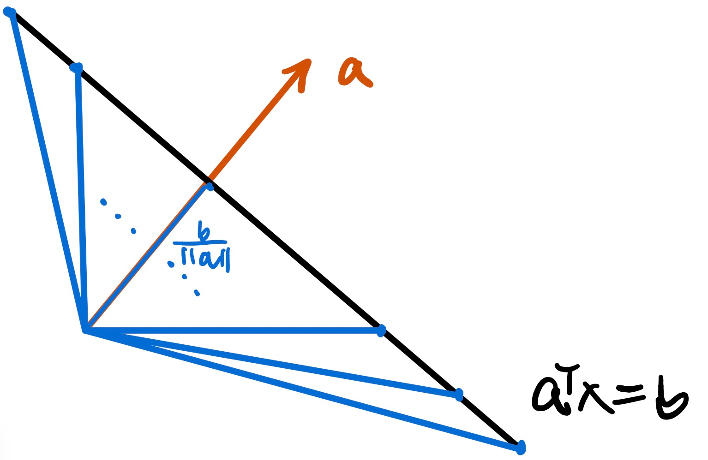</a></li></ul>

Closed halfspace:

<math xmlns="http://www.w3.org/1998/Math/MathML" display="block"><semantics><mrow><msub><mi mathvariant="script">H</mi><mo>−</mo></msub><mo>:</mo><mo>=</mo><mo stretchy="false">{</mo><mi mathvariant="bold-italic">x</mi><mo>∈</mo><msup><mi mathvariant="double-struck">R</mi><mi>n</mi></msup><mo>:</mo><msup><mi mathvariant="bold-italic">a</mi><mi mathvariant="normal">⊤</mi></msup><mi mathvariant="bold-italic">x</mi><mo>≤</mo><mi>b</mi><mo stretchy="false">}</mo><mo separator="true">,</mo><mspace width="2em"/><msub><mi mathvariant="script">H</mi><mo>+</mo></msub><mo>:</mo><mo>=</mo><mo stretchy="false">{</mo><mi mathvariant="bold-italic">x</mi><mo>∈</mo><msup><mi mathvariant="double-struck">R</mi><mi>n</mi></msup><mo>:</mo><msup><mi mathvariant="bold-italic">a</mi><mi mathvariant="normal">⊤</mi></msup><mi mathvariant="bold-italic">x</mi><mo>≥</mo><mi>b</mi><mo stretchy="false">}</mo><mi mathvariant="normal">.</mi></mrow><annotation encoding="application/x-tex">
\mathcal{H}_- := \{\bm{x} \in \mathbb{R}^n: \bm{a}^\top \bm{x} \leq b\},\qquad \mathcal{H}_+ := \{\bm{x} \in \mathbb{R}^n: \bm{a}^\top \bm{x} \geq b\}.
</annotation></semantics></math>H−​:={x∈Rn:a⊤x≤b},H+​:={x∈Rn:a⊤x≥b}.
<ul><li>
Closed halfspace 是一个凸集.
</li></ul></section>
<section class="latex-block latex-definition" id="latex-defblock-1-2-3" aria-label="Definition 1.2.3">
Definition 1.2.3　Norm ball, ellipsoid

任意范数 <math xmlns="http://www.w3.org/1998/Math/MathML"><semantics><mrow><mstyle scriptlevel="0" displaystyle="true"><mi mathvariant="normal">∥</mi><mo>⋅</mo><mi mathvariant="normal">∥</mi></mstyle></mrow><annotation encoding="application/x-tex">\displaystyle \|\cdot\|</annotation></semantics></math>∥⋅∥ 定义的以 <math xmlns="http://www.w3.org/1998/Math/MathML"><semantics><mrow><mstyle scriptlevel="0" displaystyle="true"><mi mathvariant="bold-italic">c</mi><mo>∈</mo><msup><mi mathvariant="double-struck">R</mi><mi>n</mi></msup></mstyle></mrow><annotation encoding="application/x-tex">\displaystyle \bm{c} \in \mathbb{R}^n</annotation></semantics></math>c∈Rn 为中心、<math xmlns="http://www.w3.org/1998/Math/MathML"><semantics><mrow><mstyle scriptlevel="0" displaystyle="true"><mi>r</mi><mo>&gt;</mo><mn>0</mn></mstyle></mrow><annotation encoding="application/x-tex">\displaystyle r &gt; 0</annotation></semantics></math>r&gt;0 为半径的 norm ball 是 convex set:

<math xmlns="http://www.w3.org/1998/Math/MathML" display="block"><semantics><mrow><mi mathvariant="script">B</mi><mo stretchy="false">(</mo><mi mathvariant="bold-italic">c</mi><mo separator="true">,</mo><mi>r</mi><mo stretchy="false">)</mo><mo>:</mo><mo>=</mo><mo stretchy="false">{</mo><mi mathvariant="bold-italic">x</mi><mo>∈</mo><msup><mi mathvariant="double-struck">R</mi><mi>n</mi></msup><mo>:</mo><mi mathvariant="normal">∥</mi><mi mathvariant="bold-italic">x</mi><mo>−</mo><mi mathvariant="bold-italic">c</mi><mi mathvariant="normal">∥</mi><mo>≤</mo><mi>r</mi><mo stretchy="false">}</mo><mi mathvariant="normal">.</mi></mrow><annotation encoding="application/x-tex">
\mathcal{B}(\bm{c}, r) := \{\bm{x} \in \mathbb{R}^n: \|\bm{x}-\bm{c}\| \leq r\}.
</annotation></semantics></math>B(c,r):={x∈Rn:∥x−c∥≤r}.
<ul><li>
注意: <math xmlns="http://www.w3.org/1998/Math/MathML"><semantics><mrow><mstyle scriptlevel="0" displaystyle="true"><mn>0</mn><mo>&lt;</mo><mi>p</mi><mo>&lt;</mo><mn>1</mn></mstyle></mrow><annotation encoding="application/x-tex">\displaystyle 0&lt;p&lt;1</annotation></semantics></math>0&lt;p&lt;1 时 对应的 <math xmlns="http://www.w3.org/1998/Math/MathML"><semantics><mrow><mstyle scriptlevel="0" displaystyle="true"><msub><mi mathvariant="normal">ℓ</mi><mi>p</mi></msub></mstyle></mrow><annotation encoding="application/x-tex">\displaystyle \ell_p</annotation></semantics></math>ℓp​-norm 是 quasi-norm, 其不满足严格 norm 要求的三角不等式. 此时对应的 <math xmlns="http://www.w3.org/1998/Math/MathML"><semantics><mrow><mstyle scriptlevel="0" displaystyle="true"><msub><mi mathvariant="normal">ℓ</mi><mi>p</mi></msub></mstyle></mrow><annotation encoding="application/x-tex">\displaystyle \ell_p</annotation></semantics></math>ℓp​-ball 一般不是凸集.
</li></ul>

Ellipsoid 是一个凸集, 给定 <math xmlns="http://www.w3.org/1998/Math/MathML"><semantics><mrow><mstyle scriptlevel="0" displaystyle="true"><mi mathvariant="bold-italic">P</mi><mo>∈</mo><msubsup><mi mathvariant="double-struck">S</mi><mrow><mo>+</mo><mo>+</mo></mrow><mi>n</mi></msubsup></mstyle></mrow><annotation encoding="application/x-tex">\displaystyle \bm{P} \in \mathbb{S}_{++}^n</annotation></semantics></math>P∈S++n​ 和 <math xmlns="http://www.w3.org/1998/Math/MathML"><semantics><mrow><mstyle scriptlevel="0" displaystyle="true"><mi mathvariant="bold-italic">c</mi><mo>∈</mo><msup><mi mathvariant="double-struck">R</mi><mi>n</mi></msup></mstyle></mrow><annotation encoding="application/x-tex">\displaystyle \bm{c} \in \mathbb{R}^n</annotation></semantics></math>c∈Rn，定义椭球的标准形式:

<math xmlns="http://www.w3.org/1998/Math/MathML" display="block"><semantics><mrow><mi mathvariant="script">E</mi><mo stretchy="false">(</mo><mi mathvariant="bold-italic">c</mi><mo separator="true">,</mo><mi mathvariant="bold-italic">P</mi><mo stretchy="false">)</mo><mo>:</mo><mo>=</mo><mo stretchy="false">{</mo><mi mathvariant="bold-italic">x</mi><mo>∈</mo><msup><mi mathvariant="double-struck">R</mi><mi>n</mi></msup><mo>:</mo><mo stretchy="false">(</mo><mi mathvariant="bold-italic">x</mi><mo>−</mo><mi mathvariant="bold-italic">c</mi><msup><mo stretchy="false">)</mo><mi mathvariant="normal">⊤</mi></msup><msup><mi mathvariant="bold-italic">P</mi><mrow><mo>−</mo><mn>1</mn></mrow></msup><mo stretchy="false">(</mo><mi mathvariant="bold-italic">x</mi><mo>−</mo><mi mathvariant="bold-italic">c</mi><mo stretchy="false">)</mo><mo>≤</mo><mn>1</mn><mo stretchy="false">}</mo><mo>=</mo><mo stretchy="false">{</mo><mi mathvariant="bold-italic">x</mi><mo>∈</mo><msup><mi mathvariant="double-struck">R</mi><mi>n</mi></msup><mo>:</mo><mi mathvariant="normal">∥</mi><msup><mi mathvariant="bold-italic">P</mi><mrow><mo>−</mo><mn>1</mn><mi mathvariant="normal">/</mi><mn>2</mn></mrow></msup><mo stretchy="false">(</mo><mi mathvariant="bold-italic">x</mi><mo>−</mo><mi mathvariant="bold-italic">c</mi><mo stretchy="false">)</mo><msub><mi mathvariant="normal">∥</mi><mn>2</mn></msub><mo>≤</mo><mn>1</mn><mo stretchy="false">}</mo><mi mathvariant="normal">.</mi></mrow><annotation encoding="application/x-tex">
\mathcal{E}(\bm{c}, \bm{P}) := \{\bm{x} \in \mathbb{R}^n: (\bm{x}-\bm{c})^\top \bm{P}^{-1} (\bm{x}-\bm{c}) \leq 1\} = \{\bm{x} \in \mathbb{R}^n: \|\bm{P}^{-1/2}(\bm{x}-\bm{c})\|_2 \leq 1\}.
</annotation></semantics></math>E(c,P):={x∈Rn:(x−c)⊤P−1(x−c)≤1}={x∈Rn:∥P−1/2(x−c)∥2​≤1}.
<ul><li>
或等价地, 以 affine 形式定义为 <math xmlns="http://www.w3.org/1998/Math/MathML"><semantics><mrow><mstyle scriptlevel="0" displaystyle="true"><mi mathvariant="script">E</mi><mo>=</mo><mo stretchy="false">{</mo><mi mathvariant="bold-italic">c</mi><mo>+</mo><mi mathvariant="bold-italic">A</mi><mi mathvariant="bold-italic">u</mi><mo>:</mo><mi mathvariant="normal">∥</mi><mi mathvariant="bold-italic">u</mi><msub><mi mathvariant="normal">∥</mi><mn>2</mn></msub><mo>≤</mo><mn>1</mn><mo stretchy="false">}</mo></mstyle></mrow><annotation encoding="application/x-tex">\displaystyle \mathcal{E} = \{\bm{c} + \bm{A}\bm{u}: \|\bm{u}\|_2 \leq 1\}</annotation></semantics></math>E={c+Au:∥u∥2​≤1}, 其中 <math xmlns="http://www.w3.org/1998/Math/MathML"><semantics><mrow><mstyle scriptlevel="0" displaystyle="true"><mi mathvariant="bold-italic">A</mi><mo>∈</mo><msup><mi mathvariant="double-struck">R</mi><mrow><mi>n</mi><mo>×</mo><mi>n</mi></mrow></msup></mstyle></mrow><annotation encoding="application/x-tex">\displaystyle \bm{A} \in \mathbb{R}^{n \times n}</annotation></semantics></math>A∈Rn×n 非奇异.
</li></ul></section>
<section class="latex-block latex-definition" id="latex-defblock-1-2-4" aria-label="Definition 1.2.4">
Definition 1.2.4　Polyhedron, polytope

有限个 closed halfspace 和 hyperplane 的交集是一个 polyhedron:

<math xmlns="http://www.w3.org/1998/Math/MathML" display="block"><semantics><mrow><mi mathvariant="script">P</mi><mo>:</mo><mo>=</mo><mo stretchy="false">{</mo><mi mathvariant="bold-italic">x</mi><mo>∈</mo><msup><mi mathvariant="double-struck">R</mi><mi>n</mi></msup><mo>:</mo><mi mathvariant="bold-italic">A</mi><mi mathvariant="bold-italic">x</mi><mo>≤</mo><mi mathvariant="bold-italic">b</mi><mo separator="true">,</mo><mi mathvariant="bold-italic">C</mi><mi mathvariant="bold-italic">x</mi><mo>=</mo><mi mathvariant="bold-italic">d</mi><mo stretchy="false">}</mo><mo separator="true">,</mo></mrow><annotation encoding="application/x-tex">
\mathcal{P} := \{\bm{x} \in \mathbb{R}^n: \bm{A}\bm{x} \leq \bm{b}, \bm{C}\bm{x} = \bm{d}\},
</annotation></semantics></math>P:={x∈Rn:Ax≤b,Cx=d},
<ul><li>
Polyhedron 和 polytope 都是凸集.
</li><li>
二者的说法有时会混用, 但严格说: polyhedron 可以是无界的, 而 polytope 是有界的.
</li></ul></section>
<section class="latex-block latex-definition" id="latex-defblock-1-2-5" aria-label="Definition 1.2.5">
Definition 1.2.5　Simplex

若 <math xmlns="http://www.w3.org/1998/Math/MathML"><semantics><mrow><mstyle scriptlevel="0" displaystyle="true"><msub><mi mathvariant="bold-italic">v</mi><mn>0</mn></msub><mo separator="true">,</mo><mo>…</mo><mo separator="true">,</mo><msub><mi mathvariant="bold-italic">v</mi><mi>k</mi></msub><mo>∈</mo><msup><mi mathvariant="double-struck">R</mi><mi>n</mi></msup></mstyle></mrow><annotation encoding="application/x-tex">\displaystyle \bm{v}_0, \ldots, \bm{v}_k \in \mathbb{R}^n</annotation></semantics></math>v0​,…,vk​∈Rn 是 affinely independent 的点 (即 <math xmlns="http://www.w3.org/1998/Math/MathML"><semantics><mrow><mstyle scriptlevel="0" displaystyle="true"><msub><mi mathvariant="bold-italic">v</mi><mn>1</mn></msub><mo>−</mo><msub><mi mathvariant="bold-italic">v</mi><mn>0</mn></msub><mo separator="true">,</mo><mo>…</mo><mo separator="true">,</mo><msub><mi mathvariant="bold-italic">v</mi><mi>k</mi></msub><mo>−</mo><msub><mi mathvariant="bold-italic">v</mi><mn>0</mn></msub></mstyle></mrow><annotation encoding="application/x-tex">\displaystyle \bm{v}_1-\bm{v}_0, \ldots, \bm{v}_k-\bm{v}_0</annotation></semantics></math>v1​−v0​,…,vk​−v0​ 线性无关), 则称

<math xmlns="http://www.w3.org/1998/Math/MathML" display="block"><semantics><mrow><mi mathvariant="script">S</mi><mo>:</mo><mo>=</mo><mtext>conv</mtext><mo stretchy="false">{</mo><msub><mi mathvariant="bold-italic">v</mi><mn>0</mn></msub><mo separator="true">,</mo><mo>…</mo><mo separator="true">,</mo><msub><mi mathvariant="bold-italic">v</mi><mi>k</mi></msub><mo stretchy="false">}</mo></mrow><annotation encoding="application/x-tex">
\mathcal{S} := \text{conv}\{\bm{v}_0, \ldots, \bm{v}_k\} 
</annotation></semantics></math>S:=conv{v0​,…,vk​}

是一个 <math xmlns="http://www.w3.org/1998/Math/MathML"><semantics><mrow><mstyle scriptlevel="0" displaystyle="true"><mi>k</mi></mstyle></mrow><annotation encoding="application/x-tex">\displaystyle k</annotation></semantics></math>k-simplex.

<ul><li>
Affine independent 可以理解为, 给定一个参考点 <math xmlns="http://www.w3.org/1998/Math/MathML"><semantics><mrow><mstyle scriptlevel="0" displaystyle="true"><msub><mi mathvariant="bold-italic">v</mi><mn>0</mn></msub></mstyle></mrow><annotation encoding="application/x-tex">\displaystyle \bm{v}_0</annotation></semantics></math>v0​，与其余点构成的向量是线性无关的. 因此这与其所处的空间维度是有密切联系的. 例如在二维平面中, 3 个点不共线, 给定一个参考点, 其余两个点可以 span 整个平面; 然而如果有四个点, 则必定会有一个点是冗余的. <strong>在 <math xmlns="http://www.w3.org/1998/Math/MathML"><semantics><mrow><mstyle scriptlevel="0" displaystyle="true"><mi>n</mi></mstyle></mrow><annotation encoding="application/x-tex">\displaystyle n</annotation></semantics></math>n 维空间中, 最多只能有 <math xmlns="http://www.w3.org/1998/Math/MathML"><semantics><mrow><mstyle scriptlevel="0" displaystyle="true"><mi>n</mi><mo>+</mo><mn>1</mn></mstyle></mrow><annotation encoding="application/x-tex">\displaystyle n+1</annotation></semantics></math>n+1 个 affinely independent 的点.</strong> (这些点 span 出了一个 <math xmlns="http://www.w3.org/1998/Math/MathML"><semantics><mrow><mstyle scriptlevel="0" displaystyle="true"><mi>n</mi></mstyle></mrow><annotation encoding="application/x-tex">\displaystyle n</annotation></semantics></math>n-dimensional affine space)
</li><li>
Simplex 是一种特殊的 polytope. 其相当于在对应 affine space 中最小 polytope. 其具有<strong>唯一表出</strong>的性质:

<math xmlns="http://www.w3.org/1998/Math/MathML" display="block"><semantics><mrow><mi mathvariant="bold-italic">x</mi><mo>∈</mo><mi mathvariant="script">S</mi><mtext>  </mtext><mo>⟹</mo><mtext>  </mtext><mi mathvariant="bold-italic">x</mi><mo>=</mo><munderover><mo>∑</mo><mrow><mi>i</mi><mo>=</mo><mn>0</mn></mrow><mi>k</mi></munderover><msub><mi>θ</mi><mi>i</mi></msub><msub><mi mathvariant="bold-italic">v</mi><mi>i</mi></msub><mo separator="true">,</mo><mtext>  exists unique </mtext><msub><mi>θ</mi><mi>i</mi></msub><mo>≥</mo><mn>0</mn><mo separator="true">,</mo><munderover><mo>∑</mo><mrow><mi>i</mi><mo>=</mo><mn>0</mn></mrow><mi>k</mi></munderover><msub><mi>θ</mi><mi>i</mi></msub><mo>=</mo><mn>1.</mn></mrow><annotation encoding="application/x-tex">
\bm{x} \in \mathcal{S} \implies \bm{x} = \sum_{i=0}^k \theta_i \bm{v}_i,~ \text{ exists unique } \theta_i \geq 0, \sum_{i=0}^k \theta_i = 1.
</annotation></semantics></math>x∈S⟹x=i=0∑k​θi​vi​,  exists unique θi​≥0,i=0∑k​θi​=1.

也鉴于这种性质, 可以考虑如下 <math xmlns="http://www.w3.org/1998/Math/MathML"><semantics><mrow><mstyle scriptlevel="0" displaystyle="true"><mi>d</mi></mstyle></mrow><annotation encoding="application/x-tex">\displaystyle d</annotation></semantics></math>d 维 simplex 的标准形式:

<math xmlns="http://www.w3.org/1998/Math/MathML" display="block"><semantics><mrow><msub><mi mathvariant="normal">Δ</mi><mi>d</mi></msub><mo>:</mo><mo>=</mo><mrow><mo fence="true">{</mo><mi mathvariant="bold-italic">λ</mi><mo>∈</mo><msup><mi mathvariant="double-struck">R</mi><mrow><mi>d</mi><mo>+</mo><mn>1</mn></mrow></msup><mo>:</mo><munderover><mo>∑</mo><mrow><mi>i</mi><mo>=</mo><mn>0</mn></mrow><mi>d</mi></munderover><msub><mi>λ</mi><mi>i</mi></msub><mo>=</mo><mn>1</mn><mo separator="true">,</mo><mtext> </mtext><msub><mi>λ</mi><mi>i</mi></msub><mo>≥</mo><mn>0</mn><mo separator="true">,</mo><mtext> </mtext><mi>i</mi><mo>=</mo><mn>0</mn><mo separator="true">,</mo><mo>…</mo><mo separator="true">,</mo><mi>d</mi><mo fence="true">}</mo></mrow><mi mathvariant="normal">.</mi></mrow><annotation encoding="application/x-tex">
\Delta_d := \left\{\bm{\lambda} \in \mathbb{R}^{d+1}: \sum_{i=0}^d \lambda_i = 1,~ \lambda_i \geq 0,~ i=0,\ldots,d\right\}.
</annotation></semantics></math>Δd​:={λ∈Rd+1:i=0∑d​λi​=1, λi​≥0, i=0,…,d}.

其对应的 vertices 为 <math xmlns="http://www.w3.org/1998/Math/MathML"><semantics><mrow><mstyle scriptlevel="0" displaystyle="true"><msub><mi mathvariant="bold-italic">e</mi><mn>0</mn></msub><mo separator="true">,</mo><mo>…</mo><mo separator="true">,</mo><msub><mi mathvariant="bold-italic">e</mi><mi>d</mi></msub></mstyle></mrow><annotation encoding="application/x-tex">\displaystyle \bm{e}_0, \ldots, \bm{e}_d</annotation></semantics></math>e0​,…,ed​，其中 <math xmlns="http://www.w3.org/1998/Math/MathML"><semantics><mrow><mstyle scriptlevel="0" displaystyle="true"><msub><mi mathvariant="bold-italic">e</mi><mi>i</mi></msub></mstyle></mrow><annotation encoding="application/x-tex">\displaystyle \bm{e}_i</annotation></semantics></math>ei​ 是 <math xmlns="http://www.w3.org/1998/Math/MathML"><semantics><mrow><mstyle scriptlevel="0" displaystyle="true"><mo stretchy="false">(</mo><mi>d</mi><mo>+</mo><mn>1</mn><mo stretchy="false">)</mo></mstyle></mrow><annotation encoding="application/x-tex">\displaystyle (d+1)</annotation></semantics></math>(d+1) 维单位向量. 因此任意 <math xmlns="http://www.w3.org/1998/Math/MathML"><semantics><mrow><mstyle scriptlevel="0" displaystyle="true"><mi>d</mi></mstyle></mrow><annotation encoding="application/x-tex">\displaystyle d</annotation></semantics></math>d-dimensional simplex <math xmlns="http://www.w3.org/1998/Math/MathML"><semantics><mrow><mstyle scriptlevel="0" displaystyle="true"><mi mathvariant="script">S</mi></mstyle></mrow><annotation encoding="application/x-tex">\displaystyle \mathcal{S}</annotation></semantics></math>S 都存在一个 affine map <math xmlns="http://www.w3.org/1998/Math/MathML"><semantics><mrow><mstyle scriptlevel="0" displaystyle="true"><msub><mi mathvariant="normal">Δ</mi><mi>d</mi></msub><mo>→</mo><mi mathvariant="script">S</mi></mstyle></mrow><annotation encoding="application/x-tex">\displaystyle \Delta_d \to \mathcal{S}</annotation></semantics></math>Δd​→S，因此所有 <math xmlns="http://www.w3.org/1998/Math/MathML"><semantics><mrow><mstyle scriptlevel="0" displaystyle="true"><mi>d</mi></mstyle></mrow><annotation encoding="application/x-tex">\displaystyle d</annotation></semantics></math>d-dimensional simplex 都是 affine equivalent 的. 后面可以看到, 这种唯一表出的性质就可以让我们用来定义坐标系 (barycentric coordinates).
</li></ul></section>
<section class="latex-block latex-definition" id="latex-defblock-1-2-6" aria-label="Definition 1.2.6">
Definition 1.2.6　Convex cone

一个集合 <math xmlns="http://www.w3.org/1998/Math/MathML"><semantics><mrow><mstyle scriptlevel="0" displaystyle="true"><mi mathvariant="script">K</mi></mstyle></mrow><annotation encoding="application/x-tex">\displaystyle \mathcal{K}</annotation></semantics></math>K 若满足: <math xmlns="http://www.w3.org/1998/Math/MathML"><semantics><mrow><mstyle scriptlevel="0" displaystyle="true"><mi mathvariant="bold-italic">x</mi><mo>∈</mo><mi mathvariant="script">K</mi><mo separator="true">,</mo><mi>θ</mi><mo>≥</mo><mn>0</mn><mtext>  </mtext><mo>⟹</mo><mtext>  </mtext><mi>θ</mi><mi mathvariant="bold-italic">x</mi><mo>∈</mo><mi mathvariant="script">K</mi></mstyle></mrow><annotation encoding="application/x-tex">\displaystyle \bm{x} \in \mathcal{K}, \theta \geq 0 \implies \theta \bm{x} \in \mathcal{K}</annotation></semantics></math>x∈K,θ≥0⟹θx∈K, 则称 <math xmlns="http://www.w3.org/1998/Math/MathML"><semantics><mrow><mstyle scriptlevel="0" displaystyle="true"><mi mathvariant="script">K</mi></mstyle></mrow><annotation encoding="application/x-tex">\displaystyle \mathcal{K}</annotation></semantics></math>K 是一个 cone. 若 <math xmlns="http://www.w3.org/1998/Math/MathML"><semantics><mrow><mstyle scriptlevel="0" displaystyle="true"><mi mathvariant="script">K</mi></mstyle></mrow><annotation encoding="application/x-tex">\displaystyle \mathcal{K}</annotation></semantics></math>K 还是一个 convex set, 则称 <math xmlns="http://www.w3.org/1998/Math/MathML"><semantics><mrow><mstyle scriptlevel="0" displaystyle="true"><mi mathvariant="script">K</mi></mstyle></mrow><annotation encoding="application/x-tex">\displaystyle \mathcal{K}</annotation></semantics></math>K 是一个 convex cone. Convex cone 满足:

<math xmlns="http://www.w3.org/1998/Math/MathML" display="block"><semantics><mrow><msub><mi mathvariant="bold-italic">x</mi><mn>1</mn></msub><mo separator="true">,</mo><msub><mi mathvariant="bold-italic">x</mi><mn>2</mn></msub><mo>∈</mo><mi mathvariant="script">K</mi><mo separator="true">,</mo><mtext> </mtext><msub><mi>θ</mi><mn>1</mn></msub><mo separator="true">,</mo><msub><mi>θ</mi><mn>2</mn></msub><mo>≥</mo><mn>0</mn><mtext>  </mtext><mo>⟹</mo><mtext>  </mtext><msub><mi>θ</mi><mn>1</mn></msub><msub><mi mathvariant="bold-italic">x</mi><mn>1</mn></msub><mo>+</mo><msub><mi>θ</mi><mn>2</mn></msub><msub><mi mathvariant="bold-italic">x</mi><mn>2</mn></msub><mo>∈</mo><mi mathvariant="script">K</mi><mi mathvariant="normal">.</mi></mrow><annotation encoding="application/x-tex">
\bm{x}_1, \bm{x}_2 \in \mathcal{K},~ \theta_1, \theta_2 \geq 0 \implies \theta_1 \bm{x}_1 + \theta_2 \bm{x}_2 \in \mathcal{K}.
</annotation></semantics></math>x1​,x2​∈K, θ1​,θ2​≥0⟹θ1​x1​+θ2​x2​∈K.</section>
<ul><li>
考虑平面直角坐标系中的 <math xmlns="http://www.w3.org/1998/Math/MathML"><semantics><mrow><mstyle scriptlevel="0" displaystyle="true"><mi>x</mi></mstyle></mrow><annotation encoding="application/x-tex">\displaystyle x</annotation></semantics></math>x,<math xmlns="http://www.w3.org/1998/Math/MathML"><semantics><mrow><mstyle scriptlevel="0" displaystyle="true"><mi>y</mi></mstyle></mrow><annotation encoding="application/x-tex">\displaystyle y</annotation></semantics></math>y 两个正半轴 <math xmlns="http://www.w3.org/1998/Math/MathML"><semantics><mrow><mstyle scriptlevel="0" displaystyle="true"><mo stretchy="false">{</mo><mo stretchy="false">(</mo><mi>t</mi><mo separator="true">,</mo><mn>0</mn><mo stretchy="false">)</mo><mo separator="true">,</mo><mi>t</mi><mo>≥</mo><mn>0</mn><mo stretchy="false">}</mo><mo>∪</mo><mo stretchy="false">{</mo><mo stretchy="false">(</mo><mn>0</mn><mo separator="true">,</mo><mi>t</mi><mo stretchy="false">)</mo><mo separator="true">,</mo><mi>t</mi><mo>≥</mo><mn>0</mn><mo stretchy="false">}</mo></mstyle></mrow><annotation encoding="application/x-tex">\displaystyle \{(t,0), t \geq 0\} \cup \{(0,t), t \geq 0\}</annotation></semantics></math>{(t,0),t≥0}∪{(0,t),t≥0}，则其是一个 cone, 但不是 convex cone. 若考虑整个象限 <math xmlns="http://www.w3.org/1998/Math/MathML"><semantics><mrow><mstyle scriptlevel="0" displaystyle="true"><msubsup><mi mathvariant="double-struck">R</mi><mo>+</mo><mi>n</mi></msubsup><mo>:</mo><mo>=</mo><mo stretchy="false">{</mo><mi mathvariant="bold-italic">x</mi><mo>∈</mo><msup><mi mathvariant="double-struck">R</mi><mi>n</mi></msup><mo>:</mo><msub><mi>x</mi><mi>i</mi></msub><mo>≥</mo><mn>0</mn><mo separator="true">,</mo><mi>i</mi><mo>=</mo><mn>1</mn><mo separator="true">,</mo><mo>…</mo><mo separator="true">,</mo><mi>n</mi><mo stretchy="false">}</mo></mstyle></mrow><annotation encoding="application/x-tex">\displaystyle \mathbb{R}_+^n := \{\bm{x} \in \mathbb{R}^n: x_i \geq 0, i=1,\ldots,n\}</annotation></semantics></math>R+n​:={x∈Rn:xi​≥0,i=1,…,n}，则其是一个 convex cone.
</li></ul>
<section class="latex-block latex-definition" id="latex-defblock-1-2-7" aria-label="Definition 1.2.7">
Definition 1.2.7　Second-order cone
<ul><li>
Second-order cone (SOC) 是一个 convex cone, 定义为:

<math xmlns="http://www.w3.org/1998/Math/MathML" display="block"><semantics><mrow><msup><mi mathvariant="script">Q</mi><mrow><mi>n</mi><mo>+</mo><mn>1</mn></mrow></msup><mo>:</mo><mo>=</mo><mo stretchy="false">{</mo><mo stretchy="false">(</mo><mi>t</mi><mo separator="true">,</mo><mi mathvariant="bold-italic">x</mi><mo stretchy="false">)</mo><mo>∈</mo><msup><mi mathvariant="double-struck">R</mi><mrow><mi>n</mi><mo>+</mo><mn>1</mn></mrow></msup><mo>:</mo><mi>t</mi><mo>≥</mo><mi mathvariant="normal">∥</mi><mi mathvariant="bold-italic">x</mi><msub><mi mathvariant="normal">∥</mi><mn>2</mn></msub><mo stretchy="false">}</mo><mi mathvariant="normal">.</mi></mrow><annotation encoding="application/x-tex">
\mathcal{Q}^{n+1} := \{(t, \bm{x}) \in \mathbb{R}^{n+1}: t \geq \|\bm{x}\|_2\}.
</annotation></semantics></math>Qn+1:={(t,x)∈Rn+1:t≥∥x∥2​}.
<ul><li>
SOC 是一个重要的 convex cone，它在优化问题中经常出现. 考虑 nonlinear 约束:

<math xmlns="http://www.w3.org/1998/Math/MathML" display="block"><semantics><mrow><mi mathvariant="normal">∥</mi><mi mathvariant="bold-italic">A</mi><mi mathvariant="bold-italic">x</mi><mo>+</mo><mi mathvariant="bold-italic">b</mi><msub><mi mathvariant="normal">∥</mi><mn>2</mn></msub><mo>≤</mo><msup><mi mathvariant="bold-italic">c</mi><mi mathvariant="normal">⊤</mi></msup><mi mathvariant="bold-italic">x</mi><mo>+</mo><mi>d</mi><mo separator="true">,</mo></mrow><annotation encoding="application/x-tex">
\|\bm{A}\bm{x} + \bm{b}\|_2 \leq \bm{c}^\top \bm{x} + d,
</annotation></semantics></math>∥Ax+b∥2​≤c⊤x+d,

其中 <math xmlns="http://www.w3.org/1998/Math/MathML"><semantics><mrow><mstyle scriptlevel="0" displaystyle="true"><mi mathvariant="bold-italic">A</mi><mo>∈</mo><msup><mi mathvariant="double-struck">R</mi><mrow><mi>m</mi><mo>×</mo><mi>n</mi></mrow></msup></mstyle></mrow><annotation encoding="application/x-tex">\displaystyle \bm{A} \in \mathbb{R}^{m \times n}</annotation></semantics></math>A∈Rm×n, <math xmlns="http://www.w3.org/1998/Math/MathML"><semantics><mrow><mstyle scriptlevel="0" displaystyle="true"><mi mathvariant="bold-italic">b</mi><mo>∈</mo><msup><mi mathvariant="double-struck">R</mi><mi>m</mi></msup></mstyle></mrow><annotation encoding="application/x-tex">\displaystyle \bm{b} \in \mathbb{R}^m</annotation></semantics></math>b∈Rm, <math xmlns="http://www.w3.org/1998/Math/MathML"><semantics><mrow><mstyle scriptlevel="0" displaystyle="true"><mi mathvariant="bold-italic">c</mi><mo>∈</mo><msup><mi mathvariant="double-struck">R</mi><mi>n</mi></msup></mstyle></mrow><annotation encoding="application/x-tex">\displaystyle \bm{c} \in \mathbb{R}^n</annotation></semantics></math>c∈Rn, <math xmlns="http://www.w3.org/1998/Math/MathML"><semantics><mrow><mstyle scriptlevel="0" displaystyle="true"><mi>d</mi><mo>∈</mo><mi mathvariant="double-struck">R</mi></mstyle></mrow><annotation encoding="application/x-tex">\displaystyle d \in \mathbb{R}</annotation></semantics></math>d∈R. 这就是一个 SOC 约束.
</li></ul></li></ul></section>
<section class="latex-block latex-definition" id="latex-defblock-1-2-8" aria-label="Definition 1.2.8">
Definition 1.2.8　Positive semidefinite cone
<ul><li>
Positive semidefinite cone (PSD cone) 是一个 convex cone, 定义为:

<math xmlns="http://www.w3.org/1998/Math/MathML" display="block"><semantics><mrow><msubsup><mi mathvariant="double-struck">S</mi><mo>+</mo><mi>n</mi></msubsup><mo>:</mo><mo>=</mo><mo stretchy="false">{</mo><mi mathvariant="bold-italic">X</mi><mo>∈</mo><msup><mi mathvariant="double-struck">S</mi><mi>n</mi></msup><mo>:</mo><mi mathvariant="bold-italic">X</mi><mo>⪰</mo><mn>0</mn><mo stretchy="false">}</mo><mo separator="true">,</mo></mrow><annotation encoding="application/x-tex">
\mathbb{S}_+^n := \{\bm{X} \in \mathbb{S}^n: \bm{X} \succeq 0\},
</annotation></semantics></math>S+n​:={X∈Sn:X⪰0},

即对称半正定矩阵本身就是一个 convex cone. 一个典型的 SDP 问题即为:

<math xmlns="http://www.w3.org/1998/Math/MathML" display="block"><semantics><mrow><munder><mrow><mi>min</mi><mo>⁡</mo></mrow><mi mathvariant="bold-italic">X</mi></munder><mo stretchy="false">⟨</mo><mi mathvariant="bold-italic">C</mi><mo separator="true">,</mo><mi mathvariant="bold-italic">X</mi><mo stretchy="false">⟩</mo><mspace width="1em"/><mtext>s.t.</mtext><mspace width="1em"/><mo stretchy="false">⟨</mo><msub><mi mathvariant="bold-italic">A</mi><mi>i</mi></msub><mo separator="true">,</mo><mi mathvariant="bold-italic">X</mi><mo stretchy="false">⟩</mo><mo>=</mo><msub><mi>b</mi><mi>i</mi></msub><mo separator="true">,</mo><mtext> </mtext><mi>i</mi><mo>=</mo><mn>1</mn><mo separator="true">,</mo><mo>…</mo><mo separator="true">,</mo><mi>m</mi><mo separator="true">,</mo><mtext> </mtext><mi mathvariant="bold-italic">X</mi><mo>⪰</mo><mn>0.</mn></mrow><annotation encoding="application/x-tex">
\min_{\bm{X}} \langle \bm{C}, \bm{X} \rangle \quad \text{s.t.} \quad \langle \bm{A}_i, \bm{X} \rangle = b_i,~ i=1,\ldots,m,~ \bm{X} \succeq 0.
</annotation></semantics></math>Xmin​⟨C,X⟩s.t.⟨Ai​,X⟩=bi​, i=1,…,m, X⪰0.

其中 <math xmlns="http://www.w3.org/1998/Math/MathML"><semantics><mrow><mstyle scriptlevel="0" displaystyle="true"><mi mathvariant="bold-italic">C</mi><mo separator="true">,</mo><msub><mi mathvariant="bold-italic">A</mi><mi>i</mi></msub><mo>∈</mo><msup><mi mathvariant="double-struck">S</mi><mi>n</mi></msup></mstyle></mrow><annotation encoding="application/x-tex">\displaystyle \bm{C}, \bm{A}_i \in \mathbb{S}^n</annotation></semantics></math>C,Ai​∈Sn, <math xmlns="http://www.w3.org/1998/Math/MathML"><semantics><mrow><mstyle scriptlevel="0" displaystyle="true"><mi>i</mi><mo>=</mo><mn>1</mn><mo separator="true">,</mo><mo>…</mo><mo separator="true">,</mo><mi>m</mi></mstyle></mrow><annotation encoding="application/x-tex">\displaystyle i=1,\ldots,m</annotation></semantics></math>i=1,…,m, <math xmlns="http://www.w3.org/1998/Math/MathML"><semantics><mrow><mstyle scriptlevel="0" displaystyle="true"><mi mathvariant="bold-italic">X</mi><mo>∈</mo><msup><mi mathvariant="double-struck">S</mi><mi>n</mi></msup></mstyle></mrow><annotation encoding="application/x-tex">\displaystyle \bm{X} \in \mathbb{S}^n</annotation></semantics></math>X∈Sn.
</li></ul></section>
<section class="latex-block latex-definition" id="latex-defblock-1-2-9" aria-label="Definition 1.2.9">
Definition 1.2.9　Conic optimization

总的而言, conic optimization 是一个重要的优化问题类别, 其形式为:

<math xmlns="http://www.w3.org/1998/Math/MathML" display="block"><semantics><mrow><munder><mrow><mi>min</mi><mo>⁡</mo></mrow><mi mathvariant="bold-italic">x</mi></munder><mo stretchy="false">⟨</mo><mi mathvariant="bold-italic">c</mi><mo separator="true">,</mo><mi mathvariant="bold-italic">x</mi><mo stretchy="false">⟩</mo><mspace width="1em"/><mtext>s.t.</mtext><mspace width="1em"/><mi mathvariant="bold-italic">A</mi><mi mathvariant="bold-italic">x</mi><mo>=</mo><mi mathvariant="bold-italic">b</mi><mo separator="true">,</mo><mtext> </mtext><mi mathvariant="bold-italic">x</mi><mo>∈</mo><mi mathvariant="script">K</mi><mo separator="true">,</mo></mrow><annotation encoding="application/x-tex">
\min_{\bm{x}} \langle \bm{c}, \bm{x} \rangle \quad \text{s.t.} \quad \bm{A}\bm{x} = \bm{b},~ \bm{x} \in \mathcal{K},
</annotation></semantics></math>xmin​⟨c,x⟩s.t.Ax=b, x∈K,

其中 <math xmlns="http://www.w3.org/1998/Math/MathML"><semantics><mrow><mstyle scriptlevel="0" displaystyle="true"><mi mathvariant="script">K</mi></mstyle></mrow><annotation encoding="application/x-tex">\displaystyle \mathcal{K}</annotation></semantics></math>K 是一个 convex cone. 其包含了 LP, SOCP, SDP 等优化问题.
</section>

<strong>Cone 是一种广义的非负.</strong> simplex 主要讨论的是一种位置关系, 而 cone 主要讨论的是一种方向关系. 对应的, simplex 会关心 extreme points, 而 cone 会关心 extreme rays.

#### 1.2.3. 保凸运算
<section class="latex-block latex-proposition" id="latex-propositionblock-1-2-2" aria-label="Proposition 1.2.2">
Proposition 1.2.2　保凸运算

实践中往往不会通过定义来验证给定复杂集合的凸性, 而是通过一些基本凸集出发, 通过一些保凸运算来构造新的凸集. 给定指标集合 <math xmlns="http://www.w3.org/1998/Math/MathML"><semantics><mrow><mstyle scriptlevel="0" displaystyle="true"><mi mathvariant="script">I</mi></mstyle></mrow><annotation encoding="application/x-tex">\displaystyle \mathcal{I}</annotation></semantics></math>I，任意 <math xmlns="http://www.w3.org/1998/Math/MathML"><semantics><mrow><mstyle scriptlevel="0" displaystyle="true"><mi mathvariant="script">C</mi><mo separator="true">,</mo><msub><mi mathvariant="script">C</mi><mi>i</mi></msub><mo>⊆</mo><msup><mi mathvariant="double-struck">R</mi><mi>n</mi></msup></mstyle></mrow><annotation encoding="application/x-tex">\displaystyle \mathcal{C}, \mathcal{C}_i \subseteq \mathbb{R}^n</annotation></semantics></math>C,Ci​⊆Rn，<math xmlns="http://www.w3.org/1998/Math/MathML"><semantics><mrow><mstyle scriptlevel="0" displaystyle="true"><mi>i</mi><mo>∈</mo><mi mathvariant="script">I</mi></mstyle></mrow><annotation encoding="application/x-tex">\displaystyle i \in \mathcal{I}</annotation></semantics></math>i∈I 是凸集, 则有以下保凸运算:

<ul><li>
任意交集: <math xmlns="http://www.w3.org/1998/Math/MathML"><semantics><mrow><mstyle scriptlevel="0" displaystyle="true"><munder><mo>⋂</mo><mrow><mi>i</mi><mo>∈</mo><mi mathvariant="script">I</mi></mrow></munder><msub><mi mathvariant="script">C</mi><mi>i</mi></msub></mstyle></mrow><annotation encoding="application/x-tex">\displaystyle \bigcap_{i \in \mathcal{I}} \mathcal{C}_i</annotation></semantics></math>i∈I⋂​Ci​ 是凸集.
</li><li>
仿射映射: 若 <math xmlns="http://www.w3.org/1998/Math/MathML"><semantics><mrow><mstyle scriptlevel="0" displaystyle="true"><mi mathvariant="bold-italic">A</mi><mo>∈</mo><msup><mi mathvariant="double-struck">R</mi><mrow><mi>m</mi><mo>×</mo><mi>n</mi></mrow></msup></mstyle></mrow><annotation encoding="application/x-tex">\displaystyle \bm{A} \in \mathbb{R}^{m \times n}</annotation></semantics></math>A∈Rm×n 且 <math xmlns="http://www.w3.org/1998/Math/MathML"><semantics><mrow><mstyle scriptlevel="0" displaystyle="true"><mi mathvariant="bold-italic">b</mi><mo>∈</mo><msup><mi mathvariant="double-struck">R</mi><mi>m</mi></msup></mstyle></mrow><annotation encoding="application/x-tex">\displaystyle \bm{b} \in \mathbb{R}^m</annotation></semantics></math>b∈Rm，则 <math xmlns="http://www.w3.org/1998/Math/MathML"><semantics><mrow><mstyle scriptlevel="0" displaystyle="true"><mi mathvariant="bold-italic">A</mi><mi mathvariant="script">C</mi><mo>+</mo><mi mathvariant="bold-italic">b</mi><mo>:</mo><mo>=</mo><mo stretchy="false">{</mo><mi mathvariant="bold-italic">A</mi><mi mathvariant="bold-italic">x</mi><mo>+</mo><mi mathvariant="bold-italic">b</mi><mo>:</mo><mi mathvariant="bold-italic">x</mi><mo>∈</mo><mi mathvariant="script">C</mi><mo stretchy="false">}</mo></mstyle></mrow><annotation encoding="application/x-tex">\displaystyle \bm{A}\mathcal{C} + \bm{b} := \{\bm{A}\bm{x} + \bm{b}: \bm{x} \in \mathcal{C}\}</annotation></semantics></math>AC+b:={Ax+b:x∈C} 是凸集.
</li><li>
仿射的 preimage: 若 <math xmlns="http://www.w3.org/1998/Math/MathML"><semantics><mrow><mstyle scriptlevel="0" displaystyle="true"><mi mathvariant="bold-italic">A</mi><mo>∈</mo><msup><mi mathvariant="double-struck">R</mi><mrow><mi>m</mi><mo>×</mo><mi>n</mi></mrow></msup></mstyle></mrow><annotation encoding="application/x-tex">\displaystyle \bm{A} \in \mathbb{R}^{m \times n}</annotation></semantics></math>A∈Rm×n 且 <math xmlns="http://www.w3.org/1998/Math/MathML"><semantics><mrow><mstyle scriptlevel="0" displaystyle="true"><mi mathvariant="bold-italic">b</mi><mo>∈</mo><msup><mi mathvariant="double-struck">R</mi><mi>m</mi></msup></mstyle></mrow><annotation encoding="application/x-tex">\displaystyle \bm{b} \in \mathbb{R}^m</annotation></semantics></math>b∈Rm，且这里 <math xmlns="http://www.w3.org/1998/Math/MathML"><semantics><mrow><mstyle scriptlevel="0" displaystyle="true"><mi mathvariant="script">C</mi><mo>⊆</mo><msup><mi mathvariant="double-struck">R</mi><mi>m</mi></msup></mstyle></mrow><annotation encoding="application/x-tex">\displaystyle \mathcal{C} \subseteq \mathbb{R}^m</annotation></semantics></math>C⊆Rm, 则 <math xmlns="http://www.w3.org/1998/Math/MathML"><semantics><mrow><mstyle scriptlevel="0" displaystyle="true"><mo stretchy="false">{</mo><mi mathvariant="bold-italic">x</mi><mo>∈</mo><msup><mi mathvariant="double-struck">R</mi><mi>n</mi></msup><mo>:</mo><mi mathvariant="bold-italic">A</mi><mi mathvariant="bold-italic">x</mi><mo>+</mo><mi mathvariant="bold-italic">b</mi><mo>∈</mo><mi mathvariant="script">C</mi><mo stretchy="false">}</mo></mstyle></mrow><annotation encoding="application/x-tex">\displaystyle \{\bm{x} \in \mathbb{R}^n: \bm{A}\bm{x} + \bm{b} \in \mathcal{C}\}</annotation></semantics></math>{x∈Rn:Ax+b∈C} 是凸集.
</li><li>
Minkowski sum: <math xmlns="http://www.w3.org/1998/Math/MathML"><semantics><mrow><mstyle scriptlevel="0" displaystyle="true"><msub><mi mathvariant="script">C</mi><mn>1</mn></msub><mo>+</mo><msub><mi mathvariant="script">C</mi><mn>2</mn></msub><mo>:</mo><mo>=</mo><mo stretchy="false">{</mo><msub><mi mathvariant="bold-italic">x</mi><mn>1</mn></msub><mo>+</mo><msub><mi mathvariant="bold-italic">x</mi><mn>2</mn></msub><mo>:</mo><msub><mi mathvariant="bold-italic">x</mi><mn>1</mn></msub><mo>∈</mo><msub><mi mathvariant="script">C</mi><mn>1</mn></msub><mo separator="true">,</mo><msub><mi mathvariant="bold-italic">x</mi><mn>2</mn></msub><mo>∈</mo><msub><mi mathvariant="script">C</mi><mn>2</mn></msub><mo stretchy="false">}</mo></mstyle></mrow><annotation encoding="application/x-tex">\displaystyle \mathcal{C}_1 + \mathcal{C}_2 := \{\bm{x}_1 + \bm{x}_2: \bm{x}_1 \in \mathcal{C}_1, \bm{x}_2 \in \mathcal{C}_2\}</annotation></semantics></math>C1​+C2​:={x1​+x2​:x1​∈C1​,x2​∈C2​} 是凸集.
</li><li>
Cartesian product: <math xmlns="http://www.w3.org/1998/Math/MathML"><semantics><mrow><mstyle scriptlevel="0" displaystyle="true"><msub><mi mathvariant="script">C</mi><mn>1</mn></msub><mo>×</mo><msub><mi mathvariant="script">C</mi><mn>2</mn></msub><mo>:</mo><mo>=</mo><mo stretchy="false">{</mo><mo stretchy="false">(</mo><msub><mi mathvariant="bold-italic">x</mi><mn>1</mn></msub><mo separator="true">,</mo><msub><mi mathvariant="bold-italic">x</mi><mn>2</mn></msub><mo stretchy="false">)</mo><mo>:</mo><msub><mi mathvariant="bold-italic">x</mi><mn>1</mn></msub><mo>∈</mo><msub><mi mathvariant="script">C</mi><mn>1</mn></msub><mo separator="true">,</mo><msub><mi mathvariant="bold-italic">x</mi><mn>2</mn></msub><mo>∈</mo><msub><mi mathvariant="script">C</mi><mn>2</mn></msub><mo stretchy="false">}</mo></mstyle></mrow><annotation encoding="application/x-tex">\displaystyle \mathcal{C}_1 \times \mathcal{C}_2 := \{(\bm{x}_1, \bm{x}_2): \bm{x}_1 \in \mathcal{C}_1, \bm{x}_2 \in \mathcal{C}_2\}</annotation></semantics></math>C1​×C2​:={(x1​,x2​):x1​∈C1​,x2​∈C2​} 是凸集.
</li><li>
Projection: 若 <math xmlns="http://www.w3.org/1998/Math/MathML"><semantics><mrow><mstyle scriptlevel="0" displaystyle="true"><mi mathvariant="script">C</mi><mo>⊆</mo><msup><mi mathvariant="double-struck">R</mi><mrow><mi>n</mi><mo>+</mo><mi>m</mi></mrow></msup></mstyle></mrow><annotation encoding="application/x-tex">\displaystyle \mathcal{C} \subseteq \mathbb{R}^{n+m}</annotation></semantics></math>C⊆Rn+m 是凸集, 则将 <math xmlns="http://www.w3.org/1998/Math/MathML"><semantics><mrow><mstyle scriptlevel="0" displaystyle="true"><mi mathvariant="script">C</mi></mstyle></mrow><annotation encoding="application/x-tex">\displaystyle \mathcal{C}</annotation></semantics></math>C 投影到 <math xmlns="http://www.w3.org/1998/Math/MathML"><semantics><mrow><mstyle scriptlevel="0" displaystyle="true"><mi mathvariant="bold-italic">x</mi></mstyle></mrow><annotation encoding="application/x-tex">\displaystyle \bm{x}</annotation></semantics></math>x 上得到 <math xmlns="http://www.w3.org/1998/Math/MathML"><semantics><mrow><mstyle scriptlevel="0" displaystyle="true"><msub><mi mathvariant="normal">Π</mi><mi>x</mi></msub><mi mathvariant="script">C</mi><mo>:</mo><mo>=</mo><mo stretchy="false">{</mo><mi mathvariant="bold-italic">x</mi><mo>∈</mo><msup><mi mathvariant="double-struck">R</mi><mi>n</mi></msup><mo>:</mo><mi mathvariant="normal">∃</mi><mi mathvariant="bold-italic">y</mi><mo>∈</mo><msup><mi mathvariant="double-struck">R</mi><mi>m</mi></msup><mo separator="true">,</mo><mtext>s.t. </mtext><mo stretchy="false">(</mo><mi mathvariant="bold-italic">x</mi><mo separator="true">,</mo><mi mathvariant="bold-italic">y</mi><mo stretchy="false">)</mo><mo>∈</mo><mi mathvariant="script">C</mi><mo stretchy="false">}</mo></mstyle></mrow><annotation encoding="application/x-tex">\displaystyle \Pi_x \mathcal{C} := \{\bm{x} \in \mathbb{R}^n:  \exists \bm{y} \in \mathbb{R}^m, \text{s.t. } (\bm{x}, \bm{y}) \in \mathcal{C}\}</annotation></semantics></math>Πx​C:={x∈Rn:∃y∈Rm,s.t. (x,y)∈C} 是凸集.
</li></ul></section>

### 1.3. Carathéodory&#x27;s theorem

在正式给出 Carathéodory 定理之前, 先明确 <strong>affine space</strong> 的概念.

<section class="latex-block latex-definition" id="latex-defblock-1-3-1" aria-label="Definition 1.3.1">
Definition 1.3.1　Affine space
<ul><li>
Affine space 可以理解为一个平移后的线性子空间, 或一个不经过(也不关心)原点的线性子空间, 即 <math xmlns="http://www.w3.org/1998/Math/MathML"><semantics><mrow><mstyle scriptlevel="0" displaystyle="true"><mi mathvariant="script">A</mi><mo>=</mo><msub><mi mathvariant="bold-italic">x</mi><mn>0</mn></msub><mo>+</mo><mi mathvariant="script">V</mi></mstyle></mrow><annotation encoding="application/x-tex">\displaystyle \mathcal{A} = \bm{x}_0 + \mathcal{V}</annotation></semantics></math>A=x0​+V, 其中 <math xmlns="http://www.w3.org/1998/Math/MathML"><semantics><mrow><mstyle scriptlevel="0" displaystyle="true"><mi mathvariant="script">V</mi></mstyle></mrow><annotation encoding="application/x-tex">\displaystyle \mathcal{V}</annotation></semantics></math>V 是一个线性子空间, <math xmlns="http://www.w3.org/1998/Math/MathML"><semantics><mrow><mstyle scriptlevel="0" displaystyle="true"><msub><mi mathvariant="bold-italic">x</mi><mn>0</mn></msub></mstyle></mrow><annotation encoding="application/x-tex">\displaystyle \bm{x}_0</annotation></semantics></math>x0​ 是一个固定点.
</li><li>
或者这么说, 本身 affine-linear 就是一组类似相对应的词汇. affine 是有截距的 linear.
</li><li>
所以比如前文在讨论 simplex 时, 说 <math xmlns="http://www.w3.org/1998/Math/MathML"><semantics><mrow><mstyle scriptlevel="0" displaystyle="true"><msub><mi mathvariant="bold-italic">v</mi><mn>0</mn></msub><mo separator="true">,</mo><mo>…</mo><mo separator="true">,</mo><msub><mi mathvariant="bold-italic">v</mi><mi>k</mi></msub></mstyle></mrow><annotation encoding="application/x-tex">\displaystyle \bm{v}_0, \ldots, \bm{v}_k</annotation></semantics></math>v0​,…,vk​ 是 affinely independent 的点, 也就是说 <math xmlns="http://www.w3.org/1998/Math/MathML"><semantics><mrow><mstyle scriptlevel="0" displaystyle="true"><mtext>aff</mtext><mo stretchy="false">(</mo><mo stretchy="false">{</mo><msub><mi mathvariant="bold-italic">v</mi><mn>0</mn></msub><mo separator="true">,</mo><mo>…</mo><mo separator="true">,</mo><msub><mi mathvariant="bold-italic">v</mi><mi>k</mi></msub><mo stretchy="false">}</mo><mo stretchy="false">)</mo></mstyle></mrow><annotation encoding="application/x-tex">\displaystyle \text{aff}(\{\bm{v}_0, \ldots, \bm{v}_k\})</annotation></semantics></math>aff({v0​,…,vk​}) 是一个 <math xmlns="http://www.w3.org/1998/Math/MathML"><semantics><mrow><mstyle scriptlevel="0" displaystyle="true"><mi>k</mi></mstyle></mrow><annotation encoding="application/x-tex">\displaystyle k</annotation></semantics></math>k-dimensional affine space.
</li><li>
在后面的认知当中, 也可以区分 affine dimension 和 ambient dimension. Ambient dimension 可以粗略的理解为就是所在客观世界的维度, 其可能是很大的. 而 affine dimension 是指真正我们关注的比如 feasible region <math xmlns="http://www.w3.org/1998/Math/MathML"><semantics><mrow><mstyle scriptlevel="0" displaystyle="true"><mi mathvariant="script">S</mi></mstyle></mrow><annotation encoding="application/x-tex">\displaystyle \mathcal{S}</annotation></semantics></math>S 所在的 affine space 的维度. 若 <math xmlns="http://www.w3.org/1998/Math/MathML"><semantics><mrow><mstyle scriptlevel="0" displaystyle="true"><mi mathvariant="script">S</mi></mstyle></mrow><annotation encoding="application/x-tex">\displaystyle \mathcal{S}</annotation></semantics></math>S 位于一个 <math xmlns="http://www.w3.org/1998/Math/MathML"><semantics><mrow><mstyle scriptlevel="0" displaystyle="true"><mi>m</mi></mstyle></mrow><annotation encoding="application/x-tex">\displaystyle m</annotation></semantics></math>m-dimensional affine space 中, 则即使整个空间是很高维的, 我们也只需要 <math xmlns="http://www.w3.org/1998/Math/MathML"><semantics><mrow><mstyle scriptlevel="0" displaystyle="true"><mi>m</mi><mo>+</mo><mn>1</mn></mstyle></mrow><annotation encoding="application/x-tex">\displaystyle m+1</annotation></semantics></math>m+1 个点就可以表示出任意一个凸组合.
</li></ul></section>
<section class="latex-block latex-theorem" id="latex-thmblock-1-3-1" aria-label="Theorem 1.3.1">
Theorem 1.3.1　Carathéodory

设 <math xmlns="http://www.w3.org/1998/Math/MathML"><semantics><mrow><mstyle scriptlevel="0" displaystyle="true"><mi mathvariant="script">S</mi><mo>⊆</mo><msup><mi mathvariant="double-struck">R</mi><mi>n</mi></msup></mstyle></mrow><annotation encoding="application/x-tex">\displaystyle \mathcal{S} \subseteq \mathbb{R}^n</annotation></semantics></math>S⊆Rn. 若 <math xmlns="http://www.w3.org/1998/Math/MathML"><semantics><mrow><mstyle scriptlevel="0" displaystyle="true"><mi mathvariant="bold-italic">x</mi><mo>∈</mo><mtext>conv</mtext><mo stretchy="false">(</mo><mi mathvariant="script">S</mi><mo stretchy="false">)</mo></mstyle></mrow><annotation encoding="application/x-tex">\displaystyle \bm{x} \in \text{conv}(\mathcal{S})</annotation></semantics></math>x∈conv(S)，则 <math xmlns="http://www.w3.org/1998/Math/MathML"><semantics><mrow><mstyle scriptlevel="0" displaystyle="true"><mi mathvariant="bold-italic">x</mi></mstyle></mrow><annotation encoding="application/x-tex">\displaystyle \bm{x}</annotation></semantics></math>x 可以表示为 <math xmlns="http://www.w3.org/1998/Math/MathML"><semantics><mrow><mstyle scriptlevel="0" displaystyle="true"><mi mathvariant="script">S</mi></mstyle></mrow><annotation encoding="application/x-tex">\displaystyle \mathcal{S}</annotation></semantics></math>S 中至多 <math xmlns="http://www.w3.org/1998/Math/MathML"><semantics><mrow><mstyle scriptlevel="0" displaystyle="true"><mi>n</mi><mo>+</mo><mn>1</mn></mstyle></mrow><annotation encoding="application/x-tex">\displaystyle n+1</annotation></semantics></math>n+1 个点的凸组合. <math xmlns="http://www.w3.org/1998/Math/MathML"><semantics><mrow><mstyle scriptlevel="0" displaystyle="true"><msup><mrow></mrow><mo>†</mo></msup></mstyle></mrow><annotation encoding="application/x-tex">\displaystyle ^\dagger</annotation></semantics></math>† 也即, 若 <math xmlns="http://www.w3.org/1998/Math/MathML"><semantics><mrow><mstyle scriptlevel="0" displaystyle="true"><mi mathvariant="script">S</mi><mo>⊆</mo><msup><mi mathvariant="double-struck">R</mi><mi>n</mi></msup></mstyle></mrow><annotation encoding="application/x-tex">\displaystyle \mathcal{S} \subseteq \mathbb{R}^n</annotation></semantics></math>S⊆Rn，<math xmlns="http://www.w3.org/1998/Math/MathML"><semantics><mrow><mstyle scriptlevel="0" displaystyle="true"><mtext>dim aff</mtext><mo stretchy="false">(</mo><mtext>conv</mtext><mo stretchy="false">(</mo><mi mathvariant="script">S</mi><mo stretchy="false">)</mo><mo stretchy="false">)</mo><mo>=</mo><mi>m</mi></mstyle></mrow><annotation encoding="application/x-tex">\displaystyle \text{dim}~\text{aff}(\text{conv}(\mathcal{S})) = m</annotation></semantics></math>dim aff(conv(S))=m，那么对任意 <math xmlns="http://www.w3.org/1998/Math/MathML"><semantics><mrow><mstyle scriptlevel="0" displaystyle="true"><mi mathvariant="bold-italic">x</mi><mo>∈</mo><mtext>conv</mtext><mo stretchy="false">(</mo><mi mathvariant="script">S</mi><mo stretchy="false">)</mo></mstyle></mrow><annotation encoding="application/x-tex">\displaystyle \bm{x} \in \text{conv}(\mathcal{S})</annotation></semantics></math>x∈conv(S)，存在至多 <math xmlns="http://www.w3.org/1998/Math/MathML"><semantics><mrow><mstyle scriptlevel="0" displaystyle="true"><mi>m</mi><mo>+</mo><mn>1</mn></mstyle></mrow><annotation encoding="application/x-tex">\displaystyle m+1</annotation></semantics></math>m+1 个点 <math xmlns="http://www.w3.org/1998/Math/MathML"><semantics><mrow><mstyle scriptlevel="0" displaystyle="true"><msub><mi mathvariant="bold-italic">x</mi><mn>1</mn></msub><mo separator="true">,</mo><mo>…</mo><mo separator="true">,</mo><msub><mi mathvariant="bold-italic">x</mi><mi>k</mi></msub><mo>∈</mo><mi mathvariant="script">S</mi></mstyle></mrow><annotation encoding="application/x-tex">\displaystyle \bm{x}_1, \ldots, \bm{x}_{k} \in \mathcal{S}</annotation></semantics></math>x1​,…,xk​∈S (<math xmlns="http://www.w3.org/1998/Math/MathML"><semantics><mrow><mstyle scriptlevel="0" displaystyle="true"><mi>k</mi><mo>≤</mo><mi>m</mi><mo>+</mo><mn>1</mn></mstyle></mrow><annotation encoding="application/x-tex">\displaystyle k \leq m+1</annotation></semantics></math>k≤m+1) 和系数 <math xmlns="http://www.w3.org/1998/Math/MathML"><semantics><mrow><mstyle scriptlevel="0" displaystyle="true"><msub><mi>θ</mi><mn>1</mn></msub><mo separator="true">,</mo><mo>…</mo><mo separator="true">,</mo><msub><mi>θ</mi><mi>k</mi></msub><mo>≥</mo><mn>0</mn></mstyle></mrow><annotation encoding="application/x-tex">\displaystyle \theta_1, \ldots, \theta_k \geq 0</annotation></semantics></math>θ1​,…,θk​≥0，使得 <math xmlns="http://www.w3.org/1998/Math/MathML"><semantics><mrow><mstyle scriptlevel="0" displaystyle="true"><munderover><mo>∑</mo><mrow><mi>i</mi><mo>=</mo><mn>1</mn></mrow><mi>k</mi></munderover><msub><mi>θ</mi><mi>i</mi></msub><mo>=</mo><mn>1</mn></mstyle></mrow><annotation encoding="application/x-tex">\displaystyle \sum_{i=1}^k \theta_i = 1</annotation></semantics></math>i=1∑k​θi​=1 且 <math xmlns="http://www.w3.org/1998/Math/MathML"><semantics><mrow><mstyle scriptlevel="0" displaystyle="true"><mi mathvariant="bold-italic">x</mi><mo>=</mo><munderover><mo>∑</mo><mrow><mi>i</mi><mo>=</mo><mn>1</mn></mrow><mi>k</mi></munderover><msub><mi>θ</mi><mi>i</mi></msub><msub><mi mathvariant="bold-italic">x</mi><mi>i</mi></msub></mstyle></mrow><annotation encoding="application/x-tex">\displaystyle \bm{x} = \sum_{i=1}^k \theta_i \bm{x}_i</annotation></semantics></math>x=i=1∑k​θi​xi​.
</section>
<ul><li>
直观理解, 在 <math xmlns="http://www.w3.org/1998/Math/MathML"><semantics><mrow><mstyle scriptlevel="0" displaystyle="true"><mi>n</mi></mstyle></mrow><annotation encoding="application/x-tex">\displaystyle n</annotation></semantics></math>n 维空间中, 最多只需要 <math xmlns="http://www.w3.org/1998/Math/MathML"><semantics><mrow><mstyle scriptlevel="0" displaystyle="true"><mi>n</mi><mo>+</mo><mn>1</mn></mstyle></mrow><annotation encoding="application/x-tex">\displaystyle n+1</annotation></semantics></math>n+1 个点就可以表示出任意一个凸组合. 其实这个 theorem 有点类似 simplex 的反向理解.
</li></ul>

Proof.

<math xmlns="http://www.w3.org/1998/Math/MathML"><semantics><mrow><mstyle scriptlevel="0" displaystyle="true"><msup><mtext> </mtext><mo>†</mo></msup></mstyle></mrow><annotation encoding="application/x-tex">\displaystyle ~^\dagger</annotation></semantics></math> † <em>[Nemirovski, Appendix. B §B.2.1]</em> :

<ul><li>
由于 <math xmlns="http://www.w3.org/1998/Math/MathML"><semantics><mrow><mstyle scriptlevel="0" displaystyle="true"><mi mathvariant="bold-italic">x</mi><mo>∈</mo><mtext>conv</mtext><mo stretchy="false">(</mo><mi mathvariant="script">S</mi><mo stretchy="false">)</mo></mstyle></mrow><annotation encoding="application/x-tex">\displaystyle \bm{x} \in \text{conv}(\mathcal{S})</annotation></semantics></math>x∈conv(S)，一定存在有限 <math xmlns="http://www.w3.org/1998/Math/MathML"><semantics><mrow><mstyle scriptlevel="0" displaystyle="true"><mi>N</mi></mstyle></mrow><annotation encoding="application/x-tex">\displaystyle N</annotation></semantics></math>N, 使得 <math xmlns="http://www.w3.org/1998/Math/MathML"><semantics><mrow><mstyle scriptlevel="0" displaystyle="true"><mi mathvariant="bold-italic">x</mi><mo>=</mo><munderover><mo>∑</mo><mrow><mi>i</mi><mo>=</mo><mn>1</mn></mrow><mi>N</mi></munderover><msub><mi>θ</mi><mi>i</mi></msub><msub><mi mathvariant="bold-italic">x</mi><mi>i</mi></msub></mstyle></mrow><annotation encoding="application/x-tex">\displaystyle \bm{x} = \sum_{i=1}^N \theta_i \bm{x}_i</annotation></semantics></math>x=i=1∑N​θi​xi​，其中 <math xmlns="http://www.w3.org/1998/Math/MathML"><semantics><mrow><mstyle scriptlevel="0" displaystyle="true"><msub><mi mathvariant="bold-italic">x</mi><mi>i</mi></msub><mo>∈</mo><mi mathvariant="script">S</mi></mstyle></mrow><annotation encoding="application/x-tex">\displaystyle \bm{x}_i \in \mathcal{S}</annotation></semantics></math>xi​∈S, <math xmlns="http://www.w3.org/1998/Math/MathML"><semantics><mrow><mstyle scriptlevel="0" displaystyle="true"><msub><mi>θ</mi><mi>i</mi></msub><mo>≥</mo><mn>0</mn></mstyle></mrow><annotation encoding="application/x-tex">\displaystyle \theta_i \geq 0</annotation></semantics></math>θi​≥0, <math xmlns="http://www.w3.org/1998/Math/MathML"><semantics><mrow><mstyle scriptlevel="0" displaystyle="true"><munderover><mo>∑</mo><mrow><mi>i</mi><mo>=</mo><mn>1</mn></mrow><mi>N</mi></munderover><msub><mi>θ</mi><mi>i</mi></msub><mo>=</mo><mn>1</mn></mstyle></mrow><annotation encoding="application/x-tex">\displaystyle \sum_{i=1}^N \theta_i = 1</annotation></semantics></math>i=1∑N​θi​=1. 并且选取所有可能构造中目前最小的 <math xmlns="http://www.w3.org/1998/Math/MathML"><semantics><mrow><mstyle scriptlevel="0" displaystyle="true"><mi>N</mi></mstyle></mrow><annotation encoding="application/x-tex">\displaystyle N</annotation></semantics></math>N (例如去掉一些 <math xmlns="http://www.w3.org/1998/Math/MathML"><semantics><mrow><mstyle scriptlevel="0" displaystyle="true"><msub><mi>θ</mi><mi>i</mi></msub><mo>=</mo><mn>0</mn></mstyle></mrow><annotation encoding="application/x-tex">\displaystyle \theta_i = 0</annotation></semantics></math>θi​=0 的点).
</li><li>
下证明, 定有 <math xmlns="http://www.w3.org/1998/Math/MathML"><semantics><mrow><mstyle scriptlevel="0" displaystyle="true"><mi>N</mi><mo>≤</mo><mi>m</mi><mo>+</mo><mn>1</mn></mstyle></mrow><annotation encoding="application/x-tex">\displaystyle N \leq m+1</annotation></semantics></math>N≤m+1. 用反证法, 假设 <math xmlns="http://www.w3.org/1998/Math/MathML"><semantics><mrow><mstyle scriptlevel="0" displaystyle="true"><mi>N</mi><mo>&gt;</mo><mi>m</mi><mo>+</mo><mn>1</mn></mstyle></mrow><annotation encoding="application/x-tex">\displaystyle N &gt; m+1</annotation></semantics></math>N&gt;m+1. 此时由于 <math xmlns="http://www.w3.org/1998/Math/MathML"><semantics><mrow><mstyle scriptlevel="0" displaystyle="true"><msub><mi mathvariant="bold-italic">x</mi><mn>1</mn></msub><mo separator="true">,</mo><mo>…</mo><mo separator="true">,</mo><msub><mi mathvariant="bold-italic">x</mi><mi>N</mi></msub></mstyle></mrow><annotation encoding="application/x-tex">\displaystyle \bm{x}_1, \ldots, \bm{x}_N</annotation></semantics></math>x1​,…,xN​ 在 <math xmlns="http://www.w3.org/1998/Math/MathML"><semantics><mrow><mstyle scriptlevel="0" displaystyle="true"><mi>m</mi></mstyle></mrow><annotation encoding="application/x-tex">\displaystyle m</annotation></semantics></math>m-dimensional affine space 中, 定是 affine dependent 的, 即存在 <math xmlns="http://www.w3.org/1998/Math/MathML"><semantics><mrow><mstyle scriptlevel="0" displaystyle="true"><msub><mi>α</mi><mn>1</mn></msub><mo separator="true">,</mo><mo>…</mo><mo separator="true">,</mo><msub><mi>α</mi><mi>N</mi></msub></mstyle></mrow><annotation encoding="application/x-tex">\displaystyle \alpha_1, \ldots, \alpha_N</annotation></semantics></math>α1​,…,αN​ 不全为零, 且 <math xmlns="http://www.w3.org/1998/Math/MathML"><semantics><mrow><mstyle scriptlevel="0" displaystyle="true"><munderover><mo>∑</mo><mrow><mi>i</mi><mo>=</mo><mn>1</mn></mrow><mi>N</mi></munderover><msub><mi>α</mi><mi>i</mi></msub><mo>=</mo><mn>0</mn></mstyle></mrow><annotation encoding="application/x-tex">\displaystyle \sum_{i=1}^N \alpha_i = 0</annotation></semantics></math>i=1∑N​αi​=0, 使得 <math xmlns="http://www.w3.org/1998/Math/MathML"><semantics><mrow><mstyle scriptlevel="0" displaystyle="true"><munderover><mo>∑</mo><mrow><mi>i</mi><mo>=</mo><mn>1</mn></mrow><mi>N</mi></munderover><msub><mi>α</mi><mi>i</mi></msub><msub><mi mathvariant="bold-italic">x</mi><mi>i</mi></msub><mo>=</mo><mn>0</mn></mstyle></mrow><annotation encoding="application/x-tex">\displaystyle \sum_{i=1}^N \alpha_i \bm{x}_i = 0</annotation></semantics></math>i=1∑N​αi​xi​=0.
</li><li>
故根据 <math xmlns="http://www.w3.org/1998/Math/MathML"><semantics><mrow><mstyle scriptlevel="0" displaystyle="true"><munderover><mo>∑</mo><mrow><mi>i</mi><mo>=</mo><mn>1</mn></mrow><mi>N</mi></munderover><msub><mi>θ</mi><mi>i</mi></msub><mo>=</mo><mn>1</mn></mstyle></mrow><annotation encoding="application/x-tex">\displaystyle \sum_{i=1}^N \theta_i = 1</annotation></semantics></math>i=1∑N​θi​=1 和 <math xmlns="http://www.w3.org/1998/Math/MathML"><semantics><mrow><mstyle scriptlevel="0" displaystyle="true"><munderover><mo>∑</mo><mrow><mi>i</mi><mo>=</mo><mn>1</mn></mrow><mi>N</mi></munderover><msub><mi>α</mi><mi>i</mi></msub><mo>=</mo><mn>0</mn></mstyle></mrow><annotation encoding="application/x-tex">\displaystyle \sum_{i=1}^N \alpha_i = 0</annotation></semantics></math>i=1∑N​αi​=0，有 <math xmlns="http://www.w3.org/1998/Math/MathML"><semantics><mrow><mstyle scriptlevel="0" displaystyle="true"><munderover><mo>∑</mo><mrow><mi>i</mi><mo>=</mo><mn>1</mn></mrow><mi>N</mi></munderover><mo stretchy="false">(</mo><msub><mi>θ</mi><mi>i</mi></msub><mo>+</mo><mi>t</mi><msub><mi>α</mi><mi>i</mi></msub><mo stretchy="false">)</mo><mo>=</mo><mn>1</mn></mstyle></mrow><annotation encoding="application/x-tex">\displaystyle \sum_{i=1}^N (\theta_i + t\alpha_i) = 1</annotation></semantics></math>i=1∑N​(θi​+tαi​)=1 对任意 <math xmlns="http://www.w3.org/1998/Math/MathML"><semantics><mrow><mstyle scriptlevel="0" displaystyle="true"><mi>t</mi><mo>∈</mo><mi mathvariant="double-struck">R</mi></mstyle></mrow><annotation encoding="application/x-tex">\displaystyle t \in \mathbb{R}</annotation></semantics></math>t∈R 成立. 同时, <math xmlns="http://www.w3.org/1998/Math/MathML"><semantics><mrow><mstyle scriptlevel="0" displaystyle="true"><munderover><mo>∑</mo><mrow><mi>i</mi><mo>=</mo><mn>1</mn></mrow><mi>N</mi></munderover><mo stretchy="false">(</mo><msub><mi>θ</mi><mi>i</mi></msub><mo>+</mo><mi>t</mi><msub><mi>α</mi><mi>i</mi></msub><mo stretchy="false">)</mo><msub><mi mathvariant="bold-italic">x</mi><mi>i</mi></msub><mo>=</mo><munderover><mo>∑</mo><mrow><mi>i</mi><mo>=</mo><mn>1</mn></mrow><mi>N</mi></munderover><msub><mi>θ</mi><mi>i</mi></msub><msub><mi mathvariant="bold-italic">x</mi><mi>i</mi></msub><mo>+</mo><mi>t</mi><munderover><mo>∑</mo><mrow><mi>i</mi><mo>=</mo><mn>1</mn></mrow><mi>N</mi></munderover><msub><mi>α</mi><mi>i</mi></msub><msub><mi mathvariant="bold-italic">x</mi><mi>i</mi></msub><mo>=</mo><mi mathvariant="bold-italic">x</mi></mstyle></mrow><annotation encoding="application/x-tex">\displaystyle \sum_{i=1}^N (\theta_i + t\alpha_i) \bm{x}_i = \sum_{i=1}^N \theta_i \bm{x}_i + t\sum_{i=1}^N \alpha_i \bm{x}_i = \bm{x}</annotation></semantics></math>i=1∑N​(θi​+tαi​)xi​=i=1∑N​θi​xi​+ti=1∑N​αi​xi​=x 对任意 <math xmlns="http://www.w3.org/1998/Math/MathML"><semantics><mrow><mstyle scriptlevel="0" displaystyle="true"><mi>t</mi><mo>∈</mo><mi mathvariant="double-struck">R</mi></mstyle></mrow><annotation encoding="application/x-tex">\displaystyle t \in \mathbb{R}</annotation></semantics></math>t∈R 成立.
</li><li>
因此我们总可以通过调整 <math xmlns="http://www.w3.org/1998/Math/MathML"><semantics><mrow><mstyle scriptlevel="0" displaystyle="true"><mi>t</mi></mstyle></mrow><annotation encoding="application/x-tex">\displaystyle t</annotation></semantics></math>t 来得到一个新的凸组合, 使得至少有一个新的系数为零, 也即我们可以去掉一个点, 这与我们选取的最小 <math xmlns="http://www.w3.org/1998/Math/MathML"><semantics><mrow><mstyle scriptlevel="0" displaystyle="true"><mi>N</mi></mstyle></mrow><annotation encoding="application/x-tex">\displaystyle N</annotation></semantics></math>N 矛盾. 因此定有 <math xmlns="http://www.w3.org/1998/Math/MathML"><semantics><mrow><mstyle scriptlevel="0" displaystyle="true"><mi>N</mi><mo>≤</mo><mi>m</mi><mo>+</mo><mn>1</mn></mstyle></mrow><annotation encoding="application/x-tex">\displaystyle N \leq m+1</annotation></semantics></math>N≤m+1.
</li></ul>□

### 1.4. Basic Topologies

在优化过程中, 算法总是会产生一系列的迭代点 <math xmlns="http://www.w3.org/1998/Math/MathML"><semantics><mrow><mstyle scriptlevel="0" displaystyle="true"><msub><mi mathvariant="bold-italic">x</mi><mn>1</mn></msub><mo separator="true">,</mo><msub><mi mathvariant="bold-italic">x</mi><mn>2</mn></msub><mo separator="true">,</mo><mo>…</mo></mstyle></mrow><annotation encoding="application/x-tex">\displaystyle \bm{x}_1, \bm{x}_2, \ldots</annotation></semantics></math>x1​,x2​,…，我们希望 <math xmlns="http://www.w3.org/1998/Math/MathML"><semantics><mrow><mstyle scriptlevel="0" displaystyle="true"><msub><mi mathvariant="bold-italic">x</mi><mi>k</mi></msub><mo>→</mo><msup><mi mathvariant="bold-italic">x</mi><mo>⋆</mo></msup></mstyle></mrow><annotation encoding="application/x-tex">\displaystyle \bm{x}_k \to \bm{x}^\star</annotation></semantics></math>xk​→x⋆ 收敛到一个最优解 <math xmlns="http://www.w3.org/1998/Math/MathML"><semantics><mrow><mstyle scriptlevel="0" displaystyle="true"><msup><mi mathvariant="bold-italic">x</mi><mo>⋆</mo></msup></mstyle></mrow><annotation encoding="application/x-tex">\displaystyle \bm{x}^\star</annotation></semantics></math>x⋆. 因此会有一系列问题: 如果 <math xmlns="http://www.w3.org/1998/Math/MathML"><semantics><mrow><mstyle scriptlevel="0" displaystyle="true"><msub><mi mathvariant="bold-italic">x</mi><mi>k</mi></msub><mo>∈</mo><mi mathvariant="script">S</mi></mstyle></mrow><annotation encoding="application/x-tex">\displaystyle \bm{x}_k \in \mathcal{S}</annotation></semantics></math>xk​∈S 且 <math xmlns="http://www.w3.org/1998/Math/MathML"><semantics><mrow><mstyle scriptlevel="0" displaystyle="true"><msub><mi mathvariant="bold-italic">x</mi><mi>k</mi></msub><mo>→</mo><msup><mi mathvariant="bold-italic">x</mi><mo>⋆</mo></msup></mstyle></mrow><annotation encoding="application/x-tex">\displaystyle \bm{x}_k \to \bm{x}^\star</annotation></semantics></math>xk​→x⋆，是否有 <math xmlns="http://www.w3.org/1998/Math/MathML"><semantics><mrow><mstyle scriptlevel="0" displaystyle="true"><msup><mi mathvariant="bold-italic">x</mi><mo>⋆</mo></msup><mo>∈</mo><mi mathvariant="script">S</mi></mstyle></mrow><annotation encoding="application/x-tex">\displaystyle \bm{x}^\star \in \mathcal{S}</annotation></semantics></math>x⋆∈S? 如果 <math xmlns="http://www.w3.org/1998/Math/MathML"><semantics><mrow><mstyle scriptlevel="0" displaystyle="true"><mi>f</mi><mo stretchy="false">(</mo><msub><mi mathvariant="bold-italic">x</mi><mi>k</mi></msub><mo stretchy="false">)</mo><mo>→</mo><mi>inf</mi><mo>⁡</mo><mi>f</mi></mstyle></mrow><annotation encoding="application/x-tex">\displaystyle f(\bm{x}_k) \to \inf f</annotation></semantics></math>f(xk​)→inff, 是否有 <math xmlns="http://www.w3.org/1998/Math/MathML"><semantics><mrow><mstyle scriptlevel="0" displaystyle="true"><msup><mi mathvariant="bold-italic">x</mi><mo>⋆</mo></msup><mo>∈</mo><mi mathvariant="script">S</mi></mstyle></mrow><annotation encoding="application/x-tex">\displaystyle \bm{x}^\star \in \mathcal{S}</annotation></semantics></math>x⋆∈S 且 <math xmlns="http://www.w3.org/1998/Math/MathML"><semantics><mrow><mstyle scriptlevel="0" displaystyle="true"><mi>f</mi><mo stretchy="false">(</mo><msup><mi mathvariant="bold-italic">x</mi><mo>⋆</mo></msup><mo stretchy="false">)</mo><mo>=</mo><mi>inf</mi><mo>⁡</mo><mi>f</mi></mstyle></mrow><annotation encoding="application/x-tex">\displaystyle f(\bm{x}^\star) = \inf f</annotation></semantics></math>f(x⋆)=inff? 这些问题都与集合的拓扑性质有关.

给定 norm ball <math xmlns="http://www.w3.org/1998/Math/MathML"><semantics><mrow><mstyle scriptlevel="0" displaystyle="true"><mi mathvariant="script">B</mi><mo stretchy="false">(</mo><mi mathvariant="bold-italic">x</mi><mo separator="true">,</mo><mi>ε</mi><mo stretchy="false">)</mo><mo>:</mo><mo>=</mo><mo stretchy="false">{</mo><mi mathvariant="bold-italic">y</mi><mo>∈</mo><msup><mi mathvariant="double-struck">R</mi><mi>n</mi></msup><mo>:</mo><mi mathvariant="normal">∥</mi><mi mathvariant="bold-italic">y</mi><mo>−</mo><mi mathvariant="bold-italic">x</mi><mi mathvariant="normal">∥</mi><mo>≤</mo><mi>ε</mi><mo stretchy="false">}</mo></mstyle></mrow><annotation encoding="application/x-tex">\displaystyle \mathcal{B}(\bm{x}, \varepsilon) := \{\bm{y} \in \mathbb{R}^n: \|\bm{y}-\bm{x}\| \leq \varepsilon\}</annotation></semantics></math>B(x,ε):={y∈Rn:∥y−x∥≤ε}.在欧式空间中, 任意 norm 都是等价的.

首先考虑如下几个基本的集合拓扑概念. 给定 <math xmlns="http://www.w3.org/1998/Math/MathML"><semantics><mrow><mstyle scriptlevel="0" displaystyle="true"><mi>S</mi><mo>⊆</mo><msup><mi mathvariant="double-struck">R</mi><mi>n</mi></msup></mstyle></mrow><annotation encoding="application/x-tex">\displaystyle S \subseteq \mathbb{R}^n</annotation></semantics></math>S⊆Rn:

<section class="latex-block latex-definition" id="latex-defblock-1-4-1" aria-label="Definition 1.4.1">
Definition 1.4.1　Basic topologies
<ul><li>
<math xmlns="http://www.w3.org/1998/Math/MathML"><semantics><mrow><mstyle scriptlevel="0" displaystyle="true"><mtext>int</mtext><mo stretchy="false">(</mo><mi mathvariant="script">S</mi><mo stretchy="false">)</mo><mo>:</mo><mo>=</mo><mo stretchy="false">{</mo><mi mathvariant="bold-italic">x</mi><mo>∈</mo><mi mathvariant="script">S</mi><mo>:</mo><mi mathvariant="normal">∃</mi><mi>ε</mi><mo>&gt;</mo><mn>0</mn><mo separator="true">,</mo><mi mathvariant="script">B</mi><mo stretchy="false">(</mo><mi mathvariant="bold-italic">x</mi><mo separator="true">,</mo><mi>ε</mi><mo stretchy="false">)</mo><mo>⊆</mo><mi mathvariant="script">S</mi><mo stretchy="false">}</mo></mstyle></mrow><annotation encoding="application/x-tex">\displaystyle \text{int}(\mathcal{S}) := \{\bm{x} \in \mathcal{S}: \exists \varepsilon &gt; 0, \mathcal{B}(\bm{x}, \varepsilon) \subseteq \mathcal{S}\}</annotation></semantics></math>int(S):={x∈S:∃ε&gt;0,B(x,ε)⊆S}.

<ul><li>
<math xmlns="http://www.w3.org/1998/Math/MathML"><semantics><mrow><mstyle scriptlevel="0" displaystyle="true"><mi mathvariant="bold-italic">x</mi></mstyle></mrow><annotation encoding="application/x-tex">\displaystyle \bm{x}</annotation></semantics></math>x 是集合的内点, 说明存在一个小邻域完全包含在集合中.
</li><li>
集合 <math xmlns="http://www.w3.org/1998/Math/MathML"><semantics><mrow><mstyle scriptlevel="0" displaystyle="true"><mi mathvariant="script">S</mi></mstyle></mrow><annotation encoding="application/x-tex">\displaystyle \mathcal{S}</annotation></semantics></math>S 是 open set 当且仅当 <math xmlns="http://www.w3.org/1998/Math/MathML"><semantics><mrow><mstyle scriptlevel="0" displaystyle="true"><mi mathvariant="script">S</mi><mo>=</mo><mtext>int</mtext><mo stretchy="false">(</mo><mi mathvariant="script">S</mi><mo stretchy="false">)</mo></mstyle></mrow><annotation encoding="application/x-tex">\displaystyle \mathcal{S} = \text{int}(\mathcal{S})</annotation></semantics></math>S=int(S), 即集合的任意点都是内点.
</li></ul></li><li>
<math xmlns="http://www.w3.org/1998/Math/MathML"><semantics><mrow><mstyle scriptlevel="0" displaystyle="true"><mtext>cl</mtext><mo stretchy="false">(</mo><mi mathvariant="script">S</mi><mo stretchy="false">)</mo><mo>:</mo><mo>=</mo><mo stretchy="false">{</mo><mi mathvariant="bold-italic">x</mi><mo>∈</mo><msup><mi mathvariant="double-struck">R</mi><mi>n</mi></msup><mo>:</mo><mi mathvariant="normal">∀</mi><mi>ε</mi><mo>&gt;</mo><mn>0</mn><mo separator="true">,</mo><mi mathvariant="script">B</mi><mo stretchy="false">(</mo><mi mathvariant="bold-italic">x</mi><mo separator="true">,</mo><mi>ε</mi><mo stretchy="false">)</mo><mo>∩</mo><mi mathvariant="script">S</mi><mo mathvariant="normal">≠</mo><mi mathvariant="normal">∅</mi><mo stretchy="false">}</mo></mstyle></mrow><annotation encoding="application/x-tex">\displaystyle \text{cl}(\mathcal{S}) := \{\bm{x} \in \mathbb{R}^n: \forall \varepsilon &gt; 0, \mathcal{B}(\bm{x}, \varepsilon) \cap \mathcal{S} \neq \emptyset\}</annotation></semantics></math>cl(S):={x∈Rn:∀ε&gt;0,B(x,ε)∩S=∅}.

<ul><li>
集合的闭包可以认为是集合+集合的极限点.
</li><li>
<math xmlns="http://www.w3.org/1998/Math/MathML"><semantics><mrow><mstyle scriptlevel="0" displaystyle="true"><mi mathvariant="bold-italic">x</mi><mo>∈</mo><mtext>cl</mtext><mo stretchy="false">(</mo><mi mathvariant="script">S</mi><mo stretchy="false">)</mo></mstyle></mrow><annotation encoding="application/x-tex">\displaystyle \bm{x} \in \text{cl}(\mathcal{S})</annotation></semantics></math>x∈cl(S) 当且仅当存在一个序列 <math xmlns="http://www.w3.org/1998/Math/MathML"><semantics><mrow><mstyle scriptlevel="0" displaystyle="true"><mo stretchy="false">{</mo><msub><mi mathvariant="bold-italic">x</mi><mi>k</mi></msub><mo stretchy="false">}</mo><mo>⊆</mo><mi mathvariant="script">S</mi></mstyle></mrow><annotation encoding="application/x-tex">\displaystyle \{\bm{x}_k\} \subseteq \mathcal{S}</annotation></semantics></math>{xk​}⊆S 使得 <math xmlns="http://www.w3.org/1998/Math/MathML"><semantics><mrow><mstyle scriptlevel="0" displaystyle="true"><msub><mi mathvariant="bold-italic">x</mi><mi>k</mi></msub><mo>→</mo><mi mathvariant="bold-italic">x</mi></mstyle></mrow><annotation encoding="application/x-tex">\displaystyle \bm{x}_k \to \bm{x}</annotation></semantics></math>xk​→x. 所有从 <math xmlns="http://www.w3.org/1998/Math/MathML"><semantics><mrow><mstyle scriptlevel="0" displaystyle="true"><mi mathvariant="script">S</mi></mstyle></mrow><annotation encoding="application/x-tex">\displaystyle \mathcal{S}</annotation></semantics></math>S 中的点构成的极限点都包含在 <math xmlns="http://www.w3.org/1998/Math/MathML"><semantics><mrow><mstyle scriptlevel="0" displaystyle="true"><mtext>cl</mtext><mo stretchy="false">(</mo><mi mathvariant="script">S</mi><mo stretchy="false">)</mo></mstyle></mrow><annotation encoding="application/x-tex">\displaystyle \text{cl}(\mathcal{S})</annotation></semantics></math>cl(S) 中.
</li><li>
集合 <math xmlns="http://www.w3.org/1998/Math/MathML"><semantics><mrow><mstyle scriptlevel="0" displaystyle="true"><mi mathvariant="script">S</mi></mstyle></mrow><annotation encoding="application/x-tex">\displaystyle \mathcal{S}</annotation></semantics></math>S 是 closed set 当且仅当 <math xmlns="http://www.w3.org/1998/Math/MathML"><semantics><mrow><mstyle scriptlevel="0" displaystyle="true"><mi mathvariant="script">S</mi><mo>=</mo><mtext>cl</mtext><mo stretchy="false">(</mo><mi mathvariant="script">S</mi><mo stretchy="false">)</mo></mstyle></mrow><annotation encoding="application/x-tex">\displaystyle \mathcal{S} = \text{cl}(\mathcal{S})</annotation></semantics></math>S=cl(S), 即集合包含其所有极限点.
</li></ul></li><li>
<math xmlns="http://www.w3.org/1998/Math/MathML"><semantics><mrow><mstyle scriptlevel="0" displaystyle="true"><mi mathvariant="normal">∂</mi><mi mathvariant="script">S</mi><mo>:</mo><mo>=</mo><mtext>cl</mtext><mo stretchy="false">(</mo><mi mathvariant="script">S</mi><mo stretchy="false">)</mo><mo>∖</mo><mtext>int</mtext><mo stretchy="false">(</mo><mi mathvariant="script">S</mi><mo stretchy="false">)</mo></mstyle></mrow><annotation encoding="application/x-tex">\displaystyle \partial \mathcal{S} := \text{cl}(\mathcal{S}) \setminus \text{int}(\mathcal{S})</annotation></semantics></math>∂S:=cl(S)∖int(S).

<ul><li>
集合的边界是集合的闭包减去集合的内点.
</li><li>
<math xmlns="http://www.w3.org/1998/Math/MathML"><semantics><mrow><mstyle scriptlevel="0" displaystyle="true"><mi mathvariant="script">B</mi><mo stretchy="false">(</mo><mi mathvariant="bold-italic">x</mi><mo separator="true">,</mo><mi>ε</mi><mo stretchy="false">)</mo><mo>∩</mo><mi mathvariant="script">S</mi><mo mathvariant="normal">≠</mo><mi mathvariant="normal">∅</mi></mstyle></mrow><annotation encoding="application/x-tex">\displaystyle \mathcal{B}(\bm{x}, \varepsilon) \cap \mathcal{S} \neq \emptyset</annotation></semantics></math>B(x,ε)∩S=∅ 且 <math xmlns="http://www.w3.org/1998/Math/MathML"><semantics><mrow><mstyle scriptlevel="0" displaystyle="true"><mi mathvariant="script">B</mi><mo stretchy="false">(</mo><mi mathvariant="bold-italic">x</mi><mo separator="true">,</mo><mi>ε</mi><mo stretchy="false">)</mo><mo>∩</mo><mo stretchy="false">(</mo><msup><mi mathvariant="double-struck">R</mi><mi>n</mi></msup><mo>∖</mo><mi mathvariant="script">S</mi><mo stretchy="false">)</mo><mo mathvariant="normal">≠</mo><mi mathvariant="normal">∅</mi></mstyle></mrow><annotation encoding="application/x-tex">\displaystyle \mathcal{B}(\bm{x}, \varepsilon) \cap (\mathbb{R}^n \setminus \mathcal{S}) \neq \emptyset</annotation></semantics></math>B(x,ε)∩(Rn∖S)=∅ 对任意 <math xmlns="http://www.w3.org/1998/Math/MathML"><semantics><mrow><mstyle scriptlevel="0" displaystyle="true"><mi>ε</mi><mo>&gt;</mo><mn>0</mn></mstyle></mrow><annotation encoding="application/x-tex">\displaystyle \varepsilon &gt; 0</annotation></semantics></math>ε&gt;0 成立, 则 <math xmlns="http://www.w3.org/1998/Math/MathML"><semantics><mrow><mstyle scriptlevel="0" displaystyle="true"><mi mathvariant="bold-italic">x</mi></mstyle></mrow><annotation encoding="application/x-tex">\displaystyle \bm{x}</annotation></semantics></math>x 是集合的边界点.
</li></ul></li><li>
<math xmlns="http://www.w3.org/1998/Math/MathML"><semantics><mrow><mstyle scriptlevel="0" displaystyle="true"><mi mathvariant="script">S</mi></mstyle></mrow><annotation encoding="application/x-tex">\displaystyle \mathcal{S}</annotation></semantics></math>S 是 bounded set 当且仅当存在 <math xmlns="http://www.w3.org/1998/Math/MathML"><semantics><mrow><mstyle scriptlevel="0" displaystyle="true"><mi>M</mi><mo>&gt;</mo><mn>0</mn></mstyle></mrow><annotation encoding="application/x-tex">\displaystyle M &gt; 0</annotation></semantics></math>M&gt;0 使得 <math xmlns="http://www.w3.org/1998/Math/MathML"><semantics><mrow><mstyle scriptlevel="0" displaystyle="true"><mi mathvariant="normal">∥</mi><mi mathvariant="bold-italic">x</mi><mi mathvariant="normal">∥</mi><mo>≤</mo><mi>M</mi></mstyle></mrow><annotation encoding="application/x-tex">\displaystyle \|\bm{x}\| \leq M</annotation></semantics></math>∥x∥≤M 对所有 <math xmlns="http://www.w3.org/1998/Math/MathML"><semantics><mrow><mstyle scriptlevel="0" displaystyle="true"><mi mathvariant="bold-italic">x</mi><mo>∈</mo><mi mathvariant="script">S</mi></mstyle></mrow><annotation encoding="application/x-tex">\displaystyle \bm{x} \in \mathcal{S}</annotation></semantics></math>x∈S 成立.
</li><li>
有限维欧式空间中, <math xmlns="http://www.w3.org/1998/Math/MathML"><semantics><mrow><mstyle scriptlevel="0" displaystyle="true"><mi mathvariant="script">S</mi></mstyle></mrow><annotation encoding="application/x-tex">\displaystyle \mathcal{S}</annotation></semantics></math>S 是 compact set 当且仅当 <math xmlns="http://www.w3.org/1998/Math/MathML"><semantics><mrow><mstyle scriptlevel="0" displaystyle="true"><mi mathvariant="script">S</mi></mstyle></mrow><annotation encoding="application/x-tex">\displaystyle \mathcal{S}</annotation></semantics></math>S 是 closed 且 bounded (Heine-Borel theorem).

<ul><li>
在优化视角, <strong><math xmlns="http://www.w3.org/1998/Math/MathML"><semantics><mrow><mstyle scriptlevel="0" displaystyle="true"><mi mathvariant="script">S</mi></mstyle></mrow><annotation encoding="application/x-tex">\displaystyle \mathcal{S}</annotation></semantics></math>S 是 compact set 当且仅当 <math xmlns="http://www.w3.org/1998/Math/MathML"><semantics><mrow><mstyle scriptlevel="0" displaystyle="true"><mi mathvariant="script">S</mi></mstyle></mrow><annotation encoding="application/x-tex">\displaystyle \mathcal{S}</annotation></semantics></math>S 中任何一个序列都存在一个收敛的子序列, 且其极限点仍然在 <math xmlns="http://www.w3.org/1998/Math/MathML"><semantics><mrow><mstyle scriptlevel="0" displaystyle="true"><mi mathvariant="script">S</mi></mstyle></mrow><annotation encoding="application/x-tex">\displaystyle \mathcal{S}</annotation></semantics></math>S 中.</strong> 这保证了集合内迭代点列存在收敛子列.

<ul><li>
(Bolzano-Weierstrass theorem 保证任何有界序列都存在收敛子序列. 而 compactness 保证了收敛子序列的极限点仍然在集合中.)
</li></ul></li><li>
Compactness 在优化中避免了如下两种最优解求解失败之场景:

<ul><li>
集合不闭: 例如 <math xmlns="http://www.w3.org/1998/Math/MathML"><semantics><mrow><mstyle scriptlevel="0" displaystyle="true"><munder><mrow><mi>min</mi><mo>⁡</mo></mrow><mrow><mi>x</mi><mo>∈</mo><mo stretchy="false">(</mo><mn>0</mn><mo separator="true">,</mo><mn>1</mn><mo stretchy="false">)</mo></mrow></munder><mi>x</mi></mstyle></mrow><annotation encoding="application/x-tex">\displaystyle \min_{x \in (0,1)} x</annotation></semantics></math>x∈(0,1)min​x，其 infimum 为 <math xmlns="http://www.w3.org/1998/Math/MathML"><semantics><mrow><mstyle scriptlevel="0" displaystyle="true"><mn>0</mn></mstyle></mrow><annotation encoding="application/x-tex">\displaystyle 0</annotation></semantics></math>0，但 <math xmlns="http://www.w3.org/1998/Math/MathML"><semantics><mrow><mstyle scriptlevel="0" displaystyle="true"><mn>0</mn><mo mathvariant="normal">∉</mo><mo stretchy="false">(</mo><mn>0</mn><mo separator="true">,</mo><mn>1</mn><mo stretchy="false">)</mo></mstyle></mrow><annotation encoding="application/x-tex">\displaystyle 0 \notin (0,1)</annotation></semantics></math>0∈/(0,1).
</li><li>
集合不有界: 例如 <math xmlns="http://www.w3.org/1998/Math/MathML"><semantics><mrow><mstyle scriptlevel="0" displaystyle="true"><munder><mrow><mi>min</mi><mo>⁡</mo></mrow><mrow><mi>x</mi><mo>≥</mo><mn>0</mn></mrow></munder><mi>exp</mi><mo>⁡</mo><mo stretchy="false">(</mo><mo>−</mo><mi>x</mi><mo stretchy="false">)</mo></mstyle></mrow><annotation encoding="application/x-tex">\displaystyle \min_{x \geq 0} \exp(-x)</annotation></semantics></math>x≥0min​exp(−x)，其 infimum 为 <math xmlns="http://www.w3.org/1998/Math/MathML"><semantics><mrow><mstyle scriptlevel="0" displaystyle="true"><mn>0</mn></mstyle></mrow><annotation encoding="application/x-tex">\displaystyle 0</annotation></semantics></math>0，但取在 <math xmlns="http://www.w3.org/1998/Math/MathML"><semantics><mrow><mstyle scriptlevel="0" displaystyle="true"><mi>x</mi><mo>→</mo><mi mathvariant="normal">∞</mi></mstyle></mrow><annotation encoding="application/x-tex">\displaystyle x \to \infty</annotation></semantics></math>x→∞.
</li></ul></li></ul></li></ul></section>

接着引入 <strong>relative interior</strong> 的概念.

<section class="latex-block latex-definition" id="latex-defblock-1-4-2" aria-label="Definition 1.4.2">
Definition 1.4.2　Relative interior
<ul><li>
给定集合 <math xmlns="http://www.w3.org/1998/Math/MathML"><semantics><mrow><mstyle scriptlevel="0" displaystyle="true"><mi mathvariant="script">S</mi><mo>⊆</mo><msup><mi mathvariant="double-struck">R</mi><mi>n</mi></msup></mstyle></mrow><annotation encoding="application/x-tex">\displaystyle \mathcal{S} \subseteq \mathbb{R}^n</annotation></semantics></math>S⊆Rn，其 affine hull 为 <math xmlns="http://www.w3.org/1998/Math/MathML"><semantics><mrow><mstyle scriptlevel="0" displaystyle="true"><mtext>aff</mtext><mo stretchy="false">(</mo><mi mathvariant="script">S</mi><mo stretchy="false">)</mo></mstyle></mrow><annotation encoding="application/x-tex">\displaystyle \text{aff}(\mathcal{S})</annotation></semantics></math>aff(S). 定义 <math xmlns="http://www.w3.org/1998/Math/MathML"><semantics><mrow><mstyle scriptlevel="0" displaystyle="true"><mi mathvariant="script">S</mi></mstyle></mrow><annotation encoding="application/x-tex">\displaystyle \mathcal{S}</annotation></semantics></math>S 的相对内点为:

<math xmlns="http://www.w3.org/1998/Math/MathML" display="block"><semantics><mrow><mtext>ri</mtext><mo stretchy="false">(</mo><mi mathvariant="script">S</mi><mo stretchy="false">)</mo><mo>:</mo><mo>=</mo><mo stretchy="false">{</mo><mi mathvariant="bold-italic">x</mi><mo>∈</mo><mi mathvariant="script">S</mi><mo>:</mo><mi mathvariant="normal">∃</mi><mi>ε</mi><mo>&gt;</mo><mn>0</mn><mo separator="true">,</mo><mi mathvariant="script">B</mi><mo stretchy="false">(</mo><mi mathvariant="bold-italic">x</mi><mo separator="true">,</mo><mi>ε</mi><mo stretchy="false">)</mo><mo>∩</mo><mtext>aff</mtext><mo stretchy="false">(</mo><mi mathvariant="script">S</mi><mo stretchy="false">)</mo><mo>⊆</mo><mi mathvariant="script">S</mi><mo stretchy="false">}</mo><mi mathvariant="normal">.</mi></mrow><annotation encoding="application/x-tex">
\text{ri}(\mathcal{S}) := \{\bm{x} \in \mathcal{S}: \exists \varepsilon &gt; 0, \mathcal{B}(\bm{x}, \varepsilon) \cap \text{aff}(\mathcal{S}) \subseteq \mathcal{S}\}.
</annotation></semantics></math>ri(S):={x∈S:∃ε&gt;0,B(x,ε)∩aff(S)⊆S}.</li><li>
Intuition: 考虑一个 <math xmlns="http://www.w3.org/1998/Math/MathML"><semantics><mrow><mstyle scriptlevel="0" displaystyle="true"><msup><mi mathvariant="double-struck">R</mi><mn>3</mn></msup></mstyle></mrow><annotation encoding="application/x-tex">\displaystyle \mathbb{R}^3</annotation></semantics></math>R3 中的二维 simplex <math xmlns="http://www.w3.org/1998/Math/MathML"><semantics><mrow><mstyle scriptlevel="0" displaystyle="true"><msub><mi mathvariant="normal">Δ</mi><mn>2</mn></msub></mstyle></mrow><annotation encoding="application/x-tex">\displaystyle \Delta_2</annotation></semantics></math>Δ2​. 显然, <math xmlns="http://www.w3.org/1998/Math/MathML"><semantics><mrow><mstyle scriptlevel="0" displaystyle="true"><mtext>int</mtext><mo stretchy="false">(</mo><msub><mi mathvariant="normal">Δ</mi><mn>2</mn></msub><mo stretchy="false">)</mo><mo>=</mo><mi mathvariant="normal">∅</mi></mstyle></mrow><annotation encoding="application/x-tex">\displaystyle \text{int}(\Delta_2) = \emptyset</annotation></semantics></math>int(Δ2​)=∅, 因为三维空间内的任意球体都无法完全包含在一个二维的平面中. 但是这显然并不是我们关心的. 我们只需要考虑这个我们关注集合 <math xmlns="http://www.w3.org/1998/Math/MathML"><semantics><mrow><mstyle scriptlevel="0" displaystyle="true"><mi mathvariant="script">S</mi></mstyle></mrow><annotation encoding="application/x-tex">\displaystyle \mathcal{S}</annotation></semantics></math>S 所在的 affine space, 然后考虑 ambient space 中的球体与 affine space 的公共部分, 讨论这个公共部分的内点情况即可.
</li><li>
Relative interior 帮助我们能够良好的处理在高维空间内的低维集合之间的关系.
</li><li>
反过来也可以定义 relative boundary, 即 <math xmlns="http://www.w3.org/1998/Math/MathML"><semantics><mrow><mstyle scriptlevel="0" displaystyle="true"><msub><mi mathvariant="normal">∂</mi><mtext>rel</mtext></msub><mo stretchy="false">(</mo><mi mathvariant="script">S</mi><mo stretchy="false">)</mo><mo>:</mo><mo>=</mo><mtext>cl</mtext><mo stretchy="false">(</mo><mi mathvariant="script">S</mi><mo stretchy="false">)</mo><mo>∖</mo><mtext>ri</mtext><mo stretchy="false">(</mo><mi mathvariant="script">S</mi><mo stretchy="false">)</mo></mstyle></mrow><annotation encoding="application/x-tex">\displaystyle \partial_{\text{rel}}(\mathcal{S}) := \text{cl}(\mathcal{S}) \setminus \text{ri}(\mathcal{S})</annotation></semantics></math>∂rel​(S):=cl(S)∖ri(S).
</li></ul>

故有关系:

<math xmlns="http://www.w3.org/1998/Math/MathML" display="block"><semantics><mrow><mtext>ri</mtext><mo stretchy="false">(</mo><mi mathvariant="script">S</mi><mo stretchy="false">)</mo><mo>⊆</mo><mi mathvariant="script">S</mi><mo>⊆</mo><mtext>cl</mtext><mo stretchy="false">(</mo><mi mathvariant="script">S</mi><mo stretchy="false">)</mo><mo>⊆</mo><mtext>aff</mtext><mo stretchy="false">(</mo><mi mathvariant="script">S</mi><mo stretchy="false">)</mo><mo separator="true">,</mo></mrow><annotation encoding="application/x-tex">
\text{ri}(\mathcal{S}) \subseteq \mathcal{S} \subseteq \text{cl}(\mathcal{S}) \subseteq \text{aff}(\mathcal{S}),
</annotation></semantics></math>ri(S)⊆S⊆cl(S)⊆aff(S),</section>
<section class="latex-block latex-proposition" id="latex-propositionblock-1-4-1" aria-label="Proposition 1.4.1">
Proposition 1.4.1　Relative interior of a convex set
<ul><li>
对于非空 convex set <math xmlns="http://www.w3.org/1998/Math/MathML"><semantics><mrow><mstyle scriptlevel="0" displaystyle="true"><mi mathvariant="script">C</mi><mo>⊆</mo><msup><mi mathvariant="double-struck">R</mi><mi>n</mi></msup></mstyle></mrow><annotation encoding="application/x-tex">\displaystyle \mathcal{C} \subseteq \mathbb{R}^n</annotation></semantics></math>C⊆Rn，有 <math xmlns="http://www.w3.org/1998/Math/MathML"><semantics><mrow><mstyle scriptlevel="0" displaystyle="true"><mtext>ri</mtext><mo stretchy="false">(</mo><mi mathvariant="script">C</mi><mo stretchy="false">)</mo><mo mathvariant="normal">≠</mo><mi mathvariant="normal">∅</mi></mstyle></mrow><annotation encoding="application/x-tex">\displaystyle \text{ri}(\mathcal{C}) \neq \emptyset</annotation></semantics></math>ri(C)=∅, <math xmlns="http://www.w3.org/1998/Math/MathML"><semantics><mrow><mstyle scriptlevel="0" displaystyle="true"><mtext>ri</mtext><mo stretchy="false">(</mo><mtext>cl</mtext><mo stretchy="false">(</mo><mi mathvariant="script">C</mi><mo stretchy="false">)</mo><mo stretchy="false">)</mo><mo>=</mo><mtext>ri</mtext><mo stretchy="false">(</mo><mi mathvariant="script">C</mi><mo stretchy="false">)</mo></mstyle></mrow><annotation encoding="application/x-tex">\displaystyle \text{ri}(\text{cl}(\mathcal{C})) = \text{ri}(\mathcal{C})</annotation></semantics></math>ri(cl(C))=ri(C), <math xmlns="http://www.w3.org/1998/Math/MathML"><semantics><mrow><mstyle scriptlevel="0" displaystyle="true"><mtext>cl</mtext><mo stretchy="false">(</mo><mtext>ri</mtext><mo stretchy="false">(</mo><mi mathvariant="script">C</mi><mo stretchy="false">)</mo><mo stretchy="false">)</mo><mo>=</mo><mtext>cl</mtext><mo stretchy="false">(</mo><mi mathvariant="script">C</mi><mo stretchy="false">)</mo></mstyle></mrow><annotation encoding="application/x-tex">\displaystyle \text{cl}(\text{ri}(\mathcal{C})) = \text{cl}(\mathcal{C})</annotation></semantics></math>cl(ri(C))=cl(C).
</li><li>
此外, 若 <math xmlns="http://www.w3.org/1998/Math/MathML"><semantics><mrow><mstyle scriptlevel="0" displaystyle="true"><mi mathvariant="bold-italic">x</mi><mo>∈</mo><mtext>ri</mtext><mo stretchy="false">(</mo><mi mathvariant="script">C</mi><mo stretchy="false">)</mo></mstyle></mrow><annotation encoding="application/x-tex">\displaystyle \bm{x} \in \text{ri}(\mathcal{C})</annotation></semantics></math>x∈ri(C) 且 <math xmlns="http://www.w3.org/1998/Math/MathML"><semantics><mrow><mstyle scriptlevel="0" displaystyle="true"><mi mathvariant="bold-italic">y</mi><mo>∈</mo><mtext>cl</mtext><mo stretchy="false">(</mo><mi mathvariant="script">C</mi><mo stretchy="false">)</mo></mstyle></mrow><annotation encoding="application/x-tex">\displaystyle \bm{y} \in \text{cl}(\mathcal{C})</annotation></semantics></math>y∈cl(C)，则

<math xmlns="http://www.w3.org/1998/Math/MathML" display="block"><semantics><mrow><mo stretchy="false">(</mo><mn>1</mn><mo>−</mo><mi>t</mi><mo stretchy="false">)</mo><mi mathvariant="bold-italic">x</mi><mo>+</mo><mi>t</mi><mi mathvariant="bold-italic">y</mi><mo>∈</mo><mtext>ri</mtext><mo stretchy="false">(</mo><mi mathvariant="script">C</mi><mo stretchy="false">)</mo><mo separator="true">,</mo><mtext> </mtext><mi mathvariant="normal">∀</mi><mi>t</mi><mo>∈</mo><mo stretchy="false">[</mo><mn>0</mn><mo separator="true">,</mo><mn>1</mn><mo stretchy="false">)</mo><mi mathvariant="normal">.</mi></mrow><annotation encoding="application/x-tex">
(1-t) \bm{x} + t \bm{y} \in \text{ri}(\mathcal{C}),~ \forall t \in [0,1).
</annotation></semantics></math>(1−t)x+ty∈ri(C), ∀t∈[0,1).

即从相对内点出发, 向任意闭包点连线, 只要没有到达闭包点, 都会落在相对内点中.
</li></ul></section>

### 1.5. Weierstrass theorem, existence of optimal solution

#### 1.5.1. Weierstrass theorem
<section class="latex-block latex-theorem" id="latex-thmblock-1-5-1" aria-label="Theorem 1.5.1">
Theorem 1.5.1　Weierstrass

若 <math xmlns="http://www.w3.org/1998/Math/MathML"><semantics><mrow><mstyle scriptlevel="0" displaystyle="true"><mi mathvariant="script">S</mi><mo>⊆</mo><msup><mi mathvariant="double-struck">R</mi><mi>n</mi></msup></mstyle></mrow><annotation encoding="application/x-tex">\displaystyle \mathcal{S} \subseteq \mathbb{R}^n</annotation></semantics></math>S⊆Rn 是非空的 <strong>compact</strong> set, 且 <math xmlns="http://www.w3.org/1998/Math/MathML"><semantics><mrow><mstyle scriptlevel="0" displaystyle="true"><mi>f</mi><mo>:</mo><mi mathvariant="script">S</mi><mo>→</mo><mi mathvariant="double-struck">R</mi></mstyle></mrow><annotation encoding="application/x-tex">\displaystyle f: \mathcal{S} \to \mathbb{R}</annotation></semantics></math>f:S→R 是<strong>连续</strong>函数, 则 <math xmlns="http://www.w3.org/1998/Math/MathML"><semantics><mrow><mstyle scriptlevel="0" displaystyle="true"><mi>f</mi></mstyle></mrow><annotation encoding="application/x-tex">\displaystyle f</annotation></semantics></math>f 在 <math xmlns="http://www.w3.org/1998/Math/MathML"><semantics><mrow><mstyle scriptlevel="0" displaystyle="true"><mi mathvariant="script">S</mi></mstyle></mrow><annotation encoding="application/x-tex">\displaystyle \mathcal{S}</annotation></semantics></math>S 上有最小和最大值. 特别地, 存在 <math xmlns="http://www.w3.org/1998/Math/MathML"><semantics><mrow><mstyle scriptlevel="0" displaystyle="true"><msup><mi mathvariant="bold-italic">x</mi><mo>⋆</mo></msup><mo>∈</mo><mi mathvariant="script">S</mi></mstyle></mrow><annotation encoding="application/x-tex">\displaystyle \bm{x}^\star \in \mathcal{S}</annotation></semantics></math>x⋆∈S 使得

<math xmlns="http://www.w3.org/1998/Math/MathML" display="block"><semantics><mrow><mi>f</mi><mo stretchy="false">(</mo><msup><mi mathvariant="bold-italic">x</mi><mo>⋆</mo></msup><mo stretchy="false">)</mo><mo>=</mo><munder><mrow><mi>min</mi><mo>⁡</mo></mrow><mrow><mi mathvariant="bold-italic">x</mi><mo>∈</mo><mi mathvariant="script">S</mi></mrow></munder><mi>f</mi><mo stretchy="false">(</mo><mi mathvariant="bold-italic">x</mi><mo stretchy="false">)</mo><mi mathvariant="normal">.</mi></mrow><annotation encoding="application/x-tex">
f(\bm{x}^\star) = \min_{\bm{x} \in \mathcal{S}} f(\bm{x}).
</annotation></semantics></math>f(x⋆)=x∈Smin​f(x).</section>
<ul><li>
Tl;dr: 可行域紧 + 目标函数连续 <math xmlns="http://www.w3.org/1998/Math/MathML"><semantics><mrow><mstyle scriptlevel="0" displaystyle="true"><mtext>  </mtext><mo>⟹</mo><mtext>  </mtext></mstyle></mrow><annotation encoding="application/x-tex">\displaystyle \implies</annotation></semantics></math>⟹ 存在最优解.
</li><li>
优化中, 证明最优解存在的通常思路:

<ul><li>
证明 feasible set 是紧的
</li><li>
即使 feasible set 是 unbounded, 但存在某个非空 sublevel set <math xmlns="http://www.w3.org/1998/Math/MathML"><semantics><mrow><mstyle scriptlevel="0" displaystyle="true"><mo stretchy="false">{</mo><mi mathvariant="bold-italic">x</mi><mo>∈</mo><mi mathvariant="script">S</mi><mo>:</mo><mi>f</mi><mo stretchy="false">(</mo><mi mathvariant="bold-italic">x</mi><mo stretchy="false">)</mo><mo>≤</mo><mi>α</mi><mo stretchy="false">}</mo></mstyle></mrow><annotation encoding="application/x-tex">\displaystyle \{\bm{x} \in \mathcal{S}: f(\bm{x}) \leq \alpha\}</annotation></semantics></math>{x∈S:f(x)≤α} 是紧的, 则可以将问题限制在这个 sublevel set 上
</li></ul></li></ul>

Proof Sketch.

令 <math xmlns="http://www.w3.org/1998/Math/MathML"><semantics><mrow><mstyle scriptlevel="0" displaystyle="true"><mi>α</mi><mo>:</mo><mo>=</mo><munder><mrow><mi>inf</mi><mo>⁡</mo></mrow><mrow><mi mathvariant="bold-italic">x</mi><mo>∈</mo><mi mathvariant="script">S</mi></mrow></munder><mi>f</mi><mo stretchy="false">(</mo><mi mathvariant="bold-italic">x</mi><mo stretchy="false">)</mo></mstyle></mrow><annotation encoding="application/x-tex">\displaystyle \alpha := \inf_{\bm{x} \in \mathcal{S}} f(\bm{x})</annotation></semantics></math>α:=x∈Sinf​f(x). 选择一个序列 <math xmlns="http://www.w3.org/1998/Math/MathML"><semantics><mrow><mstyle scriptlevel="0" displaystyle="true"><mo stretchy="false">{</mo><msub><mi mathvariant="bold-italic">x</mi><mi>k</mi></msub><mo stretchy="false">}</mo><mo>⊆</mo><mi mathvariant="script">S</mi></mstyle></mrow><annotation encoding="application/x-tex">\displaystyle \{\bm{x}_k\} \subseteq \mathcal{S}</annotation></semantics></math>{xk​}⊆S 使得 <math xmlns="http://www.w3.org/1998/Math/MathML"><semantics><mrow><mstyle scriptlevel="0" displaystyle="true"><mi>f</mi><mo stretchy="false">(</mo><msub><mi mathvariant="bold-italic">x</mi><mi>k</mi></msub><mo stretchy="false">)</mo><mo>↓</mo><mi>α</mi></mstyle></mrow><annotation encoding="application/x-tex">\displaystyle f(\bm{x}_k) \downarrow \alpha</annotation></semantics></math>f(xk​)↓α. 因为 <math xmlns="http://www.w3.org/1998/Math/MathML"><semantics><mrow><mstyle scriptlevel="0" displaystyle="true"><mi mathvariant="script">S</mi></mstyle></mrow><annotation encoding="application/x-tex">\displaystyle \mathcal{S}</annotation></semantics></math>S 是 compact set, <math xmlns="http://www.w3.org/1998/Math/MathML"><semantics><mrow><mstyle scriptlevel="0" displaystyle="true"><mo stretchy="false">{</mo><msub><mi mathvariant="bold-italic">x</mi><mi>k</mi></msub><mo stretchy="false">}</mo></mstyle></mrow><annotation encoding="application/x-tex">\displaystyle \{\bm{x}_k\}</annotation></semantics></math>{xk​} 有一个收敛的子序列 <math xmlns="http://www.w3.org/1998/Math/MathML"><semantics><mrow><mstyle scriptlevel="0" displaystyle="true"><mo stretchy="false">{</mo><msub><mi mathvariant="bold-italic">x</mi><msub><mi>k</mi><mi>j</mi></msub></msub><mo stretchy="false">}</mo><mo>→</mo><msup><mi mathvariant="bold-italic">x</mi><mo>⋆</mo></msup><mo>∈</mo><mi mathvariant="script">S</mi></mstyle></mrow><annotation encoding="application/x-tex">\displaystyle \{\bm{x}_{k_j}\} \to \bm{x}^\star \in \mathcal{S}</annotation></semantics></math>{xkj​​}→x⋆∈S. 由于 <math xmlns="http://www.w3.org/1998/Math/MathML"><semantics><mrow><mstyle scriptlevel="0" displaystyle="true"><mi>f</mi></mstyle></mrow><annotation encoding="application/x-tex">\displaystyle f</annotation></semantics></math>f 是连续函数, 则 <math xmlns="http://www.w3.org/1998/Math/MathML"><semantics><mrow><mstyle scriptlevel="0" displaystyle="true"><mi>f</mi><mo stretchy="false">(</mo><msub><mi mathvariant="bold-italic">x</mi><msub><mi>k</mi><mi>j</mi></msub></msub><mo stretchy="false">)</mo><mo>→</mo><mi>f</mi><mo stretchy="false">(</mo><msup><mi mathvariant="bold-italic">x</mi><mo>⋆</mo></msup><mo stretchy="false">)</mo></mstyle></mrow><annotation encoding="application/x-tex">\displaystyle f(\bm{x}_{k_j}) \to f(\bm{x}^\star)</annotation></semantics></math>f(xkj​​)→f(x⋆). 因此 <math xmlns="http://www.w3.org/1998/Math/MathML"><semantics><mrow><mstyle scriptlevel="0" displaystyle="true"><mi>f</mi><mo stretchy="false">(</mo><msup><mi mathvariant="bold-italic">x</mi><mo>⋆</mo></msup><mo stretchy="false">)</mo><mo>=</mo><mi>α</mi></mstyle></mrow><annotation encoding="application/x-tex">\displaystyle f(\bm{x}^\star) = \alpha</annotation></semantics></math>f(x⋆)=α, 即 <math xmlns="http://www.w3.org/1998/Math/MathML"><semantics><mrow><mstyle scriptlevel="0" displaystyle="true"><msup><mi mathvariant="bold-italic">x</mi><mo>⋆</mo></msup></mstyle></mrow><annotation encoding="application/x-tex">\displaystyle \bm{x}^\star</annotation></semantics></math>x⋆ 是最优解.

Proof.

<em>[Beck, Ch. 2]</em>:

<blockquote class="latex-quote">
<em>在 Beck 的论述中, 其将 Weierstrass theorem 的条件, 从 <math xmlns="http://www.w3.org/1998/Math/MathML"><semantics><mrow><mstyle scriptlevel="0" displaystyle="true"><mi>f</mi><mo>:</mo><mi>S</mi><mo>→</mo><mi mathvariant="double-struck">R</mi></mstyle></mrow><annotation encoding="application/x-tex">\displaystyle f: S \to \mathbb{R}</annotation></semantics></math>f:S→R 是连续函数, 放宽为 <math xmlns="http://www.w3.org/1998/Math/MathML"><semantics><mrow><mstyle scriptlevel="0" displaystyle="true"><mi>f</mi></mstyle></mrow><annotation encoding="application/x-tex">\displaystyle f</annotation></semantics></math>f 是 proper 且 closed 函数. 这是一个更弱的条件, 但其证明思路是类似的.</em>
</blockquote>
<ul><li>
<strong>先证 <math xmlns="http://www.w3.org/1998/Math/MathML"><semantics><mrow><mstyle scriptlevel="0" displaystyle="true"><mi>f</mi></mstyle></mrow><annotation encoding="application/x-tex">\displaystyle f</annotation></semantics></math>f bounded below</strong>. <em>在 sketch 中我们直接定义 <math xmlns="http://www.w3.org/1998/Math/MathML"><semantics><mrow><mstyle scriptlevel="0" displaystyle="true"><mi>α</mi><mo>:</mo><mo>=</mo><munder><mrow><mi>inf</mi><mo>⁡</mo></mrow><mrow><mi mathvariant="bold-italic">x</mi><mo>∈</mo><mi mathvariant="script">S</mi></mrow></munder><mi>f</mi><mo stretchy="false">(</mo><mi mathvariant="bold-italic">x</mi><mo stretchy="false">)</mo></mstyle></mrow><annotation encoding="application/x-tex">\displaystyle \alpha := \inf_{\bm{x} \in \mathcal{S}} f(\bm{x})</annotation></semantics></math>α:=x∈Sinf​f(x). 然而这个 inf 是有限实数本身也是需要严格证明的.</em> 即, 要证: 存在 <math xmlns="http://www.w3.org/1998/Math/MathML"><semantics><mrow><mstyle scriptlevel="0" displaystyle="true"><mi>L</mi><mo>∈</mo><mi mathvariant="double-struck">R</mi></mstyle></mrow><annotation encoding="application/x-tex">\displaystyle L \in \mathbb{R}</annotation></semantics></math>L∈R 使得 <math xmlns="http://www.w3.org/1998/Math/MathML"><semantics><mrow><mstyle scriptlevel="0" displaystyle="true"><mi>f</mi><mo stretchy="false">(</mo><mi mathvariant="bold-italic">x</mi><mo stretchy="false">)</mo><mo>≥</mo><mi>L</mi></mstyle></mrow><annotation encoding="application/x-tex">\displaystyle f(\bm{x}) \geq L</annotation></semantics></math>f(x)≥L 对所有 <math xmlns="http://www.w3.org/1998/Math/MathML"><semantics><mrow><mstyle scriptlevel="0" displaystyle="true"><mi mathvariant="bold-italic">x</mi><mo>∈</mo><mi mathvariant="script">S</mi></mstyle></mrow><annotation encoding="application/x-tex">\displaystyle \bm{x} \in \mathcal{S}</annotation></semantics></math>x∈S 成立.

<ul><li>
反证法, 假设 <math xmlns="http://www.w3.org/1998/Math/MathML"><semantics><mrow><mstyle scriptlevel="0" displaystyle="true"><mi>f</mi></mstyle></mrow><annotation encoding="application/x-tex">\displaystyle f</annotation></semantics></math>f 不存在下界, 则对于每一个正整数 <math xmlns="http://www.w3.org/1998/Math/MathML"><semantics><mrow><mstyle scriptlevel="0" displaystyle="true"><mi>k</mi></mstyle></mrow><annotation encoding="application/x-tex">\displaystyle k</annotation></semantics></math>k, 都可以找到 <math xmlns="http://www.w3.org/1998/Math/MathML"><semantics><mrow><mstyle scriptlevel="0" displaystyle="true"><msub><mi mathvariant="bold-italic">x</mi><mi>k</mi></msub><mo>∈</mo><mi mathvariant="script">S</mi></mstyle></mrow><annotation encoding="application/x-tex">\displaystyle \bm{x}_k \in \mathcal{S}</annotation></semantics></math>xk​∈S 使得 <math xmlns="http://www.w3.org/1998/Math/MathML"><semantics><mrow><mstyle scriptlevel="0" displaystyle="true"><mi>f</mi><mo stretchy="false">(</mo><msub><mi mathvariant="bold-italic">x</mi><mi>k</mi></msub><mo stretchy="false">)</mo><mo>≤</mo><mo>−</mo><mi>k</mi></mstyle></mrow><annotation encoding="application/x-tex">\displaystyle f(\bm{x}_k) \leq -k</annotation></semantics></math>f(xk​)≤−k. 于是我们可以构造一个序列 <math xmlns="http://www.w3.org/1998/Math/MathML"><semantics><mrow><mstyle scriptlevel="0" displaystyle="true"><mo stretchy="false">{</mo><msub><mi mathvariant="bold-italic">x</mi><mi>k</mi></msub><mo stretchy="false">}</mo><mo>⊆</mo><mi mathvariant="script">S</mi></mstyle></mrow><annotation encoding="application/x-tex">\displaystyle \{\bm{x}_k\} \subseteq \mathcal{S}</annotation></semantics></math>{xk​}⊆S 使得 <math xmlns="http://www.w3.org/1998/Math/MathML"><semantics><mrow><mstyle scriptlevel="0" displaystyle="true"><mi>f</mi><mo stretchy="false">(</mo><msub><mi mathvariant="bold-italic">x</mi><mi>k</mi></msub><mo stretchy="false">)</mo><mo>→</mo><mo>−</mo><mi mathvariant="normal">∞</mi></mstyle></mrow><annotation encoding="application/x-tex">\displaystyle f(\bm{x}_k) \to -\infty</annotation></semantics></math>f(xk​)→−∞. 由于 <math xmlns="http://www.w3.org/1998/Math/MathML"><semantics><mrow><mstyle scriptlevel="0" displaystyle="true"><mi mathvariant="script">S</mi></mstyle></mrow><annotation encoding="application/x-tex">\displaystyle \mathcal{S}</annotation></semantics></math>S 是 compact set, <math xmlns="http://www.w3.org/1998/Math/MathML"><semantics><mrow><mstyle scriptlevel="0" displaystyle="true"><mo stretchy="false">{</mo><msub><mi mathvariant="bold-italic">x</mi><mi>k</mi></msub><mo stretchy="false">}</mo></mstyle></mrow><annotation encoding="application/x-tex">\displaystyle \{\bm{x}_k\}</annotation></semantics></math>{xk​} 有一个收敛的子序列 <math xmlns="http://www.w3.org/1998/Math/MathML"><semantics><mrow><mstyle scriptlevel="0" displaystyle="true"><mo stretchy="false">{</mo><msub><mi mathvariant="bold-italic">x</mi><msub><mi>k</mi><mi>j</mi></msub></msub><mo stretchy="false">}</mo><mo>→</mo><mover accent="true"><mi mathvariant="bold-italic">x</mi><mo>ˉ</mo></mover><mo>∈</mo><mi mathvariant="script">S</mi></mstyle></mrow><annotation encoding="application/x-tex">\displaystyle \{\bm{x}_{k_j}\} \to \bar{\bm{x}} \in \mathcal{S}</annotation></semantics></math>{xkj​​}→xˉ∈S. 由于 <math xmlns="http://www.w3.org/1998/Math/MathML"><semantics><mrow><mstyle scriptlevel="0" displaystyle="true"><mi>f</mi></mstyle></mrow><annotation encoding="application/x-tex">\displaystyle f</annotation></semantics></math>f 是连续函数且 <math xmlns="http://www.w3.org/1998/Math/MathML"><semantics><mrow><mstyle scriptlevel="0" displaystyle="true"><msub><mi mathvariant="bold-italic">x</mi><msub><mi>k</mi><mi>j</mi></msub></msub><mo>→</mo><mover accent="true"><mi mathvariant="bold-italic">x</mi><mo>ˉ</mo></mover></mstyle></mrow><annotation encoding="application/x-tex">\displaystyle \bm{x}_{k_j} \to \bar{\bm{x}}</annotation></semantics></math>xkj​​→xˉ，则 <math xmlns="http://www.w3.org/1998/Math/MathML"><semantics><mrow><mstyle scriptlevel="0" displaystyle="true"><mi>f</mi><mo stretchy="false">(</mo><msub><mi mathvariant="bold-italic">x</mi><msub><mi>k</mi><mi>j</mi></msub></msub><mo stretchy="false">)</mo><mo>→</mo><mi>f</mi><mo stretchy="false">(</mo><mover accent="true"><mi mathvariant="bold-italic">x</mi><mo>ˉ</mo></mover><mo stretchy="false">)</mo></mstyle></mrow><annotation encoding="application/x-tex">\displaystyle f(\bm{x}_{k_j}) \to f(\bar{\bm{x}})</annotation></semantics></math>f(xkj​​)→f(xˉ) 是一个有限值. 然而 <math xmlns="http://www.w3.org/1998/Math/MathML"><semantics><mrow><mstyle scriptlevel="0" displaystyle="true"><mi>f</mi><mo stretchy="false">(</mo><msub><mi mathvariant="bold-italic">x</mi><msub><mi>k</mi><mi>j</mi></msub></msub><mo stretchy="false">)</mo><mo>→</mo><mo>−</mo><mi mathvariant="normal">∞</mi></mstyle></mrow><annotation encoding="application/x-tex">\displaystyle f(\bm{x}_{k_j}) \to -\infty</annotation></semantics></math>f(xkj​​)→−∞, 这与 <math xmlns="http://www.w3.org/1998/Math/MathML"><semantics><mrow><mstyle scriptlevel="0" displaystyle="true"><mi>f</mi><mo stretchy="false">(</mo><mover accent="true"><mi mathvariant="bold-italic">x</mi><mo>ˉ</mo></mover><mo stretchy="false">)</mo></mstyle></mrow><annotation encoding="application/x-tex">\displaystyle f(\bar{\bm{x}})</annotation></semantics></math>f(xˉ) 是有限值矛盾.
</li></ul></li><li>
<strong>再证 <math xmlns="http://www.w3.org/1998/Math/MathML"><semantics><mrow><mstyle scriptlevel="0" displaystyle="true"><mi>f</mi></mstyle></mrow><annotation encoding="application/x-tex">\displaystyle f</annotation></semantics></math>f 在 <math xmlns="http://www.w3.org/1998/Math/MathML"><semantics><mrow><mstyle scriptlevel="0" displaystyle="true"><mi mathvariant="script">S</mi></mstyle></mrow><annotation encoding="application/x-tex">\displaystyle \mathcal{S}</annotation></semantics></math>S 上有最小值</strong>. 由实数完备性, <math xmlns="http://www.w3.org/1998/Math/MathML"><semantics><mrow><mstyle scriptlevel="0" displaystyle="true"><mi>f</mi></mstyle></mrow><annotation encoding="application/x-tex">\displaystyle f</annotation></semantics></math>f 有下界故有下确界, 记 <math xmlns="http://www.w3.org/1998/Math/MathML"><semantics><mrow><mstyle scriptlevel="0" displaystyle="true"><mi>α</mi><mo>:</mo><mo>=</mo><munder><mrow><mi>inf</mi><mo>⁡</mo></mrow><mrow><mi mathvariant="bold-italic">x</mi><mo>∈</mo><mi mathvariant="script">S</mi></mrow></munder><mi>f</mi><mo stretchy="false">(</mo><mi mathvariant="bold-italic">x</mi><mo stretchy="false">)</mo></mstyle></mrow><annotation encoding="application/x-tex">\displaystyle \alpha := \inf_{\bm{x} \in \mathcal{S}} f(\bm{x})</annotation></semantics></math>α:=x∈Sinf​f(x). 下证 <math xmlns="http://www.w3.org/1998/Math/MathML"><semantics><mrow><mstyle scriptlevel="0" displaystyle="true"><mi mathvariant="normal">∃</mi><msup><mi mathvariant="bold-italic">x</mi><mo>⋆</mo></msup><mo>∈</mo><mi mathvariant="script">S</mi></mstyle></mrow><annotation encoding="application/x-tex">\displaystyle \exists \bm{x}^\star \in \mathcal{S}</annotation></semantics></math>∃x⋆∈S 使得 <math xmlns="http://www.w3.org/1998/Math/MathML"><semantics><mrow><mstyle scriptlevel="0" displaystyle="true"><mi>f</mi><mo stretchy="false">(</mo><msup><mi mathvariant="bold-italic">x</mi><mo>⋆</mo></msup><mo stretchy="false">)</mo><mo>=</mo><mi>α</mi></mstyle></mrow><annotation encoding="application/x-tex">\displaystyle f(\bm{x}^\star) = \alpha</annotation></semantics></math>f(x⋆)=α. 由 inf 的定义, 对于每个 <math xmlns="http://www.w3.org/1998/Math/MathML"><semantics><mrow><mstyle scriptlevel="0" displaystyle="true"><mi>k</mi><mo>≥</mo><mn>1</mn></mstyle></mrow><annotation encoding="application/x-tex">\displaystyle k \geq 1</annotation></semantics></math>k≥1, 都存在 <math xmlns="http://www.w3.org/1998/Math/MathML"><semantics><mrow><mstyle scriptlevel="0" displaystyle="true"><msub><mi mathvariant="bold-italic">x</mi><mi>k</mi></msub><mo>∈</mo><mi mathvariant="script">S</mi></mstyle></mrow><annotation encoding="application/x-tex">\displaystyle \bm{x}_k \in \mathcal{S}</annotation></semantics></math>xk​∈S 使得 <math xmlns="http://www.w3.org/1998/Math/MathML"><semantics><mrow><mstyle scriptlevel="0" displaystyle="true"><mi>α</mi><mo>≤</mo><mi>f</mi><mo stretchy="false">(</mo><msub><mi mathvariant="bold-italic">x</mi><mi>k</mi></msub><mo stretchy="false">)</mo><mo>&lt;</mo><mi>α</mi><mo>+</mo><mn>1</mn><mi mathvariant="normal">/</mi><mi>k</mi></mstyle></mrow><annotation encoding="application/x-tex">\displaystyle \alpha \leq f(\bm{x}_k) &lt; \alpha + 1/k</annotation></semantics></math>α≤f(xk​)&lt;α+1/k. 由 squeeze theorem 可以给出 <math xmlns="http://www.w3.org/1998/Math/MathML"><semantics><mrow><mstyle scriptlevel="0" displaystyle="true"><mi>f</mi><mo stretchy="false">(</mo><msub><mi mathvariant="bold-italic">x</mi><mi>k</mi></msub><mo stretchy="false">)</mo><mo>→</mo><mi>α</mi></mstyle></mrow><annotation encoding="application/x-tex">\displaystyle f(\bm{x}_k) \to \alpha</annotation></semantics></math>f(xk​)→α. 再次由于 <math xmlns="http://www.w3.org/1998/Math/MathML"><semantics><mrow><mstyle scriptlevel="0" displaystyle="true"><mi mathvariant="script">S</mi></mstyle></mrow><annotation encoding="application/x-tex">\displaystyle \mathcal{S}</annotation></semantics></math>S 是 compact set, <math xmlns="http://www.w3.org/1998/Math/MathML"><semantics><mrow><mstyle scriptlevel="0" displaystyle="true"><mo stretchy="false">{</mo><msub><mi mathvariant="bold-italic">x</mi><mi>k</mi></msub><mo stretchy="false">}</mo></mstyle></mrow><annotation encoding="application/x-tex">\displaystyle \{\bm{x}_k\}</annotation></semantics></math>{xk​} 有一个收敛的子序列 <math xmlns="http://www.w3.org/1998/Math/MathML"><semantics><mrow><mstyle scriptlevel="0" displaystyle="true"><mo stretchy="false">{</mo><msub><mi mathvariant="bold-italic">x</mi><msub><mi>k</mi><mi>j</mi></msub></msub><mo stretchy="false">}</mo><mo>→</mo><msup><mi mathvariant="bold-italic">x</mi><mo>⋆</mo></msup><mo>∈</mo><mi mathvariant="script">S</mi></mstyle></mrow><annotation encoding="application/x-tex">\displaystyle \{\bm{x}_{k_j}\} \to \bm{x}^\star \in \mathcal{S}</annotation></semantics></math>{xkj​​}→x⋆∈S. 由于 <math xmlns="http://www.w3.org/1998/Math/MathML"><semantics><mrow><mstyle scriptlevel="0" displaystyle="true"><mi>f</mi></mstyle></mrow><annotation encoding="application/x-tex">\displaystyle f</annotation></semantics></math>f 是连续函数, 则 <math xmlns="http://www.w3.org/1998/Math/MathML"><semantics><mrow><mstyle scriptlevel="0" displaystyle="true"><mi>f</mi><mo stretchy="false">(</mo><msub><mi mathvariant="bold-italic">x</mi><msub><mi>k</mi><mi>j</mi></msub></msub><mo stretchy="false">)</mo><mo>→</mo><mi>f</mi><mo stretchy="false">(</mo><msup><mi mathvariant="bold-italic">x</mi><mo>⋆</mo></msup><mo stretchy="false">)</mo></mstyle></mrow><annotation encoding="application/x-tex">\displaystyle f(\bm{x}_{k_j}) \to f(\bm{x}^\star)</annotation></semantics></math>f(xkj​​)→f(x⋆). 因此 <math xmlns="http://www.w3.org/1998/Math/MathML"><semantics><mrow><mstyle scriptlevel="0" displaystyle="true"><mi>f</mi><mo stretchy="false">(</mo><msup><mi mathvariant="bold-italic">x</mi><mo>⋆</mo></msup><mo stretchy="false">)</mo><mo>=</mo><mi>α</mi></mstyle></mrow><annotation encoding="application/x-tex">\displaystyle f(\bm{x}^\star) = \alpha</annotation></semantics></math>f(x⋆)=α, 即 <math xmlns="http://www.w3.org/1998/Math/MathML"><semantics><mrow><mstyle scriptlevel="0" displaystyle="true"><msup><mi mathvariant="bold-italic">x</mi><mo>⋆</mo></msup></mstyle></mrow><annotation encoding="application/x-tex">\displaystyle \bm{x}^\star</annotation></semantics></math>x⋆ 是最优解.
</li></ul>□

<section class="latex-block latex-corollary" id="latex-colblock-1-5-1" aria-label="Corollary 1.5.1">
Corollary 1.5.1　强凸函数在闭凸集上的最优解存在且唯一

[Yurii, <math xmlns="http://www.w3.org/1998/Math/MathML"><semantics><mrow><mstyle scriptlevel="0" displaystyle="true"><mi mathvariant="normal">§</mi></mstyle></mrow><annotation encoding="application/x-tex">\displaystyle \S</annotation></semantics></math>§ 2.2.3, Thm. 2.2.10] <em>(强凸函数在闭凸集上的最优解存在且唯一)</em>: 若 <math xmlns="http://www.w3.org/1998/Math/MathML"><semantics><mrow><mstyle scriptlevel="0" displaystyle="true"><mi mathvariant="script">Q</mi><mo>⊆</mo><msup><mi mathvariant="double-struck">R</mi><mi>n</mi></msup></mstyle></mrow><annotation encoding="application/x-tex">\displaystyle \mathcal{Q} \subseteq \mathbb{R}^n</annotation></semantics></math>Q⊆Rn 是非空的 closed convex set, 且 <math xmlns="http://www.w3.org/1998/Math/MathML"><semantics><mrow><mstyle scriptlevel="0" displaystyle="true"><mi>f</mi><mo>:</mo><mi mathvariant="script">Q</mi><mo>→</mo><mi mathvariant="double-struck">R</mi></mstyle></mrow><annotation encoding="application/x-tex">\displaystyle f: \mathcal{Q} \to \mathbb{R}</annotation></semantics></math>f:Q→R 是 <math xmlns="http://www.w3.org/1998/Math/MathML"><semantics><mrow><mstyle scriptlevel="0" displaystyle="true"><mi>μ</mi></mstyle></mrow><annotation encoding="application/x-tex">\displaystyle \mu</annotation></semantics></math>μ-strongly convex 函数 (即 <math xmlns="http://www.w3.org/1998/Math/MathML"><semantics><mrow><mstyle scriptlevel="0" displaystyle="true"><mi mathvariant="normal">∃</mi><mi>μ</mi><mo>&gt;</mo><mn>0</mn></mstyle></mrow><annotation encoding="application/x-tex">\displaystyle \exists \mu &gt; 0</annotation></semantics></math>∃μ&gt;0 使得 <math xmlns="http://www.w3.org/1998/Math/MathML"><semantics><mrow><mstyle scriptlevel="0" displaystyle="true"><mi>f</mi><mo stretchy="false">(</mo><mi mathvariant="bold-italic">y</mi><mo stretchy="false">)</mo><mo>≥</mo><mi>f</mi><mo stretchy="false">(</mo><mi mathvariant="bold-italic">x</mi><mo stretchy="false">)</mo><mo>+</mo><mi mathvariant="normal">∇</mi><mi>f</mi><mo stretchy="false">(</mo><mi mathvariant="bold-italic">x</mi><msup><mo stretchy="false">)</mo><mi mathvariant="normal">⊤</mi></msup><mo stretchy="false">(</mo><mi mathvariant="bold-italic">y</mi><mo>−</mo><mi mathvariant="bold-italic">x</mi><mo stretchy="false">)</mo><mo>+</mo><mfrac><mi>μ</mi><mn>2</mn></mfrac><mi mathvariant="normal">∥</mi><mi mathvariant="bold-italic">y</mi><mo>−</mo><mi mathvariant="bold-italic">x</mi><msubsup><mi mathvariant="normal">∥</mi><mn>2</mn><mn>2</mn></msubsup><mo separator="true">,</mo><mtext> </mtext><mi mathvariant="normal">∀</mi><mi mathvariant="bold-italic">x</mi><mo separator="true">,</mo><mi mathvariant="bold-italic">y</mi><mo>∈</mo><mi mathvariant="script">Q</mi></mstyle></mrow><annotation encoding="application/x-tex">\displaystyle f(\bm{y}) \geq f(\bm{x}) + \nabla f(\bm{x})^\top (\bm{y}-\bm{x}) + \frac{\mu}{2}\|\bm{y}-\bm{x}\|_2^2,~ \forall \bm{x}, \bm{y} \in \mathcal{Q}</annotation></semantics></math>f(y)≥f(x)+∇f(x)⊤(y−x)+2μ​∥y−x∥22​, ∀x,y∈Q), 且 <math xmlns="http://www.w3.org/1998/Math/MathML"><semantics><mrow><mstyle scriptlevel="0" displaystyle="true"><mi>f</mi></mstyle></mrow><annotation encoding="application/x-tex">\displaystyle f</annotation></semantics></math>f 是连续的, 则 <math xmlns="http://www.w3.org/1998/Math/MathML"><semantics><mrow><mstyle scriptlevel="0" displaystyle="true"><munder><mrow><mi>min</mi><mo>⁡</mo></mrow><mrow><mi mathvariant="bold-italic">x</mi><mo>∈</mo><mi mathvariant="script">Q</mi></mrow></munder><mi>f</mi><mo stretchy="false">(</mo><mi mathvariant="bold-italic">x</mi><mo stretchy="false">)</mo></mstyle></mrow><annotation encoding="application/x-tex">\displaystyle \min_{\bm{x} \in \mathcal{Q}} f(\bm{x})</annotation></semantics></math>x∈Qmin​f(x) 存在唯一最优解.
</section>

## 2. Projections

### 2.1. Euclidean projection
<section class="latex-block latex-definition" id="latex-defblock-2-1-1" aria-label="Definition 2.1.1">
Definition 2.1.1　Euclidean distance and projection

给定非空闭集 <math xmlns="http://www.w3.org/1998/Math/MathML"><semantics><mrow><mstyle scriptlevel="0" displaystyle="true"><mi mathvariant="script">C</mi><mo>⊆</mo><msup><mi mathvariant="double-struck">R</mi><mi>n</mi></msup></mstyle></mrow><annotation encoding="application/x-tex">\displaystyle \mathcal{C} \subseteq \mathbb{R}^n</annotation></semantics></math>C⊆Rn，定义点 <math xmlns="http://www.w3.org/1998/Math/MathML"><semantics><mrow><mstyle scriptlevel="0" displaystyle="true"><mi mathvariant="bold-italic">x</mi><mo>∈</mo><msup><mi mathvariant="double-struck">R</mi><mi>n</mi></msup></mstyle></mrow><annotation encoding="application/x-tex">\displaystyle \bm{x} \in \mathbb{R}^n</annotation></semantics></math>x∈Rn 到集合 <math xmlns="http://www.w3.org/1998/Math/MathML"><semantics><mrow><mstyle scriptlevel="0" displaystyle="true"><mi mathvariant="script">C</mi></mstyle></mrow><annotation encoding="application/x-tex">\displaystyle \mathcal{C}</annotation></semantics></math>C 的 Euclidean distance 为:

<math xmlns="http://www.w3.org/1998/Math/MathML" display="block"><semantics><mrow><mi>d</mi><mo stretchy="false">(</mo><mi mathvariant="bold-italic">x</mi><mo separator="true">,</mo><mi mathvariant="script">C</mi><mo stretchy="false">)</mo><mo>:</mo><mo>=</mo><munder><mrow><mi>inf</mi><mo>⁡</mo></mrow><mrow><mi mathvariant="bold-italic">y</mi><mo>∈</mo><mi mathvariant="script">C</mi></mrow></munder><mi mathvariant="normal">∥</mi><mi mathvariant="bold-italic">x</mi><mo>−</mo><mi mathvariant="bold-italic">y</mi><msub><mi mathvariant="normal">∥</mi><mn>2</mn></msub><mi mathvariant="normal">.</mi></mrow><annotation encoding="application/x-tex">
d(\bm{x}, \mathcal{C}) := \inf_{\bm{y} \in \mathcal{C}} \|\bm{x}-\bm{y}\|_2.
</annotation></semantics></math>d(x,C):=y∈Cinf​∥x−y∥2​.

若存在 <math xmlns="http://www.w3.org/1998/Math/MathML"><semantics><mrow><mstyle scriptlevel="0" displaystyle="true"><msup><mi mathvariant="bold-italic">y</mi><mo>⋆</mo></msup><mo>∈</mo><mi mathvariant="script">C</mi></mstyle></mrow><annotation encoding="application/x-tex">\displaystyle \bm{y}^\star \in \mathcal{C}</annotation></semantics></math>y⋆∈C 使得 <math xmlns="http://www.w3.org/1998/Math/MathML"><semantics><mrow><mstyle scriptlevel="0" displaystyle="true"><mi>d</mi><mo stretchy="false">(</mo><mi mathvariant="bold-italic">x</mi><mo separator="true">,</mo><mi mathvariant="script">C</mi><mo stretchy="false">)</mo><mo>=</mo><mi mathvariant="normal">∥</mi><mi mathvariant="bold-italic">x</mi><mo>−</mo><msup><mi mathvariant="bold-italic">y</mi><mo>⋆</mo></msup><msub><mi mathvariant="normal">∥</mi><mn>2</mn></msub></mstyle></mrow><annotation encoding="application/x-tex">\displaystyle d(\bm{x}, \mathcal{C}) = \|\bm{x}-\bm{y}^\star\|_2</annotation></semantics></math>d(x,C)=∥x−y⋆∥2​，则称 <math xmlns="http://www.w3.org/1998/Math/MathML"><semantics><mrow><mstyle scriptlevel="0" displaystyle="true"><msup><mi mathvariant="bold-italic">y</mi><mo>⋆</mo></msup></mstyle></mrow><annotation encoding="application/x-tex">\displaystyle \bm{y}^\star</annotation></semantics></math>y⋆ 是 <math xmlns="http://www.w3.org/1998/Math/MathML"><semantics><mrow><mstyle scriptlevel="0" displaystyle="true"><mi mathvariant="bold-italic">x</mi></mstyle></mrow><annotation encoding="application/x-tex">\displaystyle \bm{x}</annotation></semantics></math>x 在 <math xmlns="http://www.w3.org/1998/Math/MathML"><semantics><mrow><mstyle scriptlevel="0" displaystyle="true"><mi mathvariant="script">C</mi></mstyle></mrow><annotation encoding="application/x-tex">\displaystyle \mathcal{C}</annotation></semantics></math>C 上的 Euclidean projection, 记为:

<math xmlns="http://www.w3.org/1998/Math/MathML" display="block"><semantics><mrow><msub><mi mathvariant="normal">Π</mi><mi mathvariant="script">C</mi></msub><mo stretchy="false">(</mo><mi mathvariant="bold-italic">x</mi><mo stretchy="false">)</mo><mo>:</mo><mo>=</mo><mi>arg</mi><mo>⁡</mo><munder><mrow><mi>min</mi><mo>⁡</mo></mrow><mrow><mi mathvariant="bold-italic">y</mi><mo>∈</mo><mi mathvariant="script">C</mi></mrow></munder><mi mathvariant="normal">∥</mi><mi mathvariant="bold-italic">x</mi><mo>−</mo><mi mathvariant="bold-italic">y</mi><msub><mi mathvariant="normal">∥</mi><mn>2</mn></msub><mi mathvariant="normal">.</mi></mrow><annotation encoding="application/x-tex">
\Pi_{\mathcal{C}}(\bm{x}) := \arg\min_{\bm{y} \in \mathcal{C}} \|\bm{x}-\bm{y}\|_2.
</annotation></semantics></math>ΠC​(x):=argy∈Cmin​∥x−y∥2​.</section>
<section class="latex-block latex-theorem" id="latex-thmblock-2-1-1" aria-label="Theorem 2.1.1">
Theorem 2.1.1　凸闭集上的投影存在唯一

若 <math xmlns="http://www.w3.org/1998/Math/MathML"><semantics><mrow><mstyle scriptlevel="0" displaystyle="true"><mi mathvariant="script">C</mi><mo>⊆</mo><msup><mi mathvariant="double-struck">R</mi><mi>n</mi></msup></mstyle></mrow><annotation encoding="application/x-tex">\displaystyle \mathcal{C} \subseteq \mathbb{R}^n</annotation></semantics></math>C⊆Rn 是非空, 闭, 凸的, 则对每个 <math xmlns="http://www.w3.org/1998/Math/MathML"><semantics><mrow><mstyle scriptlevel="0" displaystyle="true"><mi mathvariant="bold-italic">y</mi><mo>∈</mo><msup><mi mathvariant="double-struck">R</mi><mi>n</mi></msup></mstyle></mrow><annotation encoding="application/x-tex">\displaystyle \bm{y} \in \mathbb{R}^n</annotation></semantics></math>y∈Rn，存在唯一的 <math xmlns="http://www.w3.org/1998/Math/MathML"><semantics><mrow><mstyle scriptlevel="0" displaystyle="true"><msup><mi mathvariant="bold-italic">x</mi><mo>⋆</mo></msup><mo>∈</mo><mi mathvariant="script">C</mi></mstyle></mrow><annotation encoding="application/x-tex">\displaystyle \bm{x}^\star \in \mathcal{C}</annotation></semantics></math>x⋆∈C 使得 <math xmlns="http://www.w3.org/1998/Math/MathML"><semantics><mrow><mstyle scriptlevel="0" displaystyle="true"><msup><mi mathvariant="bold-italic">x</mi><mo>⋆</mo></msup><mo>=</mo><msub><mi mathvariant="normal">Π</mi><mi mathvariant="script">C</mi></msub><mo stretchy="false">(</mo><mi mathvariant="bold-italic">y</mi><mo stretchy="false">)</mo></mstyle></mrow><annotation encoding="application/x-tex">\displaystyle \bm{x}^\star = \Pi_{\mathcal{C}}(\bm{y})</annotation></semantics></math>x⋆=ΠC​(y).
</section>

Proof.

证明等价于证明 <math xmlns="http://www.w3.org/1998/Math/MathML"><semantics><mrow><mstyle scriptlevel="0" displaystyle="true"><munder><mrow><mi>min</mi><mo>⁡</mo></mrow><mrow><mi mathvariant="bold-italic">x</mi><mo>∈</mo><mi mathvariant="script">C</mi></mrow></munder><mi mathvariant="normal">∥</mi><mi mathvariant="bold-italic">x</mi><mo>−</mo><mi mathvariant="bold-italic">y</mi><msubsup><mi mathvariant="normal">∥</mi><mn>2</mn><mn>2</mn></msubsup></mstyle></mrow><annotation encoding="application/x-tex">\displaystyle \min_{\bm{x} \in \mathcal{C}} \|\bm{x}-\bm{y}\|_2^2</annotation></semantics></math>x∈Cmin​∥x−y∥22​ 存在唯一最优解.

存在性.

<a class="latex-raster-figure" href="./convex-geometry/20260929111038580.png" style="--figure-width:30%">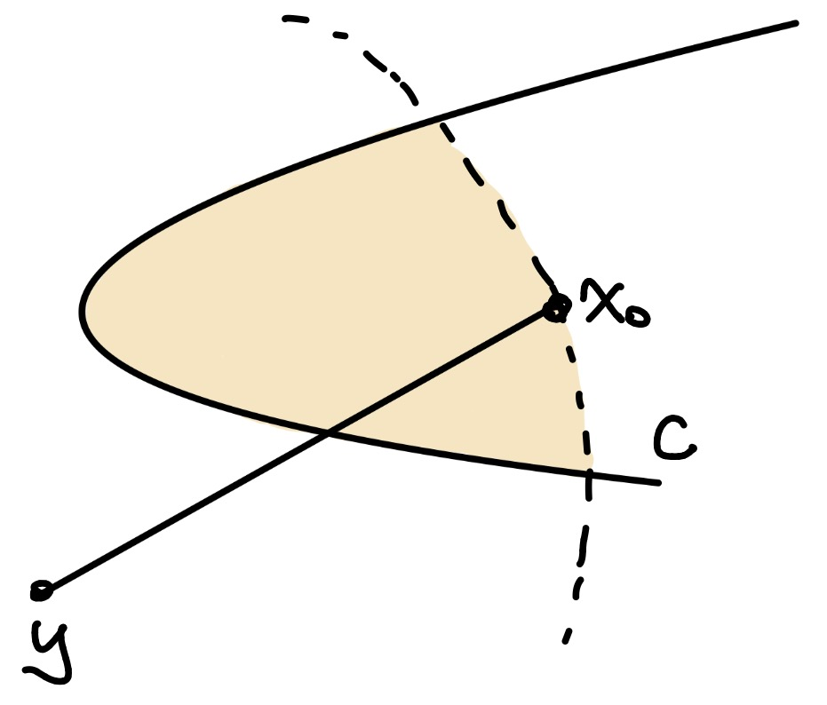</a>
<ul><li>
根据 Weierstrass theorem, 由于目标函数是连续的, 故只需给出一个紧的可行域即可. Compact = closed + bounded, 而 closed 已经给出, 故只需找到一个 bounded 的可行域即可.
</li><li>
由于 <math xmlns="http://www.w3.org/1998/Math/MathML"><semantics><mrow><mstyle scriptlevel="0" displaystyle="true"><mi mathvariant="script">C</mi></mstyle></mrow><annotation encoding="application/x-tex">\displaystyle \mathcal{C}</annotation></semantics></math>C 是非空闭集, 故任取 <math xmlns="http://www.w3.org/1998/Math/MathML"><semantics><mrow><mstyle scriptlevel="0" displaystyle="true"><msub><mi mathvariant="bold-italic">x</mi><mn>0</mn></msub><mo>∈</mo><mi mathvariant="script">C</mi></mstyle></mrow><annotation encoding="application/x-tex">\displaystyle \bm{x}_0 \in \mathcal{C}</annotation></semantics></math>x0​∈C, 记 <math xmlns="http://www.w3.org/1998/Math/MathML"><semantics><mrow><mstyle scriptlevel="0" displaystyle="true"><mi>R</mi><mo>:</mo><mo>=</mo><mi mathvariant="normal">∥</mi><msub><mi mathvariant="bold-italic">x</mi><mn>0</mn></msub><mo>−</mo><mi mathvariant="bold-italic">y</mi><msub><mi mathvariant="normal">∥</mi><mn>2</mn></msub></mstyle></mrow><annotation encoding="application/x-tex">\displaystyle R:= \|\bm{x}_0 - \bm{y}\|_2</annotation></semantics></math>R:=∥x0​−y∥2​. 则任意 <math xmlns="http://www.w3.org/1998/Math/MathML"><semantics><mrow><mstyle scriptlevel="0" displaystyle="true"><mi>d</mi><mo stretchy="false">(</mo><mi mathvariant="bold-italic">x</mi><mo separator="true">,</mo><mi mathvariant="bold-italic">y</mi><mo stretchy="false">)</mo><mo>&gt;</mo><mi>R</mi></mstyle></mrow><annotation encoding="application/x-tex">\displaystyle d(\bm{x}, \bm{y}) &gt; R</annotation></semantics></math>d(x,y)&gt;R 的点 <math xmlns="http://www.w3.org/1998/Math/MathML"><semantics><mrow><mstyle scriptlevel="0" displaystyle="true"><mi mathvariant="bold-italic">x</mi><mo>∈</mo><mi mathvariant="script">C</mi></mstyle></mrow><annotation encoding="application/x-tex">\displaystyle \bm{x} \in \mathcal{C}</annotation></semantics></math>x∈C 都不可能是最优解. 故可行域为 <math xmlns="http://www.w3.org/1998/Math/MathML"><semantics><mrow><mstyle scriptlevel="0" displaystyle="true"><mi mathvariant="script">C</mi><mo>∩</mo><mi mathvariant="script">B</mi><mo stretchy="false">(</mo><mi mathvariant="bold-italic">y</mi><mo separator="true">,</mo><mi>R</mi><mo stretchy="false">)</mo></mstyle></mrow><annotation encoding="application/x-tex">\displaystyle \mathcal{C} \cap \mathcal{B}(\bm{y}, R)</annotation></semantics></math>C∩B(y,R)，其是一个非空闭集, 且 bounded, 故是 compact set. 因此最优解存在.
</li></ul>

唯一性. 事实上唯一性在证明, 对于凸可行域+强凸目标函数, 其最优解若存在必然唯一.

<ul><li>
反证法, 若存在两个不同的最优解 <math xmlns="http://www.w3.org/1998/Math/MathML"><semantics><mrow><mstyle scriptlevel="0" displaystyle="true"><msubsup><mi mathvariant="bold-italic">x</mi><mn>1</mn><mo>⋆</mo></msubsup><mo separator="true">,</mo><msubsup><mi mathvariant="bold-italic">x</mi><mn>2</mn><mo>⋆</mo></msubsup><mo>∈</mo><mi mathvariant="script">C</mi></mstyle></mrow><annotation encoding="application/x-tex">\displaystyle \bm{x}_1^\star, \bm{x}_2^\star \in \mathcal{C}</annotation></semantics></math>x1⋆​,x2⋆​∈C，一方面

<math xmlns="http://www.w3.org/1998/Math/MathML" display="block"><semantics><mtable rowspacing="0.25em" columnalign="right left" columnspacing="0em"><mtr><mtd><mstyle scriptlevel="0" displaystyle="true"><mrow><mi mathvariant="normal">∥</mi><mi mathvariant="bold-italic">y</mi><mo>−</mo><msubsup><mi mathvariant="bold-italic">x</mi><mn>1</mn><mo>⋆</mo></msubsup><mo>+</mo><mo stretchy="false">(</mo><mi mathvariant="bold-italic">y</mi><mo>−</mo><msubsup><mi mathvariant="bold-italic">x</mi><mn>2</mn><mo>⋆</mo></msubsup><mo stretchy="false">)</mo><msubsup><mi mathvariant="normal">∥</mi><mn>2</mn><mn>2</mn></msubsup></mrow></mstyle></mtd><mtd><mstyle scriptlevel="0" displaystyle="true"><mrow><mrow></mrow><mo>=</mo><mi mathvariant="normal">∥</mi><mi mathvariant="bold-italic">y</mi><mo>−</mo><msubsup><mi mathvariant="bold-italic">x</mi><mn>1</mn><mo>⋆</mo></msubsup><msubsup><mi mathvariant="normal">∥</mi><mn>2</mn><mn>2</mn></msubsup><mo>+</mo><mi mathvariant="normal">∥</mi><mi mathvariant="bold-italic">y</mi><mo>−</mo><msubsup><mi mathvariant="bold-italic">x</mi><mn>2</mn><mo>⋆</mo></msubsup><msubsup><mi mathvariant="normal">∥</mi><mn>2</mn><mn>2</mn></msubsup><mo>+</mo><mn>2</mn><mrow><mo fence="true">⟨</mo><mi mathvariant="bold-italic">y</mi><mo>−</mo><msubsup><mi mathvariant="bold-italic">x</mi><mn>1</mn><mo>⋆</mo></msubsup><mo separator="true">,</mo><mi mathvariant="bold-italic">y</mi><mo>−</mo><msubsup><mi mathvariant="bold-italic">x</mi><mn>2</mn><mo>⋆</mo></msubsup><mo fence="true">⟩</mo></mrow></mrow></mstyle></mtd></mtr></mtable><annotation encoding="application/x-tex">
\begin{aligned}
  \|\bm{y} - \bm{x}_1^\star + (\bm{y} - \bm{x}_2^\star)\|_2^2 &amp;= \|\bm{y} - \bm{x}_1^\star\|_2^2 + \|\bm{y} - \bm{x}_2^\star\|_2^2 + 2\left\langle \bm{y} - \bm{x}_1^\star, \bm{y} - \bm{x}_2^\star \right\rangle\\
\end{aligned}
</annotation></semantics></math>∥y−x1⋆​+(y−x2⋆​)∥22​​=∥y−x1⋆​∥22​+∥y−x2⋆​∥22​+2⟨y−x1⋆​,y−x2⋆​⟩​

另一方面

<math xmlns="http://www.w3.org/1998/Math/MathML" display="block"><semantics><mtable rowspacing="0.25em" columnalign="right left" columnspacing="0em"><mtr><mtd><mstyle scriptlevel="0" displaystyle="true"><mrow><mi mathvariant="normal">∥</mi><mi mathvariant="bold-italic">y</mi><mo>−</mo><msubsup><mi mathvariant="bold-italic">x</mi><mn>1</mn><mo>⋆</mo></msubsup><mo>−</mo><mo stretchy="false">(</mo><mi mathvariant="bold-italic">y</mi><mo>−</mo><msubsup><mi mathvariant="bold-italic">x</mi><mn>2</mn><mo>⋆</mo></msubsup><mo stretchy="false">)</mo><msubsup><mi mathvariant="normal">∥</mi><mn>2</mn><mn>2</mn></msubsup></mrow></mstyle></mtd><mtd><mstyle scriptlevel="0" displaystyle="true"><mrow><mrow></mrow><mo>=</mo><mi mathvariant="normal">∥</mi><msubsup><mi mathvariant="bold-italic">x</mi><mn>1</mn><mo>⋆</mo></msubsup><mo>−</mo><msubsup><mi mathvariant="bold-italic">x</mi><mn>2</mn><mo>⋆</mo></msubsup><msubsup><mi mathvariant="normal">∥</mi><mn>2</mn><mn>2</mn></msubsup><mo>=</mo><mi mathvariant="normal">∥</mi><msubsup><mi mathvariant="bold-italic">x</mi><mn>1</mn><mo>⋆</mo></msubsup><mo>−</mo><mi mathvariant="bold-italic">y</mi><msubsup><mi mathvariant="normal">∥</mi><mn>2</mn><mn>2</mn></msubsup><mo>+</mo><mi mathvariant="normal">∥</mi><msubsup><mi mathvariant="bold-italic">x</mi><mn>2</mn><mo>⋆</mo></msubsup><mo>−</mo><mi mathvariant="bold-italic">y</mi><msubsup><mi mathvariant="normal">∥</mi><mn>2</mn><mn>2</mn></msubsup><mo>−</mo><mn>2</mn><mrow><mo fence="true">⟨</mo><mi mathvariant="bold-italic">y</mi><mo>−</mo><msubsup><mi mathvariant="bold-italic">x</mi><mn>1</mn><mo>⋆</mo></msubsup><mo separator="true">,</mo><mi mathvariant="bold-italic">y</mi><mo>−</mo><msubsup><mi mathvariant="bold-italic">x</mi><mn>2</mn><mo>⋆</mo></msubsup><mo fence="true">⟩</mo></mrow></mrow></mstyle></mtd></mtr></mtable><annotation encoding="application/x-tex">
\begin{aligned}
  \|\bm{y} - \bm{x}_1^\star - (\bm{y} - \bm{x}_2^\star)\|_2^2 &amp;= \|\bm{x}_1^\star - \bm{x}_2^\star\|_2^2 = \|\bm{x}_1^\star - \bm{y}\|_2^2 + \|\bm{x}_2^\star - \bm{y}\|_2^2 - 2\left\langle \bm{y} - \bm{x}_1^\star , \bm{y} - \bm{x}_2^\star \right\rangle\\
\end{aligned}
</annotation></semantics></math>∥y−x1⋆​−(y−x2⋆​)∥22​​=∥x1⋆​−x2⋆​∥22​=∥x1⋆​−y∥22​+∥x2⋆​−y∥22​−2⟨y−x1⋆​,y−x2⋆​⟩​

因此由第二式整理得

<math xmlns="http://www.w3.org/1998/Math/MathML" display="block"><semantics><mrow><mrow><mo fence="true">⟨</mo><mi mathvariant="bold-italic">y</mi><mo>−</mo><msubsup><mi mathvariant="bold-italic">x</mi><mn>1</mn><mo>⋆</mo></msubsup><mo separator="true">,</mo><mi mathvariant="bold-italic">y</mi><mo>−</mo><msubsup><mi mathvariant="bold-italic">x</mi><mn>2</mn><mo>⋆</mo></msubsup><mo fence="true">⟩</mo></mrow><mo>=</mo><mi>d</mi><mo stretchy="false">(</mo><mi mathvariant="bold-italic">y</mi><mo separator="true">,</mo><mi mathvariant="script">C</mi><msup><mo stretchy="false">)</mo><mn>2</mn></msup><mo>−</mo><mfrac><mn>1</mn><mn>2</mn></mfrac><mi mathvariant="normal">∥</mi><msubsup><mi mathvariant="bold-italic">x</mi><mn>1</mn><mo>⋆</mo></msubsup><mo>−</mo><msubsup><mi mathvariant="bold-italic">x</mi><mn>2</mn><mo>⋆</mo></msubsup><msubsup><mi mathvariant="normal">∥</mi><mn>2</mn><mn>2</mn></msubsup><mo>&lt;</mo><mi>d</mi><mo stretchy="false">(</mo><mi mathvariant="bold-italic">y</mi><mo separator="true">,</mo><mi mathvariant="script">C</mi><msup><mo stretchy="false">)</mo><mn>2</mn></msup><mi mathvariant="normal">.</mi></mrow><annotation encoding="application/x-tex">
\left\langle \bm{y} - \bm{x}_1^\star, \bm{y} - \bm{x}_2^\star \right\rangle = d(\bm{y}, \mathcal{C})^2 -\frac{1}{2}\|\bm{x}_1^\star - \bm{x}_2^\star\|_2^2 &lt; d(\bm{y}, \mathcal{C})^2.
</annotation></semantics></math>⟨y−x1⋆​,y−x2⋆​⟩=d(y,C)2−21​∥x1⋆​−x2⋆​∥22​&lt;d(y,C)2.</li><li>
考虑 <math xmlns="http://www.w3.org/1998/Math/MathML"><semantics><mrow><mstyle scriptlevel="0" displaystyle="true"><mi mathvariant="bold-italic">y</mi></mstyle></mrow><annotation encoding="application/x-tex">\displaystyle \bm{y}</annotation></semantics></math>y 到 <math xmlns="http://www.w3.org/1998/Math/MathML"><semantics><mrow><mstyle scriptlevel="0" displaystyle="true"><mfrac><mn>1</mn><mn>2</mn></mfrac><mo stretchy="false">(</mo><msubsup><mi mathvariant="bold-italic">x</mi><mn>1</mn><mo>⋆</mo></msubsup><mo>+</mo><msubsup><mi mathvariant="bold-italic">x</mi><mn>2</mn><mo>⋆</mo></msubsup><mo stretchy="false">)</mo></mstyle></mrow><annotation encoding="application/x-tex">\displaystyle \frac{1}{2}(\bm{x}_1^\star + \bm{x}_2^\star)</annotation></semantics></math>21​(x1⋆​+x2⋆​) 的距离, 由于 <math xmlns="http://www.w3.org/1998/Math/MathML"><semantics><mrow><mstyle scriptlevel="0" displaystyle="true"><mi mathvariant="script">C</mi></mstyle></mrow><annotation encoding="application/x-tex">\displaystyle \mathcal{C}</annotation></semantics></math>C 是凸的, 必有 <math xmlns="http://www.w3.org/1998/Math/MathML"><semantics><mrow><mstyle scriptlevel="0" displaystyle="true"><mfrac><mn>1</mn><mn>2</mn></mfrac><mo stretchy="false">(</mo><msubsup><mi mathvariant="bold-italic">x</mi><mn>1</mn><mo>⋆</mo></msubsup><mo>+</mo><msubsup><mi mathvariant="bold-italic">x</mi><mn>2</mn><mo>⋆</mo></msubsup><mo stretchy="false">)</mo><mo>∈</mo><mi mathvariant="script">C</mi></mstyle></mrow><annotation encoding="application/x-tex">\displaystyle \frac{1}{2}(\bm{x}_1^\star + \bm{x}_2^\star) \in \mathcal{C}</annotation></semantics></math>21​(x1⋆​+x2⋆​)∈C. 于是

<math xmlns="http://www.w3.org/1998/Math/MathML" display="block"><semantics><mtable rowspacing="0.25em" columnalign="right left" columnspacing="0em"><mtr><mtd><mstyle scriptlevel="0" displaystyle="true"><mrow><mi mathvariant="normal">∥</mi><mi mathvariant="bold-italic">y</mi><mo>−</mo><mfrac><mn>1</mn><mn>2</mn></mfrac><mo stretchy="false">(</mo><msubsup><mi mathvariant="bold-italic">x</mi><mn>1</mn><mo>⋆</mo></msubsup><mo>+</mo><msubsup><mi mathvariant="bold-italic">x</mi><mn>2</mn><mo>⋆</mo></msubsup><mo stretchy="false">)</mo><msubsup><mi mathvariant="normal">∥</mi><mn>2</mn><mn>2</mn></msubsup></mrow></mstyle></mtd><mtd><mstyle scriptlevel="0" displaystyle="true"><mrow><mrow></mrow><mo>=</mo><msubsup><mrow><mo fence="true">∥</mo><mfrac><mn>1</mn><mn>2</mn></mfrac><mo stretchy="false">(</mo><mi mathvariant="bold-italic">y</mi><mo>−</mo><msubsup><mi mathvariant="bold-italic">x</mi><mn>1</mn><mo>⋆</mo></msubsup><mo stretchy="false">)</mo><mo>+</mo><mfrac><mn>1</mn><mn>2</mn></mfrac><mo stretchy="false">(</mo><mi mathvariant="bold-italic">y</mi><mo>−</mo><msubsup><mi mathvariant="bold-italic">x</mi><mn>2</mn><mo>⋆</mo></msubsup><mo stretchy="false">)</mo><mo fence="true">∥</mo></mrow><mn>2</mn><mn>2</mn></msubsup></mrow></mstyle></mtd></mtr><mtr><mtd><mstyle scriptlevel="0" displaystyle="true"><mrow></mrow></mstyle></mtd><mtd><mstyle scriptlevel="0" displaystyle="true"><mrow><mrow></mrow><mo>=</mo><mfrac><mn>1</mn><mn>4</mn></mfrac><mi mathvariant="normal">∥</mi><mi mathvariant="bold-italic">y</mi><mo>−</mo><msubsup><mi mathvariant="bold-italic">x</mi><mn>1</mn><mo>⋆</mo></msubsup><msubsup><mi mathvariant="normal">∥</mi><mn>2</mn><mn>2</mn></msubsup><mo>+</mo><mfrac><mn>1</mn><mn>4</mn></mfrac><mi mathvariant="normal">∥</mi><mi mathvariant="bold-italic">y</mi><mo>−</mo><msubsup><mi mathvariant="bold-italic">x</mi><mn>2</mn><mo>⋆</mo></msubsup><msubsup><mi mathvariant="normal">∥</mi><mn>2</mn><mn>2</mn></msubsup><mo>+</mo><mfrac><mn>1</mn><mn>2</mn></mfrac><mrow><mo fence="true">⟨</mo><mi mathvariant="bold-italic">y</mi><mo>−</mo><msubsup><mi mathvariant="bold-italic">x</mi><mn>1</mn><mo>⋆</mo></msubsup><mo separator="true">,</mo><mi mathvariant="bold-italic">y</mi><mo>−</mo><msubsup><mi mathvariant="bold-italic">x</mi><mn>2</mn><mo>⋆</mo></msubsup><mo fence="true">⟩</mo></mrow></mrow></mstyle></mtd></mtr><mtr><mtd><mstyle scriptlevel="0" displaystyle="true"><mrow></mrow></mstyle></mtd><mtd><mstyle scriptlevel="0" displaystyle="true"><mrow><mrow></mrow><mo>&lt;</mo><mfrac><mn>1</mn><mn>4</mn></mfrac><mi mathvariant="normal">∥</mi><mi mathvariant="bold-italic">y</mi><mo>−</mo><msubsup><mi mathvariant="bold-italic">x</mi><mn>1</mn><mo>⋆</mo></msubsup><msubsup><mi mathvariant="normal">∥</mi><mn>2</mn><mn>2</mn></msubsup><mo>+</mo><mfrac><mn>1</mn><mn>4</mn></mfrac><mi mathvariant="normal">∥</mi><mi mathvariant="bold-italic">y</mi><mo>−</mo><msubsup><mi mathvariant="bold-italic">x</mi><mn>2</mn><mo>⋆</mo></msubsup><msubsup><mi mathvariant="normal">∥</mi><mn>2</mn><mn>2</mn></msubsup><mo>+</mo><mfrac><mn>1</mn><mn>2</mn></mfrac><mi>d</mi><mo stretchy="false">(</mo><mi mathvariant="bold-italic">y</mi><mo separator="true">,</mo><mi mathvariant="script">C</mi><msup><mo stretchy="false">)</mo><mn>2</mn></msup><mo>=</mo><mi>d</mi><mo stretchy="false">(</mo><mi mathvariant="bold-italic">y</mi><mo separator="true">,</mo><mi mathvariant="script">C</mi><msup><mo stretchy="false">)</mo><mn>2</mn></msup><mi mathvariant="normal">.</mi></mrow></mstyle></mtd></mtr></mtable><annotation encoding="application/x-tex">
\begin{aligned}
  \|\bm{y} - \frac{1}{2}(\bm{x}_1^\star + \bm{x}_2^\star)\|_2^2 &amp;= \left\|\frac{1}{2}(\bm{y}-\bm{x}_1^\star) + \frac{1}{2}(\bm{y}-\bm{x}_2^\star)\right\|_2^2\\
  &amp;= \frac{1}{4}\|\bm{y}-\bm{x}_1^\star\|_2^2 + \frac{1}{4}\|\bm{y}-\bm{x}_2^\star\|_2^2 + \frac{1}{2}\left\langle \bm{y}-\bm{x}_1^\star, \bm{y}-\bm{x}_2^\star \right\rangle\\
  &amp;&lt; \frac{1}{4}\|\bm{y}-\bm{x}_1^\star\|_2^2 + \frac{1}{4}\|\bm{y}-\bm{x}_2^\star\|_2^2 + \frac12 d(\bm{y}, \mathcal{C})^2 = d(\bm{y}, \mathcal{C})^2.
\end{aligned}
</annotation></semantics></math>∥y−21​(x1⋆​+x2⋆​)∥22​​=<svg xmlns="http://www.w3.org/2000/svg" width="0.556em" height="2.400em" viewBox="0 0 556 2400"><path d="M145 15 v585 v1200 v585 c2.667,10,9.667,15,21,15
c10,0,16.667,-5,20,-15 v-585 v-1200 v-585 c-2.667,-10,-9.667,-15,-21,-15
c-10,0,-16.667,5,-20,15z M188 15 H145 v585 v1200 v585 h43z
M367 15 v585 v1200 v585 c2.667,10,9.667,15,21,15
c10,0,16.667,-5,20,-15 v-585 v-1200 v-585 c-2.667,-10,-9.667,-15,-21,-15
c-10,0,-16.667,5,-20,15z M410 15 H367 v585 v1200 v585 h43z"/></svg>​21​(y−x1⋆​)+21​(y−x2⋆​)<svg xmlns="http://www.w3.org/2000/svg" width="0.556em" height="2.400em" viewBox="0 0 556 2400"><path d="M145 15 v585 v1200 v585 c2.667,10,9.667,15,21,15
c10,0,16.667,-5,20,-15 v-585 v-1200 v-585 c-2.667,-10,-9.667,-15,-21,-15
c-10,0,-16.667,5,-20,15z M188 15 H145 v585 v1200 v585 h43z
M367 15 v585 v1200 v585 c2.667,10,9.667,15,21,15
c10,0,16.667,-5,20,-15 v-585 v-1200 v-585 c-2.667,-10,-9.667,-15,-21,-15
c-10,0,-16.667,5,-20,15z M410 15 H367 v585 v1200 v585 h43z"/></svg>​22​=41​∥y−x1⋆​∥22​+41​∥y−x2⋆​∥22​+21​⟨y−x1⋆​,y−x2⋆​⟩&lt;41​∥y−x1⋆​∥22​+41​∥y−x2⋆​∥22​+21​d(y,C)2=d(y,C)2.​

这与 <math xmlns="http://www.w3.org/1998/Math/MathML"><semantics><mrow><mstyle scriptlevel="0" displaystyle="true"><msubsup><mi mathvariant="bold-italic">x</mi><mn>1</mn><mo>⋆</mo></msubsup><mo separator="true">,</mo><msubsup><mi mathvariant="bold-italic">x</mi><mn>2</mn><mo>⋆</mo></msubsup></mstyle></mrow><annotation encoding="application/x-tex">\displaystyle \bm{x}_1^\star, \bm{x}_2^\star</annotation></semantics></math>x1⋆​,x2⋆​ 是最优解矛盾. 因此最优解唯一.
</li></ul>□

### 2.2. Projection variational inequality
<section class="latex-block latex-theorem" id="latex-thmblock-2-2-1" aria-label="Theorem 2.2.1">
Theorem 2.2.1　Projection variational inequality

对于非空闭凸集 <math xmlns="http://www.w3.org/1998/Math/MathML"><semantics><mrow><mstyle scriptlevel="0" displaystyle="true"><mi mathvariant="script">C</mi><mo>⊆</mo><msup><mi mathvariant="double-struck">R</mi><mi>n</mi></msup></mstyle></mrow><annotation encoding="application/x-tex">\displaystyle \mathcal{C} \subseteq \mathbb{R}^n</annotation></semantics></math>C⊆Rn，<math xmlns="http://www.w3.org/1998/Math/MathML"><semantics><mrow><mstyle scriptlevel="0" displaystyle="true"><msup><mi mathvariant="bold-italic">x</mi><mo>⋆</mo></msup><mo>∈</mo><mi mathvariant="script">C</mi></mstyle></mrow><annotation encoding="application/x-tex">\displaystyle \bm{x}^\star \in \mathcal{C}</annotation></semantics></math>x⋆∈C 是 <math xmlns="http://www.w3.org/1998/Math/MathML"><semantics><mrow><mstyle scriptlevel="0" displaystyle="true"><msub><mi mathvariant="normal">Π</mi><mi mathvariant="script">C</mi></msub><mo stretchy="false">(</mo><mi mathvariant="bold-italic">y</mi><mo stretchy="false">)</mo></mstyle></mrow><annotation encoding="application/x-tex">\displaystyle \Pi_{\mathcal{C}}(\bm{y})</annotation></semantics></math>ΠC​(y) 当且仅当

<math xmlns="http://www.w3.org/1998/Math/MathML" display="block"><semantics><mrow><mrow><mo fence="true">⟨</mo><mi mathvariant="bold-italic">y</mi><mo>−</mo><msup><mi mathvariant="bold-italic">x</mi><mo>⋆</mo></msup><mo separator="true">,</mo><mi mathvariant="bold-italic">x</mi><mo>−</mo><msup><mi mathvariant="bold-italic">x</mi><mo>⋆</mo></msup><mo fence="true">⟩</mo></mrow><mo>≤</mo><mn>0</mn><mo separator="true">,</mo><mtext> </mtext><mi mathvariant="normal">∀</mi><mi mathvariant="bold-italic">x</mi><mo>∈</mo><mi mathvariant="script">C</mi><mi mathvariant="normal">.</mi></mrow><annotation encoding="application/x-tex">
\left\langle \bm{y} - \bm{x}^\star, \bm{x} - \bm{x}^\star \right\rangle \leq 0,~ \forall \bm{x} \in \mathcal{C}.
</annotation></semantics></math>⟨y−x⋆,x−x⋆⟩≤0, ∀x∈C.</section>
<a class="latex-raster-figure" href="./convex-geometry/20260929215140832.png" style="--figure-width:30%">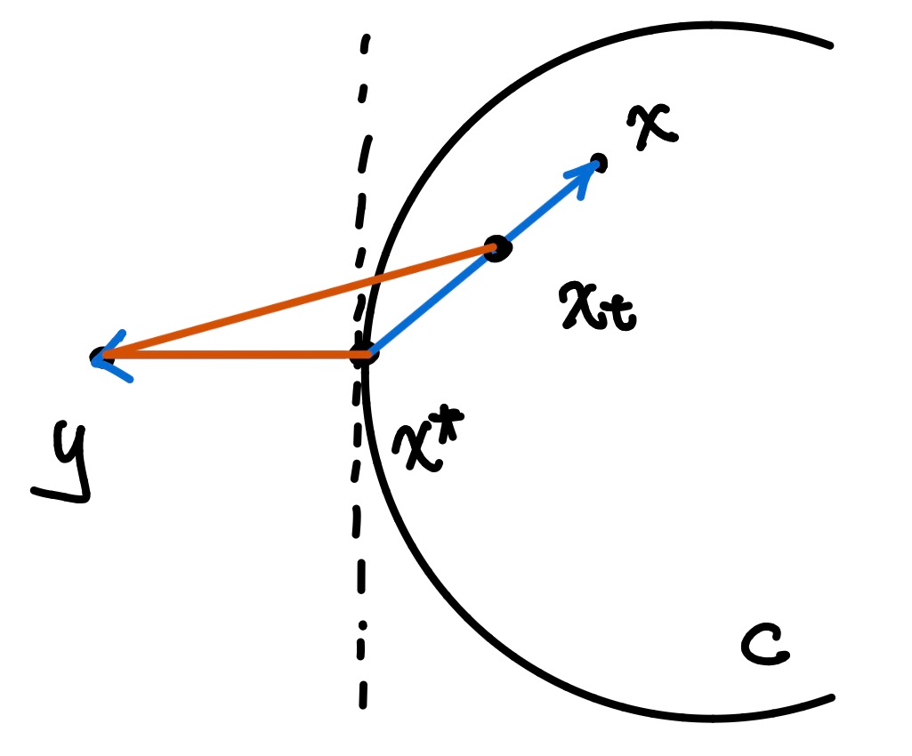</a>
<ul><li>
从 <math xmlns="http://www.w3.org/1998/Math/MathML"><semantics><mrow><mstyle scriptlevel="0" displaystyle="true"><msup><mi mathvariant="bold-italic">x</mi><mo>⋆</mo></msup></mstyle></mrow><annotation encoding="application/x-tex">\displaystyle \bm{x}^\star</annotation></semantics></math>x⋆ 出发, 向投影起点的向量定与任意可行点的向量呈钝角或直角.
</li></ul>

Proof.

<math xmlns="http://www.w3.org/1998/Math/MathML"><semantics><mrow><mstyle scriptlevel="0" displaystyle="true"><mo stretchy="false">(</mo><mo>⇐</mo><mo stretchy="false">)</mo></mstyle></mrow><annotation encoding="application/x-tex">\displaystyle (\Leftarrow)</annotation></semantics></math>(⇐) 对于任意 <math xmlns="http://www.w3.org/1998/Math/MathML"><semantics><mrow><mstyle scriptlevel="0" displaystyle="true"><mi mathvariant="bold-italic">x</mi><mo>∈</mo><mi mathvariant="script">C</mi></mstyle></mrow><annotation encoding="application/x-tex">\displaystyle \bm{x} \in \mathcal{C}</annotation></semantics></math>x∈C，有

<math xmlns="http://www.w3.org/1998/Math/MathML" display="block"><semantics><mtable rowspacing="0.25em" columnalign="right left" columnspacing="0em"><mtr><mtd><mstyle scriptlevel="0" displaystyle="true"><mrow><mi mathvariant="normal">∥</mi><mi mathvariant="bold-italic">y</mi><mo>−</mo><mi mathvariant="bold-italic">x</mi><msubsup><mi mathvariant="normal">∥</mi><mn>2</mn><mn>2</mn></msubsup></mrow></mstyle></mtd><mtd><mstyle scriptlevel="0" displaystyle="true"><mrow><mrow></mrow><mo>=</mo><mi mathvariant="normal">∥</mi><mi mathvariant="bold-italic">y</mi><mo>−</mo><msup><mi mathvariant="bold-italic">x</mi><mo>⋆</mo></msup><mo>+</mo><msup><mi mathvariant="bold-italic">x</mi><mo>⋆</mo></msup><mo>−</mo><mi mathvariant="bold-italic">x</mi><msubsup><mi mathvariant="normal">∥</mi><mn>2</mn><mn>2</mn></msubsup></mrow></mstyle></mtd></mtr><mtr><mtd><mstyle scriptlevel="0" displaystyle="true"><mrow></mrow></mstyle></mtd><mtd><mstyle scriptlevel="0" displaystyle="true"><mrow><mrow></mrow><mo>=</mo><mi mathvariant="normal">∥</mi><mi mathvariant="bold-italic">y</mi><mo>−</mo><msup><mi mathvariant="bold-italic">x</mi><mo>⋆</mo></msup><msubsup><mi mathvariant="normal">∥</mi><mn>2</mn><mn>2</mn></msubsup><mo>+</mo><mi mathvariant="normal">∥</mi><msup><mi mathvariant="bold-italic">x</mi><mo>⋆</mo></msup><mo>−</mo><mi mathvariant="bold-italic">x</mi><msubsup><mi mathvariant="normal">∥</mi><mn>2</mn><mn>2</mn></msubsup><mo>+</mo><mn>2</mn><mrow><mo fence="true">⟨</mo><mi mathvariant="bold-italic">y</mi><mo>−</mo><msup><mi mathvariant="bold-italic">x</mi><mo>⋆</mo></msup><mo separator="true">,</mo><msup><mi mathvariant="bold-italic">x</mi><mo>⋆</mo></msup><mo>−</mo><mi mathvariant="bold-italic">x</mi><mo fence="true">⟩</mo></mrow></mrow></mstyle></mtd></mtr><mtr><mtd><mstyle scriptlevel="0" displaystyle="true"><mrow></mrow></mstyle></mtd><mtd><mstyle scriptlevel="0" displaystyle="true"><mrow><mrow></mrow><mo>≥</mo><mi mathvariant="normal">∥</mi><mi mathvariant="bold-italic">y</mi><mo>−</mo><msup><mi mathvariant="bold-italic">x</mi><mo>⋆</mo></msup><msubsup><mi mathvariant="normal">∥</mi><mn>2</mn><mn>2</mn></msubsup><mo>+</mo><mi mathvariant="normal">∥</mi><msup><mi mathvariant="bold-italic">x</mi><mo>⋆</mo></msup><mo>−</mo><mi mathvariant="bold-italic">x</mi><msubsup><mi mathvariant="normal">∥</mi><mn>2</mn><mn>2</mn></msubsup><mo>≥</mo><mi mathvariant="normal">∥</mi><mi mathvariant="bold-italic">y</mi><mo>−</mo><msup><mi mathvariant="bold-italic">x</mi><mo>⋆</mo></msup><msubsup><mi mathvariant="normal">∥</mi><mn>2</mn><mn>2</mn></msubsup><mi mathvariant="normal">.</mi></mrow></mstyle></mtd></mtr></mtable><annotation encoding="application/x-tex">
\begin{aligned}
\|\bm{y}-\bm{x}\|_2^2 &amp;= \|\bm{y}-\bm{x}^\star + \bm{x}^\star - \bm{x}\|_2^2\\
&amp;= \|\bm{y}-\bm{x}^\star\|_2^2 + \|\bm{x}^\star - \bm{x}\|_2^2 + 2\left\langle \bm{y}-\bm{x}^\star, \bm{x}^\star - \bm{x} \right\rangle\\
&amp;\geq \|\bm{y}-\bm{x}^\star\|_2^2 + \|\bm{x}^\star - \bm{x}\|_2^2 \geq \|\bm{y}-\bm{x}^\star\|_2^2.
\end{aligned}
</annotation></semantics></math>∥y−x∥22​​=∥y−x⋆+x⋆−x∥22​=∥y−x⋆∥22​+∥x⋆−x∥22​+2⟨y−x⋆,x⋆−x⟩≥∥y−x⋆∥22​+∥x⋆−x∥22​≥∥y−x⋆∥22​.​

故 <math xmlns="http://www.w3.org/1998/Math/MathML"><semantics><mrow><mstyle scriptlevel="0" displaystyle="true"><msup><mi mathvariant="bold-italic">x</mi><mo>⋆</mo></msup><mo>=</mo><mi>arg</mi><mo>⁡</mo><munder><mrow><mi>min</mi><mo>⁡</mo></mrow><mrow><mi mathvariant="bold-italic">x</mi><mo>∈</mo><mi mathvariant="script">C</mi></mrow></munder><mi mathvariant="normal">∥</mi><mi mathvariant="bold-italic">y</mi><mo>−</mo><mi mathvariant="bold-italic">x</mi><msub><mi mathvariant="normal">∥</mi><mn>2</mn></msub><mo>=</mo><msub><mi mathvariant="normal">Π</mi><mi mathvariant="script">C</mi></msub><mo stretchy="false">(</mo><mi mathvariant="bold-italic">y</mi><mo stretchy="false">)</mo></mstyle></mrow><annotation encoding="application/x-tex">\displaystyle \bm{x}^\star = \arg\min_{\bm{x} \in \mathcal{C}} \|\bm{y}-\bm{x}\|_2 = \Pi_{\mathcal{C}}(\bm{y})</annotation></semantics></math>x⋆=argx∈Cmin​∥y−x∥2​=ΠC​(y).

<math xmlns="http://www.w3.org/1998/Math/MathML"><semantics><mrow><mstyle scriptlevel="0" displaystyle="true"><mo stretchy="false">(</mo><mo>⇒</mo><mo stretchy="false">)</mo></mstyle></mrow><annotation encoding="application/x-tex">\displaystyle (\Rightarrow)</annotation></semantics></math>(⇒) 定义 <math xmlns="http://www.w3.org/1998/Math/MathML"><semantics><mrow><mstyle scriptlevel="0" displaystyle="true"><msub><mi mathvariant="bold-italic">x</mi><mi>t</mi></msub><mo>:</mo><mo>=</mo><msup><mi mathvariant="bold-italic">x</mi><mo>⋆</mo></msup><mo>+</mo><mi>t</mi><mo stretchy="false">(</mo><mi mathvariant="bold-italic">x</mi><mo>−</mo><msup><mi mathvariant="bold-italic">x</mi><mo>⋆</mo></msup><mo stretchy="false">)</mo></mstyle></mrow><annotation encoding="application/x-tex">\displaystyle \bm{x}_t := \bm{x}^\star + t(\bm{x}-\bm{x}^\star)</annotation></semantics></math>xt​:=x⋆+t(x−x⋆), <math xmlns="http://www.w3.org/1998/Math/MathML"><semantics><mrow><mstyle scriptlevel="0" displaystyle="true"><mi>t</mi><mo>∈</mo><mo stretchy="false">(</mo><mn>0</mn><mo separator="true">,</mo><mn>1</mn><mo stretchy="false">]</mo></mstyle></mrow><annotation encoding="application/x-tex">\displaystyle t \in(0,1]</annotation></semantics></math>t∈(0,1]. 由于 <math xmlns="http://www.w3.org/1998/Math/MathML"><semantics><mrow><mstyle scriptlevel="0" displaystyle="true"><mi mathvariant="script">C</mi></mstyle></mrow><annotation encoding="application/x-tex">\displaystyle \mathcal{C}</annotation></semantics></math>C 是凸的, 故 <math xmlns="http://www.w3.org/1998/Math/MathML"><semantics><mrow><mstyle scriptlevel="0" displaystyle="true"><msub><mi mathvariant="bold-italic">x</mi><mi>t</mi></msub><mo>∈</mo><mi mathvariant="script">C</mi></mstyle></mrow><annotation encoding="application/x-tex">\displaystyle \bm{x}_t \in \mathcal{C}</annotation></semantics></math>xt​∈C. 由 <math xmlns="http://www.w3.org/1998/Math/MathML"><semantics><mrow><mstyle scriptlevel="0" displaystyle="true"><msup><mi mathvariant="bold-italic">x</mi><mo>⋆</mo></msup><mo>=</mo><msub><mi mathvariant="normal">Π</mi><mi mathvariant="script">C</mi></msub><mo stretchy="false">(</mo><mi mathvariant="bold-italic">y</mi><mo stretchy="false">)</mo></mstyle></mrow><annotation encoding="application/x-tex">\displaystyle \bm{x}^\star = \Pi_{\mathcal{C}}(\bm{y})</annotation></semantics></math>x⋆=ΠC​(y)，有

<math xmlns="http://www.w3.org/1998/Math/MathML" display="block"><semantics><mtable rowspacing="0.25em" columnalign="right left" columnspacing="0em"><mtr><mtd><mstyle scriptlevel="0" displaystyle="true"><mrow><mi mathvariant="normal">∥</mi><mi mathvariant="bold-italic">y</mi><mo>−</mo><msup><mi mathvariant="bold-italic">x</mi><mo>⋆</mo></msup><msubsup><mi mathvariant="normal">∥</mi><mn>2</mn><mn>2</mn></msubsup></mrow></mstyle></mtd><mtd><mstyle scriptlevel="0" displaystyle="true"><mrow><mrow></mrow><mo>≤</mo><mi mathvariant="normal">∥</mi><mi mathvariant="bold-italic">y</mi><mo>−</mo><msub><mi mathvariant="bold-italic">x</mi><mi>t</mi></msub><msubsup><mi mathvariant="normal">∥</mi><mn>2</mn><mn>2</mn></msubsup><mo>=</mo><mi mathvariant="normal">∥</mi><mi mathvariant="bold-italic">y</mi><mo>−</mo><msup><mi mathvariant="bold-italic">x</mi><mo>⋆</mo></msup><mo>+</mo><mi>t</mi><mo stretchy="false">(</mo><msup><mi mathvariant="bold-italic">x</mi><mo>⋆</mo></msup><mo>−</mo><mi mathvariant="bold-italic">x</mi><mo stretchy="false">)</mo><msubsup><mi mathvariant="normal">∥</mi><mn>2</mn><mn>2</mn></msubsup></mrow></mstyle></mtd></mtr><mtr><mtd><mstyle scriptlevel="0" displaystyle="true"><mrow></mrow></mstyle></mtd><mtd><mstyle scriptlevel="0" displaystyle="true"><mrow><mrow></mrow><mo>=</mo><mi mathvariant="normal">∥</mi><mi mathvariant="bold-italic">y</mi><mo>−</mo><msup><mi mathvariant="bold-italic">x</mi><mo>⋆</mo></msup><msubsup><mi mathvariant="normal">∥</mi><mn>2</mn><mn>2</mn></msubsup><mo>+</mo><msup><mi>t</mi><mn>2</mn></msup><mi mathvariant="normal">∥</mi><msup><mi mathvariant="bold-italic">x</mi><mo>⋆</mo></msup><mo>−</mo><mi mathvariant="bold-italic">x</mi><msubsup><mi mathvariant="normal">∥</mi><mn>2</mn><mn>2</mn></msubsup><mo>+</mo><mn>2</mn><mi>t</mi><mrow><mo fence="true">⟨</mo><mi mathvariant="bold-italic">y</mi><mo>−</mo><msup><mi mathvariant="bold-italic">x</mi><mo>⋆</mo></msup><mo separator="true">,</mo><msup><mi mathvariant="bold-italic">x</mi><mo>⋆</mo></msup><mo>−</mo><mi mathvariant="bold-italic">x</mi><mo fence="true">⟩</mo></mrow><mi mathvariant="normal">.</mi></mrow></mstyle></mtd></mtr></mtable><annotation encoding="application/x-tex">
\begin{aligned}
\|\bm{y}-\bm{x}^\star\|_2^2 &amp; \leq \|\bm{y}-\bm{x}_t\|_2^2 = \|\bm{y}-\bm{x}^\star + t(\bm{x}^\star - \bm{x})\|_2^2\\
&amp; = \|\bm{y}-\bm{x}^\star\|_2^2 + t^2\|\bm{x}^\star - \bm{x}\|_2^2 + 2t\left\langle \bm{y}-\bm{x}^\star, \bm{x}^\star - \bm{x} \right\rangle.
\end{aligned}
</annotation></semantics></math>∥y−x⋆∥22​​≤∥y−xt​∥22​=∥y−x⋆+t(x⋆−x)∥22​=∥y−x⋆∥22​+t2∥x⋆−x∥22​+2t⟨y−x⋆,x⋆−x⟩.​

消去两边共同的平方距离项后, 左右两边同时除以 <math xmlns="http://www.w3.org/1998/Math/MathML"><semantics><mrow><mstyle scriptlevel="0" displaystyle="true"><mi>t</mi><mo>&gt;</mo><mn>0</mn></mstyle></mrow><annotation encoding="application/x-tex">\displaystyle t &gt; 0</annotation></semantics></math>t&gt;0，并令 <math xmlns="http://www.w3.org/1998/Math/MathML"><semantics><mrow><mstyle scriptlevel="0" displaystyle="true"><mi>t</mi><mo>↓</mo><mn>0</mn></mstyle></mrow><annotation encoding="application/x-tex">\displaystyle t \downarrow 0</annotation></semantics></math>t↓0，则有

<math xmlns="http://www.w3.org/1998/Math/MathML" display="block"><semantics><mrow><mrow><mo fence="true">⟨</mo><mi mathvariant="bold-italic">y</mi><mo>−</mo><msup><mi mathvariant="bold-italic">x</mi><mo>⋆</mo></msup><mo separator="true">,</mo><msup><mi mathvariant="bold-italic">x</mi><mo>⋆</mo></msup><mo>−</mo><mi mathvariant="bold-italic">x</mi><mo fence="true">⟩</mo></mrow><mo>≥</mo><mn>0</mn><mo separator="true">,</mo><mtext> </mtext><mi mathvariant="normal">∀</mi><mi mathvariant="bold-italic">x</mi><mo>∈</mo><mi mathvariant="script">C</mi><mi mathvariant="normal">.</mi></mrow><annotation encoding="application/x-tex">
\left\langle \bm{y}-\bm{x}^\star, \bm{x}^\star - \bm{x} \right\rangle \geq 0,~ \forall \bm{x} \in \mathcal{C}.
</annotation></semantics></math>⟨y−x⋆,x⋆−x⟩≥0, ∀x∈C.□

### 2.3. Normal cone and optimality condition

#### 2.3.1. Normal cone

若进一步引入法锥 (normal cone) 的概念, 则可以将 projection variational inequality 进一步推广为更一般的 optimality condition.

<section class="latex-block latex-definition" id="latex-defblock-2-3-1" aria-label="Definition 2.3.1">
Definition 2.3.1　Normal cone

定义闭凸集 <math xmlns="http://www.w3.org/1998/Math/MathML"><semantics><mrow><mstyle scriptlevel="0" displaystyle="true"><mi mathvariant="script">C</mi><mo>⊆</mo><msup><mi mathvariant="double-struck">R</mi><mi>n</mi></msup></mstyle></mrow><annotation encoding="application/x-tex">\displaystyle \mathcal{C} \subseteq \mathbb{R}^n</annotation></semantics></math>C⊆Rn 在 <math xmlns="http://www.w3.org/1998/Math/MathML"><semantics><mrow><mstyle scriptlevel="0" displaystyle="true"><mi mathvariant="bold-italic">x</mi><mo>∈</mo><mi mathvariant="script">C</mi></mstyle></mrow><annotation encoding="application/x-tex">\displaystyle \bm{x} \in \mathcal{C}</annotation></semantics></math>x∈C 处的法锥为:

<math xmlns="http://www.w3.org/1998/Math/MathML" display="block"><semantics><mrow><msub><mi mathvariant="script">N</mi><mi mathvariant="script">C</mi></msub><mo stretchy="false">(</mo><mi mathvariant="bold-italic">x</mi><mo stretchy="false">)</mo><mo>:</mo><mo>=</mo><mo stretchy="false">{</mo><mi mathvariant="bold-italic">v</mi><mo>∈</mo><msup><mi mathvariant="double-struck">R</mi><mi>n</mi></msup><mo>:</mo><mrow><mo fence="true">⟨</mo><mi mathvariant="bold-italic">v</mi><mo separator="true">,</mo><mi mathvariant="bold-italic">y</mi><mo>−</mo><mi mathvariant="bold-italic">x</mi><mo fence="true">⟩</mo></mrow><mo>≤</mo><mn>0</mn><mo separator="true">,</mo><mtext> </mtext><mi mathvariant="normal">∀</mi><mi mathvariant="bold-italic">y</mi><mo>∈</mo><mi mathvariant="script">C</mi><mo stretchy="false">}</mo><mi mathvariant="normal">.</mi></mrow><annotation encoding="application/x-tex">
\mathcal{N}_{\mathcal{C}}(\bm{x}) := \{\bm{v} \in \mathbb{R}^n: \left\langle \bm{v}, \bm{y}-\bm{x} \right\rangle \leq 0,~ \forall \bm{y} \in \mathcal{C}\}.
</annotation></semantics></math>NC​(x):={v∈Rn:⟨v,y−x⟩≤0, ∀y∈C}.</section>
<ul><li>
集合某点的法锥可以理解为从该点出发, 与任意可行位移都呈直角或钝角的向量的集合.
</li><li>
<math xmlns="http://www.w3.org/1998/Math/MathML"><semantics><mrow><mstyle scriptlevel="0" displaystyle="true"><mo stretchy="false">⟨</mo><mi mathvariant="bold-italic">v</mi><mo separator="true">,</mo><mi mathvariant="bold-italic">y</mi><mo>−</mo><mi mathvariant="bold-italic">x</mi><mo stretchy="false">⟩</mo><mo>≤</mo><mn>0</mn></mstyle></mrow><annotation encoding="application/x-tex">\displaystyle \langle \bm{v}, \bm{y}-\bm{x} \rangle \leq 0</annotation></semantics></math>⟨v,y−x⟩≤0 相当于是在寻找所有的直角或钝角向量. 因此每给定一个 <math xmlns="http://www.w3.org/1998/Math/MathML"><semantics><mrow><mstyle scriptlevel="0" displaystyle="true"><mi mathvariant="bold-italic">y</mi><mo>∈</mo><mi mathvariant="script">C</mi></mstyle></mrow><annotation encoding="application/x-tex">\displaystyle \bm{y} \in \mathcal{C}</annotation></semantics></math>y∈C，都会排除掉一半的空间. 最终被保留的部分的交集就是法锥.
</li></ul>

如下是几种典型的法锥示意图:

<a class="latex-raster-figure" href="./convex-geometry/20260929221224372.png" style="--figure-width:50%">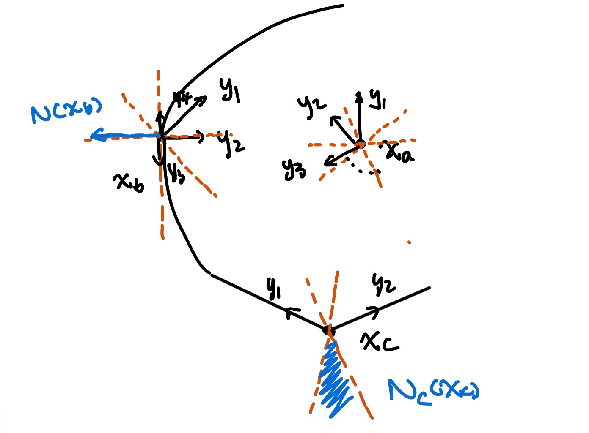</a>
<ul><li>
<math xmlns="http://www.w3.org/1998/Math/MathML"><semantics><mrow><mstyle scriptlevel="0" displaystyle="true"><msub><mi mathvariant="bold-italic">x</mi><mi>a</mi></msub><mo>∈</mo><mtext>int</mtext><mo stretchy="false">(</mo><mi mathvariant="script">C</mi><mo stretchy="false">)</mo></mstyle></mrow><annotation encoding="application/x-tex">\displaystyle \bm{x}_a \in \text{int}(\mathcal{C})</annotation></semantics></math>xa​∈int(C) 是集合的内点. 则四周都是集合的点, 因此从 <math xmlns="http://www.w3.org/1998/Math/MathML"><semantics><mrow><mstyle scriptlevel="0" displaystyle="true"><msub><mi mathvariant="bold-italic">x</mi><mi>a</mi></msub></mstyle></mrow><annotation encoding="application/x-tex">\displaystyle \bm{x}_a</annotation></semantics></math>xa​ 出发, 满足法向不等式的非零向量是不存在的. 因此 <math xmlns="http://www.w3.org/1998/Math/MathML"><semantics><mrow><mstyle scriptlevel="0" displaystyle="true"><msub><mi mathvariant="script">N</mi><mi mathvariant="script">C</mi></msub><mo stretchy="false">(</mo><msub><mi mathvariant="bold-italic">x</mi><mi>a</mi></msub><mo stretchy="false">)</mo><mo>=</mo><mo stretchy="false">{</mo><mi mathvariant="bold">0</mi><mo stretchy="false">}</mo></mstyle></mrow><annotation encoding="application/x-tex">\displaystyle \mathcal{N}_{\mathcal{C}}(\bm{x}_a) = \{\bm{0}\}</annotation></semantics></math>NC​(xa​)={0}.
</li><li>
<math xmlns="http://www.w3.org/1998/Math/MathML"><semantics><mrow><mstyle scriptlevel="0" displaystyle="true"><msub><mi mathvariant="bold-italic">x</mi><mi>b</mi></msub><mo>∈</mo><mi mathvariant="normal">∂</mi><mi mathvariant="script">C</mi></mstyle></mrow><annotation encoding="application/x-tex">\displaystyle \bm{x}_b \in \partial \mathcal{C}</annotation></semantics></math>xb​∈∂C 是集合的边界点. 则从 <math xmlns="http://www.w3.org/1998/Math/MathML"><semantics><mrow><mstyle scriptlevel="0" displaystyle="true"><msub><mi mathvariant="bold-italic">x</mi><mi>b</mi></msub></mstyle></mrow><annotation encoding="application/x-tex">\displaystyle \bm{x}_b</annotation></semantics></math>xb​ 出发, 指向集合外部的向量是存在的. 最极端考虑两个切线方向, 则从 <math xmlns="http://www.w3.org/1998/Math/MathML"><semantics><mrow><mstyle scriptlevel="0" displaystyle="true"><msub><mi mathvariant="bold-italic">x</mi><mi>b</mi></msub></mstyle></mrow><annotation encoding="application/x-tex">\displaystyle \bm{x}_b</annotation></semantics></math>xb​ 出发, 指向集合外部的向量只能在这两个切线方向之间. 因此 <math xmlns="http://www.w3.org/1998/Math/MathML"><semantics><mrow><mstyle scriptlevel="0" displaystyle="true"><msub><mi mathvariant="script">N</mi><mi mathvariant="script">C</mi></msub><mo stretchy="false">(</mo><msub><mi mathvariant="bold-italic">x</mi><mi>b</mi></msub><mo stretchy="false">)</mo></mstyle></mrow><annotation encoding="application/x-tex">\displaystyle \mathcal{N}_{\mathcal{C}}(\bm{x}_b)</annotation></semantics></math>NC​(xb​) 是一个射线, 其方向垂直于切线方向.
</li><li>
<math xmlns="http://www.w3.org/1998/Math/MathML"><semantics><mrow><mstyle scriptlevel="0" displaystyle="true"><msub><mi mathvariant="bold-italic">x</mi><mi>c</mi></msub><mo>∈</mo><mi mathvariant="script">C</mi></mstyle></mrow><annotation encoding="application/x-tex">\displaystyle \bm{x}_c \in \mathcal{C}</annotation></semantics></math>xc​∈C 是集合的角点. 则法锥是构成角点的法向量的非负锥组合. 也即, 法锥是一个凸锥, 其包含了所有满足上述法向不等式的向量.
</li></ul>

<em><strong>法锥与投影</strong></em>

<section class="latex-block latex-proposition" id="latex-propositionblock-2-3-1" aria-label="Proposition 2.3.1">
Proposition 2.3.1　法锥与投影

Projection variational inequality 可以用法锥的概念来重新表述为:

<math xmlns="http://www.w3.org/1998/Math/MathML" display="block"><semantics><mrow><msup><mi mathvariant="bold-italic">x</mi><mo>⋆</mo></msup><mo>=</mo><msub><mi mathvariant="normal">Π</mi><mi mathvariant="script">C</mi></msub><mo stretchy="false">(</mo><mi mathvariant="bold-italic">y</mi><mo stretchy="false">)</mo><mtext>  </mtext><mo>⟺</mo><mtext>  </mtext><mi mathvariant="bold-italic">y</mi><mo>−</mo><msup><mi mathvariant="bold-italic">x</mi><mo>⋆</mo></msup><mo>∈</mo><msub><mi mathvariant="script">N</mi><mi mathvariant="script">C</mi></msub><mo stretchy="false">(</mo><msup><mi mathvariant="bold-italic">x</mi><mo>⋆</mo></msup><mo stretchy="false">)</mo><mi mathvariant="normal">.</mi></mrow><annotation encoding="application/x-tex">
\bm{x}^\star = \Pi_{\mathcal{C}}(\bm{y}) \iff \bm{y}-\bm{x}^\star \in \mathcal{N}_{\mathcal{C}}(\bm{x}^\star).
</annotation></semantics></math>x⋆=ΠC​(y)⟺y−x⋆∈NC​(x⋆).

或

<math xmlns="http://www.w3.org/1998/Math/MathML" display="block"><semantics><mrow><mi mathvariant="bold-italic">y</mi><mo>−</mo><msub><mi mathvariant="normal">Π</mi><mi mathvariant="script">C</mi></msub><mo stretchy="false">(</mo><mi mathvariant="bold-italic">y</mi><mo stretchy="false">)</mo><mo>∈</mo><msub><mi mathvariant="script">N</mi><mi mathvariant="script">C</mi></msub><mo stretchy="false">(</mo><msub><mi mathvariant="normal">Π</mi><mi mathvariant="script">C</mi></msub><mo stretchy="false">(</mo><mi mathvariant="bold-italic">y</mi><mo stretchy="false">)</mo><mo stretchy="false">)</mo><mi mathvariant="normal">.</mi></mrow><annotation encoding="application/x-tex">
\bm{y} - \Pi_{\mathcal{C}}(\bm{y}) \in \mathcal{N}_{\mathcal{C}}(\Pi_{\mathcal{C}}(\bm{y})).
</annotation></semantics></math>y−ΠC​(y)∈NC​(ΠC​(y)).</section>

<em><strong>法锥与超平面</strong></em>

此外, 回顾一个超平面的定义 <math xmlns="http://www.w3.org/1998/Math/MathML"><semantics><mrow><mstyle scriptlevel="0" displaystyle="true"><mo stretchy="false">{</mo><mi mathvariant="bold-italic">x</mi><mo>∈</mo><msup><mi mathvariant="double-struck">R</mi><mi>n</mi></msup><mo>:</mo><msup><mi mathvariant="bold-italic">a</mi><mi mathvariant="normal">⊤</mi></msup><mi mathvariant="bold-italic">x</mi><mo>=</mo><mi>b</mi><mo stretchy="false">}</mo></mstyle></mrow><annotation encoding="application/x-tex">\displaystyle \{\bm{x} \in \mathbb{R}^n: \bm{a}^\top \bm{x} = b\}</annotation></semantics></math>{x∈Rn:a⊤x=b}, 其法向量就是 <math xmlns="http://www.w3.org/1998/Math/MathML"><semantics><mrow><mstyle scriptlevel="0" displaystyle="true"><mi mathvariant="bold-italic">a</mi></mstyle></mrow><annotation encoding="application/x-tex">\displaystyle \bm{a}</annotation></semantics></math>a. 因此确定了一个法向量就确定了一个平面的方向, 再加上平面过的一个点, 就确定了一个超平面. 而对于法锥中的法向量, 这样定义的超平面很完美地使集合完全位于超平面的一侧.

<em><strong>法锥与最优性条件</strong></em>

<section class="latex-block latex-proposition" id="latex-propositionblock-2-3-2" aria-label="Proposition 2.3.2">
Proposition 2.3.2　Polyhedral normal cone

很典型的, 在 LP 问题 <math xmlns="http://www.w3.org/1998/Math/MathML"><semantics><mrow><mstyle scriptlevel="0" displaystyle="true"><munder><mrow><mi>min</mi><mo>⁡</mo></mrow><mrow><mi mathvariant="bold-italic">x</mi><mo>∈</mo><mi mathvariant="script">C</mi></mrow></munder><mi>f</mi><mo stretchy="false">(</mo><mi mathvariant="bold-italic">x</mi><mo stretchy="false">)</mo></mstyle></mrow><annotation encoding="application/x-tex">\displaystyle \min_{\bm{x} \in \mathcal{C}} f(\bm{x})</annotation></semantics></math>x∈Cmin​f(x), 假设 <math xmlns="http://www.w3.org/1998/Math/MathML"><semantics><mrow><mstyle scriptlevel="0" displaystyle="true"><mi mathvariant="script">C</mi><mo>=</mo><mo stretchy="false">{</mo><mi mathvariant="bold-italic">x</mi><mo>∈</mo><msup><mi mathvariant="double-struck">R</mi><mi>n</mi></msup><mo>:</mo><mi mathvariant="bold-italic">A</mi><mi mathvariant="bold-italic">x</mi><mo>≤</mo><mi mathvariant="bold-italic">b</mi><mo stretchy="false">}</mo></mstyle></mrow><annotation encoding="application/x-tex">\displaystyle \mathcal{C} = \{\bm{x} \in \mathbb{R}^n: \bm{A}\bm{x} \leq \bm{b}\}</annotation></semantics></math>C={x∈Rn:Ax≤b} 是一个 polyhedron. 在 <math xmlns="http://www.w3.org/1998/Math/MathML"><semantics><mrow><mstyle scriptlevel="0" displaystyle="true"><msup><mi mathvariant="bold-italic">x</mi><mo>⋆</mo></msup><mo>∈</mo><mi mathvariant="script">C</mi></mstyle></mrow><annotation encoding="application/x-tex">\displaystyle \bm{x}^\star \in \mathcal{C}</annotation></semantics></math>x⋆∈C 处, 定义 active constraint set 为 <math xmlns="http://www.w3.org/1998/Math/MathML"><semantics><mrow><mstyle scriptlevel="0" displaystyle="true"><mi mathvariant="script">A</mi><mo stretchy="false">(</mo><msup><mi mathvariant="bold-italic">x</mi><mo>⋆</mo></msup><mo stretchy="false">)</mo><mo>:</mo><mo>=</mo><mo stretchy="false">{</mo><mi>i</mi><mo>:</mo><msubsup><mi mathvariant="bold-italic">a</mi><mi>i</mi><mi mathvariant="normal">⊤</mi></msubsup><msup><mi mathvariant="bold-italic">x</mi><mo>⋆</mo></msup><mo>=</mo><msub><mi>b</mi><mi>i</mi></msub><mo stretchy="false">}</mo></mstyle></mrow><annotation encoding="application/x-tex">\displaystyle \mathcal{A}(\bm{x}^\star) := \{i: \bm{a}_i^\top \bm{x}^\star = b_i\}</annotation></semantics></math>A(x⋆):={i:ai⊤​x⋆=bi​}，则在 <math xmlns="http://www.w3.org/1998/Math/MathML"><semantics><mrow><mstyle scriptlevel="0" displaystyle="true"><msup><mi mathvariant="bold-italic">x</mi><mo>⋆</mo></msup></mstyle></mrow><annotation encoding="application/x-tex">\displaystyle \bm{x}^\star</annotation></semantics></math>x⋆ 处的法锥就是这些 active constraints 的法向量的锥组合, 即

<math xmlns="http://www.w3.org/1998/Math/MathML" display="block"><semantics><mrow><msub><mi mathvariant="script">N</mi><mi mathvariant="script">C</mi></msub><mo stretchy="false">(</mo><msup><mi mathvariant="bold-italic">x</mi><mo>⋆</mo></msup><mo stretchy="false">)</mo><mo>=</mo><mrow><mo fence="true">{</mo><munder><mo>∑</mo><mrow><mi>i</mi><mo>∈</mo><mi mathvariant="script">A</mi><mo stretchy="false">(</mo><msup><mi mathvariant="bold-italic">x</mi><mo>⋆</mo></msup><mo stretchy="false">)</mo></mrow></munder><msub><mi>λ</mi><mi>i</mi></msub><msub><mi mathvariant="bold-italic">a</mi><mi>i</mi></msub><mo>:</mo><msub><mi>λ</mi><mi>i</mi></msub><mo>≥</mo><mn>0</mn><mo fence="true">}</mo></mrow><mi mathvariant="normal">.</mi></mrow><annotation encoding="application/x-tex">
\mathcal{N}_{\mathcal{C}}(\bm{x}^\star) = \left\{\sum_{i \in \mathcal{A}(\bm{x}^\star)} \lambda_i \bm{a}_i: \lambda_i \geq 0\right\}.
</annotation></semantics></math>NC​(x⋆)=⎩<svg xmlns="http://www.w3.org/2000/svg" width="0.8889em" height="0.016em" style="width:0.8889em" viewBox="0 0 888.89 16" preserveAspectRatio="xMinYMin"><path d="M384 0 H504 V16 H384z M384 0 H504 V16 H384z"/></svg>⎨<svg xmlns="http://www.w3.org/2000/svg" width="0.8889em" height="0.016em" style="width:0.8889em" viewBox="0 0 888.89 16" preserveAspectRatio="xMinYMin"><path d="M384 0 H504 V16 H384z M384 0 H504 V16 H384z"/></svg>⎧​i∈A(x⋆)∑​λi​ai​:λi​≥0⎭<svg xmlns="http://www.w3.org/2000/svg" width="0.8889em" height="0.016em" style="width:0.8889em" viewBox="0 0 888.89 16" preserveAspectRatio="xMinYMin"><path d="M384 0 H504 V16 H384z M384 0 H504 V16 H384z"/></svg>⎬<svg xmlns="http://www.w3.org/2000/svg" width="0.8889em" height="0.016em" style="width:0.8889em" viewBox="0 0 888.89 16" preserveAspectRatio="xMinYMin"><path d="M384 0 H504 V16 H384z M384 0 H504 V16 H384z"/></svg>⎫​.</section>

在讨论 KKT optimality condition 时, 其平稳性条件为

<math xmlns="http://www.w3.org/1998/Math/MathML" display="block"><semantics><mrow><mi mathvariant="normal">∇</mi><mi>f</mi><mo stretchy="false">(</mo><msup><mi mathvariant="bold-italic">x</mi><mo>⋆</mo></msup><mo stretchy="false">)</mo><mo>+</mo><munder><mo>∑</mo><mrow><mi>i</mi><mo>∈</mo><mi mathvariant="script">A</mi><mo stretchy="false">(</mo><msup><mi mathvariant="bold-italic">x</mi><mo>⋆</mo></msup><mo stretchy="false">)</mo></mrow></munder><msub><mi>λ</mi><mi>i</mi></msub><msub><mi mathvariant="bold-italic">a</mi><mi>i</mi></msub><mo>=</mo><mn>0</mn><mo separator="true">,</mo><mtext> </mtext><msub><mi>λ</mi><mi>i</mi></msub><mo>≥</mo><mn>0.</mn></mrow><annotation encoding="application/x-tex">
\nabla f(\bm{x}^\star) + \sum_{i \in \mathcal{A}(\bm{x}^\star)} \lambda_i \bm{a}_i = 0,~ \lambda_i \geq 0.
</annotation></semantics></math>∇f(x⋆)+i∈A(x⋆)∑​λi​ai​=0, λi​≥0.

而这恰好就是 <math xmlns="http://www.w3.org/1998/Math/MathML"><semantics><mrow><mstyle scriptlevel="0" displaystyle="true"><msub><mi mathvariant="script">N</mi><mi mathvariant="script">C</mi></msub><mo stretchy="false">(</mo><msup><mi mathvariant="bold-italic">x</mi><mo>⋆</mo></msup><mo stretchy="false">)</mo></mstyle></mrow><annotation encoding="application/x-tex">\displaystyle \mathcal{N}_{\mathcal{C}}(\bm{x}^\star)</annotation></semantics></math>NC​(x⋆) 的定义. 也即,

<math xmlns="http://www.w3.org/1998/Math/MathML" display="block"><semantics><mrow><mo>−</mo><mi mathvariant="normal">∇</mi><mi>f</mi><mo stretchy="false">(</mo><msup><mi mathvariant="bold-italic">x</mi><mo>⋆</mo></msup><mo stretchy="false">)</mo><mo>∈</mo><msub><mi mathvariant="script">N</mi><mi mathvariant="script">C</mi></msub><mo stretchy="false">(</mo><msup><mi mathvariant="bold-italic">x</mi><mo>⋆</mo></msup><mo stretchy="false">)</mo><mi mathvariant="normal">.</mi></mrow><annotation encoding="application/x-tex">
- \nabla f(\bm{x}^\star) \in \mathcal{N}_{\mathcal{C}}(\bm{x}^\star).
</annotation></semantics></math>−∇f(x⋆)∈NC​(x⋆).

这也是与法锥的几何直观的理解相符: 我们想要在 <math xmlns="http://www.w3.org/1998/Math/MathML"><semantics><mrow><mstyle scriptlevel="0" displaystyle="true"><msup><mi mathvariant="bold-italic">x</mi><mo>⋆</mo></msup></mstyle></mrow><annotation encoding="application/x-tex">\displaystyle \bm{x}^\star</annotation></semantics></math>x⋆ 处下降, 也即 <math xmlns="http://www.w3.org/1998/Math/MathML"><semantics><mrow><mstyle scriptlevel="0" displaystyle="true"><mo>−</mo><mi mathvariant="normal">∇</mi><mi>f</mi><mo stretchy="false">(</mo><msup><mi mathvariant="bold-italic">x</mi><mo>⋆</mo></msup><mo stretchy="false">)</mo></mstyle></mrow><annotation encoding="application/x-tex">\displaystyle -\nabla f(\bm{x}^\star)</annotation></semantics></math>−∇f(x⋆) 指向的方向. 若下降的方向指向了可行集的内部, 则说明我们可以继续下降, 这显然不是最优解. 反之, 若所有可能的下降方向都指向了可行集的外部, 则确实已经最优了.

<a class="latex-raster-figure" href="./convex-geometry/20260929223822798.png" style="--figure-width:30%">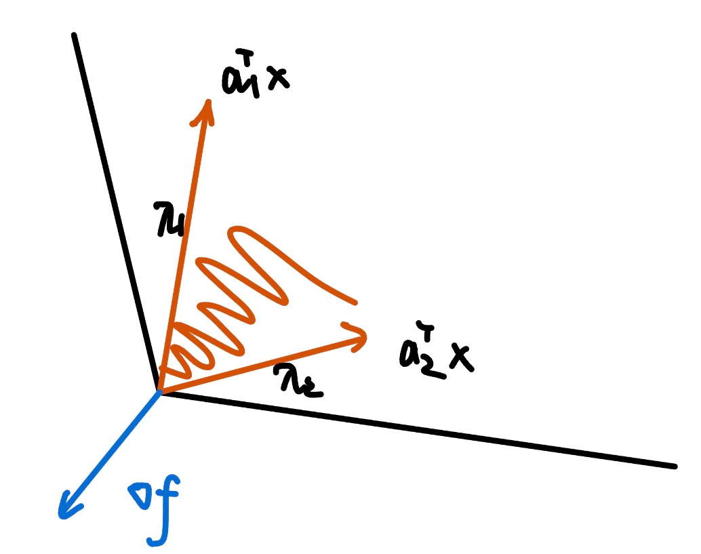</a>

另外还有一种理解方式更加物理直观. 所有的可行约束类似一个墙壁 (例如图中的边界). 而墙壁所提供的支持力就是法方向. 故法锥可以理解为所有约束 (墙壁) 所提供的支持力的合力, 而 Lagrange multiplier <math xmlns="http://www.w3.org/1998/Math/MathML"><semantics><mrow><mstyle scriptlevel="0" displaystyle="true"><msub><mi>λ</mi><mi>i</mi></msub></mstyle></mrow><annotation encoding="application/x-tex">\displaystyle \lambda_i</annotation></semantics></math>λi​ 就是每个约束所提供的支持力的大小. 因此, 若下降方向处在法锥中, 则说明我们能够通过调整各个墙壁提供的支持力的大小, 来抵消下降方向的作用, 也即我们已经无法继续下降了. 而若一个下降方向不在法锥中, 则说明我们无法通过现有力的合成来抵消下降方向的作用, 因此这将会导致我们继续下降, 也即不是最优解.

### 2.4. Convex cones, dual cones, polar cones

#### 2.4.1. Cones
<section class="latex-block latex-definition" id="latex-defblock-2-4-1" aria-label="Definition 2.4.1">
Definition 2.4.1　Cones

回顾, 定义 <math xmlns="http://www.w3.org/1998/Math/MathML"><semantics><mrow><mstyle scriptlevel="0" displaystyle="true"><mi mathvariant="script">K</mi><mo>⊆</mo><msup><mi mathvariant="double-struck">R</mi><mi>n</mi></msup></mstyle></mrow><annotation encoding="application/x-tex">\displaystyle \mathcal{K} \subseteq \mathbb{R}^n</annotation></semantics></math>K⊆Rn 是一个 cone, 若: <math xmlns="http://www.w3.org/1998/Math/MathML"><semantics><mrow><mstyle scriptlevel="0" displaystyle="true"><mi>λ</mi><mi mathvariant="bold-italic">x</mi><mo>∈</mo><mi mathvariant="script">K</mi><mo separator="true">,</mo><mtext> </mtext><mi mathvariant="normal">∀</mi><mi mathvariant="bold-italic">x</mi><mo>∈</mo><mi mathvariant="script">K</mi><mo separator="true">,</mo><mtext> </mtext><mi mathvariant="normal">∀</mi><mi>λ</mi><mo>≥</mo><mn>0</mn></mstyle></mrow><annotation encoding="application/x-tex">\displaystyle \lambda \bm{x} \in \mathcal{K},~ \forall \bm{x} \in \mathcal{K},~ \forall \lambda \geq 0</annotation></semantics></math>λx∈K, ∀x∈K, ∀λ≥0.  进一步, 对于一个锥 <math xmlns="http://www.w3.org/1998/Math/MathML"><semantics><mrow><mstyle scriptlevel="0" displaystyle="true"><mi mathvariant="script">K</mi></mstyle></mrow><annotation encoding="application/x-tex">\displaystyle \mathcal{K}</annotation></semantics></math>K，若其是凸集, 则称之为 convex cone. 也即, 对于任意 <math xmlns="http://www.w3.org/1998/Math/MathML"><semantics><mrow><mstyle scriptlevel="0" displaystyle="true"><mi mathvariant="bold-italic">x</mi><mo separator="true">,</mo><mi mathvariant="bold-italic">y</mi><mo>∈</mo><mi mathvariant="script">K</mi></mstyle></mrow><annotation encoding="application/x-tex">\displaystyle \bm{x}, \bm{y} \in \mathcal{K}</annotation></semantics></math>x,y∈K，有 <math xmlns="http://www.w3.org/1998/Math/MathML"><semantics><mrow><mstyle scriptlevel="0" displaystyle="true"><mi>λ</mi><mi mathvariant="bold-italic">x</mi><mo>+</mo><mo stretchy="false">(</mo><mn>1</mn><mo>−</mo><mi>λ</mi><mo stretchy="false">)</mo><mi mathvariant="bold-italic">y</mi><mo>∈</mo><mi mathvariant="script">K</mi><mo separator="true">,</mo><mtext> </mtext><mi mathvariant="normal">∀</mi><mi>λ</mi><mo>∈</mo><mo stretchy="false">[</mo><mn>0</mn><mo separator="true">,</mo><mn>1</mn><mo stretchy="false">]</mo></mstyle></mrow><annotation encoding="application/x-tex">\displaystyle \lambda \bm{x} + (1-\lambda) \bm{y} \in \mathcal{K},~ \forall \lambda \in [0,1]</annotation></semantics></math>λx+(1−λ)y∈K, ∀λ∈[0,1].

下面是与 cone 相关的一些概念.

<ul><li>
<em>Pointed cone</em>: 若 <math xmlns="http://www.w3.org/1998/Math/MathML"><semantics><mrow><mstyle scriptlevel="0" displaystyle="true"><mi mathvariant="script">K</mi><mo>∩</mo><mo stretchy="false">(</mo><mo>−</mo><mi mathvariant="script">K</mi><mo stretchy="false">)</mo><mo>=</mo><mo stretchy="false">{</mo><mi mathvariant="bold">0</mi><mo stretchy="false">}</mo></mstyle></mrow><annotation encoding="application/x-tex">\displaystyle \mathcal{K} \cap (-\mathcal{K}) = \{\bm{0}\}</annotation></semantics></math>K∩(−K)={0}，则称 <math xmlns="http://www.w3.org/1998/Math/MathML"><semantics><mrow><mstyle scriptlevel="0" displaystyle="true"><mi mathvariant="script">K</mi></mstyle></mrow><annotation encoding="application/x-tex">\displaystyle \mathcal{K}</annotation></semantics></math>K 是 pointed cone. 其中 <math xmlns="http://www.w3.org/1998/Math/MathML"><semantics><mrow><mstyle scriptlevel="0" displaystyle="true"><mo>−</mo><mi mathvariant="script">K</mi><mo>:</mo><mo>=</mo><mo stretchy="false">{</mo><mo>−</mo><mi mathvariant="bold-italic">x</mi><mo>:</mo><mi mathvariant="bold-italic">x</mi><mo>∈</mo><mi mathvariant="script">K</mi><mo stretchy="false">}</mo></mstyle></mrow><annotation encoding="application/x-tex">\displaystyle -\mathcal{K} := \{-\bm{x}: \bm{x} \in \mathcal{K}\}</annotation></semantics></math>−K:={−x:x∈K}. 例如, 非负正交锥 <math xmlns="http://www.w3.org/1998/Math/MathML"><semantics><mrow><mstyle scriptlevel="0" displaystyle="true"><msubsup><mi mathvariant="double-struck">R</mi><mo>+</mo><mi>n</mi></msubsup></mstyle></mrow><annotation encoding="application/x-tex">\displaystyle \mathbb{R}^n_+</annotation></semantics></math>R+n​ 是 pointed cone, 而 <math xmlns="http://www.w3.org/1998/Math/MathML"><semantics><mrow><mstyle scriptlevel="0" displaystyle="true"><msup><mi mathvariant="double-struck">R</mi><mi>n</mi></msup></mstyle></mrow><annotation encoding="application/x-tex">\displaystyle \mathbb{R}^n</annotation></semantics></math>Rn 不是 pointed cone.
</li><li>
<em>Solid cone</em>: 若 <math xmlns="http://www.w3.org/1998/Math/MathML"><semantics><mrow><mstyle scriptlevel="0" displaystyle="true"><mi mathvariant="script">K</mi></mstyle></mrow><annotation encoding="application/x-tex">\displaystyle \mathcal{K}</annotation></semantics></math>K 的 interior 非空, 则称 <math xmlns="http://www.w3.org/1998/Math/MathML"><semantics><mrow><mstyle scriptlevel="0" displaystyle="true"><mi mathvariant="script">K</mi></mstyle></mrow><annotation encoding="application/x-tex">\displaystyle \mathcal{K}</annotation></semantics></math>K 是 solid cone. 例如, 非负正交锥 <math xmlns="http://www.w3.org/1998/Math/MathML"><semantics><mrow><mstyle scriptlevel="0" displaystyle="true"><msubsup><mi mathvariant="double-struck">R</mi><mo>+</mo><mi>n</mi></msubsup></mstyle></mrow><annotation encoding="application/x-tex">\displaystyle \mathbb{R}^n_+</annotation></semantics></math>R+n​ 是 solid cone, 而 <math xmlns="http://www.w3.org/1998/Math/MathML"><semantics><mrow><mstyle scriptlevel="0" displaystyle="true"><mi mathvariant="script">K</mi><mo>=</mo><mo stretchy="false">{</mo><mo stretchy="false">(</mo><mi>t</mi><mo separator="true">,</mo><mn>0</mn><mo stretchy="false">)</mo><mo>:</mo><mi>t</mi><mo>≥</mo><mn>0</mn><mo stretchy="false">}</mo><mo>⊆</mo><msup><mi mathvariant="double-struck">R</mi><mn>2</mn></msup></mstyle></mrow><annotation encoding="application/x-tex">\displaystyle \mathcal{K} = \{(t,0): t \geq 0\} \subseteq \mathbb{R}^2</annotation></semantics></math>K={(t,0):t≥0}⊆R2 (即一条射线) 不是 solid cone.
</li><li>
<em>Proper cone</em>: 若 <math xmlns="http://www.w3.org/1998/Math/MathML"><semantics><mrow><mstyle scriptlevel="0" displaystyle="true"><mi mathvariant="script">K</mi></mstyle></mrow><annotation encoding="application/x-tex">\displaystyle \mathcal{K}</annotation></semantics></math>K 是 pointed, closed, convex 且 solid, 则称 <math xmlns="http://www.w3.org/1998/Math/MathML"><semantics><mrow><mstyle scriptlevel="0" displaystyle="true"><mi mathvariant="script">K</mi></mstyle></mrow><annotation encoding="application/x-tex">\displaystyle \mathcal{K}</annotation></semantics></math>K 是 proper cone.
</li></ul></section>

#### 2.4.2. Tangent cone

<strong>切锥为可行方向及其极限方向构成的集合.</strong>

<section class="latex-block latex-definition" id="latex-defblock-2-4-2" aria-label="Definition 2.4.2">
Definition 2.4.2　Tangent cone

给定非空闭凸集 <math xmlns="http://www.w3.org/1998/Math/MathML"><semantics><mrow><mstyle scriptlevel="0" displaystyle="true"><mi mathvariant="script">C</mi><mo>⊆</mo><msup><mi mathvariant="double-struck">R</mi><mi>n</mi></msup></mstyle></mrow><annotation encoding="application/x-tex">\displaystyle \mathcal{C} \subseteq \mathbb{R}^n</annotation></semantics></math>C⊆Rn，定义 <math xmlns="http://www.w3.org/1998/Math/MathML"><semantics><mrow><mstyle scriptlevel="0" displaystyle="true"><mi mathvariant="bold-italic">x</mi><mo>∈</mo><mi mathvariant="script">C</mi></mstyle></mrow><annotation encoding="application/x-tex">\displaystyle \bm{x} \in \mathcal{C}</annotation></semantics></math>x∈C 处的切锥为:

<math xmlns="http://www.w3.org/1998/Math/MathML" display="block"><semantics><mrow><msub><mi mathvariant="script">T</mi><mi mathvariant="script">C</mi></msub><mo stretchy="false">(</mo><mi mathvariant="bold-italic">x</mi><mo stretchy="false">)</mo><mo>:</mo><mo>=</mo><mtext>cl</mtext><mo stretchy="false">(</mo><mtext>cone</mtext><mo stretchy="false">(</mo><mi mathvariant="script">C</mi><mo>−</mo><mi mathvariant="bold-italic">x</mi><mo stretchy="false">)</mo><mo stretchy="false">)</mo><mo>=</mo><mtext>cl</mtext><mo stretchy="false">{</mo><mi>λ</mi><mo stretchy="false">(</mo><mi mathvariant="bold-italic">y</mi><mo>−</mo><mi mathvariant="bold-italic">x</mi><mo stretchy="false">)</mo><mo>:</mo><mi>λ</mi><mo>≥</mo><mn>0</mn><mo separator="true">,</mo><mtext> </mtext><mi mathvariant="bold-italic">y</mi><mo>∈</mo><mi mathvariant="script">C</mi><mo stretchy="false">}</mo><mi mathvariant="normal">.</mi></mrow><annotation encoding="application/x-tex">
\mathcal{T}_{\mathcal{C}}(\bm{x}) := \text{cl}(\text{cone}(\mathcal{C}-\bm{x})) = \text{cl}\{\lambda(\bm{y}-\bm{x}): \lambda \geq 0,~ \bm{y} \in \mathcal{C}\}.
</annotation></semantics></math>TC​(x):=cl(cone(C−x))=cl{λ(y−x):λ≥0, y∈C}.</section>
<ul><li>
<math xmlns="http://www.w3.org/1998/Math/MathML"><semantics><mrow><mstyle scriptlevel="0" displaystyle="true"><mi mathvariant="script">C</mi><mo>−</mo><mi mathvariant="bold-italic">x</mi></mstyle></mrow><annotation encoding="application/x-tex">\displaystyle \mathcal{C} - \bm{x}</annotation></semantics></math>C−x 表示从 <math xmlns="http://www.w3.org/1998/Math/MathML"><semantics><mrow><mstyle scriptlevel="0" displaystyle="true"><mi mathvariant="bold-italic">x</mi></mstyle></mrow><annotation encoding="application/x-tex">\displaystyle \bm{x}</annotation></semantics></math>x 出发, 指向集合内部的所有点. cone 表示可以在这些方向上进行任意伸缩. 而 closure 则会包含极限点 (如切线方向等)

<ul><li>
例如, 对于单位圆盘 <math xmlns="http://www.w3.org/1998/Math/MathML"><semantics><mrow><mstyle scriptlevel="0" displaystyle="true"><mi mathvariant="script">C</mi><mo>=</mo><mo stretchy="false">{</mo><mi mathvariant="bold-italic">x</mi><mo>∈</mo><msup><mi mathvariant="double-struck">R</mi><mn>2</mn></msup><mo>:</mo><mi mathvariant="normal">∥</mi><mi mathvariant="bold-italic">x</mi><msub><mi mathvariant="normal">∥</mi><mn>2</mn></msub><mo>≤</mo><mn>1</mn><mo stretchy="false">}</mo></mstyle></mrow><annotation encoding="application/x-tex">\displaystyle \mathcal{C} = \{\bm{x} \in \mathbb{R}^2: \|\bm{x}\|_2 \leq 1\}</annotation></semantics></math>C={x∈R2:∥x∥2​≤1}，在 <math xmlns="http://www.w3.org/1998/Math/MathML"><semantics><mrow><mstyle scriptlevel="0" displaystyle="true"><mi mathvariant="bold-italic">x</mi><mo>=</mo><mo stretchy="false">(</mo><mn>1</mn><mo separator="true">,</mo><mn>0</mn><mo stretchy="false">)</mo></mstyle></mrow><annotation encoding="application/x-tex">\displaystyle \bm{x} = (1,0)</annotation></semantics></math>x=(1,0) 处, 方向 <math xmlns="http://www.w3.org/1998/Math/MathML"><semantics><mrow><mstyle scriptlevel="0" displaystyle="true"><mo stretchy="false">(</mo><mn>0</mn><mo separator="true">,</mo><mn>1</mn><mo stretchy="false">)</mo></mstyle></mrow><annotation encoding="application/x-tex">\displaystyle (0,1)</annotation></semantics></math>(0,1) 是一个切线方向, 我们在定义切锥时希望将其包含在内, 因此需要 closure.
</li></ul></li><li>
因此切锥可理解为从 <math xmlns="http://www.w3.org/1998/Math/MathML"><semantics><mrow><mstyle scriptlevel="0" displaystyle="true"><mi mathvariant="bold-italic">x</mi></mstyle></mrow><annotation encoding="application/x-tex">\displaystyle \bm{x}</annotation></semantics></math>x 出发, 在一阶意义下, 指向集合内部的所有方向的集合 (包括可行方向及其极限).
</li></ul>

#### 2.4.3. Polar cone and dual cone
<a class="latex-raster-figure" href="./convex-geometry/20261010122849338.png" style="--figure-width:40%">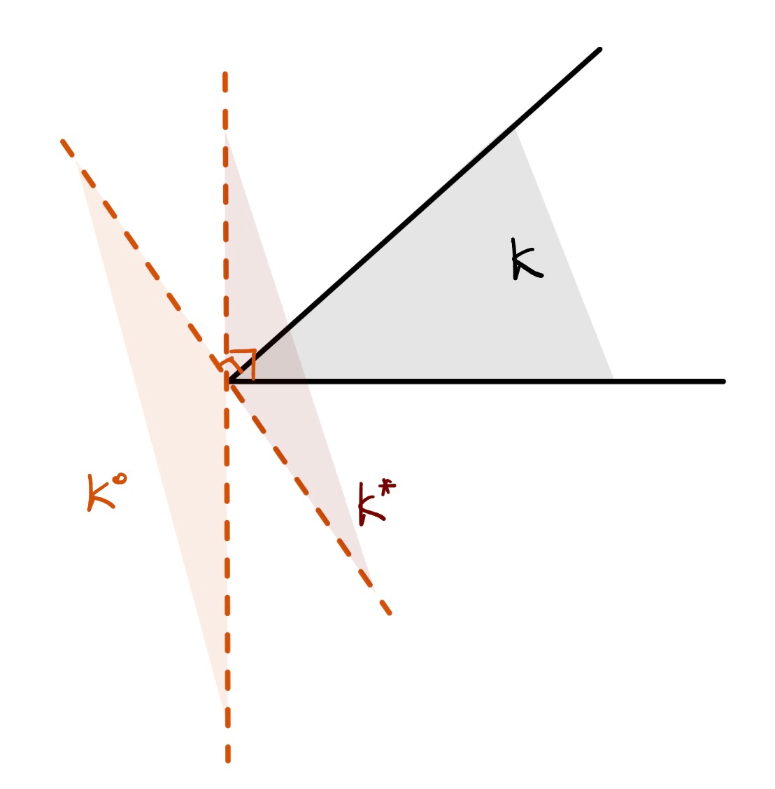</a>

<strong>极锥为与给定集合中所有向量内积非正的向量集合, 即极锥的任意向量与集合中所有向量都呈直角或钝角.</strong>

<section class="latex-block latex-definition" id="latex-defblock-2-4-3" aria-label="Definition 2.4.3">
Definition 2.4.3　Polar cone

给定非空闭凸集 <math xmlns="http://www.w3.org/1998/Math/MathML"><semantics><mrow><mstyle scriptlevel="0" displaystyle="true"><mi mathvariant="script">C</mi><mo>⊆</mo><msup><mi mathvariant="double-struck">R</mi><mi>n</mi></msup></mstyle></mrow><annotation encoding="application/x-tex">\displaystyle \mathcal{C} \subseteq \mathbb{R}^n</annotation></semantics></math>C⊆Rn，定义 <math xmlns="http://www.w3.org/1998/Math/MathML"><semantics><mrow><mstyle scriptlevel="0" displaystyle="true"><mi mathvariant="script">C</mi></mstyle></mrow><annotation encoding="application/x-tex">\displaystyle \mathcal{C}</annotation></semantics></math>C 的极锥为:

<math xmlns="http://www.w3.org/1998/Math/MathML" display="block"><semantics><mrow><msup><mi mathvariant="script">C</mi><mo>∘</mo></msup><mo>:</mo><mo>=</mo><mo stretchy="false">{</mo><mi mathvariant="bold-italic">v</mi><mo>∈</mo><msup><mi mathvariant="double-struck">R</mi><mi>n</mi></msup><mo>:</mo><mrow><mo fence="true">⟨</mo><mi mathvariant="bold-italic">v</mi><mo separator="true">,</mo><mi mathvariant="bold-italic">x</mi><mo fence="true">⟩</mo></mrow><mo>≤</mo><mn>0</mn><mo separator="true">,</mo><mtext> </mtext><mi mathvariant="normal">∀</mi><mi mathvariant="bold-italic">x</mi><mo>∈</mo><mi mathvariant="script">C</mi><mo stretchy="false">}</mo><mi mathvariant="normal">.</mi></mrow><annotation encoding="application/x-tex">
\mathcal{C}^\circ := \{\bm{v} \in \mathbb{R}^n: \left\langle \bm{v}, \bm{x} \right\rangle \leq 0,~ \forall \bm{x} \in \mathcal{C}\}.
</annotation></semantics></math>C∘:={v∈Rn:⟨v,x⟩≤0, ∀x∈C}.</section>
<ul><li>
极锥可以理解为所有与集合 <math xmlns="http://www.w3.org/1998/Math/MathML"><semantics><mrow><mstyle scriptlevel="0" displaystyle="true"><mi mathvariant="script">C</mi></mstyle></mrow><annotation encoding="application/x-tex">\displaystyle \mathcal{C}</annotation></semantics></math>C 中方向不朝向同一侧的向量的集合. 也即, 极锥中的向量与集合 <math xmlns="http://www.w3.org/1998/Math/MathML"><semantics><mrow><mstyle scriptlevel="0" displaystyle="true"><mi mathvariant="script">C</mi></mstyle></mrow><annotation encoding="application/x-tex">\displaystyle \mathcal{C}</annotation></semantics></math>C 中的所有向量都呈钝角或直角.
</li></ul>

按此定义, 则有

<math xmlns="http://www.w3.org/1998/Math/MathML" display="block"><semantics><mrow><msub><mi mathvariant="script">N</mi><mi mathvariant="script">C</mi></msub><mo stretchy="false">(</mo><mi mathvariant="bold-italic">x</mi><mo stretchy="false">)</mo><mo>=</mo><msub><mi mathvariant="script">T</mi><mi mathvariant="script">C</mi></msub><mo stretchy="false">(</mo><mi mathvariant="bold-italic">x</mi><msup><mo stretchy="false">)</mo><mo>∘</mo></msup><mo separator="true">,</mo><mtext> </mtext><msub><mi mathvariant="script">T</mi><mi mathvariant="script">C</mi></msub><mo stretchy="false">(</mo><mi mathvariant="bold-italic">x</mi><mo stretchy="false">)</mo><mo>=</mo><msub><mi mathvariant="script">N</mi><mi mathvariant="script">C</mi></msub><mo stretchy="false">(</mo><mi mathvariant="bold-italic">x</mi><msup><mo stretchy="false">)</mo><mo>∘</mo></msup><mi mathvariant="normal">.</mi></mrow><annotation encoding="application/x-tex">
\mathcal{N}_{\mathcal{C}}(\bm{x}) = \mathcal{T}_{\mathcal{C}}(\bm{x})^\circ,~ \mathcal{T}_{\mathcal{C}}(\bm{x}) = \mathcal{N}_{\mathcal{C}}(\bm{x})^\circ.
</annotation></semantics></math>NC​(x)=TC​(x)∘, TC​(x)=NC​(x)∘.

<strong>对偶锥是极锥的反向, 即对偶锥中的向量与集合 <math xmlns="http://www.w3.org/1998/Math/MathML"><semantics><mrow><mstyle scriptlevel="0" displaystyle="true"><mi mathvariant="script">C</mi></mstyle></mrow><annotation encoding="application/x-tex">\displaystyle \mathcal{C}</annotation></semantics></math>C 中的所有向量都呈锐角或直角.</strong>

<section class="latex-block latex-definition" id="latex-defblock-2-4-4" aria-label="Definition 2.4.4">
Definition 2.4.4　Dual cone

另外和 polar cone 相关的还有 dual cone 的概念, 定义为:

<math xmlns="http://www.w3.org/1998/Math/MathML" display="block"><semantics><mrow><msup><mi mathvariant="script">C</mi><mo>∗</mo></msup><mo>:</mo><mo>=</mo><mo stretchy="false">{</mo><mi mathvariant="bold-italic">v</mi><mo>∈</mo><msup><mi mathvariant="double-struck">R</mi><mi>n</mi></msup><mo>:</mo><mrow><mo fence="true">⟨</mo><mi mathvariant="bold-italic">v</mi><mo separator="true">,</mo><mi mathvariant="bold-italic">x</mi><mo fence="true">⟩</mo></mrow><mo>≥</mo><mn>0</mn><mo separator="true">,</mo><mtext> </mtext><mi mathvariant="normal">∀</mi><mi mathvariant="bold-italic">x</mi><mo>∈</mo><mi mathvariant="script">C</mi><mo stretchy="false">}</mo><mo>=</mo><munder><mo>⋂</mo><mrow><mi mathvariant="bold-italic">x</mi><mo>∈</mo><mi mathvariant="script">C</mi></mrow></munder><mo stretchy="false">{</mo><mi mathvariant="bold-italic">v</mi><mo>∈</mo><msup><mi mathvariant="double-struck">R</mi><mi>n</mi></msup><mo>:</mo><mrow><mo fence="true">⟨</mo><mi mathvariant="bold-italic">v</mi><mo separator="true">,</mo><mi mathvariant="bold-italic">x</mi><mo fence="true">⟩</mo></mrow><mo>≥</mo><mn>0</mn><mo stretchy="false">}</mo><mi mathvariant="normal">.</mi></mrow><annotation encoding="application/x-tex">
\mathcal{C}^* := \{\bm{v} \in \mathbb{R}^n: \left\langle \bm{v}, \bm{x} \right\rangle \geq 0,~ \forall \bm{x} \in \mathcal{C}\} = \bigcap_{\bm{x} \in \mathcal{C}} \{\bm{v} \in \mathbb{R}^n: \left\langle \bm{v}, \bm{x} \right\rangle \geq 0\}.
</annotation></semantics></math>C∗:={v∈Rn:⟨v,x⟩≥0, ∀x∈C}=x∈C⋂​{v∈Rn:⟨v,x⟩≥0}.</section>
<section class="latex-block latex-proposition" id="latex-propositionblock-2-4-1" aria-label="Proposition 2.4.1">
Proposition 2.4.1　Dual cone properties

对偶锥有如下性质:

<ul><li>
<math xmlns="http://www.w3.org/1998/Math/MathML"><semantics><mrow><mstyle scriptlevel="0" displaystyle="true"><msup><mi mathvariant="script">C</mi><mo>∗</mo></msup><mo>=</mo><mo>−</mo><msup><mi mathvariant="script">C</mi><mo>∘</mo></msup></mstyle></mrow><annotation encoding="application/x-tex">\displaystyle \mathcal{C}^* = - \mathcal{C}^\circ</annotation></semantics></math>C∗=−C∘.
</li><li>
<math xmlns="http://www.w3.org/1998/Math/MathML"><semantics><mrow><mstyle scriptlevel="0" displaystyle="true"><msup><mi mathvariant="script">C</mi><mo>∗</mo></msup><mo>∩</mo><msup><mi mathvariant="script">C</mi><mo>∘</mo></msup><mo>=</mo><msup><mi mathvariant="script">C</mi><mo>⊥</mo></msup></mstyle></mrow><annotation encoding="application/x-tex">\displaystyle \mathcal{C}^* \cap \mathcal{C}^\circ = \mathcal{C}^\perp</annotation></semantics></math>C∗∩C∘=C⊥. 极锥和对偶锥的交集是 <math xmlns="http://www.w3.org/1998/Math/MathML"><semantics><mrow><mstyle scriptlevel="0" displaystyle="true"><mi mathvariant="script">C</mi></mstyle></mrow><annotation encoding="application/x-tex">\displaystyle \mathcal{C}</annotation></semantics></math>C 的正交补. 其中 <math xmlns="http://www.w3.org/1998/Math/MathML"><semantics><mrow><mstyle scriptlevel="0" displaystyle="true"><msup><mi mathvariant="script">C</mi><mo>⊥</mo></msup><mo>:</mo><mo>=</mo><mo stretchy="false">{</mo><mi mathvariant="bold-italic">v</mi><mo>∈</mo><msup><mi mathvariant="double-struck">R</mi><mi>n</mi></msup><mo>:</mo><mrow><mo fence="true">⟨</mo><mi mathvariant="bold-italic">v</mi><mo separator="true">,</mo><mi mathvariant="bold-italic">x</mi><mo fence="true">⟩</mo></mrow><mo>=</mo><mn>0</mn><mo separator="true">,</mo><mtext> </mtext><mi mathvariant="normal">∀</mi><mi mathvariant="bold-italic">x</mi><mo>∈</mo><mi mathvariant="script">C</mi><mo stretchy="false">}</mo></mstyle></mrow><annotation encoding="application/x-tex">\displaystyle \mathcal{C}^\perp := \{\bm{v} \in \mathbb{R}^n: \left\langle \bm{v}, \bm{x} \right\rangle = 0,~ \forall \bm{x} \in \mathcal{C}\}</annotation></semantics></math>C⊥:={v∈Rn:⟨v,x⟩=0, ∀x∈C}.
</li><li>
若 <math xmlns="http://www.w3.org/1998/Math/MathML"><semantics><mrow><mstyle scriptlevel="0" displaystyle="true"><msub><mi mathvariant="script">C</mi><mn>1</mn></msub><mo>⊆</mo><msub><mi mathvariant="script">C</mi><mn>2</mn></msub></mstyle></mrow><annotation encoding="application/x-tex">\displaystyle \mathcal{C}_1 \subseteq \mathcal{C}_2</annotation></semantics></math>C1​⊆C2​，则有 <math xmlns="http://www.w3.org/1998/Math/MathML"><semantics><mrow><mstyle scriptlevel="0" displaystyle="true"><msubsup><mi mathvariant="script">C</mi><mn>2</mn><mo>∗</mo></msubsup><mo>⊆</mo><msubsup><mi mathvariant="script">C</mi><mn>1</mn><mo>∗</mo></msubsup></mstyle></mrow><annotation encoding="application/x-tex">\displaystyle \mathcal{C}_2^* \subseteq \mathcal{C}_1^*</annotation></semantics></math>C2∗​⊆C1∗​. 包含关系是反向的.  当一个锥变大时, 留给外部的空间就变小了.
</li><li>
<strong>对偶锥一定是闭凸锥, 不论原锥是否闭或凸.</strong> 这是因为根据 <math xmlns="http://www.w3.org/1998/Math/MathML"><semantics><mrow><mstyle scriptlevel="0" displaystyle="true"><msup><mi mathvariant="script">C</mi><mo>∗</mo></msup></mstyle></mrow><annotation encoding="application/x-tex">\displaystyle \mathcal{C}^*</annotation></semantics></math>C∗ 的定义, 对于每个给定的 <math xmlns="http://www.w3.org/1998/Math/MathML"><semantics><mrow><mstyle scriptlevel="0" displaystyle="true"><mi mathvariant="bold-italic">x</mi><mo>∈</mo><mi mathvariant="script">C</mi></mstyle></mrow><annotation encoding="application/x-tex">\displaystyle \bm{x} \in \mathcal{C}</annotation></semantics></math>x∈C，集合 <math xmlns="http://www.w3.org/1998/Math/MathML"><semantics><mrow><mstyle scriptlevel="0" displaystyle="true"><mo stretchy="false">{</mo><mi mathvariant="bold-italic">v</mi><mo>:</mo><mrow><mo fence="true">⟨</mo><mi mathvariant="bold-italic">v</mi><mo separator="true">,</mo><mi mathvariant="bold-italic">x</mi><mo fence="true">⟩</mo></mrow><mo>≥</mo><mn>0</mn><mo stretchy="false">}</mo></mstyle></mrow><annotation encoding="application/x-tex">\displaystyle \{\bm{v}: \left\langle \bm{v}, \bm{x} \right\rangle \geq 0\}</annotation></semantics></math>{v:⟨v,x⟩≥0} 是一个包含原点的 closed half-space 是闭凸集; 而任意多个闭凸集的交集仍然是闭凸集, 故 <math xmlns="http://www.w3.org/1998/Math/MathML"><semantics><mrow><mstyle scriptlevel="0" displaystyle="true"><msup><mi mathvariant="script">C</mi><mo>∗</mo></msup></mstyle></mrow><annotation encoding="application/x-tex">\displaystyle \mathcal{C}^*</annotation></semantics></math>C∗ 是闭凸集.
</li><li>
<strong>Bipolar theorem</strong>: 对于任意非空闭凸锥 <math xmlns="http://www.w3.org/1998/Math/MathML"><semantics><mrow><mstyle scriptlevel="0" displaystyle="true"><mi mathvariant="script">C</mi></mstyle></mrow><annotation encoding="application/x-tex">\displaystyle \mathcal{C}</annotation></semantics></math>C，有 <math xmlns="http://www.w3.org/1998/Math/MathML"><semantics><mrow><mstyle scriptlevel="0" displaystyle="true"><mo stretchy="false">(</mo><msup><mi mathvariant="script">C</mi><mo>∗</mo></msup><msup><mo stretchy="false">)</mo><mo>∗</mo></msup><mo>=</mo><mi mathvariant="script">C</mi></mstyle></mrow><annotation encoding="application/x-tex">\displaystyle (\mathcal{C}^*)^* = \mathcal{C}</annotation></semantics></math>(C∗)∗=C.
</li></ul></section>

### 2.5. Stability of projection: Non-expansiveness and Pythagorean theorem

投影也是一种算子/映射, 即 <math xmlns="http://www.w3.org/1998/Math/MathML"><semantics><mrow><mstyle scriptlevel="0" displaystyle="true"><msub><mi mathvariant="normal">Π</mi><mi mathvariant="script">C</mi></msub><mo>:</mo><msup><mi mathvariant="double-struck">R</mi><mi>n</mi></msup><mo>→</mo><mi mathvariant="script">C</mi></mstyle></mrow><annotation encoding="application/x-tex">\displaystyle \Pi_{\mathcal{C}}: \mathbb{R}^n \to \mathcal{C}</annotation></semantics></math>ΠC​:Rn→C. 投影的稳定性是讨论对于输入 <math xmlns="http://www.w3.org/1998/Math/MathML"><semantics><mrow><mstyle scriptlevel="0" displaystyle="true"><mi mathvariant="bold-italic">y</mi></mstyle></mrow><annotation encoding="application/x-tex">\displaystyle \bm{y}</annotation></semantics></math>y 的微小扰动, 投影结果 <math xmlns="http://www.w3.org/1998/Math/MathML"><semantics><mrow><mstyle scriptlevel="0" displaystyle="true"><msub><mi mathvariant="normal">Π</mi><mi mathvariant="script">C</mi></msub><mo stretchy="false">(</mo><mi mathvariant="bold-italic">y</mi><mo stretchy="false">)</mo></mstyle></mrow><annotation encoding="application/x-tex">\displaystyle \Pi_{\mathcal{C}}(\bm{y})</annotation></semantics></math>ΠC​(y) 的变化情况.

<section class="latex-block latex-theorem" id="latex-thmblock-2-5-1" aria-label="Theorem 2.5.1">
Theorem 2.5.1　Firm non-expansiveness

对于非空闭凸集 <math xmlns="http://www.w3.org/1998/Math/MathML"><semantics><mrow><mstyle scriptlevel="0" displaystyle="true"><mi mathvariant="script">C</mi><mo>⊆</mo><msup><mi mathvariant="double-struck">R</mi><mi>n</mi></msup></mstyle></mrow><annotation encoding="application/x-tex">\displaystyle \mathcal{C} \subseteq \mathbb{R}^n</annotation></semantics></math>C⊆Rn，<math xmlns="http://www.w3.org/1998/Math/MathML"><semantics><mrow><mstyle scriptlevel="0" displaystyle="true"><mi mathvariant="normal">∀</mi><msub><mi mathvariant="bold-italic">y</mi><mn>1</mn></msub><mo separator="true">,</mo><msub><mi mathvariant="bold-italic">y</mi><mn>2</mn></msub><mo>∈</mo><msup><mi mathvariant="double-struck">R</mi><mi>n</mi></msup></mstyle></mrow><annotation encoding="application/x-tex">\displaystyle \forall \bm{y}_1, \bm{y}_2 \in \mathbb{R}^n</annotation></semantics></math>∀y1​,y2​∈Rn，有

<math xmlns="http://www.w3.org/1998/Math/MathML" display="block"><semantics><mrow><mi mathvariant="normal">∥</mi><msub><mi mathvariant="normal">Π</mi><mi mathvariant="script">C</mi></msub><mo stretchy="false">(</mo><msub><mi mathvariant="bold-italic">y</mi><mn>1</mn></msub><mo stretchy="false">)</mo><mo>−</mo><msub><mi mathvariant="normal">Π</mi><mi mathvariant="script">C</mi></msub><mo stretchy="false">(</mo><msub><mi mathvariant="bold-italic">y</mi><mn>2</mn></msub><mo stretchy="false">)</mo><msubsup><mi mathvariant="normal">∥</mi><mn>2</mn><mn>2</mn></msubsup><mo>≤</mo><mo stretchy="false">⟨</mo><msub><mi mathvariant="normal">Π</mi><mi mathvariant="script">C</mi></msub><mo stretchy="false">(</mo><msub><mi mathvariant="bold-italic">y</mi><mn>1</mn></msub><mo stretchy="false">)</mo><mo>−</mo><msub><mi mathvariant="normal">Π</mi><mi mathvariant="script">C</mi></msub><mo stretchy="false">(</mo><msub><mi mathvariant="bold-italic">y</mi><mn>2</mn></msub><mo stretchy="false">)</mo><mo separator="true">,</mo><msub><mi mathvariant="bold-italic">y</mi><mn>1</mn></msub><mo>−</mo><msub><mi mathvariant="bold-italic">y</mi><mn>2</mn></msub><mo stretchy="false">⟩</mo><mi mathvariant="normal">.</mi></mrow><annotation encoding="application/x-tex">
\|\Pi_{\mathcal{C}}(\bm{y}_1) - \Pi_{\mathcal{C}}(\bm{y}_2)\|_2^2 \leq 
\langle \Pi_{\mathcal{C}}(\bm{y}_1) - \Pi_{\mathcal{C}}(\bm{y}_2), \bm{y}_1 - \bm{y}_2 \rangle.
</annotation></semantics></math>∥ΠC​(y1​)−ΠC​(y2​)∥22​≤⟨ΠC​(y1​)−ΠC​(y2​),y1​−y2​⟩.

Firm non-expansiveness 可以直接推出 Non-expansiveness, 即

<math xmlns="http://www.w3.org/1998/Math/MathML" display="block"><semantics><mrow><mi mathvariant="normal">∥</mi><msub><mi mathvariant="normal">Π</mi><mi mathvariant="script">C</mi></msub><mo stretchy="false">(</mo><msub><mi mathvariant="bold-italic">y</mi><mn>1</mn></msub><mo stretchy="false">)</mo><mo>−</mo><msub><mi mathvariant="normal">Π</mi><mi mathvariant="script">C</mi></msub><mo stretchy="false">(</mo><msub><mi mathvariant="bold-italic">y</mi><mn>2</mn></msub><mo stretchy="false">)</mo><msub><mi mathvariant="normal">∥</mi><mn>2</mn></msub><mo>≤</mo><mi mathvariant="normal">∥</mi><msub><mi mathvariant="bold-italic">y</mi><mn>1</mn></msub><mo>−</mo><msub><mi mathvariant="bold-italic">y</mi><mn>2</mn></msub><msub><mi mathvariant="normal">∥</mi><mn>2</mn></msub><mi mathvariant="normal">.</mi></mrow><annotation encoding="application/x-tex">
\|\Pi_{\mathcal{C}}(\bm{y}_1) - \Pi_{\mathcal{C}}(\bm{y}_2)\|_2 \leq \|\bm{y}_1 - \bm{y}_2\|_2.
</annotation></semantics></math>∥ΠC​(y1​)−ΠC​(y2​)∥2​≤∥y1​−y2​∥2​.</section>
<ul><li>
Non-expansiveness (非扩张性): 投影后的点之间的距离不会大于投影前的点之间的距离
</li></ul>

Proof.

记 <math xmlns="http://www.w3.org/1998/Math/MathML"><semantics><mrow><mstyle scriptlevel="0" displaystyle="true"><msub><mi mathvariant="bold-italic">p</mi><mn>1</mn></msub><mo>:</mo><mo>=</mo><msub><mi mathvariant="normal">Π</mi><mi mathvariant="script">C</mi></msub><mo stretchy="false">(</mo><msub><mi mathvariant="bold-italic">y</mi><mn>1</mn></msub><mo stretchy="false">)</mo></mstyle></mrow><annotation encoding="application/x-tex">\displaystyle \bm{p}_1 := \Pi_{\mathcal{C}}(\bm{y}_1)</annotation></semantics></math>p1​:=ΠC​(y1​), <math xmlns="http://www.w3.org/1998/Math/MathML"><semantics><mrow><mstyle scriptlevel="0" displaystyle="true"><msub><mi mathvariant="bold-italic">p</mi><mn>2</mn></msub><mo>:</mo><mo>=</mo><msub><mi mathvariant="normal">Π</mi><mi mathvariant="script">C</mi></msub><mo stretchy="false">(</mo><msub><mi mathvariant="bold-italic">y</mi><mn>2</mn></msub><mo stretchy="false">)</mo></mstyle></mrow><annotation encoding="application/x-tex">\displaystyle \bm{p}_2 := \Pi_{\mathcal{C}}(\bm{y}_2)</annotation></semantics></math>p2​:=ΠC​(y2​). 由 projection variational inequality, 有对于任意 <math xmlns="http://www.w3.org/1998/Math/MathML"><semantics><mrow><mstyle scriptlevel="0" displaystyle="true"><mi mathvariant="bold-italic">x</mi><mo>∈</mo><mi mathvariant="script">C</mi></mstyle></mrow><annotation encoding="application/x-tex">\displaystyle \bm{x} \in \mathcal{C}</annotation></semantics></math>x∈C，有

<math xmlns="http://www.w3.org/1998/Math/MathML" display="block"><semantics><mtable rowspacing="0.25em" columnalign="right left" columnspacing="0em"><mtr><mtd><mstyle scriptlevel="0" displaystyle="true"><mrow><mo stretchy="false">⟨</mo><msub><mi mathvariant="bold-italic">y</mi><mn>1</mn></msub><mo>−</mo><msub><mi mathvariant="bold-italic">p</mi><mn>1</mn></msub><mo separator="true">,</mo><mi mathvariant="bold-italic">x</mi><mo>−</mo><msub><mi mathvariant="bold-italic">p</mi><mn>1</mn></msub><mo stretchy="false">⟩</mo></mrow></mstyle></mtd><mtd><mstyle scriptlevel="0" displaystyle="true"><mrow><mrow></mrow><mo>≤</mo><mn>0</mn><mtext> </mtext><mo><mover><mo><mtext>  </mtext><mo>⟹</mo><mtext>  </mtext></mo><mrow><mi mathvariant="bold-italic">x</mi><mo>:</mo><mo>=</mo><msub><mi mathvariant="bold-italic">p</mi><mn>2</mn></msub></mrow></mover></mo><mo stretchy="false">⟨</mo><msub><mi mathvariant="bold-italic">y</mi><mn>1</mn></msub><mo>−</mo><msub><mi mathvariant="bold-italic">p</mi><mn>1</mn></msub><mo separator="true">,</mo><msub><mi mathvariant="bold-italic">p</mi><mn>2</mn></msub><mo>−</mo><msub><mi mathvariant="bold-italic">p</mi><mn>1</mn></msub><mo stretchy="false">⟩</mo><mo>≤</mo><mn>0</mn><mo separator="true">,</mo></mrow></mstyle></mtd></mtr><mtr><mtd><mstyle scriptlevel="0" displaystyle="true"><mrow><mo stretchy="false">⟨</mo><msub><mi mathvariant="bold-italic">y</mi><mn>2</mn></msub><mo>−</mo><msub><mi mathvariant="bold-italic">p</mi><mn>2</mn></msub><mo separator="true">,</mo><mi mathvariant="bold-italic">x</mi><mo>−</mo><msub><mi mathvariant="bold-italic">p</mi><mn>2</mn></msub><mo stretchy="false">⟩</mo></mrow></mstyle></mtd><mtd><mstyle scriptlevel="0" displaystyle="true"><mrow><mrow></mrow><mo>≤</mo><mn>0</mn><mtext> </mtext><mo><mover><mo><mtext>  </mtext><mo>⟹</mo><mtext>  </mtext></mo><mrow><mi mathvariant="bold-italic">x</mi><mo>:</mo><mo>=</mo><msub><mi mathvariant="bold-italic">p</mi><mn>1</mn></msub></mrow></mover></mo><mo stretchy="false">⟨</mo><msub><mi mathvariant="bold-italic">y</mi><mn>2</mn></msub><mo>−</mo><msub><mi mathvariant="bold-italic">p</mi><mn>2</mn></msub><mo separator="true">,</mo><msub><mi mathvariant="bold-italic">p</mi><mn>1</mn></msub><mo>−</mo><msub><mi mathvariant="bold-italic">p</mi><mn>2</mn></msub><mo stretchy="false">⟩</mo><mo>≤</mo><mn>0.</mn></mrow></mstyle></mtd></mtr></mtable><annotation encoding="application/x-tex">
\begin{aligned}
\langle \bm{y}_1 - \bm{p}_1, \bm{x} - \bm{p}_1 \rangle &amp;\leq 0\,\stackrel{\bm{x}:= \bm{p}_2}{\implies} \langle \bm{y}_1 - \bm{p}_1, \bm{p}_2 - \bm{p}_1 \rangle \leq 0,\\
\langle \bm{y}_2 - \bm{p}_2, \bm{x} - \bm{p}_2 \rangle &amp;\leq 0\,\stackrel{\bm{x}:= \bm{p}_1}{\implies} \langle \bm{y}_2 - \bm{p}_2, \bm{p}_1 - \bm{p}_2 \rangle \leq 0.
\end{aligned}
</annotation></semantics></math>⟨y1​−p1​,x−p1​⟩⟨y2​−p2​,x−p2​⟩​≤0⟹x:=p2​​⟨y1​−p1​,p2​−p1​⟩≤0,≤0⟹x:=p1​​⟨y2​−p2​,p1​−p2​⟩≤0.​

相加即证 firm non-expansiveness:

<math xmlns="http://www.w3.org/1998/Math/MathML" display="block"><semantics><mrow><mo stretchy="false">⟨</mo><msub><mi mathvariant="bold-italic">y</mi><mn>1</mn></msub><mo>−</mo><msub><mi mathvariant="bold-italic">p</mi><mn>1</mn></msub><mo>−</mo><mo stretchy="false">(</mo><msub><mi mathvariant="bold-italic">y</mi><mn>2</mn></msub><mo>−</mo><msub><mi mathvariant="bold-italic">p</mi><mn>2</mn></msub><mo stretchy="false">)</mo><mo separator="true">,</mo><msub><mi mathvariant="bold-italic">p</mi><mn>2</mn></msub><mo>−</mo><msub><mi mathvariant="bold-italic">p</mi><mn>1</mn></msub><mo stretchy="false">⟩</mo><mo>≤</mo><mn>0</mn><mtext>  </mtext><mo>⟹</mo><mtext>  </mtext><mo stretchy="false">⟨</mo><msub><mi mathvariant="bold-italic">p</mi><mn>1</mn></msub><mo>−</mo><msub><mi mathvariant="bold-italic">p</mi><mn>2</mn></msub><mo separator="true">,</mo><msub><mi mathvariant="bold-italic">y</mi><mn>1</mn></msub><mo>−</mo><msub><mi mathvariant="bold-italic">y</mi><mn>2</mn></msub><mo stretchy="false">⟩</mo><mo>≥</mo><mi mathvariant="normal">∥</mi><msub><mi mathvariant="bold-italic">p</mi><mn>1</mn></msub><mo>−</mo><msub><mi mathvariant="bold-italic">p</mi><mn>2</mn></msub><msubsup><mi mathvariant="normal">∥</mi><mn>2</mn><mn>2</mn></msubsup><mi mathvariant="normal">.</mi></mrow><annotation encoding="application/x-tex">
\langle \bm{y}_1 - \bm{p}_1 - (\bm{y}_2 - \bm{p}_2), \bm{p}_2 - \bm{p}_1 \rangle \leq 0 \implies \langle \bm{p}_1 - \bm{p}_2, \bm{y}_1 - \bm{y}_2 \rangle \geq \|\bm{p}_1 - \bm{p}_2\|_2^2.
</annotation></semantics></math>⟨y1​−p1​−(y2​−p2​),p2​−p1​⟩≤0⟹⟨p1​−p2​,y1​−y2​⟩≥∥p1​−p2​∥22​.

再由 Cauchy-Schwarz inequality, 有

<math xmlns="http://www.w3.org/1998/Math/MathML" display="block"><semantics><mrow><mi mathvariant="normal">∥</mi><msub><mi mathvariant="bold-italic">p</mi><mn>1</mn></msub><mo>−</mo><msub><mi mathvariant="bold-italic">p</mi><mn>2</mn></msub><msubsup><mi mathvariant="normal">∥</mi><mn>2</mn><mn>2</mn></msubsup><mo>≤</mo><mo stretchy="false">⟨</mo><msub><mi mathvariant="bold-italic">p</mi><mn>1</mn></msub><mo>−</mo><msub><mi mathvariant="bold-italic">p</mi><mn>2</mn></msub><mo separator="true">,</mo><msub><mi mathvariant="bold-italic">y</mi><mn>1</mn></msub><mo>−</mo><msub><mi mathvariant="bold-italic">y</mi><mn>2</mn></msub><mo stretchy="false">⟩</mo><mo>≤</mo><mi mathvariant="normal">∥</mi><msub><mi mathvariant="bold-italic">p</mi><mn>1</mn></msub><mo>−</mo><msub><mi mathvariant="bold-italic">p</mi><mn>2</mn></msub><msub><mi mathvariant="normal">∥</mi><mn>2</mn></msub><mo>⋅</mo><mi mathvariant="normal">∥</mi><msub><mi mathvariant="bold-italic">y</mi><mn>1</mn></msub><mo>−</mo><msub><mi mathvariant="bold-italic">y</mi><mn>2</mn></msub><msub><mi mathvariant="normal">∥</mi><mn>2</mn></msub><mtext>  </mtext><mo>⟹</mo><mtext>  </mtext><mi mathvariant="normal">∥</mi><msub><mi mathvariant="bold-italic">p</mi><mn>1</mn></msub><mo>−</mo><msub><mi mathvariant="bold-italic">p</mi><mn>2</mn></msub><msub><mi mathvariant="normal">∥</mi><mn>2</mn></msub><mo>≤</mo><mi mathvariant="normal">∥</mi><msub><mi mathvariant="bold-italic">y</mi><mn>1</mn></msub><mo>−</mo><msub><mi mathvariant="bold-italic">y</mi><mn>2</mn></msub><msub><mi mathvariant="normal">∥</mi><mn>2</mn></msub><mi mathvariant="normal">.</mi></mrow><annotation encoding="application/x-tex">
\|\bm{p}_1 - \bm{p}_2\|_2^2 \leq \langle \bm{p}_1 - \bm{p}_2, \bm{y}_1 - \bm{y}_2 \rangle \leq \|\bm{p}_1 - \bm{p}_2\|_2 \cdot \|\bm{y}_1 - \bm{y}_2\|_2 \implies \|\bm{p}_1 - \bm{p}_2\|_2 \leq \|\bm{y}_1 - \bm{y}_2\|_2.
</annotation></semantics></math>∥p1​−p2​∥22​≤⟨p1​−p2​,y1​−y2​⟩≤∥p1​−p2​∥2​⋅∥y1​−y2​∥2​⟹∥p1​−p2​∥2​≤∥y1​−y2​∥2​.□

<section class="latex-block latex-corollary" id="latex-colblock-2-5-1" aria-label="Corollary 2.5.1">
Corollary 2.5.1　Pythagorean theorem

对于非空闭凸集 <math xmlns="http://www.w3.org/1998/Math/MathML"><semantics><mrow><mstyle scriptlevel="0" displaystyle="true"><mi mathvariant="script">C</mi><mo>⊆</mo><msup><mi mathvariant="double-struck">R</mi><mi>n</mi></msup></mstyle></mrow><annotation encoding="application/x-tex">\displaystyle \mathcal{C} \subseteq \mathbb{R}^n</annotation></semantics></math>C⊆Rn，<math xmlns="http://www.w3.org/1998/Math/MathML"><semantics><mrow><mstyle scriptlevel="0" displaystyle="true"><mi mathvariant="normal">∀</mi><mi mathvariant="bold-italic">y</mi><mo>∈</mo><msup><mi mathvariant="double-struck">R</mi><mi>n</mi></msup></mstyle></mrow><annotation encoding="application/x-tex">\displaystyle \forall \bm{y} \in \mathbb{R}^n</annotation></semantics></math>∀y∈Rn，有

<math xmlns="http://www.w3.org/1998/Math/MathML" display="block"><semantics><mrow><mi mathvariant="normal">∥</mi><mi mathvariant="bold-italic">y</mi><mo>−</mo><msub><mi mathvariant="normal">Π</mi><mi mathvariant="script">C</mi></msub><mo stretchy="false">(</mo><mi mathvariant="bold-italic">y</mi><mo stretchy="false">)</mo><msubsup><mi mathvariant="normal">∥</mi><mn>2</mn><mn>2</mn></msubsup><mo>+</mo><mi mathvariant="normal">∥</mi><msub><mi mathvariant="normal">Π</mi><mi mathvariant="script">C</mi></msub><mo stretchy="false">(</mo><mi mathvariant="bold-italic">y</mi><mo stretchy="false">)</mo><mo>−</mo><mi mathvariant="bold-italic">x</mi><msubsup><mi mathvariant="normal">∥</mi><mn>2</mn><mn>2</mn></msubsup><mo>≤</mo><mi mathvariant="normal">∥</mi><mi mathvariant="bold-italic">y</mi><mo>−</mo><mi mathvariant="bold-italic">x</mi><msubsup><mi mathvariant="normal">∥</mi><mn>2</mn><mn>2</mn></msubsup><mo separator="true">,</mo><mtext> </mtext><mi mathvariant="normal">∀</mi><mi mathvariant="bold-italic">x</mi><mo>∈</mo><mi mathvariant="script">C</mi><mi mathvariant="normal">.</mi></mrow><annotation encoding="application/x-tex">
\|\bm{y}-\Pi_{\mathcal{C}}(\bm{y})\|_2^2 + \|\Pi_{\mathcal{C}}(\bm{y}) - \bm{x}\|_2^2 \leq \|\bm{y}-\bm{x}\|_2^2,~ \forall \bm{x} \in \mathcal{C}.
</annotation></semantics></math>∥y−ΠC​(y)∥22​+∥ΠC​(y)−x∥22​≤∥y−x∥22​, ∀x∈C.

若 <math xmlns="http://www.w3.org/1998/Math/MathML"><semantics><mrow><mstyle scriptlevel="0" displaystyle="true"><mi mathvariant="script">C</mi></mstyle></mrow><annotation encoding="application/x-tex">\displaystyle \mathcal{C}</annotation></semantics></math>C 是 affine space, 则有等号成立.
</section>

### 2.6. Projection Distance

前文说到投影是稳定的. 然而, 稳定性是一个零阶条件, 衡量是函数值对于输入扰动的变化幅度. 然而投影算子并不一定是连续可微的. 例如考虑一维空间中 <math xmlns="http://www.w3.org/1998/Math/MathML"><semantics><mrow><mstyle scriptlevel="0" displaystyle="true"><mi mathvariant="script">C</mi><mo>=</mo><msub><mi mathvariant="double-struck">R</mi><mo>+</mo></msub></mstyle></mrow><annotation encoding="application/x-tex">\displaystyle \mathcal{C} = \mathbb{R}_+</annotation></semantics></math>C=R+​，则 <math xmlns="http://www.w3.org/1998/Math/MathML"><semantics><mrow><mstyle scriptlevel="0" displaystyle="true"><msub><mi mathvariant="normal">Π</mi><mi mathvariant="script">C</mi></msub><mo stretchy="false">(</mo><mi>x</mi><mo stretchy="false">)</mo><mo>=</mo><mi>max</mi><mo>⁡</mo><mo stretchy="false">{</mo><mn>0</mn><mo separator="true">,</mo><mi>x</mi><mo stretchy="false">}</mo></mstyle></mrow><annotation encoding="application/x-tex">\displaystyle \Pi_{\mathcal{C}}(x) = \max\{0, x\}</annotation></semantics></math>ΠC​(x)=max{0,x}，其在 <math xmlns="http://www.w3.org/1998/Math/MathML"><semantics><mrow><mstyle scriptlevel="0" displaystyle="true"><mi>x</mi><mo>=</mo><mn>0</mn></mstyle></mrow><annotation encoding="application/x-tex">\displaystyle x=0</annotation></semantics></math>x=0 处不可微.

<section class="latex-block latex-definition" id="latex-defblock-2-6-1" aria-label="Definition 2.6.1">
Definition 2.6.1　Squared projection distance

不过, 若考虑点到集合的距离函数, 则其具有更好的性质. 定义平方距离为

<math xmlns="http://www.w3.org/1998/Math/MathML" display="block"><semantics><mrow><msub><mi>ρ</mi><mi mathvariant="script">C</mi></msub><mo stretchy="false">(</mo><mi mathvariant="bold-italic">y</mi><mo stretchy="false">)</mo><mo>:</mo><mo>=</mo><mfrac><mn>1</mn><mn>2</mn></mfrac><mi>d</mi><mo stretchy="false">(</mo><mi mathvariant="bold-italic">y</mi><mo separator="true">,</mo><mi mathvariant="script">C</mi><msup><mo stretchy="false">)</mo><mn>2</mn></msup><mo>=</mo><mfrac><mn>1</mn><mn>2</mn></mfrac><mi mathvariant="normal">∥</mi><mi mathvariant="bold-italic">y</mi><mo>−</mo><msub><mi mathvariant="normal">Π</mi><mi mathvariant="script">C</mi></msub><mo stretchy="false">(</mo><mi mathvariant="bold-italic">y</mi><mo stretchy="false">)</mo><msubsup><mi mathvariant="normal">∥</mi><mn>2</mn><mn>2</mn></msubsup><mi mathvariant="normal">.</mi></mrow><annotation encoding="application/x-tex">
\rho_{\mathcal{C}}(\bm{y}) := \frac12 d(\bm{y}, \mathcal{C})^2 = \frac12 \|\bm{y}-\Pi_{\mathcal{C}}(\bm{y})\|_2^2.
</annotation></semantics></math>ρC​(y):=21​d(y,C)2=21​∥y−ΠC​(y)∥22​.</section>
<section class="latex-block latex-proposition" id="latex-propositionblock-2-6-1" aria-label="Proposition 2.6.1">
Proposition 2.6.1　平方投影距离是凸且可微的

[Nesterov, § 2.2.3, Lemma 2.2.9; Beck, § 6.7.2, Theorem 6.60; Example 6.61] <em>(平方投影距离是凸且可微的)</em>. 给定 <math xmlns="http://www.w3.org/1998/Math/MathML"><semantics><mrow><mstyle scriptlevel="0" displaystyle="true"><mi mathvariant="script">C</mi></mstyle></mrow><annotation encoding="application/x-tex">\displaystyle \mathcal{C}</annotation></semantics></math>C 是非空闭凸集, 则 <math xmlns="http://www.w3.org/1998/Math/MathML"><semantics><mrow><mstyle scriptlevel="0" displaystyle="true"><msub><mi>ρ</mi><mi mathvariant="script">C</mi></msub><mo stretchy="false">(</mo><mi mathvariant="bold-italic">y</mi><mo stretchy="false">)</mo></mstyle></mrow><annotation encoding="application/x-tex">\displaystyle \rho_{\mathcal{C}}(\bm{y})</annotation></semantics></math>ρC​(y) 是 convex 且处处可微, 且其梯度是 Lipschitz continuous, 取值为

<math xmlns="http://www.w3.org/1998/Math/MathML" display="block"><semantics><mrow><mi mathvariant="normal">∇</mi><msub><mi>ρ</mi><mi mathvariant="script">C</mi></msub><mo stretchy="false">(</mo><mi mathvariant="bold-italic">y</mi><mo stretchy="false">)</mo><mo>=</mo><mi mathvariant="bold-italic">y</mi><mo>−</mo><msub><mi mathvariant="normal">Π</mi><mi mathvariant="script">C</mi></msub><mo stretchy="false">(</mo><mi mathvariant="bold-italic">y</mi><mo stretchy="false">)</mo><mi mathvariant="normal">.</mi></mrow><annotation encoding="application/x-tex">
\nabla \rho_{\mathcal{C}}(\bm{y}) = \bm{y}-\Pi_{\mathcal{C}}(\bm{y}).
</annotation></semantics></math>∇ρC​(y)=y−ΠC​(y).</section>

Proof.

直接通过 Fréchet differentiability 来证明. 给定 <math xmlns="http://www.w3.org/1998/Math/MathML"><semantics><mrow><mstyle scriptlevel="0" displaystyle="true"><msub><mi mathvariant="bold-italic">y</mi><mn>1</mn></msub><mo separator="true">,</mo><msub><mi mathvariant="bold-italic">y</mi><mn>2</mn></msub><mo>∈</mo><msup><mi mathvariant="double-struck">R</mi><mi>n</mi></msup></mstyle></mrow><annotation encoding="application/x-tex">\displaystyle \bm{y}_1 , \bm{y}_2 \in \mathbb{R}^n</annotation></semantics></math>y1​,y2​∈Rn，记 <math xmlns="http://www.w3.org/1998/Math/MathML"><semantics><mrow><mstyle scriptlevel="0" displaystyle="true"><msub><mi mathvariant="bold-italic">p</mi><mn>1</mn></msub><mo>:</mo><mo>=</mo><msub><mi mathvariant="normal">Π</mi><mi mathvariant="script">C</mi></msub><mo stretchy="false">(</mo><msub><mi mathvariant="bold-italic">y</mi><mn>1</mn></msub><mo stretchy="false">)</mo></mstyle></mrow><annotation encoding="application/x-tex">\displaystyle \bm{p}_1 := \Pi_{\mathcal{C}}(\bm{y}_1)</annotation></semantics></math>p1​:=ΠC​(y1​), <math xmlns="http://www.w3.org/1998/Math/MathML"><semantics><mrow><mstyle scriptlevel="0" displaystyle="true"><msub><mi mathvariant="bold-italic">p</mi><mn>2</mn></msub><mo>:</mo><mo>=</mo><msub><mi mathvariant="normal">Π</mi><mi mathvariant="script">C</mi></msub><mo stretchy="false">(</mo><msub><mi mathvariant="bold-italic">y</mi><mn>2</mn></msub><mo stretchy="false">)</mo></mstyle></mrow><annotation encoding="application/x-tex">\displaystyle \bm{p}_2 := \Pi_{\mathcal{C}}(\bm{y}_2)</annotation></semantics></math>p2​:=ΠC​(y2​). 令 <math xmlns="http://www.w3.org/1998/Math/MathML"><semantics><mrow><mstyle scriptlevel="0" displaystyle="true"><mi mathvariant="bold-italic">d</mi><mo>:</mo><mo>=</mo><msub><mi mathvariant="bold-italic">y</mi><mn>2</mn></msub><mo>−</mo><msub><mi mathvariant="bold-italic">y</mi><mn>1</mn></msub></mstyle></mrow><annotation encoding="application/x-tex">\displaystyle \bm{d} := \bm{y}_2 - \bm{y}_1</annotation></semantics></math>d:=y2​−y1​.

首先考虑上界.

<math xmlns="http://www.w3.org/1998/Math/MathML" display="block"><semantics><mtable rowspacing="0.25em" columnalign="right left" columnspacing="0em"><mtr><mtd><mstyle scriptlevel="0" displaystyle="true"><mrow><msub><mi>ρ</mi><mi mathvariant="script">C</mi></msub><mo stretchy="false">(</mo><msub><mi mathvariant="bold-italic">y</mi><mn>2</mn></msub><mo stretchy="false">)</mo></mrow></mstyle></mtd><mtd><mstyle scriptlevel="0" displaystyle="true"><mrow><mrow></mrow><mo>=</mo><mfrac><mn>1</mn><mn>2</mn></mfrac><mi mathvariant="normal">∥</mi><msub><mi mathvariant="bold-italic">y</mi><mn>2</mn></msub><mo>−</mo><msub><mi mathvariant="bold-italic">p</mi><mn>2</mn></msub><msubsup><mi mathvariant="normal">∥</mi><mn>2</mn><mn>2</mn></msubsup></mrow></mstyle></mtd></mtr><mtr><mtd><mstyle scriptlevel="0" displaystyle="true"><mrow></mrow></mstyle></mtd><mtd><mstyle scriptlevel="0" displaystyle="true"><mrow><mrow></mrow><mo>≤</mo><mfrac><mn>1</mn><mn>2</mn></mfrac><mi mathvariant="normal">∥</mi><msub><mi mathvariant="bold-italic">y</mi><mn>2</mn></msub><mo>−</mo><msub><mi mathvariant="bold-italic">p</mi><mn>1</mn></msub><msubsup><mi mathvariant="normal">∥</mi><mn>2</mn><mn>2</mn></msubsup><mspace width="2em"/><mstyle mathsize="0.9em"><mo stretchy="false">(</mo><mrow><mtext>因为 </mtext><mstyle scriptlevel="0" displaystyle="false"><msub><mi mathvariant="bold-italic">p</mi><mn>2</mn></msub></mstyle><mtext> 是 </mtext><mstyle scriptlevel="0" displaystyle="false"><msub><mi mathvariant="bold-italic">y</mi><mn>2</mn></msub></mstyle><mtext> 的投影, 而 </mtext><mstyle scriptlevel="0" displaystyle="false"><msub><mi mathvariant="bold-italic">p</mi><mn>1</mn></msub><mo>∈</mo><mi mathvariant="script">C</mi></mstyle><mtext> 是任意可行点</mtext></mrow><mo stretchy="false">)</mo></mstyle></mrow></mstyle></mtd></mtr><mtr><mtd><mstyle scriptlevel="0" displaystyle="true"><mrow></mrow></mstyle></mtd><mtd><mstyle scriptlevel="0" displaystyle="true"><mrow><mrow></mrow><mo>=</mo><mfrac><mn>1</mn><mn>2</mn></mfrac><mi mathvariant="normal">∥</mi><msub><mi mathvariant="bold-italic">y</mi><mn>1</mn></msub><mo>−</mo><msub><mi mathvariant="bold-italic">p</mi><mn>1</mn></msub><mo>+</mo><msub><mi mathvariant="bold-italic">y</mi><mn>2</mn></msub><mo>−</mo><msub><mi mathvariant="bold-italic">y</mi><mn>1</mn></msub><msubsup><mi mathvariant="normal">∥</mi><mn>2</mn><mn>2</mn></msubsup></mrow></mstyle></mtd></mtr><mtr><mtd><mstyle scriptlevel="0" displaystyle="true"><mrow></mrow></mstyle></mtd><mtd><mstyle scriptlevel="0" displaystyle="true"><mrow><mrow></mrow><mo>=</mo><mfrac><mn>1</mn><mn>2</mn></mfrac><mi mathvariant="normal">∥</mi><msub><mi mathvariant="bold-italic">y</mi><mn>1</mn></msub><mo>−</mo><msub><mi mathvariant="bold-italic">p</mi><mn>1</mn></msub><msubsup><mi mathvariant="normal">∥</mi><mn>2</mn><mn>2</mn></msubsup><mo>+</mo><mfrac><mn>1</mn><mn>2</mn></mfrac><mi mathvariant="normal">∥</mi><msub><mi mathvariant="bold-italic">y</mi><mn>2</mn></msub><mo>−</mo><msub><mi mathvariant="bold-italic">y</mi><mn>1</mn></msub><msubsup><mi mathvariant="normal">∥</mi><mn>2</mn><mn>2</mn></msubsup><mo>+</mo><mo stretchy="false">⟨</mo><msub><mi mathvariant="bold-italic">y</mi><mn>1</mn></msub><mo>−</mo><msub><mi mathvariant="bold-italic">p</mi><mn>1</mn></msub><mo separator="true">,</mo><msub><mi mathvariant="bold-italic">y</mi><mn>2</mn></msub><mo>−</mo><msub><mi mathvariant="bold-italic">y</mi><mn>1</mn></msub><mo stretchy="false">⟩</mo></mrow></mstyle></mtd></mtr><mtr><mtd><mstyle scriptlevel="0" displaystyle="true"><mrow></mrow></mstyle></mtd><mtd><mstyle scriptlevel="0" displaystyle="true"><mrow><mrow></mrow><mo>=</mo><msub><mi>ρ</mi><mi mathvariant="script">C</mi></msub><mo stretchy="false">(</mo><msub><mi mathvariant="bold-italic">y</mi><mn>1</mn></msub><mo stretchy="false">)</mo><mo>+</mo><mo stretchy="false">⟨</mo><msub><mi mathvariant="bold-italic">y</mi><mn>1</mn></msub><mo>−</mo><msub><mi mathvariant="bold-italic">p</mi><mn>1</mn></msub><mo separator="true">,</mo><mi mathvariant="bold-italic">d</mi><mo stretchy="false">⟩</mo><mo>+</mo><mfrac><mn>1</mn><mn>2</mn></mfrac><mi mathvariant="normal">∥</mi><mi mathvariant="bold-italic">d</mi><msubsup><mi mathvariant="normal">∥</mi><mn>2</mn><mn>2</mn></msubsup><mi mathvariant="normal">.</mi></mrow></mstyle></mtd></mtr></mtable><annotation encoding="application/x-tex">
\begin{aligned}
\rho_{\mathcal{C}}(\bm{y}_2) &amp;= \frac12 \|\bm{y}_2 - \bm{p}_2\|_2^2 \\&amp;\leq \frac12 \|\bm{y}_2 - \bm{p}_1\|_2^2\qquad {\small(\text{因为 $\bm{p}_2$ 是 $\bm{y}_2$ 的投影, 而 $\bm{p}_1 \in \mathcal{C}$ 是任意可行点})}\\
&amp;= \frac12 \|\bm{y}_1 - \bm{p}_1 + \bm{y}_2 - \bm{y}_1\|_2^2\\
&amp;= \frac12 \|\bm{y}_1 - \bm{p}_1\|_2^2 + \frac12 \|\bm{y}_2 - \bm{y}_1\|_2^2 + \langle \bm{y}_1 - \bm{p}_1, \bm{y}_2 - \bm{y}_1 \rangle\\
&amp;=  \rho_{\mathcal{C}}(\bm{y}_1) + \langle \bm{y}_1 - \bm{p}_1, \bm{d} \rangle + \frac12 \|\bm{d}\|_2^2.
\end{aligned}
</annotation></semantics></math>ρC​(y2​)​=21​∥y2​−p2​∥22​≤21​∥y2​−p1​∥22​(因为 p2​ 是 y2​ 的投影, 而 p1​∈C 是任意可行点)=21​∥y1​−p1​+y2​−y1​∥22​=21​∥y1​−p1​∥22​+21​∥y2​−y1​∥22​+⟨y1​−p1​,y2​−y1​⟩=ρC​(y1​)+⟨y1​−p1​,d⟩+21​∥d∥22​.​

其次考虑下界.

<math xmlns="http://www.w3.org/1998/Math/MathML" display="block"><semantics><mtable rowspacing="0.25em" columnalign="right left" columnspacing="0em"><mtr><mtd><mstyle scriptlevel="0" displaystyle="true"><mrow><msub><mi>ρ</mi><mi mathvariant="script">C</mi></msub><mo stretchy="false">(</mo><msub><mi mathvariant="bold-italic">y</mi><mn>2</mn></msub><mo stretchy="false">)</mo></mrow></mstyle></mtd><mtd><mstyle scriptlevel="0" displaystyle="true"><mrow><mrow></mrow><mo>=</mo><mfrac><mn>1</mn><mn>2</mn></mfrac><mi mathvariant="normal">∥</mi><msub><mi mathvariant="bold-italic">y</mi><mn>2</mn></msub><mo>−</mo><msub><mi mathvariant="bold-italic">p</mi><mn>2</mn></msub><msubsup><mi mathvariant="normal">∥</mi><mn>2</mn><mn>2</mn></msubsup></mrow></mstyle></mtd></mtr><mtr><mtd><mstyle scriptlevel="0" displaystyle="true"><mrow></mrow></mstyle></mtd><mtd><mstyle scriptlevel="0" displaystyle="true"><mrow><mrow></mrow><mo>=</mo><mfrac><mn>1</mn><mn>2</mn></mfrac><mi mathvariant="normal">∥</mi><msub><mi mathvariant="bold-italic">y</mi><mn>1</mn></msub><mo>−</mo><msub><mi mathvariant="bold-italic">p</mi><mn>1</mn></msub><mo>+</mo><mrow><mo fence="true">(</mo><msub><mi mathvariant="bold-italic">y</mi><mn>2</mn></msub><mo>−</mo><msub><mi mathvariant="bold-italic">y</mi><mn>1</mn></msub><mo>+</mo><msub><mi mathvariant="bold-italic">p</mi><mn>1</mn></msub><mo>−</mo><msub><mi mathvariant="bold-italic">p</mi><mn>2</mn></msub><mo fence="true">)</mo></mrow><msubsup><mi mathvariant="normal">∥</mi><mn>2</mn><mn>2</mn></msubsup></mrow></mstyle></mtd></mtr><mtr><mtd><mstyle scriptlevel="0" displaystyle="true"><mrow></mrow></mstyle></mtd><mtd><mstyle scriptlevel="0" displaystyle="true"><mrow><mrow></mrow><mo>=</mo><mfrac><mn>1</mn><mn>2</mn></mfrac><mi mathvariant="normal">∥</mi><msub><mi mathvariant="bold-italic">y</mi><mn>1</mn></msub><mo>−</mo><msub><mi mathvariant="bold-italic">p</mi><mn>1</mn></msub><msubsup><mi mathvariant="normal">∥</mi><mn>2</mn><mn>2</mn></msubsup><mo>+</mo><mfrac><mn>1</mn><mn>2</mn></mfrac><mi mathvariant="normal">∥</mi><mi mathvariant="bold-italic">d</mi><mo>+</mo><msub><mi mathvariant="bold-italic">p</mi><mn>1</mn></msub><mo>−</mo><msub><mi mathvariant="bold-italic">p</mi><mn>2</mn></msub><msubsup><mi mathvariant="normal">∥</mi><mn>2</mn><mn>2</mn></msubsup><mo>+</mo><mo stretchy="false">⟨</mo><msub><mi mathvariant="bold-italic">y</mi><mn>1</mn></msub><mo>−</mo><msub><mi mathvariant="bold-italic">p</mi><mn>1</mn></msub><mo separator="true">,</mo><mi mathvariant="bold-italic">d</mi><mo stretchy="false">⟩</mo><mo>+</mo><munder><munder><mrow><mo stretchy="false">⟨</mo><msub><mi mathvariant="bold-italic">y</mi><mn>1</mn></msub><mo>−</mo><msub><mi mathvariant="bold-italic">p</mi><mn>1</mn></msub><mo separator="true">,</mo><msub><mi mathvariant="bold-italic">p</mi><mn>1</mn></msub><mo>−</mo><msub><mi mathvariant="bold-italic">p</mi><mn>2</mn></msub><mo stretchy="false">⟩</mo></mrow><mo stretchy="true">⏟</mo></munder><mstyle mathsize="0.9em"><mrow><mtext>Proj. VI.</mtext><mo>≥</mo><mn>0</mn></mrow></mstyle></munder></mrow></mstyle></mtd></mtr><mtr><mtd><mstyle scriptlevel="0" displaystyle="true"><mrow></mrow></mstyle></mtd><mtd><mstyle scriptlevel="0" displaystyle="true"><mrow><mrow></mrow><mo>≥</mo><msub><mi>ρ</mi><mi mathvariant="script">C</mi></msub><mo stretchy="false">(</mo><msub><mi mathvariant="bold-italic">y</mi><mn>1</mn></msub><mo stretchy="false">)</mo><mo>+</mo><mo stretchy="false">⟨</mo><msub><mi mathvariant="bold-italic">y</mi><mn>1</mn></msub><mo>−</mo><msub><mi mathvariant="bold-italic">p</mi><mn>1</mn></msub><mo separator="true">,</mo><mi mathvariant="bold-italic">d</mi><mo stretchy="false">⟩</mo><mi mathvariant="normal">.</mi></mrow></mstyle></mtd></mtr></mtable><annotation encoding="application/x-tex">
\begin{aligned}
  \rho_{\mathcal{C}}(\bm{y}_2) &amp;= \frac12 \|\bm{y}_2 - \bm{p}_2\|_2^2 \\
  &amp;= \frac12 \|\bm{y}_1 - \bm{p}_1 + \left(\bm{y}_2 - \bm{y}_1 + \bm{p}_1 - \bm{p}_2\right)\|_2^2\\
  &amp;= \frac12 \|\bm{y}_1 - \bm{p}_1\|_2^2 + \frac12 \|\bm{d} + \bm{p}_1 - \bm{p}_2\|_2^2 + \langle \bm{y}_1 - \bm{p}_1, \bm{d} \rangle + \underbrace{\langle \bm{y}_1 - \bm{p}_1, \bm{p}_1 - \bm{p}_2 \rangle}_{{\small{\text{Proj. VI.}\geq 0}}}\\
  &amp;\geq \rho_{\mathcal{C}}(\bm{y}_1) + \langle \bm{y}_1 - \bm{p}_1, \bm{d} \rangle .
\end{aligned}
</annotation></semantics></math>ρC​(y2​)​=21​∥y2​−p2​∥22​=21​∥y1​−p1​+(y2​−y1​+p1​−p2​)∥22​=21​∥y1​−p1​∥22​+21​∥d+p1​−p2​∥22​+⟨y1​−p1​,d⟩+Proj. VI.≥0<svg xmlns="http://www.w3.org/2000/svg" width="400em" height="0.548em" viewBox="0 0 400000 548" preserveAspectRatio="xMinYMin slice"><path d="M0 6l6-6h17c12.688 0 19.313.3 20 1 4 4 7.313 8.3 10 13
 35.313 51.3 80.813 93.8 136.5 127.5 55.688 33.7 117.188 55.8 184.5 66.5.688
 0 2 .3 4 1 18.688 2.7 76 4.3 172 5h399450v120H429l-6-1c-124.688-8-235-61.7
-331-161C60.687 138.7 32.312 99.3 7 54L0 41V6z"/></svg><svg xmlns="http://www.w3.org/2000/svg" width="400em" height="0.548em" viewBox="0 0 400000 548" preserveAspectRatio="xMidYMin slice"><path d="M199572 214
c100.7 8.3 195.3 44 280 108 55.3 42 101.7 93 139 153l9 14c2.7-4 5.7-8.7 9-14
 53.3-86.7 123.7-153 211-199 66.7-36 137.3-56.3 212-62h199568v120H200432c-178.3
 11.7-311.7 78.3-403 201-6 8-9.7 12-11 12-.7.7-6.7 1-18 1s-17.3-.3-18-1c-1.3 0
-5-4-11-12-44.7-59.3-101.3-106.3-170-141s-145.3-54.3-229-60H0V214z"/></svg><svg xmlns="http://www.w3.org/2000/svg" width="400em" height="0.548em" viewBox="0 0 400000 548" preserveAspectRatio="xMaxYMin slice"><path d="M399994 0l6 6v35l-6 11c-56 104-135.3 181.3-238 232-57.3
 28.7-117 45-179 50H-300V214h399897c43.3-7 81-15 113-26 100.7-33 179.7-91 237
-174 2.7-5 6-9 10-13 .7-1 7.3-1 20-1h17z"/></svg>⟨y1​−p1​,p1​−p2​⟩​​≥ρC​(y1​)+⟨y1​−p1​,d⟩.​

整理上下界, 左右同除 <math xmlns="http://www.w3.org/1998/Math/MathML"><semantics><mrow><mstyle scriptlevel="0" displaystyle="true"><mi mathvariant="normal">∥</mi><mi mathvariant="bold-italic">d</mi><msub><mi mathvariant="normal">∥</mi><mn>2</mn></msub></mstyle></mrow><annotation encoding="application/x-tex">\displaystyle \|\bm{d}\|_2</annotation></semantics></math>∥d∥2​ 有

<math xmlns="http://www.w3.org/1998/Math/MathML" display="block"><semantics><mrow><mn>0</mn><mo>≤</mo><mfrac><mrow><msub><mi>ρ</mi><mi mathvariant="script">C</mi></msub><mo stretchy="false">(</mo><msub><mi mathvariant="bold-italic">y</mi><mn>2</mn></msub><mo stretchy="false">)</mo><mo>−</mo><msub><mi>ρ</mi><mi mathvariant="script">C</mi></msub><mo stretchy="false">(</mo><msub><mi mathvariant="bold-italic">y</mi><mn>1</mn></msub><mo stretchy="false">)</mo><mo>−</mo><mo stretchy="false">⟨</mo><msub><mi mathvariant="bold-italic">y</mi><mn>1</mn></msub><mo>−</mo><msub><mi mathvariant="bold-italic">p</mi><mn>1</mn></msub><mo separator="true">,</mo><mi mathvariant="bold-italic">d</mi><mo stretchy="false">⟩</mo></mrow><mrow><mi mathvariant="normal">∥</mi><mi mathvariant="bold-italic">d</mi><msub><mi mathvariant="normal">∥</mi><mn>2</mn></msub></mrow></mfrac><mo>≤</mo><mfrac><mn>1</mn><mn>2</mn></mfrac><mi mathvariant="normal">∥</mi><mi mathvariant="bold-italic">d</mi><msub><mi mathvariant="normal">∥</mi><mn>2</mn></msub><mi mathvariant="normal">.</mi></mrow><annotation encoding="application/x-tex">
0 \leq \frac{\rho_{\mathcal{C}}(\bm{y}_2) - \rho_{\mathcal{C}}(\bm{y}_1) - \langle \bm{y}_1 - \bm{p}_1, \bm{d} \rangle}{\|\bm{d}\|_2} \leq \frac12 \|\bm{d}\|_2.
</annotation></semantics></math>0≤∥d∥2​ρC​(y2​)−ρC​(y1​)−⟨y1​−p1​,d⟩​≤21​∥d∥2​.

令 <math xmlns="http://www.w3.org/1998/Math/MathML"><semantics><mrow><mstyle scriptlevel="0" displaystyle="true"><mi mathvariant="bold-italic">d</mi><mo>→</mo><mn>0</mn></mstyle></mrow><annotation encoding="application/x-tex">\displaystyle \bm{d} \to 0</annotation></semantics></math>d→0，故<math xmlns="http://www.w3.org/1998/Math/MathML"><semantics><mrow><mstyle scriptlevel="0" displaystyle="true"><msub><mi>ρ</mi><mi mathvariant="script">C</mi></msub></mstyle></mrow><annotation encoding="application/x-tex">\displaystyle \rho_{\mathcal{C}}</annotation></semantics></math>ρC​ 在 <math xmlns="http://www.w3.org/1998/Math/MathML"><semantics><mrow><mstyle scriptlevel="0" displaystyle="true"><msub><mi mathvariant="bold-italic">y</mi><mn>1</mn></msub></mstyle></mrow><annotation encoding="application/x-tex">\displaystyle \bm{y}_1</annotation></semantics></math>y1​ 处 Fréchet 可微, 其梯度为 <math xmlns="http://www.w3.org/1998/Math/MathML"><semantics><mrow><mstyle scriptlevel="0" displaystyle="true"><mi mathvariant="normal">∇</mi><msub><mi>ρ</mi><mi mathvariant="script">C</mi></msub><mo stretchy="false">(</mo><msub><mi mathvariant="bold-italic">y</mi><mn>1</mn></msub><mo stretchy="false">)</mo><mo>=</mo><msub><mi mathvariant="bold-italic">y</mi><mn>1</mn></msub><mo>−</mo><msub><mi mathvariant="bold-italic">p</mi><mn>1</mn></msub></mstyle></mrow><annotation encoding="application/x-tex">\displaystyle \nabla \rho_{\mathcal{C}}(\bm{y}_1) = \bm{y}_1 - \bm{p}_1</annotation></semantics></math>∇ρC​(y1​)=y1​−p1​.
□

<section class="latex-block latex-remark" id="latex-remarkblock-2-6-1" aria-label="Remark 2.6.1">
Remark 2.6.1　Fréchet differentiability

回顾: Fréchet differentiability. 在一元函数 <math xmlns="http://www.w3.org/1998/Math/MathML"><semantics><mrow><mstyle scriptlevel="0" displaystyle="true"><mi>f</mi><mo>:</mo><mi mathvariant="double-struck">R</mi><mo>→</mo><mi mathvariant="double-struck">R</mi></mstyle></mrow><annotation encoding="application/x-tex">\displaystyle f: \mathbb{R} \to \mathbb{R}</annotation></semantics></math>f:R→R 中, 若 <math xmlns="http://www.w3.org/1998/Math/MathML"><semantics><mrow><mstyle scriptlevel="0" displaystyle="true"><mi>f</mi></mstyle></mrow><annotation encoding="application/x-tex">\displaystyle f</annotation></semantics></math>f 在 <math xmlns="http://www.w3.org/1998/Math/MathML"><semantics><mrow><mstyle scriptlevel="0" displaystyle="true"><msub><mi>x</mi><mn>0</mn></msub></mstyle></mrow><annotation encoding="application/x-tex">\displaystyle x_0</annotation></semantics></math>x0​ 处可微, 则有

<math xmlns="http://www.w3.org/1998/Math/MathML" display="block"><semantics><mrow><msup><mi>f</mi><mo mathvariant="normal" lspace="0em" rspace="0em">′</mo></msup><mo stretchy="false">(</mo><msub><mi>x</mi><mn>0</mn></msub><mo stretchy="false">)</mo><mo>=</mo><munder><mrow><mi>lim</mi><mo>⁡</mo></mrow><mrow><mi>h</mi><mo>→</mo><mn>0</mn></mrow></munder><mfrac><mrow><mi>f</mi><mo stretchy="false">(</mo><msub><mi>x</mi><mn>0</mn></msub><mo>+</mo><mi>h</mi><mo stretchy="false">)</mo><mo>−</mo><mi>f</mi><mo stretchy="false">(</mo><msub><mi>x</mi><mn>0</mn></msub><mo stretchy="false">)</mo></mrow><mi>h</mi></mfrac><mtext>  </mtext><mo>⟺</mo><mtext>  </mtext><mi>f</mi><mo stretchy="false">(</mo><msub><mi>x</mi><mn>0</mn></msub><mo>+</mo><mi>h</mi><mo stretchy="false">)</mo><mo>=</mo><mi>f</mi><mo stretchy="false">(</mo><msub><mi>x</mi><mn>0</mn></msub><mo stretchy="false">)</mo><mo>+</mo><msup><mi>f</mi><mo mathvariant="normal" lspace="0em" rspace="0em">′</mo></msup><mo stretchy="false">(</mo><msub><mi>x</mi><mn>0</mn></msub><mo stretchy="false">)</mo><mi>h</mi><mo>+</mo><mi>o</mi><mo stretchy="false">(</mo><mi mathvariant="normal">∣</mi><mi>h</mi><mi mathvariant="normal">∣</mi><mo stretchy="false">)</mo><mo separator="true">,</mo><mi>h</mi><mo>→</mo><mn>0.</mn></mrow><annotation encoding="application/x-tex">
f&#x27;(x_0) = \lim_{h \to 0} \frac{f(x_0+h)-f(x_0)}{h} \iff f(x_0+h) = f(x_0) + f&#x27;(x_0)h + o(|h|), h \to 0.
</annotation></semantics></math>f′(x0​)=h→0lim​hf(x0​+h)−f(x0​)​⟺f(x0​+h)=f(x0​)+f′(x0​)h+o(∣h∣),h→0.

换言之, 对于输入 <math xmlns="http://www.w3.org/1998/Math/MathML"><semantics><mrow><mstyle scriptlevel="0" displaystyle="true"><msub><mi>x</mi><mn>0</mn></msub></mstyle></mrow><annotation encoding="application/x-tex">\displaystyle x_0</annotation></semantics></math>x0​ 的微小扰动 <math xmlns="http://www.w3.org/1998/Math/MathML"><semantics><mrow><mstyle scriptlevel="0" displaystyle="true"><mi>h</mi></mstyle></mrow><annotation encoding="application/x-tex">\displaystyle h</annotation></semantics></math>h，函数值的变化可以用线性函数 <math xmlns="http://www.w3.org/1998/Math/MathML"><semantics><mrow><mstyle scriptlevel="0" displaystyle="true"><msup><mi>f</mi><mo mathvariant="normal" lspace="0em" rspace="0em">′</mo></msup><mo stretchy="false">(</mo><msub><mi>x</mi><mn>0</mn></msub><mo stretchy="false">)</mo><mi>h</mi></mstyle></mrow><annotation encoding="application/x-tex">\displaystyle f&#x27;(x_0)h</annotation></semantics></math>f′(x0​)h 来近似, 且误差是高阶无穷小.

扩展到多元函数 <math xmlns="http://www.w3.org/1998/Math/MathML"><semantics><mrow><mstyle scriptlevel="0" displaystyle="true"><mi>f</mi><mo>:</mo><msup><mi mathvariant="double-struck">R</mi><mi>n</mi></msup><mo>→</mo><mi mathvariant="double-struck">R</mi></mstyle></mrow><annotation encoding="application/x-tex">\displaystyle f: \mathbb{R}^n \to \mathbb{R}</annotation></semantics></math>f:Rn→R，此时输入扰动是一个向量 <math xmlns="http://www.w3.org/1998/Math/MathML"><semantics><mrow><mstyle scriptlevel="0" displaystyle="true"><mi mathvariant="bold-italic">d</mi><mo>∈</mo><msup><mi mathvariant="double-struck">R</mi><mi>n</mi></msup></mstyle></mrow><annotation encoding="application/x-tex">\displaystyle \bm{d} \in \mathbb{R}^n</annotation></semantics></math>d∈Rn，我们同样希望可以用某个线性函数来近似函数值的变化, 且误差是高阶无穷小. 故可微的定义为: 若存在一个线性映射 <math xmlns="http://www.w3.org/1998/Math/MathML"><semantics><mrow><mstyle scriptlevel="0" displaystyle="true"><mi>L</mi><mo>:</mo><msup><mi mathvariant="double-struck">R</mi><mi>n</mi></msup><mo>→</mo><mi mathvariant="double-struck">R</mi></mstyle></mrow><annotation encoding="application/x-tex">\displaystyle L : \mathbb{R}^n \to \mathbb{R}</annotation></semantics></math>L:Rn→R，使得

<math xmlns="http://www.w3.org/1998/Math/MathML" display="block"><semantics><mrow><munder><mrow><mi>lim</mi><mo>⁡</mo></mrow><mrow><mi mathvariant="bold-italic">d</mi><mo>→</mo><mn>0</mn></mrow></munder><mfrac><mrow><mi mathvariant="normal">∣</mi><mi>f</mi><mo stretchy="false">(</mo><msub><mi mathvariant="bold-italic">x</mi><mn>0</mn></msub><mo>+</mo><mi mathvariant="bold-italic">d</mi><mo stretchy="false">)</mo><mo>−</mo><mi>f</mi><mo stretchy="false">(</mo><msub><mi mathvariant="bold-italic">x</mi><mn>0</mn></msub><mo stretchy="false">)</mo><mo>−</mo><mi>L</mi><mo stretchy="false">(</mo><mi mathvariant="bold-italic">d</mi><mo stretchy="false">)</mo><mi mathvariant="normal">∣</mi></mrow><mrow><mi mathvariant="normal">∥</mi><mi mathvariant="bold-italic">d</mi><mi mathvariant="normal">∥</mi></mrow></mfrac><mo>=</mo><mn>0</mn><mtext>  </mtext><mo>⟺</mo><mtext>  </mtext><mi>f</mi><mo stretchy="false">(</mo><msub><mi mathvariant="bold-italic">x</mi><mn>0</mn></msub><mo>+</mo><mi mathvariant="bold-italic">d</mi><mo stretchy="false">)</mo><mo>=</mo><mi>f</mi><mo stretchy="false">(</mo><msub><mi mathvariant="bold-italic">x</mi><mn>0</mn></msub><mo stretchy="false">)</mo><mo>+</mo><mi>L</mi><mo stretchy="false">(</mo><mi mathvariant="bold-italic">d</mi><mo stretchy="false">)</mo><mo>+</mo><mi>o</mi><mo stretchy="false">(</mo><mi mathvariant="normal">∥</mi><mi mathvariant="bold-italic">d</mi><mi mathvariant="normal">∥</mi><mo stretchy="false">)</mo><mo separator="true">,</mo></mrow><annotation encoding="application/x-tex">
\lim_{\bm{d} \to 0} \frac{|f(\bm{x}_0 + \bm{d}) - f(\bm{x}_0) - L(\bm{d})|}{\|\bm{d}\|} = 0 \iff f(\bm{x}_0 + \bm{d}) = f(\bm{x}_0) + L(\bm{d}) + o(\|\bm{d}\|),
</annotation></semantics></math>d→0lim​∥d∥∣f(x0​+d)−f(x0​)−L(d)∣​=0⟺f(x0​+d)=f(x0​)+L(d)+o(∥d∥),

则称 <math xmlns="http://www.w3.org/1998/Math/MathML"><semantics><mrow><mstyle scriptlevel="0" displaystyle="true"><mi>f</mi></mstyle></mrow><annotation encoding="application/x-tex">\displaystyle f</annotation></semantics></math>f 在 <math xmlns="http://www.w3.org/1998/Math/MathML"><semantics><mrow><mstyle scriptlevel="0" displaystyle="true"><msub><mi mathvariant="bold-italic">x</mi><mn>0</mn></msub></mstyle></mrow><annotation encoding="application/x-tex">\displaystyle \bm{x}_0</annotation></semantics></math>x0​ 处可微.

特别地, 在 Euclidean space 中, 每个线性映射 <math xmlns="http://www.w3.org/1998/Math/MathML"><semantics><mrow><mstyle scriptlevel="0" displaystyle="true"><mi>L</mi><mo stretchy="false">(</mo><mi mathvariant="bold-italic">d</mi><mo stretchy="false">)</mo><mo>:</mo><msup><mi mathvariant="double-struck">R</mi><mi>n</mi></msup><mo>→</mo><mi mathvariant="double-struck">R</mi></mstyle></mrow><annotation encoding="application/x-tex">\displaystyle L(\bm{d}): \mathbb{R}^n \to \mathbb{R}</annotation></semantics></math>L(d):Rn→R 都可以唯一地表示为内积的形式, 即 <math xmlns="http://www.w3.org/1998/Math/MathML"><semantics><mrow><mstyle scriptlevel="0" displaystyle="true"><mi>L</mi><mo stretchy="false">(</mo><mi mathvariant="bold-italic">d</mi><mo stretchy="false">)</mo><mo>=</mo><mo stretchy="false">⟨</mo><mi mathvariant="bold-italic">g</mi><mo separator="true">,</mo><mi mathvariant="bold-italic">d</mi><mo stretchy="false">⟩</mo></mstyle></mrow><annotation encoding="application/x-tex">\displaystyle L(\bm{d}) = \langle \bm{g}, \bm{d} \rangle</annotation></semantics></math>L(d)=⟨g,d⟩，我们称 <math xmlns="http://www.w3.org/1998/Math/MathML"><semantics><mrow><mstyle scriptlevel="0" displaystyle="true"><mi mathvariant="bold-italic">g</mi></mstyle></mrow><annotation encoding="application/x-tex">\displaystyle \bm{g}</annotation></semantics></math>g 为 <math xmlns="http://www.w3.org/1998/Math/MathML"><semantics><mrow><mstyle scriptlevel="0" displaystyle="true"><mi>f</mi></mstyle></mrow><annotation encoding="application/x-tex">\displaystyle f</annotation></semantics></math>f 在 <math xmlns="http://www.w3.org/1998/Math/MathML"><semantics><mrow><mstyle scriptlevel="0" displaystyle="true"><msub><mi mathvariant="bold-italic">x</mi><mn>0</mn></msub></mstyle></mrow><annotation encoding="application/x-tex">\displaystyle \bm{x}_0</annotation></semantics></math>x0​ 处的梯度, 记为 <math xmlns="http://www.w3.org/1998/Math/MathML"><semantics><mrow><mstyle scriptlevel="0" displaystyle="true"><mi mathvariant="normal">∇</mi><mi>f</mi><mo stretchy="false">(</mo><msub><mi mathvariant="bold-italic">x</mi><mn>0</mn></msub><mo stretchy="false">)</mo><mo>=</mo><mi mathvariant="bold-italic">g</mi></mstyle></mrow><annotation encoding="application/x-tex">\displaystyle \nabla f(\bm{x}_0) = \bm{g}</annotation></semantics></math>∇f(x0​)=g.
</section>

### 2.7. Proximal operator and Moreau envelope
<section class="latex-block latex-definition" id="latex-defblock-2-7-1" aria-label="Definition 2.7.1">
Definition 2.7.1　Proximal operator

对于 proper closed convex 函数 <math xmlns="http://www.w3.org/1998/Math/MathML"><semantics><mrow><mstyle scriptlevel="0" displaystyle="true"><mi>f</mi></mstyle></mrow><annotation encoding="application/x-tex">\displaystyle f</annotation></semantics></math>f, proximal operator 是投影算子的一种推广, 其定义为:

<math xmlns="http://www.w3.org/1998/Math/MathML" display="block"><semantics><mrow><msub><mtext>prox</mtext><mrow><mi>γ</mi><mi>f</mi></mrow></msub><mo stretchy="false">(</mo><mi mathvariant="bold-italic">y</mi><mo stretchy="false">)</mo><mo>:</mo><mo>=</mo><mi>arg</mi><mo>⁡</mo><munder><mrow><mi>min</mi><mo>⁡</mo></mrow><mrow><mi mathvariant="bold-italic">x</mi><mo>∈</mo><msup><mi mathvariant="double-struck">R</mi><mi>n</mi></msup></mrow></munder><mrow><mo fence="true">{</mo><mi>f</mi><mo stretchy="false">(</mo><mi mathvariant="bold-italic">x</mi><mo stretchy="false">)</mo><mo>+</mo><mfrac><mn>1</mn><mrow><mn>2</mn><mi>γ</mi></mrow></mfrac><mi mathvariant="normal">∥</mi><mi mathvariant="bold-italic">x</mi><mo>−</mo><mi mathvariant="bold-italic">y</mi><msubsup><mi mathvariant="normal">∥</mi><mn>2</mn><mn>2</mn></msubsup><mo fence="true">}</mo></mrow><mo separator="true">,</mo><mtext> </mtext><mi>γ</mi><mo>&gt;</mo><mn>0.</mn></mrow><annotation encoding="application/x-tex">
\text{prox}_{\gamma f}(\bm{y}) := \arg\min_{\bm{x} \in \mathbb{R}^n} \left\{f(\bm{x}) + \frac{1}{2\gamma}\|\bm{x}-\bm{y}\|_2^2\right\},~ \gamma &gt; 0.
</annotation></semantics></math>proxγf​(y):=argx∈Rnmin​{f(x)+2γ1​∥x−y∥22​}, γ&gt;0.</section>
<ul><li>
粗略地, proximal operator 尝试在输入点 <math xmlns="http://www.w3.org/1998/Math/MathML"><semantics><mrow><mstyle scriptlevel="0" displaystyle="true"><mi mathvariant="bold-italic">y</mi></mstyle></mrow><annotation encoding="application/x-tex">\displaystyle \bm{y}</annotation></semantics></math>y 附近寻找可以相对最小化 <math xmlns="http://www.w3.org/1998/Math/MathML"><semantics><mrow><mstyle scriptlevel="0" displaystyle="true"><mi>f</mi></mstyle></mrow><annotation encoding="application/x-tex">\displaystyle f</annotation></semantics></math>f 的点. 因此这里也天然地引入了距离.
</li></ul>
<section class="latex-block latex-definition" id="latex-defblock-2-7-2" aria-label="Definition 2.7.2">
Definition 2.7.2　Indicator function

对于非空闭凸集 <math xmlns="http://www.w3.org/1998/Math/MathML"><semantics><mrow><mstyle scriptlevel="0" displaystyle="true"><mi mathvariant="script">C</mi></mstyle></mrow><annotation encoding="application/x-tex">\displaystyle \mathcal{C}</annotation></semantics></math>C, indicator function <math xmlns="http://www.w3.org/1998/Math/MathML"><semantics><mrow><mstyle scriptlevel="0" displaystyle="true"><msub><mi>δ</mi><mi mathvariant="script">C</mi></msub><mo stretchy="false">(</mo><mi mathvariant="bold-italic">x</mi><mo stretchy="false">)</mo></mstyle></mrow><annotation encoding="application/x-tex">\displaystyle \delta_{\mathcal{C}}(\bm{x})</annotation></semantics></math>δC​(x) 是一个特殊的凸函数, 其定义为:

<math xmlns="http://www.w3.org/1998/Math/MathML" display="block"><semantics><mrow><msub><mi>δ</mi><mi mathvariant="script">C</mi></msub><mo stretchy="false">(</mo><mi mathvariant="bold-italic">x</mi><mo stretchy="false">)</mo><mo>:</mo><mo>=</mo><mrow><mo fence="true">{</mo><mtable rowspacing="0.36em" columnalign="left left" columnspacing="1em"><mtr><mtd><mstyle scriptlevel="0" displaystyle="false"><mrow><mn>0</mn><mo separator="true">,</mo></mrow></mstyle></mtd><mtd><mstyle scriptlevel="0" displaystyle="false"><mrow><mi mathvariant="bold-italic">x</mi><mo>∈</mo><mi mathvariant="script">C</mi></mrow></mstyle></mtd></mtr><mtr><mtd><mstyle scriptlevel="0" displaystyle="false"><mrow><mo>+</mo><mi mathvariant="normal">∞</mi><mo separator="true">,</mo></mrow></mstyle></mtd><mtd><mstyle scriptlevel="0" displaystyle="false"><mrow><mi mathvariant="bold-italic">x</mi><mo mathvariant="normal">∉</mo><mi mathvariant="script">C</mi></mrow></mstyle></mtd></mtr></mtable></mrow><mi mathvariant="normal">.</mi></mrow><annotation encoding="application/x-tex">
\delta_{\mathcal{C}}(\bm{x}) := \begin{cases} 0, &amp; \bm{x} \in \mathcal{C}\\ +\infty, &amp; \bm{x} \notin \mathcal{C}\end{cases}.
</annotation></semantics></math>δC​(x):={0,+∞,​x∈Cx∈/C​.</section>
<ul><li>
往往可以将约束优化问题 <math xmlns="http://www.w3.org/1998/Math/MathML"><semantics><mrow><mstyle scriptlevel="0" displaystyle="true"><munder><mrow><mi>min</mi><mo>⁡</mo></mrow><mrow><mi mathvariant="bold-italic">x</mi><mo>∈</mo><mi mathvariant="script">C</mi></mrow></munder><mi>f</mi><mo stretchy="false">(</mo><mi mathvariant="bold-italic">x</mi><mo stretchy="false">)</mo></mstyle></mrow><annotation encoding="application/x-tex">\displaystyle \min_{\bm{x} \in \mathcal{C}} f(\bm{x})</annotation></semantics></math>x∈Cmin​f(x) 转化为无约束优化问题 <math xmlns="http://www.w3.org/1998/Math/MathML"><semantics><mrow><mstyle scriptlevel="0" displaystyle="true"><munder><mrow><mi>min</mi><mo>⁡</mo></mrow><mrow><mi mathvariant="bold-italic">x</mi><mo>∈</mo><msup><mi mathvariant="double-struck">R</mi><mi>n</mi></msup></mrow></munder><mi>f</mi><mo stretchy="false">(</mo><mi mathvariant="bold-italic">x</mi><mo stretchy="false">)</mo><mo>+</mo><msub><mi>δ</mi><mi mathvariant="script">C</mi></msub><mo stretchy="false">(</mo><mi mathvariant="bold-italic">x</mi><mo stretchy="false">)</mo></mstyle></mrow><annotation encoding="application/x-tex">\displaystyle \min_{\bm{x} \in \mathbb{R}^n} f(\bm{x}) + \delta_{\mathcal{C}}(\bm{x})</annotation></semantics></math>x∈Rnmin​f(x)+δC​(x), 因为若想要取到最优解, 则 <math xmlns="http://www.w3.org/1998/Math/MathML"><semantics><mrow><mstyle scriptlevel="0" displaystyle="true"><mi mathvariant="bold-italic">x</mi></mstyle></mrow><annotation encoding="application/x-tex">\displaystyle \bm{x}</annotation></semantics></math>x 必须在 <math xmlns="http://www.w3.org/1998/Math/MathML"><semantics><mrow><mstyle scriptlevel="0" displaystyle="true"><mi mathvariant="script">C</mi></mstyle></mrow><annotation encoding="application/x-tex">\displaystyle \mathcal{C}</annotation></semantics></math>C 中, 否则目标函数值为 <math xmlns="http://www.w3.org/1998/Math/MathML"><semantics><mrow><mstyle scriptlevel="0" displaystyle="true"><mo>+</mo><mi mathvariant="normal">∞</mi></mstyle></mrow><annotation encoding="application/x-tex">\displaystyle +\infty</annotation></semantics></math>+∞.
</li></ul>

故若考虑 <math xmlns="http://www.w3.org/1998/Math/MathML"><semantics><mrow><mstyle scriptlevel="0" displaystyle="true"><msub><mtext>prox</mtext><mrow><mi>γ</mi><msub><mi>δ</mi><mi mathvariant="script">C</mi></msub></mrow></msub><mo stretchy="false">(</mo><mi mathvariant="bold-italic">y</mi><mo stretchy="false">)</mo></mstyle></mrow><annotation encoding="application/x-tex">\displaystyle \text{prox}_{\gamma \delta_{\mathcal{C}}}(\bm{y})</annotation></semantics></math>proxγδC​​(y)，则有

<math xmlns="http://www.w3.org/1998/Math/MathML" display="block"><semantics><mrow><msub><mtext>prox</mtext><mrow><mi>γ</mi><msub><mi>δ</mi><mi mathvariant="script">C</mi></msub></mrow></msub><mo stretchy="false">(</mo><mi mathvariant="bold-italic">y</mi><mo stretchy="false">)</mo><mo>=</mo><mi>arg</mi><mo>⁡</mo><munder><mrow><mi>min</mi><mo>⁡</mo></mrow><mrow><mi mathvariant="bold-italic">x</mi><mo>∈</mo><msup><mi mathvariant="double-struck">R</mi><mi>n</mi></msup></mrow></munder><mrow><mo fence="true">{</mo><msub><mi>δ</mi><mi mathvariant="script">C</mi></msub><mo stretchy="false">(</mo><mi mathvariant="bold-italic">x</mi><mo stretchy="false">)</mo><mo>+</mo><mfrac><mn>1</mn><mrow><mn>2</mn><mi>γ</mi></mrow></mfrac><mi mathvariant="normal">∥</mi><mi mathvariant="bold-italic">x</mi><mo>−</mo><mi mathvariant="bold-italic">y</mi><msubsup><mi mathvariant="normal">∥</mi><mn>2</mn><mn>2</mn></msubsup><mo fence="true">}</mo></mrow><mo>=</mo><mi>arg</mi><mo>⁡</mo><munder><mrow><mi>min</mi><mo>⁡</mo></mrow><mrow><mi mathvariant="bold-italic">x</mi><mo>∈</mo><mi mathvariant="script">C</mi></mrow></munder><mfrac><mn>1</mn><mrow><mn>2</mn><mi>γ</mi></mrow></mfrac><mi mathvariant="normal">∥</mi><mi mathvariant="bold-italic">x</mi><mo>−</mo><mi mathvariant="bold-italic">y</mi><msubsup><mi mathvariant="normal">∥</mi><mn>2</mn><mn>2</mn></msubsup><mo>=</mo><msub><mi mathvariant="normal">Π</mi><mi mathvariant="script">C</mi></msub><mo stretchy="false">(</mo><mi mathvariant="bold-italic">y</mi><mo stretchy="false">)</mo><mi mathvariant="normal">.</mi></mrow><annotation encoding="application/x-tex">
\text{prox}_{\gamma \delta_{\mathcal{C}}}(\bm{y}) = \arg\min_{\bm{x} \in \mathbb{R}^n} \left\{ \delta_{\mathcal{C}}(\bm{x}) + \frac{1}{2\gamma}\|\bm{x}-\bm{y}\|_2^2 \right\} = \arg\min_{\bm{x} \in \mathcal{C}} \frac{1}{2\gamma}\|\bm{x}-\bm{y}\|_2^2 = \Pi_{\mathcal{C}}(\bm{y}).
</annotation></semantics></math>proxγδC​​(y)=argx∈Rnmin​{δC​(x)+2γ1​∥x−y∥22​}=argx∈Cmin​2γ1​∥x−y∥22​=ΠC​(y).
<ul><li>
这也是符合 proximal operator 的直观理解的: 若想要最小化 <math xmlns="http://www.w3.org/1998/Math/MathML"><semantics><mrow><mstyle scriptlevel="0" displaystyle="true"><msub><mi>δ</mi><mi mathvariant="script">C</mi></msub><mo stretchy="false">(</mo><mi mathvariant="bold-italic">x</mi><mo stretchy="false">)</mo></mstyle></mrow><annotation encoding="application/x-tex">\displaystyle \delta_{\mathcal{C}}(\bm{x})</annotation></semantics></math>δC​(x)，则 <math xmlns="http://www.w3.org/1998/Math/MathML"><semantics><mrow><mstyle scriptlevel="0" displaystyle="true"><mi mathvariant="bold-italic">x</mi></mstyle></mrow><annotation encoding="application/x-tex">\displaystyle \bm{x}</annotation></semantics></math>x 必须在 <math xmlns="http://www.w3.org/1998/Math/MathML"><semantics><mrow><mstyle scriptlevel="0" displaystyle="true"><mi mathvariant="script">C</mi></mstyle></mrow><annotation encoding="application/x-tex">\displaystyle \mathcal{C}</annotation></semantics></math>C 中; 与此同时又希望找到的点尽量靠近 <math xmlns="http://www.w3.org/1998/Math/MathML"><semantics><mrow><mstyle scriptlevel="0" displaystyle="true"><mi mathvariant="bold-italic">y</mi></mstyle></mrow><annotation encoding="application/x-tex">\displaystyle \bm{y}</annotation></semantics></math>y，因此 <math xmlns="http://www.w3.org/1998/Math/MathML"><semantics><mrow><mstyle scriptlevel="0" displaystyle="true"><msub><mtext>prox</mtext><mrow><mi>γ</mi><msub><mi>δ</mi><mi mathvariant="script">C</mi></msub></mrow></msub><mo stretchy="false">(</mo><mi mathvariant="bold-italic">y</mi><mo stretchy="false">)</mo></mstyle></mrow><annotation encoding="application/x-tex">\displaystyle \text{prox}_{\gamma \delta_{\mathcal{C}}}(\bm{y})</annotation></semantics></math>proxγδC​​(y) 就是 <math xmlns="http://www.w3.org/1998/Math/MathML"><semantics><mrow><mstyle scriptlevel="0" displaystyle="true"><mi mathvariant="bold-italic">y</mi></mstyle></mrow><annotation encoding="application/x-tex">\displaystyle \bm{y}</annotation></semantics></math>y 在 <math xmlns="http://www.w3.org/1998/Math/MathML"><semantics><mrow><mstyle scriptlevel="0" displaystyle="true"><mi mathvariant="script">C</mi></mstyle></mrow><annotation encoding="application/x-tex">\displaystyle \mathcal{C}</annotation></semantics></math>C 上的投影.
</li></ul>
<section class="latex-block latex-definition" id="latex-defblock-2-7-3" aria-label="Definition 2.7.3">
Definition 2.7.3　Moreau envelope

另一个与之相关的重要概念是 Moreau envelope, 其定义为:

<math xmlns="http://www.w3.org/1998/Math/MathML" display="block"><semantics><mrow><msub><mi>M</mi><mrow><mi>γ</mi><mi>f</mi></mrow></msub><mo stretchy="false">(</mo><mi mathvariant="bold-italic">y</mi><mo stretchy="false">)</mo><mo>:</mo><mo>=</mo><munder><mrow><mi>min</mi><mo>⁡</mo></mrow><mrow><mi mathvariant="bold-italic">x</mi><mo>∈</mo><msup><mi mathvariant="double-struck">R</mi><mi>n</mi></msup></mrow></munder><mrow><mo fence="true">{</mo><mi>f</mi><mo stretchy="false">(</mo><mi mathvariant="bold-italic">x</mi><mo stretchy="false">)</mo><mo>+</mo><mfrac><mn>1</mn><mrow><mn>2</mn><mi>γ</mi></mrow></mfrac><mi mathvariant="normal">∥</mi><mi mathvariant="bold-italic">x</mi><mo>−</mo><mi mathvariant="bold-italic">y</mi><msubsup><mi mathvariant="normal">∥</mi><mn>2</mn><mn>2</mn></msubsup><mo fence="true">}</mo></mrow><mo separator="true">,</mo><mtext> </mtext><mi>γ</mi><mo>&gt;</mo><mn>0.</mn></mrow><annotation encoding="application/x-tex">
M_{\gamma f}(\bm{y}) := \min_{\bm{x} \in \mathbb{R}^n} \left\{f(\bm{x}) + \frac{1}{2\gamma}\|\bm{x}-\bm{y}\|_2^2\right\},~ \gamma &gt; 0.
</annotation></semantics></math>Mγf​(y):=x∈Rnmin​{f(x)+2γ1​∥x−y∥22​}, γ&gt;0.</section>
<ul><li>
Proximal operator 是寻找 argmin, 而 Moreau envelope 是寻找对应的最小值函数.
</li><li>
例如, 若考虑 <math xmlns="http://www.w3.org/1998/Math/MathML"><semantics><mrow><mstyle scriptlevel="0" displaystyle="true"><msub><mi>M</mi><mrow><mi>γ</mi><msub><mi>δ</mi><mi mathvariant="script">C</mi></msub></mrow></msub><mo stretchy="false">(</mo><mi mathvariant="bold-italic">y</mi><mo stretchy="false">)</mo></mstyle></mrow><annotation encoding="application/x-tex">\displaystyle M_{\gamma \delta_{\mathcal{C}}}(\bm{y})</annotation></semantics></math>MγδC​​(y)，则有

<math xmlns="http://www.w3.org/1998/Math/MathML" display="block"><semantics><mrow><msub><mi>M</mi><mrow><mi>γ</mi><msub><mi>δ</mi><mi mathvariant="script">C</mi></msub></mrow></msub><mo stretchy="false">(</mo><mi mathvariant="bold-italic">y</mi><mo stretchy="false">)</mo><mo>=</mo><munder><mrow><mi>min</mi><mo>⁡</mo></mrow><mrow><mi mathvariant="bold-italic">x</mi><mo>∈</mo><msup><mi mathvariant="double-struck">R</mi><mi>n</mi></msup></mrow></munder><mrow><mo fence="true">{</mo><msub><mi>δ</mi><mi mathvariant="script">C</mi></msub><mo stretchy="false">(</mo><mi mathvariant="bold-italic">x</mi><mo stretchy="false">)</mo><mo>+</mo><mfrac><mn>1</mn><mrow><mn>2</mn><mi>γ</mi></mrow></mfrac><mi mathvariant="normal">∥</mi><mi mathvariant="bold-italic">x</mi><mo>−</mo><mi mathvariant="bold-italic">y</mi><msubsup><mi mathvariant="normal">∥</mi><mn>2</mn><mn>2</mn></msubsup><mo fence="true">}</mo></mrow><mo>=</mo><munder><mrow><mi>min</mi><mo>⁡</mo></mrow><mrow><mi mathvariant="bold-italic">x</mi><mo>∈</mo><mi mathvariant="script">C</mi></mrow></munder><mfrac><mn>1</mn><mrow><mn>2</mn><mi>γ</mi></mrow></mfrac><mi mathvariant="normal">∥</mi><mi mathvariant="bold-italic">x</mi><mo>−</mo><mi mathvariant="bold-italic">y</mi><msubsup><mi mathvariant="normal">∥</mi><mn>2</mn><mn>2</mn></msubsup><mo>=</mo><mfrac><mn>1</mn><mrow><mn>2</mn><mi>γ</mi></mrow></mfrac><mi>d</mi><mo stretchy="false">(</mo><mi mathvariant="bold-italic">y</mi><mo separator="true">,</mo><mi mathvariant="script">C</mi><msup><mo stretchy="false">)</mo><mn>2</mn></msup><mi mathvariant="normal">.</mi></mrow><annotation encoding="application/x-tex">
M_{\gamma \delta_{\mathcal{C}}}(\bm{y}) = \min_{\bm{x} \in \mathbb{R}^n} \left\{\delta_{\mathcal{C}}(\bm{x}) + \frac{1}{2\gamma}\|\bm{x}-\bm{y}\|_2^2\right\} = \min_{\bm{x} \in \mathcal{C}} \frac{1}{2\gamma}\|\bm{x}-\bm{y}\|_2^2 = \frac{1}{2\gamma} d(\bm{y}, \mathcal{C})^2.
</annotation></semantics></math>MγδC​​(y)=x∈Rnmin​{δC​(x)+2γ1​∥x−y∥22​}=x∈Cmin​2γ1​∥x−y∥22​=2γ1​d(y,C)2.

这也反映了 Moreau envelope 具有光滑化的特性. 对比原始的 <math xmlns="http://www.w3.org/1998/Math/MathML"><semantics><mrow><mstyle scriptlevel="0" displaystyle="true"><msub><mi>δ</mi><mi mathvariant="script">C</mi></msub><mo stretchy="false">(</mo><mi mathvariant="bold-italic">x</mi><mo stretchy="false">)</mo></mstyle></mrow><annotation encoding="application/x-tex">\displaystyle \delta_{\mathcal{C}}(\bm{x})</annotation></semantics></math>δC​(x)，其在 <math xmlns="http://www.w3.org/1998/Math/MathML"><semantics><mrow><mstyle scriptlevel="0" displaystyle="true"><mi mathvariant="script">C</mi></mstyle></mrow><annotation encoding="application/x-tex">\displaystyle \mathcal{C}</annotation></semantics></math>C 内部是平的, 在 <math xmlns="http://www.w3.org/1998/Math/MathML"><semantics><mrow><mstyle scriptlevel="0" displaystyle="true"><mi mathvariant="script">C</mi></mstyle></mrow><annotation encoding="application/x-tex">\displaystyle \mathcal{C}</annotation></semantics></math>C 外部是无穷大, 其梯度在 <math xmlns="http://www.w3.org/1998/Math/MathML"><semantics><mrow><mstyle scriptlevel="0" displaystyle="true"><mi mathvariant="normal">int</mi><mo>⁡</mo><mo stretchy="false">(</mo><mi mathvariant="script">C</mi><mo stretchy="false">)</mo></mstyle></mrow><annotation encoding="application/x-tex">\displaystyle \operatorname{int}(\mathcal{C})</annotation></semantics></math>int(C) 内处处为零, 在 <math xmlns="http://www.w3.org/1998/Math/MathML"><semantics><mrow><mstyle scriptlevel="0" displaystyle="true"><mi mathvariant="script">C</mi></mstyle></mrow><annotation encoding="application/x-tex">\displaystyle \mathcal{C}</annotation></semantics></math>C 外部处处不存在. 而 Moreau envelope 则是一个光滑的函数, 其梯度恰为 <math xmlns="http://www.w3.org/1998/Math/MathML"><semantics><mrow><mstyle scriptlevel="0" displaystyle="true"><mi mathvariant="normal">∇</mi><msub><mi>M</mi><mrow><mi>γ</mi><msub><mi>δ</mi><mi mathvariant="script">C</mi></msub></mrow></msub><mo stretchy="false">(</mo><mi mathvariant="bold-italic">y</mi><mo stretchy="false">)</mo><mo>=</mo><mfrac><mn>1</mn><mi>γ</mi></mfrac><mo stretchy="false">(</mo><mi mathvariant="bold-italic">y</mi><mo>−</mo><msub><mi mathvariant="normal">Π</mi><mi mathvariant="script">C</mi></msub><mo stretchy="false">(</mo><mi mathvariant="bold-italic">y</mi><mo stretchy="false">)</mo><mo stretchy="false">)</mo></mstyle></mrow><annotation encoding="application/x-tex">\displaystyle \nabla M_{\gamma \delta_{\mathcal{C}}}(\bm{y}) = \frac{1}{\gamma}(\bm{y}-\Pi_{\mathcal{C}}(\bm{y}))</annotation></semantics></math>∇MγδC​​(y)=γ1​(y−ΠC​(y)).
</li></ul>

### 2.8. Examples of projections
<section class="latex-block latex-example" id="latex-exampleblock-2-8-1" aria-label="Example 2.8.1">
Example 2.8.1　Projection onto a halfspace

给定半空间 <math xmlns="http://www.w3.org/1998/Math/MathML"><semantics><mrow><mstyle scriptlevel="0" displaystyle="true"><mi mathvariant="script">H</mi><mo>:</mo><mo>=</mo><mo stretchy="false">{</mo><mi mathvariant="bold-italic">x</mi><mo>∈</mo><msup><mi mathvariant="double-struck">R</mi><mi>n</mi></msup><mo>:</mo><msup><mi mathvariant="bold-italic">a</mi><mi mathvariant="normal">⊤</mi></msup><mi mathvariant="bold-italic">x</mi><mo>≤</mo><mi>b</mi><mo stretchy="false">}</mo></mstyle></mrow><annotation encoding="application/x-tex">\displaystyle \mathcal{H} := \{\bm{x} \in \mathbb{R}^n: \bm{a}^\top \bm{x} \leq b\}</annotation></semantics></math>H:={x∈Rn:a⊤x≤b}，<math xmlns="http://www.w3.org/1998/Math/MathML"><semantics><mrow><mstyle scriptlevel="0" displaystyle="true"><mi mathvariant="bold-italic">a</mi><mo mathvariant="normal">≠</mo><mi mathvariant="bold">0</mi></mstyle></mrow><annotation encoding="application/x-tex">\displaystyle \bm{a} \neq \bm{0}</annotation></semantics></math>a=0，则 <math xmlns="http://www.w3.org/1998/Math/MathML"><semantics><mrow><mstyle scriptlevel="0" displaystyle="true"><mi mathvariant="normal">∀</mi><mi mathvariant="bold-italic">y</mi><mo>∈</mo><msup><mi mathvariant="double-struck">R</mi><mi>n</mi></msup></mstyle></mrow><annotation encoding="application/x-tex">\displaystyle \forall \bm{y} \in \mathbb{R}^n</annotation></semantics></math>∀y∈Rn，有

<math xmlns="http://www.w3.org/1998/Math/MathML" display="block"><semantics><mrow><msub><mi mathvariant="normal">Π</mi><mi mathvariant="script">H</mi></msub><mo stretchy="false">(</mo><mi mathvariant="bold-italic">y</mi><mo stretchy="false">)</mo><mo>=</mo><mrow><mo fence="true">{</mo><mtable rowspacing="0.36em" columnalign="left left" columnspacing="1em"><mtr><mtd><mstyle scriptlevel="0" displaystyle="false"><mrow><mi mathvariant="bold-italic">y</mi><mo separator="true">,</mo></mrow></mstyle></mtd><mtd><mstyle scriptlevel="0" displaystyle="false"><mrow><mtext>if </mtext><mi mathvariant="bold-italic">y</mi><mo>∈</mo><mi mathvariant="script">H</mi></mrow></mstyle></mtd></mtr><mtr><mtd><mstyle scriptlevel="0" displaystyle="false"><mrow><mi mathvariant="bold-italic">y</mi><mo>−</mo><mfrac><mrow><mo stretchy="false">(</mo><msup><mi mathvariant="bold-italic">a</mi><mi mathvariant="normal">⊤</mi></msup><mi mathvariant="bold-italic">y</mi><mo>−</mo><mi>b</mi><msub><mo stretchy="false">)</mo><mo>+</mo></msub></mrow><mrow><mi mathvariant="normal">∥</mi><mi mathvariant="bold-italic">a</mi><msubsup><mi mathvariant="normal">∥</mi><mn>2</mn><mn>2</mn></msubsup></mrow></mfrac><mi mathvariant="bold-italic">a</mi><mo separator="true">,</mo></mrow></mstyle></mtd><mtd><mstyle scriptlevel="0" displaystyle="false"><mrow><mtext>if </mtext><mi mathvariant="bold-italic">y</mi><mo mathvariant="normal">∉</mo><mi mathvariant="script">H</mi></mrow></mstyle></mtd></mtr></mtable></mrow><mi mathvariant="normal">.</mi></mrow><annotation encoding="application/x-tex">
\Pi_{\mathcal{H}}(\bm{y}) = \begin{cases} \bm{y}, &amp; \text{if } \bm{y} \in \mathcal{H}\\ \bm{y} - \frac{(\bm{a}^\top \bm{y}-b)_+}{\|\bm{a}\|_2^2}\bm{a}, &amp; \text{if } \bm{y} \notin \mathcal{H}\end{cases}.
</annotation></semantics></math>ΠH​(y)={y,y−∥a∥22​(a⊤y−b)+​​a,​if y∈Hif y∈/H​.</section>

Proof.

<math xmlns="http://www.w3.org/1998/Math/MathML"><semantics><mrow><mstyle scriptlevel="0" displaystyle="true"><mi mathvariant="bold-italic">y</mi><mo>∈</mo><mi mathvariant="script">H</mi></mstyle></mrow><annotation encoding="application/x-tex">\displaystyle \bm{y} \in \mathcal{H}</annotation></semantics></math>y∈H 的情况是显然的. 若 <math xmlns="http://www.w3.org/1998/Math/MathML"><semantics><mrow><mstyle scriptlevel="0" displaystyle="true"><mi mathvariant="bold-italic">y</mi><mo mathvariant="normal">∉</mo><mi mathvariant="script">H</mi></mstyle></mrow><annotation encoding="application/x-tex">\displaystyle \bm{y} \notin \mathcal{H}</annotation></semantics></math>y∈/H，实际上这是解析几何的经典公式. 这里作为复习. 最短距离定出现在点到边界的垂线段上, 因此若记投影点为 <math xmlns="http://www.w3.org/1998/Math/MathML"><semantics><mrow><mstyle scriptlevel="0" displaystyle="true"><msub><mi mathvariant="bold-italic">x</mi><mn>0</mn></msub></mstyle></mrow><annotation encoding="application/x-tex">\displaystyle \bm{x}_0</annotation></semantics></math>x0​ (即垂足), 则 <math xmlns="http://www.w3.org/1998/Math/MathML"><semantics><mrow><mstyle scriptlevel="0" displaystyle="true"><mi mathvariant="bold-italic">y</mi></mstyle></mrow><annotation encoding="application/x-tex">\displaystyle \bm{y}</annotation></semantics></math>y 在其法方向上, 即 <math xmlns="http://www.w3.org/1998/Math/MathML"><semantics><mrow><mstyle scriptlevel="0" displaystyle="true"><mi mathvariant="bold-italic">y</mi><mo>=</mo><msub><mi mathvariant="bold-italic">x</mi><mn>0</mn></msub><mo>+</mo><mi>λ</mi><mi mathvariant="bold-italic">a</mi></mstyle></mrow><annotation encoding="application/x-tex">\displaystyle \bm{y} = \bm{x}_0 + \lambda \bm{a}</annotation></semantics></math>y=x0​+λa, <math xmlns="http://www.w3.org/1998/Math/MathML"><semantics><mrow><mstyle scriptlevel="0" displaystyle="true"><mi>λ</mi><mo>∈</mo><mi mathvariant="double-struck">R</mi></mstyle></mrow><annotation encoding="application/x-tex">\displaystyle \lambda \in \mathbb{R}</annotation></semantics></math>λ∈R. 此外又知 <math xmlns="http://www.w3.org/1998/Math/MathML"><semantics><mrow><mstyle scriptlevel="0" displaystyle="true"><msub><mi mathvariant="bold-italic">x</mi><mn>0</mn></msub><mo>∈</mo><mi mathvariant="normal">∂</mi><mi mathvariant="script">H</mi></mstyle></mrow><annotation encoding="application/x-tex">\displaystyle \bm{x}_0 \in \partial \mathcal{H}</annotation></semantics></math>x0​∈∂H，即 <math xmlns="http://www.w3.org/1998/Math/MathML"><semantics><mrow><mstyle scriptlevel="0" displaystyle="true"><msup><mi mathvariant="bold-italic">a</mi><mi mathvariant="normal">⊤</mi></msup><msub><mi mathvariant="bold-italic">x</mi><mn>0</mn></msub><mo>=</mo><mi>b</mi></mstyle></mrow><annotation encoding="application/x-tex">\displaystyle \bm{a}^\top \bm{x}_0 = b</annotation></semantics></math>a⊤x0​=b. 二者联立, 得 <math xmlns="http://www.w3.org/1998/Math/MathML"><semantics><mrow><mstyle scriptlevel="0" displaystyle="true"><mi>λ</mi><mo>=</mo><mfrac><mrow><msup><mi mathvariant="bold-italic">a</mi><mi mathvariant="normal">⊤</mi></msup><mi mathvariant="bold-italic">y</mi><mo>−</mo><mi>b</mi></mrow><mrow><mi mathvariant="normal">∥</mi><mi mathvariant="bold-italic">a</mi><msubsup><mi mathvariant="normal">∥</mi><mn>2</mn><mn>2</mn></msubsup></mrow></mfrac></mstyle></mrow><annotation encoding="application/x-tex">\displaystyle \lambda = \frac{\bm{a}^\top \bm{y}-b}{\|\bm{a}\|_2^2}</annotation></semantics></math>λ=∥a∥22​a⊤y−b​，从而代入可知 <math xmlns="http://www.w3.org/1998/Math/MathML"><semantics><mrow><mstyle scriptlevel="0" displaystyle="true"><msub><mi mathvariant="bold-italic">x</mi><mn>0</mn></msub><mo>=</mo><mi mathvariant="bold-italic">y</mi><mo>−</mo><mfrac><mrow><msup><mi mathvariant="bold-italic">a</mi><mi mathvariant="normal">⊤</mi></msup><mi mathvariant="bold-italic">y</mi><mo>−</mo><mi>b</mi></mrow><mrow><mi mathvariant="normal">∥</mi><mi mathvariant="bold-italic">a</mi><msubsup><mi mathvariant="normal">∥</mi><mn>2</mn><mn>2</mn></msubsup></mrow></mfrac><mi mathvariant="bold-italic">a</mi></mstyle></mrow><annotation encoding="application/x-tex">\displaystyle \bm{x}_0 = \bm{y} - \frac{\bm{a}^\top \bm{y}-b}{\|\bm{a}\|_2^2}\bm{a}</annotation></semantics></math>x0​=y−∥a∥22​a⊤y−b​a.

<a class="latex-raster-figure" href="./convex-geometry/20261002220459514.png" style="--figure-width:30%">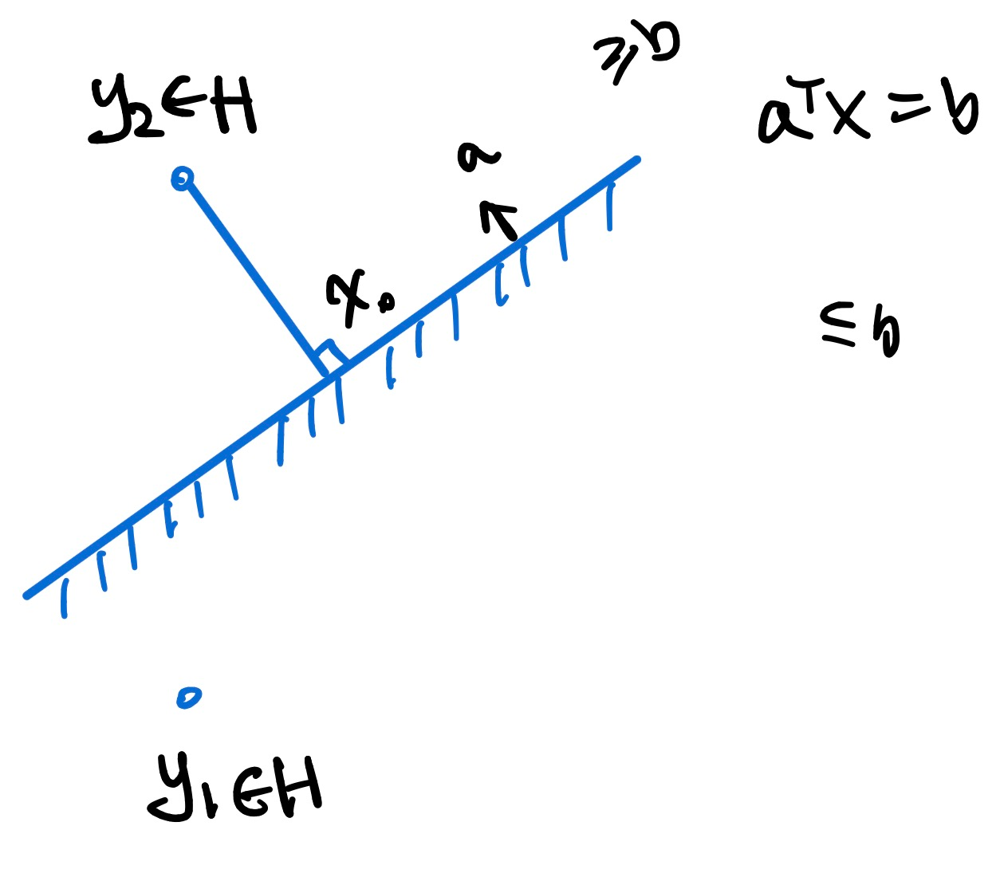</a>□

<section class="latex-block latex-example" id="latex-exampleblock-2-8-2" aria-label="Example 2.8.2">
Example 2.8.2　Projection onto a non-negative orthant cone

定义非负正交锥为 <math xmlns="http://www.w3.org/1998/Math/MathML"><semantics><mrow><mstyle scriptlevel="0" displaystyle="true"><mi mathvariant="script">C</mi><mo>:</mo><mo>=</mo><msubsup><mi mathvariant="double-struck">R</mi><mo>+</mo><mi>n</mi></msubsup><mo>=</mo><mo stretchy="false">{</mo><mi mathvariant="bold-italic">x</mi><mo>∈</mo><msup><mi mathvariant="double-struck">R</mi><mi>n</mi></msup><mo>:</mo><msub><mi>x</mi><mi>i</mi></msub><mo>≥</mo><mn>0</mn><mo separator="true">,</mo><mtext> </mtext><mi>i</mi><mo>=</mo><mn>1</mn><mo separator="true">,</mo><mo>…</mo><mo separator="true">,</mo><mi>n</mi><mo stretchy="false">}</mo></mstyle></mrow><annotation encoding="application/x-tex">\displaystyle \mathcal{C} := \mathbb{R}_+^n = \{\bm{x} \in \mathbb{R}^n: x_i \geq 0,~ i=1,\dots,n\}</annotation></semantics></math>C:=R+n​={x∈Rn:xi​≥0, i=1,…,n}. 则 <math xmlns="http://www.w3.org/1998/Math/MathML"><semantics><mrow><mstyle scriptlevel="0" displaystyle="true"><mi mathvariant="normal">∀</mi><mi mathvariant="bold-italic">y</mi><mo>∈</mo><msup><mi mathvariant="double-struck">R</mi><mi>n</mi></msup></mstyle></mrow><annotation encoding="application/x-tex">\displaystyle \forall \bm{y} \in \mathbb{R}^n</annotation></semantics></math>∀y∈Rn，有

<math xmlns="http://www.w3.org/1998/Math/MathML" display="block"><semantics><mrow><msub><mi mathvariant="normal">Π</mi><mi mathvariant="script">C</mi></msub><mo stretchy="false">(</mo><mi mathvariant="bold-italic">y</mi><mo stretchy="false">)</mo><mo>=</mo><mi>max</mi><mo>⁡</mo><mo stretchy="false">{</mo><mi mathvariant="bold">0</mi><mo separator="true">,</mo><mi mathvariant="bold-italic">y</mi><mo stretchy="false">}</mo><mo>=</mo><msup><mrow><mo fence="true">(</mo><mi>max</mi><mo>⁡</mo><mo stretchy="false">{</mo><mn>0</mn><mo separator="true">,</mo><msub><mi>y</mi><mn>1</mn></msub><mo stretchy="false">}</mo><mo separator="true">,</mo><mo>…</mo><mo separator="true">,</mo><mi>max</mi><mo>⁡</mo><mo stretchy="false">{</mo><mn>0</mn><mo separator="true">,</mo><msub><mi>y</mi><mi>n</mi></msub><mo stretchy="false">}</mo><mo fence="true">)</mo></mrow><mi mathvariant="normal">⊤</mi></msup><mi mathvariant="normal">.</mi></mrow><annotation encoding="application/x-tex">
\Pi_{\mathcal{C}}(\bm{y}) = \max\{\bm{0}, \bm{y}\} = \left(\max\{0, y_1\}, \dots, \max\{0, y_n\}\right)^\top.
</annotation></semantics></math>ΠC​(y)=max{0,y}=(max{0,y1​},…,max{0,yn​})⊤.

即 coordinate-wise ReLU.
</section>

Proof.

由定义, <math xmlns="http://www.w3.org/1998/Math/MathML"><semantics><mrow><mstyle scriptlevel="0" displaystyle="true"><msub><mi mathvariant="normal">Π</mi><mi mathvariant="script">C</mi></msub><mo stretchy="false">(</mo><mi mathvariant="bold-italic">y</mi><mo stretchy="false">)</mo><mo>=</mo><mi>arg</mi><mo>⁡</mo><munder><mrow><mi>min</mi><mo>⁡</mo></mrow><mrow><mi mathvariant="bold-italic">x</mi><mo>∈</mo><mi mathvariant="script">C</mi></mrow></munder><mi mathvariant="normal">∥</mi><mi mathvariant="bold-italic">x</mi><mo>−</mo><mi mathvariant="bold-italic">y</mi><msubsup><mi mathvariant="normal">∥</mi><mn>2</mn><mn>2</mn></msubsup><mo>=</mo><mi>arg</mi><mo>⁡</mo><munder><mrow><mi>min</mi><mo>⁡</mo></mrow><mrow><mi mathvariant="bold-italic">x</mi><mo>∈</mo><mi mathvariant="script">C</mi></mrow></munder><munderover><mo>∑</mo><mrow><mi>i</mi><mo>=</mo><mn>1</mn></mrow><mi>n</mi></munderover><mo stretchy="false">(</mo><msub><mi>x</mi><mi>i</mi></msub><mo>−</mo><msub><mi>y</mi><mi>i</mi></msub><msup><mo stretchy="false">)</mo><mn>2</mn></msup></mstyle></mrow><annotation encoding="application/x-tex">\displaystyle \Pi_{\mathcal{C}}(\bm{y}) = \arg\min_{\bm{x} \in \mathcal{C}} \|\bm{x}-\bm{y}\|_2^2 = \arg\min_{\bm{x} \in \mathcal{C}} \sum_{i=1}^n (x_i - y_i)^2</annotation></semantics></math>ΠC​(y)=argx∈Cmin​∥x−y∥22​=argx∈Cmin​i=1∑n​(xi​−yi​)2. 由于 <math xmlns="http://www.w3.org/1998/Math/MathML"><semantics><mrow><mstyle scriptlevel="0" displaystyle="true"><mi mathvariant="script">C</mi></mstyle></mrow><annotation encoding="application/x-tex">\displaystyle \mathcal{C}</annotation></semantics></math>C 是一个正交锥, 故可以 coordinate-wise 分解为 <math xmlns="http://www.w3.org/1998/Math/MathML"><semantics><mrow><mstyle scriptlevel="0" displaystyle="true"><mi>arg</mi><mo>⁡</mo><munder><mrow><mi>min</mi><mo>⁡</mo></mrow><mrow><msub><mi>x</mi><mi>i</mi></msub><mo>≥</mo><mn>0</mn></mrow></munder><mo stretchy="false">(</mo><msub><mi>x</mi><mi>i</mi></msub><mo>−</mo><msub><mi>y</mi><mi>i</mi></msub><msup><mo stretchy="false">)</mo><mn>2</mn></msup></mstyle></mrow><annotation encoding="application/x-tex">\displaystyle \arg\min_{x_i \geq 0} (x_i - y_i)^2</annotation></semantics></math>argxi​≥0min​(xi​−yi​)2, 从而有 <math xmlns="http://www.w3.org/1998/Math/MathML"><semantics><mrow><mstyle scriptlevel="0" displaystyle="true"><msub><mi mathvariant="normal">Π</mi><mi mathvariant="script">C</mi></msub><mo stretchy="false">(</mo><mi mathvariant="bold-italic">y</mi><mo stretchy="false">)</mo><mo>=</mo><mo stretchy="false">(</mo><mi>max</mi><mo>⁡</mo><mo stretchy="false">{</mo><mn>0</mn><mo separator="true">,</mo><msub><mi>y</mi><mn>1</mn></msub><mo stretchy="false">}</mo><mo separator="true">,</mo><mo>…</mo><mo separator="true">,</mo><mi>max</mi><mo>⁡</mo><mo stretchy="false">{</mo><mn>0</mn><mo separator="true">,</mo><msub><mi>y</mi><mi>n</mi></msub><mo stretchy="false">}</mo><msup><mo stretchy="false">)</mo><mi mathvariant="normal">⊤</mi></msup></mstyle></mrow><annotation encoding="application/x-tex">\displaystyle \Pi_{\mathcal{C}}(\bm{y}) = (\max\{0, y_1\}, \dots, \max\{0, y_n\})^\top</annotation></semantics></math>ΠC​(y)=(max{0,y1​},…,max{0,yn​})⊤.

<blockquote class="latex-quote">
这里有一个重要思想是, 若目标函数和约束集都是 separable 的, 则可以将问题分解为若干个小问题, 分别求解.
</blockquote>□

## 3. Separation theorem and supporting hyperplane theorem

### 3.1. Separations

首先给出 separation 的定义.

<section class="latex-block latex-definition" id="latex-defblock-3-1-1" aria-label="Definition 3.1.1">
Definition 3.1.1　Weak and strong separation

给定两个非空集合 <math xmlns="http://www.w3.org/1998/Math/MathML"><semantics><mrow><mstyle scriptlevel="0" displaystyle="true"><mi mathvariant="script">S</mi><mo separator="true">,</mo><mi mathvariant="script">T</mi><mo>⊆</mo><msup><mi mathvariant="double-struck">R</mi><mi>n</mi></msup></mstyle></mrow><annotation encoding="application/x-tex">\displaystyle \mathcal{S}, \mathcal{T} \subseteq \mathbb{R}^n</annotation></semantics></math>S,T⊆Rn，若存在非零向量 <math xmlns="http://www.w3.org/1998/Math/MathML"><semantics><mrow><mstyle scriptlevel="0" displaystyle="true"><mi mathvariant="bold-italic">a</mi><mo>∈</mo><msup><mi mathvariant="double-struck">R</mi><mi>n</mi></msup></mstyle></mrow><annotation encoding="application/x-tex">\displaystyle \bm{a} \in \mathbb{R}^n</annotation></semantics></math>a∈Rn 使得

<math xmlns="http://www.w3.org/1998/Math/MathML" display="block"><semantics><mrow><munder><mrow><mi>sup</mi><mo>⁡</mo></mrow><mrow><mi mathvariant="bold-italic">x</mi><mo>∈</mo><mi mathvariant="script">S</mi></mrow></munder><msup><mi mathvariant="bold-italic">a</mi><mi mathvariant="normal">⊤</mi></msup><mi mathvariant="bold-italic">x</mi><mo>≤</mo><munder><mrow><mi>inf</mi><mo>⁡</mo></mrow><mrow><mi mathvariant="bold-italic">y</mi><mo>∈</mo><mi mathvariant="script">T</mi></mrow></munder><msup><mi mathvariant="bold-italic">a</mi><mi mathvariant="normal">⊤</mi></msup><mi mathvariant="bold-italic">y</mi><mo separator="true">,</mo></mrow><annotation encoding="application/x-tex">
\sup_{\bm{x} \in \mathcal{S}} \bm{a}^\top \bm{x} \leq \inf_{\bm{y} \in \mathcal{T}} \bm{a}^\top \bm{y},
</annotation></semantics></math>x∈Ssup​a⊤x≤y∈Tinf​a⊤y,

则称 <math xmlns="http://www.w3.org/1998/Math/MathML"><semantics><mrow><mstyle scriptlevel="0" displaystyle="true"><mi mathvariant="script">S</mi></mstyle></mrow><annotation encoding="application/x-tex">\displaystyle \mathcal{S}</annotation></semantics></math>S 和 <math xmlns="http://www.w3.org/1998/Math/MathML"><semantics><mrow><mstyle scriptlevel="0" displaystyle="true"><mi mathvariant="script">T</mi></mstyle></mrow><annotation encoding="application/x-tex">\displaystyle \mathcal{T}</annotation></semantics></math>T 是可弱分离的 (weakly separable). 若可以严格取到 <math xmlns="http://www.w3.org/1998/Math/MathML"><semantics><mrow><mstyle scriptlevel="0" displaystyle="true"><mo>&lt;</mo></mstyle></mrow><annotation encoding="application/x-tex">\displaystyle &lt;</annotation></semantics></math>&lt;，则称 <math xmlns="http://www.w3.org/1998/Math/MathML"><semantics><mrow><mstyle scriptlevel="0" displaystyle="true"><mi mathvariant="script">S</mi></mstyle></mrow><annotation encoding="application/x-tex">\displaystyle \mathcal{S}</annotation></semantics></math>S 和 <math xmlns="http://www.w3.org/1998/Math/MathML"><semantics><mrow><mstyle scriptlevel="0" displaystyle="true"><mi mathvariant="script">T</mi></mstyle></mrow><annotation encoding="application/x-tex">\displaystyle \mathcal{T}</annotation></semantics></math>T 是强可分离的 (strongly separable).

<ul><li>
也即, 存在一个超平面 <math xmlns="http://www.w3.org/1998/Math/MathML"><semantics><mrow><mstyle scriptlevel="0" displaystyle="true"><mi mathvariant="script">H</mi><mo>:</mo><mo>=</mo><mo stretchy="false">{</mo><mi mathvariant="bold-italic">z</mi><mo>∈</mo><msup><mi mathvariant="double-struck">R</mi><mi>n</mi></msup><mo>:</mo><msup><mi mathvariant="bold-italic">a</mi><mi mathvariant="normal">⊤</mi></msup><mi mathvariant="bold-italic">z</mi><mo>=</mo><mi>b</mi><mo stretchy="false">}</mo></mstyle></mrow><annotation encoding="application/x-tex">\displaystyle \mathcal{H}:=\{\bm{z} \in \mathbb{R}^n: \bm{a}^\top \bm{z} = b\}</annotation></semantics></math>H:={z∈Rn:a⊤z=b}，使得 <math xmlns="http://www.w3.org/1998/Math/MathML"><semantics><mrow><mstyle scriptlevel="0" displaystyle="true"><mi mathvariant="script">S</mi></mstyle></mrow><annotation encoding="application/x-tex">\displaystyle \mathcal{S}</annotation></semantics></math>S 和 <math xmlns="http://www.w3.org/1998/Math/MathML"><semantics><mrow><mstyle scriptlevel="0" displaystyle="true"><mi mathvariant="script">T</mi></mstyle></mrow><annotation encoding="application/x-tex">\displaystyle \mathcal{T}</annotation></semantics></math>T 分别位于该超平面的两侧 (弱分离允许集合接触超平面, 强分离则不允许), 其中 <math xmlns="http://www.w3.org/1998/Math/MathML"><semantics><mrow><mstyle scriptlevel="0" displaystyle="true"><munder><mrow><mi>sup</mi><mo>⁡</mo></mrow><mrow><mi mathvariant="bold-italic">x</mi><mo>∈</mo><mi mathvariant="script">S</mi></mrow></munder><msup><mi mathvariant="bold-italic">a</mi><mi mathvariant="normal">⊤</mi></msup><mi mathvariant="bold-italic">x</mi><mo>≤</mo><mi>b</mi><mo>≤</mo><munder><mrow><mi>inf</mi><mo>⁡</mo></mrow><mrow><mi mathvariant="bold-italic">y</mi><mo>∈</mo><mi mathvariant="script">T</mi></mrow></munder><msup><mi mathvariant="bold-italic">a</mi><mi mathvariant="normal">⊤</mi></msup><mi mathvariant="bold-italic">y</mi></mstyle></mrow><annotation encoding="application/x-tex">\displaystyle \sup_{\bm{x} \in \mathcal{S}} \bm{a}^\top \bm{x} \leq b \leq \inf_{\bm{y} \in \mathcal{T}} \bm{a}^\top \bm{y}</annotation></semantics></math>x∈Ssup​a⊤x≤b≤y∈Tinf​a⊤y.
</li></ul></section>
<ul><li>
这里再复习/提供一下几何直觉. 给定一个方向 <math xmlns="http://www.w3.org/1998/Math/MathML"><semantics><mrow><mstyle scriptlevel="0" displaystyle="true"><mi mathvariant="bold-italic">a</mi></mstyle></mrow><annotation encoding="application/x-tex">\displaystyle \bm{a}</annotation></semantics></math>a，则 <math xmlns="http://www.w3.org/1998/Math/MathML"><semantics><mrow><mstyle scriptlevel="0" displaystyle="true"><mo stretchy="false">⟨</mo><mi mathvariant="bold-italic">a</mi><mo separator="true">,</mo><mi mathvariant="bold-italic">x</mi><mo stretchy="false">⟩</mo></mstyle></mrow><annotation encoding="application/x-tex">\displaystyle \langle \bm{a}, \bm{x} \rangle</annotation></semantics></math>⟨a,x⟩ 可以理解为 <math xmlns="http://www.w3.org/1998/Math/MathML"><semantics><mrow><mstyle scriptlevel="0" displaystyle="true"><mi mathvariant="bold-italic">x</mi></mstyle></mrow><annotation encoding="application/x-tex">\displaystyle \bm{x}</annotation></semantics></math>x 在 <math xmlns="http://www.w3.org/1998/Math/MathML"><semantics><mrow><mstyle scriptlevel="0" displaystyle="true"><mi mathvariant="bold-italic">a</mi></mstyle></mrow><annotation encoding="application/x-tex">\displaystyle \bm{a}</annotation></semantics></math>a 方向上的投影 (这里最好把 <math xmlns="http://www.w3.org/1998/Math/MathML"><semantics><mrow><mstyle scriptlevel="0" displaystyle="true"><mi mathvariant="bold-italic">x</mi></mstyle></mrow><annotation encoding="application/x-tex">\displaystyle \bm{x}</annotation></semantics></math>x 理解为点而不是向量), 也就是 <math xmlns="http://www.w3.org/1998/Math/MathML"><semantics><mrow><mstyle scriptlevel="0" displaystyle="true"><mi mathvariant="bold-italic">x</mi></mstyle></mrow><annotation encoding="application/x-tex">\displaystyle \bm{x}</annotation></semantics></math>x 在 <math xmlns="http://www.w3.org/1998/Math/MathML"><semantics><mrow><mstyle scriptlevel="0" displaystyle="true"><mi mathvariant="bold-italic">a</mi></mstyle></mrow><annotation encoding="application/x-tex">\displaystyle \bm{a}</annotation></semantics></math>a 方向上的坐标. 而固定一个方向 <math xmlns="http://www.w3.org/1998/Math/MathML"><semantics><mrow><mstyle scriptlevel="0" displaystyle="true"><mi mathvariant="bold-italic">a</mi></mstyle></mrow><annotation encoding="application/x-tex">\displaystyle \bm{a}</annotation></semantics></math>a，对应超平面就只能在 <math xmlns="http://www.w3.org/1998/Math/MathML"><semantics><mrow><mstyle scriptlevel="0" displaystyle="true"><mi mathvariant="bold-italic">a</mi></mstyle></mrow><annotation encoding="application/x-tex">\displaystyle \bm{a}</annotation></semantics></math>a 方向上下移动. 因此只要两个集合在 <math xmlns="http://www.w3.org/1998/Math/MathML"><semantics><mrow><mstyle scriptlevel="0" displaystyle="true"><mi mathvariant="bold-italic">a</mi></mstyle></mrow><annotation encoding="application/x-tex">\displaystyle \bm{a}</annotation></semantics></math>a 方向上的投影不重叠, 则在二者的 gap 区域取的点都可以确定一个超平面, 使得二者被分开.
</li></ul>
<a class="latex-raster-figure" href="./convex-geometry/20261003153442526.png" style="--figure-width:60%">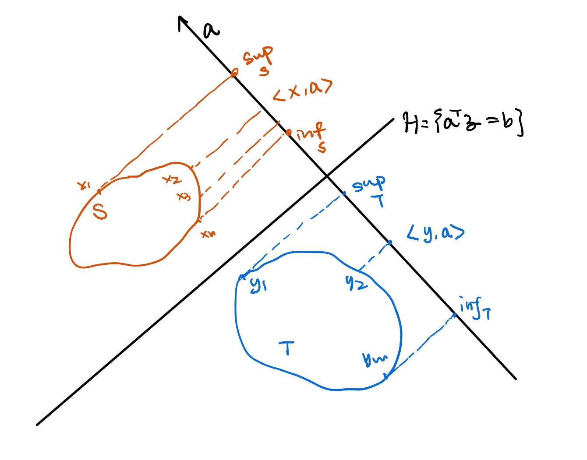</a>
<section class="latex-block latex-definition" id="latex-defblock-3-1-2" aria-label="Definition 3.1.2">
Definition 3.1.2　Proper separation

此外区分 weak separation 和 proper separation. 在 weak separation 中有一个退化情景, 即 <math xmlns="http://www.w3.org/1998/Math/MathML"><semantics><mrow><mstyle scriptlevel="0" displaystyle="true"><mi mathvariant="script">S</mi></mstyle></mrow><annotation encoding="application/x-tex">\displaystyle \mathcal{S}</annotation></semantics></math>S 和 <math xmlns="http://www.w3.org/1998/Math/MathML"><semantics><mrow><mstyle scriptlevel="0" displaystyle="true"><mi mathvariant="script">T</mi></mstyle></mrow><annotation encoding="application/x-tex">\displaystyle \mathcal{T}</annotation></semantics></math>T 都完全位于超平面上. 因此在 Ben-Tal-Nemirovski 的书中, 其定义的 separation 是 proper separation, 即要求至少有一个集合不完全位于超平面上. 也即下方定义的第二个条件:

<math xmlns="http://www.w3.org/1998/Math/MathML" display="block"><semantics><mrow><munder><mrow><mi>sup</mi><mo>⁡</mo></mrow><mrow><mi mathvariant="bold-italic">x</mi><mo>∈</mo><mi mathvariant="script">S</mi></mrow></munder><msup><mi mathvariant="bold-italic">a</mi><mi mathvariant="normal">⊤</mi></msup><mi mathvariant="bold-italic">x</mi><mo>≤</mo><munder><mrow><mi>inf</mi><mo>⁡</mo></mrow><mrow><mi mathvariant="bold-italic">y</mi><mo>∈</mo><mi mathvariant="script">T</mi></mrow></munder><msup><mi mathvariant="bold-italic">a</mi><mi mathvariant="normal">⊤</mi></msup><mi mathvariant="bold-italic">y</mi><mspace width="1em"/><mo>∧</mo><mspace width="1em"/><munder><mrow><mi>inf</mi><mo>⁡</mo></mrow><mrow><mi mathvariant="bold-italic">x</mi><mo>∈</mo><mi mathvariant="script">S</mi></mrow></munder><msup><mi mathvariant="bold-italic">a</mi><mi mathvariant="normal">⊤</mi></msup><mi mathvariant="bold-italic">x</mi><mo>&lt;</mo><munder><mrow><mi>sup</mi><mo>⁡</mo></mrow><mrow><mi mathvariant="bold-italic">y</mi><mo>∈</mo><mi mathvariant="script">T</mi></mrow></munder><msup><mi mathvariant="bold-italic">a</mi><mi mathvariant="normal">⊤</mi></msup><mi mathvariant="bold-italic">y</mi><mi mathvariant="normal">.</mi></mrow><annotation encoding="application/x-tex">
\sup_{\bm{x} \in \mathcal{S}} \bm{a}^\top \bm{x} \leq \inf_{\bm{y} \in \mathcal{T}} \bm{a}^\top \bm{y} \quad \land \quad \inf_{\bm{x} \in \mathcal{S}} \bm{a}^\top \bm{x} &lt; \sup_{\bm{y} \in \mathcal{T}} \bm{a}^\top \bm{y}.
</annotation></semantics></math>x∈Ssup​a⊤x≤y∈Tinf​a⊤y∧x∈Sinf​a⊤x&lt;y∈Tsup​a⊤y.
<ul><li>
之所以可以排除退化情况, 是因为根据条件一有: <math xmlns="http://www.w3.org/1998/Math/MathML"><semantics><mrow><mstyle scriptlevel="0" displaystyle="true"><munder><mrow><mi>inf</mi><mo>⁡</mo></mrow><mi mathvariant="script">S</mi></munder><mo>⋅</mo><mo>≤</mo><munder><mrow><mi>sup</mi><mo>⁡</mo></mrow><mi mathvariant="script">S</mi></munder><mo>⋅</mo><mo>≤</mo><munder><mrow><mi>inf</mi><mo>⁡</mo></mrow><mi mathvariant="script">T</mi></munder><mo>⋅</mo><mo>≤</mo><munder><mrow><mi>sup</mi><mo>⁡</mo></mrow><mi mathvariant="script">T</mi></munder><mo>⋅</mo></mstyle></mrow><annotation encoding="application/x-tex">\displaystyle \inf_{\mathcal{S}} \cdot \leq \sup_{\mathcal{S}} \cdot \leq \inf_{\mathcal{T}} \cdot \leq \sup_{\mathcal{T}} \cdot</annotation></semantics></math>Sinf​⋅≤Ssup​⋅≤Tinf​⋅≤Tsup​⋅. 因此第二个条件可以保证至少有一个 <math xmlns="http://www.w3.org/1998/Math/MathML"><semantics><mrow><mstyle scriptlevel="0" displaystyle="true"><mo>≤</mo></mstyle></mrow><annotation encoding="application/x-tex">\displaystyle \leq</annotation></semantics></math>≤ 是严格的 <math xmlns="http://www.w3.org/1998/Math/MathML"><semantics><mrow><mstyle scriptlevel="0" displaystyle="true"><mo>&lt;</mo></mstyle></mrow><annotation encoding="application/x-tex">\displaystyle &lt;</annotation></semantics></math>&lt;.
</li></ul></section>

### 3.2. Separation theorem
<section class="latex-block latex-theorem" id="latex-thmblock-3-2-1" aria-label="Theorem 3.2.1">
Theorem 3.2.1　Point-set separation

[Bertsimas, § 4.7, Theorem 4.11]: 给定 <math xmlns="http://www.w3.org/1998/Math/MathML"><semantics><mrow><mstyle scriptlevel="0" displaystyle="true"><mi mathvariant="script">C</mi><mo>⊆</mo><msup><mi mathvariant="double-struck">R</mi><mi>n</mi></msup></mstyle></mrow><annotation encoding="application/x-tex">\displaystyle \mathcal{C} \subseteq \mathbb{R}^n</annotation></semantics></math>C⊆Rn 是非空闭凸集, 给定 <math xmlns="http://www.w3.org/1998/Math/MathML"><semantics><mrow><mstyle scriptlevel="0" displaystyle="true"><msup><mi mathvariant="bold-italic">x</mi><mo>⋆</mo></msup><mo mathvariant="normal">∉</mo><mi mathvariant="script">C</mi></mstyle></mrow><annotation encoding="application/x-tex">\displaystyle \bm{x}^\star \notin \mathcal{C}</annotation></semantics></math>x⋆∈/C，则定存在向量 <math xmlns="http://www.w3.org/1998/Math/MathML"><semantics><mrow><mstyle scriptlevel="0" displaystyle="true"><mi mathvariant="bold-italic">c</mi><mo>∈</mo><msup><mi mathvariant="double-struck">R</mi><mi>n</mi></msup></mstyle></mrow><annotation encoding="application/x-tex">\displaystyle \bm{c} \in \mathbb{R}^n</annotation></semantics></math>c∈Rn 使得对于任意 <math xmlns="http://www.w3.org/1998/Math/MathML"><semantics><mrow><mstyle scriptlevel="0" displaystyle="true"><mi mathvariant="bold-italic">x</mi><mo>∈</mo><mi mathvariant="script">C</mi></mstyle></mrow><annotation encoding="application/x-tex">\displaystyle \bm{x} \in \mathcal{C}</annotation></semantics></math>x∈C，有

<math xmlns="http://www.w3.org/1998/Math/MathML" display="block"><semantics><mrow><msup><mi mathvariant="bold-italic">c</mi><mi mathvariant="normal">⊤</mi></msup><mi mathvariant="bold-italic">x</mi><mo>&lt;</mo><msup><mi mathvariant="bold-italic">c</mi><mi mathvariant="normal">⊤</mi></msup><msup><mi mathvariant="bold-italic">x</mi><mo>⋆</mo></msup><mi mathvariant="normal">.</mi></mrow><annotation encoding="application/x-tex">
\bm{c}^\top \bm{x} &lt; \bm{c}^\top \bm{x}^\star.
</annotation></semantics></math>c⊤x&lt;c⊤x⋆.</section>
<a class="latex-raster-figure" href="./convex-geometry/20261003113803639.png" style="--figure-width:30%">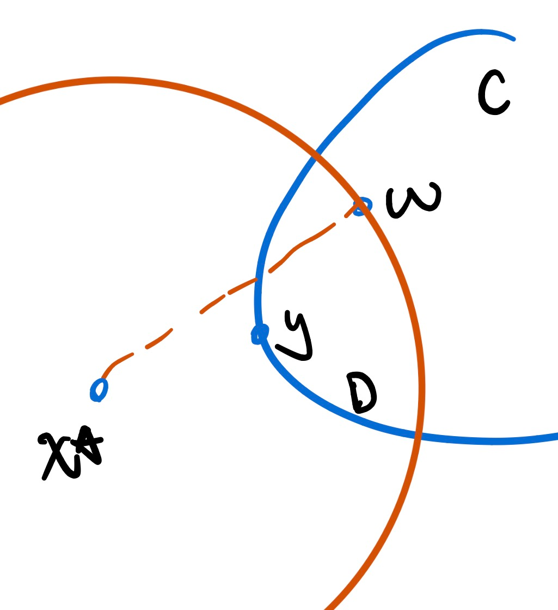</a>

Proof.

原书中的证明过程相当于分别依次证明了如下两个命题, 这两个命题的具体证明细节与前面叙述的基本完全一致, 故不再详细赘述.

<ul><li>
首先利用向闭凸集的投影定理, 记 <math xmlns="http://www.w3.org/1998/Math/MathML"><semantics><mrow><mstyle scriptlevel="0" displaystyle="true"><mi mathvariant="bold-italic">y</mi><mo>:</mo><mo>=</mo><msub><mi mathvariant="normal">Π</mi><mi mathvariant="script">C</mi></msub><mo stretchy="false">(</mo><msup><mi mathvariant="bold-italic">x</mi><mo>⋆</mo></msup><mo stretchy="false">)</mo></mstyle></mrow><annotation encoding="application/x-tex">\displaystyle \bm{y} := \Pi_{\mathcal{C}}(\bm{x}^\star)</annotation></semantics></math>y:=ΠC​(x⋆) 为 <math xmlns="http://www.w3.org/1998/Math/MathML"><semantics><mrow><mstyle scriptlevel="0" displaystyle="true"><msup><mi mathvariant="bold-italic">x</mi><mo>⋆</mo></msup></mstyle></mrow><annotation encoding="application/x-tex">\displaystyle \bm{x}^\star</annotation></semantics></math>x⋆ 在 <math xmlns="http://www.w3.org/1998/Math/MathML"><semantics><mrow><mstyle scriptlevel="0" displaystyle="true"><mi mathvariant="script">C</mi></mstyle></mrow><annotation encoding="application/x-tex">\displaystyle \mathcal{C}</annotation></semantics></math>C 上的投影点.
</li><li>
接着, 利用 projection variational inequality, 有

<math xmlns="http://www.w3.org/1998/Math/MathML" display="block"><semantics><mrow><mo stretchy="false">⟨</mo><msup><mi mathvariant="bold-italic">x</mi><mo>⋆</mo></msup><mo>−</mo><mi mathvariant="bold-italic">y</mi><mo separator="true">,</mo><mi mathvariant="bold-italic">x</mi><mo>−</mo><mi mathvariant="bold-italic">y</mi><mo stretchy="false">⟩</mo><mo>≤</mo><mn>0</mn><mo separator="true">,</mo><mtext> </mtext><mi mathvariant="normal">∀</mi><mi mathvariant="bold-italic">x</mi><mo>∈</mo><mi mathvariant="script">C</mi><mi mathvariant="normal">.</mi></mrow><annotation encoding="application/x-tex">
\langle \bm{x}^\star - \bm{y}, \bm{x}- \bm{y} \rangle \leq 0,~ \forall \bm{x} \in \mathcal{C}.
</annotation></semantics></math>⟨x⋆−y,x−y⟩≤0, ∀x∈C.

记 <math xmlns="http://www.w3.org/1998/Math/MathML"><semantics><mrow><mstyle scriptlevel="0" displaystyle="true"><mi mathvariant="bold-italic">c</mi><mo>:</mo><mo>=</mo><msup><mi mathvariant="bold-italic">x</mi><mo>⋆</mo></msup><mo>−</mo><mi mathvariant="bold-italic">y</mi></mstyle></mrow><annotation encoding="application/x-tex">\displaystyle \bm{c} := \bm{x}^\star - \bm{y}</annotation></semantics></math>c:=x⋆−y，且 <math xmlns="http://www.w3.org/1998/Math/MathML"><semantics><mrow><mstyle scriptlevel="0" displaystyle="true"><mi mathvariant="bold-italic">c</mi><mo mathvariant="normal">≠</mo><mi mathvariant="bold">0</mi></mstyle></mrow><annotation encoding="application/x-tex">\displaystyle \bm{c} \neq \bm{0}</annotation></semantics></math>c=0，则有

<math xmlns="http://www.w3.org/1998/Math/MathML" display="block"><semantics><mrow><mo stretchy="false">⟨</mo><mi mathvariant="bold-italic">c</mi><mo separator="true">,</mo><mi mathvariant="bold-italic">x</mi><mo>−</mo><mi mathvariant="bold-italic">y</mi><mo stretchy="false">⟩</mo><mo>≤</mo><mn>0</mn><mo separator="true">,</mo><mtext> </mtext><mi mathvariant="normal">∀</mi><mi mathvariant="bold-italic">x</mi><mo>∈</mo><mi mathvariant="script">C</mi><mtext>  </mtext><mo>⟹</mo><mtext>  </mtext><mo stretchy="false">⟨</mo><mi mathvariant="bold-italic">c</mi><mo separator="true">,</mo><mi mathvariant="bold-italic">x</mi><mo stretchy="false">⟩</mo><mo>≤</mo><mo stretchy="false">⟨</mo><mi mathvariant="bold-italic">c</mi><mo separator="true">,</mo><mi mathvariant="bold-italic">y</mi><mo stretchy="false">⟩</mo><mo separator="true">,</mo><mtext> </mtext><mi mathvariant="normal">∀</mi><mi mathvariant="bold-italic">x</mi><mo>∈</mo><mi mathvariant="script">C</mi><mi mathvariant="normal">.</mi></mrow><annotation encoding="application/x-tex">
\langle \bm{c}, \bm{x}- \bm{y} \rangle \leq 0,~ \forall \bm{x} \in \mathcal{C} \implies \langle \bm{c}, \bm{x} \rangle \leq \langle \bm{c}, \bm{y} \rangle,~ \forall \bm{x} \in \mathcal{C}.
</annotation></semantics></math>⟨c,x−y⟩≤0, ∀x∈C⟹⟨c,x⟩≤⟨c,y⟩, ∀x∈C.</li><li>
另一方面, 考虑

<math xmlns="http://www.w3.org/1998/Math/MathML" display="block"><semantics><mrow><mo stretchy="false">⟨</mo><mi mathvariant="bold-italic">c</mi><mo separator="true">,</mo><msup><mi mathvariant="bold-italic">x</mi><mo>⋆</mo></msup><mo>−</mo><mi mathvariant="bold-italic">y</mi><mo stretchy="false">⟩</mo><mo>=</mo><mo stretchy="false">⟨</mo><msup><mi mathvariant="bold-italic">x</mi><mo>⋆</mo></msup><mo>−</mo><mi mathvariant="bold-italic">y</mi><mo separator="true">,</mo><msup><mi mathvariant="bold-italic">x</mi><mo>⋆</mo></msup><mo>−</mo><mi mathvariant="bold-italic">y</mi><mo stretchy="false">⟩</mo><mo>=</mo><mi mathvariant="normal">∥</mi><msup><mi mathvariant="bold-italic">x</mi><mo>⋆</mo></msup><mo>−</mo><mi mathvariant="bold-italic">y</mi><msubsup><mi mathvariant="normal">∥</mi><mn>2</mn><mn>2</mn></msubsup><mo>&gt;</mo><mn>0.</mn></mrow><annotation encoding="application/x-tex">
\langle \bm{c}, \bm{x}^\star - \bm{y} \rangle = \langle \bm{x}^\star - \bm{y}, \bm{x}^\star - \bm{y} \rangle = \|\bm{x}^\star - \bm{y}\|_2^2 &gt; 0.
</annotation></semantics></math>⟨c,x⋆−y⟩=⟨x⋆−y,x⋆−y⟩=∥x⋆−y∥22​&gt;0.

故有 <math xmlns="http://www.w3.org/1998/Math/MathML"><semantics><mrow><mstyle scriptlevel="0" displaystyle="true"><mo stretchy="false">⟨</mo><mi mathvariant="bold-italic">c</mi><mo separator="true">,</mo><msup><mi mathvariant="bold-italic">x</mi><mo>⋆</mo></msup><mo>−</mo><mi mathvariant="bold-italic">y</mi><mo stretchy="false">⟩</mo><mo>&gt;</mo><mn>0</mn></mstyle></mrow><annotation encoding="application/x-tex">\displaystyle \langle \bm{c}, \bm{x}^\star - \bm{y} \rangle &gt; 0</annotation></semantics></math>⟨c,x⋆−y⟩&gt;0，从而有

<math xmlns="http://www.w3.org/1998/Math/MathML" display="block"><semantics><mrow><mo stretchy="false">⟨</mo><mi mathvariant="bold-italic">c</mi><mo separator="true">,</mo><msup><mi mathvariant="bold-italic">x</mi><mo>⋆</mo></msup><mo stretchy="false">⟩</mo><mo>&gt;</mo><mo stretchy="false">⟨</mo><mi mathvariant="bold-italic">c</mi><mo separator="true">,</mo><mi mathvariant="bold-italic">y</mi><mo stretchy="false">⟩</mo><mi mathvariant="normal">.</mi></mrow><annotation encoding="application/x-tex">
\langle \bm{c}, \bm{x}^\star\rangle &gt; \langle \bm{c}, \bm{y}\rangle.
</annotation></semantics></math>⟨c,x⋆⟩&gt;⟨c,y⟩.</li><li>
综上得到

<math xmlns="http://www.w3.org/1998/Math/MathML" display="block"><semantics><mrow><msup><mi mathvariant="bold-italic">c</mi><mi mathvariant="normal">⊤</mi></msup><mi mathvariant="bold-italic">x</mi><mo>&lt;</mo><msup><mi mathvariant="bold-italic">c</mi><mi mathvariant="normal">⊤</mi></msup><msup><mi mathvariant="bold-italic">x</mi><mo>⋆</mo></msup><mo separator="true">,</mo><mtext> </mtext><mi mathvariant="normal">∀</mi><mi mathvariant="bold-italic">x</mi><mo>∈</mo><mi mathvariant="script">C</mi><mi mathvariant="normal">.</mi></mrow><annotation encoding="application/x-tex">
\bm{c}^\top \bm{x} &lt; \bm{c}^\top \bm{x}^\star,~ \forall \bm{x} \in \mathcal{C}.
</annotation></semantics></math>c⊤x&lt;c⊤x⋆, ∀x∈C.</li></ul>□

从上述证明过程也可以看出, 从投影点 <math xmlns="http://www.w3.org/1998/Math/MathML"><semantics><mrow><mstyle scriptlevel="0" displaystyle="true"><mi mathvariant="bold-italic">y</mi></mstyle></mrow><annotation encoding="application/x-tex">\displaystyle \bm{y}</annotation></semantics></math>y 指向外部点 <math xmlns="http://www.w3.org/1998/Math/MathML"><semantics><mrow><mstyle scriptlevel="0" displaystyle="true"><msup><mi mathvariant="bold-italic">x</mi><mo>⋆</mo></msup></mstyle></mrow><annotation encoding="application/x-tex">\displaystyle \bm{x}^\star</annotation></semantics></math>x⋆ 的向量 <math xmlns="http://www.w3.org/1998/Math/MathML"><semantics><mrow><mstyle scriptlevel="0" displaystyle="true"><mi mathvariant="bold-italic">c</mi></mstyle></mrow><annotation encoding="application/x-tex">\displaystyle \bm{c}</annotation></semantics></math>c 就是将点和集合分开的超平面的法向量. 也即, 超平面 <math xmlns="http://www.w3.org/1998/Math/MathML"><semantics><mrow><mstyle scriptlevel="0" displaystyle="true"><mi mathvariant="script">H</mi><mo>:</mo><mo>=</mo><mo stretchy="false">{</mo><mi mathvariant="bold-italic">z</mi><mo>∈</mo><msup><mi mathvariant="double-struck">R</mi><mi>n</mi></msup><mo>:</mo><msup><mi mathvariant="bold-italic">c</mi><mi mathvariant="normal">⊤</mi></msup><mi mathvariant="bold-italic">z</mi><mo>=</mo><msup><mi mathvariant="bold-italic">c</mi><mi mathvariant="normal">⊤</mi></msup><mi mathvariant="bold-italic">y</mi><mo stretchy="false">}</mo></mstyle></mrow><annotation encoding="application/x-tex">\displaystyle \mathcal{H} := \{\bm{z} \in \mathbb{R}^n: \bm{c}^\top \bm{z} = \bm{c}^\top \bm{y}\}</annotation></semantics></math>H:={z∈Rn:c⊤z=c⊤y} 将集合 <math xmlns="http://www.w3.org/1998/Math/MathML"><semantics><mrow><mstyle scriptlevel="0" displaystyle="true"><mi mathvariant="script">C</mi></mstyle></mrow><annotation encoding="application/x-tex">\displaystyle \mathcal{C}</annotation></semantics></math>C 和点 <math xmlns="http://www.w3.org/1998/Math/MathML"><semantics><mrow><mstyle scriptlevel="0" displaystyle="true"><msup><mi mathvariant="bold-italic">x</mi><mo>⋆</mo></msup></mstyle></mrow><annotation encoding="application/x-tex">\displaystyle \bm{x}^\star</annotation></semantics></math>x⋆ 分开.

<section class="latex-block latex-theorem" id="latex-thmblock-3-2-2" aria-label="Theorem 3.2.2">
Theorem 3.2.2　Finite-dimensional separation

[Ben-Tal-Nemirovski, § B.2.6, Theorem B.2.9]: 若 <math xmlns="http://www.w3.org/1998/Math/MathML"><semantics><mrow><mstyle scriptlevel="0" displaystyle="true"><mi mathvariant="script">S</mi><mo separator="true">,</mo><mi mathvariant="script">T</mi><mo>⊆</mo><msup><mi mathvariant="double-struck">R</mi><mi>n</mi></msup></mstyle></mrow><annotation encoding="application/x-tex">\displaystyle \mathcal{S}, \mathcal{T} \subseteq \mathbb{R}^n</annotation></semantics></math>S,T⊆Rn 是非空闭凸集, 则 <math xmlns="http://www.w3.org/1998/Math/MathML"><semantics><mrow><mstyle scriptlevel="0" displaystyle="true"><mi mathvariant="script">S</mi></mstyle></mrow><annotation encoding="application/x-tex">\displaystyle \mathcal{S}</annotation></semantics></math>S 和 <math xmlns="http://www.w3.org/1998/Math/MathML"><semantics><mrow><mstyle scriptlevel="0" displaystyle="true"><mi mathvariant="script">T</mi></mstyle></mrow><annotation encoding="application/x-tex">\displaystyle \mathcal{T}</annotation></semantics></math>T 是 properly separable 的, 当且仅当

<math xmlns="http://www.w3.org/1998/Math/MathML" display="block"><semantics><mrow><mtext>ri</mtext><mo stretchy="false">(</mo><mi mathvariant="script">S</mi><mo stretchy="false">)</mo><mo>∩</mo><mtext>ri</mtext><mo stretchy="false">(</mo><mi mathvariant="script">T</mi><mo stretchy="false">)</mo><mo>=</mo><mi mathvariant="normal">∅</mi><mi mathvariant="normal">.</mi></mrow><annotation encoding="application/x-tex">
\text{ri}(\mathcal{S}) \cap \text{ri}(\mathcal{T}) = \emptyset.
</annotation></semantics></math>ri(S)∩ri(T)=∅.</section>
<blockquote class="latex-quote">
<em>Note</em>.
</blockquote>
<section class="latex-block latex-remark" id="latex-remarkblock-3-2-1" aria-label="Remark 3.2.1">
Remark 3.2.1　Separation via the difference set

在凸分析中, 常用的一个 trick 是将两个集合的分离问题转化为一个集合和一个点的分离问题. 也即, 考虑 <math xmlns="http://www.w3.org/1998/Math/MathML"><semantics><mrow><mstyle scriptlevel="0" displaystyle="true"><mi mathvariant="script">S</mi></mstyle></mrow><annotation encoding="application/x-tex">\displaystyle \mathcal{S}</annotation></semantics></math>S 与 <math xmlns="http://www.w3.org/1998/Math/MathML"><semantics><mrow><mstyle scriptlevel="0" displaystyle="true"><mi mathvariant="script">T</mi></mstyle></mrow><annotation encoding="application/x-tex">\displaystyle \mathcal{T}</annotation></semantics></math>T 的差集 <math xmlns="http://www.w3.org/1998/Math/MathML"><semantics><mrow><mstyle scriptlevel="0" displaystyle="true"><mi mathvariant="script">D</mi><mo>:</mo><mo>=</mo><mi mathvariant="script">S</mi><mo>−</mo><mi mathvariant="script">T</mi><mo>:</mo><mo>=</mo><mo stretchy="false">{</mo><mi mathvariant="bold-italic">x</mi><mo>−</mo><mi mathvariant="bold-italic">y</mi><mo>:</mo><mi mathvariant="bold-italic">x</mi><mo>∈</mo><mi mathvariant="script">S</mi><mo separator="true">,</mo><mi mathvariant="bold-italic">y</mi><mo>∈</mo><mi mathvariant="script">T</mi><mo stretchy="false">}</mo></mstyle></mrow><annotation encoding="application/x-tex">\displaystyle \mathcal{D} := \mathcal{S}-\mathcal{T} := \{\bm{x}-\bm{y}: \bm{x} \in \mathcal{S}, \bm{y} \in \mathcal{T}\}</annotation></semantics></math>D:=S−T:={x−y:x∈S,y∈T}，则 <math xmlns="http://www.w3.org/1998/Math/MathML"><semantics><mrow><mstyle scriptlevel="0" displaystyle="true"><mi mathvariant="script">D</mi></mstyle></mrow><annotation encoding="application/x-tex">\displaystyle \mathcal{D}</annotation></semantics></math>D 是非空凸集, 但不一定闭, 且 <math xmlns="http://www.w3.org/1998/Math/MathML"><semantics><mrow><mstyle scriptlevel="0" displaystyle="true"><mn>0</mn><mo>∈</mo><mi mathvariant="script">D</mi><mtext>  </mtext><mo>⟺</mo><mtext>  </mtext><mi mathvariant="script">S</mi><mo>∩</mo><mi mathvariant="script">T</mi><mo mathvariant="normal">≠</mo><mi mathvariant="normal">∅</mi></mstyle></mrow><annotation encoding="application/x-tex">\displaystyle 0 \in \mathcal{D} \iff \mathcal{S} \cap \mathcal{T} \neq \emptyset</annotation></semantics></math>0∈D⟺S∩T=∅. 且回顾, 若 <math xmlns="http://www.w3.org/1998/Math/MathML"><semantics><mrow><mstyle scriptlevel="0" displaystyle="true"><mi mathvariant="script">S</mi></mstyle></mrow><annotation encoding="application/x-tex">\displaystyle \mathcal{S}</annotation></semantics></math>S 和 <math xmlns="http://www.w3.org/1998/Math/MathML"><semantics><mrow><mstyle scriptlevel="0" displaystyle="true"><mi mathvariant="script">T</mi></mstyle></mrow><annotation encoding="application/x-tex">\displaystyle \mathcal{T}</annotation></semantics></math>T 是 properly separable 的, 则存在 <math xmlns="http://www.w3.org/1998/Math/MathML"><semantics><mrow><mstyle scriptlevel="0" displaystyle="true"><mi mathvariant="bold-italic">a</mi><mo>∈</mo><msup><mi mathvariant="double-struck">R</mi><mi>n</mi></msup></mstyle></mrow><annotation encoding="application/x-tex">\displaystyle \bm{a} \in \mathbb{R}^n</annotation></semantics></math>a∈Rn 使得

<math xmlns="http://www.w3.org/1998/Math/MathML" display="block"><semantics><mrow><msup><mi mathvariant="bold-italic">a</mi><mi mathvariant="normal">⊤</mi></msup><mi mathvariant="bold-italic">x</mi><mo>≤</mo><msup><mi mathvariant="bold-italic">a</mi><mi mathvariant="normal">⊤</mi></msup><mi mathvariant="bold-italic">y</mi><mo separator="true">,</mo><mtext> </mtext><mi mathvariant="normal">∀</mi><mi mathvariant="bold-italic">x</mi><mo>∈</mo><mi mathvariant="script">S</mi><mo separator="true">,</mo><mtext> </mtext><mi mathvariant="normal">∀</mi><mi mathvariant="bold-italic">y</mi><mo>∈</mo><mi mathvariant="script">T</mi><mtext>  </mtext><mo>⟺</mo><mtext>  </mtext><msup><mi mathvariant="bold-italic">a</mi><mi mathvariant="normal">⊤</mi></msup><mo stretchy="false">(</mo><mi mathvariant="bold-italic">x</mi><mo>−</mo><mi mathvariant="bold-italic">y</mi><mo stretchy="false">)</mo><mo>:</mo><mo>=</mo><msup><mi mathvariant="bold-italic">a</mi><mi mathvariant="normal">⊤</mi></msup><mi mathvariant="bold-italic">d</mi><mo>≤</mo><mn>0</mn><mo>=</mo><msup><mi mathvariant="bold-italic">a</mi><mi mathvariant="normal">⊤</mi></msup><mi mathvariant="bold">0</mi><mo separator="true">,</mo><mtext> </mtext><mi mathvariant="normal">∀</mi><mi mathvariant="bold-italic">d</mi><mo>∈</mo><mi mathvariant="script">D</mi><mi mathvariant="normal">.</mi></mrow><annotation encoding="application/x-tex">
\bm{a}^\top \bm{x} \leq \bm{a}^\top \bm{y},~ \forall \bm{x} \in \mathcal{S},~ \forall \bm{y} \in \mathcal{T} 
\iff
\bm{a}^\top (\bm{x}-\bm{y}) := \bm{a}^\top \bm{d} \leq 0 = \bm{a}^\top \bm{0},~ \forall \bm{d} \in \mathcal{D}.
</annotation></semantics></math>a⊤x≤a⊤y, ∀x∈S, ∀y∈T⟺a⊤(x−y):=a⊤d≤0=a⊤0, ∀d∈D.

因此讨论 <math xmlns="http://www.w3.org/1998/Math/MathML"><semantics><mrow><mstyle scriptlevel="0" displaystyle="true"><mi mathvariant="script">S</mi></mstyle></mrow><annotation encoding="application/x-tex">\displaystyle \mathcal{S}</annotation></semantics></math>S 和 <math xmlns="http://www.w3.org/1998/Math/MathML"><semantics><mrow><mstyle scriptlevel="0" displaystyle="true"><mi mathvariant="script">T</mi></mstyle></mrow><annotation encoding="application/x-tex">\displaystyle \mathcal{T}</annotation></semantics></math>T 的分离问题等价于讨论 <math xmlns="http://www.w3.org/1998/Math/MathML"><semantics><mrow><mstyle scriptlevel="0" displaystyle="true"><mi mathvariant="script">D</mi></mstyle></mrow><annotation encoding="application/x-tex">\displaystyle \mathcal{D}</annotation></semantics></math>D 和 <math xmlns="http://www.w3.org/1998/Math/MathML"><semantics><mrow><mstyle scriptlevel="0" displaystyle="true"><mo stretchy="false">{</mo><mn>0</mn><mo stretchy="false">}</mo></mstyle></mrow><annotation encoding="application/x-tex">\displaystyle \{0\}</annotation></semantics></math>{0} 的分离问题. 同样, 若存在某 <math xmlns="http://www.w3.org/1998/Math/MathML"><semantics><mrow><mstyle scriptlevel="0" displaystyle="true"><mi mathvariant="bold-italic">d</mi><mo>∈</mo><mi mathvariant="script">D</mi></mstyle></mrow><annotation encoding="application/x-tex">\displaystyle \bm{d} \in \mathcal{D}</annotation></semantics></math>d∈D 使得 <math xmlns="http://www.w3.org/1998/Math/MathML"><semantics><mrow><mstyle scriptlevel="0" displaystyle="true"><msup><mi mathvariant="bold-italic">a</mi><mi mathvariant="normal">⊤</mi></msup><mi mathvariant="bold-italic">d</mi><mo>&lt;</mo><mn>0</mn></mstyle></mrow><annotation encoding="application/x-tex">\displaystyle \bm{a}^\top \bm{d} &lt; 0</annotation></semantics></math>a⊤d&lt;0 严格成立, 则说明 <math xmlns="http://www.w3.org/1998/Math/MathML"><semantics><mrow><mstyle scriptlevel="0" displaystyle="true"><mi mathvariant="script">S</mi></mstyle></mrow><annotation encoding="application/x-tex">\displaystyle \mathcal{S}</annotation></semantics></math>S 和 <math xmlns="http://www.w3.org/1998/Math/MathML"><semantics><mrow><mstyle scriptlevel="0" displaystyle="true"><mi mathvariant="script">T</mi></mstyle></mrow><annotation encoding="application/x-tex">\displaystyle \mathcal{T}</annotation></semantics></math>T 是 properly separable 的. 进一步, 若 <math xmlns="http://www.w3.org/1998/Math/MathML"><semantics><mrow><mstyle scriptlevel="0" displaystyle="true"><munder><mrow><mi>sup</mi><mo>⁡</mo></mrow><mrow><mi mathvariant="bold-italic">d</mi><mo>∈</mo><mi mathvariant="script">D</mi></mrow></munder><msup><mi mathvariant="bold-italic">a</mi><mi mathvariant="normal">⊤</mi></msup><mi mathvariant="bold-italic">d</mi><mo>&lt;</mo><mn>0</mn></mstyle></mrow><annotation encoding="application/x-tex">\displaystyle \sup_{\bm{d} \in \mathcal{D}} \bm{a}^\top \bm{d} &lt; 0</annotation></semantics></math>d∈Dsup​a⊤d&lt;0，则说明 <math xmlns="http://www.w3.org/1998/Math/MathML"><semantics><mrow><mstyle scriptlevel="0" displaystyle="true"><munder><mrow><mi>sup</mi><mo>⁡</mo></mrow><mrow><mi mathvariant="bold-italic">x</mi><mo>∈</mo><mi mathvariant="script">S</mi></mrow></munder><msup><mi mathvariant="bold-italic">a</mi><mi mathvariant="normal">⊤</mi></msup><mi mathvariant="bold-italic">x</mi><mo>&lt;</mo><munder><mrow><mi>inf</mi><mo>⁡</mo></mrow><mrow><mi mathvariant="bold-italic">y</mi><mo>∈</mo><mi mathvariant="script">T</mi></mrow></munder><msup><mi mathvariant="bold-italic">a</mi><mi mathvariant="normal">⊤</mi></msup><mi mathvariant="bold-italic">y</mi></mstyle></mrow><annotation encoding="application/x-tex">\displaystyle \sup_{\bm{x} \in \mathcal{S}} \bm{a}^\top \bm{x} &lt; \inf_{\bm{y} \in \mathcal{T}} \bm{a}^\top \bm{y}</annotation></semantics></math>x∈Ssup​a⊤x&lt;y∈Tinf​a⊤y，也即 <math xmlns="http://www.w3.org/1998/Math/MathML"><semantics><mrow><mstyle scriptlevel="0" displaystyle="true"><mi mathvariant="script">S</mi></mstyle></mrow><annotation encoding="application/x-tex">\displaystyle \mathcal{S}</annotation></semantics></math>S 和 <math xmlns="http://www.w3.org/1998/Math/MathML"><semantics><mrow><mstyle scriptlevel="0" displaystyle="true"><mi mathvariant="script">T</mi></mstyle></mrow><annotation encoding="application/x-tex">\displaystyle \mathcal{T}</annotation></semantics></math>T 是 strongly separable 的.
</section>

Proof Sketch.

<strong>(Necessity)</strong>. 即假设 <math xmlns="http://www.w3.org/1998/Math/MathML"><semantics><mrow><mstyle scriptlevel="0" displaystyle="true"><mi mathvariant="script">S</mi></mstyle></mrow><annotation encoding="application/x-tex">\displaystyle \mathcal{S}</annotation></semantics></math>S 和 <math xmlns="http://www.w3.org/1998/Math/MathML"><semantics><mrow><mstyle scriptlevel="0" displaystyle="true"><mi mathvariant="script">T</mi></mstyle></mrow><annotation encoding="application/x-tex">\displaystyle \mathcal{T}</annotation></semantics></math>T 是 properly separable 的, 即存在 <math xmlns="http://www.w3.org/1998/Math/MathML"><semantics><mrow><mstyle scriptlevel="0" displaystyle="true"><mi mathvariant="bold-italic">a</mi><mo>∈</mo><msup><mi mathvariant="double-struck">R</mi><mi>n</mi></msup></mstyle></mrow><annotation encoding="application/x-tex">\displaystyle \bm{a} \in \mathbb{R}^n</annotation></semantics></math>a∈Rn 使得

<math xmlns="http://www.w3.org/1998/Math/MathML" display="block"><semantics><mrow><munder><mrow><mi>sup</mi><mo>⁡</mo></mrow><mrow><mi mathvariant="bold-italic">x</mi><mo>∈</mo><mi mathvariant="script">S</mi></mrow></munder><msup><mi mathvariant="bold-italic">a</mi><mi mathvariant="normal">⊤</mi></msup><mi mathvariant="bold-italic">x</mi><mo>≤</mo><munder><mrow><mi>inf</mi><mo>⁡</mo></mrow><mrow><mi mathvariant="bold-italic">y</mi><mo>∈</mo><mi mathvariant="script">T</mi></mrow></munder><msup><mi mathvariant="bold-italic">a</mi><mi mathvariant="normal">⊤</mi></msup><mi mathvariant="bold-italic">y</mi><mspace width="1em"/><mo>∧</mo><mspace width="1em"/><munder><mrow><mi>inf</mi><mo>⁡</mo></mrow><mrow><mi mathvariant="bold-italic">x</mi><mo>∈</mo><mi mathvariant="script">S</mi></mrow></munder><msup><mi mathvariant="bold-italic">a</mi><mi mathvariant="normal">⊤</mi></msup><mi mathvariant="bold-italic">x</mi><mo>&lt;</mo><munder><mrow><mi>sup</mi><mo>⁡</mo></mrow><mrow><mi mathvariant="bold-italic">y</mi><mo>∈</mo><mi mathvariant="script">T</mi></mrow></munder><msup><mi mathvariant="bold-italic">a</mi><mi mathvariant="normal">⊤</mi></msup><mi mathvariant="bold-italic">y</mi><mi mathvariant="normal">.</mi></mrow><annotation encoding="application/x-tex">
\sup_{\bm{x} \in \mathcal{S}} \bm{a}^\top \bm{x} \leq \inf_{\bm{y} \in \mathcal{T}} \bm{a}^\top \bm{y} \quad \land \quad \inf_{\bm{x} \in \mathcal{S}} \bm{a}^\top \bm{x} &lt; \sup_{\bm{y} \in \mathcal{T}} \bm{a}^\top \bm{y}.
</annotation></semantics></math>x∈Ssup​a⊤x≤y∈Tinf​a⊤y∧x∈Sinf​a⊤x&lt;y∈Tsup​a⊤y.

则不可能存在 <math xmlns="http://www.w3.org/1998/Math/MathML"><semantics><mrow><mstyle scriptlevel="0" displaystyle="true"><mi mathvariant="bold-italic">z</mi><mo>∈</mo><mtext>ri</mtext><mo stretchy="false">(</mo><mi mathvariant="script">S</mi><mo stretchy="false">)</mo><mo>∩</mo><mtext>ri</mtext><mo stretchy="false">(</mo><mi mathvariant="script">T</mi><mo stretchy="false">)</mo></mstyle></mrow><annotation encoding="application/x-tex">\displaystyle \bm{z} \in \text{ri}(\mathcal{S}) \cap \text{ri}(\mathcal{T})</annotation></semantics></math>z∈ri(S)∩ri(T). 由反证法, 若不然, 则由于 <math xmlns="http://www.w3.org/1998/Math/MathML"><semantics><mrow><mstyle scriptlevel="0" displaystyle="true"><mi mathvariant="bold-italic">z</mi><mo>∈</mo><mtext>ri</mtext><mo stretchy="false">(</mo><mi mathvariant="script">S</mi><mo stretchy="false">)</mo></mstyle></mrow><annotation encoding="application/x-tex">\displaystyle \bm{z} \in \text{ri}(\mathcal{S})</annotation></semantics></math>z∈ri(S)，且 <math xmlns="http://www.w3.org/1998/Math/MathML"><semantics><mrow><mstyle scriptlevel="0" displaystyle="true"><mi mathvariant="bold-italic">z</mi><mo>∈</mo><mtext>ri</mtext><mo stretchy="false">(</mo><mi mathvariant="script">T</mi><mo stretchy="false">)</mo></mstyle></mrow><annotation encoding="application/x-tex">\displaystyle \bm{z} \in \text{ri}(\mathcal{T})</annotation></semantics></math>z∈ri(T)，故有 <math xmlns="http://www.w3.org/1998/Math/MathML"><semantics><mrow><mstyle scriptlevel="0" displaystyle="true"><msup><mi mathvariant="bold-italic">a</mi><mi mathvariant="normal">⊤</mi></msup><mi mathvariant="bold-italic">z</mi><mo>≤</mo><munder><mrow><mi>sup</mi><mo>⁡</mo></mrow><mrow><mi mathvariant="bold-italic">x</mi><mo>∈</mo><mi mathvariant="script">S</mi></mrow></munder><msup><mi mathvariant="bold-italic">a</mi><mi mathvariant="normal">⊤</mi></msup><mi mathvariant="bold-italic">x</mi><mo>≤</mo><munder><mrow><mi>inf</mi><mo>⁡</mo></mrow><mrow><mi mathvariant="bold-italic">y</mi><mo>∈</mo><mi mathvariant="script">T</mi></mrow></munder><msup><mi mathvariant="bold-italic">a</mi><mi mathvariant="normal">⊤</mi></msup><mi mathvariant="bold-italic">y</mi><mo>≤</mo><msup><mi mathvariant="bold-italic">a</mi><mi mathvariant="normal">⊤</mi></msup><mi mathvariant="bold-italic">z</mi></mstyle></mrow><annotation encoding="application/x-tex">\displaystyle \bm{a}^\top \bm{z} \leq \sup_{\bm{x} \in \mathcal{S}} \bm{a}^\top \bm{x} \leq \inf_{\bm{y} \in \mathcal{T}} \bm{a}^\top \bm{y} \leq \bm{a}^\top \bm{z}</annotation></semantics></math>a⊤z≤x∈Ssup​a⊤x≤y∈Tinf​a⊤y≤a⊤z，从而 <math xmlns="http://www.w3.org/1998/Math/MathML"><semantics><mrow><mstyle scriptlevel="0" displaystyle="true"><msup><mi mathvariant="bold-italic">a</mi><mi mathvariant="normal">⊤</mi></msup><mi mathvariant="bold-italic">z</mi><mo>=</mo><munder><mrow><mi>sup</mi><mo>⁡</mo></mrow><mrow><mi mathvariant="bold-italic">x</mi><mo>∈</mo><mi mathvariant="script">S</mi></mrow></munder><msup><mi mathvariant="bold-italic">a</mi><mi mathvariant="normal">⊤</mi></msup><mi mathvariant="bold-italic">x</mi><mo>=</mo><munder><mrow><mi>inf</mi><mo>⁡</mo></mrow><mrow><mi mathvariant="bold-italic">y</mi><mo>∈</mo><mi mathvariant="script">T</mi></mrow></munder><msup><mi mathvariant="bold-italic">a</mi><mi mathvariant="normal">⊤</mi></msup><mi mathvariant="bold-italic">y</mi></mstyle></mrow><annotation encoding="application/x-tex">\displaystyle \bm{a}^\top \bm{z} = \sup_{\bm{x} \in \mathcal{S}} \bm{a}^\top \bm{x} = \inf_{\bm{y} \in \mathcal{T}} \bm{a}^\top \bm{y}</annotation></semantics></math>a⊤z=x∈Ssup​a⊤x=y∈Tinf​a⊤y. 然而有引理: <em>若线性目标函数 <math xmlns="http://www.w3.org/1998/Math/MathML"><semantics><mrow><mstyle scriptlevel="0" displaystyle="true"><msup><mi mathvariant="bold-italic">a</mi><mi mathvariant="normal">⊤</mi></msup><mi mathvariant="bold-italic">x</mi></mstyle></mrow><annotation encoding="application/x-tex">\displaystyle \bm{a}^\top \bm{x}</annotation></semantics></math>a⊤x 在凸集 <math xmlns="http://www.w3.org/1998/Math/MathML"><semantics><mrow><mstyle scriptlevel="0" displaystyle="true"><mi mathvariant="script">C</mi></mstyle></mrow><annotation encoding="application/x-tex">\displaystyle \mathcal{C}</annotation></semantics></math>C 的内部 <math xmlns="http://www.w3.org/1998/Math/MathML"><semantics><mrow><mstyle scriptlevel="0" displaystyle="true"><mtext>ri</mtext><mo stretchy="false">(</mo><mi mathvariant="script">C</mi><mo stretchy="false">)</mo></mstyle></mrow><annotation encoding="application/x-tex">\displaystyle \text{ri}(\mathcal{C})</annotation></semantics></math>ri(C) 上取得最优值, 则该目标函数在 <math xmlns="http://www.w3.org/1998/Math/MathML"><semantics><mrow><mstyle scriptlevel="0" displaystyle="true"><mi mathvariant="script">C</mi></mstyle></mrow><annotation encoding="application/x-tex">\displaystyle \mathcal{C}</annotation></semantics></math>C 上必为常函数.</em> 而这与 proper 的定义矛盾, 因此 <math xmlns="http://www.w3.org/1998/Math/MathML"><semantics><mrow><mstyle scriptlevel="0" displaystyle="true"><mtext>ri</mtext><mo stretchy="false">(</mo><mi mathvariant="script">S</mi><mo stretchy="false">)</mo><mo>∩</mo><mtext>ri</mtext><mo stretchy="false">(</mo><mi mathvariant="script">T</mi><mo stretchy="false">)</mo><mo>=</mo><mi mathvariant="normal">∅</mi></mstyle></mrow><annotation encoding="application/x-tex">\displaystyle \text{ri}(\mathcal{S}) \cap \text{ri}(\mathcal{T}) = \emptyset</annotation></semantics></math>ri(S)∩ri(T)=∅.

<strong>(Sufficiency)</strong>. 即假设 <math xmlns="http://www.w3.org/1998/Math/MathML"><semantics><mrow><mstyle scriptlevel="0" displaystyle="true"><mtext>ri</mtext><mo stretchy="false">(</mo><mi mathvariant="script">S</mi><mo stretchy="false">)</mo><mo>∩</mo><mtext>ri</mtext><mo stretchy="false">(</mo><mi mathvariant="script">T</mi><mo stretchy="false">)</mo><mo>=</mo><mi mathvariant="normal">∅</mi></mstyle></mrow><annotation encoding="application/x-tex">\displaystyle \text{ri}(\mathcal{S}) \cap \text{ri}(\mathcal{T}) = \emptyset</annotation></semantics></math>ri(S)∩ri(T)=∅，则 <math xmlns="http://www.w3.org/1998/Math/MathML"><semantics><mrow><mstyle scriptlevel="0" displaystyle="true"><mi mathvariant="script">S</mi></mstyle></mrow><annotation encoding="application/x-tex">\displaystyle \mathcal{S}</annotation></semantics></math>S 和 <math xmlns="http://www.w3.org/1998/Math/MathML"><semantics><mrow><mstyle scriptlevel="0" displaystyle="true"><mi mathvariant="script">T</mi></mstyle></mrow><annotation encoding="application/x-tex">\displaystyle \mathcal{T}</annotation></semantics></math>T 是 properly separable 的. 这里有两个事实: <em>对于非空凸集 <math xmlns="http://www.w3.org/1998/Math/MathML"><semantics><mrow><mstyle scriptlevel="0" displaystyle="true"><mi mathvariant="script">S</mi></mstyle></mrow><annotation encoding="application/x-tex">\displaystyle \mathcal{S}</annotation></semantics></math>S 和 <math xmlns="http://www.w3.org/1998/Math/MathML"><semantics><mrow><mstyle scriptlevel="0" displaystyle="true"><mi mathvariant="script">T</mi></mstyle></mrow><annotation encoding="application/x-tex">\displaystyle \mathcal{T}</annotation></semantics></math>T，<math xmlns="http://www.w3.org/1998/Math/MathML"><semantics><mrow><mstyle scriptlevel="0" displaystyle="true"><mtext>ri</mtext><mo stretchy="false">(</mo><mi mathvariant="script">S</mi><mo stretchy="false">)</mo></mstyle></mrow><annotation encoding="application/x-tex">\displaystyle \text{ri}(\mathcal{S})</annotation></semantics></math>ri(S) 与 <math xmlns="http://www.w3.org/1998/Math/MathML"><semantics><mrow><mstyle scriptlevel="0" displaystyle="true"><mtext>ri</mtext><mo stretchy="false">(</mo><mi mathvariant="script">T</mi><mo stretchy="false">)</mo></mstyle></mrow><annotation encoding="application/x-tex">\displaystyle \text{ri}(\mathcal{T})</annotation></semantics></math>ri(T) 非空且凸的</em>, 且 <math xmlns="http://www.w3.org/1998/Math/MathML"><semantics><mrow><mstyle scriptlevel="0" displaystyle="true"><mtext>cl</mtext><mo stretchy="false">(</mo><mtext>ri</mtext><mo stretchy="false">(</mo><mi mathvariant="script">S</mi><mo stretchy="false">)</mo><mo stretchy="false">)</mo><mo>=</mo><mtext>cl</mtext><mo stretchy="false">(</mo><mi mathvariant="script">S</mi><mo stretchy="false">)</mo></mstyle></mrow><annotation encoding="application/x-tex">\displaystyle \text{cl}(\text{ri}(\mathcal{S})) = \text{cl}(\mathcal{S})</annotation></semantics></math>cl(ri(S))=cl(S), <math xmlns="http://www.w3.org/1998/Math/MathML"><semantics><mrow><mstyle scriptlevel="0" displaystyle="true"><mtext>cl</mtext><mo stretchy="false">(</mo><mtext>ri</mtext><mo stretchy="false">(</mo><mi mathvariant="script">T</mi><mo stretchy="false">)</mo><mo stretchy="false">)</mo><mo>=</mo><mtext>cl</mtext><mo stretchy="false">(</mo><mi mathvariant="script">T</mi><mo stretchy="false">)</mo></mstyle></mrow><annotation encoding="application/x-tex">\displaystyle \text{cl}(\text{ri}(\mathcal{T})) = \text{cl}(\mathcal{T})</annotation></semantics></math>cl(ri(T))=cl(T). 对于非空凸集 <math xmlns="http://www.w3.org/1998/Math/MathML"><semantics><mrow><mstyle scriptlevel="0" displaystyle="true"><mtext>ri</mtext><mo stretchy="false">(</mo><mi mathvariant="script">S</mi><mo stretchy="false">)</mo></mstyle></mrow><annotation encoding="application/x-tex">\displaystyle \text{ri}(\mathcal{S})</annotation></semantics></math>ri(S) 和 <math xmlns="http://www.w3.org/1998/Math/MathML"><semantics><mrow><mstyle scriptlevel="0" displaystyle="true"><mtext>ri</mtext><mo stretchy="false">(</mo><mi mathvariant="script">T</mi><mo stretchy="false">)</mo></mstyle></mrow><annotation encoding="application/x-tex">\displaystyle \text{ri}(\mathcal{T})</annotation></semantics></math>ri(T)，由于二者不交, 故定存在 <math xmlns="http://www.w3.org/1998/Math/MathML"><semantics><mrow><mstyle scriptlevel="0" displaystyle="true"><mi mathvariant="bold-italic">a</mi><mo mathvariant="normal">≠</mo><mi mathvariant="bold">0</mi></mstyle></mrow><annotation encoding="application/x-tex">\displaystyle \bm{a} \neq \bm{0}</annotation></semantics></math>a=0 分离二者且是 proper 的. 再根据 <math xmlns="http://www.w3.org/1998/Math/MathML"><semantics><mrow><mstyle scriptlevel="0" displaystyle="true"><mtext>cl</mtext><mo stretchy="false">(</mo><mtext>ri</mtext><mo stretchy="false">(</mo><mi mathvariant="script">S</mi><mo stretchy="false">)</mo><mo stretchy="false">)</mo><mo>=</mo><mtext>cl</mtext><mo stretchy="false">(</mo><mi mathvariant="script">S</mi><mo stretchy="false">)</mo></mstyle></mrow><annotation encoding="application/x-tex">\displaystyle \text{cl}(\text{ri}(\mathcal{S})) = \text{cl}(\mathcal{S})</annotation></semantics></math>cl(ri(S))=cl(S), <math xmlns="http://www.w3.org/1998/Math/MathML"><semantics><mrow><mstyle scriptlevel="0" displaystyle="true"><mtext>cl</mtext><mo stretchy="false">(</mo><mtext>ri</mtext><mo stretchy="false">(</mo><mi mathvariant="script">T</mi><mo stretchy="false">)</mo><mo stretchy="false">)</mo><mo>=</mo><mtext>cl</mtext><mo stretchy="false">(</mo><mi mathvariant="script">T</mi><mo stretchy="false">)</mo></mstyle></mrow><annotation encoding="application/x-tex">\displaystyle \text{cl}(\text{ri}(\mathcal{T})) = \text{cl}(\mathcal{T})</annotation></semantics></math>cl(ri(T))=cl(T)，以及函数 <math xmlns="http://www.w3.org/1998/Math/MathML"><semantics><mrow><mstyle scriptlevel="0" displaystyle="true"><msup><mi mathvariant="bold-italic">a</mi><mi mathvariant="normal">⊤</mi></msup><mi mathvariant="bold-italic">x</mi></mstyle></mrow><annotation encoding="application/x-tex">\displaystyle \bm{a}^\top \bm{x}</annotation></semantics></math>a⊤x 的连续性, 因此 <math xmlns="http://www.w3.org/1998/Math/MathML"><semantics><mrow><mstyle scriptlevel="0" displaystyle="true"><munder><mrow><mi>sup</mi><mo>⁡</mo></mrow><mrow><mi mathvariant="bold-italic">x</mi><mo>∈</mo><mtext>ri</mtext><mo stretchy="false">(</mo><mi mathvariant="script">S</mi><mo stretchy="false">)</mo></mrow></munder><msup><mi mathvariant="bold-italic">a</mi><mi mathvariant="normal">⊤</mi></msup><mi mathvariant="bold-italic">x</mi><mo>=</mo><munder><mrow><mi>sup</mi><mo>⁡</mo></mrow><mrow><mi mathvariant="bold-italic">x</mi><mo>∈</mo><mi mathvariant="script">S</mi></mrow></munder><msup><mi mathvariant="bold-italic">a</mi><mi mathvariant="normal">⊤</mi></msup><mi mathvariant="bold-italic">x</mi></mstyle></mrow><annotation encoding="application/x-tex">\displaystyle \sup_{\bm{x} \in \text{ri}(\mathcal{S})} \bm{a}^\top \bm{x} = \sup_{\bm{x} \in \mathcal{S}} \bm{a}^\top \bm{x}</annotation></semantics></math>x∈ri(S)sup​a⊤x=x∈Ssup​a⊤x, <math xmlns="http://www.w3.org/1998/Math/MathML"><semantics><mrow><mstyle scriptlevel="0" displaystyle="true"><munder><mrow><mi>inf</mi><mo>⁡</mo></mrow><mrow><mi mathvariant="bold-italic">y</mi><mo>∈</mo><mtext>ri</mtext><mo stretchy="false">(</mo><mi mathvariant="script">T</mi><mo stretchy="false">)</mo></mrow></munder><msup><mi mathvariant="bold-italic">a</mi><mi mathvariant="normal">⊤</mi></msup><mi mathvariant="bold-italic">y</mi><mo>=</mo><munder><mrow><mi>inf</mi><mo>⁡</mo></mrow><mrow><mi mathvariant="bold-italic">y</mi><mo>∈</mo><mi mathvariant="script">T</mi></mrow></munder><msup><mi mathvariant="bold-italic">a</mi><mi mathvariant="normal">⊤</mi></msup><mi mathvariant="bold-italic">y</mi></mstyle></mrow><annotation encoding="application/x-tex">\displaystyle \inf_{\bm{y} \in \text{ri}(\mathcal{T})} \bm{a}^\top \bm{y} = \inf_{\bm{y} \in \mathcal{T}} \bm{a}^\top \bm{y}</annotation></semantics></math>y∈ri(T)inf​a⊤y=y∈Tinf​a⊤y, 从而扩展到 <math xmlns="http://www.w3.org/1998/Math/MathML"><semantics><mrow><mstyle scriptlevel="0" displaystyle="true"><mi mathvariant="script">S</mi></mstyle></mrow><annotation encoding="application/x-tex">\displaystyle \mathcal{S}</annotation></semantics></math>S 和 <math xmlns="http://www.w3.org/1998/Math/MathML"><semantics><mrow><mstyle scriptlevel="0" displaystyle="true"><mi mathvariant="script">T</mi></mstyle></mrow><annotation encoding="application/x-tex">\displaystyle \mathcal{T}</annotation></semantics></math>T 上, 即 <math xmlns="http://www.w3.org/1998/Math/MathML"><semantics><mrow><mstyle scriptlevel="0" displaystyle="true"><mi mathvariant="script">S</mi></mstyle></mrow><annotation encoding="application/x-tex">\displaystyle \mathcal{S}</annotation></semantics></math>S 和 <math xmlns="http://www.w3.org/1998/Math/MathML"><semantics><mrow><mstyle scriptlevel="0" displaystyle="true"><mi mathvariant="script">T</mi></mstyle></mrow><annotation encoding="application/x-tex">\displaystyle \mathcal{T}</annotation></semantics></math>T 是 properly separable 的.
□

<section class="latex-block latex-corollary" id="latex-colblock-3-2-1" aria-label="Corollary 3.2.1">
Corollary 3.2.1

[Nesterov, § 3.1.4]

<ul><li>
<math xmlns="http://www.w3.org/1998/Math/MathML"><semantics><mrow><mstyle scriptlevel="0" displaystyle="true"><mi mathvariant="script">S</mi></mstyle></mrow><annotation encoding="application/x-tex">\displaystyle \mathcal{S}</annotation></semantics></math>S 和 <math xmlns="http://www.w3.org/1998/Math/MathML"><semantics><mrow><mstyle scriptlevel="0" displaystyle="true"><mi mathvariant="script">T</mi></mstyle></mrow><annotation encoding="application/x-tex">\displaystyle \mathcal{T}</annotation></semantics></math>T 是 strongly separable 的, 当且仅当 <math xmlns="http://www.w3.org/1998/Math/MathML"><semantics><mrow><mstyle scriptlevel="0" displaystyle="true"><mtext>dist</mtext><mo stretchy="false">(</mo><mi mathvariant="script">S</mi><mo separator="true">,</mo><mi mathvariant="script">T</mi><mo stretchy="false">)</mo><mo>&gt;</mo><mn>0</mn></mstyle></mrow><annotation encoding="application/x-tex">\displaystyle \text{dist}(\mathcal{S}, \mathcal{T}) &gt; 0</annotation></semantics></math>dist(S,T)&gt;0.
</li><li>
特别地, 若 <math xmlns="http://www.w3.org/1998/Math/MathML"><semantics><mrow><mstyle scriptlevel="0" displaystyle="true"><mi mathvariant="script">S</mi><mo separator="true">,</mo><mi mathvariant="script">T</mi></mstyle></mrow><annotation encoding="application/x-tex">\displaystyle \mathcal{S}, \mathcal{T}</annotation></semantics></math>S,T 是非空闭凸集, <math xmlns="http://www.w3.org/1998/Math/MathML"><semantics><mrow><mstyle scriptlevel="0" displaystyle="true"><mi mathvariant="script">S</mi><mo>∩</mo><mi mathvariant="script">T</mi><mo>=</mo><mi mathvariant="normal">∅</mi></mstyle></mrow><annotation encoding="application/x-tex">\displaystyle \mathcal{S} \cap \mathcal{T} = \emptyset</annotation></semantics></math>S∩T=∅，且至少有一个集合是 bounded 的 (即是 compact 的), 则二者是 strongly separable 的.
</li><li>
若记 <math xmlns="http://www.w3.org/1998/Math/MathML"><semantics><mrow><mstyle scriptlevel="0" displaystyle="true"><msup><mi mathvariant="bold-italic">s</mi><mo>⋆</mo></msup><mo>∈</mo><mi mathvariant="script">S</mi></mstyle></mrow><annotation encoding="application/x-tex">\displaystyle \bm{s}^\star \in \mathcal{S}</annotation></semantics></math>s⋆∈S 和 <math xmlns="http://www.w3.org/1998/Math/MathML"><semantics><mrow><mstyle scriptlevel="0" displaystyle="true"><msup><mi mathvariant="bold-italic">t</mi><mo>⋆</mo></msup><mo>∈</mo><mi mathvariant="script">T</mi></mstyle></mrow><annotation encoding="application/x-tex">\displaystyle \bm{t}^\star \in \mathcal{T}</annotation></semantics></math>t⋆∈T 为二者的最短距离点, 则 <math xmlns="http://www.w3.org/1998/Math/MathML"><semantics><mrow><mstyle scriptlevel="0" displaystyle="true"><msup><mi mathvariant="bold-italic">s</mi><mo>⋆</mo></msup></mstyle></mrow><annotation encoding="application/x-tex">\displaystyle \bm{s}^\star</annotation></semantics></math>s⋆ 和 <math xmlns="http://www.w3.org/1998/Math/MathML"><semantics><mrow><mstyle scriptlevel="0" displaystyle="true"><msup><mi mathvariant="bold-italic">t</mi><mo>⋆</mo></msup></mstyle></mrow><annotation encoding="application/x-tex">\displaystyle \bm{t}^\star</annotation></semantics></math>t⋆ 不一定唯一, 但差向量 <math xmlns="http://www.w3.org/1998/Math/MathML"><semantics><mrow><mstyle scriptlevel="0" displaystyle="true"><msup><mi mathvariant="bold-italic">t</mi><mo>⋆</mo></msup><mo>−</mo><msup><mi mathvariant="bold-italic">s</mi><mo>⋆</mo></msup></mstyle></mrow><annotation encoding="application/x-tex">\displaystyle \bm{t}^\star-\bm{s}^\star</annotation></semantics></math>t⋆−s⋆ 是唯一的, 且 <math xmlns="http://www.w3.org/1998/Math/MathML"><semantics><mrow><mstyle scriptlevel="0" displaystyle="true"><mi mathvariant="bold-italic">a</mi><mo>:</mo><mo>=</mo><msup><mi mathvariant="bold-italic">t</mi><mo>⋆</mo></msup><mo>−</mo><msup><mi mathvariant="bold-italic">s</mi><mo>⋆</mo></msup></mstyle></mrow><annotation encoding="application/x-tex">\displaystyle \bm{a} := \bm{t}^\star - \bm{s}^\star</annotation></semantics></math>a:=t⋆−s⋆ 就是将二者分开的超平面的法向量.
</li></ul></section>

### 3.3. Supporting hyperplane theorem
<section class="latex-block latex-definition" id="latex-defblock-3-3-1" aria-label="Definition 3.3.1">
Definition 3.3.1　Supporting hyperplane

在上面的分离定理中的分离超平面中, 恰好经过集合的边界点的, 即为支持超平面 (supporting hyperplane). 具体定义为: 给定非空凸集 <math xmlns="http://www.w3.org/1998/Math/MathML"><semantics><mrow><mstyle scriptlevel="0" displaystyle="true"><mi mathvariant="script">C</mi><mo>⊆</mo><msup><mi mathvariant="double-struck">R</mi><mi>n</mi></msup></mstyle></mrow><annotation encoding="application/x-tex">\displaystyle \mathcal{C} \subseteq \mathbb{R}^n</annotation></semantics></math>C⊆Rn，及边界点 <math xmlns="http://www.w3.org/1998/Math/MathML"><semantics><mrow><mstyle scriptlevel="0" displaystyle="true"><msup><mi mathvariant="bold-italic">x</mi><mo>⋆</mo></msup><mo>∈</mo><mtext>bd</mtext><mo stretchy="false">(</mo><mi mathvariant="script">C</mi><mo stretchy="false">)</mo></mstyle></mrow><annotation encoding="application/x-tex">\displaystyle \bm{x}^\star \in \text{bd}(\mathcal{C})</annotation></semantics></math>x⋆∈bd(C)，若超平面

<math xmlns="http://www.w3.org/1998/Math/MathML" display="block"><semantics><mrow><mi mathvariant="script">H</mi><mo>:</mo><mo>=</mo><mo stretchy="false">{</mo><mi mathvariant="bold-italic">x</mi><mo>∈</mo><msup><mi mathvariant="double-struck">R</mi><mi>n</mi></msup><mo>:</mo><msup><mi mathvariant="bold-italic">a</mi><mi mathvariant="normal">⊤</mi></msup><mi mathvariant="bold-italic">x</mi><mo>=</mo><msup><mi mathvariant="bold-italic">a</mi><mi mathvariant="normal">⊤</mi></msup><msup><mi mathvariant="bold-italic">x</mi><mo>⋆</mo></msup><mo stretchy="false">}</mo><mo separator="true">,</mo><mtext> </mtext><mi mathvariant="bold-italic">a</mi><mo mathvariant="normal">≠</mo><mi mathvariant="bold">0</mi></mrow><annotation encoding="application/x-tex">
\mathcal{H} := \{\bm{x} \in \mathbb{R}^n: \bm{a}^\top \bm{x} =  \bm{a}^\top \bm{x}^\star\},~ \bm{a} \neq \bm{0}
</annotation></semantics></math>H:={x∈Rn:a⊤x=a⊤x⋆}, a=0

满足

<math xmlns="http://www.w3.org/1998/Math/MathML" display="block"><semantics><mrow><msup><mi mathvariant="bold-italic">a</mi><mi mathvariant="normal">⊤</mi></msup><mi mathvariant="bold-italic">x</mi><mo>≤</mo><msup><mi mathvariant="bold-italic">a</mi><mi mathvariant="normal">⊤</mi></msup><msup><mi mathvariant="bold-italic">x</mi><mo>⋆</mo></msup><mo separator="true">,</mo><mtext> </mtext><mi mathvariant="normal">∀</mi><mi mathvariant="bold-italic">x</mi><mo>∈</mo><mi mathvariant="script">C</mi><mo separator="true">,</mo></mrow><annotation encoding="application/x-tex">
\bm{a}^\top \bm{x} \leq \bm{a}^\top \bm{x}^\star,~ \forall \bm{x} \in \mathcal{C},
</annotation></semantics></math>a⊤x≤a⊤x⋆, ∀x∈C,

则称 <math xmlns="http://www.w3.org/1998/Math/MathML"><semantics><mrow><mstyle scriptlevel="0" displaystyle="true"><mi mathvariant="script">H</mi></mstyle></mrow><annotation encoding="application/x-tex">\displaystyle \mathcal{H}</annotation></semantics></math>H 是在 <math xmlns="http://www.w3.org/1998/Math/MathML"><semantics><mrow><mstyle scriptlevel="0" displaystyle="true"><msup><mi mathvariant="bold-italic">x</mi><mo>⋆</mo></msup></mstyle></mrow><annotation encoding="application/x-tex">\displaystyle \bm{x}^\star</annotation></semantics></math>x⋆ 处的 supporting hyperplane.
</section>
<ul><li>
注意, 根据 Boyd-Vandenberghe 的定义, 这里并不要求 <math xmlns="http://www.w3.org/1998/Math/MathML"><semantics><mrow><mstyle scriptlevel="0" displaystyle="true"><mi mathvariant="script">C</mi></mstyle></mrow><annotation encoding="application/x-tex">\displaystyle \mathcal{C}</annotation></semantics></math>C 是闭集等.
</li></ul>
<section class="latex-block latex-theorem" id="latex-thmblock-3-3-1" aria-label="Theorem 3.3.1">
Theorem 3.3.1　Supporting hyperplane theorem

若 <math xmlns="http://www.w3.org/1998/Math/MathML"><semantics><mrow><mstyle scriptlevel="0" displaystyle="true"><mi mathvariant="script">C</mi><mo>⊆</mo><msup><mi mathvariant="double-struck">R</mi><mi>n</mi></msup></mstyle></mrow><annotation encoding="application/x-tex">\displaystyle \mathcal{C} \subseteq \mathbb{R}^n</annotation></semantics></math>C⊆Rn 是凸集, 则在任意边界点 <math xmlns="http://www.w3.org/1998/Math/MathML"><semantics><mrow><mstyle scriptlevel="0" displaystyle="true"><msup><mi mathvariant="bold-italic">x</mi><mo>⋆</mo></msup><mo>∈</mo><mtext>bd</mtext><mo stretchy="false">(</mo><mi mathvariant="script">C</mi><mo stretchy="false">)</mo></mstyle></mrow><annotation encoding="application/x-tex">\displaystyle \bm{x}^\star \in \text{bd}(\mathcal{C})</annotation></semantics></math>x⋆∈bd(C) 处, 都存在一个 supporting hyperplane.
</section>

Proof Sketch.

整体证明思路如下. 首先考虑闭凸集, 存在外部点列 <math xmlns="http://www.w3.org/1998/Math/MathML"><semantics><mrow><mstyle scriptlevel="0" displaystyle="true"><mo stretchy="false">{</mo><msub><mi mathvariant="bold-italic">y</mi><mi>k</mi></msub><mo stretchy="false">}</mo><mo>⊆</mo><msup><mi mathvariant="double-struck">R</mi><mi>n</mi></msup><mo>∖</mo><mi mathvariant="script">C</mi></mstyle></mrow><annotation encoding="application/x-tex">\displaystyle \{\bm{y}_k\} \subseteq \mathbb{R}^n \setminus \mathcal{C}</annotation></semantics></math>{yk​}⊆Rn∖C 收敛到 <math xmlns="http://www.w3.org/1998/Math/MathML"><semantics><mrow><mstyle scriptlevel="0" displaystyle="true"><msup><mi mathvariant="bold-italic">x</mi><mo>⋆</mo></msup></mstyle></mrow><annotation encoding="application/x-tex">\displaystyle \bm{x}^\star</annotation></semantics></math>x⋆. 对于外部的每一个点, 根据点与集合的分离定理, 都存在一个分离超平面, 对应着一列法向量 <math xmlns="http://www.w3.org/1998/Math/MathML"><semantics><mrow><mstyle scriptlevel="0" displaystyle="true"><mo stretchy="false">{</mo><msub><mi mathvariant="bold-italic">a</mi><mi>k</mi></msub><mo stretchy="false">}</mo></mstyle></mrow><annotation encoding="application/x-tex">\displaystyle \{\bm{a}_k\}</annotation></semantics></math>{ak​}. 将法向量归一化后, 序列位于紧的单位球面上, 因此根据 Bolzano-Weierstrass 定理可以选取一个收敛子列 <math xmlns="http://www.w3.org/1998/Math/MathML"><semantics><mrow><mstyle scriptlevel="0" displaystyle="true"><mo stretchy="false">{</mo><msub><mi mathvariant="bold-italic">a</mi><msub><mi>k</mi><mi>j</mi></msub></msub><mo stretchy="false">}</mo></mstyle></mrow><annotation encoding="application/x-tex">\displaystyle \{\bm{a}_{k_j}\}</annotation></semantics></math>{akj​​} 收敛到某个 <math xmlns="http://www.w3.org/1998/Math/MathML"><semantics><mrow><mstyle scriptlevel="0" displaystyle="true"><msup><mi mathvariant="bold-italic">a</mi><mo>⋆</mo></msup><mo mathvariant="normal">≠</mo><mi mathvariant="bold">0</mi></mstyle></mrow><annotation encoding="application/x-tex">\displaystyle \bm{a}^\star \neq \bm{0}</annotation></semantics></math>a⋆=0. 再根据连续性, 取极限后就可以得到在 <math xmlns="http://www.w3.org/1998/Math/MathML"><semantics><mrow><mstyle scriptlevel="0" displaystyle="true"><msup><mi mathvariant="bold-italic">x</mi><mo>⋆</mo></msup></mstyle></mrow><annotation encoding="application/x-tex">\displaystyle \bm{x}^\star</annotation></semantics></math>x⋆ 处的 supporting hyperplane.

Proof.

首先考虑 <math xmlns="http://www.w3.org/1998/Math/MathML"><semantics><mrow><mstyle scriptlevel="0" displaystyle="true"><mi mathvariant="script">C</mi></mstyle></mrow><annotation encoding="application/x-tex">\displaystyle \mathcal{C}</annotation></semantics></math>C 是闭凸集.

<ul><li>
<strong>Step 1</strong>. 由于 <math xmlns="http://www.w3.org/1998/Math/MathML"><semantics><mrow><mstyle scriptlevel="0" displaystyle="true"><msup><mi mathvariant="bold-italic">x</mi><mo>⋆</mo></msup><mo>∈</mo><mtext>bd</mtext><mo stretchy="false">(</mo><mi mathvariant="script">C</mi><mo stretchy="false">)</mo></mstyle></mrow><annotation encoding="application/x-tex">\displaystyle \bm{x}^\star \in \text{bd}(\mathcal{C})</annotation></semantics></math>x⋆∈bd(C)，则存在 <math xmlns="http://www.w3.org/1998/Math/MathML"><semantics><mrow><mstyle scriptlevel="0" displaystyle="true"><mo stretchy="false">{</mo><msub><mi mathvariant="bold-italic">y</mi><mi>k</mi></msub><mo stretchy="false">}</mo><mo>⊆</mo><msup><mi mathvariant="double-struck">R</mi><mi>n</mi></msup><mo>∖</mo><mi mathvariant="script">C</mi></mstyle></mrow><annotation encoding="application/x-tex">\displaystyle \{\bm{y}_k\} \subseteq \mathbb{R}^n \setminus \mathcal{C}</annotation></semantics></math>{yk​}⊆Rn∖C 收敛到 <math xmlns="http://www.w3.org/1998/Math/MathML"><semantics><mrow><mstyle scriptlevel="0" displaystyle="true"><msup><mi mathvariant="bold-italic">x</mi><mo>⋆</mo></msup></mstyle></mrow><annotation encoding="application/x-tex">\displaystyle \bm{x}^\star</annotation></semantics></math>x⋆. 这是由边界点的定义直接得到的. 也即, 对于任意 <math xmlns="http://www.w3.org/1998/Math/MathML"><semantics><mrow><mstyle scriptlevel="0" displaystyle="true"><mi>ϵ</mi><mo>&gt;</mo><mn>0</mn></mstyle></mrow><annotation encoding="application/x-tex">\displaystyle \epsilon &gt; 0</annotation></semantics></math>ϵ&gt;0，存在 <math xmlns="http://www.w3.org/1998/Math/MathML"><semantics><mrow><mstyle scriptlevel="0" displaystyle="true"><mi mathvariant="bold-italic">y</mi><mo>∈</mo><msup><mi mathvariant="double-struck">R</mi><mi>n</mi></msup><mo>∖</mo><mi mathvariant="script">C</mi></mstyle></mrow><annotation encoding="application/x-tex">\displaystyle \bm{y} \in \mathbb{R}^n \setminus \mathcal{C}</annotation></semantics></math>y∈Rn∖C，使得 <math xmlns="http://www.w3.org/1998/Math/MathML"><semantics><mrow><mstyle scriptlevel="0" displaystyle="true"><mi mathvariant="normal">∥</mi><mi mathvariant="bold-italic">y</mi><mo>−</mo><msup><mi mathvariant="bold-italic">x</mi><mo>⋆</mo></msup><msub><mi mathvariant="normal">∥</mi><mn>2</mn></msub><mo>&lt;</mo><mi>ϵ</mi></mstyle></mrow><annotation encoding="application/x-tex">\displaystyle \|\bm{y}-\bm{x}^\star\|_2 &lt; \epsilon</annotation></semantics></math>∥y−x⋆∥2​&lt;ϵ. 因此, 对于任意 <math xmlns="http://www.w3.org/1998/Math/MathML"><semantics><mrow><mstyle scriptlevel="0" displaystyle="true"><mi>k</mi><mo>∈</mo><mi mathvariant="double-struck">N</mi></mstyle></mrow><annotation encoding="application/x-tex">\displaystyle k \in \mathbb{N}</annotation></semantics></math>k∈N，取 <math xmlns="http://www.w3.org/1998/Math/MathML"><semantics><mrow><mstyle scriptlevel="0" displaystyle="true"><mi>ϵ</mi><mo>=</mo><mn>1</mn><mi mathvariant="normal">/</mi><mi>k</mi></mstyle></mrow><annotation encoding="application/x-tex">\displaystyle \epsilon = 1/k</annotation></semantics></math>ϵ=1/k，则存在 <math xmlns="http://www.w3.org/1998/Math/MathML"><semantics><mrow><mstyle scriptlevel="0" displaystyle="true"><msub><mi mathvariant="bold-italic">y</mi><mi>k</mi></msub><mo>∈</mo><msup><mi mathvariant="double-struck">R</mi><mi>n</mi></msup><mo>∖</mo><mi mathvariant="script">C</mi></mstyle></mrow><annotation encoding="application/x-tex">\displaystyle \bm{y}_k \in \mathbb{R}^n \setminus \mathcal{C}</annotation></semantics></math>yk​∈Rn∖C，使得 <math xmlns="http://www.w3.org/1998/Math/MathML"><semantics><mrow><mstyle scriptlevel="0" displaystyle="true"><mi mathvariant="normal">∥</mi><msub><mi mathvariant="bold-italic">y</mi><mi>k</mi></msub><mo>−</mo><msup><mi mathvariant="bold-italic">x</mi><mo>⋆</mo></msup><msub><mi mathvariant="normal">∥</mi><mn>2</mn></msub><mo>&lt;</mo><mn>1</mn><mi mathvariant="normal">/</mi><mi>k</mi></mstyle></mrow><annotation encoding="application/x-tex">\displaystyle \|\bm{y}_k - \bm{x}^\star\|_2 &lt; 1/k</annotation></semantics></math>∥yk​−x⋆∥2​&lt;1/k，从而 <math xmlns="http://www.w3.org/1998/Math/MathML"><semantics><mrow><mstyle scriptlevel="0" displaystyle="true"><msub><mi mathvariant="bold-italic">y</mi><mi>k</mi></msub><mo>→</mo><msup><mi mathvariant="bold-italic">x</mi><mo>⋆</mo></msup></mstyle></mrow><annotation encoding="application/x-tex">\displaystyle \bm{y}_k \to \bm{x}^\star</annotation></semantics></math>yk​→x⋆.
</li><li>
<strong>Step 2</strong>. 对于每一个 <math xmlns="http://www.w3.org/1998/Math/MathML"><semantics><mrow><mstyle scriptlevel="0" displaystyle="true"><msub><mi mathvariant="bold-italic">y</mi><mi>k</mi></msub><mo>∈</mo><msup><mi mathvariant="double-struck">R</mi><mi>n</mi></msup><mo>∖</mo><mi mathvariant="script">C</mi></mstyle></mrow><annotation encoding="application/x-tex">\displaystyle \bm{y}_k \in \mathbb{R}^n \setminus \mathcal{C}</annotation></semantics></math>yk​∈Rn∖C，根据点与集合的分离定理, 存在 <math xmlns="http://www.w3.org/1998/Math/MathML"><semantics><mrow><mstyle scriptlevel="0" displaystyle="true"><msub><mi mathvariant="bold-italic">a</mi><mi>k</mi></msub><mo mathvariant="normal">≠</mo><mi mathvariant="bold">0</mi></mstyle></mrow><annotation encoding="application/x-tex">\displaystyle \bm{a}_k \neq \bm{0}</annotation></semantics></math>ak​=0 使得

<math xmlns="http://www.w3.org/1998/Math/MathML" display="block"><semantics><mrow><msubsup><mi mathvariant="bold-italic">a</mi><mi>k</mi><mi mathvariant="normal">⊤</mi></msubsup><mi mathvariant="bold-italic">x</mi><mo>&lt;</mo><msubsup><mi mathvariant="bold-italic">a</mi><mi>k</mi><mi mathvariant="normal">⊤</mi></msubsup><msub><mi mathvariant="bold-italic">y</mi><mi>k</mi></msub><mo separator="true">,</mo><mtext> </mtext><mi mathvariant="normal">∀</mi><mi mathvariant="bold-italic">x</mi><mo>∈</mo><mi mathvariant="script">C</mi><mi mathvariant="normal">.</mi></mrow><annotation encoding="application/x-tex">
\bm{a}_k^\top \bm{x} &lt; \bm{a}_k^\top \bm{y}_k,~ \forall \bm{x} \in \mathcal{C}.
</annotation></semantics></math>ak⊤​x&lt;ak⊤​yk​, ∀x∈C.

不妨将 <math xmlns="http://www.w3.org/1998/Math/MathML"><semantics><mrow><mstyle scriptlevel="0" displaystyle="true"><msub><mi mathvariant="bold-italic">a</mi><mi>k</mi></msub></mstyle></mrow><annotation encoding="application/x-tex">\displaystyle \bm{a}_k</annotation></semantics></math>ak​ 归一化, 即 <math xmlns="http://www.w3.org/1998/Math/MathML"><semantics><mrow><mstyle scriptlevel="0" displaystyle="true"><mi mathvariant="normal">∥</mi><msub><mi mathvariant="bold-italic">a</mi><mi>k</mi></msub><msub><mi mathvariant="normal">∥</mi><mn>2</mn></msub><mo>=</mo><mn>1</mn></mstyle></mrow><annotation encoding="application/x-tex">\displaystyle \|\bm{a}_k\|_2 = 1</annotation></semantics></math>∥ak​∥2​=1. 则此时, 所有的 <math xmlns="http://www.w3.org/1998/Math/MathML"><semantics><mrow><mstyle scriptlevel="0" displaystyle="true"><msub><mi mathvariant="bold-italic">a</mi><mi>k</mi></msub></mstyle></mrow><annotation encoding="application/x-tex">\displaystyle \bm{a}_k</annotation></semantics></math>ak​ 都位于单位球面上, 因此 <math xmlns="http://www.w3.org/1998/Math/MathML"><semantics><mrow><mstyle scriptlevel="0" displaystyle="true"><mo stretchy="false">{</mo><msub><mi mathvariant="bold-italic">a</mi><mi>k</mi></msub><mo stretchy="false">}</mo></mstyle></mrow><annotation encoding="application/x-tex">\displaystyle \{\bm{a}_k\}</annotation></semantics></math>{ak​} 是有界的, 故定存在收敛子列 <math xmlns="http://www.w3.org/1998/Math/MathML"><semantics><mrow><mstyle scriptlevel="0" displaystyle="true"><mo stretchy="false">{</mo><msub><mi mathvariant="bold-italic">a</mi><msub><mi>k</mi><mi>j</mi></msub></msub><mo stretchy="false">}</mo></mstyle></mrow><annotation encoding="application/x-tex">\displaystyle \{\bm{a}_{k_j}\}</annotation></semantics></math>{akj​​} 收敛到某个 <math xmlns="http://www.w3.org/1998/Math/MathML"><semantics><mrow><mstyle scriptlevel="0" displaystyle="true"><msup><mi mathvariant="bold-italic">a</mi><mo>⋆</mo></msup><mo mathvariant="normal">≠</mo><mi mathvariant="bold">0</mi></mstyle></mrow><annotation encoding="application/x-tex">\displaystyle \bm{a}^\star \neq \bm{0}</annotation></semantics></math>a⋆=0.
</li><li>
<strong>Step 3</strong>. 由前述构造, 已有 <math xmlns="http://www.w3.org/1998/Math/MathML"><semantics><mrow><mstyle scriptlevel="0" displaystyle="true"><msubsup><mi mathvariant="bold-italic">a</mi><msub><mi>k</mi><mi>j</mi></msub><mi mathvariant="normal">⊤</mi></msubsup><mo stretchy="false">(</mo><mi mathvariant="bold-italic">x</mi><mo>−</mo><msub><mi mathvariant="bold-italic">y</mi><msub><mi>k</mi><mi>j</mi></msub></msub><mo stretchy="false">)</mo><mo>&lt;</mo><mn>0</mn><mo separator="true">,</mo><mtext> </mtext><mi mathvariant="normal">∀</mi><mi mathvariant="bold-italic">x</mi><mo>∈</mo><mi mathvariant="script">C</mi></mstyle></mrow><annotation encoding="application/x-tex">\displaystyle \bm{a}_{k_j}^\top (\bm{x} - \bm{y}_{k_j}) &lt; 0,~ \forall \bm{x} \in \mathcal{C}</annotation></semantics></math>akj​⊤​(x−ykj​​)&lt;0, ∀x∈C. 取极限 <math xmlns="http://www.w3.org/1998/Math/MathML"><semantics><mrow><mstyle scriptlevel="0" displaystyle="true"><mi>j</mi><mo>→</mo><mi mathvariant="normal">∞</mi></mstyle></mrow><annotation encoding="application/x-tex">\displaystyle j \to \infty</annotation></semantics></math>j→∞，得到

<math xmlns="http://www.w3.org/1998/Math/MathML" display="block"><semantics><mrow><msup><mi mathvariant="bold-italic">a</mi><mo>⋆</mo></msup><msup><mrow></mrow><mi mathvariant="normal">⊤</mi></msup><mo stretchy="false">(</mo><mi mathvariant="bold-italic">x</mi><mo>−</mo><msup><mi mathvariant="bold-italic">x</mi><mo>⋆</mo></msup><mo stretchy="false">)</mo><mo>≤</mo><mn>0</mn><mo separator="true">,</mo><mtext> </mtext><mi mathvariant="normal">∀</mi><mi mathvariant="bold-italic">x</mi><mo>∈</mo><mi mathvariant="script">C</mi><mi mathvariant="normal">.</mi></mrow><annotation encoding="application/x-tex">
\bm{a}^\star{}^\top (\bm{x} - \bm{x}^\star) \leq 0,~ \forall \bm{x} \in \mathcal{C}.
</annotation></semantics></math>a⋆⊤(x−x⋆)≤0, ∀x∈C.

故有 <math xmlns="http://www.w3.org/1998/Math/MathML"><semantics><mrow><mstyle scriptlevel="0" displaystyle="true"><msup><mi mathvariant="bold-italic">a</mi><mo>⋆</mo></msup><msup><mrow></mrow><mi mathvariant="normal">⊤</mi></msup><mi mathvariant="bold-italic">x</mi><mo>≤</mo><msup><mi mathvariant="bold-italic">a</mi><mo>⋆</mo></msup><msup><mrow></mrow><mi mathvariant="normal">⊤</mi></msup><msup><mi mathvariant="bold-italic">x</mi><mo>⋆</mo></msup><mo separator="true">,</mo><mtext> </mtext><mi mathvariant="normal">∀</mi><mi mathvariant="bold-italic">x</mi><mo>∈</mo><mi mathvariant="script">C</mi></mstyle></mrow><annotation encoding="application/x-tex">\displaystyle \bm{a}^\star{}^\top \bm{x} \leq \bm{a}^\star{}^\top \bm{x}^\star,~ \forall \bm{x} \in \mathcal{C}</annotation></semantics></math>a⋆⊤x≤a⋆⊤x⋆, ∀x∈C，从而得到在 <math xmlns="http://www.w3.org/1998/Math/MathML"><semantics><mrow><mstyle scriptlevel="0" displaystyle="true"><msup><mi mathvariant="bold-italic">x</mi><mo>⋆</mo></msup></mstyle></mrow><annotation encoding="application/x-tex">\displaystyle \bm{x}^\star</annotation></semantics></math>x⋆ 处的 supporting hyperplane.
</li></ul>

若 <math xmlns="http://www.w3.org/1998/Math/MathML"><semantics><mrow><mstyle scriptlevel="0" displaystyle="true"><mi mathvariant="script">C</mi></mstyle></mrow><annotation encoding="application/x-tex">\displaystyle \mathcal{C}</annotation></semantics></math>C 不是闭集, 则考虑 <math xmlns="http://www.w3.org/1998/Math/MathML"><semantics><mrow><mstyle scriptlevel="0" displaystyle="true"><mtext>cl</mtext><mo stretchy="false">(</mo><mi mathvariant="script">C</mi><mo stretchy="false">)</mo></mstyle></mrow><annotation encoding="application/x-tex">\displaystyle \text{cl}(\mathcal{C})</annotation></semantics></math>cl(C)，此时 <math xmlns="http://www.w3.org/1998/Math/MathML"><semantics><mrow><mstyle scriptlevel="0" displaystyle="true"><msup><mi mathvariant="bold-italic">x</mi><mo>⋆</mo></msup><mo>∈</mo><mtext>bd</mtext><mo stretchy="false">(</mo><mtext>cl</mtext><mo stretchy="false">(</mo><mi mathvariant="script">C</mi><mo stretchy="false">)</mo><mo stretchy="false">)</mo></mstyle></mrow><annotation encoding="application/x-tex">\displaystyle \bm{x}^\star \in \text{bd}(\text{cl}(\mathcal{C}))</annotation></semantics></math>x⋆∈bd(cl(C))，且 <math xmlns="http://www.w3.org/1998/Math/MathML"><semantics><mrow><mstyle scriptlevel="0" displaystyle="true"><mtext>cl</mtext><mo stretchy="false">(</mo><mi mathvariant="script">C</mi><mo stretchy="false">)</mo></mstyle></mrow><annotation encoding="application/x-tex">\displaystyle \text{cl}(\mathcal{C})</annotation></semantics></math>cl(C) 是闭凸集.而 <math xmlns="http://www.w3.org/1998/Math/MathML"><semantics><mrow><mstyle scriptlevel="0" displaystyle="true"><mi mathvariant="script">C</mi><mo>⊆</mo><mtext>cl</mtext><mo stretchy="false">(</mo><mi mathvariant="script">C</mi><mo stretchy="false">)</mo></mstyle></mrow><annotation encoding="application/x-tex">\displaystyle \mathcal{C} \subseteq \text{cl}(\mathcal{C})</annotation></semantics></math>C⊆cl(C)，因此在 <math xmlns="http://www.w3.org/1998/Math/MathML"><semantics><mrow><mstyle scriptlevel="0" displaystyle="true"><msup><mi mathvariant="bold-italic">x</mi><mo>⋆</mo></msup></mstyle></mrow><annotation encoding="application/x-tex">\displaystyle \bm{x}^\star</annotation></semantics></math>x⋆ 处的 supporting hyperplane 同样是 <math xmlns="http://www.w3.org/1998/Math/MathML"><semantics><mrow><mstyle scriptlevel="0" displaystyle="true"><mi mathvariant="script">C</mi></mstyle></mrow><annotation encoding="application/x-tex">\displaystyle \mathcal{C}</annotation></semantics></math>C 的 supporting hyperplane.

<section class="latex-block latex-corollary" id="latex-colblock-3-3-1" aria-label="Corollary 3.3.1">
Corollary 3.3.1

任意非空闭凸集 <math xmlns="http://www.w3.org/1998/Math/MathML"><semantics><mrow><mstyle scriptlevel="0" displaystyle="true"><mi mathvariant="script">C</mi></mstyle></mrow><annotation encoding="application/x-tex">\displaystyle \mathcal{C}</annotation></semantics></math>C 都可以表示为所有包含它的 supporting halfspace 的交集.
</section>

### 3.4. Support function and Exposed face

<em><strong>Support function</strong></em>.

回顾, 对于凸集 <math xmlns="http://www.w3.org/1998/Math/MathML"><semantics><mrow><mstyle scriptlevel="0" displaystyle="true"><mi mathvariant="script">C</mi></mstyle></mrow><annotation encoding="application/x-tex">\displaystyle \mathcal{C}</annotation></semantics></math>C, 如果存在 <math xmlns="http://www.w3.org/1998/Math/MathML"><semantics><mrow><mstyle scriptlevel="0" displaystyle="true"><mi mathvariant="bold-italic">a</mi><mo mathvariant="normal">≠</mo><mi mathvariant="bold">0</mi></mstyle></mrow><annotation encoding="application/x-tex">\displaystyle \bm{a} \neq \bm{0}</annotation></semantics></math>a=0 使得 <math xmlns="http://www.w3.org/1998/Math/MathML"><semantics><mrow><mstyle scriptlevel="0" displaystyle="true"><msup><mi mathvariant="bold-italic">a</mi><mi mathvariant="normal">⊤</mi></msup><mo stretchy="false">(</mo><mi mathvariant="bold-italic">x</mi><mo>−</mo><msup><mi mathvariant="bold-italic">x</mi><mo>⋆</mo></msup><mo stretchy="false">)</mo><mo>≤</mo><mn>0</mn><mo separator="true">,</mo><mtext> </mtext><mi mathvariant="normal">∀</mi><mi mathvariant="bold-italic">x</mi><mo>∈</mo><mi mathvariant="script">C</mi></mstyle></mrow><annotation encoding="application/x-tex">\displaystyle \bm{a}^\top (\bm{x}-\bm{x}^\star) \leq 0,~ \forall \bm{x} \in \mathcal{C}</annotation></semantics></math>a⊤(x−x⋆)≤0, ∀x∈C，则称 <math xmlns="http://www.w3.org/1998/Math/MathML"><semantics><mrow><mstyle scriptlevel="0" displaystyle="true"><mi mathvariant="bold-italic">a</mi></mstyle></mrow><annotation encoding="application/x-tex">\displaystyle \bm{a}</annotation></semantics></math>a 是在 <math xmlns="http://www.w3.org/1998/Math/MathML"><semantics><mrow><mstyle scriptlevel="0" displaystyle="true"><msup><mi mathvariant="bold-italic">x</mi><mo>⋆</mo></msup></mstyle></mrow><annotation encoding="application/x-tex">\displaystyle \bm{x}^\star</annotation></semantics></math>x⋆ 处的 supporting hyperplane 的法向量. 根据这个定义, 超平面本身也意味着:

<math xmlns="http://www.w3.org/1998/Math/MathML" display="block"><semantics><mrow><msup><mi mathvariant="bold-italic">a</mi><mi mathvariant="normal">⊤</mi></msup><msup><mi mathvariant="bold-italic">x</mi><mo>⋆</mo></msup><mo>=</mo><munder><mrow><mi>max</mi><mo>⁡</mo></mrow><mrow><mi mathvariant="bold-italic">x</mi><mo>∈</mo><mi mathvariant="script">C</mi></mrow></munder><msup><mi mathvariant="bold-italic">a</mi><mi mathvariant="normal">⊤</mi></msup><mi mathvariant="bold-italic">x</mi><mi mathvariant="normal">.</mi></mrow><annotation encoding="application/x-tex">
\bm{a}^\top \bm{x}^\star = \max_{\bm{x} \in \mathcal{C}} \bm{a}^\top \bm{x}.
</annotation></semantics></math>a⊤x⋆=x∈Cmax​a⊤x.
<ul><li>
可以想象, 每给定一个方向, 就好像有这个方向一个竹签, 有一个横着的面包片可以在竹签上滑动. 竹签上有一个肉丸, 最远能把这个面包片推到多远, 就是这个方向的 support function 的值.
</li></ul>
<a class="latex-raster-figure" href="./convex-geometry/20261008201613697.png" style="--figure-width:30%">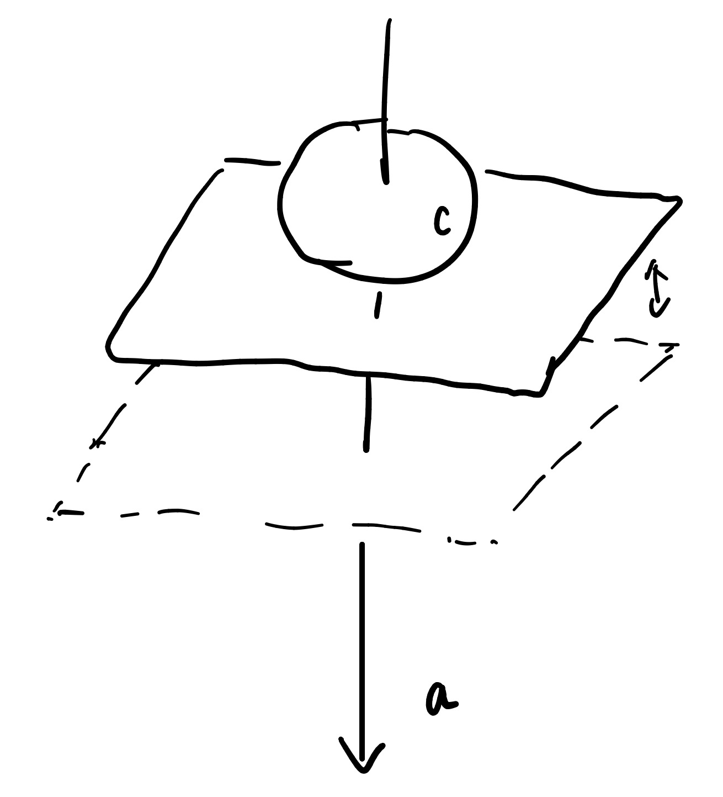</a>
<section class="latex-block latex-definition" id="latex-defblock-3-4-1" aria-label="Definition 3.4.1">
Definition 3.4.1　Support function

对于非空集合 <math xmlns="http://www.w3.org/1998/Math/MathML"><semantics><mrow><mstyle scriptlevel="0" displaystyle="true"><mi mathvariant="script">C</mi><mo>⊆</mo><msup><mi mathvariant="double-struck">R</mi><mi>n</mi></msup></mstyle></mrow><annotation encoding="application/x-tex">\displaystyle \mathcal{C} \subseteq \mathbb{R}^n</annotation></semantics></math>C⊆Rn，定义其 support function 为:

<math xmlns="http://www.w3.org/1998/Math/MathML" display="block"><semantics><mrow><msub><mi>σ</mi><mi mathvariant="script">C</mi></msub><mo stretchy="false">(</mo><mi mathvariant="bold-italic">a</mi><mo stretchy="false">)</mo><mo>:</mo><mo>=</mo><munder><mrow><mi>sup</mi><mo>⁡</mo></mrow><mrow><mi mathvariant="bold-italic">x</mi><mo>∈</mo><mi mathvariant="script">C</mi></mrow></munder><msup><mi mathvariant="bold-italic">a</mi><mi mathvariant="normal">⊤</mi></msup><mi mathvariant="bold-italic">x</mi><mo separator="true">,</mo></mrow><annotation encoding="application/x-tex">
\sigma_{\mathcal{C}}(\bm{a}) := \sup_{\bm{x} \in \mathcal{C}} \bm{a}^\top \bm{x},
</annotation></semantics></math>σC​(a):=x∈Csup​a⊤x,</section>
<ul><li>
当上确界有限且在 <math xmlns="http://www.w3.org/1998/Math/MathML"><semantics><mrow><mstyle scriptlevel="0" displaystyle="true"><mi mathvariant="script">C</mi></mstyle></mrow><annotation encoding="application/x-tex">\displaystyle \mathcal{C}</annotation></semantics></math>C 中取得时, supporting hyperplane 可以定义为:

<math xmlns="http://www.w3.org/1998/Math/MathML" display="block"><semantics><mrow><mi mathvariant="script">H</mi><mo>=</mo><mo stretchy="false">{</mo><mi mathvariant="bold-italic">x</mi><mo>∈</mo><msup><mi mathvariant="double-struck">R</mi><mi>n</mi></msup><mo>:</mo><msup><mi mathvariant="bold-italic">a</mi><mi mathvariant="normal">⊤</mi></msup><mi mathvariant="bold-italic">x</mi><mo>=</mo><msub><mi>σ</mi><mi mathvariant="script">C</mi></msub><mo stretchy="false">(</mo><mi mathvariant="bold-italic">a</mi><mo stretchy="false">)</mo><mo stretchy="false">}</mo><mo separator="true">,</mo><mtext> </mtext><mi mathvariant="bold-italic">a</mi><mo mathvariant="normal">≠</mo><mi mathvariant="bold">0</mi><mi mathvariant="normal">.</mi></mrow><annotation encoding="application/x-tex">
\mathcal{H} = \{\bm{x} \in \mathbb{R}^n: \bm{a}^\top \bm{x} = \sigma_{\mathcal{C}}(\bm{a})\},~ \bm{a} \neq \bm{0}.
</annotation></semantics></math>H={x∈Rn:a⊤x=σC​(a)}, a=0.</li></ul>
<section class="latex-block latex-proposition" id="latex-propositionblock-3-4-1" aria-label="Proposition 3.4.1">
Proposition 3.4.1　Support function representation
<ul><li>
前文提到, 一个非空闭凸集 <math xmlns="http://www.w3.org/1998/Math/MathML"><semantics><mrow><mstyle scriptlevel="0" displaystyle="true"><mi mathvariant="script">C</mi></mstyle></mrow><annotation encoding="application/x-tex">\displaystyle \mathcal{C}</annotation></semantics></math>C 可以表示为所有包含它的 supporting halfspace 的交集, 因此也可以通过 support function 来表示 <math xmlns="http://www.w3.org/1998/Math/MathML"><semantics><mrow><mstyle scriptlevel="0" displaystyle="true"><mi mathvariant="script">C</mi></mstyle></mrow><annotation encoding="application/x-tex">\displaystyle \mathcal{C}</annotation></semantics></math>C:

<math xmlns="http://www.w3.org/1998/Math/MathML" display="block"><semantics><mrow><mi mathvariant="script">C</mi><mo>=</mo><munder><mo>⋂</mo><mrow><mi mathvariant="bold-italic">a</mi><mo>∈</mo><msup><mi mathvariant="double-struck">R</mi><mi>n</mi></msup><mo>∖</mo><mo stretchy="false">{</mo><mi mathvariant="bold">0</mi><mo stretchy="false">}</mo></mrow></munder><mo stretchy="false">{</mo><mi mathvariant="bold-italic">x</mi><mo>∈</mo><msup><mi mathvariant="double-struck">R</mi><mi>n</mi></msup><mo>:</mo><msup><mi mathvariant="bold-italic">a</mi><mi mathvariant="normal">⊤</mi></msup><mi mathvariant="bold-italic">x</mi><mo>≤</mo><msub><mi>σ</mi><mi mathvariant="script">C</mi></msub><mo stretchy="false">(</mo><mi mathvariant="bold-italic">a</mi><mo stretchy="false">)</mo><mo stretchy="false">}</mo><mi mathvariant="normal">.</mi></mrow><annotation encoding="application/x-tex">
\mathcal{C} = \bigcap_{\bm{a} \in \mathbb{R}^n \setminus \{\bm{0}\}} \{\bm{x} \in \mathbb{R}^n: \bm{a}^\top \bm{x} \leq \sigma_{\mathcal{C}}(\bm{a})\}.
</annotation></semantics></math>C=a∈Rn∖{0}⋂​{x∈Rn:a⊤x≤σC​(a)}.</li></ul></section>

并且可以由此推论集合之间的包含关系: 对于闭凸集 <math xmlns="http://www.w3.org/1998/Math/MathML"><semantics><mrow><mstyle scriptlevel="0" displaystyle="true"><msub><mi mathvariant="script">C</mi><mn>1</mn></msub><mo separator="true">,</mo><msub><mi mathvariant="script">C</mi><mn>2</mn></msub><mo>⊆</mo><msup><mi mathvariant="double-struck">R</mi><mi>n</mi></msup></mstyle></mrow><annotation encoding="application/x-tex">\displaystyle \mathcal{C}_1, \mathcal{C}_2 \subseteq \mathbb{R}^n</annotation></semantics></math>C1​,C2​⊆Rn，有 <math xmlns="http://www.w3.org/1998/Math/MathML"><semantics><mrow><mstyle scriptlevel="0" displaystyle="true"><msub><mi mathvariant="script">C</mi><mn>1</mn></msub><mo>⊆</mo><msub><mi mathvariant="script">C</mi><mn>2</mn></msub><mtext>  </mtext><mo>⟺</mo><mtext>  </mtext><msub><mi>σ</mi><msub><mi mathvariant="script">C</mi><mn>1</mn></msub></msub><mo stretchy="false">(</mo><mi mathvariant="bold-italic">a</mi><mo stretchy="false">)</mo><mo>≤</mo><msub><mi>σ</mi><msub><mi mathvariant="script">C</mi><mn>2</mn></msub></msub><mo stretchy="false">(</mo><mi mathvariant="bold-italic">a</mi><mo stretchy="false">)</mo><mo separator="true">,</mo><mtext> </mtext><mi mathvariant="normal">∀</mi><mi mathvariant="bold-italic">a</mi><mo>∈</mo><msup><mi mathvariant="double-struck">R</mi><mi>n</mi></msup></mstyle></mrow><annotation encoding="application/x-tex">\displaystyle \mathcal{C}_1 \subseteq \mathcal{C}_2 \iff \sigma_{\mathcal{C}_1}(\bm{a}) \leq \sigma_{\mathcal{C}_2}(\bm{a}),~ \forall \bm{a} \in \mathbb{R}^n</annotation></semantics></math>C1​⊆C2​⟺σC1​​(a)≤σC2​​(a), ∀a∈Rn.

<section class="latex-block latex-example" id="latex-exampleblock-3-4-1" aria-label="Example 3.4.1">
Example 3.4.1　Support functions

下面是一些常见集合的 support function 的例子:

<ul><li>
对于 Euclidean ball <math xmlns="http://www.w3.org/1998/Math/MathML"><semantics><mrow><mstyle scriptlevel="0" displaystyle="true"><mi mathvariant="script">B</mi><mo stretchy="false">(</mo><mi mathvariant="bold-italic">c</mi><mo separator="true">,</mo><mi>r</mi><mo stretchy="false">)</mo><mo>:</mo><mo>=</mo><mo stretchy="false">{</mo><mi mathvariant="bold-italic">x</mi><mo>∈</mo><msup><mi mathvariant="double-struck">R</mi><mi>n</mi></msup><mo>:</mo><mi mathvariant="normal">∥</mi><mi mathvariant="bold-italic">x</mi><mo>−</mo><mi mathvariant="bold-italic">c</mi><msub><mi mathvariant="normal">∥</mi><mn>2</mn></msub><mo>≤</mo><mi>r</mi><mo stretchy="false">}</mo></mstyle></mrow><annotation encoding="application/x-tex">\displaystyle \mathcal{B}(\bm{c}, r) := \{\bm{x} \in \mathbb{R}^n: \|\bm{x}-\bm{c}\|_2 \leq r\}</annotation></semantics></math>B(c,r):={x∈Rn:∥x−c∥2​≤r}，有 <math xmlns="http://www.w3.org/1998/Math/MathML"><semantics><mrow><mstyle scriptlevel="0" displaystyle="true"><msub><mi>σ</mi><mrow><mi mathvariant="script">B</mi><mo stretchy="false">(</mo><mi mathvariant="bold-italic">c</mi><mo separator="true">,</mo><mi>r</mi><mo stretchy="false">)</mo></mrow></msub><mo stretchy="false">(</mo><mi mathvariant="bold-italic">a</mi><mo stretchy="false">)</mo><mo>=</mo><msup><mi mathvariant="bold-italic">a</mi><mi mathvariant="normal">⊤</mi></msup><mi mathvariant="bold-italic">c</mi><mo>+</mo><mi>r</mi><mi mathvariant="normal">∥</mi><mi mathvariant="bold-italic">a</mi><msub><mi mathvariant="normal">∥</mi><mn>2</mn></msub></mstyle></mrow><annotation encoding="application/x-tex">\displaystyle \sigma_{\mathcal{B}(\bm{c}, r)}(\bm{a}) = \bm{a}^\top \bm{c} + r\|\bm{a}\|_2</annotation></semantics></math>σB(c,r)​(a)=a⊤c+r∥a∥2​. 直观上, 可以理解为, 球在方向 <math xmlns="http://www.w3.org/1998/Math/MathML"><semantics><mrow><mstyle scriptlevel="0" displaystyle="true"><mi mathvariant="bold-italic">a</mi></mstyle></mrow><annotation encoding="application/x-tex">\displaystyle \bm{a}</annotation></semantics></math>a 上的评分, 就是由球心 <math xmlns="http://www.w3.org/1998/Math/MathML"><semantics><mrow><mstyle scriptlevel="0" displaystyle="true"><mi mathvariant="bold-italic">c</mi></mstyle></mrow><annotation encoding="application/x-tex">\displaystyle \bm{c}</annotation></semantics></math>c 在方向 <math xmlns="http://www.w3.org/1998/Math/MathML"><semantics><mrow><mstyle scriptlevel="0" displaystyle="true"><mi mathvariant="bold-italic">a</mi></mstyle></mrow><annotation encoding="application/x-tex">\displaystyle \bm{a}</annotation></semantics></math>a 上的投影, 再加上半径 <math xmlns="http://www.w3.org/1998/Math/MathML"><semantics><mrow><mstyle scriptlevel="0" displaystyle="true"><mi>r</mi></mstyle></mrow><annotation encoding="application/x-tex">\displaystyle r</annotation></semantics></math>r 在方向 <math xmlns="http://www.w3.org/1998/Math/MathML"><semantics><mrow><mstyle scriptlevel="0" displaystyle="true"><mi mathvariant="bold-italic">a</mi></mstyle></mrow><annotation encoding="application/x-tex">\displaystyle \bm{a}</annotation></semantics></math>a 上的投影 (即 <math xmlns="http://www.w3.org/1998/Math/MathML"><semantics><mrow><mstyle scriptlevel="0" displaystyle="true"><mi>r</mi><mi mathvariant="normal">∥</mi><mi mathvariant="bold-italic">a</mi><msub><mi mathvariant="normal">∥</mi><mn>2</mn></msub></mstyle></mrow><annotation encoding="application/x-tex">\displaystyle r\|\bm{a}\|_2</annotation></semantics></math>r∥a∥2​).
</li><li>
对于 simplex <math xmlns="http://www.w3.org/1998/Math/MathML"><semantics><mrow><mstyle scriptlevel="0" displaystyle="true"><msub><mi mathvariant="normal">Δ</mi><mrow><mi>n</mi><mo>−</mo><mn>1</mn></mrow></msub><mo>:</mo><mo>=</mo><mo stretchy="false">{</mo><mi mathvariant="bold-italic">x</mi><mo>∈</mo><msup><mi mathvariant="double-struck">R</mi><mi>n</mi></msup><mo>:</mo><msub><mi>x</mi><mi>i</mi></msub><mo>≥</mo><mn>0</mn><mo separator="true">,</mo><mtext> </mtext><munderover><mo>∑</mo><mrow><mi>i</mi><mo>=</mo><mn>1</mn></mrow><mi>n</mi></munderover><msub><mi>x</mi><mi>i</mi></msub><mo>=</mo><mn>1</mn><mo stretchy="false">}</mo></mstyle></mrow><annotation encoding="application/x-tex">\displaystyle \Delta_{n-1} := \{\bm{x} \in \mathbb{R}^n: x_i \geq 0,~ \sum_{i=1}^n x_i = 1\}</annotation></semantics></math>Δn−1​:={x∈Rn:xi​≥0, i=1∑n​xi​=1}，有 <math xmlns="http://www.w3.org/1998/Math/MathML"><semantics><mrow><mstyle scriptlevel="0" displaystyle="true"><msub><mi>σ</mi><msub><mi mathvariant="normal">Δ</mi><mrow><mi>n</mi><mo>−</mo><mn>1</mn></mrow></msub></msub><mo stretchy="false">(</mo><mi mathvariant="bold-italic">a</mi><mo stretchy="false">)</mo><mo>=</mo><munder><mrow><mi>max</mi><mo>⁡</mo></mrow><mrow><mi>i</mi><mo>=</mo><mn>1</mn><mo separator="true">,</mo><mo>…</mo><mo separator="true">,</mo><mi>n</mi></mrow></munder><msub><mi>a</mi><mi>i</mi></msub></mstyle></mrow><annotation encoding="application/x-tex">\displaystyle \sigma_{\Delta_{n-1}}(\bm{a}) = \max_{i=1,\dots,n} a_i</annotation></semantics></math>σΔn−1​​(a)=i=1,…,nmax​ai​.
对于三维欧氏空间, simplex 即为由 <math xmlns="http://www.w3.org/1998/Math/MathML"><semantics><mrow><mstyle scriptlevel="0" displaystyle="true"><mo stretchy="false">(</mo><mn>1</mn><mo separator="true">,</mo><mn>0</mn><mo separator="true">,</mo><mn>0</mn><mo stretchy="false">)</mo><mo separator="true">,</mo><mo stretchy="false">(</mo><mn>0</mn><mo separator="true">,</mo><mn>1</mn><mo separator="true">,</mo><mn>0</mn><mo stretchy="false">)</mo><mo separator="true">,</mo><mo stretchy="false">(</mo><mn>0</mn><mo separator="true">,</mo><mn>0</mn><mo separator="true">,</mo><mn>1</mn><mo stretchy="false">)</mo></mstyle></mrow><annotation encoding="application/x-tex">\displaystyle (1,0,0), (0,1,0), (0,0,1)</annotation></semantics></math>(1,0,0),(0,1,0),(0,0,1) 三个点构成的等边三角形和内部. 直观上, 可以理解为, simplex 在方向 <math xmlns="http://www.w3.org/1998/Math/MathML"><semantics><mrow><mstyle scriptlevel="0" displaystyle="true"><mi mathvariant="bold-italic">a</mi></mstyle></mrow><annotation encoding="application/x-tex">\displaystyle \bm{a}</annotation></semantics></math>a 上的评分, 就是由三个顶点在方向 <math xmlns="http://www.w3.org/1998/Math/MathML"><semantics><mrow><mstyle scriptlevel="0" displaystyle="true"><mi mathvariant="bold-italic">a</mi></mstyle></mrow><annotation encoding="application/x-tex">\displaystyle \bm{a}</annotation></semantics></math>a 上的投影中最大的那个.

<a class="latex-raster-figure" href="./convex-geometry/20261008224136252.png" style="--figure-width:40%">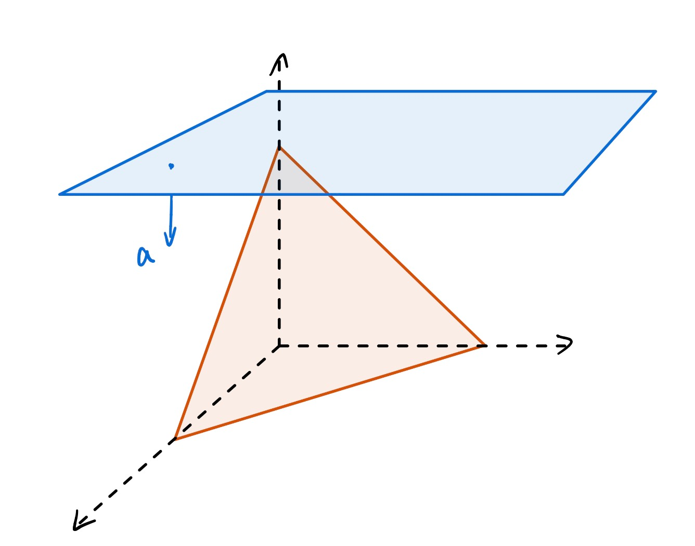</a></li><li>
对于 box-constraint set <math xmlns="http://www.w3.org/1998/Math/MathML"><semantics><mrow><mstyle scriptlevel="0" displaystyle="true"><mo stretchy="false">[</mo><mi>l</mi><mo separator="true">,</mo><mi>u</mi><mo stretchy="false">]</mo></mstyle></mrow><annotation encoding="application/x-tex">\displaystyle [l,u]</annotation></semantics></math>[l,u], 有 <math xmlns="http://www.w3.org/1998/Math/MathML"><semantics><mrow><mstyle scriptlevel="0" displaystyle="true"><msub><mi>σ</mi><mrow><mo stretchy="false">[</mo><mi>l</mi><mo separator="true">,</mo><mi>u</mi><mo stretchy="false">]</mo></mrow></msub><mo stretchy="false">(</mo><mi mathvariant="bold-italic">a</mi><mo stretchy="false">)</mo><mo>=</mo><munderover><mo>∑</mo><mrow><mi>i</mi><mo>=</mo><mn>1</mn></mrow><mi>n</mi></munderover><mi>max</mi><mo>⁡</mo><mo stretchy="false">{</mo><msub><mi>a</mi><mi>i</mi></msub><msub><mi>l</mi><mi>i</mi></msub><mo separator="true">,</mo><msub><mi>a</mi><mi>i</mi></msub><msub><mi>u</mi><mi>i</mi></msub><mo stretchy="false">}</mo></mstyle></mrow><annotation encoding="application/x-tex">\displaystyle \sigma_{[l,u]}(\bm{a}) = \sum_{i=1}^n \max\{a_i l_i, a_i u_i\}</annotation></semantics></math>σ[l,u]​(a)=i=1∑n​max{ai​li​,ai​ui​}.
</li><li>
对于 closed convex cone <math xmlns="http://www.w3.org/1998/Math/MathML"><semantics><mrow><mstyle scriptlevel="0" displaystyle="true"><mi mathvariant="script">K</mi></mstyle></mrow><annotation encoding="application/x-tex">\displaystyle \mathcal{K}</annotation></semantics></math>K, 有 <math xmlns="http://www.w3.org/1998/Math/MathML"><semantics><mrow><mstyle scriptlevel="0" displaystyle="true"><msub><mi>σ</mi><mi mathvariant="script">K</mi></msub><mo stretchy="false">(</mo><mi mathvariant="bold-italic">a</mi><mo stretchy="false">)</mo><mo>=</mo><msub><mi>δ</mi><msup><mi mathvariant="script">K</mi><mo>∘</mo></msup></msub><mo stretchy="false">(</mo><mi mathvariant="bold-italic">a</mi><mo stretchy="false">)</mo></mstyle></mrow><annotation encoding="application/x-tex">\displaystyle \sigma_{\mathcal{K}}(\bm{a}) = \delta_{\mathcal{K}^\circ}(\bm{a})</annotation></semantics></math>σK​(a)=δK∘​(a)，其中 <math xmlns="http://www.w3.org/1998/Math/MathML"><semantics><mrow><mstyle scriptlevel="0" displaystyle="true"><msup><mi mathvariant="script">K</mi><mo>∘</mo></msup></mstyle></mrow><annotation encoding="application/x-tex">\displaystyle \mathcal{K}^\circ</annotation></semantics></math>K∘ 是 <math xmlns="http://www.w3.org/1998/Math/MathML"><semantics><mrow><mstyle scriptlevel="0" displaystyle="true"><mi mathvariant="script">K</mi></mstyle></mrow><annotation encoding="application/x-tex">\displaystyle \mathcal{K}</annotation></semantics></math>K 的极锥 (polar cone).
</li></ul></section>
<section class="latex-block latex-definition" id="latex-defblock-3-4-2" aria-label="Definition 3.4.2">
Definition 3.4.2　Exposed face

有了集合 <math xmlns="http://www.w3.org/1998/Math/MathML"><semantics><mrow><mstyle scriptlevel="0" displaystyle="true"><mi mathvariant="script">C</mi></mstyle></mrow><annotation encoding="application/x-tex">\displaystyle \mathcal{C}</annotation></semantics></math>C 和 supporting hyperplane <math xmlns="http://www.w3.org/1998/Math/MathML"><semantics><mrow><mstyle scriptlevel="0" displaystyle="true"><mi mathvariant="script">H</mi></mstyle></mrow><annotation encoding="application/x-tex">\displaystyle \mathcal{H}</annotation></semantics></math>H，exposed face 就是二者的交界面, 即 <math xmlns="http://www.w3.org/1998/Math/MathML"><semantics><mrow><mstyle scriptlevel="0" displaystyle="true"><msub><mi mathvariant="script">F</mi><mi mathvariant="script">C</mi></msub><mo stretchy="false">(</mo><mi mathvariant="bold-italic">a</mi><mo stretchy="false">)</mo><mo>:</mo><mo>=</mo><mi mathvariant="script">C</mi><mo>∩</mo><mi mathvariant="script">H</mi></mstyle></mrow><annotation encoding="application/x-tex">\displaystyle \mathcal{F}_{\mathcal{C}}(\bm{a}) := \mathcal{C} \cap \mathcal{H}</annotation></semantics></math>FC​(a):=C∩H. 或者, 也可以直接定义 exposed face 为:

<math xmlns="http://www.w3.org/1998/Math/MathML" display="block"><semantics><mrow><msub><mi mathvariant="script">F</mi><mi mathvariant="script">C</mi></msub><mo stretchy="false">(</mo><mi mathvariant="bold-italic">a</mi><mo stretchy="false">)</mo><mo>:</mo><mo>=</mo><mi>arg</mi><mo>⁡</mo><munder><mrow><mi>max</mi><mo>⁡</mo></mrow><mrow><mi mathvariant="bold-italic">x</mi><mo>∈</mo><mi mathvariant="script">C</mi></mrow></munder><msup><mi mathvariant="bold-italic">a</mi><mi mathvariant="normal">⊤</mi></msup><mi mathvariant="bold-italic">x</mi><mo separator="true">,</mo><mtext> </mtext><mi mathvariant="bold-italic">a</mi><mo mathvariant="normal">≠</mo><mi mathvariant="bold">0</mi><mi mathvariant="normal">.</mi></mrow><annotation encoding="application/x-tex">
\mathcal{F}_{\mathcal{C}}(\bm{a}) := \arg\max_{\bm{x} \in \mathcal{C}} \bm{a}^\top \bm{x},~ \bm{a} \neq \bm{0}.
</annotation></semantics></math>FC​(a):=argx∈Cmax​a⊤x, a=0.</section>

<em><strong>Deeper view of support function</strong></em>.

以上两个数学量的定义本身是直观的. 然而其可以通过凸分析的工具进行更深刻的理解.

首先, support function 可以看作是集合的 indicator function 的 Fenchel conjugate. 理由如下.

<ul><li>
对于 <math xmlns="http://www.w3.org/1998/Math/MathML"><semantics><mrow><mstyle scriptlevel="0" displaystyle="true"><msub><mi>σ</mi><mi mathvariant="script">C</mi></msub><mo stretchy="false">(</mo><mi mathvariant="bold-italic">a</mi><mo stretchy="false">)</mo><mo>=</mo><munder><mrow><mi>sup</mi><mo>⁡</mo></mrow><mrow><mi mathvariant="bold-italic">x</mi><mo>∈</mo><mi mathvariant="script">C</mi></mrow></munder><msup><mi mathvariant="bold-italic">a</mi><mi mathvariant="normal">⊤</mi></msup><mi mathvariant="bold-italic">x</mi></mstyle></mrow><annotation encoding="application/x-tex">\displaystyle \sigma_{\mathcal{C}}(\bm{a}) = \sup_{\bm{x} \in \mathcal{C}} \bm{a}^\top \bm{x}</annotation></semantics></math>σC​(a)=x∈Csup​a⊤x，其关注的是, 给定一个方向 <math xmlns="http://www.w3.org/1998/Math/MathML"><semantics><mrow><mstyle scriptlevel="0" displaystyle="true"><mi mathvariant="bold-italic">a</mi></mstyle></mrow><annotation encoding="application/x-tex">\displaystyle \bm{a}</annotation></semantics></math>a，在这个方向上, 集合 <math xmlns="http://www.w3.org/1998/Math/MathML"><semantics><mrow><mstyle scriptlevel="0" displaystyle="true"><mi mathvariant="script">C</mi></mstyle></mrow><annotation encoding="application/x-tex">\displaystyle \mathcal{C}</annotation></semantics></math>C 能够测量的最大评分是多少.

<ul><li>
例如, 对于 Euclidean ball <math xmlns="http://www.w3.org/1998/Math/MathML"><semantics><mrow><mstyle scriptlevel="0" displaystyle="true"><mi mathvariant="script">C</mi><mo>=</mo><mo stretchy="false">{</mo><mi mathvariant="bold-italic">x</mi><mo>∈</mo><msup><mi mathvariant="double-struck">R</mi><mi>n</mi></msup><mo>:</mo><mi mathvariant="normal">∥</mi><mi mathvariant="bold-italic">x</mi><msub><mi mathvariant="normal">∥</mi><mn>2</mn></msub><mo>≤</mo><mn>1</mn><mo stretchy="false">}</mo></mstyle></mrow><annotation encoding="application/x-tex">\displaystyle \mathcal{C} = \{\bm{x} \in \mathbb{R}^n: \|\bm{x}\|_2 \leq 1\}</annotation></semantics></math>C={x∈Rn:∥x∥2​≤1}，则由 Cauchy-Schwarz inequality 可知 <math xmlns="http://www.w3.org/1998/Math/MathML"><semantics><mrow><mstyle scriptlevel="0" displaystyle="true"><msup><mi mathvariant="bold-italic">a</mi><mi mathvariant="normal">⊤</mi></msup><mi mathvariant="bold-italic">x</mi><mo>≤</mo><mi mathvariant="normal">∥</mi><mi mathvariant="bold-italic">a</mi><msub><mi mathvariant="normal">∥</mi><mn>2</mn></msub><mi mathvariant="normal">∥</mi><mi mathvariant="bold-italic">x</mi><msub><mi mathvariant="normal">∥</mi><mn>2</mn></msub><mo>≤</mo><mi mathvariant="normal">∥</mi><mi mathvariant="bold-italic">a</mi><msub><mi mathvariant="normal">∥</mi><mn>2</mn></msub></mstyle></mrow><annotation encoding="application/x-tex">\displaystyle \bm{a}^\top \bm{x} \leq \|\bm{a}\|_2 \|\bm{x}\|_2 \leq \|\bm{a}\|_2</annotation></semantics></math>a⊤x≤∥a∥2​∥x∥2​≤∥a∥2​，故 <math xmlns="http://www.w3.org/1998/Math/MathML"><semantics><mrow><mstyle scriptlevel="0" displaystyle="true"><msub><mi>σ</mi><mi mathvariant="script">C</mi></msub><mo stretchy="false">(</mo><mi mathvariant="bold-italic">a</mi><mo stretchy="false">)</mo><mo>=</mo><mi mathvariant="normal">∥</mi><mi mathvariant="bold-italic">a</mi><msub><mi mathvariant="normal">∥</mi><mn>2</mn></msub></mstyle></mrow><annotation encoding="application/x-tex">\displaystyle \sigma_{\mathcal{C}}(\bm{a}) = \|\bm{a}\|_2</annotation></semantics></math>σC​(a)=∥a∥2​.
</li><li>
这里从集合 <math xmlns="http://www.w3.org/1998/Math/MathML"><semantics><mrow><mstyle scriptlevel="0" displaystyle="true"><mi mathvariant="script">C</mi></mstyle></mrow><annotation encoding="application/x-tex">\displaystyle \mathcal{C}</annotation></semantics></math>C 转换成了一个函数 <math xmlns="http://www.w3.org/1998/Math/MathML"><semantics><mrow><mstyle scriptlevel="0" displaystyle="true"><msub><mi>σ</mi><mi mathvariant="script">C</mi></msub><mo stretchy="false">(</mo><mo>⋅</mo><mo stretchy="false">)</mo></mstyle></mrow><annotation encoding="application/x-tex">\displaystyle \sigma_{\mathcal{C}}(\cdot)</annotation></semantics></math>σC​(⋅).
</li></ul></li><li>
联想到 Fenchel conjugate. 对于函数 <math xmlns="http://www.w3.org/1998/Math/MathML"><semantics><mrow><mstyle scriptlevel="0" displaystyle="true"><mi>f</mi><mo>:</mo><msup><mi mathvariant="double-struck">R</mi><mi>n</mi></msup><mo>→</mo><mi mathvariant="double-struck">R</mi><mo>∪</mo><mo stretchy="false">{</mo><mo>+</mo><mi mathvariant="normal">∞</mi><mo stretchy="false">}</mo></mstyle></mrow><annotation encoding="application/x-tex">\displaystyle f: \mathbb{R}^n \to \mathbb{R} \cup \{+\infty\}</annotation></semantics></math>f:Rn→R∪{+∞}，其 Fenchel conjugate 定义为 <math xmlns="http://www.w3.org/1998/Math/MathML"><semantics><mrow><mstyle scriptlevel="0" displaystyle="true"><msup><mi>f</mi><mo>∗</mo></msup><mo stretchy="false">(</mo><mi mathvariant="bold-italic">y</mi><mo stretchy="false">)</mo><mo>:</mo><mo>=</mo><munder><mrow><mi>sup</mi><mo>⁡</mo></mrow><mrow><mi mathvariant="bold-italic">x</mi><mo>∈</mo><msup><mi mathvariant="double-struck">R</mi><mi>n</mi></msup></mrow></munder><mo stretchy="false">{</mo><msup><mi mathvariant="bold-italic">y</mi><mi mathvariant="normal">⊤</mi></msup><mi mathvariant="bold-italic">x</mi><mo>−</mo><mi>f</mi><mo stretchy="false">(</mo><mi mathvariant="bold-italic">x</mi><mo stretchy="false">)</mo><mo stretchy="false">}</mo></mstyle></mrow><annotation encoding="application/x-tex">\displaystyle f^*(\bm{y}) := \sup_{\bm{x} \in \mathbb{R}^n} \{\bm{y}^\top \bm{x} - f(\bm{x})\}</annotation></semantics></math>f∗(y):=x∈Rnsup​{y⊤x−f(x)}.

<ul><li>
Fenchel conjugate 关注的是, 在整个 <math xmlns="http://www.w3.org/1998/Math/MathML"><semantics><mrow><mstyle scriptlevel="0" displaystyle="true"><msup><mi mathvariant="double-struck">R</mi><mi>n</mi></msup></mstyle></mrow><annotation encoding="application/x-tex">\displaystyle \mathbb{R}^n</annotation></semantics></math>Rn 空间中的最大化, 但是要扣除一个 penalty <math xmlns="http://www.w3.org/1998/Math/MathML"><semantics><mrow><mstyle scriptlevel="0" displaystyle="true"><mi>f</mi><mo stretchy="false">(</mo><mi mathvariant="bold-italic">x</mi><mo stretchy="false">)</mo></mstyle></mrow><annotation encoding="application/x-tex">\displaystyle f(\bm{x})</annotation></semantics></math>f(x). 而 support function 关注的是, 在集合 <math xmlns="http://www.w3.org/1998/Math/MathML"><semantics><mrow><mstyle scriptlevel="0" displaystyle="true"><mi mathvariant="script">C</mi></mstyle></mrow><annotation encoding="application/x-tex">\displaystyle \mathcal{C}</annotation></semantics></math>C 中的最大化.
</li><li>
不妨通过令 <math xmlns="http://www.w3.org/1998/Math/MathML"><semantics><mrow><mstyle scriptlevel="0" displaystyle="true"><mi>f</mi><mo stretchy="false">(</mo><mi mathvariant="bold-italic">x</mi><mo stretchy="false">)</mo><mo>=</mo><msub><mi>δ</mi><mi mathvariant="script">C</mi></msub><mo stretchy="false">(</mo><mi mathvariant="bold-italic">x</mi><mo stretchy="false">)</mo></mstyle></mrow><annotation encoding="application/x-tex">\displaystyle f(\bm{x}) = \delta_{\mathcal{C}}(\bm{x})</annotation></semantics></math>f(x)=δC​(x)，则有 <math xmlns="http://www.w3.org/1998/Math/MathML"><semantics><mrow><mstyle scriptlevel="0" displaystyle="true"><msup><mi>f</mi><mo>∗</mo></msup><mo stretchy="false">(</mo><mi mathvariant="bold-italic">y</mi><mo stretchy="false">)</mo><mo>=</mo><munder><mrow><mi>sup</mi><mo>⁡</mo></mrow><mrow><mi mathvariant="bold-italic">x</mi><mo>∈</mo><msup><mi mathvariant="double-struck">R</mi><mi>n</mi></msup></mrow></munder><mo stretchy="false">{</mo><msup><mi mathvariant="bold-italic">y</mi><mi mathvariant="normal">⊤</mi></msup><mi mathvariant="bold-italic">x</mi><mo>−</mo><msub><mi>δ</mi><mi mathvariant="script">C</mi></msub><mo stretchy="false">(</mo><mi mathvariant="bold-italic">x</mi><mo stretchy="false">)</mo><mo stretchy="false">}</mo><mo>=</mo><munder><mrow><mi>sup</mi><mo>⁡</mo></mrow><mrow><mi mathvariant="bold-italic">x</mi><mo>∈</mo><mi mathvariant="script">C</mi></mrow></munder><msup><mi mathvariant="bold-italic">y</mi><mi mathvariant="normal">⊤</mi></msup><mi mathvariant="bold-italic">x</mi><mo>=</mo><msub><mi>σ</mi><mi mathvariant="script">C</mi></msub><mo stretchy="false">(</mo><mi mathvariant="bold-italic">y</mi><mo stretchy="false">)</mo></mstyle></mrow><annotation encoding="application/x-tex">\displaystyle f^*(\bm{y}) = \sup_{\bm{x} \in \mathbb{R}^n} \{\bm{y}^\top \bm{x} - \delta_{\mathcal{C}}(\bm{x})\} = \sup_{\bm{x} \in \mathcal{C}} \bm{y}^\top \bm{x} = \sigma_{\mathcal{C}}(\bm{y})</annotation></semantics></math>f∗(y)=x∈Rnsup​{y⊤x−δC​(x)}=x∈Csup​y⊤x=σC​(y). 也即, support function 可以看作是 indicator function 的 Fenchel conjugate.
</li></ul></li><li>
因此, 集合 <math xmlns="http://www.w3.org/1998/Math/MathML"><semantics><mrow><mstyle scriptlevel="0" displaystyle="true"><mi mathvariant="script">C</mi></mstyle></mrow><annotation encoding="application/x-tex">\displaystyle \mathcal{C}</annotation></semantics></math>C 的 support function 可以看作是 <math xmlns="http://www.w3.org/1998/Math/MathML"><semantics><mrow><mstyle scriptlevel="0" displaystyle="true"><mi mathvariant="script">C</mi></mstyle></mrow><annotation encoding="application/x-tex">\displaystyle \mathcal{C}</annotation></semantics></math>C 的 indicator function 的 Fenchel conjugate.
</li></ul>

## 4. Farkas lemma

### 4.1. Standard form

Farkas lemma 给出了线性系统的可行性的一个判断条件. 其有多种等价的表述. 首先考虑其标准形式.

<section class="latex-block latex-theorem" id="latex-thmblock-4-1-1" aria-label="Theorem 4.1.1">
Theorem 4.1.1　Farkas lemma, standard form

[Bertsimas, § 4.6, Theorem 4.6]  给定 <math xmlns="http://www.w3.org/1998/Math/MathML"><semantics><mrow><mstyle scriptlevel="0" displaystyle="true"><mi mathvariant="bold-italic">A</mi><mo>∈</mo><msup><mi mathvariant="double-struck">R</mi><mrow><mi>m</mi><mo>×</mo><mi>n</mi></mrow></msup></mstyle></mrow><annotation encoding="application/x-tex">\displaystyle \bm{A} \in \mathbb{R}^{m \times n}</annotation></semantics></math>A∈Rm×n, <math xmlns="http://www.w3.org/1998/Math/MathML"><semantics><mrow><mstyle scriptlevel="0" displaystyle="true"><mi mathvariant="bold-italic">x</mi><mo>∈</mo><msup><mi mathvariant="double-struck">R</mi><mi>n</mi></msup></mstyle></mrow><annotation encoding="application/x-tex">\displaystyle \bm{x} \in \mathbb{R}^n</annotation></semantics></math>x∈Rn，<math xmlns="http://www.w3.org/1998/Math/MathML"><semantics><mrow><mstyle scriptlevel="0" displaystyle="true"><mi mathvariant="bold-italic">b</mi><mo>∈</mo><msup><mi mathvariant="double-struck">R</mi><mi>m</mi></msup></mstyle></mrow><annotation encoding="application/x-tex">\displaystyle \bm{b} \in \mathbb{R}^m</annotation></semantics></math>b∈Rm，则如下两个命题有且仅有一个成立:

<ol><li>
存在 <math xmlns="http://www.w3.org/1998/Math/MathML"><semantics><mrow><mstyle scriptlevel="0" displaystyle="true"><mi mathvariant="bold-italic">x</mi><mo>≥</mo><mi mathvariant="bold">0</mi></mstyle></mrow><annotation encoding="application/x-tex">\displaystyle \bm{x} \geq \bm{0}</annotation></semantics></math>x≥0 使得 <math xmlns="http://www.w3.org/1998/Math/MathML"><semantics><mrow><mstyle scriptlevel="0" displaystyle="true"><mi mathvariant="bold-italic">A</mi><mi mathvariant="bold-italic">x</mi><mo>=</mo><mi mathvariant="bold-italic">b</mi></mstyle></mrow><annotation encoding="application/x-tex">\displaystyle \bm{A}\bm{x} = \bm{b}</annotation></semantics></math>Ax=b.
</li><li>
存在 <math xmlns="http://www.w3.org/1998/Math/MathML"><semantics><mrow><mstyle scriptlevel="0" displaystyle="true"><mi mathvariant="bold-italic">y</mi><mo>∈</mo><msup><mi mathvariant="double-struck">R</mi><mi>m</mi></msup></mstyle></mrow><annotation encoding="application/x-tex">\displaystyle \bm{y} \in \mathbb{R}^m</annotation></semantics></math>y∈Rm 使得 <math xmlns="http://www.w3.org/1998/Math/MathML"><semantics><mrow><mstyle scriptlevel="0" displaystyle="true"><msup><mi mathvariant="bold-italic">y</mi><mi mathvariant="normal">⊤</mi></msup><mi mathvariant="bold-italic">A</mi><mo>≥</mo><msup><mi mathvariant="bold">0</mi><mi mathvariant="normal">⊤</mi></msup></mstyle></mrow><annotation encoding="application/x-tex">\displaystyle \bm{y}^\top \bm{A} \geq \bm{0}^\top</annotation></semantics></math>y⊤A≥0⊤ 且 <math xmlns="http://www.w3.org/1998/Math/MathML"><semantics><mrow><mstyle scriptlevel="0" displaystyle="true"><msup><mi mathvariant="bold-italic">y</mi><mi mathvariant="normal">⊤</mi></msup><mi mathvariant="bold-italic">b</mi><mo>&lt;</mo><mn>0</mn></mstyle></mrow><annotation encoding="application/x-tex">\displaystyle \bm{y}^\top \bm{b} &lt; 0</annotation></semantics></math>y⊤b&lt;0.
</li></ol></section>

Proof.

记第一个命题为 <math xmlns="http://www.w3.org/1998/Math/MathML"><semantics><mrow><mstyle scriptlevel="0" displaystyle="true"><mi>P</mi></mstyle></mrow><annotation encoding="application/x-tex">\displaystyle P</annotation></semantics></math>P, 第二个命题为 <math xmlns="http://www.w3.org/1998/Math/MathML"><semantics><mrow><mstyle scriptlevel="0" displaystyle="true"><mi>Q</mi></mstyle></mrow><annotation encoding="application/x-tex">\displaystyle Q</annotation></semantics></math>Q. 故该命题要证明的是 <math xmlns="http://www.w3.org/1998/Math/MathML"><semantics><mrow><mstyle scriptlevel="0" displaystyle="true"><mi mathvariant="normal">¬</mi><mi>P</mi><mtext>  </mtext><mo>⟺</mo><mtext>  </mtext><mi>Q</mi></mstyle></mrow><annotation encoding="application/x-tex">\displaystyle \neg P \iff Q</annotation></semantics></math>¬P⟺Q.

<ul><li>
(<math xmlns="http://www.w3.org/1998/Math/MathML"><semantics><mrow><mstyle scriptlevel="0" displaystyle="true"><mi>Q</mi><mo>⇒</mo><mi mathvariant="normal">¬</mi><mi>P</mi></mstyle></mrow><annotation encoding="application/x-tex">\displaystyle Q \Rightarrow \neg P</annotation></semantics></math>Q⇒¬P) 这个方向的证明是比较直接的. 考虑其等价逆否命题, 即存在 <math xmlns="http://www.w3.org/1998/Math/MathML"><semantics><mrow><mstyle scriptlevel="0" displaystyle="true"><mi mathvariant="bold-italic">x</mi><mo>≥</mo><mi mathvariant="bold">0</mi></mstyle></mrow><annotation encoding="application/x-tex">\displaystyle \bm{x} \geq \bm{0}</annotation></semantics></math>x≥0 使得 <math xmlns="http://www.w3.org/1998/Math/MathML"><semantics><mrow><mstyle scriptlevel="0" displaystyle="true"><mi mathvariant="bold-italic">A</mi><mi mathvariant="bold-italic">x</mi><mo>=</mo><mi mathvariant="bold-italic">b</mi></mstyle></mrow><annotation encoding="application/x-tex">\displaystyle \bm{A}\bm{x} = \bm{b}</annotation></semantics></math>Ax=b，则此时对于任意 <math xmlns="http://www.w3.org/1998/Math/MathML"><semantics><mrow><mstyle scriptlevel="0" displaystyle="true"><mi mathvariant="bold-italic">y</mi><mo>∈</mo><msup><mi mathvariant="double-struck">R</mi><mi>m</mi></msup></mstyle></mrow><annotation encoding="application/x-tex">\displaystyle \bm{y} \in \mathbb{R}^m</annotation></semantics></math>y∈Rm，有 <math xmlns="http://www.w3.org/1998/Math/MathML"><semantics><mrow><mstyle scriptlevel="0" displaystyle="true"><msup><mi mathvariant="bold-italic">y</mi><mi mathvariant="normal">⊤</mi></msup><mi mathvariant="bold-italic">A</mi><mi mathvariant="bold-italic">x</mi><mo>=</mo><msup><mi mathvariant="bold-italic">y</mi><mi mathvariant="normal">⊤</mi></msup><mi mathvariant="bold-italic">b</mi></mstyle></mrow><annotation encoding="application/x-tex">\displaystyle \bm{y}^\top \bm{A}\bm{x} = \bm{y}^\top \bm{b}</annotation></semantics></math>y⊤Ax=y⊤b. 故若 <math xmlns="http://www.w3.org/1998/Math/MathML"><semantics><mrow><mstyle scriptlevel="0" displaystyle="true"><msup><mi mathvariant="bold-italic">y</mi><mi mathvariant="normal">⊤</mi></msup><mi mathvariant="bold-italic">A</mi><mo>≥</mo><msup><mi mathvariant="bold">0</mi><mi mathvariant="normal">⊤</mi></msup></mstyle></mrow><annotation encoding="application/x-tex">\displaystyle \bm{y}^\top \bm{A} \geq \bm{0}^\top</annotation></semantics></math>y⊤A≥0⊤，则有 <math xmlns="http://www.w3.org/1998/Math/MathML"><semantics><mrow><mstyle scriptlevel="0" displaystyle="true"><msup><mi mathvariant="bold-italic">y</mi><mi mathvariant="normal">⊤</mi></msup><mi mathvariant="bold-italic">b</mi><mo>=</mo><msup><mi mathvariant="bold-italic">y</mi><mi mathvariant="normal">⊤</mi></msup><mi mathvariant="bold-italic">A</mi><mi mathvariant="bold-italic">x</mi><mo>≥</mo><mn>0</mn></mstyle></mrow><annotation encoding="application/x-tex">\displaystyle \bm{y}^\top \bm{b} = \bm{y}^\top \bm{A}\bm{x} \geq 0</annotation></semantics></math>y⊤b=y⊤Ax≥0, 从而与 <math xmlns="http://www.w3.org/1998/Math/MathML"><semantics><mrow><mstyle scriptlevel="0" displaystyle="true"><msup><mi mathvariant="bold-italic">y</mi><mi mathvariant="normal">⊤</mi></msup><mi mathvariant="bold-italic">b</mi><mo>&lt;</mo><mn>0</mn></mstyle></mrow><annotation encoding="application/x-tex">\displaystyle \bm{y}^\top \bm{b} &lt; 0</annotation></semantics></math>y⊤b&lt;0 矛盾.
</li><li>
(<math xmlns="http://www.w3.org/1998/Math/MathML"><semantics><mrow><mstyle scriptlevel="0" displaystyle="true"><mi mathvariant="normal">¬</mi><mi>P</mi><mo>⇒</mo><mi>Q</mi></mstyle></mrow><annotation encoding="application/x-tex">\displaystyle \neg P \Rightarrow Q</annotation></semantics></math>¬P⇒Q) 这个方向的证明是比较复杂的. Bertsimas 的书中是通过如下 LP 问题与其对偶问题的可行性来证明的. 具体而言, 考虑如下 LP 问题:

<math xmlns="http://www.w3.org/1998/Math/MathML" display="block"><semantics><mrow><mi>min</mi><mo>⁡</mo><msup><mi mathvariant="bold">0</mi><mi mathvariant="normal">⊤</mi></msup><mi mathvariant="bold-italic">x</mi><mspace width="1em"/><mtext>s.t. </mtext><mi mathvariant="bold-italic">A</mi><mi mathvariant="bold-italic">x</mi><mo>=</mo><mi mathvariant="bold-italic">b</mi><mo separator="true">,</mo><mtext> </mtext><mi mathvariant="bold-italic">x</mi><mo>≥</mo><mi mathvariant="bold">0</mi><mi mathvariant="normal">.</mi></mrow><annotation encoding="application/x-tex">
\min \bm{0}^\top \bm{x} \quad \text{s.t.}~ \bm{A}\bm{x} = \bm{b},~ \bm{x} \geq \bm{0}.
</annotation></semantics></math>min0⊤xs.t. Ax=b, x≥0.

其对偶问题经变量取负后的等价形式为:

<math xmlns="http://www.w3.org/1998/Math/MathML" display="block"><semantics><mrow><mi>min</mi><mo>⁡</mo><msup><mi mathvariant="bold-italic">b</mi><mi mathvariant="normal">⊤</mi></msup><mi mathvariant="bold-italic">y</mi><mspace width="1em"/><mtext>s.t. </mtext><msup><mi mathvariant="bold-italic">y</mi><mi mathvariant="normal">⊤</mi></msup><mi mathvariant="bold-italic">A</mi><mo>≥</mo><msup><mi mathvariant="bold">0</mi><mi mathvariant="normal">⊤</mi></msup><mi mathvariant="normal">.</mi></mrow><annotation encoding="application/x-tex">
\min \bm{b}^\top \bm{y} \quad \text{s.t.}~ \bm{y}^\top \bm{A} \geq \bm{0}^\top.
</annotation></semantics></math>minb⊤ys.t. y⊤A≥0⊤.

如果 <math xmlns="http://www.w3.org/1998/Math/MathML"><semantics><mrow><mstyle scriptlevel="0" displaystyle="true"><mi mathvariant="normal">¬</mi><mi>P</mi></mstyle></mrow><annotation encoding="application/x-tex">\displaystyle \neg P</annotation></semantics></math>¬P 成立, 则说明原问题不可行, 则根据 LP 的对偶性质, 说明对偶问题要么是不可行的, 要么是无界的. 然而显然 <math xmlns="http://www.w3.org/1998/Math/MathML"><semantics><mrow><mstyle scriptlevel="0" displaystyle="true"><mi mathvariant="bold-italic">y</mi><mo>=</mo><mi mathvariant="bold">0</mi></mstyle></mrow><annotation encoding="application/x-tex">\displaystyle \bm{y} = \bm{0}</annotation></semantics></math>y=0 是对偶问题的一个可行解, 因此只能是对偶问题是无界的, 即 <math xmlns="http://www.w3.org/1998/Math/MathML"><semantics><mrow><mstyle scriptlevel="0" displaystyle="true"><msup><mi mathvariant="bold-italic">b</mi><mi mathvariant="normal">⊤</mi></msup><mi mathvariant="bold-italic">y</mi><mo>&lt;</mo><mn>0</mn></mstyle></mrow><annotation encoding="application/x-tex">\displaystyle \bm{b}^\top \bm{y} &lt; 0</annotation></semantics></math>b⊤y&lt;0 (故最小化时是无界的). 因此, 存在 <math xmlns="http://www.w3.org/1998/Math/MathML"><semantics><mrow><mstyle scriptlevel="0" displaystyle="true"><mi mathvariant="bold-italic">y</mi><mo>∈</mo><msup><mi mathvariant="double-struck">R</mi><mi>m</mi></msup></mstyle></mrow><annotation encoding="application/x-tex">\displaystyle \bm{y} \in \mathbb{R}^m</annotation></semantics></math>y∈Rm 使得 <math xmlns="http://www.w3.org/1998/Math/MathML"><semantics><mrow><mstyle scriptlevel="0" displaystyle="true"><msup><mi mathvariant="bold-italic">y</mi><mi mathvariant="normal">⊤</mi></msup><mi mathvariant="bold-italic">A</mi><mo>≥</mo><msup><mi mathvariant="bold">0</mi><mi mathvariant="normal">⊤</mi></msup></mstyle></mrow><annotation encoding="application/x-tex">\displaystyle \bm{y}^\top \bm{A} \geq \bm{0}^\top</annotation></semantics></math>y⊤A≥0⊤ 且 <math xmlns="http://www.w3.org/1998/Math/MathML"><semantics><mrow><mstyle scriptlevel="0" displaystyle="true"><msup><mi mathvariant="bold-italic">y</mi><mi mathvariant="normal">⊤</mi></msup><mi mathvariant="bold-italic">b</mi><mo>&lt;</mo><mn>0</mn></mstyle></mrow><annotation encoding="application/x-tex">\displaystyle \bm{y}^\top \bm{b} &lt; 0</annotation></semantics></math>y⊤b&lt;0. 故 <math xmlns="http://www.w3.org/1998/Math/MathML"><semantics><mrow><mstyle scriptlevel="0" displaystyle="true"><mi>Q</mi></mstyle></mrow><annotation encoding="application/x-tex">\displaystyle Q</annotation></semantics></math>Q 成立.
</li></ul>□

这是一个很简洁的证明视角, 不过其证明依赖于 LP 的对偶理论 (不过有趣的是, 确实不存在循环论证的问题). Bertsimas 接着还给出了一个几何的视角说明, 这或许更为直观, 而且和 separation theorem 密切相关.

<em>Geometric view</em>. 命题 <math xmlns="http://www.w3.org/1998/Math/MathML"><semantics><mrow><mstyle scriptlevel="0" displaystyle="true"><mi>P</mi></mstyle></mrow><annotation encoding="application/x-tex">\displaystyle P</annotation></semantics></math>P 若成立, 等价于 <math xmlns="http://www.w3.org/1998/Math/MathML"><semantics><mrow><mstyle scriptlevel="0" displaystyle="true"><mi mathvariant="bold-italic">b</mi><mo>∈</mo><mtext>cone</mtext><mo stretchy="false">(</mo><mi mathvariant="bold-italic">A</mi><mo stretchy="false">)</mo><mo>:</mo><mo>=</mo><mo stretchy="false">{</mo><munderover><mo>∑</mo><mrow><mi>i</mi><mo>=</mo><mn>1</mn></mrow><mi>n</mi></munderover><msub><mi>x</mi><mi>i</mi></msub><msub><mi mathvariant="bold-italic">A</mi><mi>i</mi></msub><mo>:</mo><msub><mi>x</mi><mi>i</mi></msub><mo>≥</mo><mi mathvariant="bold">0</mi><mo stretchy="false">}</mo></mstyle></mrow><annotation encoding="application/x-tex">\displaystyle \bm{b} \in \text{cone}(\bm{A}) := \{\sum_{i=1}^n x_i \bm{A}_i: x_i \geq \bm{0}\}</annotation></semantics></math>b∈cone(A):={i=1∑n​xi​Ai​:xi​≥0}, 也即 <math xmlns="http://www.w3.org/1998/Math/MathML"><semantics><mrow><mstyle scriptlevel="0" displaystyle="true"><mi mathvariant="bold-italic">b</mi></mstyle></mrow><annotation encoding="application/x-tex">\displaystyle \bm{b}</annotation></semantics></math>b 属于由 <math xmlns="http://www.w3.org/1998/Math/MathML"><semantics><mrow><mstyle scriptlevel="0" displaystyle="true"><mi mathvariant="bold-italic">A</mi></mstyle></mrow><annotation encoding="application/x-tex">\displaystyle \bm{A}</annotation></semantics></math>A 的列向量生成的凸锥中. 故若 <math xmlns="http://www.w3.org/1998/Math/MathML"><semantics><mrow><mstyle scriptlevel="0" displaystyle="true"><mi mathvariant="normal">¬</mi><mi>P</mi></mstyle></mrow><annotation encoding="application/x-tex">\displaystyle \neg P</annotation></semantics></math>¬P 成立, 则说明 <math xmlns="http://www.w3.org/1998/Math/MathML"><semantics><mrow><mstyle scriptlevel="0" displaystyle="true"><mi mathvariant="bold-italic">b</mi><mo mathvariant="normal">∉</mo><mtext>cone</mtext><mo stretchy="false">(</mo><mi mathvariant="bold-italic">A</mi><mo stretchy="false">)</mo></mstyle></mrow><annotation encoding="application/x-tex">\displaystyle \bm{b} \notin \text{cone}(\bm{A})</annotation></semantics></math>b∈/cone(A). 则根据 separation theorem, 存在超平面, 对应法向量 <math xmlns="http://www.w3.org/1998/Math/MathML"><semantics><mrow><mstyle scriptlevel="0" displaystyle="true"><mi mathvariant="bold-italic">y</mi><mo>∈</mo><msup><mi mathvariant="double-struck">R</mi><mi>m</mi></msup></mstyle></mrow><annotation encoding="application/x-tex">\displaystyle \bm{y} \in \mathbb{R}^m</annotation></semantics></math>y∈Rm 使得 <math xmlns="http://www.w3.org/1998/Math/MathML"><semantics><mrow><mstyle scriptlevel="0" displaystyle="true"><msup><mi mathvariant="bold-italic">y</mi><mi mathvariant="normal">⊤</mi></msup><mi mathvariant="bold-italic">b</mi><mo>&lt;</mo><mn>0</mn></mstyle></mrow><annotation encoding="application/x-tex">\displaystyle \bm{y}^\top \bm{b} &lt; 0</annotation></semantics></math>y⊤b&lt;0 且 <math xmlns="http://www.w3.org/1998/Math/MathML"><semantics><mrow><mstyle scriptlevel="0" displaystyle="true"><msup><mi mathvariant="bold-italic">y</mi><mi mathvariant="normal">⊤</mi></msup><msub><mi mathvariant="bold-italic">A</mi><mi>i</mi></msub><mo>≥</mo><mn>0</mn><mo separator="true">,</mo><mtext> </mtext><mi>i</mi><mo>=</mo><mn>1</mn><mo separator="true">,</mo><mo>…</mo><mo separator="true">,</mo><mi>n</mi></mstyle></mrow><annotation encoding="application/x-tex">\displaystyle \bm{y}^\top \bm{A}_i \geq 0,~ i=1,\dots,n</annotation></semantics></math>y⊤Ai​≥0, i=1,…,n. 故 <math xmlns="http://www.w3.org/1998/Math/MathML"><semantics><mrow><mstyle scriptlevel="0" displaystyle="true"><mi>Q</mi></mstyle></mrow><annotation encoding="application/x-tex">\displaystyle Q</annotation></semantics></math>Q 成立.

<a class="latex-raster-figure" href="./convex-geometry/20261009201801658.png" style="--figure-width:45%">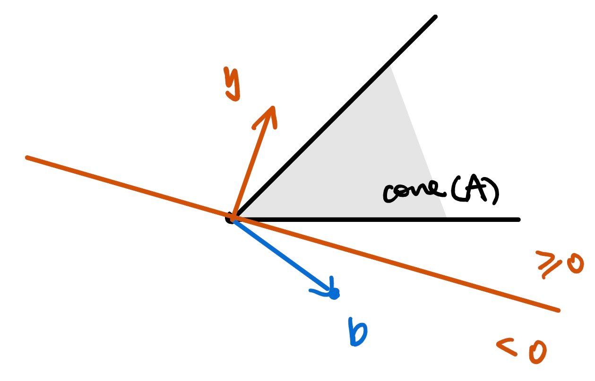</a>

因此, <math xmlns="http://www.w3.org/1998/Math/MathML"><semantics><mrow><mstyle scriptlevel="0" displaystyle="true"><msup><mi mathvariant="bold-italic">y</mi><mi mathvariant="normal">⊤</mi></msup><mi mathvariant="bold-italic">A</mi><mo>≥</mo><msup><mi mathvariant="bold">0</mi><mi mathvariant="normal">⊤</mi></msup></mstyle></mrow><annotation encoding="application/x-tex">\displaystyle \bm{y}^\top \bm{A} \geq \bm{0}^\top</annotation></semantics></math>y⊤A≥0⊤ , <math xmlns="http://www.w3.org/1998/Math/MathML"><semantics><mrow><mstyle scriptlevel="0" displaystyle="true"><msup><mi mathvariant="bold-italic">y</mi><mi mathvariant="normal">⊤</mi></msup><mi mathvariant="bold-italic">b</mi><mo>&lt;</mo><mn>0</mn></mstyle></mrow><annotation encoding="application/x-tex">\displaystyle \bm{y}^\top \bm{b} &lt; 0</annotation></semantics></math>y⊤b&lt;0 就是原问题不可行性的一个 certificate. 如果这个成立, 就一定不可行; 反之亦然.

需要说明的是, 该视角的严格证明需要依赖于 <em><math xmlns="http://www.w3.org/1998/Math/MathML"><semantics><mrow><mstyle scriptlevel="0" displaystyle="true"><mtext>cone</mtext><mo stretchy="false">(</mo><mi mathvariant="bold-italic">A</mi><mo stretchy="false">)</mo></mstyle></mrow><annotation encoding="application/x-tex">\displaystyle \text{cone}(\bm{A})</annotation></semantics></math>cone(A) 是闭凸集</em> 这一事实, 而其 closedness 的证明并不是 trivial 的, 需要依赖于 Carathéodory 定理. 不过这里不妨承认之.

<section class="latex-block latex-example" id="latex-exampleblock-4-1-1" aria-label="Example 4.1.1">
Example 4.1.1　Farkas lemma in No-arbitrage financial market

考虑一个单期金融市场.

<ul><li>
市场有 <math xmlns="http://www.w3.org/1998/Math/MathML"><semantics><mrow><mstyle scriptlevel="0" displaystyle="true"><mi>n</mi></mstyle></mrow><annotation encoding="application/x-tex">\displaystyle n</annotation></semantics></math>n 种资产, 在期末有 <math xmlns="http://www.w3.org/1998/Math/MathML"><semantics><mrow><mstyle scriptlevel="0" displaystyle="true"><mi>m</mi></mstyle></mrow><annotation encoding="application/x-tex">\displaystyle m</annotation></semantics></math>m 种可能的状态. 记 payoff matrix 为 <math xmlns="http://www.w3.org/1998/Math/MathML"><semantics><mrow><mstyle scriptlevel="0" displaystyle="true"><mi mathvariant="bold-italic">R</mi><mo>∈</mo><msup><mi mathvariant="double-struck">R</mi><mrow><mi>m</mi><mo>×</mo><mi>n</mi></mrow></msup></mstyle></mrow><annotation encoding="application/x-tex">\displaystyle \bm{R} \in \mathbb{R}^{m \times n}</annotation></semantics></math>R∈Rm×n, 其中 <math xmlns="http://www.w3.org/1998/Math/MathML"><semantics><mrow><mstyle scriptlevel="0" displaystyle="true"><msub><mi mathvariant="bold-italic">R</mi><mrow><mi>i</mi><mi>j</mi></mrow></msub></mstyle></mrow><annotation encoding="application/x-tex">\displaystyle \bm{R}_{ij}</annotation></semantics></math>Rij​ 表示第 <math xmlns="http://www.w3.org/1998/Math/MathML"><semantics><mrow><mstyle scriptlevel="0" displaystyle="true"><mi>j</mi></mstyle></mrow><annotation encoding="application/x-tex">\displaystyle j</annotation></semantics></math>j 种资产在第 <math xmlns="http://www.w3.org/1998/Math/MathML"><semantics><mrow><mstyle scriptlevel="0" displaystyle="true"><mi>i</mi></mstyle></mrow><annotation encoding="application/x-tex">\displaystyle i</annotation></semantics></math>i 种期末市场状态下的收益.
</li><li>
记 <math xmlns="http://www.w3.org/1998/Math/MathML"><semantics><mrow><mstyle scriptlevel="0" displaystyle="true"><mi mathvariant="bold-italic">x</mi><mo>∈</mo><msup><mi mathvariant="double-struck">R</mi><mi>n</mi></msup></mstyle></mrow><annotation encoding="application/x-tex">\displaystyle \bm{x} \in \mathbb{R}^n</annotation></semantics></math>x∈Rn 为投资组合的权重且允许为负 (short selling). 则投资组合在期末的收益为 <math xmlns="http://www.w3.org/1998/Math/MathML"><semantics><mrow><mstyle scriptlevel="0" displaystyle="true"><mi mathvariant="bold-italic">w</mi><mo>=</mo><mi mathvariant="bold-italic">R</mi><mi mathvariant="bold-italic">x</mi><mo>∈</mo><msup><mi mathvariant="double-struck">R</mi><mi>m</mi></msup></mstyle></mrow><annotation encoding="application/x-tex">\displaystyle \bm{w} = \bm{R}\bm{x} \in \mathbb{R}^m</annotation></semantics></math>w=Rx∈Rm.
</li><li>
另外当前的投资组合价格为 <math xmlns="http://www.w3.org/1998/Math/MathML"><semantics><mrow><mstyle scriptlevel="0" displaystyle="true"><mi mathvariant="bold-italic">p</mi><mo>∈</mo><msup><mi mathvariant="double-struck">R</mi><mi>n</mi></msup></mstyle></mrow><annotation encoding="application/x-tex">\displaystyle \bm{p} \in \mathbb{R}^n</annotation></semantics></math>p∈Rn, 故持有该投资组合的成本为 <math xmlns="http://www.w3.org/1998/Math/MathML"><semantics><mrow><mstyle scriptlevel="0" displaystyle="true"><msup><mi mathvariant="bold-italic">p</mi><mi mathvariant="normal">⊤</mi></msup><mi mathvariant="bold-italic">x</mi></mstyle></mrow><annotation encoding="application/x-tex">\displaystyle \bm{p}^\top \bm{x}</annotation></semantics></math>p⊤x.
</li></ul>

在金融市场中, 一个投资组合 <math xmlns="http://www.w3.org/1998/Math/MathML"><semantics><mrow><mstyle scriptlevel="0" displaystyle="true"><mi mathvariant="bold-italic">x</mi></mstyle></mrow><annotation encoding="application/x-tex">\displaystyle \bm{x}</annotation></semantics></math>x 在此处所讨论的严格负初始成本意义下是可套利的, 当存在某种组合 <math xmlns="http://www.w3.org/1998/Math/MathML"><semantics><mrow><mstyle scriptlevel="0" displaystyle="true"><mi mathvariant="bold-italic">x</mi></mstyle></mrow><annotation encoding="application/x-tex">\displaystyle \bm{x}</annotation></semantics></math>x 使得 <math xmlns="http://www.w3.org/1998/Math/MathML"><semantics><mrow><mstyle scriptlevel="0" displaystyle="true"><mi mathvariant="bold-italic">R</mi><mi mathvariant="bold-italic">x</mi><mo>≥</mo><mi mathvariant="bold">0</mi></mstyle></mrow><annotation encoding="application/x-tex">\displaystyle \bm{R}\bm{x} \geq \bm{0}</annotation></semantics></math>Rx≥0 且 <math xmlns="http://www.w3.org/1998/Math/MathML"><semantics><mrow><mstyle scriptlevel="0" displaystyle="true"><msup><mi mathvariant="bold-italic">p</mi><mi mathvariant="normal">⊤</mi></msup><mi mathvariant="bold-italic">x</mi><mo>&lt;</mo><mn>0</mn></mstyle></mrow><annotation encoding="application/x-tex">\displaystyle \bm{p}^\top \bm{x} &lt; 0</annotation></semantics></math>p⊤x&lt;0. 也即, 在期末的收益是非负的, 且在期初的成本是负的 (即不需要投入资金).

故为使得市场无套利, 则必须不存在这样的 <math xmlns="http://www.w3.org/1998/Math/MathML"><semantics><mrow><mstyle scriptlevel="0" displaystyle="true"><mi mathvariant="bold-italic">x</mi></mstyle></mrow><annotation encoding="application/x-tex">\displaystyle \bm{x}</annotation></semantics></math>x. 根据 Farkas lemma, 则等价于存在 <math xmlns="http://www.w3.org/1998/Math/MathML"><semantics><mrow><mstyle scriptlevel="0" displaystyle="true"><mi mathvariant="bold-italic">q</mi><mo>∈</mo><msubsup><mi mathvariant="double-struck">R</mi><mrow><mo>≥</mo><mn>0</mn></mrow><mi>m</mi></msubsup></mstyle></mrow><annotation encoding="application/x-tex">\displaystyle \bm{q}\in \mathbb{R}^m_{\geq 0}</annotation></semantics></math>q∈R≥0m​ 使得 <math xmlns="http://www.w3.org/1998/Math/MathML"><semantics><mrow><mstyle scriptlevel="0" displaystyle="true"><msup><mi mathvariant="bold-italic">R</mi><mi mathvariant="normal">⊤</mi></msup><mi mathvariant="bold-italic">q</mi><mo>=</mo><mi mathvariant="bold-italic">p</mi></mstyle></mrow><annotation encoding="application/x-tex">\displaystyle \bm{R}^\top \bm{q} = \bm{p}</annotation></semantics></math>R⊤q=p, 或等价地对于每个资产 <math xmlns="http://www.w3.org/1998/Math/MathML"><semantics><mrow><mstyle scriptlevel="0" displaystyle="true"><mi>j</mi><mo>=</mo><mn>1</mn><mo separator="true">,</mo><mo>…</mo><mo separator="true">,</mo><mi>n</mi></mstyle></mrow><annotation encoding="application/x-tex">\displaystyle j=1,\dots,n</annotation></semantics></math>j=1,…,n，有 <math xmlns="http://www.w3.org/1998/Math/MathML"><semantics><mrow><mstyle scriptlevel="0" displaystyle="true"><msub><mi mathvariant="bold-italic">p</mi><mi>j</mi></msub><mo>=</mo><munderover><mo>∑</mo><mrow><mi>i</mi><mo>=</mo><mn>1</mn></mrow><mi>m</mi></munderover><msub><mi mathvariant="bold-italic">R</mi><mrow><mi>i</mi><mi>j</mi></mrow></msub><msub><mi mathvariant="bold-italic">q</mi><mi>i</mi></msub></mstyle></mrow><annotation encoding="application/x-tex">\displaystyle \bm{p}_j = \sum_{i=1}^m \bm{R}_{ij} \bm{q}_i</annotation></semantics></math>pj​=i=1∑m​Rij​qi​. 也即, 存在一个非负的状态价格向量 <math xmlns="http://www.w3.org/1998/Math/MathML"><semantics><mrow><mstyle scriptlevel="0" displaystyle="true"><mi mathvariant="bold-italic">q</mi></mstyle></mrow><annotation encoding="application/x-tex">\displaystyle \bm{q}</annotation></semantics></math>q, 使得每个资产的价格等于其在各个状态下的收益的加权和 (权重为 <math xmlns="http://www.w3.org/1998/Math/MathML"><semantics><mrow><mstyle scriptlevel="0" displaystyle="true"><mi mathvariant="bold-italic">q</mi></mstyle></mrow><annotation encoding="application/x-tex">\displaystyle \bm{q}</annotation></semantics></math>q). 若 <math xmlns="http://www.w3.org/1998/Math/MathML"><semantics><mrow><mstyle scriptlevel="0" displaystyle="true"><munder><mo>∑</mo><mi>i</mi></munder><msub><mi>q</mi><mi>i</mi></msub><mo>&gt;</mo><mn>0</mn></mstyle></mrow><annotation encoding="application/x-tex">\displaystyle \sum_i q_i &gt; 0</annotation></semantics></math>i∑​qi​&gt;0, 归一化后可看成概率分布下的期望收益再乘以 <math xmlns="http://www.w3.org/1998/Math/MathML"><semantics><mrow><mstyle scriptlevel="0" displaystyle="true"><munder><mo>∑</mo><mi>i</mi></munder><msub><mi>q</mi><mi>i</mi></msub></mstyle></mrow><annotation encoding="application/x-tex">\displaystyle \sum_i q_i</annotation></semantics></math>i∑​qi​. 这就是金融市场中无套利定价的基本原理.
</section>

### 4.2. Variants of Farkas lemma and General Discussion of Alternative System

<em><strong>Some Classic Variants</strong></em>

<section class="latex-block latex-proposition" id="latex-propositionblock-4-2-1" aria-label="Proposition 4.2.1">
Proposition 4.2.1　Some Classic Variants

如下是 Farkas lemma 的一些常见变体, 其都是择一成立的, 有时也称之为 alternative system.

<ul><li>
Gordan lemma: <math xmlns="http://www.w3.org/1998/Math/MathML"><semantics><mrow><mstyle scriptlevel="0" displaystyle="true"><mi mathvariant="bold-italic">A</mi><mi mathvariant="bold-italic">x</mi><mo>&lt;</mo><mn>0</mn></mstyle></mrow><annotation encoding="application/x-tex">\displaystyle \bm{A}\bm{x} &lt; 0</annotation></semantics></math>Ax&lt;0 <math xmlns="http://www.w3.org/1998/Math/MathML"><semantics><mrow><mstyle scriptlevel="0" displaystyle="true"><mtext>与</mtext></mstyle></mrow><annotation encoding="application/x-tex">\displaystyle \text{与}</annotation></semantics></math>与 <math xmlns="http://www.w3.org/1998/Math/MathML"><semantics><mrow><mstyle scriptlevel="0" displaystyle="true"><msup><mi mathvariant="bold-italic">A</mi><mi mathvariant="normal">⊤</mi></msup><mi mathvariant="bold-italic">y</mi><mo>=</mo><mn>0</mn><mo separator="true">,</mo><mtext> </mtext><mi mathvariant="bold-italic">y</mi><mo>≥</mo><mn>0</mn><mo separator="true">,</mo><mtext> </mtext><mi mathvariant="bold-italic">y</mi><mo mathvariant="normal">≠</mo><mn>0</mn></mstyle></mrow><annotation encoding="application/x-tex">\displaystyle \bm{A}^\top \bm{y} = 0,~ \bm{y} \geq 0,~ \bm{y} \neq 0</annotation></semantics></math>A⊤y=0, y≥0, y=0.
</li><li>
<math xmlns="http://www.w3.org/1998/Math/MathML"><semantics><mrow><mstyle scriptlevel="0" displaystyle="true"><mi mathvariant="bold-italic">A</mi><mi mathvariant="bold-italic">x</mi><mo>≤</mo><mn>0</mn></mstyle></mrow><annotation encoding="application/x-tex">\displaystyle \bm{A}\bm{x} \leq 0</annotation></semantics></math>Ax≤0, <math xmlns="http://www.w3.org/1998/Math/MathML"><semantics><mrow><mstyle scriptlevel="0" displaystyle="true"><mi mathvariant="bold-italic">x</mi><mo>≥</mo><mn>0</mn></mstyle></mrow><annotation encoding="application/x-tex">\displaystyle \bm{x} \geq 0</annotation></semantics></math>x≥0, <math xmlns="http://www.w3.org/1998/Math/MathML"><semantics><mrow><mstyle scriptlevel="0" displaystyle="true"><msup><mi mathvariant="bold-italic">c</mi><mi mathvariant="normal">⊤</mi></msup><mi mathvariant="bold-italic">x</mi><mo>&gt;</mo><mn>0</mn></mstyle></mrow><annotation encoding="application/x-tex">\displaystyle \bm{c}^\top \bm{x} &gt; 0</annotation></semantics></math>c⊤x&gt;0 <math xmlns="http://www.w3.org/1998/Math/MathML"><semantics><mrow><mstyle scriptlevel="0" displaystyle="true"><mtext>与</mtext></mstyle></mrow><annotation encoding="application/x-tex">\displaystyle \text{与}</annotation></semantics></math>与 <math xmlns="http://www.w3.org/1998/Math/MathML"><semantics><mrow><mstyle scriptlevel="0" displaystyle="true"><msup><mi mathvariant="bold-italic">A</mi><mi mathvariant="normal">⊤</mi></msup><mi mathvariant="bold-italic">y</mi><mo>≥</mo><mi mathvariant="bold-italic">c</mi></mstyle></mrow><annotation encoding="application/x-tex">\displaystyle \bm{A}^\top \bm{y} \geq \bm{c}</annotation></semantics></math>A⊤y≥c, <math xmlns="http://www.w3.org/1998/Math/MathML"><semantics><mrow><mstyle scriptlevel="0" displaystyle="true"><mi mathvariant="bold-italic">y</mi><mo>≥</mo><mn>0</mn></mstyle></mrow><annotation encoding="application/x-tex">\displaystyle \bm{y} \geq 0</annotation></semantics></math>y≥0.
</li><li>
<math xmlns="http://www.w3.org/1998/Math/MathML"><semantics><mrow><mstyle scriptlevel="0" displaystyle="true"><mi mathvariant="bold-italic">A</mi><mi mathvariant="bold-italic">x</mi><mo>≤</mo><mi mathvariant="bold">0</mi></mstyle></mrow><annotation encoding="application/x-tex">\displaystyle \bm{A}\bm{x} \leq \bm{0}</annotation></semantics></math>Ax≤0, <math xmlns="http://www.w3.org/1998/Math/MathML"><semantics><mrow><mstyle scriptlevel="0" displaystyle="true"><mi mathvariant="bold-italic">B</mi><mi mathvariant="bold-italic">x</mi><mo>=</mo><mi mathvariant="bold">0</mi></mstyle></mrow><annotation encoding="application/x-tex">\displaystyle \bm{B}\bm{x} = \bm{0}</annotation></semantics></math>Bx=0, <math xmlns="http://www.w3.org/1998/Math/MathML"><semantics><mrow><mstyle scriptlevel="0" displaystyle="true"><msup><mi mathvariant="bold-italic">c</mi><mi mathvariant="normal">⊤</mi></msup><mi mathvariant="bold-italic">x</mi><mo>&gt;</mo><mn>0</mn></mstyle></mrow><annotation encoding="application/x-tex">\displaystyle \bm{c}^\top \bm{x} &gt; 0</annotation></semantics></math>c⊤x&gt;0 <math xmlns="http://www.w3.org/1998/Math/MathML"><semantics><mrow><mstyle scriptlevel="0" displaystyle="true"><mtext>与</mtext></mstyle></mrow><annotation encoding="application/x-tex">\displaystyle \text{与}</annotation></semantics></math>与 <math xmlns="http://www.w3.org/1998/Math/MathML"><semantics><mrow><mstyle scriptlevel="0" displaystyle="true"><msup><mi mathvariant="bold-italic">A</mi><mi mathvariant="normal">⊤</mi></msup><mi mathvariant="bold-italic">y</mi><mo>+</mo><msup><mi mathvariant="bold-italic">B</mi><mi mathvariant="normal">⊤</mi></msup><mi mathvariant="bold-italic">z</mi><mo>=</mo><mi mathvariant="bold-italic">c</mi></mstyle></mrow><annotation encoding="application/x-tex">\displaystyle \bm{A}^\top \bm{y} + \bm{B}^\top \bm{z} = \bm{c}</annotation></semantics></math>A⊤y+B⊤z=c, <math xmlns="http://www.w3.org/1998/Math/MathML"><semantics><mrow><mstyle scriptlevel="0" displaystyle="true"><mi mathvariant="bold-italic">y</mi><mo>≥</mo><mn>0</mn></mstyle></mrow><annotation encoding="application/x-tex">\displaystyle \bm{y} \geq 0</annotation></semantics></math>y≥0, <math xmlns="http://www.w3.org/1998/Math/MathML"><semantics><mrow><mstyle scriptlevel="0" displaystyle="true"><mi mathvariant="bold-italic">z</mi></mstyle></mrow><annotation encoding="application/x-tex">\displaystyle \bm{z}</annotation></semantics></math>z 任意.
</li></ul></section>

<em><strong>Alternative system</strong></em>

隐约感觉, Farkas lemma 并不是一个特殊的定理, 其背后有着一套更为普遍的分析框架. 故我们尝试讨论其背后的更一般的行为.

考虑一个集合 <math xmlns="http://www.w3.org/1998/Math/MathML"><semantics><mrow><mstyle scriptlevel="0" displaystyle="true"><mi mathvariant="script">S</mi><mo>⊆</mo><msup><mi mathvariant="double-struck">R</mi><mi>n</mi></msup></mstyle></mrow><annotation encoding="application/x-tex">\displaystyle \mathcal{S} \subseteq \mathbb{R}^n</annotation></semantics></math>S⊆Rn，且给定 <math xmlns="http://www.w3.org/1998/Math/MathML"><semantics><mrow><mstyle scriptlevel="0" displaystyle="true"><mi mathvariant="bold-italic">b</mi><mo>∈</mo><msup><mi mathvariant="double-struck">R</mi><mi>n</mi></msup></mstyle></mrow><annotation encoding="application/x-tex">\displaystyle \bm{b} \in \mathbb{R}^n</annotation></semantics></math>b∈Rn，可行性问题即为判断 <math xmlns="http://www.w3.org/1998/Math/MathML"><semantics><mrow><mstyle scriptlevel="0" displaystyle="true"><mi mathvariant="bold-italic">b</mi><mo>∈</mo><mi mathvariant="script">S</mi></mstyle></mrow><annotation encoding="application/x-tex">\displaystyle \bm{b} \in \mathcal{S}</annotation></semantics></math>b∈S 是否成立, 这是一个 membership problem. 其一般有两种方法来判断 <math xmlns="http://www.w3.org/1998/Math/MathML"><semantics><mrow><mstyle scriptlevel="0" displaystyle="true"><mi mathvariant="bold-italic">b</mi><mo>∈</mo><mi mathvariant="script">S</mi></mstyle></mrow><annotation encoding="application/x-tex">\displaystyle \bm{b} \in \mathcal{S}</annotation></semantics></math>b∈S 是否成立:

<ul><li>
Constructive: 如果我们认为 <math xmlns="http://www.w3.org/1998/Math/MathML"><semantics><mrow><mstyle scriptlevel="0" displaystyle="true"><mi mathvariant="bold-italic">b</mi><mo>∈</mo><mi mathvariant="script">S</mi></mstyle></mrow><annotation encoding="application/x-tex">\displaystyle \bm{b} \in \mathcal{S}</annotation></semantics></math>b∈S，则可以直接给出 <math xmlns="http://www.w3.org/1998/Math/MathML"><semantics><mrow><mstyle scriptlevel="0" displaystyle="true"><mi mathvariant="bold-italic">b</mi></mstyle></mrow><annotation encoding="application/x-tex">\displaystyle \bm{b}</annotation></semantics></math>b 属于 <math xmlns="http://www.w3.org/1998/Math/MathML"><semantics><mrow><mstyle scriptlevel="0" displaystyle="true"><mi mathvariant="script">S</mi></mstyle></mrow><annotation encoding="application/x-tex">\displaystyle \mathcal{S}</annotation></semantics></math>S 的构造，并证明其确实符合 <math xmlns="http://www.w3.org/1998/Math/MathML"><semantics><mrow><mstyle scriptlevel="0" displaystyle="true"><mi mathvariant="script">S</mi></mstyle></mrow><annotation encoding="application/x-tex">\displaystyle \mathcal{S}</annotation></semantics></math>S 的定义.
</li><li>
Certificate: 如果我们认为 <math xmlns="http://www.w3.org/1998/Math/MathML"><semantics><mrow><mstyle scriptlevel="0" displaystyle="true"><mi mathvariant="bold-italic">b</mi><mo mathvariant="normal">∉</mo><mi mathvariant="script">S</mi></mstyle></mrow><annotation encoding="application/x-tex">\displaystyle \bm{b} \notin \mathcal{S}</annotation></semantics></math>b∈/S，则可以找到某些易于检查的性质 (certificate), 使得: 所有 <math xmlns="http://www.w3.org/1998/Math/MathML"><semantics><mrow><mstyle scriptlevel="0" displaystyle="true"><mi mathvariant="script">S</mi></mstyle></mrow><annotation encoding="application/x-tex">\displaystyle \mathcal{S}</annotation></semantics></math>S 中的元素定满足这些性质, 而 <math xmlns="http://www.w3.org/1998/Math/MathML"><semantics><mrow><mstyle scriptlevel="0" displaystyle="true"><mi mathvariant="bold-italic">b</mi></mstyle></mrow><annotation encoding="application/x-tex">\displaystyle \bm{b}</annotation></semantics></math>b 不满足这些性质.

<blockquote class="latex-quote">
注意, 从逻辑上, 我们总可以说 <math xmlns="http://www.w3.org/1998/Math/MathML"><semantics><mrow><mstyle scriptlevel="0" displaystyle="true"><mi>P</mi><mo>∨</mo><mi mathvariant="normal">¬</mi><mi>P</mi></mstyle></mrow><annotation encoding="application/x-tex">\displaystyle P \lor \neg P</annotation></semantics></math>P∨¬P，而 alternative system 之所以有意义, 是因为其给一个抽象的否命题提供了一组具体的条件, 甚至是一组线性泛函的条件, 这使得我们可以非常容易地检查条件的成立与否.
</blockquote></li></ul>

而对于一个非空闭凸集 <math xmlns="http://www.w3.org/1998/Math/MathML"><semantics><mrow><mstyle scriptlevel="0" displaystyle="true"><mi mathvariant="script">S</mi></mstyle></mrow><annotation encoding="application/x-tex">\displaystyle \mathcal{S}</annotation></semantics></math>S，separation theorem 给出了一个非常自然的 certificate.

<ul><li>
其自然地将一个集合的属于性问题, 转化为了一个线性不等式的成立性问题.

<ul><li>
按照几何的视角, 条件 <math xmlns="http://www.w3.org/1998/Math/MathML"><semantics><mrow><mstyle scriptlevel="0" displaystyle="true"><mi mathvariant="bold-italic">x</mi><mo>≥</mo><mn>0</mn><mo separator="true">,</mo><mi mathvariant="bold-italic">A</mi><mi mathvariant="bold-italic">x</mi></mstyle></mrow><annotation encoding="application/x-tex">\displaystyle \bm{x} \geq 0, \bm{A}\bm{x}</annotation></semantics></math>x≥0,Ax 就定义了一个凸锥 <math xmlns="http://www.w3.org/1998/Math/MathML"><semantics><mrow><mstyle scriptlevel="0" displaystyle="true"><mi mathvariant="script">S</mi><mo>:</mo><mo>=</mo><mtext>cone</mtext><mo stretchy="false">(</mo><mi mathvariant="bold-italic">A</mi><mo stretchy="false">)</mo></mstyle></mrow><annotation encoding="application/x-tex">\displaystyle \mathcal{S}:= \text{cone}(\bm{A})</annotation></semantics></math>S:=cone(A)，而不存在 <math xmlns="http://www.w3.org/1998/Math/MathML"><semantics><mrow><mstyle scriptlevel="0" displaystyle="true"><mi mathvariant="bold-italic">x</mi><mo>≥</mo><mn>0</mn></mstyle></mrow><annotation encoding="application/x-tex">\displaystyle \bm{x} \geq 0</annotation></semantics></math>x≥0 使得 <math xmlns="http://www.w3.org/1998/Math/MathML"><semantics><mrow><mstyle scriptlevel="0" displaystyle="true"><mi mathvariant="bold-italic">A</mi><mi mathvariant="bold-italic">x</mi><mo>=</mo><mi mathvariant="bold-italic">b</mi></mstyle></mrow><annotation encoding="application/x-tex">\displaystyle \bm{A}\bm{x} = \bm{b}</annotation></semantics></math>Ax=b，则说明 <math xmlns="http://www.w3.org/1998/Math/MathML"><semantics><mrow><mstyle scriptlevel="0" displaystyle="true"><mi mathvariant="bold-italic">b</mi><mo mathvariant="normal">∉</mo><mi mathvariant="script">S</mi></mstyle></mrow><annotation encoding="application/x-tex">\displaystyle \bm{b} \notin \mathcal{S}</annotation></semantics></math>b∈/S, 即存在锥外点 <math xmlns="http://www.w3.org/1998/Math/MathML"><semantics><mrow><mstyle scriptlevel="0" displaystyle="true"><mi mathvariant="bold-italic">b</mi></mstyle></mrow><annotation encoding="application/x-tex">\displaystyle \bm{b}</annotation></semantics></math>b. 则根据 separation theorem, 存在一个超平面将 <math xmlns="http://www.w3.org/1998/Math/MathML"><semantics><mrow><mstyle scriptlevel="0" displaystyle="true"><mi mathvariant="bold-italic">b</mi></mstyle></mrow><annotation encoding="application/x-tex">\displaystyle \bm{b}</annotation></semantics></math>b 和 <math xmlns="http://www.w3.org/1998/Math/MathML"><semantics><mrow><mstyle scriptlevel="0" displaystyle="true"><mi mathvariant="script">S</mi></mstyle></mrow><annotation encoding="application/x-tex">\displaystyle \mathcal{S}</annotation></semantics></math>S 分开, 其法向量为 <math xmlns="http://www.w3.org/1998/Math/MathML"><semantics><mrow><mstyle scriptlevel="0" displaystyle="true"><mi mathvariant="bold-italic">y</mi></mstyle></mrow><annotation encoding="application/x-tex">\displaystyle \bm{y}</annotation></semantics></math>y.
</li><li>
而超平面又可以通过 support function 来刻画, <math xmlns="http://www.w3.org/1998/Math/MathML"><semantics><mrow><mstyle scriptlevel="0" displaystyle="true"><mi mathvariant="bold-italic">b</mi><mo mathvariant="normal">∉</mo><mi mathvariant="script">S</mi></mstyle></mrow><annotation encoding="application/x-tex">\displaystyle \bm{b} \notin \mathcal{S}</annotation></semantics></math>b∈/S <math xmlns="http://www.w3.org/1998/Math/MathML"><semantics><mrow><mstyle scriptlevel="0" displaystyle="true"><mtext>  </mtext><mo>⟺</mo><mtext>  </mtext></mstyle></mrow><annotation encoding="application/x-tex">\displaystyle \iff</annotation></semantics></math>⟺ 存在 <math xmlns="http://www.w3.org/1998/Math/MathML"><semantics><mrow><mstyle scriptlevel="0" displaystyle="true"><mi mathvariant="bold-italic">y</mi></mstyle></mrow><annotation encoding="application/x-tex">\displaystyle \bm{y}</annotation></semantics></math>y 使得 <math xmlns="http://www.w3.org/1998/Math/MathML"><semantics><mrow><mstyle scriptlevel="0" displaystyle="true"><msup><mi mathvariant="bold-italic">y</mi><mi mathvariant="normal">⊤</mi></msup><mi mathvariant="bold-italic">b</mi><mo>&gt;</mo><msub><mi>σ</mi><mi mathvariant="script">S</mi></msub><mo stretchy="false">(</mo><mi mathvariant="bold-italic">y</mi><mo stretchy="false">)</mo><mo>=</mo><munder><mrow><mi>sup</mi><mo>⁡</mo></mrow><mrow><mi mathvariant="bold-italic">x</mi><mo>∈</mo><mi mathvariant="script">S</mi></mrow></munder><msup><mi mathvariant="bold-italic">y</mi><mi mathvariant="normal">⊤</mi></msup><mi mathvariant="bold-italic">x</mi></mstyle></mrow><annotation encoding="application/x-tex">\displaystyle \bm{y}^\top \bm{b} &gt; \sigma_{\mathcal{S}}(\bm{y}) = \sup_{\bm{x} \in \mathcal{S}} \bm{y}^\top \bm{x}</annotation></semantics></math>y⊤b&gt;σS​(y)=x∈Ssup​y⊤x.
</li></ul></li><li>
因此, 更本质地从分析的角度, 其是将集合的属于性问题, 通过一个线性泛函给出了一个易于检查的条件 (这是线性的). 欲判断 <math xmlns="http://www.w3.org/1998/Math/MathML"><semantics><mrow><mstyle scriptlevel="0" displaystyle="true"><mi mathvariant="bold-italic">b</mi><mo>∈</mo><mi mathvariant="script">S</mi></mstyle></mrow><annotation encoding="application/x-tex">\displaystyle \bm{b} \in \mathcal{S}</annotation></semantics></math>b∈S 是否成立, 只需要检查 <math xmlns="http://www.w3.org/1998/Math/MathML"><semantics><mrow><mstyle scriptlevel="0" displaystyle="true"><mi mathvariant="bold-italic">b</mi></mstyle></mrow><annotation encoding="application/x-tex">\displaystyle \bm{b}</annotation></semantics></math>b 通过一个线性泛函得到的评分, 是否大于所有 <math xmlns="http://www.w3.org/1998/Math/MathML"><semantics><mrow><mstyle scriptlevel="0" displaystyle="true"><mi mathvariant="script">S</mi></mstyle></mrow><annotation encoding="application/x-tex">\displaystyle \mathcal{S}</annotation></semantics></math>S 中的元素通过这个线性泛函得到的评分即可. 而在有限维的欧式空间中, 每一个线性泛函都可以表示成与某个向量的内积, 这也就引入了向量 <math xmlns="http://www.w3.org/1998/Math/MathML"><semantics><mrow><mstyle scriptlevel="0" displaystyle="true"><mi mathvariant="bold-italic">y</mi></mstyle></mrow><annotation encoding="application/x-tex">\displaystyle \bm{y}</annotation></semantics></math>y.
</li></ul>

继续更深入考虑 <math xmlns="http://www.w3.org/1998/Math/MathML"><semantics><mrow><mstyle scriptlevel="0" displaystyle="true"><mi mathvariant="bold-italic">y</mi></mstyle></mrow><annotation encoding="application/x-tex">\displaystyle \bm{y}</annotation></semantics></math>y. 通过下面的思考角度, 我们或许也可以任意构造给定线性系统 feasibility 的 certificate.

<ul><li>
先考虑一个简单的线性系统:

<math xmlns="http://www.w3.org/1998/Math/MathML" display="block"><semantics><mtable rowspacing="0.25em" columnalign="right left" columnspacing="0em"><mtr><mtd><mstyle scriptlevel="0" displaystyle="true"><mrow><msub><mi>x</mi><mn>1</mn></msub><mo>+</mo><msub><mi>x</mi><mn>2</mn></msub></mrow></mstyle></mtd><mtd><mstyle scriptlevel="0" displaystyle="true"><mrow><mrow></mrow><mo>≤</mo><mn>1</mn><mo separator="true">,</mo></mrow></mstyle></mtd></mtr><mtr><mtd><mstyle scriptlevel="0" displaystyle="true"><mrow><mo>−</mo><msub><mi>x</mi><mn>1</mn></msub><mo>−</mo><msub><mi>x</mi><mn>2</mn></msub></mrow></mstyle></mtd><mtd><mstyle scriptlevel="0" displaystyle="true"><mrow><mrow></mrow><mo>≤</mo><mo>−</mo><mn>3.</mn></mrow></mstyle></mtd></mtr></mtable><annotation encoding="application/x-tex">
\begin{aligned}
  x_1 + x_2 &amp;\leq 1,\\
  -x_1 - x_2 &amp;\leq -3.
\end{aligned}
</annotation></semantics></math>x1​+x2​−x1​−x2​​≤1,≤−3.​

显然这个系统无解, 因为两式相加即有 <math xmlns="http://www.w3.org/1998/Math/MathML"><semantics><mrow><mstyle scriptlevel="0" displaystyle="true"><mn>0</mn><mo>≤</mo><mo>−</mo><mn>2</mn></mstyle></mrow><annotation encoding="application/x-tex">\displaystyle 0 \leq -2</annotation></semantics></math>0≤−2, 矛盾.
</li><li>
故进一步考虑 <math xmlns="http://www.w3.org/1998/Math/MathML"><semantics><mrow><mstyle scriptlevel="0" displaystyle="true"><msubsup><mi mathvariant="bold-italic">A</mi><mi>i</mi><mi mathvariant="normal">⊤</mi></msubsup><mi mathvariant="bold-italic">x</mi><mo>≤</mo><msub><mi>b</mi><mi>i</mi></msub><mo separator="true">,</mo><mtext> </mtext><mi>i</mi><mo>=</mo><mn>1</mn><mo separator="true">,</mo><mo>…</mo><mo separator="true">,</mo><mi>m</mi></mstyle></mrow><annotation encoding="application/x-tex">\displaystyle \bm{A}_i^\top \bm{x} \leq b_i,~ i=1,\dots,m</annotation></semantics></math>Ai⊤​x≤bi​, i=1,…,m，仿照前面的过程, 若能找到一些 <math xmlns="http://www.w3.org/1998/Math/MathML"><semantics><mrow><mstyle scriptlevel="0" displaystyle="true"><msub><mi mathvariant="bold-italic">y</mi><mi>i</mi></msub><mo>≥</mo><mn>0</mn></mstyle></mrow><annotation encoding="application/x-tex">\displaystyle \bm{y}_i \geq 0</annotation></semantics></math>yi​≥0，使得 <math xmlns="http://www.w3.org/1998/Math/MathML"><semantics><mrow><mstyle scriptlevel="0" displaystyle="true"><munderover><mo>∑</mo><mrow><mi>i</mi><mo>=</mo><mn>1</mn></mrow><mi>m</mi></munderover><msub><mi mathvariant="bold-italic">A</mi><mi>i</mi></msub><msub><mi mathvariant="bold-italic">y</mi><mi>i</mi></msub><mo>=</mo><mn>0</mn></mstyle></mrow><annotation encoding="application/x-tex">\displaystyle \sum_{i=1}^m \bm{A}_i \bm{y}_i = 0</annotation></semantics></math>i=1∑m​Ai​yi​=0，则可以类似地对每个 <math xmlns="http://www.w3.org/1998/Math/MathML"><semantics><mrow><mstyle scriptlevel="0" displaystyle="true"><msubsup><mi mathvariant="bold-italic">A</mi><mi>i</mi><mi mathvariant="normal">⊤</mi></msubsup><mi mathvariant="bold-italic">x</mi><mo>≤</mo><msub><mi>b</mi><mi>i</mi></msub></mstyle></mrow><annotation encoding="application/x-tex">\displaystyle \bm{A}_i^\top \bm{x} \leq b_i</annotation></semantics></math>Ai⊤​x≤bi​ 乘以 <math xmlns="http://www.w3.org/1998/Math/MathML"><semantics><mrow><mstyle scriptlevel="0" displaystyle="true"><msub><mi mathvariant="bold-italic">y</mi><mi>i</mi></msub></mstyle></mrow><annotation encoding="application/x-tex">\displaystyle \bm{y}_i</annotation></semantics></math>yi​，然后相加, 得到

<math xmlns="http://www.w3.org/1998/Math/MathML" display="block"><semantics><mrow><munderover><mo>∑</mo><mrow><mi>i</mi><mo>=</mo><mn>1</mn></mrow><mi>m</mi></munderover><msubsup><mi mathvariant="bold-italic">A</mi><mi>i</mi><mi mathvariant="normal">⊤</mi></msubsup><mi mathvariant="bold-italic">x</mi><msub><mi mathvariant="bold-italic">y</mi><mi>i</mi></msub><mo>=</mo><mn>0</mn><mo>≤</mo><munderover><mo>∑</mo><mrow><mi>i</mi><mo>=</mo><mn>1</mn></mrow><mi>m</mi></munderover><msub><mi>b</mi><mi>i</mi></msub><msub><mi mathvariant="bold-italic">y</mi><mi>i</mi></msub><mi mathvariant="normal">.</mi></mrow><annotation encoding="application/x-tex">
\sum_{i=1}^m \bm{A}_i^\top \bm{x} \bm{y}_i = 0 \leq \sum_{i=1}^m b_i \bm{y}_i.
</annotation></semantics></math>i=1∑m​Ai⊤​xyi​=0≤i=1∑m​bi​yi​.

由于 <math xmlns="http://www.w3.org/1998/Math/MathML"><semantics><mrow><mstyle scriptlevel="0" displaystyle="true"><msub><mi mathvariant="bold-italic">y</mi><mi>i</mi></msub><mo>≥</mo><mn>0</mn></mstyle></mrow><annotation encoding="application/x-tex">\displaystyle \bm{y}_i \geq 0</annotation></semantics></math>yi​≥0 , 其不改变不等式的方向. 若进一步又要求 <math xmlns="http://www.w3.org/1998/Math/MathML"><semantics><mrow><mstyle scriptlevel="0" displaystyle="true"><munderover><mo>∑</mo><mrow><mi>i</mi><mo>=</mo><mn>1</mn></mrow><mi>m</mi></munderover><msub><mi>b</mi><mi>i</mi></msub><msub><mi mathvariant="bold-italic">y</mi><mi>i</mi></msub><mo>&lt;</mo><mn>0</mn></mstyle></mrow><annotation encoding="application/x-tex">\displaystyle \sum_{i=1}^m b_i \bm{y}_i &lt; 0</annotation></semantics></math>i=1∑m​bi​yi​&lt;0，就可以构造矛盾, 从而说明原系统无解.
</li><li>
而且从上述的讨论还可以看到, 如果原始的约束是不等式约束 <math xmlns="http://www.w3.org/1998/Math/MathML"><semantics><mrow><mstyle scriptlevel="0" displaystyle="true"><msubsup><mi mathvariant="bold-italic">A</mi><mi>i</mi><mi mathvariant="normal">⊤</mi></msubsup><mi mathvariant="bold-italic">x</mi><mo>≤</mo><msub><mi>b</mi><mi>i</mi></msub></mstyle></mrow><annotation encoding="application/x-tex">\displaystyle \bm{A}_i^\top \bm{x} \leq b_i</annotation></semantics></math>Ai⊤​x≤bi​，则对应的 certificate 是 <math xmlns="http://www.w3.org/1998/Math/MathML"><semantics><mrow><mstyle scriptlevel="0" displaystyle="true"><msub><mi mathvariant="bold-italic">y</mi><mi>i</mi></msub><mo>≥</mo><mn>0</mn></mstyle></mrow><annotation encoding="application/x-tex">\displaystyle \bm{y}_i \geq 0</annotation></semantics></math>yi​≥0 也需要通过不等式约束来保证符号不变; 反之若是等式 <math xmlns="http://www.w3.org/1998/Math/MathML"><semantics><mrow><mstyle scriptlevel="0" displaystyle="true"><msubsup><mi mathvariant="bold-italic">A</mi><mi>i</mi><mi mathvariant="normal">⊤</mi></msubsup><mi mathvariant="bold-italic">x</mi><mo>=</mo><msub><mi>b</mi><mi>i</mi></msub></mstyle></mrow><annotation encoding="application/x-tex">\displaystyle \bm{A}_i^\top \bm{x} = b_i</annotation></semantics></math>Ai⊤​x=bi​，则对应的 certificate 是 <math xmlns="http://www.w3.org/1998/Math/MathML"><semantics><mrow><mstyle scriptlevel="0" displaystyle="true"><msub><mi mathvariant="bold-italic">y</mi><mi>i</mi></msub></mstyle></mrow><annotation encoding="application/x-tex">\displaystyle \bm{y}_i</annotation></semantics></math>yi​ 可以是任意实数. 这在上述最后一个变体 <math xmlns="http://www.w3.org/1998/Math/MathML"><semantics><mrow><mstyle scriptlevel="0" displaystyle="true"><msup><mi mathvariant="bold-italic">A</mi><mi mathvariant="normal">⊤</mi></msup><mi mathvariant="bold-italic">y</mi><mo>+</mo><msup><mi mathvariant="bold-italic">B</mi><mi mathvariant="normal">⊤</mi></msup><mi mathvariant="bold-italic">z</mi><mo>=</mo><mi mathvariant="bold-italic">c</mi></mstyle></mrow><annotation encoding="application/x-tex">\displaystyle \bm{A}^\top \bm{y} + \bm{B}^\top \bm{z} = \bm{c}</annotation></semantics></math>A⊤y+B⊤z=c 中就体现了出来, 其中 <math xmlns="http://www.w3.org/1998/Math/MathML"><semantics><mrow><mstyle scriptlevel="0" displaystyle="true"><mi mathvariant="bold-italic">y</mi></mstyle></mrow><annotation encoding="application/x-tex">\displaystyle \bm{y}</annotation></semantics></math>y 对应不等式约束, <math xmlns="http://www.w3.org/1998/Math/MathML"><semantics><mrow><mstyle scriptlevel="0" displaystyle="true"><mi mathvariant="bold-italic">z</mi></mstyle></mrow><annotation encoding="application/x-tex">\displaystyle \bm{z}</annotation></semantics></math>z 对应等式约束.
</li></ul>

### 4.3. Tricks of proving Farkas lemma

若在偏应试的角度证明 Farkas lemma, 则可以考虑通过标准化的方法统一证明. 为作区分, 这里记最终的 alternative system 为

<math xmlns="http://www.w3.org/1998/Math/MathML" display="block"><semantics><mtable rowspacing="0.25em" columnalign="right left right left" columnspacing="0em 1em 0em"><mtr><mtd><mstyle scriptlevel="0" displaystyle="true"><mrow><mi mathvariant="bold-italic">M</mi><mi mathvariant="bold-italic">w</mi></mrow></mstyle></mtd><mtd><mstyle scriptlevel="0" displaystyle="true"><mrow><mrow></mrow><mo>=</mo><mi mathvariant="bold-italic">h</mi><mo separator="true">,</mo><mspace width="1em"/></mrow></mstyle></mtd><mtd><mstyle scriptlevel="0" displaystyle="true"><mrow></mrow></mstyle></mtd><mtd><mstyle scriptlevel="0" displaystyle="true"><mrow><mrow></mrow><mi mathvariant="bold-italic">w</mi><mo>≥</mo><mn>0</mn><mo separator="true">,</mo><mspace width="1em"/><mtext>(System 1)</mtext></mrow></mstyle></mtd></mtr><mtr><mtd><mstyle scriptlevel="0" displaystyle="true"><mrow><msup><mi mathvariant="bold-italic">M</mi><mi mathvariant="normal">⊤</mi></msup><mi mathvariant="bold-italic">z</mi></mrow></mstyle></mtd><mtd><mstyle scriptlevel="0" displaystyle="true"><mrow><mrow></mrow><mo>≥</mo><mn>0</mn><mo separator="true">,</mo><mspace width="1em"/></mrow></mstyle></mtd><mtd><mstyle scriptlevel="0" displaystyle="true"><mrow></mrow></mstyle></mtd><mtd><mstyle scriptlevel="0" displaystyle="true"><mrow><mrow></mrow><msup><mi mathvariant="bold-italic">h</mi><mi mathvariant="normal">⊤</mi></msup><mi mathvariant="bold-italic">z</mi><mo>&lt;</mo><mn>0.</mn><mspace width="1em"/><mtext>(System 2)</mtext></mrow></mstyle></mtd></mtr></mtable><annotation encoding="application/x-tex">
\begin{aligned}
  \bm{M}\bm{w} &amp; = \bm{h},\quad &amp;&amp;\bm{w} \geq 0,\quad \text{(System 1)}\\
  \bm{M}^\top \bm{z} &amp;\geq 0,\quad &amp;&amp;\bm{h}^\top \bm{z} &lt; 0. \quad \text{(System 2)}
\end{aligned}
</annotation></semantics></math>MwM⊤z​=h,≥0,​​w≥0,(System 1)h⊤z&lt;0.(System 2)​

其中 <math xmlns="http://www.w3.org/1998/Math/MathML"><semantics><mrow><mstyle scriptlevel="0" displaystyle="true"><mi mathvariant="bold-italic">z</mi></mstyle></mrow><annotation encoding="application/x-tex">\displaystyle \bm{z}</annotation></semantics></math>z 是自由变量. 故此时的问题重点在于将给定的线性系统转为此标准型.

<section class="latex-block latex-example" id="latex-exampleblock-4-3-1" aria-label="Example 4.3.1">
Example 4.3.1

如下线性系统有且仅有一个 alternative system 成立:

<math xmlns="http://www.w3.org/1998/Math/MathML" display="block"><semantics><mtable rowspacing="0.25em" columnalign="right left right left" columnspacing="0em 1em 0em"><mtr><mtd><mstyle scriptlevel="0" displaystyle="true"><mrow><mi mathvariant="bold-italic">A</mi><mi mathvariant="bold-italic">x</mi></mrow></mstyle></mtd><mtd><mstyle scriptlevel="0" displaystyle="true"><mrow><mrow></mrow><mo>≤</mo><mi mathvariant="bold">0</mi><mo separator="true">,</mo><mspace width="1em"/></mrow></mstyle></mtd><mtd><mstyle scriptlevel="0" displaystyle="true"><mrow></mrow></mstyle></mtd><mtd><mstyle scriptlevel="0" displaystyle="true"><mrow><mrow></mrow><mi mathvariant="bold-italic">x</mi><mo>≥</mo><mn>0</mn><mo separator="true">,</mo><mspace width="1em"/><msup><mi mathvariant="bold-italic">b</mi><mi mathvariant="normal">⊤</mi></msup><mi mathvariant="bold-italic">x</mi><mo>&gt;</mo><mn>0</mn><mo separator="true">,</mo><mspace width="1em"/><mtext>(System 1)</mtext></mrow></mstyle></mtd></mtr><mtr><mtd><mstyle scriptlevel="0" displaystyle="true"><mrow><msup><mi mathvariant="bold-italic">A</mi><mi mathvariant="normal">⊤</mi></msup><mi mathvariant="bold-italic">y</mi></mrow></mstyle></mtd><mtd><mstyle scriptlevel="0" displaystyle="true"><mrow><mrow></mrow><mo>≥</mo><mi mathvariant="bold-italic">b</mi><mo separator="true">,</mo><mspace width="1em"/></mrow></mstyle></mtd><mtd><mstyle scriptlevel="0" displaystyle="true"><mrow></mrow></mstyle></mtd><mtd><mstyle scriptlevel="0" displaystyle="true"><mrow><mrow></mrow><mi mathvariant="bold-italic">y</mi><mo>≥</mo><mn>0.</mn><mspace width="1em"/><mspace width="1em"/><mtext>(System 2)</mtext></mrow></mstyle></mtd></mtr></mtable><annotation encoding="application/x-tex">
\begin{aligned}
  \bm{A}\bm{x} &amp;\leq \bm{0},\quad &amp;&amp;\bm{x} \geq 0,\quad \bm{b}^\top \bm{x} &gt; 0, \quad \text{(System 1)}\\
  \bm{A}^\top \bm{y} &amp;\geq \bm{b},\quad &amp;&amp;\bm{y} \geq 0. \quad \quad \text{(System 2)}
\end{aligned}
</annotation></semantics></math>AxA⊤y​≤0,≥b,​​x≥0,b⊤x&gt;0,(System 1)y≥0.(System 2)​</section>

Proof.

首先处理 System 1.

<ul><li>
为进行标准化, 首先要处理 <math xmlns="http://www.w3.org/1998/Math/MathML"><semantics><mrow><mstyle scriptlevel="0" displaystyle="true"><msup><mi mathvariant="bold-italic">b</mi><mi mathvariant="normal">⊤</mi></msup><mi mathvariant="bold-italic">x</mi><mo>&gt;</mo><mn>0</mn></mstyle></mrow><annotation encoding="application/x-tex">\displaystyle \bm{b}^\top \bm{x} &gt; 0</annotation></semantics></math>b⊤x&gt;0 这个 strict inequality.

<ul><li>
注意到有如下等价关系: <math xmlns="http://www.w3.org/1998/Math/MathML"><semantics><mrow><mstyle scriptlevel="0" displaystyle="true"><mi mathvariant="bold-italic">A</mi><mi mathvariant="bold-italic">x</mi><mo>≤</mo><mi mathvariant="bold">0</mi></mstyle></mrow><annotation encoding="application/x-tex">\displaystyle \bm{A}\bm{x} \leq \bm{0}</annotation></semantics></math>Ax≤0, <math xmlns="http://www.w3.org/1998/Math/MathML"><semantics><mrow><mstyle scriptlevel="0" displaystyle="true"><mi mathvariant="bold-italic">x</mi><mo>≥</mo><mn>0</mn></mstyle></mrow><annotation encoding="application/x-tex">\displaystyle \bm{x} \geq 0</annotation></semantics></math>x≥0, <math xmlns="http://www.w3.org/1998/Math/MathML"><semantics><mrow><mstyle scriptlevel="0" displaystyle="true"><msup><mi mathvariant="bold-italic">b</mi><mi mathvariant="normal">⊤</mi></msup><mi mathvariant="bold-italic">x</mi><mo>&gt;</mo><mn>0</mn></mstyle></mrow><annotation encoding="application/x-tex">\displaystyle \bm{b}^\top \bm{x} &gt; 0</annotation></semantics></math>b⊤x&gt;0 <math xmlns="http://www.w3.org/1998/Math/MathML"><semantics><mrow><mstyle scriptlevel="0" displaystyle="true"><mtext>  </mtext><mo>⟺</mo><mtext>  </mtext></mstyle></mrow><annotation encoding="application/x-tex">\displaystyle \iff</annotation></semantics></math>⟺ <math xmlns="http://www.w3.org/1998/Math/MathML"><semantics><mrow><mstyle scriptlevel="0" displaystyle="true"><mi mathvariant="bold-italic">A</mi><mi mathvariant="bold-italic">x</mi><mo>≤</mo><mi mathvariant="bold">0</mi></mstyle></mrow><annotation encoding="application/x-tex">\displaystyle \bm{A}\bm{x} \leq \bm{0}</annotation></semantics></math>Ax≤0, <math xmlns="http://www.w3.org/1998/Math/MathML"><semantics><mrow><mstyle scriptlevel="0" displaystyle="true"><mi mathvariant="bold-italic">x</mi><mo>≥</mo><mn>0</mn></mstyle></mrow><annotation encoding="application/x-tex">\displaystyle \bm{x} \geq 0</annotation></semantics></math>x≥0, <math xmlns="http://www.w3.org/1998/Math/MathML"><semantics><mrow><mstyle scriptlevel="0" displaystyle="true"><msup><mi mathvariant="bold-italic">b</mi><mi mathvariant="normal">⊤</mi></msup><mi mathvariant="bold-italic">x</mi><mo>=</mo><mn>1</mn></mstyle></mrow><annotation encoding="application/x-tex">\displaystyle \bm{b}^\top \bm{x} = 1</annotation></semantics></math>b⊤x=1. 也即, 由于前两项是 homogeneous 的, 故可以通过缩放 <math xmlns="http://www.w3.org/1998/Math/MathML"><semantics><mrow><mstyle scriptlevel="0" displaystyle="true"><mi mathvariant="bold-italic">x</mi></mstyle></mrow><annotation encoding="application/x-tex">\displaystyle \bm{x}</annotation></semantics></math>x 将 <math xmlns="http://www.w3.org/1998/Math/MathML"><semantics><mrow><mstyle scriptlevel="0" displaystyle="true"><msup><mi mathvariant="bold-italic">b</mi><mi mathvariant="normal">⊤</mi></msup><mi mathvariant="bold-italic">x</mi><mo>&gt;</mo><mn>0</mn></mstyle></mrow><annotation encoding="application/x-tex">\displaystyle \bm{b}^\top \bm{x} &gt; 0</annotation></semantics></math>b⊤x&gt;0 归一化为 <math xmlns="http://www.w3.org/1998/Math/MathML"><semantics><mrow><mstyle scriptlevel="0" displaystyle="true"><msup><mi mathvariant="bold-italic">b</mi><mi mathvariant="normal">⊤</mi></msup><mi mathvariant="bold-italic">x</mi><mo>=</mo><mn>1</mn></mstyle></mrow><annotation encoding="application/x-tex">\displaystyle \bm{b}^\top \bm{x} = 1</annotation></semantics></math>b⊤x=1.
</li><li>
这是因为, 若 <math xmlns="http://www.w3.org/1998/Math/MathML"><semantics><mrow><mstyle scriptlevel="0" displaystyle="true"><mi mathvariant="bold-italic">A</mi><mi mathvariant="bold-italic">x</mi><mo>≤</mo><mi mathvariant="bold">0</mi></mstyle></mrow><annotation encoding="application/x-tex">\displaystyle \bm{A}\bm{x} \leq \bm{0}</annotation></semantics></math>Ax≤0, <math xmlns="http://www.w3.org/1998/Math/MathML"><semantics><mrow><mstyle scriptlevel="0" displaystyle="true"><mi mathvariant="bold-italic">x</mi><mo>≥</mo><mn>0</mn></mstyle></mrow><annotation encoding="application/x-tex">\displaystyle \bm{x} \geq 0</annotation></semantics></math>x≥0 成立, 则对于任意 <math xmlns="http://www.w3.org/1998/Math/MathML"><semantics><mrow><mstyle scriptlevel="0" displaystyle="true"><mi>α</mi><mo>&gt;</mo><mn>0</mn></mstyle></mrow><annotation encoding="application/x-tex">\displaystyle \alpha &gt; 0</annotation></semantics></math>α&gt;0，有 <math xmlns="http://www.w3.org/1998/Math/MathML"><semantics><mrow><mstyle scriptlevel="0" displaystyle="true"><mi mathvariant="bold-italic">A</mi><mo stretchy="false">(</mo><mi>α</mi><mi mathvariant="bold-italic">x</mi><mo stretchy="false">)</mo><mo>=</mo><mi>α</mi><mi mathvariant="bold-italic">A</mi><mi mathvariant="bold-italic">x</mi><mo>≤</mo><mi mathvariant="bold">0</mi></mstyle></mrow><annotation encoding="application/x-tex">\displaystyle \bm{A}(\alpha \bm{x}) = \alpha \bm{A}\bm{x} \leq \bm{0}</annotation></semantics></math>A(αx)=αAx≤0, <math xmlns="http://www.w3.org/1998/Math/MathML"><semantics><mrow><mstyle scriptlevel="0" displaystyle="true"><mi>α</mi><mi mathvariant="bold-italic">x</mi><mo>≥</mo><mn>0</mn></mstyle></mrow><annotation encoding="application/x-tex">\displaystyle \alpha \bm{x} \geq 0</annotation></semantics></math>αx≥0, 故取 <math xmlns="http://www.w3.org/1998/Math/MathML"><semantics><mrow><mstyle scriptlevel="0" displaystyle="true"><mi><mover accent="true"><mi mathvariant="bold-italic">x</mi><mo>^</mo></mover></mi><mo>=</mo><mfrac><mi mathvariant="bold-italic">x</mi><mrow><msup><mi mathvariant="bold-italic">b</mi><mi mathvariant="normal">⊤</mi></msup><mi mathvariant="bold-italic">x</mi></mrow></mfrac></mstyle></mrow><annotation encoding="application/x-tex">\displaystyle \bm{\hat{x}} = \frac{\bm{x}}{\bm{b}^\top \bm{x}}</annotation></semantics></math>x^=b⊤xx​ 即可得到 <math xmlns="http://www.w3.org/1998/Math/MathML"><semantics><mrow><mstyle scriptlevel="0" displaystyle="true"><msup><mi mathvariant="bold-italic">b</mi><mi mathvariant="normal">⊤</mi></msup><mi><mover accent="true"><mi mathvariant="bold-italic">x</mi><mo>^</mo></mover></mi><mo>=</mo><mn>1</mn></mstyle></mrow><annotation encoding="application/x-tex">\displaystyle \bm{b}^\top \bm{\hat{x}} = 1</annotation></semantics></math>b⊤x^=1.
</li></ul></li><li>
接着, 对于 <math xmlns="http://www.w3.org/1998/Math/MathML"><semantics><mrow><mstyle scriptlevel="0" displaystyle="true"><mi mathvariant="bold-italic">A</mi><mi mathvariant="bold-italic">x</mi><mo>≤</mo><mi mathvariant="bold">0</mi></mstyle></mrow><annotation encoding="application/x-tex">\displaystyle \bm{A}\bm{x} \leq \bm{0}</annotation></semantics></math>Ax≤0, 可以引入 slack variable <math xmlns="http://www.w3.org/1998/Math/MathML"><semantics><mrow><mstyle scriptlevel="0" displaystyle="true"><mi mathvariant="bold-italic">s</mi><mo>≥</mo><mn>0</mn></mstyle></mrow><annotation encoding="application/x-tex">\displaystyle \bm{s} \geq 0</annotation></semantics></math>s≥0，将其转化为等式约束 <math xmlns="http://www.w3.org/1998/Math/MathML"><semantics><mrow><mstyle scriptlevel="0" displaystyle="true"><mi mathvariant="bold-italic">A</mi><mi mathvariant="bold-italic">x</mi><mo>+</mo><mi mathvariant="bold-italic">s</mi><mo>=</mo><mi mathvariant="bold">0</mi></mstyle></mrow><annotation encoding="application/x-tex">\displaystyle \bm{A}\bm{x} + \bm{s} = \bm{0}</annotation></semantics></math>Ax+s=0.
</li><li>
最终, 将 <math xmlns="http://www.w3.org/1998/Math/MathML"><semantics><mrow><mstyle scriptlevel="0" displaystyle="true"><mi mathvariant="bold-italic">x</mi></mstyle></mrow><annotation encoding="application/x-tex">\displaystyle \bm{x}</annotation></semantics></math>x 和 <math xmlns="http://www.w3.org/1998/Math/MathML"><semantics><mrow><mstyle scriptlevel="0" displaystyle="true"><mi mathvariant="bold-italic">s</mi></mstyle></mrow><annotation encoding="application/x-tex">\displaystyle \bm{s}</annotation></semantics></math>s 组合为 <math xmlns="http://www.w3.org/1998/Math/MathML"><semantics><mrow><mstyle scriptlevel="0" displaystyle="true"><mi mathvariant="bold-italic">w</mi><mo>=</mo><mo stretchy="false">[</mo><mi mathvariant="bold-italic">x</mi><mo separator="true">;</mo><mi mathvariant="bold-italic">s</mi><mo stretchy="false">]</mo></mstyle></mrow><annotation encoding="application/x-tex">\displaystyle \bm{w} = [\bm{x}; \bm{s}]</annotation></semantics></math>w=[x;s]，则原问题可以转化为标准形式:

<math xmlns="http://www.w3.org/1998/Math/MathML" display="block"><semantics><mrow><mi mathvariant="bold-italic">M</mi><mi mathvariant="bold-italic">w</mi><mo>=</mo><mrow><mo fence="true">[</mo><mtable rowspacing="0.16em" columnalign="center center" columnspacing="1em"><mtr><mtd><mstyle scriptlevel="0" displaystyle="false"><mi mathvariant="bold-italic">A</mi></mstyle></mtd><mtd><mstyle scriptlevel="0" displaystyle="false"><msub><mi mathvariant="bold-italic">I</mi><mi>m</mi></msub></mstyle></mtd></mtr><mtr><mtd><mstyle scriptlevel="0" displaystyle="false"><msup><mi mathvariant="bold-italic">b</mi><mi mathvariant="normal">⊤</mi></msup></mstyle></mtd><mtd><mstyle scriptlevel="0" displaystyle="false"><mn>0</mn></mstyle></mtd></mtr></mtable><mo fence="true">]</mo></mrow><mrow><mo fence="true">[</mo><mtable rowspacing="0.16em" columnalign="center" columnspacing="1em"><mtr><mtd><mstyle scriptlevel="0" displaystyle="false"><mi mathvariant="bold-italic">x</mi></mstyle></mtd></mtr><mtr><mtd><mstyle scriptlevel="0" displaystyle="false"><mi mathvariant="bold-italic">s</mi></mstyle></mtd></mtr></mtable><mo fence="true">]</mo></mrow><mo>=</mo><mrow><mo fence="true">[</mo><mtable rowspacing="0.16em" columnalign="center" columnspacing="1em"><mtr><mtd><mstyle scriptlevel="0" displaystyle="false"><msub><mi mathvariant="bold">0</mi><mi>m</mi></msub></mstyle></mtd></mtr><mtr><mtd><mstyle scriptlevel="0" displaystyle="false"><mn>1</mn></mstyle></mtd></mtr></mtable><mo fence="true">]</mo></mrow><mo>=</mo><mi mathvariant="bold-italic">h</mi><mo separator="true">,</mo><mspace width="1em"/><mi mathvariant="bold-italic">w</mi><mo>≥</mo><mn>0.</mn></mrow><annotation encoding="application/x-tex">
\bm{M}\bm{w} = \begin{bmatrix} \bm{A} &amp; \bm{I}_m \\ \bm{b}^\top &amp; 0 \end{bmatrix} \begin{bmatrix} \bm{x} \\ \bm{s} \end{bmatrix} = \begin{bmatrix} \bm{0}_m \\ 1 \end{bmatrix} = \bm{h},\quad \bm{w} \geq 0.
</annotation></semantics></math>Mw=[Ab⊤​Im​0​][xs​]=[0m​1​]=h,w≥0.</li></ul>

故根据 Farkas lemma, System 1 有解当且仅当 System 2: <math xmlns="http://www.w3.org/1998/Math/MathML"><semantics><mrow><mstyle scriptlevel="0" displaystyle="true"><msup><mi mathvariant="bold-italic">M</mi><mi mathvariant="normal">⊤</mi></msup><mi mathvariant="bold-italic">z</mi><mo>≥</mo><mn>0</mn></mstyle></mrow><annotation encoding="application/x-tex">\displaystyle \bm{M}^\top \bm{z} \geq 0</annotation></semantics></math>M⊤z≥0, <math xmlns="http://www.w3.org/1998/Math/MathML"><semantics><mrow><mstyle scriptlevel="0" displaystyle="true"><msup><mi mathvariant="bold-italic">h</mi><mi mathvariant="normal">⊤</mi></msup><mi mathvariant="bold-italic">z</mi><mo>&lt;</mo><mn>0</mn></mstyle></mrow><annotation encoding="application/x-tex">\displaystyle \bm{h}^\top \bm{z} &lt; 0</annotation></semantics></math>h⊤z&lt;0 无解. 故下要证明 System 2 无解与题设 <math xmlns="http://www.w3.org/1998/Math/MathML"><semantics><mrow><mstyle scriptlevel="0" displaystyle="true"><msup><mi mathvariant="bold-italic">A</mi><mi mathvariant="normal">⊤</mi></msup><mi mathvariant="bold-italic">y</mi><mo>≥</mo><mi mathvariant="bold-italic">b</mi></mstyle></mrow><annotation encoding="application/x-tex">\displaystyle \bm{A}^\top \bm{y} \geq \bm{b}</annotation></semantics></math>A⊤y≥b, <math xmlns="http://www.w3.org/1998/Math/MathML"><semantics><mrow><mstyle scriptlevel="0" displaystyle="true"><mi mathvariant="bold-italic">y</mi><mo>≥</mo><mn>0</mn></mstyle></mrow><annotation encoding="application/x-tex">\displaystyle \bm{y} \geq 0</annotation></semantics></math>y≥0 无解等价.

<ul><li>
不妨将 <math xmlns="http://www.w3.org/1998/Math/MathML"><semantics><mrow><mstyle scriptlevel="0" displaystyle="true"><mi mathvariant="bold-italic">z</mi><mo>=</mo><mrow><mo fence="true">[</mo><mtable rowspacing="0.16em" columnalign="center" columnspacing="1em"><mtr><mtd><mstyle scriptlevel="0" displaystyle="false"><msub><mi mathvariant="bold-italic">z</mi><mn>1</mn></msub></mstyle></mtd></mtr><mtr><mtd><mstyle scriptlevel="0" displaystyle="false"><msub><mi>z</mi><mn>2</mn></msub></mstyle></mtd></mtr></mtable><mo fence="true">]</mo></mrow></mstyle></mrow><annotation encoding="application/x-tex">\displaystyle \bm{z} = \begin{bmatrix} \bm{z}_1 \\ z_2 \end{bmatrix}</annotation></semantics></math>z=[z1​z2​​]，其中 <math xmlns="http://www.w3.org/1998/Math/MathML"><semantics><mrow><mstyle scriptlevel="0" displaystyle="true"><msub><mi mathvariant="bold-italic">z</mi><mn>1</mn></msub><mo>∈</mo><msup><mi mathvariant="double-struck">R</mi><mi>m</mi></msup></mstyle></mrow><annotation encoding="application/x-tex">\displaystyle \bm{z}_1 \in \mathbb{R}^m</annotation></semantics></math>z1​∈Rm, <math xmlns="http://www.w3.org/1998/Math/MathML"><semantics><mrow><mstyle scriptlevel="0" displaystyle="true"><msub><mi>z</mi><mn>2</mn></msub><mo>∈</mo><mi mathvariant="double-struck">R</mi></mstyle></mrow><annotation encoding="application/x-tex">\displaystyle z_2 \in \mathbb{R}</annotation></semantics></math>z2​∈R. 则 System 2 可以写为:

<math xmlns="http://www.w3.org/1998/Math/MathML" display="block"><semantics><mtable rowspacing="0.25em" columnalign="right left" columnspacing="0em"><mtr><mtd><mstyle scriptlevel="0" displaystyle="true"><mrow><msup><mi mathvariant="bold-italic">A</mi><mi mathvariant="normal">⊤</mi></msup><msub><mi mathvariant="bold-italic">z</mi><mn>1</mn></msub><mo>+</mo><msub><mi>z</mi><mn>2</mn></msub><mi mathvariant="bold-italic">b</mi></mrow></mstyle></mtd><mtd><mstyle scriptlevel="0" displaystyle="true"><mrow><mrow></mrow><mo>≥</mo><mn>0</mn><mo separator="true">,</mo><mspace width="1em"/><msub><mi mathvariant="bold-italic">z</mi><mn>1</mn></msub><mo>≥</mo><mn>0</mn><mo separator="true">,</mo><mspace width="1em"/><msub><mi>z</mi><mn>2</mn></msub><mo>&lt;</mo><mn>0.</mn></mrow></mstyle></mtd></mtr></mtable><annotation encoding="application/x-tex">
\begin{aligned}
  \bm{A}^\top \bm{z}_1 + z_2 \bm{b} &amp;\geq 0, \quad \bm{z}_1 \geq 0,\quad z_2 &lt; 0.
\end{aligned}
</annotation></semantics></math>A⊤z1​+z2​b​≥0,z1​≥0,z2​&lt;0.​</li><li>
再次根据齐次性, 任意满足条件的 <math xmlns="http://www.w3.org/1998/Math/MathML"><semantics><mrow><mstyle scriptlevel="0" displaystyle="true"><mo stretchy="false">(</mo><msub><mi mathvariant="bold-italic">z</mi><mn>1</mn></msub><mo separator="true">,</mo><msub><mi>z</mi><mn>2</mn></msub><mo stretchy="false">)</mo></mstyle></mrow><annotation encoding="application/x-tex">\displaystyle (\bm{z}_1, z_2)</annotation></semantics></math>(z1​,z2​), 都可以引入 <math xmlns="http://www.w3.org/1998/Math/MathML"><semantics><mrow><mstyle scriptlevel="0" displaystyle="true"><mi>β</mi><mo>&gt;</mo><mn>0</mn></mstyle></mrow><annotation encoding="application/x-tex">\displaystyle \beta &gt; 0</annotation></semantics></math>β&gt;0, 使得 <math xmlns="http://www.w3.org/1998/Math/MathML"><semantics><mrow><mstyle scriptlevel="0" displaystyle="true"><msup><mi mathvariant="bold-italic">A</mi><mi mathvariant="normal">⊤</mi></msup><mo stretchy="false">(</mo><mi>β</mi><msub><mi mathvariant="bold-italic">z</mi><mn>1</mn></msub><mo stretchy="false">)</mo><mo>+</mo><mo stretchy="false">(</mo><mi>β</mi><msub><mi>z</mi><mn>2</mn></msub><mo stretchy="false">)</mo><mi mathvariant="bold-italic">b</mi><mo>≥</mo><mn>0</mn></mstyle></mrow><annotation encoding="application/x-tex">\displaystyle \bm{A}^\top (\beta \bm{z}_1) + (\beta z_2) \bm{b} \geq 0</annotation></semantics></math>A⊤(βz1​)+(βz2​)b≥0, <math xmlns="http://www.w3.org/1998/Math/MathML"><semantics><mrow><mstyle scriptlevel="0" displaystyle="true"><mi>β</mi><msub><mi mathvariant="bold-italic">z</mi><mn>1</mn></msub><mo>≥</mo><mn>0</mn></mstyle></mrow><annotation encoding="application/x-tex">\displaystyle \beta \bm{z}_1 \geq 0</annotation></semantics></math>βz1​≥0, <math xmlns="http://www.w3.org/1998/Math/MathML"><semantics><mrow><mstyle scriptlevel="0" displaystyle="true"><mi>β</mi><msub><mi>z</mi><mn>2</mn></msub><mo>&lt;</mo><mn>0</mn></mstyle></mrow><annotation encoding="application/x-tex">\displaystyle \beta z_2 &lt; 0</annotation></semantics></math>βz2​&lt;0. 故不妨令 <math xmlns="http://www.w3.org/1998/Math/MathML"><semantics><mrow><mstyle scriptlevel="0" displaystyle="true"><mi>β</mi><mo>=</mo><mo>−</mo><mfrac><mn>1</mn><msub><mi>z</mi><mn>2</mn></msub></mfrac><mo>&gt;</mo><mn>0</mn></mstyle></mrow><annotation encoding="application/x-tex">\displaystyle \beta = -\frac{1}{z_2} &gt; 0</annotation></semantics></math>β=−z2​1​&gt;0，则有 <math xmlns="http://www.w3.org/1998/Math/MathML"><semantics><mrow><mstyle scriptlevel="0" displaystyle="true"><msup><mi mathvariant="bold-italic">A</mi><mi mathvariant="normal">⊤</mi></msup><mo stretchy="false">(</mo><mo>−</mo><mfrac><msub><mi mathvariant="bold-italic">z</mi><mn>1</mn></msub><msub><mi>z</mi><mn>2</mn></msub></mfrac><mo stretchy="false">)</mo><mo>−</mo><mi mathvariant="bold-italic">b</mi><mo>≥</mo><mn>0</mn></mstyle></mrow><annotation encoding="application/x-tex">\displaystyle \bm{A}^\top (-\frac{\bm{z}_1}{z_2}) - \bm{b} \geq 0</annotation></semantics></math>A⊤(−z2​z1​​)−b≥0, <math xmlns="http://www.w3.org/1998/Math/MathML"><semantics><mrow><mstyle scriptlevel="0" displaystyle="true"><mo>−</mo><mfrac><msub><mi mathvariant="bold-italic">z</mi><mn>1</mn></msub><msub><mi>z</mi><mn>2</mn></msub></mfrac><mo>≥</mo><mn>0</mn></mstyle></mrow><annotation encoding="application/x-tex">\displaystyle -\frac{\bm{z}_1}{z_2} \geq 0</annotation></semantics></math>−z2​z1​​≥0, <math xmlns="http://www.w3.org/1998/Math/MathML"><semantics><mrow><mstyle scriptlevel="0" displaystyle="true"><mo>−</mo><mfrac><mn>1</mn><msub><mi>z</mi><mn>2</mn></msub></mfrac><msub><mi>z</mi><mn>2</mn></msub><mo>=</mo><mo>−</mo><mn>1</mn><mo>&lt;</mo><mn>0</mn></mstyle></mrow><annotation encoding="application/x-tex">\displaystyle -\frac{1}{z_2} z_2 = -1 &lt; 0</annotation></semantics></math>−z2​1​z2​=−1&lt;0. 故令 <math xmlns="http://www.w3.org/1998/Math/MathML"><semantics><mrow><mstyle scriptlevel="0" displaystyle="true"><mi mathvariant="bold-italic">y</mi><mo>=</mo><mo>−</mo><mfrac><msub><mi mathvariant="bold-italic">z</mi><mn>1</mn></msub><msub><mi>z</mi><mn>2</mn></msub></mfrac><mo>≥</mo><mn>0</mn></mstyle></mrow><annotation encoding="application/x-tex">\displaystyle \bm{y} = -\frac{\bm{z}_1}{z_2} \geq 0</annotation></semantics></math>y=−z2​z1​​≥0，则 System 2 无解等价于 <math xmlns="http://www.w3.org/1998/Math/MathML"><semantics><mrow><mstyle scriptlevel="0" displaystyle="true"><msup><mi mathvariant="bold-italic">A</mi><mi mathvariant="normal">⊤</mi></msup><mi mathvariant="bold-italic">y</mi><mo>≥</mo><mi mathvariant="bold-italic">b</mi></mstyle></mrow><annotation encoding="application/x-tex">\displaystyle \bm{A}^\top \bm{y} \geq \bm{b}</annotation></semantics></math>A⊤y≥b, <math xmlns="http://www.w3.org/1998/Math/MathML"><semantics><mrow><mstyle scriptlevel="0" displaystyle="true"><mi mathvariant="bold-italic">y</mi><mo>≥</mo><mn>0</mn></mstyle></mrow><annotation encoding="application/x-tex">\displaystyle \bm{y} \geq 0</annotation></semantics></math>y≥0 无解.
</li></ul>□

## 5. The geometry of LP

本小节主要参考 [Bertsimas, § 2 和 § 4.8, 4.9].

### 5.1. Extreme points, vertices, and basic feasible solutions

#### 5.1.1. Extreme points, vertices and basic feasible solutions

在初等的 LP 学习过程中, 往往会有 LP 的解在角落处取得最优值的结论. Bertsimas 的书中从三个角度论述了 &#x27;角落&#x27; 这个概念, 并且给出了它们之间的等价性.

<section class="latex-block latex-definition" id="latex-defblock-5-1-1" aria-label="Definition 5.1.1">
Definition 5.1.1　Extreme points, vertices and basic feasible solutions
<ul><li>
<strong>Extreme Point.</strong> 如果一个点 <math xmlns="http://www.w3.org/1998/Math/MathML"><semantics><mrow><mstyle scriptlevel="0" displaystyle="true"><mi mathvariant="bold-italic">x</mi><mo>∈</mo><mi mathvariant="script">P</mi></mstyle></mrow><annotation encoding="application/x-tex">\displaystyle \bm{x} \in \mathcal{P}</annotation></semantics></math>x∈P 不能表示为 <math xmlns="http://www.w3.org/1998/Math/MathML"><semantics><mrow><mstyle scriptlevel="0" displaystyle="true"><mi mathvariant="script">P</mi></mstyle></mrow><annotation encoding="application/x-tex">\displaystyle \mathcal{P}</annotation></semantics></math>P 中两个不同点的非平凡凸组合, 则称 <math xmlns="http://www.w3.org/1998/Math/MathML"><semantics><mrow><mstyle scriptlevel="0" displaystyle="true"><mi mathvariant="bold-italic">x</mi></mstyle></mrow><annotation encoding="application/x-tex">\displaystyle \bm{x}</annotation></semantics></math>x 是 <math xmlns="http://www.w3.org/1998/Math/MathML"><semantics><mrow><mstyle scriptlevel="0" displaystyle="true"><mi mathvariant="script">P</mi></mstyle></mrow><annotation encoding="application/x-tex">\displaystyle \mathcal{P}</annotation></semantics></math>P 的 extreme point.

<a class="latex-raster-figure" href="./convex-geometry/20261023141151.png" style="--figure-width:30%">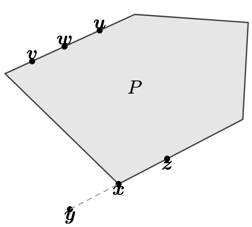</a>
<ul><li>
三角形的三个顶点都是 extreme points, 圆盘边界上的所有点都是 extreme points, 半空间没有 extreme points.
</li></ul></li><li>
<strong>Vertex.</strong> 对于 Polyhedron <math xmlns="http://www.w3.org/1998/Math/MathML"><semantics><mrow><mstyle scriptlevel="0" displaystyle="true"><mi mathvariant="script">P</mi></mstyle></mrow><annotation encoding="application/x-tex">\displaystyle \mathcal{P}</annotation></semantics></math>P，定义 <math xmlns="http://www.w3.org/1998/Math/MathML"><semantics><mrow><mstyle scriptlevel="0" displaystyle="true"><mi mathvariant="bold-italic">x</mi><mo>∈</mo><mi mathvariant="script">P</mi></mstyle></mrow><annotation encoding="application/x-tex">\displaystyle \bm{x} \in \mathcal{P}</annotation></semantics></math>x∈P 是 <math xmlns="http://www.w3.org/1998/Math/MathML"><semantics><mrow><mstyle scriptlevel="0" displaystyle="true"><mi mathvariant="script">P</mi></mstyle></mrow><annotation encoding="application/x-tex">\displaystyle \mathcal{P}</annotation></semantics></math>P 的 vertex, 如果存在 <math xmlns="http://www.w3.org/1998/Math/MathML"><semantics><mrow><mstyle scriptlevel="0" displaystyle="true"><mi mathvariant="bold-italic">c</mi><mo>∈</mo><msup><mi mathvariant="double-struck">R</mi><mi>n</mi></msup></mstyle></mrow><annotation encoding="application/x-tex">\displaystyle \bm{c} \in \mathbb{R}^n</annotation></semantics></math>c∈Rn 使得对任意 <math xmlns="http://www.w3.org/1998/Math/MathML"><semantics><mrow><mstyle scriptlevel="0" displaystyle="true"><mi mathvariant="bold-italic">y</mi><mo>∈</mo><mi mathvariant="script">P</mi><mo>∖</mo><mo stretchy="false">{</mo><mi mathvariant="bold-italic">x</mi><mo stretchy="false">}</mo></mstyle></mrow><annotation encoding="application/x-tex">\displaystyle \bm{y} \in \mathcal{P} \setminus \{\bm{x}\}</annotation></semantics></math>y∈P∖{x}，有 <math xmlns="http://www.w3.org/1998/Math/MathML"><semantics><mrow><mstyle scriptlevel="0" displaystyle="true"><msup><mi mathvariant="bold-italic">c</mi><mi mathvariant="normal">⊤</mi></msup><mi mathvariant="bold-italic">x</mi><mo>&lt;</mo><msup><mi mathvariant="bold-italic">c</mi><mi mathvariant="normal">⊤</mi></msup><mi mathvariant="bold-italic">y</mi></mstyle></mrow><annotation encoding="application/x-tex">\displaystyle \bm{c}^\top \bm{x} &lt; \bm{c}^\top \bm{y}</annotation></semantics></math>c⊤x&lt;c⊤y.

<a class="latex-raster-figure" href="./convex-geometry/20261023141406.png" style="--figure-width:30%">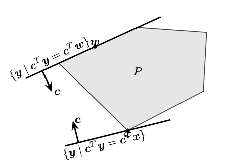</a>
<ul><li>
Vertex 可以理解为: 若 supporting hyperplane 与 <math xmlns="http://www.w3.org/1998/Math/MathML"><semantics><mrow><mstyle scriptlevel="0" displaystyle="true"><mi mathvariant="script">P</mi></mstyle></mrow><annotation encoding="application/x-tex">\displaystyle \mathcal{P}</annotation></semantics></math>P 唯一相交于 <math xmlns="http://www.w3.org/1998/Math/MathML"><semantics><mrow><mstyle scriptlevel="0" displaystyle="true"><mi mathvariant="bold-italic">x</mi></mstyle></mrow><annotation encoding="application/x-tex">\displaystyle \bm{x}</annotation></semantics></math>x，则 <math xmlns="http://www.w3.org/1998/Math/MathML"><semantics><mrow><mstyle scriptlevel="0" displaystyle="true"><mi mathvariant="bold-italic">x</mi></mstyle></mrow><annotation encoding="application/x-tex">\displaystyle \bm{x}</annotation></semantics></math>x 是 vertex.
</li></ul></li><li>
<strong>Basic feasible solution.</strong> 考虑由线性等式和不等式构成的 polyhedron <math xmlns="http://www.w3.org/1998/Math/MathML"><semantics><mrow><mstyle scriptlevel="0" displaystyle="true"><mi mathvariant="script">P</mi><mo>⊆</mo><msup><mi mathvariant="double-struck">R</mi><mi>n</mi></msup></mstyle></mrow><annotation encoding="application/x-tex">\displaystyle \mathcal{P} \subseteq \mathbb{R}^n</annotation></semantics></math>P⊆Rn，且 <math xmlns="http://www.w3.org/1998/Math/MathML"><semantics><mrow><mstyle scriptlevel="0" displaystyle="true"><mi mathvariant="bold-italic">x</mi><mo>∈</mo><msup><mi mathvariant="double-struck">R</mi><mi>n</mi></msup></mstyle></mrow><annotation encoding="application/x-tex">\displaystyle \bm{x} \in \mathbb{R}^n</annotation></semantics></math>x∈Rn. 称 <math xmlns="http://www.w3.org/1998/Math/MathML"><semantics><mrow><mstyle scriptlevel="0" displaystyle="true"><mi mathvariant="bold-italic">x</mi></mstyle></mrow><annotation encoding="application/x-tex">\displaystyle \bm{x}</annotation></semantics></math>x 是 basic solution, 如果其所有等式约束都是 active 的, 且在所有 active constraints 中 (可能是等式或不等式约束) 恰有 <math xmlns="http://www.w3.org/1998/Math/MathML"><semantics><mrow><mstyle scriptlevel="0" displaystyle="true"><mi>n</mi></mstyle></mrow><annotation encoding="application/x-tex">\displaystyle n</annotation></semantics></math>n 个约束是线性无关的. 若进一步 <math xmlns="http://www.w3.org/1998/Math/MathML"><semantics><mrow><mstyle scriptlevel="0" displaystyle="true"><mi mathvariant="bold-italic">x</mi></mstyle></mrow><annotation encoding="application/x-tex">\displaystyle \bm{x}</annotation></semantics></math>x 是 feasible 的, 则称 <math xmlns="http://www.w3.org/1998/Math/MathML"><semantics><mrow><mstyle scriptlevel="0" displaystyle="true"><mi mathvariant="bold-italic">x</mi></mstyle></mrow><annotation encoding="application/x-tex">\displaystyle \bm{x}</annotation></semantics></math>x 是 basic feasible solution (BFS).

<ul><li>
<strong>Active constraints.</strong> 分别记 LP 中的三种约束为 <math xmlns="http://www.w3.org/1998/Math/MathML"><semantics><mrow><mstyle scriptlevel="0" displaystyle="true"><msub><mi mathvariant="script">M</mi><mn>1</mn></msub><mo>:</mo><mo>=</mo><mo stretchy="false">{</mo><mi>i</mi><mo>:</mo><msubsup><mi mathvariant="bold-italic">a</mi><mi>i</mi><mi mathvariant="normal">⊤</mi></msubsup><mi mathvariant="bold-italic">x</mi><mo>≥</mo><msub><mi>b</mi><mi>i</mi></msub><mo stretchy="false">}</mo></mstyle></mrow><annotation encoding="application/x-tex">\displaystyle \mathcal{M}_1 := \{i: \bm{a}_i^\top \bm{x} \geq b_i\}</annotation></semantics></math>M1​:={i:ai⊤​x≥bi​}, <math xmlns="http://www.w3.org/1998/Math/MathML"><semantics><mrow><mstyle scriptlevel="0" displaystyle="true"><msub><mi mathvariant="script">M</mi><mn>2</mn></msub><mo>:</mo><mo>=</mo><mo stretchy="false">{</mo><mi>i</mi><mo>:</mo><msubsup><mi mathvariant="bold-italic">a</mi><mi>i</mi><mi mathvariant="normal">⊤</mi></msubsup><mi mathvariant="bold-italic">x</mi><mo>≤</mo><msub><mi>b</mi><mi>i</mi></msub><mo stretchy="false">}</mo></mstyle></mrow><annotation encoding="application/x-tex">\displaystyle \mathcal{M}_2 := \{i: \bm{a}_i^\top \bm{x} \leq b_i\}</annotation></semantics></math>M2​:={i:ai⊤​x≤bi​}, <math xmlns="http://www.w3.org/1998/Math/MathML"><semantics><mrow><mstyle scriptlevel="0" displaystyle="true"><msub><mi mathvariant="script">M</mi><mn>3</mn></msub><mo>:</mo><mo>=</mo><mo stretchy="false">{</mo><mi>i</mi><mo>:</mo><msubsup><mi mathvariant="bold-italic">a</mi><mi>i</mi><mi mathvariant="normal">⊤</mi></msubsup><mi mathvariant="bold-italic">x</mi><mo>=</mo><msub><mi>b</mi><mi>i</mi></msub><mo stretchy="false">}</mo></mstyle></mrow><annotation encoding="application/x-tex">\displaystyle \mathcal{M}_3 := \{i: \bm{a}_i^\top \bm{x} = b_i\}</annotation></semantics></math>M3​:={i:ai⊤​x=bi​}. 若对于 <math xmlns="http://www.w3.org/1998/Math/MathML"><semantics><mrow><mstyle scriptlevel="0" displaystyle="true"><msup><mi mathvariant="bold-italic">x</mi><mo>∗</mo></msup><mo>∈</mo><mi mathvariant="script">P</mi></mstyle></mrow><annotation encoding="application/x-tex">\displaystyle \bm{x}^* \in \mathcal{P}</annotation></semantics></math>x∗∈P，有 <math xmlns="http://www.w3.org/1998/Math/MathML"><semantics><mrow><mstyle scriptlevel="0" displaystyle="true"><msubsup><mi mathvariant="bold-italic">a</mi><mi>i</mi><mi mathvariant="normal">⊤</mi></msubsup><msup><mi mathvariant="bold-italic">x</mi><mo>∗</mo></msup><mo>=</mo><msub><mi>b</mi><mi>i</mi></msub></mstyle></mrow><annotation encoding="application/x-tex">\displaystyle \bm{a}_i^\top \bm{x}^* = b_i</annotation></semantics></math>ai⊤​x∗=bi​，则称约束 <math xmlns="http://www.w3.org/1998/Math/MathML"><semantics><mrow><mstyle scriptlevel="0" displaystyle="true"><mi>i</mi></mstyle></mrow><annotation encoding="application/x-tex">\displaystyle i</annotation></semantics></math>i 是 active 的.
</li></ul></li></ul></section>
<section class="latex-block latex-lemma" id="latex-lemmablock-5-1-1" aria-label="Lemma 5.1.1">
Lemma 5.1.1

首先根据线性代数给出如下命题作为引理. 给定 <math xmlns="http://www.w3.org/1998/Math/MathML"><semantics><mrow><mstyle scriptlevel="0" displaystyle="true"><msup><mi mathvariant="bold-italic">x</mi><mo>∗</mo></msup><mo>∈</mo><msup><mi mathvariant="double-struck">R</mi><mi>n</mi></msup></mstyle></mrow><annotation encoding="application/x-tex">\displaystyle \bm{x}^* \in \mathbb{R}^n</annotation></semantics></math>x∗∈Rn, 令 <math xmlns="http://www.w3.org/1998/Math/MathML"><semantics><mrow><mstyle scriptlevel="0" displaystyle="true"><mi mathvariant="script">I</mi><mo>=</mo><mo stretchy="false">{</mo><mi>i</mi><mo>:</mo><msubsup><mi mathvariant="bold-italic">a</mi><mi>i</mi><mi mathvariant="normal">⊤</mi></msubsup><msup><mi mathvariant="bold-italic">x</mi><mo>∗</mo></msup><mo>=</mo><msub><mi>b</mi><mi>i</mi></msub><mo stretchy="false">}</mo></mstyle></mrow><annotation encoding="application/x-tex">\displaystyle \mathcal{I} = \{i: \bm{a}_i^\top \bm{x}^* = b_i\}</annotation></semantics></math>I={i:ai⊤​x∗=bi​}. 则如下命题等价:

<ol><li>
线性系统 <math xmlns="http://www.w3.org/1998/Math/MathML"><semantics><mrow><mstyle scriptlevel="0" displaystyle="true"><msubsup><mi mathvariant="bold-italic">a</mi><mi>i</mi><mi mathvariant="normal">⊤</mi></msubsup><mi mathvariant="bold-italic">x</mi><mo>=</mo><msub><mi>b</mi><mi>i</mi></msub><mo separator="true">,</mo><mtext> </mtext><mi>i</mi><mo>∈</mo><mi mathvariant="script">I</mi></mstyle></mrow><annotation encoding="application/x-tex">\displaystyle \bm{a}_i^\top \bm{x} = b_i,~ i \in \mathcal{I}</annotation></semantics></math>ai⊤​x=bi​, i∈I 有唯一解 <math xmlns="http://www.w3.org/1998/Math/MathML"><semantics><mrow><mstyle scriptlevel="0" displaystyle="true"><msup><mi mathvariant="bold-italic">x</mi><mo>∗</mo></msup></mstyle></mrow><annotation encoding="application/x-tex">\displaystyle \bm{x}^*</annotation></semantics></math>x∗.
</li><li>
存在 <math xmlns="http://www.w3.org/1998/Math/MathML"><semantics><mrow><mstyle scriptlevel="0" displaystyle="true"><mi>n</mi></mstyle></mrow><annotation encoding="application/x-tex">\displaystyle n</annotation></semantics></math>n 个线性无关的约束 <math xmlns="http://www.w3.org/1998/Math/MathML"><semantics><mrow><mstyle scriptlevel="0" displaystyle="true"><msub><mi mathvariant="bold-italic">a</mi><msub><mi>i</mi><mn>1</mn></msub></msub><mo separator="true">,</mo><mo>…</mo><mo separator="true">,</mo><msub><mi mathvariant="bold-italic">a</mi><msub><mi>i</mi><mi>n</mi></msub></msub></mstyle></mrow><annotation encoding="application/x-tex">\displaystyle \bm{a}_{i_1}, \dots, \bm{a}_{i_n}</annotation></semantics></math>ai1​​,…,ain​​, 其中 <math xmlns="http://www.w3.org/1998/Math/MathML"><semantics><mrow><mstyle scriptlevel="0" displaystyle="true"><msub><mi>i</mi><mi>j</mi></msub><mo>∈</mo><mi mathvariant="script">I</mi></mstyle></mrow><annotation encoding="application/x-tex">\displaystyle i_j \in \mathcal{I}</annotation></semantics></math>ij​∈I.
</li><li>
所有 <math xmlns="http://www.w3.org/1998/Math/MathML"><semantics><mrow><mstyle scriptlevel="0" displaystyle="true"><msub><mi mathvariant="bold-italic">a</mi><mi>i</mi></msub><mo separator="true">,</mo><mtext> </mtext><mi>i</mi><mo>∈</mo><mi mathvariant="script">I</mi></mstyle></mrow><annotation encoding="application/x-tex">\displaystyle \bm{a}_i,~ i \in \mathcal{I}</annotation></semantics></math>ai​, i∈I 张成的空间是 <math xmlns="http://www.w3.org/1998/Math/MathML"><semantics><mrow><mstyle scriptlevel="0" displaystyle="true"><msup><mi mathvariant="double-struck">R</mi><mi>n</mi></msup></mstyle></mrow><annotation encoding="application/x-tex">\displaystyle \mathbb{R}^n</annotation></semantics></math>Rn.
</li></ol></section>
<section class="latex-block latex-proposition" id="latex-propositionblock-5-1-1" aria-label="Proposition 5.1.1">
Proposition 5.1.1

据此立即得到, 由上述三个角度定义的 extreme point, vertex 和 basic feasible solution 三者是等价的: 对于 <math xmlns="http://www.w3.org/1998/Math/MathML"><semantics><mrow><mstyle scriptlevel="0" displaystyle="true"><mi mathvariant="script">P</mi></mstyle></mrow><annotation encoding="application/x-tex">\displaystyle \mathcal{P}</annotation></semantics></math>P 是非空的 polyhedron, 且 <math xmlns="http://www.w3.org/1998/Math/MathML"><semantics><mrow><mstyle scriptlevel="0" displaystyle="true"><msup><mi mathvariant="bold-italic">x</mi><mo>∗</mo></msup><mo>∈</mo><mi mathvariant="script">P</mi></mstyle></mrow><annotation encoding="application/x-tex">\displaystyle \bm{x}^* \in \mathcal{P}</annotation></semantics></math>x∗∈P, 有

<ol><li>
<math xmlns="http://www.w3.org/1998/Math/MathML"><semantics><mrow><mstyle scriptlevel="0" displaystyle="true"><msup><mi mathvariant="bold-italic">x</mi><mo>∗</mo></msup></mstyle></mrow><annotation encoding="application/x-tex">\displaystyle \bm{x}^*</annotation></semantics></math>x∗ 是 <math xmlns="http://www.w3.org/1998/Math/MathML"><semantics><mrow><mstyle scriptlevel="0" displaystyle="true"><mi mathvariant="script">P</mi></mstyle></mrow><annotation encoding="application/x-tex">\displaystyle \mathcal{P}</annotation></semantics></math>P 的 extreme point.
</li><li>
<math xmlns="http://www.w3.org/1998/Math/MathML"><semantics><mrow><mstyle scriptlevel="0" displaystyle="true"><msup><mi mathvariant="bold-italic">x</mi><mo>∗</mo></msup></mstyle></mrow><annotation encoding="application/x-tex">\displaystyle \bm{x}^*</annotation></semantics></math>x∗ 是 <math xmlns="http://www.w3.org/1998/Math/MathML"><semantics><mrow><mstyle scriptlevel="0" displaystyle="true"><mi mathvariant="script">P</mi></mstyle></mrow><annotation encoding="application/x-tex">\displaystyle \mathcal{P}</annotation></semantics></math>P 的 vertex.
</li><li>
<math xmlns="http://www.w3.org/1998/Math/MathML"><semantics><mrow><mstyle scriptlevel="0" displaystyle="true"><msup><mi mathvariant="bold-italic">x</mi><mo>∗</mo></msup></mstyle></mrow><annotation encoding="application/x-tex">\displaystyle \bm{x}^*</annotation></semantics></math>x∗ 是 <math xmlns="http://www.w3.org/1998/Math/MathML"><semantics><mrow><mstyle scriptlevel="0" displaystyle="true"><mi mathvariant="script">P</mi></mstyle></mrow><annotation encoding="application/x-tex">\displaystyle \mathcal{P}</annotation></semantics></math>P 的 basic feasible solution.
</li></ol></section>

因此对应如下 extreme point 的判定定理.

<section class="latex-block latex-theorem" id="latex-thmblock-5-1-1" aria-label="Theorem 5.1.1">
Theorem 5.1.1　Extreme point characterization

给定 Polyhedron <math xmlns="http://www.w3.org/1998/Math/MathML"><semantics><mrow><mstyle scriptlevel="0" displaystyle="true"><mi mathvariant="script">P</mi><mo>⊆</mo><msup><mi mathvariant="double-struck">R</mi><mi>n</mi></msup></mstyle></mrow><annotation encoding="application/x-tex">\displaystyle \mathcal{P} \subseteq \mathbb{R}^n</annotation></semantics></math>P⊆Rn，则 <math xmlns="http://www.w3.org/1998/Math/MathML"><semantics><mrow><mstyle scriptlevel="0" displaystyle="true"><msup><mi mathvariant="bold-italic">x</mi><mo>∗</mo></msup><mo>∈</mo><mi mathvariant="script">P</mi></mstyle></mrow><annotation encoding="application/x-tex">\displaystyle \bm{x}^* \in \mathcal{P}</annotation></semantics></math>x∗∈P 是 <math xmlns="http://www.w3.org/1998/Math/MathML"><semantics><mrow><mstyle scriptlevel="0" displaystyle="true"><mi mathvariant="script">P</mi></mstyle></mrow><annotation encoding="application/x-tex">\displaystyle \mathcal{P}</annotation></semantics></math>P 的 extreme point 当且仅当 <math xmlns="http://www.w3.org/1998/Math/MathML"><semantics><mrow><mstyle scriptlevel="0" displaystyle="true"><msup><mi mathvariant="bold-italic">x</mi><mo>∗</mo></msup></mstyle></mrow><annotation encoding="application/x-tex">\displaystyle \bm{x}^*</annotation></semantics></math>x∗ 的 active constraints 中有 <math xmlns="http://www.w3.org/1998/Math/MathML"><semantics><mrow><mstyle scriptlevel="0" displaystyle="true"><mi>n</mi></mstyle></mrow><annotation encoding="application/x-tex">\displaystyle n</annotation></semantics></math>n 个线性无关的约束.
</section>
<blockquote class="latex-quote">
Note.
注意, 上述的讨论与具体的 <math xmlns="http://www.w3.org/1998/Math/MathML"><semantics><mrow><mstyle scriptlevel="0" displaystyle="true"><mi mathvariant="script">P</mi></mstyle></mrow><annotation encoding="application/x-tex">\displaystyle \mathcal{P}</annotation></semantics></math>P 的表示是无关的.
</blockquote>

### 5.2. Polyhedral in Standard Form

#### 5.2.1. Basic solution characterization in standard form

下面考虑 polyhedron 的标准形式, 并将上述讨论在标准形式下进行具体化. 具体而言, 给定 <math xmlns="http://www.w3.org/1998/Math/MathML"><semantics><mrow><mstyle scriptlevel="0" displaystyle="true"><mi mathvariant="script">P</mi><mo>=</mo><mo stretchy="false">{</mo><mi mathvariant="bold-italic">x</mi><mo>∈</mo><msup><mi mathvariant="double-struck">R</mi><mi>n</mi></msup><mo>:</mo><mi mathvariant="bold-italic">A</mi><mi mathvariant="bold-italic">x</mi><mo>=</mo><mi mathvariant="bold-italic">b</mi><mo separator="true">,</mo><mtext> </mtext><mi mathvariant="bold-italic">x</mi><mo>≥</mo><mn>0</mn><mo stretchy="false">}</mo></mstyle></mrow><annotation encoding="application/x-tex">\displaystyle \mathcal{P} = \{\bm{x} \in \mathbb{R}^n: \bm{A}\bm{x} = \bm{b},~ \bm{x} \geq 0\}</annotation></semantics></math>P={x∈Rn:Ax=b, x≥0}，其中 <math xmlns="http://www.w3.org/1998/Math/MathML"><semantics><mrow><mstyle scriptlevel="0" displaystyle="true"><mi mathvariant="bold-italic">A</mi><mo>∈</mo><msup><mi mathvariant="double-struck">R</mi><mrow><mi>m</mi><mo>×</mo><mi>n</mi></mrow></msup></mstyle></mrow><annotation encoding="application/x-tex">\displaystyle \bm{A} \in \mathbb{R}^{m \times n}</annotation></semantics></math>A∈Rm×n 且 <math xmlns="http://www.w3.org/1998/Math/MathML"><semantics><mrow><mstyle scriptlevel="0" displaystyle="true"><mtext>rank</mtext><mo stretchy="false">(</mo><mi mathvariant="bold-italic">A</mi><mo stretchy="false">)</mo><mo>=</mo><mi>m</mi><mo>&lt;</mo><mi>n</mi></mstyle></mrow><annotation encoding="application/x-tex">\displaystyle \text{rank}(\bm{A}) = m &lt; n</annotation></semantics></math>rank(A)=m&lt;n (行满秩). 即, 共有 <math xmlns="http://www.w3.org/1998/Math/MathML"><semantics><mrow><mstyle scriptlevel="0" displaystyle="true"><mi>n</mi></mstyle></mrow><annotation encoding="application/x-tex">\displaystyle n</annotation></semantics></math>n 个变量, <math xmlns="http://www.w3.org/1998/Math/MathML"><semantics><mrow><mstyle scriptlevel="0" displaystyle="true"><mi>m</mi></mstyle></mrow><annotation encoding="application/x-tex">\displaystyle m</annotation></semantics></math>m 个线性等式约束.
这里记 <math xmlns="http://www.w3.org/1998/Math/MathML"><semantics><mrow><mstyle scriptlevel="0" displaystyle="true"><mi mathvariant="bold-italic">A</mi><mo>=</mo><mo stretchy="false">[</mo><msub><mi mathvariant="bold-italic">A</mi><mn>1</mn></msub><mo separator="true">,</mo><mo>…</mo><mo separator="true">,</mo><msub><mi mathvariant="bold-italic">A</mi><mi>n</mi></msub><mo stretchy="false">]</mo></mstyle></mrow><annotation encoding="application/x-tex">\displaystyle \bm{A} = [\bm{A}_1, \dots, \bm{A}_n]</annotation></semantics></math>A=[A1​,…,An​]，其中 <math xmlns="http://www.w3.org/1998/Math/MathML"><semantics><mrow><mstyle scriptlevel="0" displaystyle="true"><msub><mi mathvariant="bold-italic">A</mi><mi>i</mi></msub><mo>∈</mo><msup><mi mathvariant="double-struck">R</mi><mi>m</mi></msup></mstyle></mrow><annotation encoding="application/x-tex">\displaystyle \bm{A}_i \in \mathbb{R}^m</annotation></semantics></math>Ai​∈Rm 是 <math xmlns="http://www.w3.org/1998/Math/MathML"><semantics><mrow><mstyle scriptlevel="0" displaystyle="true"><mi mathvariant="bold-italic">A</mi></mstyle></mrow><annotation encoding="application/x-tex">\displaystyle \bm{A}</annotation></semantics></math>A 的第 <math xmlns="http://www.w3.org/1998/Math/MathML"><semantics><mrow><mstyle scriptlevel="0" displaystyle="true"><mi>i</mi></mstyle></mrow><annotation encoding="application/x-tex">\displaystyle i</annotation></semantics></math>i 列.

给定 <math xmlns="http://www.w3.org/1998/Math/MathML"><semantics><mrow><mstyle scriptlevel="0" displaystyle="true"><msup><mi mathvariant="bold-italic">x</mi><mo>∗</mo></msup><mo>∈</mo><mi mathvariant="script">P</mi></mstyle></mrow><annotation encoding="application/x-tex">\displaystyle \bm{x}^* \in \mathcal{P}</annotation></semantics></math>x∗∈P, 我们想讨论其是否是 extreme point / vertex / basic solution.

<ul><li>
注意到, 由于 <math xmlns="http://www.w3.org/1998/Math/MathML"><semantics><mrow><mstyle scriptlevel="0" displaystyle="true"><mi mathvariant="bold-italic">A</mi><msup><mi mathvariant="bold-italic">x</mi><mo>∗</mo></msup><mo>=</mo><mi mathvariant="bold-italic">b</mi></mstyle></mrow><annotation encoding="application/x-tex">\displaystyle \bm{A}\bm{x}^* = \bm{b}</annotation></semantics></math>Ax∗=b, 首先这些等式约束就天然地提供了 <math xmlns="http://www.w3.org/1998/Math/MathML"><semantics><mrow><mstyle scriptlevel="0" displaystyle="true"><mi>m</mi></mstyle></mrow><annotation encoding="application/x-tex">\displaystyle m</annotation></semantics></math>m 个 active constraints. 进一步, 由于假设 <math xmlns="http://www.w3.org/1998/Math/MathML"><semantics><mrow><mstyle scriptlevel="0" displaystyle="true"><mi mathvariant="bold-italic">A</mi></mstyle></mrow><annotation encoding="application/x-tex">\displaystyle \bm{A}</annotation></semantics></math>A 是行满秩的, 故这 <math xmlns="http://www.w3.org/1998/Math/MathML"><semantics><mrow><mstyle scriptlevel="0" displaystyle="true"><mi>m</mi></mstyle></mrow><annotation encoding="application/x-tex">\displaystyle m</annotation></semantics></math>m 个 active constraints 是线性无关的.
</li><li>
根据上述的极点判定定理, 若 <math xmlns="http://www.w3.org/1998/Math/MathML"><semantics><mrow><mstyle scriptlevel="0" displaystyle="true"><msup><mi mathvariant="bold-italic">x</mi><mo>∗</mo></msup></mstyle></mrow><annotation encoding="application/x-tex">\displaystyle \bm{x}^*</annotation></semantics></math>x∗ 是 BS, 则需要总共 <math xmlns="http://www.w3.org/1998/Math/MathML"><semantics><mrow><mstyle scriptlevel="0" displaystyle="true"><mi>n</mi></mstyle></mrow><annotation encoding="application/x-tex">\displaystyle n</annotation></semantics></math>n 个 linear independent active constraints. 故还需要额外的 <math xmlns="http://www.w3.org/1998/Math/MathML"><semantics><mrow><mstyle scriptlevel="0" displaystyle="true"><mi>n</mi><mo>−</mo><mi>m</mi></mstyle></mrow><annotation encoding="application/x-tex">\displaystyle n-m</annotation></semantics></math>n−m 个 active constraints. 因此我们要选择 <math xmlns="http://www.w3.org/1998/Math/MathML"><semantics><mrow><mstyle scriptlevel="0" displaystyle="true"><mo stretchy="false">(</mo><mi>n</mi><mo>−</mo><mi>m</mi><mo stretchy="false">)</mo></mstyle></mrow><annotation encoding="application/x-tex">\displaystyle (n-m)</annotation></semantics></math>(n−m) 个不等式约束 <math xmlns="http://www.w3.org/1998/Math/MathML"><semantics><mrow><mstyle scriptlevel="0" displaystyle="true"><mi mathvariant="bold-italic">x</mi><mo>≥</mo><mn>0</mn></mstyle></mrow><annotation encoding="application/x-tex">\displaystyle \bm{x} \geq 0</annotation></semantics></math>x≥0 使其为 active constraints. 也即, 需要选择 <math xmlns="http://www.w3.org/1998/Math/MathML"><semantics><mrow><mstyle scriptlevel="0" displaystyle="true"><mo stretchy="false">(</mo><mi>n</mi><mo>−</mo><mi>m</mi><mo stretchy="false">)</mo></mstyle></mrow><annotation encoding="application/x-tex">\displaystyle (n-m)</annotation></semantics></math>(n−m) 个 <math xmlns="http://www.w3.org/1998/Math/MathML"><semantics><mrow><mstyle scriptlevel="0" displaystyle="true"><msubsup><mi mathvariant="bold-italic">x</mi><mi>i</mi><mo>∗</mo></msubsup><mo>=</mo><mn>0</mn></mstyle></mrow><annotation encoding="application/x-tex">\displaystyle \bm{x}^*_i = 0</annotation></semantics></math>xi∗​=0.

<ul><li>
从几何的角度理解, 对于一个 <math xmlns="http://www.w3.org/1998/Math/MathML"><semantics><mrow><mstyle scriptlevel="0" displaystyle="true"><msup><mi mathvariant="double-struck">R</mi><mi>n</mi></msup></mstyle></mrow><annotation encoding="application/x-tex">\displaystyle \mathbb{R}^n</annotation></semantics></math>Rn 的空间, 等式 <math xmlns="http://www.w3.org/1998/Math/MathML"><semantics><mrow><mstyle scriptlevel="0" displaystyle="true"><mi mathvariant="bold-italic">A</mi><mi mathvariant="bold-italic">x</mi><mo>=</mo><mi mathvariant="bold-italic">b</mi></mstyle></mrow><annotation encoding="application/x-tex">\displaystyle \bm{A}\bm{x} = \bm{b}</annotation></semantics></math>Ax=b (在行满秩条件下) 确定了 <math xmlns="http://www.w3.org/1998/Math/MathML"><semantics><mrow><mstyle scriptlevel="0" displaystyle="true"><mi>m</mi></mstyle></mrow><annotation encoding="application/x-tex">\displaystyle m</annotation></semantics></math>m 个维度, 留下了 <math xmlns="http://www.w3.org/1998/Math/MathML"><semantics><mrow><mstyle scriptlevel="0" displaystyle="true"><mo stretchy="false">(</mo><mi>n</mi><mo>−</mo><mi>m</mi><mo stretchy="false">)</mo></mstyle></mrow><annotation encoding="application/x-tex">\displaystyle (n-m)</annotation></semantics></math>(n−m) 个自由度. 也即, <math xmlns="http://www.w3.org/1998/Math/MathML"><semantics><mrow><mstyle scriptlevel="0" displaystyle="true"><mi mathvariant="bold-italic">A</mi><mi mathvariant="bold-italic">x</mi><mo>=</mo><mi mathvariant="bold-italic">b</mi></mstyle></mrow><annotation encoding="application/x-tex">\displaystyle \bm{A} \bm{x} = \bm{b}</annotation></semantics></math>Ax=b 的解集 (即 <math xmlns="http://www.w3.org/1998/Math/MathML"><semantics><mrow><mstyle scriptlevel="0" displaystyle="true"><mi>m</mi></mstyle></mrow><annotation encoding="application/x-tex">\displaystyle m</annotation></semantics></math>m 个超平面的交集) 是一个 <math xmlns="http://www.w3.org/1998/Math/MathML"><semantics><mrow><mstyle scriptlevel="0" displaystyle="true"><mo stretchy="false">(</mo><mi>n</mi><mo>−</mo><mi>m</mi><mo stretchy="false">)</mo></mstyle></mrow><annotation encoding="application/x-tex">\displaystyle (n-m)</annotation></semantics></math>(n−m) 维的 affine space. 因此, 若想唯一确定一个点, 则要消除余下的 <math xmlns="http://www.w3.org/1998/Math/MathML"><semantics><mrow><mstyle scriptlevel="0" displaystyle="true"><mo stretchy="false">(</mo><mi>n</mi><mo>−</mo><mi>m</mi><mo stretchy="false">)</mo></mstyle></mrow><annotation encoding="application/x-tex">\displaystyle (n-m)</annotation></semantics></math>(n−m) 个自由度, 也即需要 <math xmlns="http://www.w3.org/1998/Math/MathML"><semantics><mrow><mstyle scriptlevel="0" displaystyle="true"><mo stretchy="false">(</mo><mi>n</mi><mo>−</mo><mi>m</mi><mo stretchy="false">)</mo></mstyle></mrow><annotation encoding="application/x-tex">\displaystyle (n-m)</annotation></semantics></math>(n−m) 个不等式约束 <math xmlns="http://www.w3.org/1998/Math/MathML"><semantics><mrow><mstyle scriptlevel="0" displaystyle="true"><mi mathvariant="bold-italic">x</mi><mo>≥</mo><mn>0</mn></mstyle></mrow><annotation encoding="application/x-tex">\displaystyle \bm{x} \geq 0</annotation></semantics></math>x≥0 使其为 active constraints.
</li><li>
如下图所示, 这是一个 <math xmlns="http://www.w3.org/1998/Math/MathML"><semantics><mrow><mstyle scriptlevel="0" displaystyle="true"><mi>n</mi><mo>=</mo><mn>6</mn></mstyle></mrow><annotation encoding="application/x-tex">\displaystyle n=6</annotation></semantics></math>n=6, <math xmlns="http://www.w3.org/1998/Math/MathML"><semantics><mrow><mstyle scriptlevel="0" displaystyle="true"><mi>m</mi><mo>=</mo><mn>4</mn></mstyle></mrow><annotation encoding="application/x-tex">\displaystyle m=4</annotation></semantics></math>m=4 的例子. 也即, 在一个 <math xmlns="http://www.w3.org/1998/Math/MathML"><semantics><mrow><mstyle scriptlevel="0" displaystyle="true"><msup><mi mathvariant="double-struck">R</mi><mn>6</mn></msup></mstyle></mrow><annotation encoding="application/x-tex">\displaystyle \mathbb{R}^6</annotation></semantics></math>R6 的空间中, 通过 <math xmlns="http://www.w3.org/1998/Math/MathML"><semantics><mrow><mstyle scriptlevel="0" displaystyle="true"><mi mathvariant="bold-italic">A</mi><mi mathvariant="bold-italic">x</mi><mo>=</mo><mi mathvariant="bold-italic">b</mi></mstyle></mrow><annotation encoding="application/x-tex">\displaystyle \bm{A}\bm{x} = \bm{b}</annotation></semantics></math>Ax=b 的 <math xmlns="http://www.w3.org/1998/Math/MathML"><semantics><mrow><mstyle scriptlevel="0" displaystyle="true"><mn>4</mn></mstyle></mrow><annotation encoding="application/x-tex">\displaystyle 4</annotation></semantics></math>4 个等式约束, 确定了一个 <math xmlns="http://www.w3.org/1998/Math/MathML"><semantics><mrow><mstyle scriptlevel="0" displaystyle="true"><mn>2</mn></mstyle></mrow><annotation encoding="application/x-tex">\displaystyle 2</annotation></semantics></math>2 维的 affine space (即图中所展示的空间). 此外, 还有 <math xmlns="http://www.w3.org/1998/Math/MathML"><semantics><mrow><mstyle scriptlevel="0" displaystyle="true"><mn>6</mn></mstyle></mrow><annotation encoding="application/x-tex">\displaystyle 6</annotation></semantics></math>6 个不等式约束 <math xmlns="http://www.w3.org/1998/Math/MathML"><semantics><mrow><mstyle scriptlevel="0" displaystyle="true"><mi mathvariant="bold-italic">x</mi><mo>≥</mo><mn>0</mn></mstyle></mrow><annotation encoding="application/x-tex">\displaystyle \bm{x} \geq 0</annotation></semantics></math>x≥0, 即为图中的 <math xmlns="http://www.w3.org/1998/Math/MathML"><semantics><mrow><mstyle scriptlevel="0" displaystyle="true"><mn>6</mn></mstyle></mrow><annotation encoding="application/x-tex">\displaystyle 6</annotation></semantics></math>6 条直线. 任选两条直线的交点, 即为令这两个约束为 active constraints, 则可以唯一确定一个点. 也即, 该点是 basic solution. 不过 Basic solution 并不一定是 feasible 的.
</li></ul>
<a class="latex-raster-figure" href="./convex-geometry/20261023150428.png" style="--figure-width:50%">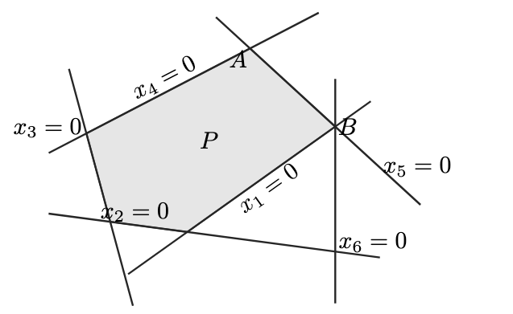</a></li><li>
我们已经说明, 要选择 <math xmlns="http://www.w3.org/1998/Math/MathML"><semantics><mrow><mstyle scriptlevel="0" displaystyle="true"><mo stretchy="false">(</mo><mi>n</mi><mo>−</mo><mi>m</mi><mo stretchy="false">)</mo></mstyle></mrow><annotation encoding="application/x-tex">\displaystyle (n-m)</annotation></semantics></math>(n−m) 个 <math xmlns="http://www.w3.org/1998/Math/MathML"><semantics><mrow><mstyle scriptlevel="0" displaystyle="true"><msubsup><mi mathvariant="bold-italic">x</mi><mi>i</mi><mo>∗</mo></msubsup><mo>=</mo><mn>0</mn></mstyle></mrow><annotation encoding="application/x-tex">\displaystyle \bm{x}^*_i = 0</annotation></semantics></math>xi∗​=0 来作为 active constraints. 这样的选择并不唯一, 但也不是任意的. 这是因为, 如果新增的约束与原有的 <math xmlns="http://www.w3.org/1998/Math/MathML"><semantics><mrow><mstyle scriptlevel="0" displaystyle="true"><mi>m</mi></mstyle></mrow><annotation encoding="application/x-tex">\displaystyle m</annotation></semantics></math>m 个等式约束线性相关, 则这样的选择是无效的.
</li></ul>

故, 可以将上述的讨论总结为如下定理.

<section class="latex-block latex-theorem" id="latex-thmblock-5-2-1" aria-label="Theorem 5.2.1">
Theorem 5.2.1　Basic Solution Characterization in Standard Form

考虑标准形式. <math xmlns="http://www.w3.org/1998/Math/MathML"><semantics><mrow><mstyle scriptlevel="0" displaystyle="true"><msup><mi mathvariant="bold-italic">x</mi><mo>∗</mo></msup><mo>∈</mo><msup><mi mathvariant="double-struck">R</mi><mi>n</mi></msup></mstyle></mrow><annotation encoding="application/x-tex">\displaystyle \bm{x}^* \in \mathbb{R}^n</annotation></semantics></math>x∗∈Rn 是 <math xmlns="http://www.w3.org/1998/Math/MathML"><semantics><mrow><mstyle scriptlevel="0" displaystyle="true"><mi mathvariant="script">P</mi></mstyle></mrow><annotation encoding="application/x-tex">\displaystyle \mathcal{P}</annotation></semantics></math>P 的 basic solution 当且仅当: 所有等式约束 <math xmlns="http://www.w3.org/1998/Math/MathML"><semantics><mrow><mstyle scriptlevel="0" displaystyle="true"><mi mathvariant="bold-italic">A</mi><mi mathvariant="bold-italic">x</mi><mo>=</mo><mi mathvariant="bold-italic">b</mi></mstyle></mrow><annotation encoding="application/x-tex">\displaystyle \bm{A}\bm{x} = \bm{b}</annotation></semantics></math>Ax=b 都是 active 的; 且存在 <math xmlns="http://www.w3.org/1998/Math/MathML"><semantics><mrow><mstyle scriptlevel="0" displaystyle="true"><mi>m</mi></mstyle></mrow><annotation encoding="application/x-tex">\displaystyle m</annotation></semantics></math>m 个 indices <math xmlns="http://www.w3.org/1998/Math/MathML"><semantics><mrow><mstyle scriptlevel="0" displaystyle="true"><mi>B</mi><mo stretchy="false">(</mo><mn>1</mn><mo stretchy="false">)</mo><mo separator="true">,</mo><mo>…</mo><mo separator="true">,</mo><mi>B</mi><mo stretchy="false">(</mo><mi>m</mi><mo stretchy="false">)</mo></mstyle></mrow><annotation encoding="application/x-tex">\displaystyle B(1), \dots, B(m)</annotation></semantics></math>B(1),…,B(m) 使得 (1) <math xmlns="http://www.w3.org/1998/Math/MathML"><semantics><mrow><mstyle scriptlevel="0" displaystyle="true"><mi mathvariant="bold-italic">A</mi></mstyle></mrow><annotation encoding="application/x-tex">\displaystyle \bm{A}</annotation></semantics></math>A 的对应列向量 <math xmlns="http://www.w3.org/1998/Math/MathML"><semantics><mrow><mstyle scriptlevel="0" displaystyle="true"><msub><mi mathvariant="bold-italic">A</mi><mrow><mi>B</mi><mo stretchy="false">(</mo><mn>1</mn><mo stretchy="false">)</mo></mrow></msub><mo separator="true">,</mo><mo>…</mo><mo separator="true">,</mo><msub><mi mathvariant="bold-italic">A</mi><mrow><mi>B</mi><mo stretchy="false">(</mo><mi>m</mi><mo stretchy="false">)</mo></mrow></msub></mstyle></mrow><annotation encoding="application/x-tex">\displaystyle \bm{A}_{B(1)}, \dots, \bm{A}_{B(m)}</annotation></semantics></math>AB(1)​,…,AB(m)​ 是线性无关的, 且 (2) 对于任意 <math xmlns="http://www.w3.org/1998/Math/MathML"><semantics><mrow><mstyle scriptlevel="0" displaystyle="true"><mi>j</mi><mo mathvariant="normal">∉</mo><mo stretchy="false">{</mo><mi>B</mi><mo stretchy="false">(</mo><mn>1</mn><mo stretchy="false">)</mo><mo separator="true">,</mo><mo>…</mo><mo separator="true">,</mo><mi>B</mi><mo stretchy="false">(</mo><mi>m</mi><mo stretchy="false">)</mo><mo stretchy="false">}</mo></mstyle></mrow><annotation encoding="application/x-tex">\displaystyle j \notin \{B(1), \dots, B(m)\}</annotation></semantics></math>j∈/{B(1),…,B(m)}，有 <math xmlns="http://www.w3.org/1998/Math/MathML"><semantics><mrow><mstyle scriptlevel="0" displaystyle="true"><msubsup><mi mathvariant="bold-italic">x</mi><mi>j</mi><mo>∗</mo></msubsup><mo>=</mo><mn>0</mn></mstyle></mrow><annotation encoding="application/x-tex">\displaystyle \bm{x}^*_j = 0</annotation></semantics></math>xj∗​=0.

<ul><li>
注意, 这里仅要求 <math xmlns="http://www.w3.org/1998/Math/MathML"><semantics><mrow><mstyle scriptlevel="0" displaystyle="true"><msup><mi mathvariant="bold-italic">x</mi><mo>∗</mo></msup></mstyle></mrow><annotation encoding="application/x-tex">\displaystyle \bm{x}^*</annotation></semantics></math>x∗ 是 basic solution, 并不要求其是 feasible 的. 若进一步要求 <math xmlns="http://www.w3.org/1998/Math/MathML"><semantics><mrow><mstyle scriptlevel="0" displaystyle="true"><msup><mi mathvariant="bold-italic">x</mi><mo>∗</mo></msup><mo>≥</mo><mn>0</mn></mstyle></mrow><annotation encoding="application/x-tex">\displaystyle \bm{x}^* \geq 0</annotation></semantics></math>x∗≥0，则称其为 basic feasible solution (BFS).
</li></ul></section>
<section class="latex-block latex-definition" id="latex-defblock-5-2-1" aria-label="Definition 5.2.1">
Definition 5.2.1　Basic and non-basic variables

为方便叙述, 称 <math xmlns="http://www.w3.org/1998/Math/MathML"><semantics><mrow><mstyle scriptlevel="0" displaystyle="true"><msub><mi mathvariant="bold-italic">A</mi><mrow><mi>B</mi><mo stretchy="false">(</mo><mn>1</mn><mo stretchy="false">)</mo></mrow></msub><mo separator="true">,</mo><mo>…</mo><mo separator="true">,</mo><msub><mi mathvariant="bold-italic">A</mi><mrow><mi>B</mi><mo stretchy="false">(</mo><mi>m</mi><mo stretchy="false">)</mo></mrow></msub></mstyle></mrow><annotation encoding="application/x-tex">\displaystyle \bm{A}_{B(1)}, \dots, \bm{A}_{B(m)}</annotation></semantics></math>AB(1)​,…,AB(m)​ 为 basic columns, 对应的变量 <math xmlns="http://www.w3.org/1998/Math/MathML"><semantics><mrow><mstyle scriptlevel="0" displaystyle="true"><msub><mi mathvariant="bold-italic">x</mi><mrow><mi>B</mi><mo stretchy="false">(</mo><mn>1</mn><mo stretchy="false">)</mo></mrow></msub><mo separator="true">,</mo><mo>…</mo><mo separator="true">,</mo><msub><mi mathvariant="bold-italic">x</mi><mrow><mi>B</mi><mo stretchy="false">(</mo><mi>m</mi><mo stretchy="false">)</mo></mrow></msub></mstyle></mrow><annotation encoding="application/x-tex">\displaystyle \bm{x}_{B(1)}, \dots, \bm{x}_{B(m)}</annotation></semantics></math>xB(1)​,…,xB(m)​ 为 basic variables, 其余的变量为 non-basic variables. 并且 wlog 可以将 <math xmlns="http://www.w3.org/1998/Math/MathML"><semantics><mrow><mstyle scriptlevel="0" displaystyle="true"><mi mathvariant="bold-italic">A</mi></mstyle></mrow><annotation encoding="application/x-tex">\displaystyle \bm{A}</annotation></semantics></math>A 进行列重排, 使得 <math xmlns="http://www.w3.org/1998/Math/MathML"><semantics><mrow><mstyle scriptlevel="0" displaystyle="true"><mi mathvariant="bold-italic">A</mi><mo>=</mo><mo stretchy="false">[</mo><mi mathvariant="bold-italic">B</mi><mo separator="true">,</mo><mi mathvariant="bold-italic">N</mi><mo stretchy="false">]</mo></mstyle></mrow><annotation encoding="application/x-tex">\displaystyle \bm{A} = [\bm{B}, \bm{N}]</annotation></semantics></math>A=[B,N]，其中 <math xmlns="http://www.w3.org/1998/Math/MathML"><semantics><mrow><mstyle scriptlevel="0" displaystyle="true"><mi mathvariant="bold-italic">B</mi><mo>=</mo><mo stretchy="false">[</mo><msub><mi mathvariant="bold-italic">A</mi><mrow><mi>B</mi><mo stretchy="false">(</mo><mn>1</mn><mo stretchy="false">)</mo></mrow></msub><mo separator="true">,</mo><mo>…</mo><mo separator="true">,</mo><msub><mi mathvariant="bold-italic">A</mi><mrow><mi>B</mi><mo stretchy="false">(</mo><mi>m</mi><mo stretchy="false">)</mo></mrow></msub><mo stretchy="false">]</mo><mo>∈</mo><msup><mi mathvariant="double-struck">R</mi><mrow><mi>m</mi><mo>×</mo><mi>m</mi></mrow></msup></mstyle></mrow><annotation encoding="application/x-tex">\displaystyle \bm{B} = [\bm{A}_{B(1)}, \dots, \bm{A}_{B(m)}] \in \mathbb{R}^{m \times m}</annotation></semantics></math>B=[AB(1)​,…,AB(m)​]∈Rm×m 是 basic matrix, <math xmlns="http://www.w3.org/1998/Math/MathML"><semantics><mrow><mstyle scriptlevel="0" displaystyle="true"><mi mathvariant="bold-italic">N</mi><mo>=</mo><mo stretchy="false">[</mo><msub><mi mathvariant="bold-italic">A</mi><msub><mi>j</mi><mn>1</mn></msub></msub><mo separator="true">,</mo><mo>…</mo><mo separator="true">,</mo><msub><mi mathvariant="bold-italic">A</mi><msub><mi>j</mi><mrow><mi>n</mi><mo>−</mo><mi>m</mi></mrow></msub></msub><mo stretchy="false">]</mo><mo>∈</mo><msup><mi mathvariant="double-struck">R</mi><mrow><mi>m</mi><mo>×</mo><mo stretchy="false">(</mo><mi>n</mi><mo>−</mo><mi>m</mi><mo stretchy="false">)</mo></mrow></msup></mstyle></mrow><annotation encoding="application/x-tex">\displaystyle \bm{N} = [\bm{A}_{j_1}, \dots, \bm{A}_{j_{n-m}}] \in \mathbb{R}^{m \times (n-m)}</annotation></semantics></math>N=[Aj1​​,…,Ajn−m​​]∈Rm×(n−m) 是 non-basic matrix. 对应的变量为 <math xmlns="http://www.w3.org/1998/Math/MathML"><semantics><mrow><mstyle scriptlevel="0" displaystyle="true"><mi mathvariant="bold-italic">x</mi><mo>=</mo><mo stretchy="false">[</mo><msub><mi mathvariant="bold-italic">x</mi><mi>B</mi></msub><mo separator="true">;</mo><msub><mi mathvariant="bold-italic">x</mi><mi>N</mi></msub><mo stretchy="false">]</mo></mstyle></mrow><annotation encoding="application/x-tex">\displaystyle \bm{x} = [\bm{x}_B; \bm{x}_N]</annotation></semantics></math>x=[xB​;xN​].
</section>

#### 5.2.2. Constructing basic solution

利用上述定理, 给出如下构造 BS 的方法. 给定 <math xmlns="http://www.w3.org/1998/Math/MathML"><semantics><mrow><mstyle scriptlevel="0" displaystyle="true"><mi mathvariant="script">P</mi><mo>=</mo><mo stretchy="false">{</mo><mi mathvariant="bold-italic">x</mi><mo>∈</mo><msup><mi mathvariant="double-struck">R</mi><mi>n</mi></msup><mo>:</mo><mi mathvariant="bold-italic">A</mi><mi mathvariant="bold-italic">x</mi><mo>=</mo><mi mathvariant="bold-italic">b</mi><mo separator="true">,</mo><mtext> </mtext><mi mathvariant="bold-italic">x</mi><mo>≥</mo><mn>0</mn><mo stretchy="false">}</mo></mstyle></mrow><annotation encoding="application/x-tex">\displaystyle \mathcal{P} = \{\bm{x} \in \mathbb{R}^n: \bm{A}\bm{x} = \bm{b},~ \bm{x} \geq 0\}</annotation></semantics></math>P={x∈Rn:Ax=b, x≥0}:

<ol><li>
选择 <math xmlns="http://www.w3.org/1998/Math/MathML"><semantics><mrow><mstyle scriptlevel="0" displaystyle="true"><mi>m</mi></mstyle></mrow><annotation encoding="application/x-tex">\displaystyle m</annotation></semantics></math>m 个线性无关的列向量 <math xmlns="http://www.w3.org/1998/Math/MathML"><semantics><mrow><mstyle scriptlevel="0" displaystyle="true"><msub><mi mathvariant="bold-italic">A</mi><mrow><mi>B</mi><mo stretchy="false">(</mo><mn>1</mn><mo stretchy="false">)</mo></mrow></msub><mo separator="true">,</mo><mo>…</mo><mo separator="true">,</mo><msub><mi mathvariant="bold-italic">A</mi><mrow><mi>B</mi><mo stretchy="false">(</mo><mi>m</mi><mo stretchy="false">)</mo></mrow></msub></mstyle></mrow><annotation encoding="application/x-tex">\displaystyle \bm{A}_{B(1)}, \dots, \bm{A}_{B(m)}</annotation></semantics></math>AB(1)​,…,AB(m)​，并将其作为 basic columns. 其余的列向量为 non-basic columns. 并且按照上述的约定, 将 <math xmlns="http://www.w3.org/1998/Math/MathML"><semantics><mrow><mstyle scriptlevel="0" displaystyle="true"><mi mathvariant="bold-italic">A</mi></mstyle></mrow><annotation encoding="application/x-tex">\displaystyle \bm{A}</annotation></semantics></math>A 进行列重排, 得到 <math xmlns="http://www.w3.org/1998/Math/MathML"><semantics><mrow><mstyle scriptlevel="0" displaystyle="true"><mi mathvariant="bold-italic">A</mi><mo>=</mo><mo stretchy="false">[</mo><mi mathvariant="bold-italic">B</mi><mo separator="true">,</mo><mi mathvariant="bold-italic">N</mi><mo stretchy="false">]</mo></mstyle></mrow><annotation encoding="application/x-tex">\displaystyle \bm{A} = [\bm{B}, \bm{N}]</annotation></semantics></math>A=[B,N], 对应的变量为 <math xmlns="http://www.w3.org/1998/Math/MathML"><semantics><mrow><mstyle scriptlevel="0" displaystyle="true"><mi mathvariant="bold-italic">x</mi><mo>=</mo><mo stretchy="false">[</mo><msub><mi mathvariant="bold-italic">x</mi><mi>B</mi></msub><mo separator="true">;</mo><msub><mi mathvariant="bold-italic">x</mi><mi>N</mi></msub><mo stretchy="false">]</mo></mstyle></mrow><annotation encoding="application/x-tex">\displaystyle \bm{x} = [\bm{x}_B; \bm{x}_N]</annotation></semantics></math>x=[xB​;xN​].
</li><li>
将 non-basic variables 置为 <math xmlns="http://www.w3.org/1998/Math/MathML"><semantics><mrow><mstyle scriptlevel="0" displaystyle="true"><mn>0</mn></mstyle></mrow><annotation encoding="application/x-tex">\displaystyle 0</annotation></semantics></math>0, 即 <math xmlns="http://www.w3.org/1998/Math/MathML"><semantics><mrow><mstyle scriptlevel="0" displaystyle="true"><msub><mi mathvariant="bold-italic">x</mi><mi>N</mi></msub><mo>=</mo><mn>0</mn></mstyle></mrow><annotation encoding="application/x-tex">\displaystyle \bm{x}_N = 0</annotation></semantics></math>xN​=0.
</li><li>
由 <math xmlns="http://www.w3.org/1998/Math/MathML"><semantics><mrow><mstyle scriptlevel="0" displaystyle="true"><mi mathvariant="bold-italic">A</mi><mi mathvariant="bold-italic">x</mi><mo>=</mo><mi mathvariant="bold-italic">b</mi></mstyle></mrow><annotation encoding="application/x-tex">\displaystyle \bm{A}\bm{x} = \bm{b}</annotation></semantics></math>Ax=b 可得 <math xmlns="http://www.w3.org/1998/Math/MathML"><semantics><mrow><mstyle scriptlevel="0" displaystyle="true"><mi mathvariant="bold-italic">B</mi><msub><mi mathvariant="bold-italic">x</mi><mi>B</mi></msub><mo>=</mo><mi mathvariant="bold-italic">b</mi></mstyle></mrow><annotation encoding="application/x-tex">\displaystyle \bm{B}\bm{x}_B = \bm{b}</annotation></semantics></math>BxB​=b, 由于 <math xmlns="http://www.w3.org/1998/Math/MathML"><semantics><mrow><mstyle scriptlevel="0" displaystyle="true"><mi mathvariant="bold-italic">B</mi></mstyle></mrow><annotation encoding="application/x-tex">\displaystyle \bm{B}</annotation></semantics></math>B 是非奇异的, 故可解得 <math xmlns="http://www.w3.org/1998/Math/MathML"><semantics><mrow><mstyle scriptlevel="0" displaystyle="true"><msub><mi mathvariant="bold-italic">x</mi><mi>B</mi></msub><mo>=</mo><msup><mi mathvariant="bold-italic">B</mi><mrow><mo>−</mo><mn>1</mn></mrow></msup><mi mathvariant="bold-italic">b</mi></mstyle></mrow><annotation encoding="application/x-tex">\displaystyle \bm{x}_B = \bm{B}^{-1}\bm{b}</annotation></semantics></math>xB​=B−1b.
</li></ol>

最终, 得到 <math xmlns="http://www.w3.org/1998/Math/MathML"><semantics><mrow><mstyle scriptlevel="0" displaystyle="true"><mi mathvariant="bold-italic">x</mi><mo>=</mo><mo stretchy="false">[</mo><msub><mi mathvariant="bold-italic">x</mi><mi>B</mi></msub><mo separator="true">;</mo><msub><mi mathvariant="bold-italic">x</mi><mi>N</mi></msub><mo stretchy="false">]</mo></mstyle></mrow><annotation encoding="application/x-tex">\displaystyle \bm{x} = [\bm{x}_B; \bm{x}_N]</annotation></semantics></math>x=[xB​;xN​] 即为一个 basic solution. 若进一步 <math xmlns="http://www.w3.org/1998/Math/MathML"><semantics><mrow><mstyle scriptlevel="0" displaystyle="true"><mi mathvariant="bold-italic">x</mi><mo>≥</mo><mn>0</mn></mstyle></mrow><annotation encoding="application/x-tex">\displaystyle \bm{x} \geq 0</annotation></semantics></math>x≥0，则为 basic feasible solution.

<section class="latex-block latex-example" id="latex-exampleblock-5-2-1" aria-label="Example 5.2.1">
Example 5.2.1

考虑 <math xmlns="http://www.w3.org/1998/Math/MathML"><semantics><mrow><mstyle scriptlevel="0" displaystyle="true"><mi mathvariant="bold-italic">A</mi><mi mathvariant="bold-italic">x</mi><mo>=</mo><mi mathvariant="bold-italic">b</mi></mstyle></mrow><annotation encoding="application/x-tex">\displaystyle \bm{A} \bm{x} = \bm{b}</annotation></semantics></math>Ax=b 为

<math xmlns="http://www.w3.org/1998/Math/MathML" display="block"><semantics><mrow><mrow><mo fence="true">(</mo><mtable rowspacing="0.16em" columnalign="center center center center center center center" columnspacing="1em"><mtr><mtd><mstyle scriptlevel="0" displaystyle="false"><mn>1</mn></mstyle></mtd><mtd><mstyle scriptlevel="0" displaystyle="false"><mn>1</mn></mstyle></mtd><mtd><mstyle scriptlevel="0" displaystyle="false"><mn>2</mn></mstyle></mtd><mtd><mstyle scriptlevel="0" displaystyle="false"><mn>1</mn></mstyle></mtd><mtd><mstyle scriptlevel="0" displaystyle="false"><mn>0</mn></mstyle></mtd><mtd><mstyle scriptlevel="0" displaystyle="false"><mn>0</mn></mstyle></mtd><mtd><mstyle scriptlevel="0" displaystyle="false"><mn>0</mn></mstyle></mtd></mtr><mtr><mtd><mstyle scriptlevel="0" displaystyle="false"><mn>0</mn></mstyle></mtd><mtd><mstyle scriptlevel="0" displaystyle="false"><mn>1</mn></mstyle></mtd><mtd><mstyle scriptlevel="0" displaystyle="false"><mn>6</mn></mstyle></mtd><mtd><mstyle scriptlevel="0" displaystyle="false"><mn>0</mn></mstyle></mtd><mtd><mstyle scriptlevel="0" displaystyle="false"><mn>1</mn></mstyle></mtd><mtd><mstyle scriptlevel="0" displaystyle="false"><mn>0</mn></mstyle></mtd><mtd><mstyle scriptlevel="0" displaystyle="false"><mn>0</mn></mstyle></mtd></mtr><mtr><mtd><mstyle scriptlevel="0" displaystyle="false"><mn>1</mn></mstyle></mtd><mtd><mstyle scriptlevel="0" displaystyle="false"><mn>0</mn></mstyle></mtd><mtd><mstyle scriptlevel="0" displaystyle="false"><mn>0</mn></mstyle></mtd><mtd><mstyle scriptlevel="0" displaystyle="false"><mn>0</mn></mstyle></mtd><mtd><mstyle scriptlevel="0" displaystyle="false"><mn>0</mn></mstyle></mtd><mtd><mstyle scriptlevel="0" displaystyle="false"><mn>1</mn></mstyle></mtd><mtd><mstyle scriptlevel="0" displaystyle="false"><mn>0</mn></mstyle></mtd></mtr><mtr><mtd><mstyle scriptlevel="0" displaystyle="false"><mn>0</mn></mstyle></mtd><mtd><mstyle scriptlevel="0" displaystyle="false"><mn>1</mn></mstyle></mtd><mtd><mstyle scriptlevel="0" displaystyle="false"><mn>0</mn></mstyle></mtd><mtd><mstyle scriptlevel="0" displaystyle="false"><mn>0</mn></mstyle></mtd><mtd><mstyle scriptlevel="0" displaystyle="false"><mn>0</mn></mstyle></mtd><mtd><mstyle scriptlevel="0" displaystyle="false"><mn>0</mn></mstyle></mtd><mtd><mstyle scriptlevel="0" displaystyle="false"><mn>1</mn></mstyle></mtd></mtr></mtable><mo fence="true">)</mo></mrow><mrow><mo fence="true">(</mo><mtable rowspacing="0.16em" columnalign="center" columnspacing="1em"><mtr><mtd><mstyle scriptlevel="0" displaystyle="false"><msub><mi>x</mi><mn>1</mn></msub></mstyle></mtd></mtr><mtr><mtd><mstyle scriptlevel="0" displaystyle="false"><msub><mi>x</mi><mn>2</mn></msub></mstyle></mtd></mtr><mtr><mtd><mstyle scriptlevel="0" displaystyle="false"><msub><mi>x</mi><mn>3</mn></msub></mstyle></mtd></mtr><mtr><mtd><mstyle scriptlevel="0" displaystyle="false"><msub><mi>x</mi><mn>4</mn></msub></mstyle></mtd></mtr><mtr><mtd><mstyle scriptlevel="0" displaystyle="false"><msub><mi>x</mi><mn>5</mn></msub></mstyle></mtd></mtr><mtr><mtd><mstyle scriptlevel="0" displaystyle="false"><msub><mi>x</mi><mn>6</mn></msub></mstyle></mtd></mtr><mtr><mtd><mstyle scriptlevel="0" displaystyle="false"><msub><mi>x</mi><mn>7</mn></msub></mstyle></mtd></mtr></mtable><mo fence="true">)</mo></mrow><mo>=</mo><mrow><mo fence="true">(</mo><mtable rowspacing="0.16em" columnalign="center" columnspacing="1em"><mtr><mtd><mstyle scriptlevel="0" displaystyle="false"><mn>8</mn></mstyle></mtd></mtr><mtr><mtd><mstyle scriptlevel="0" displaystyle="false"><mn>12</mn></mstyle></mtd></mtr><mtr><mtd><mstyle scriptlevel="0" displaystyle="false"><mn>4</mn></mstyle></mtd></mtr><mtr><mtd><mstyle scriptlevel="0" displaystyle="false"><mn>6</mn></mstyle></mtd></mtr></mtable><mo fence="true">)</mo></mrow><mi mathvariant="normal">.</mi></mrow><annotation encoding="application/x-tex">
\begin{pmatrix}
  1 &amp; 1 &amp; 2 &amp; 1 &amp; 0 &amp; 0 &amp; 0\\
  0 &amp; 1 &amp; 6 &amp; 0 &amp; 1 &amp; 0 &amp; 0\\
  1 &amp; 0 &amp; 0 &amp; 0 &amp; 0 &amp; 1 &amp; 0\\
  0 &amp; 1 &amp; 0 &amp; 0 &amp; 0 &amp; 0 &amp; 1
\end{pmatrix}
\begin{pmatrix}
  x_1\\x_2\\x_3\\x_4\\x_5\\x_6\\x_7
\end{pmatrix}
=
\begin{pmatrix}
  8 \\ 12 \\ 4 \\ 6
\end{pmatrix}.
</annotation></semantics></math><svg xmlns="http://www.w3.org/2000/svg" width="0.875em" height="4.800em" viewBox="0 0 875 4800"><path d="M863,9c0,-2,-2,-5,-6,-9c0,0,-17,0,-17,0c-12.7,0,-19.3,0.3,-20,1
c-5.3,5.3,-10.3,11,-15,17c-242.7,294.7,-395.3,682,-458,1162c-21.3,163.3,-33.3,349,
-36,557 l0,1284c0.2,6,0,26,0,60c2,159.3,10,310.7,24,454c53.3,528,210,
949.7,470,1265c4.7,6,9.7,11.7,15,17c0.7,0.7,7,1,19,1c0,0,18,0,18,0c4,-4,6,-7,6,-9
c0,-2.7,-3.3,-8.7,-10,-18c-135.3,-192.7,-235.5,-414.3,-300.5,-665c-65,-250.7,-102.5,
-544.7,-112.5,-882c-2,-104,-3,-167,-3,-189
l0,-1292c0,-162.7,5.7,-314,17,-454c20.7,-272,63.7,-513,129,-723c65.3,
-210,155.3,-396.3,270,-559c6.7,-9.3,10,-15.3,10,-18z"/></svg>​1010​1101​2600​1000​0100​0010​0001​<svg xmlns="http://www.w3.org/2000/svg" width="0.875em" height="4.800em" viewBox="0 0 875 4800"><path d="M76,0c-16.7,0,-25,3,-25,9c0,2,2,6.3,6,13c21.3,28.7,42.3,60.3,
63,95c96.7,156.7,172.8,332.5,228.5,527.5c55.7,195,92.8,416.5,111.5,664.5
c11.3,139.3,17,290.7,17,454c0,28,1.7,43,3.3,45l0,1209
c-3,4,-3.3,16.7,-3.3,38c0,162,-5.7,313.7,-17,455c-18.7,248,-55.8,469.3,-111.5,664
c-55.7,194.7,-131.8,370.3,-228.5,527c-20.7,34.7,-41.7,66.3,-63,95c-2,3.3,-4,7,-6,11
c0,7.3,5.7,11,17,11c0,0,11,0,11,0c9.3,0,14.3,-0.3,15,-1c5.3,-5.3,10.3,-11,15,-17
c242.7,-294.7,395.3,-681.7,458,-1161c21.3,-164.7,33.3,-350.7,36,-558
l0,-1344c-2,-159.3,-10,-310.7,-24,-454c-53.3,-528,-210,-949.7,
-470,-1265c-4.7,-6,-9.7,-11.7,-15,-17c-0.7,-0.7,-6.7,-1,-18,-1z"/></svg>​<svg xmlns="http://www.w3.org/2000/svg" width="0.875em" height="8.400em" viewBox="0 0 875 8400"><path d="M863,9c0,-2,-2,-5,-6,-9c0,0,-17,0,-17,0c-12.7,0,-19.3,0.3,-20,1
c-5.3,5.3,-10.3,11,-15,17c-242.7,294.7,-395.3,682,-458,1162c-21.3,163.3,-33.3,349,
-36,557 l0,4884c0.2,6,0,26,0,60c2,159.3,10,310.7,24,454c53.3,528,210,
949.7,470,1265c4.7,6,9.7,11.7,15,17c0.7,0.7,7,1,19,1c0,0,18,0,18,0c4,-4,6,-7,6,-9
c0,-2.7,-3.3,-8.7,-10,-18c-135.3,-192.7,-235.5,-414.3,-300.5,-665c-65,-250.7,-102.5,
-544.7,-112.5,-882c-2,-104,-3,-167,-3,-189
l0,-4892c0,-162.7,5.7,-314,17,-454c20.7,-272,63.7,-513,129,-723c65.3,
-210,155.3,-396.3,270,-559c6.7,-9.3,10,-15.3,10,-18z"/></svg>​x1​x2​x3​x4​x5​x6​x7​​<svg xmlns="http://www.w3.org/2000/svg" width="0.875em" height="8.400em" viewBox="0 0 875 8400"><path d="M76,0c-16.7,0,-25,3,-25,9c0,2,2,6.3,6,13c21.3,28.7,42.3,60.3,
63,95c96.7,156.7,172.8,332.5,228.5,527.5c55.7,195,92.8,416.5,111.5,664.5
c11.3,139.3,17,290.7,17,454c0,28,1.7,43,3.3,45l0,4809
c-3,4,-3.3,16.7,-3.3,38c0,162,-5.7,313.7,-17,455c-18.7,248,-55.8,469.3,-111.5,664
c-55.7,194.7,-131.8,370.3,-228.5,527c-20.7,34.7,-41.7,66.3,-63,95c-2,3.3,-4,7,-6,11
c0,7.3,5.7,11,17,11c0,0,11,0,11,0c9.3,0,14.3,-0.3,15,-1c5.3,-5.3,10.3,-11,15,-17
c242.7,-294.7,395.3,-681.7,458,-1161c21.3,-164.7,33.3,-350.7,36,-558
l0,-4944c-2,-159.3,-10,-310.7,-24,-454c-53.3,-528,-210,-949.7,
-470,-1265c-4.7,-6,-9.7,-11.7,-15,-17c-0.7,-0.7,-6.7,-1,-18,-1z"/></svg>​=<svg xmlns="http://www.w3.org/2000/svg" width="0.875em" height="4.800em" viewBox="0 0 875 4800"><path d="M863,9c0,-2,-2,-5,-6,-9c0,0,-17,0,-17,0c-12.7,0,-19.3,0.3,-20,1
c-5.3,5.3,-10.3,11,-15,17c-242.7,294.7,-395.3,682,-458,1162c-21.3,163.3,-33.3,349,
-36,557 l0,1284c0.2,6,0,26,0,60c2,159.3,10,310.7,24,454c53.3,528,210,
949.7,470,1265c4.7,6,9.7,11.7,15,17c0.7,0.7,7,1,19,1c0,0,18,0,18,0c4,-4,6,-7,6,-9
c0,-2.7,-3.3,-8.7,-10,-18c-135.3,-192.7,-235.5,-414.3,-300.5,-665c-65,-250.7,-102.5,
-544.7,-112.5,-882c-2,-104,-3,-167,-3,-189
l0,-1292c0,-162.7,5.7,-314,17,-454c20.7,-272,63.7,-513,129,-723c65.3,
-210,155.3,-396.3,270,-559c6.7,-9.3,10,-15.3,10,-18z"/></svg>​81246​<svg xmlns="http://www.w3.org/2000/svg" width="0.875em" height="4.800em" viewBox="0 0 875 4800"><path d="M76,0c-16.7,0,-25,3,-25,9c0,2,2,6.3,6,13c21.3,28.7,42.3,60.3,
63,95c96.7,156.7,172.8,332.5,228.5,527.5c55.7,195,92.8,416.5,111.5,664.5
c11.3,139.3,17,290.7,17,454c0,28,1.7,43,3.3,45l0,1209
c-3,4,-3.3,16.7,-3.3,38c0,162,-5.7,313.7,-17,455c-18.7,248,-55.8,469.3,-111.5,664
c-55.7,194.7,-131.8,370.3,-228.5,527c-20.7,34.7,-41.7,66.3,-63,95c-2,3.3,-4,7,-6,11
c0,7.3,5.7,11,17,11c0,0,11,0,11,0c9.3,0,14.3,-0.3,15,-1c5.3,-5.3,10.3,-11,15,-17
c242.7,-294.7,395.3,-681.7,458,-1161c21.3,-164.7,33.3,-350.7,36,-558
l0,-1344c-2,-159.3,-10,-310.7,-24,-454c-53.3,-528,-210,-949.7,
-470,-1265c-4.7,-6,-9.7,-11.7,-15,-17c-0.7,-0.7,-6.7,-1,-18,-1z"/></svg>​.

则 <math xmlns="http://www.w3.org/1998/Math/MathML"><semantics><mrow><mstyle scriptlevel="0" displaystyle="true"><mi mathvariant="bold-italic">A</mi></mstyle></mrow><annotation encoding="application/x-tex">\displaystyle \bm{A}</annotation></semantics></math>A 的 rank 为 <math xmlns="http://www.w3.org/1998/Math/MathML"><semantics><mrow><mstyle scriptlevel="0" displaystyle="true"><mn>4</mn></mstyle></mrow><annotation encoding="application/x-tex">\displaystyle 4</annotation></semantics></math>4, 对应的 basic solution 需要选择 <math xmlns="http://www.w3.org/1998/Math/MathML"><semantics><mrow><mstyle scriptlevel="0" displaystyle="true"><mn>4</mn></mstyle></mrow><annotation encoding="application/x-tex">\displaystyle 4</annotation></semantics></math>4 个线性无关的列向量作为 basic columns. 例如, 选择 <math xmlns="http://www.w3.org/1998/Math/MathML"><semantics><mrow><mstyle scriptlevel="0" displaystyle="true"><msub><mi mathvariant="bold-italic">A</mi><mn>4</mn></msub><mo separator="true">,</mo><msub><mi mathvariant="bold-italic">A</mi><mn>5</mn></msub><mo separator="true">,</mo><msub><mi mathvariant="bold-italic">A</mi><mn>6</mn></msub><mo separator="true">,</mo><msub><mi mathvariant="bold-italic">A</mi><mn>7</mn></msub></mstyle></mrow><annotation encoding="application/x-tex">\displaystyle \bm{A}_4, \bm{A}_5, \bm{A}_6, \bm{A}_7</annotation></semantics></math>A4​,A5​,A6​,A7​ 作为 basic columns, 则 non-basic columns 为 <math xmlns="http://www.w3.org/1998/Math/MathML"><semantics><mrow><mstyle scriptlevel="0" displaystyle="true"><msub><mi mathvariant="bold-italic">A</mi><mn>1</mn></msub><mo separator="true">,</mo><msub><mi mathvariant="bold-italic">A</mi><mn>2</mn></msub><mo separator="true">,</mo><msub><mi mathvariant="bold-italic">A</mi><mn>3</mn></msub></mstyle></mrow><annotation encoding="application/x-tex">\displaystyle \bm{A}_1, \bm{A}_2, \bm{A}_3</annotation></semantics></math>A1​,A2​,A3​. 因此得到

<math xmlns="http://www.w3.org/1998/Math/MathML" display="block"><semantics><mrow><mi mathvariant="bold-italic">B</mi><mo>=</mo><mrow><mo fence="true">(</mo><mtable rowspacing="0.16em" columnalign="center center center center" columnspacing="1em"><mtr><mtd><mstyle scriptlevel="0" displaystyle="false"><mn>1</mn></mstyle></mtd><mtd><mstyle scriptlevel="0" displaystyle="false"><mn>0</mn></mstyle></mtd><mtd><mstyle scriptlevel="0" displaystyle="false"><mn>0</mn></mstyle></mtd><mtd><mstyle scriptlevel="0" displaystyle="false"><mn>0</mn></mstyle></mtd></mtr><mtr><mtd><mstyle scriptlevel="0" displaystyle="false"><mn>0</mn></mstyle></mtd><mtd><mstyle scriptlevel="0" displaystyle="false"><mn>1</mn></mstyle></mtd><mtd><mstyle scriptlevel="0" displaystyle="false"><mn>0</mn></mstyle></mtd><mtd><mstyle scriptlevel="0" displaystyle="false"><mn>0</mn></mstyle></mtd></mtr><mtr><mtd><mstyle scriptlevel="0" displaystyle="false"><mn>0</mn></mstyle></mtd><mtd><mstyle scriptlevel="0" displaystyle="false"><mn>0</mn></mstyle></mtd><mtd><mstyle scriptlevel="0" displaystyle="false"><mn>1</mn></mstyle></mtd><mtd><mstyle scriptlevel="0" displaystyle="false"><mn>0</mn></mstyle></mtd></mtr><mtr><mtd><mstyle scriptlevel="0" displaystyle="false"><mn>0</mn></mstyle></mtd><mtd><mstyle scriptlevel="0" displaystyle="false"><mn>0</mn></mstyle></mtd><mtd><mstyle scriptlevel="0" displaystyle="false"><mn>0</mn></mstyle></mtd><mtd><mstyle scriptlevel="0" displaystyle="false"><mn>1</mn></mstyle></mtd></mtr></mtable><mo fence="true">)</mo></mrow><mo separator="true">,</mo><mspace width="1em"/><mi mathvariant="bold-italic">N</mi><mo>=</mo><mrow><mo fence="true">(</mo><mtable rowspacing="0.16em" columnalign="center center center" columnspacing="1em"><mtr><mtd><mstyle scriptlevel="0" displaystyle="false"><mn>1</mn></mstyle></mtd><mtd><mstyle scriptlevel="0" displaystyle="false"><mn>1</mn></mstyle></mtd><mtd><mstyle scriptlevel="0" displaystyle="false"><mn>2</mn></mstyle></mtd></mtr><mtr><mtd><mstyle scriptlevel="0" displaystyle="false"><mn>0</mn></mstyle></mtd><mtd><mstyle scriptlevel="0" displaystyle="false"><mn>1</mn></mstyle></mtd><mtd><mstyle scriptlevel="0" displaystyle="false"><mn>6</mn></mstyle></mtd></mtr><mtr><mtd><mstyle scriptlevel="0" displaystyle="false"><mn>1</mn></mstyle></mtd><mtd><mstyle scriptlevel="0" displaystyle="false"><mn>0</mn></mstyle></mtd><mtd><mstyle scriptlevel="0" displaystyle="false"><mn>0</mn></mstyle></mtd></mtr><mtr><mtd><mstyle scriptlevel="0" displaystyle="false"><mn>0</mn></mstyle></mtd><mtd><mstyle scriptlevel="0" displaystyle="false"><mn>1</mn></mstyle></mtd><mtd><mstyle scriptlevel="0" displaystyle="false"><mn>0</mn></mstyle></mtd></mtr></mtable><mo fence="true">)</mo></mrow><mi mathvariant="normal">.</mi></mrow><annotation encoding="application/x-tex">
\bm{B} =
\begin{pmatrix}
  1 &amp; 0 &amp; 0 &amp; 0\\
  0 &amp; 1 &amp; 0 &amp; 0\\
  0 &amp; 0 &amp; 1 &amp; 0\\
  0 &amp; 0 &amp; 0 &amp; 1
\end{pmatrix},\quad
\bm{N} =
\begin{pmatrix}
  1 &amp; 1 &amp; 2\\
  0 &amp; 1 &amp; 6\\
  1 &amp; 0 &amp; 0\\
  0 &amp; 1 &amp; 0
\end{pmatrix}.
</annotation></semantics></math>B=<svg xmlns="http://www.w3.org/2000/svg" width="0.875em" height="4.800em" viewBox="0 0 875 4800"><path d="M863,9c0,-2,-2,-5,-6,-9c0,0,-17,0,-17,0c-12.7,0,-19.3,0.3,-20,1
c-5.3,5.3,-10.3,11,-15,17c-242.7,294.7,-395.3,682,-458,1162c-21.3,163.3,-33.3,349,
-36,557 l0,1284c0.2,6,0,26,0,60c2,159.3,10,310.7,24,454c53.3,528,210,
949.7,470,1265c4.7,6,9.7,11.7,15,17c0.7,0.7,7,1,19,1c0,0,18,0,18,0c4,-4,6,-7,6,-9
c0,-2.7,-3.3,-8.7,-10,-18c-135.3,-192.7,-235.5,-414.3,-300.5,-665c-65,-250.7,-102.5,
-544.7,-112.5,-882c-2,-104,-3,-167,-3,-189
l0,-1292c0,-162.7,5.7,-314,17,-454c20.7,-272,63.7,-513,129,-723c65.3,
-210,155.3,-396.3,270,-559c6.7,-9.3,10,-15.3,10,-18z"/></svg>​1000​0100​0010​0001​<svg xmlns="http://www.w3.org/2000/svg" width="0.875em" height="4.800em" viewBox="0 0 875 4800"><path d="M76,0c-16.7,0,-25,3,-25,9c0,2,2,6.3,6,13c21.3,28.7,42.3,60.3,
63,95c96.7,156.7,172.8,332.5,228.5,527.5c55.7,195,92.8,416.5,111.5,664.5
c11.3,139.3,17,290.7,17,454c0,28,1.7,43,3.3,45l0,1209
c-3,4,-3.3,16.7,-3.3,38c0,162,-5.7,313.7,-17,455c-18.7,248,-55.8,469.3,-111.5,664
c-55.7,194.7,-131.8,370.3,-228.5,527c-20.7,34.7,-41.7,66.3,-63,95c-2,3.3,-4,7,-6,11
c0,7.3,5.7,11,17,11c0,0,11,0,11,0c9.3,0,14.3,-0.3,15,-1c5.3,-5.3,10.3,-11,15,-17
c242.7,-294.7,395.3,-681.7,458,-1161c21.3,-164.7,33.3,-350.7,36,-558
l0,-1344c-2,-159.3,-10,-310.7,-24,-454c-53.3,-528,-210,-949.7,
-470,-1265c-4.7,-6,-9.7,-11.7,-15,-17c-0.7,-0.7,-6.7,-1,-18,-1z"/></svg>​,N=<svg xmlns="http://www.w3.org/2000/svg" width="0.875em" height="4.800em" viewBox="0 0 875 4800"><path d="M863,9c0,-2,-2,-5,-6,-9c0,0,-17,0,-17,0c-12.7,0,-19.3,0.3,-20,1
c-5.3,5.3,-10.3,11,-15,17c-242.7,294.7,-395.3,682,-458,1162c-21.3,163.3,-33.3,349,
-36,557 l0,1284c0.2,6,0,26,0,60c2,159.3,10,310.7,24,454c53.3,528,210,
949.7,470,1265c4.7,6,9.7,11.7,15,17c0.7,0.7,7,1,19,1c0,0,18,0,18,0c4,-4,6,-7,6,-9
c0,-2.7,-3.3,-8.7,-10,-18c-135.3,-192.7,-235.5,-414.3,-300.5,-665c-65,-250.7,-102.5,
-544.7,-112.5,-882c-2,-104,-3,-167,-3,-189
l0,-1292c0,-162.7,5.7,-314,17,-454c20.7,-272,63.7,-513,129,-723c65.3,
-210,155.3,-396.3,270,-559c6.7,-9.3,10,-15.3,10,-18z"/></svg>​1010​1101​2600​<svg xmlns="http://www.w3.org/2000/svg" width="0.875em" height="4.800em" viewBox="0 0 875 4800"><path d="M76,0c-16.7,0,-25,3,-25,9c0,2,2,6.3,6,13c21.3,28.7,42.3,60.3,
63,95c96.7,156.7,172.8,332.5,228.5,527.5c55.7,195,92.8,416.5,111.5,664.5
c11.3,139.3,17,290.7,17,454c0,28,1.7,43,3.3,45l0,1209
c-3,4,-3.3,16.7,-3.3,38c0,162,-5.7,313.7,-17,455c-18.7,248,-55.8,469.3,-111.5,664
c-55.7,194.7,-131.8,370.3,-228.5,527c-20.7,34.7,-41.7,66.3,-63,95c-2,3.3,-4,7,-6,11
c0,7.3,5.7,11,17,11c0,0,11,0,11,0c9.3,0,14.3,-0.3,15,-1c5.3,-5.3,10.3,-11,15,-17
c242.7,-294.7,395.3,-681.7,458,-1161c21.3,-164.7,33.3,-350.7,36,-558
l0,-1344c-2,-159.3,-10,-310.7,-24,-454c-53.3,-528,-210,-949.7,
-470,-1265c-4.7,-6,-9.7,-11.7,-15,-17c-0.7,-0.7,-6.7,-1,-18,-1z"/></svg>​.

将 non-basic variables 置为 <math xmlns="http://www.w3.org/1998/Math/MathML"><semantics><mrow><mstyle scriptlevel="0" displaystyle="true"><mn>0</mn></mstyle></mrow><annotation encoding="application/x-tex">\displaystyle 0</annotation></semantics></math>0, 即 <math xmlns="http://www.w3.org/1998/Math/MathML"><semantics><mrow><mstyle scriptlevel="0" displaystyle="true"><msub><mi mathvariant="bold-italic">x</mi><mi>N</mi></msub><mo>=</mo><mi mathvariant="bold">0</mi></mstyle></mrow><annotation encoding="application/x-tex">\displaystyle \bm{x}_N = \bm{0}</annotation></semantics></math>xN​=0. 对应 <math xmlns="http://www.w3.org/1998/Math/MathML"><semantics><mrow><mstyle scriptlevel="0" displaystyle="true"><msub><mi mathvariant="bold-italic">x</mi><mi>B</mi></msub><mo>=</mo><msup><mi mathvariant="bold-italic">B</mi><mrow><mo>−</mo><mn>1</mn></mrow></msup><mi mathvariant="bold-italic">b</mi><mo>=</mo><mo stretchy="false">(</mo><mn>8</mn><mo separator="true">,</mo><mn>12</mn><mo separator="true">,</mo><mn>4</mn><mo separator="true">,</mo><mn>6</mn><msup><mo stretchy="false">)</mo><mi mathvariant="normal">⊤</mi></msup></mstyle></mrow><annotation encoding="application/x-tex">\displaystyle \bm{x}_B = \bm{B}^{-1}\bm{b} = (8, 12, 4, 6)^\top</annotation></semantics></math>xB​=B−1b=(8,12,4,6)⊤. 故最终得到 basic solution 为 <math xmlns="http://www.w3.org/1998/Math/MathML"><semantics><mrow><mstyle scriptlevel="0" displaystyle="true"><mi mathvariant="bold-italic">x</mi><mo>=</mo><mo stretchy="false">(</mo><mn>0</mn><mo separator="true">,</mo><mn>0</mn><mo separator="true">,</mo><mn>0</mn><mo separator="true">,</mo><mn>8</mn><mo separator="true">,</mo><mn>12</mn><mo separator="true">,</mo><mn>4</mn><mo separator="true">,</mo><mn>6</mn><msup><mo stretchy="false">)</mo><mi mathvariant="normal">⊤</mi></msup></mstyle></mrow><annotation encoding="application/x-tex">\displaystyle \bm{x} = (0, 0, 0, 8, 12, 4, 6)^\top</annotation></semantics></math>x=(0,0,0,8,12,4,6)⊤. 由于 <math xmlns="http://www.w3.org/1998/Math/MathML"><semantics><mrow><mstyle scriptlevel="0" displaystyle="true"><mi mathvariant="bold-italic">x</mi><mo>≥</mo><mn>0</mn></mstyle></mrow><annotation encoding="application/x-tex">\displaystyle \bm{x} \geq 0</annotation></semantics></math>x≥0, 故其为 basic feasible solution.
</section>

#### 5.2.3. Column space perspective of basic solution

进一步通过列空间的角度来理解 basic solution 的构造. 考虑 <math xmlns="http://www.w3.org/1998/Math/MathML"><semantics><mrow><mstyle scriptlevel="0" displaystyle="true"><mi>m</mi><mo>=</mo><mn>2</mn></mstyle></mrow><annotation encoding="application/x-tex">\displaystyle m=2</annotation></semantics></math>m=2, <math xmlns="http://www.w3.org/1998/Math/MathML"><semantics><mrow><mstyle scriptlevel="0" displaystyle="true"><mi>n</mi><mo>=</mo><mn>4</mn></mstyle></mrow><annotation encoding="application/x-tex">\displaystyle n=4</annotation></semantics></math>n=4 的例子, 如下图所示. 因此 <math xmlns="http://www.w3.org/1998/Math/MathML"><semantics><mrow><mstyle scriptlevel="0" displaystyle="true"><mi mathvariant="bold-italic">A</mi><mi mathvariant="bold-italic">x</mi><mo>=</mo><msub><mi mathvariant="bold-italic">A</mi><mn>1</mn></msub><msub><mi>x</mi><mn>1</mn></msub><mo>+</mo><msub><mi mathvariant="bold-italic">A</mi><mn>2</mn></msub><msub><mi>x</mi><mn>2</mn></msub><mo>+</mo><msub><mi mathvariant="bold-italic">A</mi><mn>3</mn></msub><msub><mi>x</mi><mn>3</mn></msub><mo>+</mo><msub><mi mathvariant="bold-italic">A</mi><mn>4</mn></msub><msub><mi>x</mi><mn>4</mn></msub><mo>=</mo><mi mathvariant="bold-italic">b</mi></mstyle></mrow><annotation encoding="application/x-tex">\displaystyle \bm{A}\bm{x} = \bm{A}_1 x_1 + \bm{A}_2 x_2 + \bm{A}_3 x_3 + \bm{A}_4 x_4 = \bm{b}</annotation></semantics></math>Ax=A1​x1​+A2​x2​+A3​x3​+A4​x4​=b, 可以看作是通过四种不同的资源 <math xmlns="http://www.w3.org/1998/Math/MathML"><semantics><mrow><mstyle scriptlevel="0" displaystyle="true"><msub><mi mathvariant="bold-italic">A</mi><mn>1</mn></msub><mo separator="true">,</mo><msub><mi mathvariant="bold-italic">A</mi><mn>2</mn></msub><mo separator="true">,</mo><msub><mi mathvariant="bold-italic">A</mi><mn>3</mn></msub><mo separator="true">,</mo><msub><mi mathvariant="bold-italic">A</mi><mn>4</mn></msub></mstyle></mrow><annotation encoding="application/x-tex">\displaystyle \bm{A}_1, \bm{A}_2, \bm{A}_3, \bm{A}_4</annotation></semantics></math>A1​,A2​,A3​,A4​ 的线性组合来得到 <math xmlns="http://www.w3.org/1998/Math/MathML"><semantics><mrow><mstyle scriptlevel="0" displaystyle="true"><mi mathvariant="bold-italic">b</mi></mstyle></mrow><annotation encoding="application/x-tex">\displaystyle \bm{b}</annotation></semantics></math>b. 由于 <math xmlns="http://www.w3.org/1998/Math/MathML"><semantics><mrow><mstyle scriptlevel="0" displaystyle="true"><mtext>rank</mtext><mo stretchy="false">(</mo><mi mathvariant="bold-italic">A</mi><mo stretchy="false">)</mo><mo>=</mo><mn>2</mn></mstyle></mrow><annotation encoding="application/x-tex">\displaystyle \text{rank}(\bm{A}) = 2</annotation></semantics></math>rank(A)=2, 故 <math xmlns="http://www.w3.org/1998/Math/MathML"><semantics><mrow><mstyle scriptlevel="0" displaystyle="true"><mi mathvariant="bold-italic">b</mi></mstyle></mrow><annotation encoding="application/x-tex">\displaystyle \bm{b}</annotation></semantics></math>b 可以由任意两个线性无关的列向量的线性组合来表示.

<ul><li>
<math xmlns="http://www.w3.org/1998/Math/MathML"><semantics><mrow><mstyle scriptlevel="0" displaystyle="true"><msub><mi mathvariant="bold-italic">A</mi><mn>1</mn></msub><mo separator="true">,</mo><msub><mi mathvariant="bold-italic">A</mi><mn>2</mn></msub></mstyle></mrow><annotation encoding="application/x-tex">\displaystyle \bm{A}_1, \bm{A}_2</annotation></semantics></math>A1​,A2​ 是线性无关的, 故 <math xmlns="http://www.w3.org/1998/Math/MathML"><semantics><mrow><mstyle scriptlevel="0" displaystyle="true"><mi mathvariant="bold-italic">b</mi></mstyle></mrow><annotation encoding="application/x-tex">\displaystyle \bm{b}</annotation></semantics></math>b 可以由 <math xmlns="http://www.w3.org/1998/Math/MathML"><semantics><mrow><mstyle scriptlevel="0" displaystyle="true"><msub><mi mathvariant="bold-italic">A</mi><mn>1</mn></msub><mo separator="true">,</mo><msub><mi mathvariant="bold-italic">A</mi><mn>2</mn></msub></mstyle></mrow><annotation encoding="application/x-tex">\displaystyle \bm{A}_1, \bm{A}_2</annotation></semantics></math>A1​,A2​ 的线性组合来表示, 故可以构成一个 basis. 然而, 为了表示 <math xmlns="http://www.w3.org/1998/Math/MathML"><semantics><mrow><mstyle scriptlevel="0" displaystyle="true"><mi mathvariant="bold-italic">b</mi></mstyle></mrow><annotation encoding="application/x-tex">\displaystyle \bm{b}</annotation></semantics></math>b, <math xmlns="http://www.w3.org/1998/Math/MathML"><semantics><mrow><mstyle scriptlevel="0" displaystyle="true"><mi>x</mi></mstyle></mrow><annotation encoding="application/x-tex">\displaystyle x</annotation></semantics></math>x 的系数需要为负数, 故其不是 basic feasible solution.
</li><li>
<math xmlns="http://www.w3.org/1998/Math/MathML"><semantics><mrow><mstyle scriptlevel="0" displaystyle="true"><msub><mi mathvariant="bold-italic">A</mi><mn>1</mn></msub><mo separator="true">,</mo><msub><mi mathvariant="bold-italic">A</mi><mn>3</mn></msub></mstyle></mrow><annotation encoding="application/x-tex">\displaystyle \bm{A}_1, \bm{A}_3</annotation></semantics></math>A1​,A3​ 是线性无关的, 故 <math xmlns="http://www.w3.org/1998/Math/MathML"><semantics><mrow><mstyle scriptlevel="0" displaystyle="true"><mi mathvariant="bold-italic">b</mi></mstyle></mrow><annotation encoding="application/x-tex">\displaystyle \bm{b}</annotation></semantics></math>b 可以由 <math xmlns="http://www.w3.org/1998/Math/MathML"><semantics><mrow><mstyle scriptlevel="0" displaystyle="true"><msub><mi mathvariant="bold-italic">A</mi><mn>1</mn></msub><mo separator="true">,</mo><msub><mi mathvariant="bold-italic">A</mi><mn>3</mn></msub></mstyle></mrow><annotation encoding="application/x-tex">\displaystyle \bm{A}_1, \bm{A}_3</annotation></semantics></math>A1​,A3​ 的线性组合来表示, 且系数均为非负数, 故其是 basic feasible solution.
</li><li>
<math xmlns="http://www.w3.org/1998/Math/MathML"><semantics><mrow><mstyle scriptlevel="0" displaystyle="true"><msub><mi mathvariant="bold-italic">A</mi><mn>1</mn></msub><mo separator="true">,</mo><msub><mi mathvariant="bold-italic">A</mi><mn>4</mn></msub></mstyle></mrow><annotation encoding="application/x-tex">\displaystyle \bm{A}_1, \bm{A}_4</annotation></semantics></math>A1​,A4​ 是线性相关的, 故不能构成 basis, 也即不能表示 <math xmlns="http://www.w3.org/1998/Math/MathML"><semantics><mrow><mstyle scriptlevel="0" displaystyle="true"><mi mathvariant="bold-italic">b</mi></mstyle></mrow><annotation encoding="application/x-tex">\displaystyle \bm{b}</annotation></semantics></math>b.
</li></ul>
<a class="latex-raster-figure" href="./convex-geometry/20261023153354.png" style="--figure-width:50%">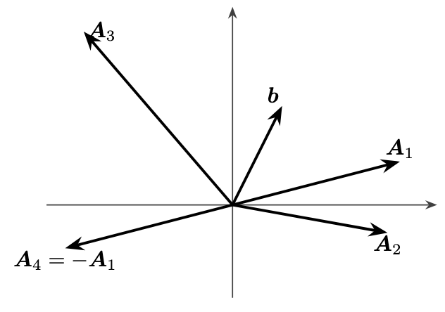</a>

#### 5.2.4. Full row rank assumption

最后说明, 上述对于 <math xmlns="http://www.w3.org/1998/Math/MathML"><semantics><mrow><mstyle scriptlevel="0" displaystyle="true"><mi mathvariant="bold-italic">A</mi></mstyle></mrow><annotation encoding="application/x-tex">\displaystyle \bm{A}</annotation></semantics></math>A 的行满秩假设是 wlog 的. 只要 <math xmlns="http://www.w3.org/1998/Math/MathML"><semantics><mrow><mstyle scriptlevel="0" displaystyle="true"><mi mathvariant="script">P</mi></mstyle></mrow><annotation encoding="application/x-tex">\displaystyle \mathcal{P}</annotation></semantics></math>P 是非空的 polyhedron, 则即使 <math xmlns="http://www.w3.org/1998/Math/MathML"><semantics><mrow><mstyle scriptlevel="0" displaystyle="true"><mi mathvariant="bold-italic">A</mi></mstyle></mrow><annotation encoding="application/x-tex">\displaystyle \bm{A}</annotation></semantics></math>A 不是行满秩的, 也可以直接丢弃冗余的行约束, 使得余下的约束是行满秩的, 而不改变 basic solution 的构造.

例如考虑约束:

<math xmlns="http://www.w3.org/1998/Math/MathML" display="block"><semantics><mtable rowspacing="0.25em" columnalign="right left" columnspacing="0em"><mtr><mtd><mstyle scriptlevel="0" displaystyle="true"><mrow><mn>2</mn><msub><mi>x</mi><mn>1</mn></msub><mo>+</mo><msub><mi>x</mi><mn>2</mn></msub><mo>+</mo><msub><mi>x</mi><mn>3</mn></msub></mrow></mstyle></mtd><mtd><mstyle scriptlevel="0" displaystyle="true"><mrow><mrow></mrow><mo>=</mo><mn>2</mn><mo separator="true">,</mo></mrow></mstyle></mtd></mtr><mtr><mtd><mstyle scriptlevel="0" displaystyle="true"><mrow><msub><mi>x</mi><mn>1</mn></msub><mo>+</mo><msub><mi>x</mi><mn>2</mn></msub></mrow></mstyle></mtd><mtd><mstyle scriptlevel="0" displaystyle="true"><mrow><mrow></mrow><mo>=</mo><mn>1</mn><mo separator="true">,</mo></mrow></mstyle></mtd></mtr><mtr><mtd><mstyle scriptlevel="0" displaystyle="true"><mrow><msub><mi>x</mi><mn>1</mn></msub><mo>+</mo><msub><mi>x</mi><mn>3</mn></msub></mrow></mstyle></mtd><mtd><mstyle scriptlevel="0" displaystyle="true"><mrow><mrow></mrow><mo>=</mo><mn>1</mn><mo separator="true">,</mo></mrow></mstyle></mtd></mtr><mtr><mtd><mstyle scriptlevel="0" displaystyle="true"><mrow><msub><mi>x</mi><mn>1</mn></msub><mo separator="true">,</mo><msub><mi>x</mi><mn>2</mn></msub><mo separator="true">,</mo><msub><mi>x</mi><mn>3</mn></msub></mrow></mstyle></mtd><mtd><mstyle scriptlevel="0" displaystyle="true"><mrow><mrow></mrow><mo>≥</mo><mn>0.</mn></mrow></mstyle></mtd></mtr></mtable><annotation encoding="application/x-tex">
\begin{aligned}
  2x_1 + x_2 + x_3 &amp;= 2,\\
  x_1 + x_2 &amp;= 1,\\
  x_1 + x_3 &amp;= 1,\\
  x_1, x_2, x_3 &amp;\geq 0.
\end{aligned}
</annotation></semantics></math>2x1​+x2​+x3​x1​+x2​x1​+x3​x1​,x2​,x3​​=2,=1,=1,≥0.​

不难发现, 第一个约束是冗余的, 因为其可以由后两个约束线性组合得到. 丢弃第一个约束, 则剩下的约束是行满秩的, 且不改变 basic solution 的构造.

### 5.3. Degeneracy

#### 5.3.1. Basis and basic solution

考虑 basis matrix 和 basic solution 的关系, 可以发现: 一个 basis 只能对应一个 basic solution, 但一个 basic solution 可能对应多个 basis.

<ul><li>
对于标准形式 <math xmlns="http://www.w3.org/1998/Math/MathML"><semantics><mrow><mstyle scriptlevel="0" displaystyle="true"><mi mathvariant="script">P</mi></mstyle></mrow><annotation encoding="application/x-tex">\displaystyle \mathcal{P}</annotation></semantics></math>P, 通过上述的构造方法, 选择 <math xmlns="http://www.w3.org/1998/Math/MathML"><semantics><mrow><mstyle scriptlevel="0" displaystyle="true"><mi>m</mi></mstyle></mrow><annotation encoding="application/x-tex">\displaystyle m</annotation></semantics></math>m 个线性无关的列向量作为 basic columns 构造 <math xmlns="http://www.w3.org/1998/Math/MathML"><semantics><mrow><mstyle scriptlevel="0" displaystyle="true"><mi mathvariant="bold-italic">B</mi></mstyle></mrow><annotation encoding="application/x-tex">\displaystyle \bm{B}</annotation></semantics></math>B, 令其余 <math xmlns="http://www.w3.org/1998/Math/MathML"><semantics><mrow><mstyle scriptlevel="0" displaystyle="true"><mi>n</mi><mo>−</mo><mi>m</mi></mstyle></mrow><annotation encoding="application/x-tex">\displaystyle n-m</annotation></semantics></math>n−m 个对应的 <math xmlns="http://www.w3.org/1998/Math/MathML"><semantics><mrow><mstyle scriptlevel="0" displaystyle="true"><msub><mi mathvariant="bold-italic">x</mi><mi>N</mi></msub><mo>=</mo><mn>0</mn></mstyle></mrow><annotation encoding="application/x-tex">\displaystyle \bm{x}_N = 0</annotation></semantics></math>xN​=0, 则可以求解 <math xmlns="http://www.w3.org/1998/Math/MathML"><semantics><mrow><mstyle scriptlevel="0" displaystyle="true"><msub><mi mathvariant="bold-italic">x</mi><mi>B</mi></msub><mo>=</mo><msup><mi mathvariant="bold-italic">B</mi><mrow><mo>−</mo><mn>1</mn></mrow></msup><mi mathvariant="bold-italic">b</mi></mstyle></mrow><annotation encoding="application/x-tex">\displaystyle \bm{x}_B = \bm{B}^{-1}\bm{b}</annotation></semantics></math>xB​=B−1b 得到 basic solution <math xmlns="http://www.w3.org/1998/Math/MathML"><semantics><mrow><mstyle scriptlevel="0" displaystyle="true"><mi mathvariant="bold-italic">x</mi><mo>=</mo><mo stretchy="false">[</mo><msub><mi mathvariant="bold-italic">x</mi><mi>B</mi></msub><mo separator="true">;</mo><msub><mi mathvariant="bold-italic">x</mi><mi>N</mi></msub><mo stretchy="false">]</mo></mstyle></mrow><annotation encoding="application/x-tex">\displaystyle \bm{x} = [\bm{x}_B; \bm{x}_N]</annotation></semantics></math>x=[xB​;xN​]. 由于 <math xmlns="http://www.w3.org/1998/Math/MathML"><semantics><mrow><mstyle scriptlevel="0" displaystyle="true"><mi mathvariant="bold-italic">B</mi></mstyle></mrow><annotation encoding="application/x-tex">\displaystyle \bm{B}</annotation></semantics></math>B 是非奇异的, 故 <math xmlns="http://www.w3.org/1998/Math/MathML"><semantics><mrow><mstyle scriptlevel="0" displaystyle="true"><msub><mi mathvariant="bold-italic">x</mi><mi>B</mi></msub></mstyle></mrow><annotation encoding="application/x-tex">\displaystyle \bm{x}_B</annotation></semantics></math>xB​ 是唯一的.
</li><li>
然而反过来, 可能存在多个不同的 basis 对应同一个 basic solution. 这是因为, 在求解 <math xmlns="http://www.w3.org/1998/Math/MathML"><semantics><mrow><mstyle scriptlevel="0" displaystyle="true"><msub><mi mathvariant="bold-italic">x</mi><mi>B</mi></msub><mo>=</mo><msup><mi mathvariant="bold-italic">B</mi><mrow><mo>−</mo><mn>1</mn></mrow></msup><mi mathvariant="bold-italic">b</mi></mstyle></mrow><annotation encoding="application/x-tex">\displaystyle \bm{x}_B = \bm{B}^{-1}\bm{b}</annotation></semantics></math>xB​=B−1b 时, 可能存在某些 <math xmlns="http://www.w3.org/1998/Math/MathML"><semantics><mrow><mstyle scriptlevel="0" displaystyle="true"><msub><mi mathvariant="bold-italic">x</mi><mi>B</mi></msub></mstyle></mrow><annotation encoding="application/x-tex">\displaystyle \bm{x}_B</annotation></semantics></math>xB​ 的分量为 <math xmlns="http://www.w3.org/1998/Math/MathML"><semantics><mrow><mstyle scriptlevel="0" displaystyle="true"><mn>0</mn></mstyle></mrow><annotation encoding="application/x-tex">\displaystyle 0</annotation></semantics></math>0. 而这些分量为 <math xmlns="http://www.w3.org/1998/Math/MathML"><semantics><mrow><mstyle scriptlevel="0" displaystyle="true"><mn>0</mn></mstyle></mrow><annotation encoding="application/x-tex">\displaystyle 0</annotation></semantics></math>0 的 basic variables, 也可以被视为 non-basic variables, 从而可以选择不同的 basic columns 来构造不同的 basis. 这就是 degeneracy 的来源.
</li></ul>

例如考虑 <math xmlns="http://www.w3.org/1998/Math/MathML"><semantics><mrow><mstyle scriptlevel="0" displaystyle="true"><msup><mi mathvariant="double-struck">R</mi><mn>3</mn></msup></mstyle></mrow><annotation encoding="application/x-tex">\displaystyle \mathbb{R}^3</annotation></semantics></math>R3 空间中的如下两个约束:

<math xmlns="http://www.w3.org/1998/Math/MathML" display="block"><semantics><mrow><mo fence="true">{</mo><mtable rowspacing="0.36em" columnalign="left left" columnspacing="1em"><mtr><mtd><mstyle scriptlevel="0" displaystyle="false"><mrow><msub><mi>x</mi><mn>1</mn></msub><mo>+</mo><msub><mi>x</mi><mn>3</mn></msub></mrow></mstyle></mtd><mtd><mstyle scriptlevel="0" displaystyle="false"><mrow><mo>=</mo><mn>1</mn><mo separator="true">,</mo></mrow></mstyle></mtd></mtr><mtr><mtd><mstyle scriptlevel="0" displaystyle="false"><mrow><msub><mi>x</mi><mn>2</mn></msub><mo>+</mo><msub><mi>x</mi><mn>3</mn></msub></mrow></mstyle></mtd><mtd><mstyle scriptlevel="0" displaystyle="false"><mrow><mo>=</mo><mn>0.</mn></mrow></mstyle></mtd></mtr></mtable></mrow><annotation encoding="application/x-tex">
\begin{cases}
  x_1 + x_3 &amp;= 1,\\
  x_2 + x_3 &amp;= 0.
\end{cases}
</annotation></semantics></math>{x1​+x3​x2​+x3​​=1,=0.​

则对应的 <math xmlns="http://www.w3.org/1998/Math/MathML"><semantics><mrow><mstyle scriptlevel="0" displaystyle="true"><msub><mi mathvariant="bold-italic">A</mi><mn>1</mn></msub><mo>=</mo><mo stretchy="false">(</mo><mn>1</mn><mo separator="true">,</mo><mn>0</mn><msup><mo stretchy="false">)</mo><mi mathvariant="normal">⊤</mi></msup></mstyle></mrow><annotation encoding="application/x-tex">\displaystyle \bm{A}_1 = (1, 0)^\top</annotation></semantics></math>A1​=(1,0)⊤, <math xmlns="http://www.w3.org/1998/Math/MathML"><semantics><mrow><mstyle scriptlevel="0" displaystyle="true"><msub><mi mathvariant="bold-italic">A</mi><mn>2</mn></msub><mo>=</mo><mo stretchy="false">(</mo><mn>0</mn><mo separator="true">,</mo><mn>1</mn><msup><mo stretchy="false">)</mo><mi mathvariant="normal">⊤</mi></msup></mstyle></mrow><annotation encoding="application/x-tex">\displaystyle \bm{A}_2 = (0, 1)^\top</annotation></semantics></math>A2​=(0,1)⊤, <math xmlns="http://www.w3.org/1998/Math/MathML"><semantics><mrow><mstyle scriptlevel="0" displaystyle="true"><msub><mi mathvariant="bold-italic">A</mi><mn>3</mn></msub><mo>=</mo><mo stretchy="false">(</mo><mn>1</mn><mo separator="true">,</mo><mn>1</mn><msup><mo stretchy="false">)</mo><mi mathvariant="normal">⊤</mi></msup></mstyle></mrow><annotation encoding="application/x-tex">\displaystyle \bm{A}_3 = (1, 1)^\top</annotation></semantics></math>A3​=(1,1)⊤, <math xmlns="http://www.w3.org/1998/Math/MathML"><semantics><mrow><mstyle scriptlevel="0" displaystyle="true"><mi mathvariant="bold-italic">b</mi><mo>=</mo><mo stretchy="false">(</mo><mn>1</mn><mo separator="true">,</mo><mn>0</mn><msup><mo stretchy="false">)</mo><mi mathvariant="normal">⊤</mi></msup></mstyle></mrow><annotation encoding="application/x-tex">\displaystyle \bm{b} = (1, 0)^\top</annotation></semantics></math>b=(1,0)⊤.

<ul><li>
若选择 <math xmlns="http://www.w3.org/1998/Math/MathML"><semantics><mrow><mstyle scriptlevel="0" displaystyle="true"><msub><mi mathvariant="bold-italic">A</mi><mn>1</mn></msub><mo separator="true">,</mo><msub><mi mathvariant="bold-italic">A</mi><mn>2</mn></msub></mstyle></mrow><annotation encoding="application/x-tex">\displaystyle \bm{A}_1, \bm{A}_2</annotation></semantics></math>A1​,A2​ 作为 basic columns, 则 <math xmlns="http://www.w3.org/1998/Math/MathML"><semantics><mrow><mstyle scriptlevel="0" displaystyle="true"><msub><mi mathvariant="bold-italic">B</mi><mn>1</mn></msub><mo>=</mo><mrow><mo fence="true">(</mo><mtable rowspacing="0.16em" columnalign="center center" columnspacing="1em"><mtr><mtd><mstyle scriptlevel="0" displaystyle="false"><mn>1</mn></mstyle></mtd><mtd><mstyle scriptlevel="0" displaystyle="false"><mn>0</mn></mstyle></mtd></mtr><mtr><mtd><mstyle scriptlevel="0" displaystyle="false"><mn>0</mn></mstyle></mtd><mtd><mstyle scriptlevel="0" displaystyle="false"><mn>1</mn></mstyle></mtd></mtr></mtable><mo fence="true">)</mo></mrow></mstyle></mrow><annotation encoding="application/x-tex">\displaystyle \bm{B}_1 = \begin{pmatrix} 1 &amp; 0 \\ 0 &amp; 1 \end{pmatrix}</annotation></semantics></math>B1​=(10​01​), 则 <math xmlns="http://www.w3.org/1998/Math/MathML"><semantics><mrow><mstyle scriptlevel="0" displaystyle="true"><msub><mi mathvariant="bold-italic">x</mi><mi>B</mi></msub><mo>=</mo><msubsup><mi mathvariant="bold-italic">B</mi><mn>1</mn><mrow><mo>−</mo><mn>1</mn></mrow></msubsup><mi mathvariant="bold-italic">b</mi><mo>=</mo><mo stretchy="false">(</mo><mn>1</mn><mo separator="true">,</mo><mn>0</mn><msup><mo stretchy="false">)</mo><mi mathvariant="normal">⊤</mi></msup></mstyle></mrow><annotation encoding="application/x-tex">\displaystyle \bm{x}_B = \bm{B}_1^{-1} \bm{b} = (1, 0)^\top</annotation></semantics></math>xB​=B1−1​b=(1,0)⊤, 对应的 basic solution 为 <math xmlns="http://www.w3.org/1998/Math/MathML"><semantics><mrow><mstyle scriptlevel="0" displaystyle="true"><mi mathvariant="bold-italic">x</mi><mo>=</mo><mo stretchy="false">(</mo><mn>1</mn><mo separator="true">,</mo><mn>0</mn><mo separator="true">,</mo><mn>0</mn><msup><mo stretchy="false">)</mo><mi mathvariant="normal">⊤</mi></msup></mstyle></mrow><annotation encoding="application/x-tex">\displaystyle \bm{x} = (1, 0, 0)^\top</annotation></semantics></math>x=(1,0,0)⊤.
</li><li>
若选择 <math xmlns="http://www.w3.org/1998/Math/MathML"><semantics><mrow><mstyle scriptlevel="0" displaystyle="true"><msub><mi mathvariant="bold-italic">A</mi><mn>1</mn></msub><mo separator="true">,</mo><msub><mi mathvariant="bold-italic">A</mi><mn>3</mn></msub></mstyle></mrow><annotation encoding="application/x-tex">\displaystyle \bm{A}_1, \bm{A}_3</annotation></semantics></math>A1​,A3​ 作为 basic columns, 则 <math xmlns="http://www.w3.org/1998/Math/MathML"><semantics><mrow><mstyle scriptlevel="0" displaystyle="true"><msub><mi mathvariant="bold-italic">B</mi><mn>2</mn></msub><mo>=</mo><mrow><mo fence="true">(</mo><mtable rowspacing="0.16em" columnalign="center center" columnspacing="1em"><mtr><mtd><mstyle scriptlevel="0" displaystyle="false"><mn>1</mn></mstyle></mtd><mtd><mstyle scriptlevel="0" displaystyle="false"><mn>1</mn></mstyle></mtd></mtr><mtr><mtd><mstyle scriptlevel="0" displaystyle="false"><mn>0</mn></mstyle></mtd><mtd><mstyle scriptlevel="0" displaystyle="false"><mn>1</mn></mstyle></mtd></mtr></mtable><mo fence="true">)</mo></mrow></mstyle></mrow><annotation encoding="application/x-tex">\displaystyle \bm{B}_2 = \begin{pmatrix} 1 &amp; 1 \\ 0 &amp; 1 \end{pmatrix}</annotation></semantics></math>B2​=(10​11​), 则 <math xmlns="http://www.w3.org/1998/Math/MathML"><semantics><mrow><mstyle scriptlevel="0" displaystyle="true"><msub><mi mathvariant="bold-italic">x</mi><mi>B</mi></msub><mo>=</mo><msubsup><mi mathvariant="bold-italic">B</mi><mn>2</mn><mrow><mo>−</mo><mn>1</mn></mrow></msubsup><mi mathvariant="bold-italic">b</mi><mo>=</mo><mo stretchy="false">(</mo><mn>1</mn><mo separator="true">,</mo><mn>0</mn><msup><mo stretchy="false">)</mo><mi mathvariant="normal">⊤</mi></msup></mstyle></mrow><annotation encoding="application/x-tex">\displaystyle \bm{x}_B = \bm{B}_2^{-1} \bm{b} = (1, 0)^\top</annotation></semantics></math>xB​=B2−1​b=(1,0)⊤, 对应的 basic solution 为 <math xmlns="http://www.w3.org/1998/Math/MathML"><semantics><mrow><mstyle scriptlevel="0" displaystyle="true"><mi mathvariant="bold-italic">x</mi><mo>=</mo><mo stretchy="false">(</mo><mn>1</mn><mo separator="true">,</mo><mn>0</mn><mo separator="true">,</mo><mn>0</mn><msup><mo stretchy="false">)</mo><mi mathvariant="normal">⊤</mi></msup></mstyle></mrow><annotation encoding="application/x-tex">\displaystyle \bm{x} = (1, 0, 0)^\top</annotation></semantics></math>x=(1,0,0)⊤.
</li></ul>

#### 5.3.2. Degeneracy
<section class="latex-block latex-definition" id="latex-defblock-5-3-1" aria-label="Definition 5.3.1">
Definition 5.3.1　Degeneracy

回顾, 点 <math xmlns="http://www.w3.org/1998/Math/MathML"><semantics><mrow><mstyle scriptlevel="0" displaystyle="true"><msup><mi mathvariant="bold-italic">x</mi><mo>∗</mo></msup><mo>∈</mo><msup><mi mathvariant="double-struck">R</mi><mi>n</mi></msup></mstyle></mrow><annotation encoding="application/x-tex">\displaystyle \bm{x}^* \in \mathbb{R}^n</annotation></semantics></math>x∗∈Rn 是 basic solution, 当且仅当其满足所有的等式约束, 且在这个点处存在 <math xmlns="http://www.w3.org/1998/Math/MathML"><semantics><mrow><mstyle scriptlevel="0" displaystyle="true"><mi>n</mi></mstyle></mrow><annotation encoding="application/x-tex">\displaystyle n</annotation></semantics></math>n 个线性无关的 active constraints.

此时, <strong>若实际 active 的约束数大于 <math xmlns="http://www.w3.org/1998/Math/MathML"><semantics><mrow><mstyle scriptlevel="0" displaystyle="true"><mi>n</mi></mstyle></mrow><annotation encoding="application/x-tex">\displaystyle n</annotation></semantics></math>n, 则称 <math xmlns="http://www.w3.org/1998/Math/MathML"><semantics><mrow><mstyle scriptlevel="0" displaystyle="true"><msup><mi mathvariant="bold-italic">x</mi><mo>∗</mo></msup></mstyle></mrow><annotation encoding="application/x-tex">\displaystyle \bm{x}^*</annotation></semantics></math>x∗ 是 degenerate basic solution.</strong> 因为在 <math xmlns="http://www.w3.org/1998/Math/MathML"><semantics><mrow><mstyle scriptlevel="0" displaystyle="true"><msup><mi mathvariant="double-struck">R</mi><mi>n</mi></msup></mstyle></mrow><annotation encoding="application/x-tex">\displaystyle \mathbb{R}^n</annotation></semantics></math>Rn 空间中, 最多只有 <math xmlns="http://www.w3.org/1998/Math/MathML"><semantics><mrow><mstyle scriptlevel="0" displaystyle="true"><mi>n</mi></mstyle></mrow><annotation encoding="application/x-tex">\displaystyle n</annotation></semantics></math>n 个线性无关的约束, 因此当活跃的约束数大于 <math xmlns="http://www.w3.org/1998/Math/MathML"><semantics><mrow><mstyle scriptlevel="0" displaystyle="true"><mi>n</mi></mstyle></mrow><annotation encoding="application/x-tex">\displaystyle n</annotation></semantics></math>n 时, 必然存在冗余的约束, 也即存在某些约束是线性相关的. 这就导致了 degeneracy 的出现.
</section>
<section class="latex-block latex-proposition" id="latex-propositionblock-5-3-1" aria-label="Proposition 5.3.1">
Proposition 5.3.1　Degeneracy

故可以总结如下:

<ol><li>
在一般形式下, basic solution <math xmlns="http://www.w3.org/1998/Math/MathML"><semantics><mrow><mstyle scriptlevel="0" displaystyle="true"><mi mathvariant="bold-italic">x</mi><mo>∈</mo><msup><mi mathvariant="double-struck">R</mi><mi>n</mi></msup></mstyle></mrow><annotation encoding="application/x-tex">\displaystyle \bm{x} \in \mathbb{R}^n</annotation></semantics></math>x∈Rn 是 degenerate 的, 当且仅当其对应的 active constraints 的数量大于 <math xmlns="http://www.w3.org/1998/Math/MathML"><semantics><mrow><mstyle scriptlevel="0" displaystyle="true"><mi>n</mi></mstyle></mrow><annotation encoding="application/x-tex">\displaystyle n</annotation></semantics></math>n.
</li><li>
在标准形式下, 一个 basic solution <math xmlns="http://www.w3.org/1998/Math/MathML"><semantics><mrow><mstyle scriptlevel="0" displaystyle="true"><msup><mi mathvariant="bold-italic">x</mi><mo>∗</mo></msup></mstyle></mrow><annotation encoding="application/x-tex">\displaystyle \bm{x}^*</annotation></semantics></math>x∗ 是 degenerate 的, 当且仅当其对应的 basic variables 中有至少一个为 <math xmlns="http://www.w3.org/1998/Math/MathML"><semantics><mrow><mstyle scriptlevel="0" displaystyle="true"><mn>0</mn></mstyle></mrow><annotation encoding="application/x-tex">\displaystyle 0</annotation></semantics></math>0. 也即, 若 <math xmlns="http://www.w3.org/1998/Math/MathML"><semantics><mrow><mstyle scriptlevel="0" displaystyle="true"><msup><mi mathvariant="bold-italic">x</mi><mo>∗</mo></msup></mstyle></mrow><annotation encoding="application/x-tex">\displaystyle \bm{x}^*</annotation></semantics></math>x∗ 中 <math xmlns="http://www.w3.org/1998/Math/MathML"><semantics><mrow><mstyle scriptlevel="0" displaystyle="true"><mn>0</mn></mstyle></mrow><annotation encoding="application/x-tex">\displaystyle 0</annotation></semantics></math>0 的分量数大于 <math xmlns="http://www.w3.org/1998/Math/MathML"><semantics><mrow><mstyle scriptlevel="0" displaystyle="true"><mi>n</mi><mo>−</mo><mi>m</mi></mstyle></mrow><annotation encoding="application/x-tex">\displaystyle n-m</annotation></semantics></math>n−m (即非 basic variables 的数量).
</li><li>
退化可能导致多个不同的 basis 对应同一个 basic solution (但不必然).
</li></ol></section>

此外指出, 退化和 feasibility 没有必然联系.

如下图 <math xmlns="http://www.w3.org/1998/Math/MathML"><semantics><mrow><mstyle scriptlevel="0" displaystyle="true"><mi>B</mi></mstyle></mrow><annotation encoding="application/x-tex">\displaystyle B</annotation></semantics></math>B 点所示, 在该点有 3 个 active constraints, 但其所在的空间是 <math xmlns="http://www.w3.org/1998/Math/MathML"><semantics><mrow><mstyle scriptlevel="0" displaystyle="true"><msup><mi mathvariant="double-struck">R</mi><mn>2</mn></msup></mstyle></mrow><annotation encoding="application/x-tex">\displaystyle \mathbb{R}^2</annotation></semantics></math>R2, 因此是 degenerate basic solution.

如果 <math xmlns="http://www.w3.org/1998/Math/MathML"><semantics><mrow><mstyle scriptlevel="0" displaystyle="true"><mi mathvariant="bold-italic">A</mi><mo separator="true">,</mo><mi mathvariant="bold-italic">b</mi></mstyle></mrow><annotation encoding="application/x-tex">\displaystyle \bm{A}, \bm{b}</annotation></semantics></math>A,b 是随机生成的, 则这种精确共线导致的 degeneracy 几乎不会发生. 但在实际问题中, 由于约束的特殊结构, 如一些现实的资源约束等, degeneracy 是很常见的.

此外, 退化并不是单纯由几何决定的. 同一个 polyhedron, 其不同的表示方式可能会导致不同的 degeneracy. 例如, 对于二维空间的第一象限 <math xmlns="http://www.w3.org/1998/Math/MathML"><semantics><mrow><mstyle scriptlevel="0" displaystyle="true"><mi mathvariant="script">P</mi><mo>:</mo><mo>=</mo><mo stretchy="false">{</mo><mo stretchy="false">(</mo><msub><mi>x</mi><mn>1</mn></msub><mo separator="true">,</mo><msub><mi>x</mi><mn>2</mn></msub><mo stretchy="false">)</mo><mo>:</mo><msub><mi>x</mi><mn>1</mn></msub><mo>≥</mo><mn>0</mn><mo separator="true">,</mo><msub><mi>x</mi><mn>2</mn></msub><mo>≥</mo><mn>0</mn><mo stretchy="false">}</mo></mstyle></mrow><annotation encoding="application/x-tex">\displaystyle \mathcal{P} := \{(x_1, x_2): x_1 \geq 0, x_2 \geq 0\}</annotation></semantics></math>P:={(x1​,x2​):x1​≥0,x2​≥0}, 若如此表示则原点 <math xmlns="http://www.w3.org/1998/Math/MathML"><semantics><mrow><mstyle scriptlevel="0" displaystyle="true"><mo stretchy="false">(</mo><mn>0</mn><mo separator="true">,</mo><mn>0</mn><mo stretchy="false">)</mo></mstyle></mrow><annotation encoding="application/x-tex">\displaystyle (0, 0)</annotation></semantics></math>(0,0) 是非退化的 BFS; 但若将其表示为 <math xmlns="http://www.w3.org/1998/Math/MathML"><semantics><mrow><mstyle scriptlevel="0" displaystyle="true"><mi mathvariant="script">P</mi><mo>:</mo><mo>=</mo><mo stretchy="false">{</mo><mo stretchy="false">(</mo><msub><mi>x</mi><mn>1</mn></msub><mo separator="true">,</mo><msub><mi>x</mi><mn>2</mn></msub><mo stretchy="false">)</mo><mo>:</mo><msub><mi>x</mi><mn>1</mn></msub><mo>≥</mo><mn>0</mn><mo separator="true">,</mo><msub><mi>x</mi><mn>2</mn></msub><mo>≥</mo><mn>0</mn><mo separator="true">,</mo><msub><mi>x</mi><mn>1</mn></msub><mo>+</mo><msub><mi>x</mi><mn>2</mn></msub><mo>≥</mo><mn>0</mn><mo stretchy="false">}</mo></mstyle></mrow><annotation encoding="application/x-tex">\displaystyle \mathcal{P} := \{(x_1, x_2): x_1 \geq 0, x_2 \geq 0, x_1 + x_2 \geq 0\}</annotation></semantics></math>P:={(x1​,x2​):x1​≥0,x2​≥0,x1​+x2​≥0}, 则原点 <math xmlns="http://www.w3.org/1998/Math/MathML"><semantics><mrow><mstyle scriptlevel="0" displaystyle="true"><mo stretchy="false">(</mo><mn>0</mn><mo separator="true">,</mo><mn>0</mn><mo stretchy="false">)</mo></mstyle></mrow><annotation encoding="application/x-tex">\displaystyle (0, 0)</annotation></semantics></math>(0,0) 是退化的 BFS.

### 5.4. Existence of extreme points

在之前的讨论中, 我们已知对于可行点 <math xmlns="http://www.w3.org/1998/Math/MathML"><semantics><mrow><mstyle scriptlevel="0" displaystyle="true"><mi mathvariant="bold-italic">x</mi><mo>∈</mo><msup><mi mathvariant="double-struck">R</mi><mi>n</mi></msup></mstyle></mrow><annotation encoding="application/x-tex">\displaystyle \bm{x} \in \mathbb{R}^n</annotation></semantics></math>x∈Rn, <math xmlns="http://www.w3.org/1998/Math/MathML"><semantics><mrow><mstyle scriptlevel="0" displaystyle="true"><mi mathvariant="bold-italic">x</mi></mstyle></mrow><annotation encoding="application/x-tex">\displaystyle \bm{x}</annotation></semantics></math>x 是 extreme point 当且仅当其是 basic feasible solution, 当且仅当在 <math xmlns="http://www.w3.org/1998/Math/MathML"><semantics><mrow><mstyle scriptlevel="0" displaystyle="true"><mi mathvariant="bold-italic">x</mi></mstyle></mrow><annotation encoding="application/x-tex">\displaystyle \bm{x}</annotation></semantics></math>x 处有 <math xmlns="http://www.w3.org/1998/Math/MathML"><semantics><mrow><mstyle scriptlevel="0" displaystyle="true"><mi>n</mi></mstyle></mrow><annotation encoding="application/x-tex">\displaystyle n</annotation></semantics></math>n 个线性无关的 active constraints (或 active constraints 的 normal vectors 张成 <math xmlns="http://www.w3.org/1998/Math/MathML"><semantics><mrow><mstyle scriptlevel="0" displaystyle="true"><msup><mi mathvariant="double-struck">R</mi><mi>n</mi></msup></mstyle></mrow><annotation encoding="application/x-tex">\displaystyle \mathbb{R}^n</annotation></semantics></math>Rn).

上述都是对于一个给定点 <math xmlns="http://www.w3.org/1998/Math/MathML"><semantics><mrow><mstyle scriptlevel="0" displaystyle="true"><mi mathvariant="bold-italic">x</mi></mstyle></mrow><annotation encoding="application/x-tex">\displaystyle \bm{x}</annotation></semantics></math>x 的讨论. 下面我们讨论, 对于一个给定的 polyhedron <math xmlns="http://www.w3.org/1998/Math/MathML"><semantics><mrow><mstyle scriptlevel="0" displaystyle="true"><mi mathvariant="script">P</mi></mstyle></mrow><annotation encoding="application/x-tex">\displaystyle \mathcal{P}</annotation></semantics></math>P, 是否一定存在这样的 extreme point. 要意识到并不是所有的 polyhedron 都有 extreme points. 例如, 考虑半平面 <math xmlns="http://www.w3.org/1998/Math/MathML"><semantics><mrow><mstyle scriptlevel="0" displaystyle="true"><mi mathvariant="script">P</mi><mo>=</mo><mo stretchy="false">{</mo><mo stretchy="false">(</mo><msub><mi>x</mi><mn>1</mn></msub><mo separator="true">,</mo><msub><mi>x</mi><mn>2</mn></msub><mo stretchy="false">)</mo><mo>:</mo><msub><mi>x</mi><mn>1</mn></msub><mo>≥</mo><mn>0</mn><mo stretchy="false">}</mo></mstyle></mrow><annotation encoding="application/x-tex">\displaystyle \mathcal{P} = \{(x_1, x_2): x_1 \geq 0\}</annotation></semantics></math>P={(x1​,x2​):x1​≥0}, 其包含一整条完整的直线, 是没有 extreme points 的.

<section class="latex-block latex-theorem" id="latex-thmblock-5-4-1" aria-label="Theorem 5.4.1">
Theorem 5.4.1　Existence of extreme points

给定 polyhedron <math xmlns="http://www.w3.org/1998/Math/MathML"><semantics><mrow><mstyle scriptlevel="0" displaystyle="true"><mi mathvariant="script">P</mi><mo>=</mo><mo stretchy="false">{</mo><mi mathvariant="bold-italic">x</mi><mo>∈</mo><msup><mi mathvariant="double-struck">R</mi><mi>n</mi></msup><mo>:</mo><msubsup><mi mathvariant="bold-italic">a</mi><mi>i</mi><mi mathvariant="normal">⊤</mi></msubsup><mi mathvariant="bold-italic">x</mi><mo>≥</mo><msub><mi>b</mi><mi>i</mi></msub><mo separator="true">,</mo><mtext> </mtext><mi>i</mi><mo>=</mo><mn>1</mn><mo separator="true">,</mo><mo>…</mo><mo separator="true">,</mo><mi>m</mi><mo stretchy="false">}</mo><mo mathvariant="normal">≠</mo><mi mathvariant="normal">∅</mi></mstyle></mrow><annotation encoding="application/x-tex">\displaystyle \mathcal{P} = \{\bm{x} \in \mathbb{R}^n: \bm{a}_i^\top \bm{x} \geq b_i,~ i=1,\dots,m\} \neq \varnothing</annotation></semantics></math>P={x∈Rn:ai⊤​x≥bi​, i=1,…,m}=∅, 则如下三个条件等价:

<ol><li>
<math xmlns="http://www.w3.org/1998/Math/MathML"><semantics><mrow><mstyle scriptlevel="0" displaystyle="true"><mi mathvariant="script">P</mi></mstyle></mrow><annotation encoding="application/x-tex">\displaystyle \mathcal{P}</annotation></semantics></math>P 有至少一个 extreme point.
</li><li>
<math xmlns="http://www.w3.org/1998/Math/MathML"><semantics><mrow><mstyle scriptlevel="0" displaystyle="true"><mi mathvariant="script">P</mi></mstyle></mrow><annotation encoding="application/x-tex">\displaystyle \mathcal{P}</annotation></semantics></math>P 不包含一条完整的直线. 其中, <math xmlns="http://www.w3.org/1998/Math/MathML"><semantics><mrow><mstyle scriptlevel="0" displaystyle="true"><mi mathvariant="script">P</mi></mstyle></mrow><annotation encoding="application/x-tex">\displaystyle \mathcal{P}</annotation></semantics></math>P 包含一条完整的直线, 当且仅当存在 <math xmlns="http://www.w3.org/1998/Math/MathML"><semantics><mrow><mstyle scriptlevel="0" displaystyle="true"><mi mathvariant="bold-italic">d</mi><mo mathvariant="normal">≠</mo><mi mathvariant="bold">0</mi></mstyle></mrow><annotation encoding="application/x-tex">\displaystyle \bm{d} \neq \bm{0}</annotation></semantics></math>d=0 及 <math xmlns="http://www.w3.org/1998/Math/MathML"><semantics><mrow><mstyle scriptlevel="0" displaystyle="true"><mi mathvariant="bold-italic">x</mi><mo>∈</mo><mi mathvariant="script">P</mi></mstyle></mrow><annotation encoding="application/x-tex">\displaystyle \bm{x} \in \mathcal{P}</annotation></semantics></math>x∈P, 使得对于任意 <math xmlns="http://www.w3.org/1998/Math/MathML"><semantics><mrow><mstyle scriptlevel="0" displaystyle="true"><mi>λ</mi><mo>∈</mo><mi mathvariant="double-struck">R</mi></mstyle></mrow><annotation encoding="application/x-tex">\displaystyle \lambda \in \mathbb{R}</annotation></semantics></math>λ∈R, 有 <math xmlns="http://www.w3.org/1998/Math/MathML"><semantics><mrow><mstyle scriptlevel="0" displaystyle="true"><mi mathvariant="bold-italic">x</mi><mo>+</mo><mi>λ</mi><mi mathvariant="bold-italic">d</mi><mo>∈</mo><mi mathvariant="script">P</mi></mstyle></mrow><annotation encoding="application/x-tex">\displaystyle \bm{x} + \lambda \bm{d} \in \mathcal{P}</annotation></semantics></math>x+λd∈P.
</li><li>
<math xmlns="http://www.w3.org/1998/Math/MathML"><semantics><mrow><mstyle scriptlevel="0" displaystyle="true"><mi mathvariant="normal">span</mi><mo>⁡</mo><mo stretchy="false">{</mo><msub><mi mathvariant="bold-italic">a</mi><mn>1</mn></msub><mo separator="true">,</mo><mo>…</mo><mo separator="true">,</mo><msub><mi mathvariant="bold-italic">a</mi><mi>m</mi></msub><mo stretchy="false">}</mo><mo>=</mo><msup><mi mathvariant="double-struck">R</mi><mi>n</mi></msup></mstyle></mrow><annotation encoding="application/x-tex">\displaystyle \operatorname{span}\{\bm{a}_1, \dots, \bm{a}_m\} = \mathbb{R}^n</annotation></semantics></math>span{a1​,…,am​}=Rn. (<em>注意, 这里与判断某个点是 extreme point 的条件不同, 后者要求的是 active constraints 的 normal vectors 张成 <math xmlns="http://www.w3.org/1998/Math/MathML"><semantics><mrow><mstyle scriptlevel="0" displaystyle="true"><msup><mi mathvariant="double-struck">R</mi><mi>n</mi></msup></mstyle></mrow><annotation encoding="application/x-tex">\displaystyle \mathbb{R}^n</annotation></semantics></math>Rn, 而这里是所有约束的 normal vectors 张成 <math xmlns="http://www.w3.org/1998/Math/MathML"><semantics><mrow><mstyle scriptlevel="0" displaystyle="true"><msup><mi mathvariant="double-struck">R</mi><mi>n</mi></msup></mstyle></mrow><annotation encoding="application/x-tex">\displaystyle \mathbb{R}^n</annotation></semantics></math>Rn.</em>)
</li></ol></section>

Proof.

<strong><math xmlns="http://www.w3.org/1998/Math/MathML"><semantics><mrow><mstyle scriptlevel="0" displaystyle="true"><mo stretchy="false">(</mo><mn>2</mn><mo stretchy="false">)</mo><mtext>  </mtext><mo>⟹</mo><mtext>  </mtext><mo stretchy="false">(</mo><mn>1</mn><mo stretchy="false">)</mo></mstyle></mrow><annotation encoding="application/x-tex">\displaystyle (2) \implies (1)</annotation></semantics></math>(2)⟹(1)</strong>. 给定可行点 <math xmlns="http://www.w3.org/1998/Math/MathML"><semantics><mrow><mstyle scriptlevel="0" displaystyle="true"><mi mathvariant="bold-italic">x</mi><mo>∈</mo><mi mathvariant="script">P</mi></mstyle></mrow><annotation encoding="application/x-tex">\displaystyle \bm{x} \in \mathcal{P}</annotation></semantics></math>x∈P. 记 <math xmlns="http://www.w3.org/1998/Math/MathML"><semantics><mrow><mstyle scriptlevel="0" displaystyle="true"><mi mathvariant="script">I</mi><mo>=</mo><mo stretchy="false">{</mo><mi>i</mi><mo>:</mo><msubsup><mi mathvariant="bold-italic">a</mi><mi>i</mi><mi mathvariant="normal">⊤</mi></msubsup><mi mathvariant="bold-italic">x</mi><mo>=</mo><msub><mi>b</mi><mi>i</mi></msub><mo stretchy="false">}</mo></mstyle></mrow><annotation encoding="application/x-tex">\displaystyle \mathcal{I} = \{i: \bm{a}_i^\top \bm{x} = b_i\}</annotation></semantics></math>I={i:ai⊤​x=bi​} 为 <math xmlns="http://www.w3.org/1998/Math/MathML"><semantics><mrow><mstyle scriptlevel="0" displaystyle="true"><mi mathvariant="bold-italic">x</mi></mstyle></mrow><annotation encoding="application/x-tex">\displaystyle \bm{x}</annotation></semantics></math>x 的 active constraints, <math xmlns="http://www.w3.org/1998/Math/MathML"><semantics><mrow><mstyle scriptlevel="0" displaystyle="true"><mi>r</mi><mo>=</mo><mtext>dim</mtext><mo stretchy="false">(</mo><mtext>span</mtext><mo stretchy="false">{</mo><msub><mi mathvariant="bold-italic">a</mi><mi>i</mi></msub><mo>:</mo><mi>i</mi><mo>∈</mo><mi mathvariant="script">I</mi><mo stretchy="false">}</mo><mo stretchy="false">)</mo></mstyle></mrow><annotation encoding="application/x-tex">\displaystyle r = \text{dim}(\text{span}\{\bm{a}_i: i \in \mathcal{I}\})</annotation></semantics></math>r=dim(span{ai​:i∈I}).

<ul><li>
若 <math xmlns="http://www.w3.org/1998/Math/MathML"><semantics><mrow><mstyle scriptlevel="0" displaystyle="true"><mi>r</mi><mo>=</mo><mi>n</mi></mstyle></mrow><annotation encoding="application/x-tex">\displaystyle r = n</annotation></semantics></math>r=n, 则 <math xmlns="http://www.w3.org/1998/Math/MathML"><semantics><mrow><mstyle scriptlevel="0" displaystyle="true"><mi mathvariant="bold-italic">x</mi></mstyle></mrow><annotation encoding="application/x-tex">\displaystyle \bm{x}</annotation></semantics></math>x 是 extreme point, 命题成立.
</li><li>
若不然, <math xmlns="http://www.w3.org/1998/Math/MathML"><semantics><mrow><mstyle scriptlevel="0" displaystyle="true"><mi>r</mi><mo>&lt;</mo><mi>n</mi></mstyle></mrow><annotation encoding="application/x-tex">\displaystyle r&lt;n</annotation></semantics></math>r&lt;n, 即 active 的约束的 normal vector 只能张成一个低于 <math xmlns="http://www.w3.org/1998/Math/MathML"><semantics><mrow><mstyle scriptlevel="0" displaystyle="true"><mi>n</mi></mstyle></mrow><annotation encoding="application/x-tex">\displaystyle n</annotation></semantics></math>n 维的子空间. 此时在其正交补中一定存在非零向量 <math xmlns="http://www.w3.org/1998/Math/MathML"><semantics><mrow><mstyle scriptlevel="0" displaystyle="true"><mi mathvariant="bold-italic">d</mi><mo>∈</mo><msup><mi mathvariant="double-struck">R</mi><mi>n</mi></msup></mstyle></mrow><annotation encoding="application/x-tex">\displaystyle \bm{d} \in \mathbb{R}^n</annotation></semantics></math>d∈Rn, 使得 <math xmlns="http://www.w3.org/1998/Math/MathML"><semantics><mrow><mstyle scriptlevel="0" displaystyle="true"><msubsup><mi mathvariant="bold-italic">a</mi><mi>i</mi><mi mathvariant="normal">⊤</mi></msubsup><mi mathvariant="bold-italic">d</mi><mo>=</mo><mn>0</mn></mstyle></mrow><annotation encoding="application/x-tex">\displaystyle \bm{a}_i^\top \bm{d} = 0</annotation></semantics></math>ai⊤​d=0 对任意 <math xmlns="http://www.w3.org/1998/Math/MathML"><semantics><mrow><mstyle scriptlevel="0" displaystyle="true"><mi>i</mi><mo>∈</mo><mi mathvariant="script">I</mi></mstyle></mrow><annotation encoding="application/x-tex">\displaystyle i \in \mathcal{I}</annotation></semantics></math>i∈I 成立.

<ul><li>
因此, <strong>沿着 <math xmlns="http://www.w3.org/1998/Math/MathML"><semantics><mrow><mstyle scriptlevel="0" displaystyle="true"><mi mathvariant="bold-italic">d</mi></mstyle></mrow><annotation encoding="application/x-tex">\displaystyle \bm{d}</annotation></semantics></math>d 的方向任意移动, 已有的 active constraints 依然 active</strong>, 数学上即为, 对于 <math xmlns="http://www.w3.org/1998/Math/MathML"><semantics><mrow><mstyle scriptlevel="0" displaystyle="true"><mi mathvariant="bold-italic">y</mi><mo>=</mo><mi mathvariant="bold-italic">x</mi><mo>+</mo><mi>λ</mi><mi mathvariant="bold-italic">d</mi></mstyle></mrow><annotation encoding="application/x-tex">\displaystyle \bm{y} = \bm{x} + \lambda \bm{d}</annotation></semantics></math>y=x+λd, 有 <math xmlns="http://www.w3.org/1998/Math/MathML"><semantics><mrow><mstyle scriptlevel="0" displaystyle="true"><msubsup><mi mathvariant="bold-italic">a</mi><mi>i</mi><mi mathvariant="normal">⊤</mi></msubsup><mi mathvariant="bold-italic">y</mi><mo>=</mo><msubsup><mi mathvariant="bold-italic">a</mi><mi>i</mi><mi mathvariant="normal">⊤</mi></msubsup><mo stretchy="false">(</mo><mi mathvariant="bold-italic">x</mi><mo>+</mo><mi>λ</mi><mi mathvariant="bold-italic">d</mi><mo stretchy="false">)</mo><mo>=</mo><msub><mi>b</mi><mi>i</mi></msub></mstyle></mrow><annotation encoding="application/x-tex">\displaystyle \bm{a}_i^\top \bm{y} = \bm{a}_i^\top (\bm{x} + \lambda \bm{d}) = b_i</annotation></semantics></math>ai⊤​y=ai⊤​(x+λd)=bi​ 对任意 <math xmlns="http://www.w3.org/1998/Math/MathML"><semantics><mrow><mstyle scriptlevel="0" displaystyle="true"><mi>i</mi><mo>∈</mo><mi mathvariant="script">I</mi></mstyle></mrow><annotation encoding="application/x-tex">\displaystyle i \in \mathcal{I}</annotation></semantics></math>i∈I 成立.
</li><li>
对于非活跃约束 <math xmlns="http://www.w3.org/1998/Math/MathML"><semantics><mrow><mstyle scriptlevel="0" displaystyle="true"><mi>j</mi><mo mathvariant="normal">∉</mo><mi mathvariant="script">I</mi></mstyle></mrow><annotation encoding="application/x-tex">\displaystyle j \notin \mathcal{I}</annotation></semantics></math>j∈/I, 由于 <math xmlns="http://www.w3.org/1998/Math/MathML"><semantics><mrow><mstyle scriptlevel="0" displaystyle="true"><msub><mi mathvariant="bold-italic">s</mi><mi>j</mi></msub><mo>:</mo><mo>=</mo><msubsup><mi mathvariant="bold-italic">a</mi><mi>j</mi><mi mathvariant="normal">⊤</mi></msubsup><mi mathvariant="bold-italic">x</mi><mo>−</mo><msub><mi>b</mi><mi>j</mi></msub><mo>&gt;</mo><mn>0</mn></mstyle></mrow><annotation encoding="application/x-tex">\displaystyle \bm{s}_j := \bm{a}_j^\top \bm{x} - b_j &gt; 0</annotation></semantics></math>sj​:=aj⊤​x−bj​&gt;0, 故沿着 <math xmlns="http://www.w3.org/1998/Math/MathML"><semantics><mrow><mstyle scriptlevel="0" displaystyle="true"><mi mathvariant="bold-italic">d</mi></mstyle></mrow><annotation encoding="application/x-tex">\displaystyle \bm{d}</annotation></semantics></math>d 的方向移动, 只要距离 <math xmlns="http://www.w3.org/1998/Math/MathML"><semantics><mrow><mstyle scriptlevel="0" displaystyle="true"><mi>λ</mi></mstyle></mrow><annotation encoding="application/x-tex">\displaystyle \lambda</annotation></semantics></math>λ 足够小 (通过下式可以反推 <math xmlns="http://www.w3.org/1998/Math/MathML"><semantics><mrow><mstyle scriptlevel="0" displaystyle="true"><mi mathvariant="normal">∣</mi><mi>λ</mi><mi mathvariant="normal">∣</mi><mo>&lt;</mo><mfrac><msub><mi mathvariant="bold-italic">s</mi><mi>j</mi></msub><mrow><mn>2</mn><mi mathvariant="normal">∣</mi><msubsup><mi mathvariant="bold-italic">a</mi><mi>j</mi><mi mathvariant="normal">⊤</mi></msubsup><mi mathvariant="bold-italic">d</mi><mi mathvariant="normal">∣</mi></mrow></mfrac></mstyle></mrow><annotation encoding="application/x-tex">\displaystyle |\lambda| &lt; \frac{\bm{s}_j}{2|\bm{a}_j^\top \bm{d}|}</annotation></semantics></math>∣λ∣&lt;2∣aj⊤​d∣sj​​, 对 <math xmlns="http://www.w3.org/1998/Math/MathML"><semantics><mrow><mstyle scriptlevel="0" displaystyle="true"><msubsup><mi mathvariant="bold-italic">a</mi><mi>j</mi><mi mathvariant="normal">⊤</mi></msubsup><mi mathvariant="bold-italic">d</mi><mo mathvariant="normal">≠</mo><mn>0</mn></mstyle></mrow><annotation encoding="application/x-tex">\displaystyle \bm{a}_j^\top \bm{d} \neq 0</annotation></semantics></math>aj⊤​d=0; 若为零则无需限制), 就可以确保

<math xmlns="http://www.w3.org/1998/Math/MathML" display="block"><semantics><mrow><msubsup><mi mathvariant="bold-italic">a</mi><mi>j</mi><mi mathvariant="normal">⊤</mi></msubsup><mi mathvariant="bold-italic">y</mi><mo>−</mo><msub><mi>b</mi><mi>j</mi></msub><mo>=</mo><msubsup><mi mathvariant="bold-italic">a</mi><mi>j</mi><mi mathvariant="normal">⊤</mi></msubsup><mo stretchy="false">(</mo><mi mathvariant="bold-italic">x</mi><mo>+</mo><mi>λ</mi><mi mathvariant="bold-italic">d</mi><mo stretchy="false">)</mo><mo>−</mo><msub><mi>b</mi><mi>j</mi></msub><mo>=</mo><msub><mi mathvariant="bold-italic">s</mi><mi>j</mi></msub><mo>+</mo><mi>λ</mi><msubsup><mi mathvariant="bold-italic">a</mi><mi>j</mi><mi mathvariant="normal">⊤</mi></msubsup><mi mathvariant="bold-italic">d</mi><mo>&gt;</mo><mn>0.</mn></mrow><annotation encoding="application/x-tex">
  \bm{a}_j^\top \bm{y} - b_j = \bm{a}_j^\top (\bm{x} + \lambda \bm{d}) - b_j = \bm{s}_j + \lambda \bm{a}_j^\top \bm{d} &gt; 0.
</annotation></semantics></math>aj⊤​y−bj​=aj⊤​(x+λd)−bj​=sj​+λaj⊤​d&gt;0.

即, 沿着 <math xmlns="http://www.w3.org/1998/Math/MathML"><semantics><mrow><mstyle scriptlevel="0" displaystyle="true"><mi mathvariant="bold-italic">d</mi></mstyle></mrow><annotation encoding="application/x-tex">\displaystyle \bm{d}</annotation></semantics></math>d 的方向移动, 非活跃约束在小范围内依然保持非活跃.
</li></ul></li><li>
根据 (2) 中题设, 由于 <math xmlns="http://www.w3.org/1998/Math/MathML"><semantics><mrow><mstyle scriptlevel="0" displaystyle="true"><mi mathvariant="script">P</mi></mstyle></mrow><annotation encoding="application/x-tex">\displaystyle \mathcal{P}</annotation></semantics></math>P 不包含一条完整的直线, 故沿着 <math xmlns="http://www.w3.org/1998/Math/MathML"><semantics><mrow><mstyle scriptlevel="0" displaystyle="true"><mi mathvariant="bold-italic">d</mi></mstyle></mrow><annotation encoding="application/x-tex">\displaystyle \bm{d}</annotation></semantics></math>d 或 <math xmlns="http://www.w3.org/1998/Math/MathML"><semantics><mrow><mstyle scriptlevel="0" displaystyle="true"><mo>−</mo><mi mathvariant="bold-italic">d</mi></mstyle></mrow><annotation encoding="application/x-tex">\displaystyle -\bm{d}</annotation></semantics></math>−d 中至少一个方向移动一定会被阻挡, 即存在某位置 <math xmlns="http://www.w3.org/1998/Math/MathML"><semantics><mrow><mstyle scriptlevel="0" displaystyle="true"><msup><mi mathvariant="bold-italic">x</mi><mo mathvariant="normal" lspace="0em" rspace="0em">′</mo></msup><mo>:</mo><mo>=</mo><mi mathvariant="bold-italic">x</mi><mo>+</mo><msup><mi>λ</mi><mo>⋆</mo></msup><mi mathvariant="bold-italic">d</mi></mstyle></mrow><annotation encoding="application/x-tex">\displaystyle \bm{x}&#x27; := \bm{x} + \lambda^\star \bm{d}</annotation></semantics></math>x′:=x+λ⋆d, 使得恰好某个非活跃 <math xmlns="http://www.w3.org/1998/Math/MathML"><semantics><mrow><mstyle scriptlevel="0" displaystyle="true"><mi>k</mi></mstyle></mrow><annotation encoding="application/x-tex">\displaystyle k</annotation></semantics></math>k 约束变为活跃 (即 <math xmlns="http://www.w3.org/1998/Math/MathML"><semantics><mrow><mstyle scriptlevel="0" displaystyle="true"><msubsup><mi mathvariant="bold-italic">a</mi><mi>k</mi><mi mathvariant="normal">⊤</mi></msubsup><msup><mi mathvariant="bold-italic">x</mi><mo mathvariant="normal" lspace="0em" rspace="0em">′</mo></msup><mo>=</mo><msub><mi>b</mi><mi>k</mi></msub></mstyle></mrow><annotation encoding="application/x-tex">\displaystyle \bm{a}_k^\top \bm{x}&#x27; = b_k</annotation></semantics></math>ak⊤​x′=bk​, <math xmlns="http://www.w3.org/1998/Math/MathML"><semantics><mrow><mstyle scriptlevel="0" displaystyle="true"><msubsup><mi mathvariant="bold-italic">a</mi><mi>k</mi><mi mathvariant="normal">⊤</mi></msubsup><mi mathvariant="bold-italic">x</mi><mo>&gt;</mo><msub><mi>b</mi><mi>k</mi></msub></mstyle></mrow><annotation encoding="application/x-tex">\displaystyle \bm{a}_k^\top \bm{x} &gt; b_k</annotation></semantics></math>ak⊤​x&gt;bk​). 此时, <math xmlns="http://www.w3.org/1998/Math/MathML"><semantics><mrow><mstyle scriptlevel="0" displaystyle="true"><msubsup><mi mathvariant="bold-italic">a</mi><mi>k</mi><mi mathvariant="normal">⊤</mi></msubsup><msup><mi mathvariant="bold-italic">x</mi><mo mathvariant="normal" lspace="0em" rspace="0em">′</mo></msup><mo>=</mo><msubsup><mi mathvariant="bold-italic">a</mi><mi>k</mi><mi mathvariant="normal">⊤</mi></msubsup><mo stretchy="false">(</mo><mi mathvariant="bold-italic">x</mi><mo>+</mo><msup><mi>λ</mi><mo>⋆</mo></msup><mi mathvariant="bold-italic">d</mi><mo stretchy="false">)</mo><mo>=</mo><msub><mi>b</mi><mi>k</mi></msub></mstyle></mrow><annotation encoding="application/x-tex">\displaystyle \bm{a}_k^\top \bm{x}&#x27; = \bm{a}_k^\top (\bm{x} + \lambda^\star \bm{d}) = b_k</annotation></semantics></math>ak⊤​x′=ak⊤​(x+λ⋆d)=bk​, 故 <math xmlns="http://www.w3.org/1998/Math/MathML"><semantics><mrow><mstyle scriptlevel="0" displaystyle="true"><msup><mi>λ</mi><mo>⋆</mo></msup><msubsup><mi mathvariant="bold-italic">a</mi><mi>k</mi><mi mathvariant="normal">⊤</mi></msubsup><mi mathvariant="bold-italic">d</mi><mo>=</mo><msub><mi>b</mi><mi>k</mi></msub><mo>−</mo><msubsup><mi mathvariant="bold-italic">a</mi><mi>k</mi><mi mathvariant="normal">⊤</mi></msubsup><mi mathvariant="bold-italic">x</mi><mo mathvariant="normal">≠</mo><mn>0</mn></mstyle></mrow><annotation encoding="application/x-tex">\displaystyle \lambda^\star \bm{a}_k^\top \bm{d} = b_k - \bm{a}_k^\top \bm{x} \neq 0</annotation></semantics></math>λ⋆ak⊤​d=bk​−ak⊤​x=0, 故 <math xmlns="http://www.w3.org/1998/Math/MathML"><semantics><mrow><mstyle scriptlevel="0" displaystyle="true"><msubsup><mi mathvariant="bold-italic">a</mi><mi>k</mi><mi mathvariant="normal">⊤</mi></msubsup><mi mathvariant="bold-italic">d</mi><mo mathvariant="normal">≠</mo><mn>0</mn></mstyle></mrow><annotation encoding="application/x-tex">\displaystyle \bm{a}_k^\top \bm{d} \neq 0</annotation></semantics></math>ak⊤​d=0. 因此, <math xmlns="http://www.w3.org/1998/Math/MathML"><semantics><mrow><mstyle scriptlevel="0" displaystyle="true"><msub><mi mathvariant="bold-italic">a</mi><mi>k</mi></msub></mstyle></mrow><annotation encoding="application/x-tex">\displaystyle \bm{a}_k</annotation></semantics></math>ak​ 与 <math xmlns="http://www.w3.org/1998/Math/MathML"><semantics><mrow><mstyle scriptlevel="0" displaystyle="true"><mi mathvariant="bold-italic">d</mi></mstyle></mrow><annotation encoding="application/x-tex">\displaystyle \bm{d}</annotation></semantics></math>d 不正交, 也即 <math xmlns="http://www.w3.org/1998/Math/MathML"><semantics><mrow><mstyle scriptlevel="0" displaystyle="true"><msub><mi mathvariant="bold-italic">a</mi><mi>k</mi></msub></mstyle></mrow><annotation encoding="application/x-tex">\displaystyle \bm{a}_k</annotation></semantics></math>ak​ 不在 <math xmlns="http://www.w3.org/1998/Math/MathML"><semantics><mrow><mstyle scriptlevel="0" displaystyle="true"><mtext>span</mtext><mo stretchy="false">{</mo><msub><mi mathvariant="bold-italic">a</mi><mi>i</mi></msub><mo>:</mo><mi>i</mi><mo>∈</mo><mi mathvariant="script">I</mi><mo stretchy="false">}</mo></mstyle></mrow><annotation encoding="application/x-tex">\displaystyle \text{span}\{\bm{a}_i: i \in \mathcal{I}\}</annotation></semantics></math>span{ai​:i∈I} 中. 故 <math xmlns="http://www.w3.org/1998/Math/MathML"><semantics><mrow><mstyle scriptlevel="0" displaystyle="true"><mtext>dim</mtext><mo stretchy="false">(</mo><mtext>span</mtext><mo stretchy="false">{</mo><msub><mi mathvariant="bold-italic">a</mi><mi>i</mi></msub><mo>:</mo><mi>i</mi><mo>∈</mo><mi mathvariant="script">I</mi><mo>∪</mo><mo stretchy="false">{</mo><mi>k</mi><mo stretchy="false">}</mo><mo stretchy="false">}</mo><mo stretchy="false">)</mo><mo>=</mo><mi>r</mi><mo>+</mo><mn>1</mn></mstyle></mrow><annotation encoding="application/x-tex">\displaystyle \text{dim}(\text{span}\{\bm{a}_i: i \in \mathcal{I} \cup \{k\}\}) = r + 1</annotation></semantics></math>dim(span{ai​:i∈I∪{k}})=r+1. 即只要不断沿着 <math xmlns="http://www.w3.org/1998/Math/MathML"><semantics><mrow><mstyle scriptlevel="0" displaystyle="true"><mi mathvariant="bold-italic">d</mi></mstyle></mrow><annotation encoding="application/x-tex">\displaystyle \bm{d}</annotation></semantics></math>d 的方向移动, 我们就终归会碰到新的约束点, 且此时会增加活跃约束的数量.
</li><li>
到达新的点 <math xmlns="http://www.w3.org/1998/Math/MathML"><semantics><mrow><mstyle scriptlevel="0" displaystyle="true"><msup><mi mathvariant="bold-italic">x</mi><mo mathvariant="normal" lspace="0em" rspace="0em">′</mo></msup></mstyle></mrow><annotation encoding="application/x-tex">\displaystyle \bm{x}&#x27;</annotation></semantics></math>x′ 后, 重新计算其 active constraints 的 normal vectors 张成的空间维度. 若仍然小于 <math xmlns="http://www.w3.org/1998/Math/MathML"><semantics><mrow><mstyle scriptlevel="0" displaystyle="true"><mi>n</mi></mstyle></mrow><annotation encoding="application/x-tex">\displaystyle n</annotation></semantics></math>n, 则继续沿着新的正交补方向移动, 直到活跃约束的 normal vectors 张成 <math xmlns="http://www.w3.org/1998/Math/MathML"><semantics><mrow><mstyle scriptlevel="0" displaystyle="true"><msup><mi mathvariant="double-struck">R</mi><mi>n</mi></msup></mstyle></mrow><annotation encoding="application/x-tex">\displaystyle \mathbb{R}^n</annotation></semantics></math>Rn. 由于 <math xmlns="http://www.w3.org/1998/Math/MathML"><semantics><mrow><mstyle scriptlevel="0" displaystyle="true"><mi mathvariant="script">P</mi></mstyle></mrow><annotation encoding="application/x-tex">\displaystyle \mathcal{P}</annotation></semantics></math>P 不包含完整直线, 故最终一定会到达一个 extreme point.
</li></ul>

<strong><math xmlns="http://www.w3.org/1998/Math/MathML"><semantics><mrow><mstyle scriptlevel="0" displaystyle="true"><mo stretchy="false">(</mo><mn>3</mn><mo stretchy="false">)</mo><mtext>  </mtext><mo>⟹</mo><mtext>  </mtext><mo stretchy="false">(</mo><mn>2</mn><mo stretchy="false">)</mo></mstyle></mrow><annotation encoding="application/x-tex">\displaystyle (3) \implies (2)</annotation></semantics></math>(3)⟹(2)</strong>. 反证法. 假设 <math xmlns="http://www.w3.org/1998/Math/MathML"><semantics><mrow><mstyle scriptlevel="0" displaystyle="true"><mi mathvariant="script">P</mi></mstyle></mrow><annotation encoding="application/x-tex">\displaystyle \mathcal{P}</annotation></semantics></math>P 包含一条完整的直线, 则存在 <math xmlns="http://www.w3.org/1998/Math/MathML"><semantics><mrow><mstyle scriptlevel="0" displaystyle="true"><mi mathvariant="bold-italic">d</mi><mo mathvariant="normal">≠</mo><mn>0</mn></mstyle></mrow><annotation encoding="application/x-tex">\displaystyle \bm{d} \neq 0</annotation></semantics></math>d=0 及 <math xmlns="http://www.w3.org/1998/Math/MathML"><semantics><mrow><mstyle scriptlevel="0" displaystyle="true"><mi mathvariant="bold-italic">x</mi><mo>∈</mo><mi mathvariant="script">P</mi></mstyle></mrow><annotation encoding="application/x-tex">\displaystyle \bm{x} \in \mathcal{P}</annotation></semantics></math>x∈P, 使得对于任意 <math xmlns="http://www.w3.org/1998/Math/MathML"><semantics><mrow><mstyle scriptlevel="0" displaystyle="true"><mi>λ</mi><mo>∈</mo><mi mathvariant="double-struck">R</mi></mstyle></mrow><annotation encoding="application/x-tex">\displaystyle \lambda \in \mathbb{R}</annotation></semantics></math>λ∈R, 有 <math xmlns="http://www.w3.org/1998/Math/MathML"><semantics><mrow><mstyle scriptlevel="0" displaystyle="true"><mi mathvariant="bold-italic">x</mi><mo>+</mo><mi>λ</mi><mi mathvariant="bold-italic">d</mi><mo>∈</mo><mi mathvariant="script">P</mi></mstyle></mrow><annotation encoding="application/x-tex">\displaystyle \bm{x} + \lambda \bm{d} \in \mathcal{P}</annotation></semantics></math>x+λd∈P.

<ul><li>
对于任意约束 <math xmlns="http://www.w3.org/1998/Math/MathML"><semantics><mrow><mstyle scriptlevel="0" displaystyle="true"><mi>i</mi><mo>=</mo><mn>1</mn><mo separator="true">,</mo><mo>…</mo><mo separator="true">,</mo><mi>m</mi></mstyle></mrow><annotation encoding="application/x-tex">\displaystyle i = 1, \dots, m</annotation></semantics></math>i=1,…,m, 由于直线上的任意点均在 <math xmlns="http://www.w3.org/1998/Math/MathML"><semantics><mrow><mstyle scriptlevel="0" displaystyle="true"><mi mathvariant="script">P</mi></mstyle></mrow><annotation encoding="application/x-tex">\displaystyle \mathcal{P}</annotation></semantics></math>P 中, 故有 <math xmlns="http://www.w3.org/1998/Math/MathML"><semantics><mrow><mstyle scriptlevel="0" displaystyle="true"><msubsup><mi mathvariant="bold-italic">a</mi><mi>i</mi><mi mathvariant="normal">⊤</mi></msubsup><mo stretchy="false">(</mo><mi mathvariant="bold-italic">x</mi><mo>+</mo><mi>λ</mi><mi mathvariant="bold-italic">d</mi><mo stretchy="false">)</mo><mo>=</mo><msubsup><mi mathvariant="bold-italic">a</mi><mi>i</mi><mi mathvariant="normal">⊤</mi></msubsup><mi mathvariant="bold-italic">x</mi><mo>+</mo><mi>λ</mi><msubsup><mi mathvariant="bold-italic">a</mi><mi>i</mi><mi mathvariant="normal">⊤</mi></msubsup><mi mathvariant="bold-italic">d</mi><mo>≥</mo><msub><mi>b</mi><mi>i</mi></msub></mstyle></mrow><annotation encoding="application/x-tex">\displaystyle \bm{a}_i^\top (\bm{x} + \lambda \bm{d}) = \bm{a}_i^\top \bm{x}+ \lambda \bm{a}_i^\top \bm{d} \geq b_i</annotation></semantics></math>ai⊤​(x+λd)=ai⊤​x+λai⊤​d≥bi​, 对任意 <math xmlns="http://www.w3.org/1998/Math/MathML"><semantics><mrow><mstyle scriptlevel="0" displaystyle="true"><mi>λ</mi><mo>∈</mo><mi mathvariant="double-struck">R</mi></mstyle></mrow><annotation encoding="application/x-tex">\displaystyle \lambda \in \mathbb{R}</annotation></semantics></math>λ∈R 成立.
</li><li>
然而, 若 <math xmlns="http://www.w3.org/1998/Math/MathML"><semantics><mrow><mstyle scriptlevel="0" displaystyle="true"><msubsup><mi mathvariant="bold-italic">a</mi><mi>i</mi><mi mathvariant="normal">⊤</mi></msubsup><mi mathvariant="bold-italic">d</mi><mo>&gt;</mo><mn>0</mn></mstyle></mrow><annotation encoding="application/x-tex">\displaystyle \bm{a}_i^\top \bm{d} &gt; 0</annotation></semantics></math>ai⊤​d&gt;0, 则当 <math xmlns="http://www.w3.org/1998/Math/MathML"><semantics><mrow><mstyle scriptlevel="0" displaystyle="true"><mi>λ</mi><mo>→</mo><mo>−</mo><mi mathvariant="normal">∞</mi></mstyle></mrow><annotation encoding="application/x-tex">\displaystyle \lambda \to -\infty</annotation></semantics></math>λ→−∞ 时, <math xmlns="http://www.w3.org/1998/Math/MathML"><semantics><mrow><mstyle scriptlevel="0" displaystyle="true"><msubsup><mi mathvariant="bold-italic">a</mi><mi>i</mi><mi mathvariant="normal">⊤</mi></msubsup><mo stretchy="false">(</mo><mi mathvariant="bold-italic">x</mi><mo>+</mo><mi>λ</mi><mi mathvariant="bold-italic">d</mi><mo stretchy="false">)</mo><mo>→</mo><mo>−</mo><mi mathvariant="normal">∞</mi></mstyle></mrow><annotation encoding="application/x-tex">\displaystyle \bm{a}_i^\top (\bm{x} + \lambda \bm{d}) \to -\infty</annotation></semantics></math>ai⊤​(x+λd)→−∞, 与 <math xmlns="http://www.w3.org/1998/Math/MathML"><semantics><mrow><mstyle scriptlevel="0" displaystyle="true"><msubsup><mi mathvariant="bold-italic">a</mi><mi>i</mi><mi mathvariant="normal">⊤</mi></msubsup><mo stretchy="false">(</mo><mi mathvariant="bold-italic">x</mi><mo>+</mo><mi>λ</mi><mi mathvariant="bold-italic">d</mi><mo stretchy="false">)</mo><mo>≥</mo><msub><mi>b</mi><mi>i</mi></msub></mstyle></mrow><annotation encoding="application/x-tex">\displaystyle \bm{a}_i^\top (\bm{x} + \lambda \bm{d}) \geq b_i</annotation></semantics></math>ai⊤​(x+λd)≥bi​ 矛盾. 反之若 <math xmlns="http://www.w3.org/1998/Math/MathML"><semantics><mrow><mstyle scriptlevel="0" displaystyle="true"><msubsup><mi mathvariant="bold-italic">a</mi><mi>i</mi><mi mathvariant="normal">⊤</mi></msubsup><mi mathvariant="bold-italic">d</mi><mo>&lt;</mo><mn>0</mn></mstyle></mrow><annotation encoding="application/x-tex">\displaystyle \bm{a}_i^\top \bm{d} &lt; 0</annotation></semantics></math>ai⊤​d&lt;0, 则当 <math xmlns="http://www.w3.org/1998/Math/MathML"><semantics><mrow><mstyle scriptlevel="0" displaystyle="true"><mi>λ</mi><mo>→</mo><mo>+</mo><mi mathvariant="normal">∞</mi></mstyle></mrow><annotation encoding="application/x-tex">\displaystyle \lambda \to +\infty</annotation></semantics></math>λ→+∞ 时, <math xmlns="http://www.w3.org/1998/Math/MathML"><semantics><mrow><mstyle scriptlevel="0" displaystyle="true"><msubsup><mi mathvariant="bold-italic">a</mi><mi>i</mi><mi mathvariant="normal">⊤</mi></msubsup><mo stretchy="false">(</mo><mi mathvariant="bold-italic">x</mi><mo>+</mo><mi>λ</mi><mi mathvariant="bold-italic">d</mi><mo stretchy="false">)</mo><mo>→</mo><mo>−</mo><mi mathvariant="normal">∞</mi></mstyle></mrow><annotation encoding="application/x-tex">\displaystyle \bm{a}_i^\top (\bm{x} + \lambda \bm{d}) \to -\infty</annotation></semantics></math>ai⊤​(x+λd)→−∞, 与 <math xmlns="http://www.w3.org/1998/Math/MathML"><semantics><mrow><mstyle scriptlevel="0" displaystyle="true"><msubsup><mi mathvariant="bold-italic">a</mi><mi>i</mi><mi mathvariant="normal">⊤</mi></msubsup><mo stretchy="false">(</mo><mi mathvariant="bold-italic">x</mi><mo>+</mo><mi>λ</mi><mi mathvariant="bold-italic">d</mi><mo stretchy="false">)</mo><mo>≥</mo><msub><mi>b</mi><mi>i</mi></msub></mstyle></mrow><annotation encoding="application/x-tex">\displaystyle \bm{a}_i^\top (\bm{x} + \lambda \bm{d}) \geq b_i</annotation></semantics></math>ai⊤​(x+λd)≥bi​ 矛盾.
</li><li>
故只有 <math xmlns="http://www.w3.org/1998/Math/MathML"><semantics><mrow><mstyle scriptlevel="0" displaystyle="true"><msubsup><mi mathvariant="bold-italic">a</mi><mi>i</mi><mi mathvariant="normal">⊤</mi></msubsup><mi mathvariant="bold-italic">d</mi><mo>=</mo><mn>0</mn></mstyle></mrow><annotation encoding="application/x-tex">\displaystyle \bm{a}_i^\top \bm{d} = 0</annotation></semantics></math>ai⊤​d=0 对于任意 <math xmlns="http://www.w3.org/1998/Math/MathML"><semantics><mrow><mstyle scriptlevel="0" displaystyle="true"><mi>i</mi><mo>=</mo><mn>1</mn><mo separator="true">,</mo><mo>…</mo><mo separator="true">,</mo><mi>m</mi></mstyle></mrow><annotation encoding="application/x-tex">\displaystyle i = 1, \dots, m</annotation></semantics></math>i=1,…,m 成立. 也即, <math xmlns="http://www.w3.org/1998/Math/MathML"><semantics><mrow><mstyle scriptlevel="0" displaystyle="true"><mi mathvariant="bold-italic">d</mi></mstyle></mrow><annotation encoding="application/x-tex">\displaystyle \bm{d}</annotation></semantics></math>d 与所有约束的 normal vectors 正交. 然而由于 <math xmlns="http://www.w3.org/1998/Math/MathML"><semantics><mrow><mstyle scriptlevel="0" displaystyle="true"><mi mathvariant="normal">span</mi><mo>⁡</mo><mo stretchy="false">{</mo><msub><mi mathvariant="bold-italic">a</mi><mn>1</mn></msub><mo separator="true">,</mo><mo>…</mo><mo separator="true">,</mo><msub><mi mathvariant="bold-italic">a</mi><mi>m</mi></msub><mo stretchy="false">}</mo><mo>=</mo><msup><mi mathvariant="double-struck">R</mi><mi>n</mi></msup></mstyle></mrow><annotation encoding="application/x-tex">\displaystyle \operatorname{span}\{\bm{a}_1, \dots, \bm{a}_m\} = \mathbb{R}^n</annotation></semantics></math>span{a1​,…,am​}=Rn, 故 <math xmlns="http://www.w3.org/1998/Math/MathML"><semantics><mrow><mstyle scriptlevel="0" displaystyle="true"><mi mathvariant="bold-italic">d</mi></mstyle></mrow><annotation encoding="application/x-tex">\displaystyle \bm{d}</annotation></semantics></math>d 必须为 <math xmlns="http://www.w3.org/1998/Math/MathML"><semantics><mrow><mstyle scriptlevel="0" displaystyle="true"><mn>0</mn></mstyle></mrow><annotation encoding="application/x-tex">\displaystyle 0</annotation></semantics></math>0, 与假设矛盾. 故 <math xmlns="http://www.w3.org/1998/Math/MathML"><semantics><mrow><mstyle scriptlevel="0" displaystyle="true"><mi mathvariant="script">P</mi></mstyle></mrow><annotation encoding="application/x-tex">\displaystyle \mathcal{P}</annotation></semantics></math>P 不包含完整直线.
</li></ul>

<strong><math xmlns="http://www.w3.org/1998/Math/MathML"><semantics><mrow><mstyle scriptlevel="0" displaystyle="true"><mo stretchy="false">(</mo><mn>1</mn><mo stretchy="false">)</mo><mtext>  </mtext><mo>⟹</mo><mtext>  </mtext><mo stretchy="false">(</mo><mn>3</mn><mo stretchy="false">)</mo></mstyle></mrow><annotation encoding="application/x-tex">\displaystyle (1) \implies (3)</annotation></semantics></math>(1)⟹(3)</strong>. 可以直接利用 extreme point 的判定定理. 若 <math xmlns="http://www.w3.org/1998/Math/MathML"><semantics><mrow><mstyle scriptlevel="0" displaystyle="true"><msup><mi mathvariant="bold-italic">x</mi><mo>∗</mo></msup></mstyle></mrow><annotation encoding="application/x-tex">\displaystyle \bm{x}^*</annotation></semantics></math>x∗ 是 extreme point, 则其为 BFS, 因此在 <math xmlns="http://www.w3.org/1998/Math/MathML"><semantics><mrow><mstyle scriptlevel="0" displaystyle="true"><msup><mi mathvariant="bold-italic">x</mi><mo>∗</mo></msup></mstyle></mrow><annotation encoding="application/x-tex">\displaystyle \bm{x}^*</annotation></semantics></math>x∗ 处有 <math xmlns="http://www.w3.org/1998/Math/MathML"><semantics><mrow><mstyle scriptlevel="0" displaystyle="true"><mi>n</mi></mstyle></mrow><annotation encoding="application/x-tex">\displaystyle n</annotation></semantics></math>n 个线性无关的 active constraints, 故定有 <math xmlns="http://www.w3.org/1998/Math/MathML"><semantics><mrow><mstyle scriptlevel="0" displaystyle="true"><mi>n</mi></mstyle></mrow><annotation encoding="application/x-tex">\displaystyle n</annotation></semantics></math>n 个线性无关的约束张成 <math xmlns="http://www.w3.org/1998/Math/MathML"><semantics><mrow><mstyle scriptlevel="0" displaystyle="true"><msup><mi mathvariant="double-struck">R</mi><mi>n</mi></msup></mstyle></mrow><annotation encoding="application/x-tex">\displaystyle \mathbb{R}^n</annotation></semantics></math>Rn.
□

<section class="latex-block latex-corollary" id="latex-colblock-5-4-1" aria-label="Corollary 5.4.1">
Corollary 5.4.1

因此立刻有推论: <em>任何非空有界 polyhedron (故定不包含直线) 或任意非空标准型 polyhedron <math xmlns="http://www.w3.org/1998/Math/MathML"><semantics><mrow><mstyle scriptlevel="0" displaystyle="true"><mi mathvariant="script">P</mi><mo>=</mo><mo stretchy="false">{</mo><mi mathvariant="bold-italic">x</mi><mo>∈</mo><msup><mi mathvariant="double-struck">R</mi><mi>n</mi></msup><mo>:</mo><mi mathvariant="bold-italic">A</mi><mi mathvariant="bold-italic">x</mi><mo>=</mo><mi mathvariant="bold-italic">b</mi><mo separator="true">,</mo><mtext> </mtext><mi mathvariant="bold-italic">x</mi><mo>≥</mo><mn>0</mn><mo stretchy="false">}</mo></mstyle></mrow><annotation encoding="application/x-tex">\displaystyle \mathcal{P} = \{\bm{x} \in \mathbb{R}^n: \bm{A}\bm{x} = \bm{b},~ \bm{x} \geq 0\}</annotation></semantics></math>P={x∈Rn:Ax=b, x≥0} (由于 <math xmlns="http://www.w3.org/1998/Math/MathML"><semantics><mrow><mstyle scriptlevel="0" displaystyle="true"><mi mathvariant="script">P</mi><mo>⊆</mo><msubsup><mi mathvariant="double-struck">R</mi><mo>+</mo><mi>n</mi></msubsup></mstyle></mrow><annotation encoding="application/x-tex">\displaystyle \mathcal{P} \subseteq \mathbb{R}^n_+</annotation></semantics></math>P⊆R+n​, 故不包含直线) 都至少有一个 extreme point, 即至少存在一个 basic feasible solution.</em> 这也为后续的 simplex 方法提供了理论基础.
</section>

### 5.5. Optimality of extreme points

下面正式进入一点线性规划的问题. 考虑如下问题:

<math xmlns="http://www.w3.org/1998/Math/MathML" display="block"><semantics><mtable width="100%"><mtr><mtd width="50%"></mtd><mtd><mrow><munder><mrow><mi>min</mi><mo>⁡</mo></mrow><mrow><mi mathvariant="bold-italic">x</mi><mo>∈</mo><mi mathvariant="script">P</mi></mrow></munder><msup><mi mathvariant="bold-italic">c</mi><mi mathvariant="normal">⊤</mi></msup><mi mathvariant="bold-italic">x</mi></mrow></mtd><mtd width="50%"></mtd><mtd><mtext>(LP)</mtext></mtd></mtr></mtable><annotation encoding="application/x-tex">
\min_{\bm{x} \in \mathcal{P}} \bm{c}^\top \bm{x} \tag{LP}
</annotation></semantics></math>x∈Pmin​c⊤x(LP)

其中 <math xmlns="http://www.w3.org/1998/Math/MathML"><semantics><mrow><mstyle scriptlevel="0" displaystyle="true"><mi mathvariant="script">P</mi></mstyle></mrow><annotation encoding="application/x-tex">\displaystyle \mathcal{P}</annotation></semantics></math>P 是某个 polyhedron.

<section class="latex-block latex-theorem" id="latex-thmblock-5-5-1" aria-label="Theorem 5.5.1">
Theorem 5.5.1　Optimality of extreme points

若 <math xmlns="http://www.w3.org/1998/Math/MathML"><semantics><mrow><mstyle scriptlevel="0" displaystyle="true"><mi mathvariant="script">P</mi></mstyle></mrow><annotation encoding="application/x-tex">\displaystyle \mathcal{P}</annotation></semantics></math>P 至少有一个 extreme point, 且该 LP 问题存在最优解 <math xmlns="http://www.w3.org/1998/Math/MathML"><semantics><mrow><mstyle scriptlevel="0" displaystyle="true"><msup><mi mathvariant="bold-italic">x</mi><mo>∗</mo></msup></mstyle></mrow><annotation encoding="application/x-tex">\displaystyle \bm{x}^*</annotation></semantics></math>x∗, 则至少有一个最优解是 extreme point.
</section>

Proof.

整体证明思路为: 首先找出原问题的全体最优解的集合, 并找出该最优解集内的 extreme point, 进而证明该 extreme point 也是原问题的极点.

<ul><li>
记 <math xmlns="http://www.w3.org/1998/Math/MathML"><semantics><mrow><mstyle scriptlevel="0" displaystyle="true"><mi mathvariant="script">Q</mi><mo>:</mo><mo>=</mo><mo stretchy="false">{</mo><mi mathvariant="bold-italic">x</mi><mo>∈</mo><mi mathvariant="script">P</mi><mo>:</mo><msup><mi mathvariant="bold-italic">c</mi><mi mathvariant="normal">⊤</mi></msup><mi mathvariant="bold-italic">x</mi><mo>=</mo><munder><mrow><mi>min</mi><mo>⁡</mo></mrow><mrow><mi mathvariant="bold-italic">x</mi><mo>∈</mo><mi mathvariant="script">P</mi></mrow></munder><msup><mi mathvariant="bold-italic">c</mi><mi mathvariant="normal">⊤</mi></msup><mi mathvariant="bold-italic">x</mi><mo stretchy="false">}</mo></mstyle></mrow><annotation encoding="application/x-tex">\displaystyle \mathcal{Q} := \{\bm{x} \in \mathcal{P}: \bm{c}^\top \bm{x} = \min_{\bm{x} \in \mathcal{P}} \bm{c}^\top \bm{x}\}</annotation></semantics></math>Q:={x∈P:c⊤x=x∈Pmin​c⊤x} 为原问题的最优解集. 由于 <math xmlns="http://www.w3.org/1998/Math/MathML"><semantics><mrow><mstyle scriptlevel="0" displaystyle="true"><mi mathvariant="script">P</mi></mstyle></mrow><annotation encoding="application/x-tex">\displaystyle \mathcal{P}</annotation></semantics></math>P 是 polyhedron, 且 <math xmlns="http://www.w3.org/1998/Math/MathML"><semantics><mrow><mstyle scriptlevel="0" displaystyle="true"><mi mathvariant="script">Q</mi></mstyle></mrow><annotation encoding="application/x-tex">\displaystyle \mathcal{Q}</annotation></semantics></math>Q 是在 <math xmlns="http://www.w3.org/1998/Math/MathML"><semantics><mrow><mstyle scriptlevel="0" displaystyle="true"><mi mathvariant="script">P</mi></mstyle></mrow><annotation encoding="application/x-tex">\displaystyle \mathcal{P}</annotation></semantics></math>P 的基础上额外增加了一个线性约束 <math xmlns="http://www.w3.org/1998/Math/MathML"><semantics><mrow><mstyle scriptlevel="0" displaystyle="true"><msup><mi mathvariant="bold-italic">c</mi><mi mathvariant="normal">⊤</mi></msup><mi mathvariant="bold-italic">x</mi><mo>=</mo><mtext>const</mtext></mstyle></mrow><annotation encoding="application/x-tex">\displaystyle \bm{c}^\top \bm{x} = \text{const}</annotation></semantics></math>c⊤x=const, 故 <math xmlns="http://www.w3.org/1998/Math/MathML"><semantics><mrow><mstyle scriptlevel="0" displaystyle="true"><mi mathvariant="script">Q</mi></mstyle></mrow><annotation encoding="application/x-tex">\displaystyle \mathcal{Q}</annotation></semantics></math>Q 也是 polyhedron, 且题设的最优解存在性确保 <math xmlns="http://www.w3.org/1998/Math/MathML"><semantics><mrow><mstyle scriptlevel="0" displaystyle="true"><mi mathvariant="script">Q</mi></mstyle></mrow><annotation encoding="application/x-tex">\displaystyle \mathcal{Q}</annotation></semantics></math>Q 非空. 又因为 <math xmlns="http://www.w3.org/1998/Math/MathML"><semantics><mrow><mstyle scriptlevel="0" displaystyle="true"><mi mathvariant="script">P</mi></mstyle></mrow><annotation encoding="application/x-tex">\displaystyle \mathcal{P}</annotation></semantics></math>P 至少有一个 extreme point, 故定不包含直线, 故 <math xmlns="http://www.w3.org/1998/Math/MathML"><semantics><mrow><mstyle scriptlevel="0" displaystyle="true"><mi mathvariant="script">Q</mi><mo>⊆</mo><mi mathvariant="script">P</mi></mstyle></mrow><annotation encoding="application/x-tex">\displaystyle \mathcal{Q} \subseteq \mathcal{P}</annotation></semantics></math>Q⊆P 也不包含直线. 根据极点存在性定理, <math xmlns="http://www.w3.org/1998/Math/MathML"><semantics><mrow><mstyle scriptlevel="0" displaystyle="true"><mi mathvariant="script">Q</mi></mstyle></mrow><annotation encoding="application/x-tex">\displaystyle \mathcal{Q}</annotation></semantics></math>Q 至少有一个 extreme point <math xmlns="http://www.w3.org/1998/Math/MathML"><semantics><mrow><mstyle scriptlevel="0" displaystyle="true"><msup><mi mathvariant="bold-italic">x</mi><mo>∗</mo></msup></mstyle></mrow><annotation encoding="application/x-tex">\displaystyle \bm{x}^*</annotation></semantics></math>x∗.
</li><li>
下用反证法证明 <math xmlns="http://www.w3.org/1998/Math/MathML"><semantics><mrow><mstyle scriptlevel="0" displaystyle="true"><msup><mi mathvariant="bold-italic">x</mi><mo>∗</mo></msup></mstyle></mrow><annotation encoding="application/x-tex">\displaystyle \bm{x}^*</annotation></semantics></math>x∗ 也是原问题的极点. 若不然, 则根据极点定义, 定存在不同的 <math xmlns="http://www.w3.org/1998/Math/MathML"><semantics><mrow><mstyle scriptlevel="0" displaystyle="true"><mi mathvariant="bold-italic">y</mi><mo separator="true">,</mo><mi mathvariant="bold-italic">z</mi><mo>∈</mo><mi mathvariant="script">P</mi></mstyle></mrow><annotation encoding="application/x-tex">\displaystyle \bm{y}, \bm{z} \in \mathcal{P}</annotation></semantics></math>y,z∈P 和 <math xmlns="http://www.w3.org/1998/Math/MathML"><semantics><mrow><mstyle scriptlevel="0" displaystyle="true"><mi>λ</mi><mo>∈</mo><mo stretchy="false">(</mo><mn>0</mn><mo separator="true">,</mo><mn>1</mn><mo stretchy="false">)</mo></mstyle></mrow><annotation encoding="application/x-tex">\displaystyle \lambda \in (0, 1)</annotation></semantics></math>λ∈(0,1), 使得 <math xmlns="http://www.w3.org/1998/Math/MathML"><semantics><mrow><mstyle scriptlevel="0" displaystyle="true"><msup><mi mathvariant="bold-italic">x</mi><mo>∗</mo></msup><mo>=</mo><mi>λ</mi><mi mathvariant="bold-italic">y</mi><mo>+</mo><mo stretchy="false">(</mo><mn>1</mn><mo>−</mo><mi>λ</mi><mo stretchy="false">)</mo><mi mathvariant="bold-italic">z</mi></mstyle></mrow><annotation encoding="application/x-tex">\displaystyle \bm{x}^* = \lambda \bm{y} + (1-\lambda) \bm{z}</annotation></semantics></math>x∗=λy+(1−λ)z. 由于 <math xmlns="http://www.w3.org/1998/Math/MathML"><semantics><mrow><mstyle scriptlevel="0" displaystyle="true"><mi mathvariant="bold-italic">y</mi><mo separator="true">,</mo><mi mathvariant="bold-italic">z</mi><mo>∈</mo><mi mathvariant="script">P</mi></mstyle></mrow><annotation encoding="application/x-tex">\displaystyle \bm{y}, \bm{z} \in \mathcal{P}</annotation></semantics></math>y,z∈P, 且 <math xmlns="http://www.w3.org/1998/Math/MathML"><semantics><mrow><mstyle scriptlevel="0" displaystyle="true"><msup><mi mathvariant="bold-italic">x</mi><mo>∗</mo></msup></mstyle></mrow><annotation encoding="application/x-tex">\displaystyle \bm{x}^*</annotation></semantics></math>x∗ 是最优解, 故 <math xmlns="http://www.w3.org/1998/Math/MathML"><semantics><mrow><mstyle scriptlevel="0" displaystyle="true"><msup><mi mathvariant="bold-italic">c</mi><mi mathvariant="normal">⊤</mi></msup><mi mathvariant="bold-italic">y</mi><mo>≥</mo><msup><mi mathvariant="bold-italic">c</mi><mi mathvariant="normal">⊤</mi></msup><msup><mi mathvariant="bold-italic">x</mi><mo>∗</mo></msup><mo>=</mo><mi>λ</mi><msup><mi mathvariant="bold-italic">c</mi><mi mathvariant="normal">⊤</mi></msup><mi mathvariant="bold-italic">y</mi><mo>+</mo><mo stretchy="false">(</mo><mn>1</mn><mo>−</mo><mi>λ</mi><mo stretchy="false">)</mo><msup><mi mathvariant="bold-italic">c</mi><mi mathvariant="normal">⊤</mi></msup><mi mathvariant="bold-italic">z</mi></mstyle></mrow><annotation encoding="application/x-tex">\displaystyle \bm{c}^\top \bm{y}  \geq \bm{c}^\top \bm{x}^* = \lambda \bm{c}^\top \bm{y} + (1-\lambda) \bm{c}^\top \bm{z}</annotation></semantics></math>c⊤y≥c⊤x∗=λc⊤y+(1−λ)c⊤z, 且 <math xmlns="http://www.w3.org/1998/Math/MathML"><semantics><mrow><mstyle scriptlevel="0" displaystyle="true"><msup><mi mathvariant="bold-italic">c</mi><mi mathvariant="normal">⊤</mi></msup><mi mathvariant="bold-italic">z</mi><mo>≥</mo><msup><mi mathvariant="bold-italic">c</mi><mi mathvariant="normal">⊤</mi></msup><msup><mi mathvariant="bold-italic">x</mi><mo>∗</mo></msup></mstyle></mrow><annotation encoding="application/x-tex">\displaystyle \bm{c}^\top \bm{z} \geq \bm{c}^\top \bm{x}^*</annotation></semantics></math>c⊤z≥c⊤x∗, 进而有 <math xmlns="http://www.w3.org/1998/Math/MathML"><semantics><mrow><mstyle scriptlevel="0" displaystyle="true"><msup><mi mathvariant="bold-italic">c</mi><mi mathvariant="normal">⊤</mi></msup><mi mathvariant="bold-italic">y</mi><mo>=</mo><msup><mi mathvariant="bold-italic">c</mi><mi mathvariant="normal">⊤</mi></msup><msup><mi mathvariant="bold-italic">x</mi><mo>∗</mo></msup><mo>=</mo><msup><mi mathvariant="bold-italic">c</mi><mi mathvariant="normal">⊤</mi></msup><mi mathvariant="bold-italic">z</mi></mstyle></mrow><annotation encoding="application/x-tex">\displaystyle \bm{c}^\top \bm{y} = \bm{c}^\top \bm{x}^* = \bm{c}^\top \bm{z}</annotation></semantics></math>c⊤y=c⊤x∗=c⊤z, 故 <math xmlns="http://www.w3.org/1998/Math/MathML"><semantics><mrow><mstyle scriptlevel="0" displaystyle="true"><mi mathvariant="bold-italic">y</mi><mo separator="true">,</mo><mi mathvariant="bold-italic">z</mi><mo>∈</mo><mi mathvariant="script">Q</mi></mstyle></mrow><annotation encoding="application/x-tex">\displaystyle \bm{y}, \bm{z} \in \mathcal{Q}</annotation></semantics></math>y,z∈Q. 这与 <math xmlns="http://www.w3.org/1998/Math/MathML"><semantics><mrow><mstyle scriptlevel="0" displaystyle="true"><msup><mi mathvariant="bold-italic">x</mi><mo>∗</mo></msup></mstyle></mrow><annotation encoding="application/x-tex">\displaystyle \bm{x}^*</annotation></semantics></math>x∗ 是 <math xmlns="http://www.w3.org/1998/Math/MathML"><semantics><mrow><mstyle scriptlevel="0" displaystyle="true"><mi mathvariant="script">Q</mi></mstyle></mrow><annotation encoding="application/x-tex">\displaystyle \mathcal{Q}</annotation></semantics></math>Q 的极点矛盾. 故 <math xmlns="http://www.w3.org/1998/Math/MathML"><semantics><mrow><mstyle scriptlevel="0" displaystyle="true"><msup><mi mathvariant="bold-italic">x</mi><mo>∗</mo></msup></mstyle></mrow><annotation encoding="application/x-tex">\displaystyle \bm{x}^*</annotation></semantics></math>x∗ 也是原问题的极点.
</li></ul>□

该命题可以进一步加强如下.

<section class="latex-block latex-theorem" id="latex-thmblock-5-5-2" aria-label="Theorem 5.5.2">
Theorem 5.5.2　Optimality of extreme points

若 <math xmlns="http://www.w3.org/1998/Math/MathML"><semantics><mrow><mstyle scriptlevel="0" displaystyle="true"><mi mathvariant="script">P</mi></mstyle></mrow><annotation encoding="application/x-tex">\displaystyle \mathcal{P}</annotation></semantics></math>P 至少有一个 extreme point, 则 LP 问题 <math xmlns="http://www.w3.org/1998/Math/MathML"><semantics><mrow><mstyle scriptlevel="0" displaystyle="true"><munder><mrow><mi>min</mi><mo>⁡</mo></mrow><mrow><mi mathvariant="bold-italic">x</mi><mo>∈</mo><mi mathvariant="script">P</mi></mrow></munder><msup><mi mathvariant="bold-italic">c</mi><mi mathvariant="normal">⊤</mi></msup><mi mathvariant="bold-italic">x</mi></mstyle></mrow><annotation encoding="application/x-tex">\displaystyle \min_{\bm{x} \in \mathcal{P}} \bm{c}^\top \bm{x}</annotation></semantics></math>x∈Pmin​c⊤x 要么无下界, 要么存在最优解 <math xmlns="http://www.w3.org/1998/Math/MathML"><semantics><mrow><mstyle scriptlevel="0" displaystyle="true"><msup><mi mathvariant="bold-italic">x</mi><mo>∗</mo></msup></mstyle></mrow><annotation encoding="application/x-tex">\displaystyle \bm{x}^*</annotation></semantics></math>x∗在 extreme point 上.
</section>

Proof.

不妨记 <math xmlns="http://www.w3.org/1998/Math/MathML"><semantics><mrow><mstyle scriptlevel="0" displaystyle="true"><mi>v</mi><mo>:</mo><mo>=</mo><munder><mrow><mi>inf</mi><mo>⁡</mo></mrow><mrow><mi mathvariant="bold-italic">x</mi><mo>∈</mo><mi mathvariant="script">P</mi></mrow></munder><msup><mi mathvariant="bold-italic">c</mi><mi mathvariant="normal">⊤</mi></msup><mi mathvariant="bold-italic">x</mi></mstyle></mrow><annotation encoding="application/x-tex">\displaystyle v:= \inf_{\bm{x} \in \mathcal{P}} \bm{c}^\top \bm{x}</annotation></semantics></math>v:=x∈Pinf​c⊤x, <math xmlns="http://www.w3.org/1998/Math/MathML"><semantics><mrow><mstyle scriptlevel="0" displaystyle="true"><mi mathvariant="script">P</mi><mo>:</mo><mo>=</mo><mo stretchy="false">{</mo><mi mathvariant="bold-italic">x</mi><mo>∈</mo><msup><mi mathvariant="double-struck">R</mi><mi>n</mi></msup><mo>:</mo><mi mathvariant="bold-italic">A</mi><mi mathvariant="bold-italic">x</mi><mo>≥</mo><mi mathvariant="bold-italic">b</mi><mo stretchy="false">}</mo></mstyle></mrow><annotation encoding="application/x-tex">\displaystyle \mathcal{P} := \{\bm{x} \in \mathbb{R}^n: \bm{A}\bm{x} \geq \bm{b}\}</annotation></semantics></math>P:={x∈Rn:Ax≥b}. 由于 <math xmlns="http://www.w3.org/1998/Math/MathML"><semantics><mrow><mstyle scriptlevel="0" displaystyle="true"><mi mathvariant="script">P</mi></mstyle></mrow><annotation encoding="application/x-tex">\displaystyle \mathcal{P}</annotation></semantics></math>P 至少有一个 extreme point, 故定不包含完整直线. 对于某可行点 <math xmlns="http://www.w3.org/1998/Math/MathML"><semantics><mrow><mstyle scriptlevel="0" displaystyle="true"><mi mathvariant="bold-italic">x</mi><mo>∈</mo><mi mathvariant="script">P</mi></mstyle></mrow><annotation encoding="application/x-tex">\displaystyle \bm{x} \in \mathcal{P}</annotation></semantics></math>x∈P, 记 <math xmlns="http://www.w3.org/1998/Math/MathML"><semantics><mrow><mstyle scriptlevel="0" displaystyle="true"><mi mathvariant="script">I</mi><mo>=</mo><mo stretchy="false">{</mo><mi>i</mi><mo>:</mo><msubsup><mi mathvariant="bold-italic">a</mi><mi>i</mi><mi mathvariant="normal">⊤</mi></msubsup><mi mathvariant="bold-italic">x</mi><mo>=</mo><msub><mi>b</mi><mi>i</mi></msub><mo stretchy="false">}</mo></mstyle></mrow><annotation encoding="application/x-tex">\displaystyle \mathcal{I} = \{i: \bm{a}_i^\top \bm{x} = b_i\}</annotation></semantics></math>I={i:ai⊤​x=bi​} 为 <math xmlns="http://www.w3.org/1998/Math/MathML"><semantics><mrow><mstyle scriptlevel="0" displaystyle="true"><mi mathvariant="bold-italic">x</mi></mstyle></mrow><annotation encoding="application/x-tex">\displaystyle \bm{x}</annotation></semantics></math>x 的 active constraints, <math xmlns="http://www.w3.org/1998/Math/MathML"><semantics><mrow><mstyle scriptlevel="0" displaystyle="true"><mi>k</mi><mo>=</mo><mtext>dim</mtext><mo stretchy="false">(</mo><mtext>span</mtext><mo stretchy="false">{</mo><msub><mi mathvariant="bold-italic">a</mi><mi>i</mi></msub><mo>:</mo><mi>i</mi><mo>∈</mo><mi mathvariant="script">I</mi><mo stretchy="false">}</mo><mo stretchy="false">)</mo></mstyle></mrow><annotation encoding="application/x-tex">\displaystyle k = \text{dim}(\text{span}\{\bm{a}_i: i \in \mathcal{I}\})</annotation></semantics></math>k=dim(span{ai​:i∈I}) 即活跃约束的 normal vectors 张成的空间维度为该点的约束的 rank.

首先证明, 当目标函数有下界时, 对于任意可行点 <math xmlns="http://www.w3.org/1998/Math/MathML"><semantics><mrow><mstyle scriptlevel="0" displaystyle="true"><mi mathvariant="bold-italic">x</mi><mo>∈</mo><mi mathvariant="script">P</mi></mstyle></mrow><annotation encoding="application/x-tex">\displaystyle \bm{x} \in \mathcal{P}</annotation></semantics></math>x∈P, 都存在一个 BFS <math xmlns="http://www.w3.org/1998/Math/MathML"><semantics><mrow><mstyle scriptlevel="0" displaystyle="true"><mi mathvariant="bold-italic">w</mi><mo>∈</mo><mi mathvariant="script">P</mi></mstyle></mrow><annotation encoding="application/x-tex">\displaystyle \bm{w} \in \mathcal{P}</annotation></semantics></math>w∈P, 使得 <math xmlns="http://www.w3.org/1998/Math/MathML"><semantics><mrow><mstyle scriptlevel="0" displaystyle="true"><msup><mi mathvariant="bold-italic">c</mi><mi mathvariant="normal">⊤</mi></msup><mi mathvariant="bold-italic">w</mi><mo>≤</mo><msup><mi mathvariant="bold-italic">c</mi><mi mathvariant="normal">⊤</mi></msup><mi mathvariant="bold-italic">x</mi></mstyle></mrow><annotation encoding="application/x-tex">\displaystyle \bm{c}^\top \bm{w} \leq \bm{c}^\top \bm{x}</annotation></semantics></math>c⊤w≤c⊤x.

<ul><li>
任取某可行点 <math xmlns="http://www.w3.org/1998/Math/MathML"><semantics><mrow><mstyle scriptlevel="0" displaystyle="true"><mi mathvariant="bold-italic">x</mi><mo>∈</mo><mi mathvariant="script">P</mi></mstyle></mrow><annotation encoding="application/x-tex">\displaystyle \bm{x} \in \mathcal{P}</annotation></semantics></math>x∈P. 若 <math xmlns="http://www.w3.org/1998/Math/MathML"><semantics><mrow><mstyle scriptlevel="0" displaystyle="true"><mi>k</mi><mo>=</mo><mi>n</mi></mstyle></mrow><annotation encoding="application/x-tex">\displaystyle k = n</annotation></semantics></math>k=n, 即该点已经有 <math xmlns="http://www.w3.org/1998/Math/MathML"><semantics><mrow><mstyle scriptlevel="0" displaystyle="true"><mi>n</mi></mstyle></mrow><annotation encoding="application/x-tex">\displaystyle n</annotation></semantics></math>n 个线性无关的 active constraints, 则 <math xmlns="http://www.w3.org/1998/Math/MathML"><semantics><mrow><mstyle scriptlevel="0" displaystyle="true"><mi mathvariant="bold-italic">x</mi></mstyle></mrow><annotation encoding="application/x-tex">\displaystyle \bm{x}</annotation></semantics></math>x 已经是 BFS, 取 <math xmlns="http://www.w3.org/1998/Math/MathML"><semantics><mrow><mstyle scriptlevel="0" displaystyle="true"><mi mathvariant="bold-italic">w</mi><mo>=</mo><mi mathvariant="bold-italic">x</mi></mstyle></mrow><annotation encoding="application/x-tex">\displaystyle \bm{w} = \bm{x}</annotation></semantics></math>w=x 即可.
</li><li>
若 <math xmlns="http://www.w3.org/1998/Math/MathML"><semantics><mrow><mstyle scriptlevel="0" displaystyle="true"><mi>k</mi><mo>&lt;</mo><mi>n</mi></mstyle></mrow><annotation encoding="application/x-tex">\displaystyle k &lt; n</annotation></semantics></math>k&lt;n, 则在活跃约束法向量张成空间的正交补中一定存在非零向量 <math xmlns="http://www.w3.org/1998/Math/MathML"><semantics><mrow><mstyle scriptlevel="0" displaystyle="true"><mi mathvariant="bold-italic">d</mi><mo>∈</mo><msup><mi mathvariant="double-struck">R</mi><mi>n</mi></msup></mstyle></mrow><annotation encoding="application/x-tex">\displaystyle \bm{d} \in \mathbb{R}^n</annotation></semantics></math>d∈Rn, 使得 <math xmlns="http://www.w3.org/1998/Math/MathML"><semantics><mrow><mstyle scriptlevel="0" displaystyle="true"><msubsup><mi mathvariant="bold-italic">a</mi><mi>i</mi><mi mathvariant="normal">⊤</mi></msubsup><mi mathvariant="bold-italic">d</mi><mo>=</mo><mn>0</mn></mstyle></mrow><annotation encoding="application/x-tex">\displaystyle \bm{a}_i^\top \bm{d} = 0</annotation></semantics></math>ai⊤​d=0 对任意 <math xmlns="http://www.w3.org/1998/Math/MathML"><semantics><mrow><mstyle scriptlevel="0" displaystyle="true"><mi>i</mi><mo>∈</mo><mi mathvariant="script">I</mi></mstyle></mrow><annotation encoding="application/x-tex">\displaystyle i \in \mathcal{I}</annotation></semantics></math>i∈I 成立 (这与上一命题的构造完全相同). 记 <math xmlns="http://www.w3.org/1998/Math/MathML"><semantics><mrow><mstyle scriptlevel="0" displaystyle="true"><mi mathvariant="bold-italic">y</mi><mo>=</mo><mi mathvariant="bold-italic">x</mi><mo>+</mo><mi>λ</mi><mi mathvariant="bold-italic">d</mi></mstyle></mrow><annotation encoding="application/x-tex">\displaystyle \bm{y} = \bm{x} + \lambda \bm{d}</annotation></semantics></math>y=x+λd, 则沿该方向移动, 任意已有活跃约束仍然是活跃的.
</li><li>
与前述证明唯一不同的是, 在之前的论述中我们可以任取 <math xmlns="http://www.w3.org/1998/Math/MathML"><semantics><mrow><mstyle scriptlevel="0" displaystyle="true"><mi mathvariant="bold-italic">d</mi></mstyle></mrow><annotation encoding="application/x-tex">\displaystyle \bm{d}</annotation></semantics></math>d 的两侧去寻找下一个约束边界, 而这里的证明需要考虑目标函数的下降方向. <math xmlns="http://www.w3.org/1998/Math/MathML"><semantics><mrow><mstyle scriptlevel="0" displaystyle="true"><mi mathvariant="script">P</mi></mstyle></mrow><annotation encoding="application/x-tex">\displaystyle \mathcal{P}</annotation></semantics></math>P 中没有直线的条件并没有排除类似射线的情况, 其仍然有可能在某一侧是 unbounded 的. 因此若恰好是在下降一侧 unbounded, 则我们永远没有办法到达下一个约束边界, 也即无法通过该方向到达下一个 BFS (这一点后面是通过目标函数 bounded 解决的).
</li><li>
注意到, 在移动后的点 <math xmlns="http://www.w3.org/1998/Math/MathML"><semantics><mrow><mstyle scriptlevel="0" displaystyle="true"><mi mathvariant="bold-italic">y</mi></mstyle></mrow><annotation encoding="application/x-tex">\displaystyle \bm{y}</annotation></semantics></math>y, 其目标函数值为 <math xmlns="http://www.w3.org/1998/Math/MathML"><semantics><mrow><mstyle scriptlevel="0" displaystyle="true"><msup><mi mathvariant="bold-italic">c</mi><mi mathvariant="normal">⊤</mi></msup><mi mathvariant="bold-italic">y</mi><mo>=</mo><msup><mi mathvariant="bold-italic">c</mi><mi mathvariant="normal">⊤</mi></msup><mi mathvariant="bold-italic">x</mi><mo>+</mo><mi>λ</mi><msup><mi mathvariant="bold-italic">c</mi><mi mathvariant="normal">⊤</mi></msup><mi mathvariant="bold-italic">d</mi></mstyle></mrow><annotation encoding="application/x-tex">\displaystyle \bm{c}^\top \bm{y} = \bm{c}^\top \bm{x} + \lambda \bm{c}^\top \bm{d}</annotation></semantics></math>c⊤y=c⊤x+λc⊤d. 因此目标函数的取值将由 <math xmlns="http://www.w3.org/1998/Math/MathML"><semantics><mrow><mstyle scriptlevel="0" displaystyle="true"><msup><mi mathvariant="bold-italic">c</mi><mi mathvariant="normal">⊤</mi></msup><mi mathvariant="bold-italic">d</mi></mstyle></mrow><annotation encoding="application/x-tex">\displaystyle \bm{c}^\top \bm{d}</annotation></semantics></math>c⊤d 决定 (不妨假设 <math xmlns="http://www.w3.org/1998/Math/MathML"><semantics><mrow><mstyle scriptlevel="0" displaystyle="true"><msup><mi mathvariant="bold-italic">c</mi><mi mathvariant="normal">⊤</mi></msup><mi mathvariant="bold-italic">d</mi><mo>≤</mo><mn>0</mn></mstyle></mrow><annotation encoding="application/x-tex">\displaystyle \bm{c}^\top \bm{d} \leq 0</annotation></semantics></math>c⊤d≤0, <math xmlns="http://www.w3.org/1998/Math/MathML"><semantics><mrow><mstyle scriptlevel="0" displaystyle="true"><mi>λ</mi><mo>&gt;</mo><mn>0</mn></mstyle></mrow><annotation encoding="application/x-tex">\displaystyle \lambda &gt; 0</annotation></semantics></math>λ&gt;0, 否则可以将 <math xmlns="http://www.w3.org/1998/Math/MathML"><semantics><mrow><mstyle scriptlevel="0" displaystyle="true"><mi>λ</mi></mstyle></mrow><annotation encoding="application/x-tex">\displaystyle \lambda</annotation></semantics></math>λ 取负, 使得沿着 <math xmlns="http://www.w3.org/1998/Math/MathML"><semantics><mrow><mstyle scriptlevel="0" displaystyle="true"><mo>−</mo><mi mathvariant="bold-italic">d</mi></mstyle></mrow><annotation encoding="application/x-tex">\displaystyle -\bm{d}</annotation></semantics></math>−d 的方向移动).

<ul><li>
若 <math xmlns="http://www.w3.org/1998/Math/MathML"><semantics><mrow><mstyle scriptlevel="0" displaystyle="true"><msup><mi mathvariant="bold-italic">c</mi><mi mathvariant="normal">⊤</mi></msup><mi mathvariant="bold-italic">d</mi><mo>&lt;</mo><mn>0</mn></mstyle></mrow><annotation encoding="application/x-tex">\displaystyle \bm{c}^\top \bm{d} &lt; 0</annotation></semantics></math>c⊤d&lt;0. 则此时对于移动后的点的目标值 <math xmlns="http://www.w3.org/1998/Math/MathML"><semantics><mrow><mstyle scriptlevel="0" displaystyle="true"><msup><mi mathvariant="bold-italic">c</mi><mi mathvariant="normal">⊤</mi></msup><mi mathvariant="bold-italic">y</mi><mo>=</mo><msup><mi mathvariant="bold-italic">c</mi><mi mathvariant="normal">⊤</mi></msup><mi mathvariant="bold-italic">x</mi><mo>+</mo><mi>λ</mi><msup><mi mathvariant="bold-italic">c</mi><mi mathvariant="normal">⊤</mi></msup><mi mathvariant="bold-italic">d</mi><mo>&lt;</mo><msup><mi mathvariant="bold-italic">c</mi><mi mathvariant="normal">⊤</mi></msup><mi mathvariant="bold-italic">x</mi></mstyle></mrow><annotation encoding="application/x-tex">\displaystyle \bm{c}^\top \bm{y} = \bm{c}^\top \bm{x} + \lambda \bm{c}^\top \bm{d} &lt; \bm{c}^\top \bm{x}</annotation></semantics></math>c⊤y=c⊤x+λc⊤d&lt;c⊤x 是严格下降的. 故断言沿此方向定会最终遇到新的约束边界点, 否则当 <math xmlns="http://www.w3.org/1998/Math/MathML"><semantics><mrow><mstyle scriptlevel="0" displaystyle="true"><mi>λ</mi><mo>→</mo><mo>+</mo><mi mathvariant="normal">∞</mi></mstyle></mrow><annotation encoding="application/x-tex">\displaystyle \lambda \to +\infty</annotation></semantics></math>λ→+∞ 时, <math xmlns="http://www.w3.org/1998/Math/MathML"><semantics><mrow><mstyle scriptlevel="0" displaystyle="true"><msup><mi mathvariant="bold-italic">c</mi><mi mathvariant="normal">⊤</mi></msup><mi mathvariant="bold-italic">y</mi><mo>→</mo><mo>−</mo><mi mathvariant="normal">∞</mi></mstyle></mrow><annotation encoding="application/x-tex">\displaystyle \bm{c}^\top \bm{y} \to -\infty</annotation></semantics></math>c⊤y→−∞, 与目标函数有下界矛盾. 与前文论述相同, 在新的边界点, 其活跃约束的 normal vectors 张成的空间维度至少增加 <math xmlns="http://www.w3.org/1998/Math/MathML"><semantics><mrow><mstyle scriptlevel="0" displaystyle="true"><mn>1</mn></mstyle></mrow><annotation encoding="application/x-tex">\displaystyle 1</annotation></semantics></math>1.
</li><li>
若 <math xmlns="http://www.w3.org/1998/Math/MathML"><semantics><mrow><mstyle scriptlevel="0" displaystyle="true"><msup><mi mathvariant="bold-italic">c</mi><mi mathvariant="normal">⊤</mi></msup><mi mathvariant="bold-italic">d</mi><mo>=</mo><mn>0</mn></mstyle></mrow><annotation encoding="application/x-tex">\displaystyle \bm{c}^\top \bm{d} = 0</annotation></semantics></math>c⊤d=0. 则此时沿着 <math xmlns="http://www.w3.org/1998/Math/MathML"><semantics><mrow><mstyle scriptlevel="0" displaystyle="true"><mi mathvariant="bold-italic">d</mi></mstyle></mrow><annotation encoding="application/x-tex">\displaystyle \bm{d}</annotation></semantics></math>d 的方向移动, 目标函数值不变. 可选择 <math xmlns="http://www.w3.org/1998/Math/MathML"><semantics><mrow><mstyle scriptlevel="0" displaystyle="true"><mi mathvariant="bold-italic">d</mi></mstyle></mrow><annotation encoding="application/x-tex">\displaystyle \bm{d}</annotation></semantics></math>d 或 <math xmlns="http://www.w3.org/1998/Math/MathML"><semantics><mrow><mstyle scriptlevel="0" displaystyle="true"><mo>−</mo><mi mathvariant="bold-italic">d</mi></mstyle></mrow><annotation encoding="application/x-tex">\displaystyle -\bm{d}</annotation></semantics></math>−d 中受阻的一侧平移直到遇到新的约束边界点, 其活跃约束的 normal vectors 张成的空间维度至少增加 <math xmlns="http://www.w3.org/1998/Math/MathML"><semantics><mrow><mstyle scriptlevel="0" displaystyle="true"><mn>1</mn></mstyle></mrow><annotation encoding="application/x-tex">\displaystyle 1</annotation></semantics></math>1.
</li></ul></li><li>
反复进行上述操作, 直到活跃约束的 normal vectors 张成 <math xmlns="http://www.w3.org/1998/Math/MathML"><semantics><mrow><mstyle scriptlevel="0" displaystyle="true"><msup><mi mathvariant="double-struck">R</mi><mi>n</mi></msup></mstyle></mrow><annotation encoding="application/x-tex">\displaystyle \mathbb{R}^n</annotation></semantics></math>Rn, 即到达一个 BFS <math xmlns="http://www.w3.org/1998/Math/MathML"><semantics><mrow><mstyle scriptlevel="0" displaystyle="true"><mi mathvariant="bold-italic">w</mi><mo>∈</mo><mi mathvariant="script">P</mi></mstyle></mrow><annotation encoding="application/x-tex">\displaystyle \bm{w} \in \mathcal{P}</annotation></semantics></math>w∈P, 且 <math xmlns="http://www.w3.org/1998/Math/MathML"><semantics><mrow><mstyle scriptlevel="0" displaystyle="true"><msup><mi mathvariant="bold-italic">c</mi><mi mathvariant="normal">⊤</mi></msup><mi mathvariant="bold-italic">w</mi><mo>≤</mo><msup><mi mathvariant="bold-italic">c</mi><mi mathvariant="normal">⊤</mi></msup><mi mathvariant="bold-italic">x</mi></mstyle></mrow><annotation encoding="application/x-tex">\displaystyle \bm{c}^\top \bm{w} \leq \bm{c}^\top \bm{x}</annotation></semantics></math>c⊤w≤c⊤x.
</li></ul>

记 <math xmlns="http://www.w3.org/1998/Math/MathML"><semantics><mrow><mstyle scriptlevel="0" displaystyle="true"><mi mathvariant="script">P</mi></mstyle></mrow><annotation encoding="application/x-tex">\displaystyle \mathcal{P}</annotation></semantics></math>P 的全体 polyhedron 的 BFS 集合为 <math xmlns="http://www.w3.org/1998/Math/MathML"><semantics><mrow><mstyle scriptlevel="0" displaystyle="true"><msub><mi mathvariant="bold-italic">w</mi><mn>1</mn></msub><mo separator="true">,</mo><mo>…</mo><mo separator="true">,</mo><msub><mi mathvariant="bold-italic">w</mi><mi>K</mi></msub></mstyle></mrow><annotation encoding="application/x-tex">\displaystyle \bm{w}_1, \dots, \bm{w}_K</annotation></semantics></math>w1​,…,wK​ (其中 <math xmlns="http://www.w3.org/1998/Math/MathML"><semantics><mrow><mstyle scriptlevel="0" displaystyle="true"><mi>K</mi></mstyle></mrow><annotation encoding="application/x-tex">\displaystyle K</annotation></semantics></math>K 是有限的, 因为 <math xmlns="http://www.w3.org/1998/Math/MathML"><semantics><mrow><mstyle scriptlevel="0" displaystyle="true"><mi mathvariant="script">P</mi></mstyle></mrow><annotation encoding="application/x-tex">\displaystyle \mathcal{P}</annotation></semantics></math>P 的 BFS 数量是有限的). 取其中 <math xmlns="http://www.w3.org/1998/Math/MathML"><semantics><mrow><mstyle scriptlevel="0" displaystyle="true"><msup><mi>k</mi><mo>∗</mo></msup><mo>∈</mo><mi>arg</mi><mo>⁡</mo><munder><mrow><mi>min</mi><mo>⁡</mo></mrow><mrow><mi>k</mi><mo>=</mo><mn>1</mn><mo separator="true">,</mo><mo>…</mo><mo separator="true">,</mo><mi>K</mi></mrow></munder><msup><mi mathvariant="bold-italic">c</mi><mi mathvariant="normal">⊤</mi></msup><msub><mi mathvariant="bold-italic">w</mi><mi>k</mi></msub><mo separator="true">,</mo><mtext> </mtext><msup><mi mathvariant="bold-italic">w</mi><mo>∗</mo></msup><mo>=</mo><msub><mi mathvariant="bold-italic">w</mi><msup><mi>k</mi><mo>∗</mo></msup></msub></mstyle></mrow><annotation encoding="application/x-tex">\displaystyle k^* \in \arg\min_{k=1,\dots,K} \bm{c}^\top \bm{w}_k,~ \bm{w}^* = \bm{w}_{k^*}</annotation></semantics></math>k∗∈argk=1,…,Kmin​c⊤wk​, w∗=wk∗​. 在第一部分我们证明, 任意可行点 <math xmlns="http://www.w3.org/1998/Math/MathML"><semantics><mrow><mstyle scriptlevel="0" displaystyle="true"><mi mathvariant="bold-italic">x</mi><mo>∈</mo><mi mathvariant="script">P</mi></mstyle></mrow><annotation encoding="application/x-tex">\displaystyle \bm{x} \in \mathcal{P}</annotation></semantics></math>x∈P 都存在一个 BFS <math xmlns="http://www.w3.org/1998/Math/MathML"><semantics><mrow><mstyle scriptlevel="0" displaystyle="true"><mi mathvariant="bold-italic">w</mi><mo>∈</mo><mi mathvariant="script">P</mi></mstyle></mrow><annotation encoding="application/x-tex">\displaystyle \bm{w} \in \mathcal{P}</annotation></semantics></math>w∈P, 使得 <math xmlns="http://www.w3.org/1998/Math/MathML"><semantics><mrow><mstyle scriptlevel="0" displaystyle="true"><msup><mi mathvariant="bold-italic">c</mi><mi mathvariant="normal">⊤</mi></msup><mi mathvariant="bold-italic">w</mi><mo>≤</mo><msup><mi mathvariant="bold-italic">c</mi><mi mathvariant="normal">⊤</mi></msup><mi mathvariant="bold-italic">x</mi></mstyle></mrow><annotation encoding="application/x-tex">\displaystyle \bm{c}^\top \bm{w} \leq \bm{c}^\top \bm{x}</annotation></semantics></math>c⊤w≤c⊤x. 因此, 有 <math xmlns="http://www.w3.org/1998/Math/MathML"><semantics><mrow><mstyle scriptlevel="0" displaystyle="true"><msup><mi mathvariant="bold-italic">c</mi><mi mathvariant="normal">⊤</mi></msup><msup><mi mathvariant="bold-italic">w</mi><mo>∗</mo></msup><mo>≤</mo><msup><mi mathvariant="bold-italic">c</mi><mi mathvariant="normal">⊤</mi></msup><mi mathvariant="bold-italic">w</mi><mo>≤</mo><msup><mi mathvariant="bold-italic">c</mi><mi mathvariant="normal">⊤</mi></msup><mi mathvariant="bold-italic">x</mi></mstyle></mrow><annotation encoding="application/x-tex">\displaystyle \bm{c}^\top \bm{w}^* \leq \bm{c}^\top \bm{w} \leq \bm{c}^\top \bm{x}</annotation></semantics></math>c⊤w∗≤c⊤w≤c⊤x 对任意 <math xmlns="http://www.w3.org/1998/Math/MathML"><semantics><mrow><mstyle scriptlevel="0" displaystyle="true"><mi mathvariant="bold-italic">x</mi><mo>∈</mo><mi mathvariant="script">P</mi></mstyle></mrow><annotation encoding="application/x-tex">\displaystyle \bm{x} \in \mathcal{P}</annotation></semantics></math>x∈P 成立. 故 <math xmlns="http://www.w3.org/1998/Math/MathML"><semantics><mrow><mstyle scriptlevel="0" displaystyle="true"><msup><mi mathvariant="bold-italic">w</mi><mo>∗</mo></msup></mstyle></mrow><annotation encoding="application/x-tex">\displaystyle \bm{w}^*</annotation></semantics></math>w∗ 是最优解, 且是 BFS, 即 extreme point.

### 5.6. Cones and extreme rays

上面的论述说明, 若有 extreme points, 且目标函数值有限, 则可在 BFS / 极点处达到最优. 而另一方面, 当目标函数无下界时, 我们希望给出对应的 certification. 因此需要引出极射线 (extreme rays) 的概念. 在章节安排上, 本小节位于 Bertsimas 的 Duality 一章, 我们在讨论这个问题的时候也应该留意对偶视角的联系.

<section class="latex-block latex-definition" id="latex-defblock-5-6-1" aria-label="Definition 5.6.1">
Definition 5.6.1　Pointed polyhedral cone

首先顺承上述关于极点的讨论, 先给出 pointed cone 的定义. 给定一个 polyhedral cone <math xmlns="http://www.w3.org/1998/Math/MathML"><semantics><mrow><mstyle scriptlevel="0" displaystyle="true"><mi mathvariant="script">C</mi><mo>=</mo><mo stretchy="false">{</mo><mi mathvariant="bold-italic">x</mi><mo>∈</mo><msup><mi mathvariant="double-struck">R</mi><mi>n</mi></msup><mo>:</mo><msubsup><mi mathvariant="bold-italic">a</mi><mi>i</mi><mi mathvariant="normal">⊤</mi></msubsup><mi mathvariant="bold-italic">x</mi><mo>≥</mo><mn>0</mn><mo separator="true">,</mo><mtext> </mtext><mi>i</mi><mo>=</mo><mn>1</mn><mo separator="true">,</mo><mo>…</mo><mo separator="true">,</mo><mi>m</mi><mo stretchy="false">}</mo></mstyle></mrow><annotation encoding="application/x-tex">\displaystyle \mathcal{C} = \{\bm{x} \in \mathbb{R}^n: \bm{a}_i^\top \bm{x} \geq 0,~ i=1,\dots,m\}</annotation></semantics></math>C={x∈Rn:ai⊤​x≥0, i=1,…,m}. 一个 cone 是 pointed 当且仅当下述任一条件成立:

<ol><li>
<math xmlns="http://www.w3.org/1998/Math/MathML"><semantics><mrow><mstyle scriptlevel="0" displaystyle="true"><mi mathvariant="script">C</mi></mstyle></mrow><annotation encoding="application/x-tex">\displaystyle \mathcal{C}</annotation></semantics></math>C 不包含完整直线.
</li><li>
<math xmlns="http://www.w3.org/1998/Math/MathML"><semantics><mrow><mstyle scriptlevel="0" displaystyle="true"><mi mathvariant="bold">0</mi></mstyle></mrow><annotation encoding="application/x-tex">\displaystyle \bm{0}</annotation></semantics></math>0 是 <math xmlns="http://www.w3.org/1998/Math/MathML"><semantics><mrow><mstyle scriptlevel="0" displaystyle="true"><mi mathvariant="script">C</mi></mstyle></mrow><annotation encoding="application/x-tex">\displaystyle \mathcal{C}</annotation></semantics></math>C 的极点.
</li><li>
在 <math xmlns="http://www.w3.org/1998/Math/MathML"><semantics><mrow><mstyle scriptlevel="0" displaystyle="true"><msub><mi mathvariant="bold-italic">a</mi><mn>1</mn></msub><mo separator="true">,</mo><mo>…</mo><mo separator="true">,</mo><msub><mi mathvariant="bold-italic">a</mi><mi>m</mi></msub></mstyle></mrow><annotation encoding="application/x-tex">\displaystyle \bm{a}_1, \dots, \bm{a}_m</annotation></semantics></math>a1​,…,am​ 中存在 <math xmlns="http://www.w3.org/1998/Math/MathML"><semantics><mrow><mstyle scriptlevel="0" displaystyle="true"><mi>n</mi></mstyle></mrow><annotation encoding="application/x-tex">\displaystyle n</annotation></semantics></math>n 个线性无关的向量.
</li></ol></section>
<section class="latex-block latex-definition" id="latex-defblock-5-6-2" aria-label="Definition 5.6.2">
Definition 5.6.2　Recession cone

考虑非空 polyhedron <math xmlns="http://www.w3.org/1998/Math/MathML"><semantics><mrow><mstyle scriptlevel="0" displaystyle="true"><mi mathvariant="script">P</mi><mo>=</mo><mo stretchy="false">{</mo><mi mathvariant="bold-italic">x</mi><mo>∈</mo><msup><mi mathvariant="double-struck">R</mi><mi>n</mi></msup><mo>:</mo><mi mathvariant="bold-italic">A</mi><mi mathvariant="bold-italic">x</mi><mo>≥</mo><mi mathvariant="bold-italic">b</mi><mo stretchy="false">}</mo></mstyle></mrow><annotation encoding="application/x-tex">\displaystyle \mathcal{P} = \{\bm{x} \in \mathbb{R}^n: \bm{A}\bm{x} \geq \bm{b}\}</annotation></semantics></math>P={x∈Rn:Ax≥b}. 称从任意 <math xmlns="http://www.w3.org/1998/Math/MathML"><semantics><mrow><mstyle scriptlevel="0" displaystyle="true"><mi mathvariant="bold-italic">y</mi><mo>∈</mo><mi mathvariant="script">P</mi></mstyle></mrow><annotation encoding="application/x-tex">\displaystyle \bm{y} \in \mathcal{P}</annotation></semantics></math>y∈P 出发, 可以无限沿着某个方向移动, 而仍然保持在 <math xmlns="http://www.w3.org/1998/Math/MathML"><semantics><mrow><mstyle scriptlevel="0" displaystyle="true"><mi mathvariant="script">P</mi></mstyle></mrow><annotation encoding="application/x-tex">\displaystyle \mathcal{P}</annotation></semantics></math>P 中的方向的集合为这个 polyhedron 的 recession cone, 记为 <math xmlns="http://www.w3.org/1998/Math/MathML"><semantics><mrow><mstyle scriptlevel="0" displaystyle="true"><mrow><mi mathvariant="normal">r</mi><mi mathvariant="normal">e</mi><mi mathvariant="normal">c</mi></mrow><mo stretchy="false">(</mo><mi mathvariant="script">P</mi><mo stretchy="false">)</mo></mstyle></mrow><annotation encoding="application/x-tex">\displaystyle \mathrm{rec}(\mathcal{P})</annotation></semantics></math>rec(P). Formally, 定义如下:

<math xmlns="http://www.w3.org/1998/Math/MathML" display="block"><semantics><mrow><mrow><mi mathvariant="normal">r</mi><mi mathvariant="normal">e</mi><mi mathvariant="normal">c</mi></mrow><mo stretchy="false">(</mo><mi mathvariant="script">P</mi><mo stretchy="false">)</mo><mo>:</mo><mo>=</mo><mo stretchy="false">{</mo><mi mathvariant="bold-italic">d</mi><mo>∈</mo><msup><mi mathvariant="double-struck">R</mi><mi>n</mi></msup><mo>:</mo><mi mathvariant="bold-italic">A</mi><mo stretchy="false">(</mo><mi mathvariant="bold-italic">y</mi><mo>+</mo><mi>λ</mi><mi mathvariant="bold-italic">d</mi><mo stretchy="false">)</mo><mo>≥</mo><mi mathvariant="bold-italic">b</mi><mo separator="true">,</mo><mtext> </mtext><mi mathvariant="normal">∀</mi><mi>λ</mi><mo>≥</mo><mn>0</mn><mo separator="true">,</mo><mtext> </mtext><mi mathvariant="normal">∀</mi><mi mathvariant="bold-italic">y</mi><mo>∈</mo><mi mathvariant="script">P</mi><mo stretchy="false">}</mo><mo>=</mo><mo stretchy="false">{</mo><mi mathvariant="bold-italic">d</mi><mo>∈</mo><msup><mi mathvariant="double-struck">R</mi><mi>n</mi></msup><mo>:</mo><mi mathvariant="bold-italic">A</mi><mi mathvariant="bold-italic">d</mi><mo>≥</mo><mn>0</mn><mo stretchy="false">}</mo><mi mathvariant="normal">.</mi></mrow><annotation encoding="application/x-tex">
\mathrm{rec}(\mathcal{P}) := \{\bm{d} \in \mathbb{R}^n: \bm{A}(\bm{y} + \lambda \bm{d}) \geq \bm{b},~ \forall \lambda \geq 0,~ \forall \bm{y} \in \mathcal{P}\} = \{\bm{d} \in \mathbb{R}^n: \bm{A}\bm{d} \geq 0\}.
</annotation></semantics></math>rec(P):={d∈Rn:A(y+λd)≥b, ∀λ≥0, ∀y∈P}={d∈Rn:Ad≥0}.

若改用标准形式 <math xmlns="http://www.w3.org/1998/Math/MathML"><semantics><mrow><mstyle scriptlevel="0" displaystyle="true"><mi mathvariant="script">P</mi><mo>=</mo><mo stretchy="false">{</mo><mi mathvariant="bold-italic">x</mi><mo>∈</mo><msup><mi mathvariant="double-struck">R</mi><mi>n</mi></msup><mo>:</mo><mi mathvariant="bold-italic">A</mi><mi mathvariant="bold-italic">x</mi><mo>=</mo><mi mathvariant="bold-italic">b</mi><mo separator="true">,</mo><mtext> </mtext><mi mathvariant="bold-italic">x</mi><mo>≥</mo><mn>0</mn><mo stretchy="false">}</mo></mstyle></mrow><annotation encoding="application/x-tex">\displaystyle \mathcal{P} = \{\bm{x} \in \mathbb{R}^n: \bm{A}\bm{x} = \bm{b},~ \bm{x} \geq 0\}</annotation></semantics></math>P={x∈Rn:Ax=b, x≥0}, 则 recession cone 为

<math xmlns="http://www.w3.org/1998/Math/MathML" display="block"><semantics><mrow><mrow><mi mathvariant="normal">r</mi><mi mathvariant="normal">e</mi><mi mathvariant="normal">c</mi></mrow><mo stretchy="false">(</mo><mi mathvariant="script">P</mi><mo stretchy="false">)</mo><mo>:</mo><mo>=</mo><mo stretchy="false">{</mo><mi mathvariant="bold-italic">d</mi><mo>∈</mo><msup><mi mathvariant="double-struck">R</mi><mi>n</mi></msup><mo>:</mo><mi mathvariant="bold-italic">A</mi><mi mathvariant="bold-italic">d</mi><mo>=</mo><mn>0</mn><mo separator="true">,</mo><mtext> </mtext><mi mathvariant="bold-italic">d</mi><mo>≥</mo><mn>0</mn><mo stretchy="false">}</mo><mi mathvariant="normal">.</mi></mrow><annotation encoding="application/x-tex">
\mathrm{rec}(\mathcal{P}) := \{\bm{d} \in \mathbb{R}^n: \bm{A}\bm{d} = 0,~ \bm{d} \geq 0\}.
</annotation></semantics></math>rec(P):={d∈Rn:Ad=0, d≥0}.</section>
<section class="latex-block latex-definition" id="latex-defblock-5-6-3" aria-label="Definition 5.6.3">
Definition 5.6.3　Extreme rays

接着, 仿照 BFS / 极点的定义, 我们可以定义极射线 (extreme rays) 的概念. 回顾对于极点 <math xmlns="http://www.w3.org/1998/Math/MathML"><semantics><mrow><mstyle scriptlevel="0" displaystyle="true"><mi mathvariant="bold-italic">x</mi><mo>∈</mo><mi mathvariant="script">P</mi><mo>⊆</mo><msup><mi mathvariant="double-struck">R</mi><mi>n</mi></msup></mstyle></mrow><annotation encoding="application/x-tex">\displaystyle \bm{x} \in \mathcal{P} \subseteq \mathbb{R}^n</annotation></semantics></math>x∈P⊆Rn, 其具有 <math xmlns="http://www.w3.org/1998/Math/MathML"><semantics><mrow><mstyle scriptlevel="0" displaystyle="true"><mi>n</mi></mstyle></mrow><annotation encoding="application/x-tex">\displaystyle n</annotation></semantics></math>n 个线性无关的 active constraints. 而对于 pointed recession cone 的极射线方向 <math xmlns="http://www.w3.org/1998/Math/MathML"><semantics><mrow><mstyle scriptlevel="0" displaystyle="true"><mi mathvariant="bold-italic">d</mi><mo>∈</mo><mrow><mi mathvariant="normal">r</mi><mi mathvariant="normal">e</mi><mi mathvariant="normal">c</mi></mrow><mo stretchy="false">(</mo><mi mathvariant="script">P</mi><mo stretchy="false">)</mo><mo>∖</mo><mo stretchy="false">{</mo><mi mathvariant="bold">0</mi><mo stretchy="false">}</mo></mstyle></mrow><annotation encoding="application/x-tex">\displaystyle \bm{d} \in \mathrm{rec}(\mathcal{P}) \setminus \{\bm{0}\}</annotation></semantics></math>d∈rec(P)∖{0}, 其在 recession cone 中的 active constraints 的秩恰为 <math xmlns="http://www.w3.org/1998/Math/MathML"><semantics><mrow><mstyle scriptlevel="0" displaystyle="true"><mi>n</mi><mo>−</mo><mn>1</mn></mstyle></mrow><annotation encoding="application/x-tex">\displaystyle n-1</annotation></semantics></math>n−1, 其相比于 extreme point 多了一个自由度, 也即可以沿着该方向无限移动.
</section>

如下图所示. (a) 中, <math xmlns="http://www.w3.org/1998/Math/MathML"><semantics><mrow><mstyle scriptlevel="0" displaystyle="true"><mi mathvariant="bold-italic">y</mi></mstyle></mrow><annotation encoding="application/x-tex">\displaystyle \bm{y}</annotation></semantics></math>y 在非零边界点上, 因为恰有 <math xmlns="http://www.w3.org/1998/Math/MathML"><semantics><mrow><mstyle scriptlevel="0" displaystyle="true"><mi>n</mi><mo>−</mo><mn>1</mn><mo>=</mo><mn>1</mn></mstyle></mrow><annotation encoding="application/x-tex">\displaystyle n-1=1</annotation></semantics></math>n−1=1 个线性无关的 active constraints, 故所有非零边界点 <math xmlns="http://www.w3.org/1998/Math/MathML"><semantics><mrow><mstyle scriptlevel="0" displaystyle="true"><mi mathvariant="bold-italic">y</mi></mstyle></mrow><annotation encoding="application/x-tex">\displaystyle \bm{y}</annotation></semantics></math>y 都生成极射线; 相反内部点不是 extreme ray, 因为没有 active constraints. (b) 中同理, 对于三棱锥, 其三条棱都是极射线, 而其内部点不是极射线.

<a class="latex-raster-figure" href="./convex-geometry/20261105214905217.png" style="--figure-width:50%">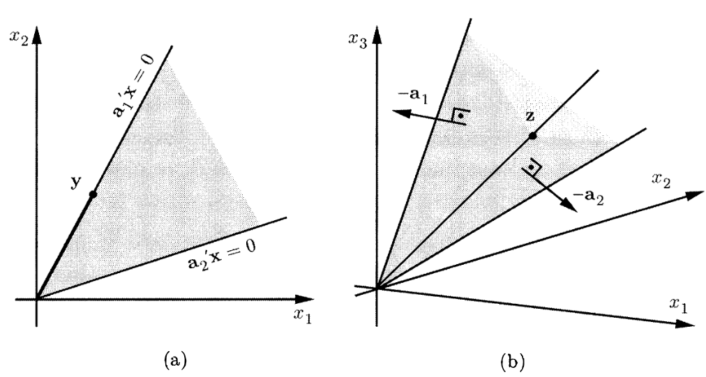</a>
<section class="latex-block latex-theorem" id="latex-thmblock-5-6-1" aria-label="Theorem 5.6.1">
Theorem 5.6.1　Extreme rays on standard polyhedron

考虑优化问题 <math xmlns="http://www.w3.org/1998/Math/MathML"><semantics><mrow><mstyle scriptlevel="0" displaystyle="true"><munder><mrow><mi>min</mi><mo>⁡</mo></mrow><mrow><mi mathvariant="bold-italic">x</mi><mo>∈</mo><mi mathvariant="script">C</mi></mrow></munder><msup><mi mathvariant="bold-italic">c</mi><mi mathvariant="normal">⊤</mi></msup><mi mathvariant="bold-italic">x</mi></mstyle></mrow><annotation encoding="application/x-tex">\displaystyle \min_{\bm{x} \in \mathcal{C}} \bm{c}^\top \bm{x}</annotation></semantics></math>x∈Cmin​c⊤x, 其中 <math xmlns="http://www.w3.org/1998/Math/MathML"><semantics><mrow><mstyle scriptlevel="0" displaystyle="true"><mi mathvariant="script">C</mi><mo>=</mo><mo stretchy="false">{</mo><mi mathvariant="bold-italic">x</mi><mo>∈</mo><msup><mi mathvariant="double-struck">R</mi><mi>n</mi></msup><mo>:</mo><msubsup><mi mathvariant="bold-italic">a</mi><mi>i</mi><mi mathvariant="normal">⊤</mi></msubsup><mi mathvariant="bold-italic">x</mi><mo>≥</mo><mn>0</mn><mo separator="true">,</mo><mtext> </mtext><mi>i</mi><mo>=</mo><mn>1</mn><mo separator="true">,</mo><mo>…</mo><mo separator="true">,</mo><mi>m</mi><mo stretchy="false">}</mo></mstyle></mrow><annotation encoding="application/x-tex">\displaystyle \mathcal{C} = \{\bm{x} \in \mathbb{R}^n: \bm{a}_i^\top \bm{x} \geq 0,~ i=1,\dots,m\}</annotation></semantics></math>C={x∈Rn:ai⊤​x≥0, i=1,…,m} 是一个 pointed cone. 则最优值等于 <math xmlns="http://www.w3.org/1998/Math/MathML"><semantics><mrow><mstyle scriptlevel="0" displaystyle="true"><mo>−</mo><mi mathvariant="normal">∞</mi></mstyle></mrow><annotation encoding="application/x-tex">\displaystyle -\infty</annotation></semantics></math>−∞ 当且仅当存在一个 extreme ray <math xmlns="http://www.w3.org/1998/Math/MathML"><semantics><mrow><mstyle scriptlevel="0" displaystyle="true"><mi mathvariant="bold-italic">d</mi><mo>∈</mo><mi mathvariant="script">C</mi></mstyle></mrow><annotation encoding="application/x-tex">\displaystyle \bm{d} \in \mathcal{C}</annotation></semantics></math>d∈C, 使得 <math xmlns="http://www.w3.org/1998/Math/MathML"><semantics><mrow><mstyle scriptlevel="0" displaystyle="true"><msup><mi mathvariant="bold-italic">c</mi><mi mathvariant="normal">⊤</mi></msup><mi mathvariant="bold-italic">d</mi><mo>&lt;</mo><mn>0</mn></mstyle></mrow><annotation encoding="application/x-tex">\displaystyle \bm{c}^\top \bm{d} &lt; 0</annotation></semantics></math>c⊤d&lt;0.
</section>

Proof.

(<math xmlns="http://www.w3.org/1998/Math/MathML"><semantics><mrow><mstyle scriptlevel="0" displaystyle="true"><mo>⇐</mo></mstyle></mrow><annotation encoding="application/x-tex">\displaystyle \Leftarrow</annotation></semantics></math>⇐) 若存在一个 extreme ray <math xmlns="http://www.w3.org/1998/Math/MathML"><semantics><mrow><mstyle scriptlevel="0" displaystyle="true"><mi mathvariant="bold-italic">d</mi><mo>∈</mo><mi mathvariant="script">C</mi></mstyle></mrow><annotation encoding="application/x-tex">\displaystyle \bm{d} \in \mathcal{C}</annotation></semantics></math>d∈C, 使得 <math xmlns="http://www.w3.org/1998/Math/MathML"><semantics><mrow><mstyle scriptlevel="0" displaystyle="true"><msup><mi mathvariant="bold-italic">c</mi><mi mathvariant="normal">⊤</mi></msup><mi mathvariant="bold-italic">d</mi><mo>&lt;</mo><mn>0</mn></mstyle></mrow><annotation encoding="application/x-tex">\displaystyle \bm{c}^\top \bm{d} &lt; 0</annotation></semantics></math>c⊤d&lt;0, 则对于任意 <math xmlns="http://www.w3.org/1998/Math/MathML"><semantics><mrow><mstyle scriptlevel="0" displaystyle="true"><mi>λ</mi><mo>≥</mo><mn>0</mn></mstyle></mrow><annotation encoding="application/x-tex">\displaystyle \lambda \geq 0</annotation></semantics></math>λ≥0, 有 <math xmlns="http://www.w3.org/1998/Math/MathML"><semantics><mrow><mstyle scriptlevel="0" displaystyle="true"><mi mathvariant="bold-italic">x</mi><mo>+</mo><mi>λ</mi><mi mathvariant="bold-italic">d</mi><mo>∈</mo><mi mathvariant="script">C</mi></mstyle></mrow><annotation encoding="application/x-tex">\displaystyle \bm{x} + \lambda \bm{d} \in \mathcal{C}</annotation></semantics></math>x+λd∈C, 且 <math xmlns="http://www.w3.org/1998/Math/MathML"><semantics><mrow><mstyle scriptlevel="0" displaystyle="true"><msup><mi mathvariant="bold-italic">c</mi><mi mathvariant="normal">⊤</mi></msup><mo stretchy="false">(</mo><mi mathvariant="bold-italic">x</mi><mo>+</mo><mi>λ</mi><mi mathvariant="bold-italic">d</mi><mo stretchy="false">)</mo><mo>=</mo><msup><mi mathvariant="bold-italic">c</mi><mi mathvariant="normal">⊤</mi></msup><mi mathvariant="bold-italic">x</mi><mo>+</mo><mi>λ</mi><msup><mi mathvariant="bold-italic">c</mi><mi mathvariant="normal">⊤</mi></msup><mi mathvariant="bold-italic">d</mi></mstyle></mrow><annotation encoding="application/x-tex">\displaystyle \bm{c}^\top (\bm{x} + \lambda \bm{d}) = \bm{c}^\top \bm{x} + \lambda \bm{c}^\top \bm{d}</annotation></semantics></math>c⊤(x+λd)=c⊤x+λc⊤d, 随着 <math xmlns="http://www.w3.org/1998/Math/MathML"><semantics><mrow><mstyle scriptlevel="0" displaystyle="true"><mi>λ</mi><mo>→</mo><mo>+</mo><mi mathvariant="normal">∞</mi></mstyle></mrow><annotation encoding="application/x-tex">\displaystyle \lambda \to +\infty</annotation></semantics></math>λ→+∞, <math xmlns="http://www.w3.org/1998/Math/MathML"><semantics><mrow><mstyle scriptlevel="0" displaystyle="true"><msup><mi mathvariant="bold-italic">c</mi><mi mathvariant="normal">⊤</mi></msup><mo stretchy="false">(</mo><mi mathvariant="bold-italic">x</mi><mo>+</mo><mi>λ</mi><mi mathvariant="bold-italic">d</mi><mo stretchy="false">)</mo><mo>→</mo><mo>−</mo><mi mathvariant="normal">∞</mi></mstyle></mrow><annotation encoding="application/x-tex">\displaystyle \bm{c}^\top (\bm{x} + \lambda \bm{d}) \to -\infty</annotation></semantics></math>c⊤(x+λd)→−∞, 故最优值为 <math xmlns="http://www.w3.org/1998/Math/MathML"><semantics><mrow><mstyle scriptlevel="0" displaystyle="true"><mo>−</mo><mi mathvariant="normal">∞</mi></mstyle></mrow><annotation encoding="application/x-tex">\displaystyle -\infty</annotation></semantics></math>−∞.

(<math xmlns="http://www.w3.org/1998/Math/MathML"><semantics><mrow><mstyle scriptlevel="0" displaystyle="true"><mo>⇒</mo></mstyle></mrow><annotation encoding="application/x-tex">\displaystyle \Rightarrow</annotation></semantics></math>⇒) 欲证: 若最优值为 <math xmlns="http://www.w3.org/1998/Math/MathML"><semantics><mrow><mstyle scriptlevel="0" displaystyle="true"><mo>−</mo><mi mathvariant="normal">∞</mi></mstyle></mrow><annotation encoding="application/x-tex">\displaystyle -\infty</annotation></semantics></math>−∞, 则存在一个 extreme ray <math xmlns="http://www.w3.org/1998/Math/MathML"><semantics><mrow><mstyle scriptlevel="0" displaystyle="true"><mi mathvariant="bold-italic">d</mi><mo>∈</mo><mi mathvariant="script">C</mi></mstyle></mrow><annotation encoding="application/x-tex">\displaystyle \bm{d} \in \mathcal{C}</annotation></semantics></math>d∈C, 使得 <math xmlns="http://www.w3.org/1998/Math/MathML"><semantics><mrow><mstyle scriptlevel="0" displaystyle="true"><msup><mi mathvariant="bold-italic">c</mi><mi mathvariant="normal">⊤</mi></msup><mi mathvariant="bold-italic">d</mi><mo>&lt;</mo><mn>0</mn></mstyle></mrow><annotation encoding="application/x-tex">\displaystyle \bm{c}^\top \bm{d} &lt; 0</annotation></semantics></math>c⊤d&lt;0.

<ul><li>
首先, 由于最优值为 <math xmlns="http://www.w3.org/1998/Math/MathML"><semantics><mrow><mstyle scriptlevel="0" displaystyle="true"><mo>−</mo><mi mathvariant="normal">∞</mi></mstyle></mrow><annotation encoding="application/x-tex">\displaystyle -\infty</annotation></semantics></math>−∞, 故定存在 <math xmlns="http://www.w3.org/1998/Math/MathML"><semantics><mrow><mstyle scriptlevel="0" displaystyle="true"><mi mathvariant="bold-italic">x</mi><mo>∈</mo><mi mathvariant="script">C</mi></mstyle></mrow><annotation encoding="application/x-tex">\displaystyle \bm{x} \in \mathcal{C}</annotation></semantics></math>x∈C, 使得 <math xmlns="http://www.w3.org/1998/Math/MathML"><semantics><mrow><mstyle scriptlevel="0" displaystyle="true"><msup><mi mathvariant="bold-italic">c</mi><mi mathvariant="normal">⊤</mi></msup><mi mathvariant="bold-italic">x</mi><mo>&lt;</mo><mn>0</mn></mstyle></mrow><annotation encoding="application/x-tex">\displaystyle \bm{c}^\top \bm{x} &lt; 0</annotation></semantics></math>c⊤x&lt;0. 对 <math xmlns="http://www.w3.org/1998/Math/MathML"><semantics><mrow><mstyle scriptlevel="0" displaystyle="true"><mi mathvariant="bold-italic">x</mi></mstyle></mrow><annotation encoding="application/x-tex">\displaystyle \bm{x}</annotation></semantics></math>x 费用进行归一化为 <math xmlns="http://www.w3.org/1998/Math/MathML"><semantics><mrow><mstyle scriptlevel="0" displaystyle="true"><mover accent="true"><mi mathvariant="bold-italic">x</mi><mo>~</mo></mover><mo>=</mo><mi mathvariant="bold-italic">x</mi><mi mathvariant="normal">/</mi><mrow><mo stretchy="false">(</mo><mo>−</mo><msup><mi mathvariant="bold-italic">c</mi><mi mathvariant="normal">⊤</mi></msup><mi mathvariant="bold-italic">x</mi><mo stretchy="false">)</mo></mrow></mstyle></mrow><annotation encoding="application/x-tex">\displaystyle \tilde{\bm{x}} = {\bm{x}}/{(-\bm{c}^\top \bm{x})}</annotation></semantics></math>x~=x/(−c⊤x), 则 <math xmlns="http://www.w3.org/1998/Math/MathML"><semantics><mrow><mstyle scriptlevel="0" displaystyle="true"><mover accent="true"><mi mathvariant="bold-italic">x</mi><mo>~</mo></mover><mo>∈</mo><mi mathvariant="script">C</mi></mstyle></mrow><annotation encoding="application/x-tex">\displaystyle \tilde{\bm{x}} \in \mathcal{C}</annotation></semantics></math>x~∈C 且 <math xmlns="http://www.w3.org/1998/Math/MathML"><semantics><mrow><mstyle scriptlevel="0" displaystyle="true"><msup><mi mathvariant="bold-italic">c</mi><mi mathvariant="normal">⊤</mi></msup><mover accent="true"><mi mathvariant="bold-italic">x</mi><mo>~</mo></mover><mo>=</mo><mo>−</mo><mn>1</mn></mstyle></mrow><annotation encoding="application/x-tex">\displaystyle \bm{c}^\top \tilde{\bm{x}} = -1</annotation></semantics></math>c⊤x~=−1. 方便起见, 这里仍将 <math xmlns="http://www.w3.org/1998/Math/MathML"><semantics><mrow><mstyle scriptlevel="0" displaystyle="true"><mover accent="true"><mi mathvariant="bold-italic">x</mi><mo>~</mo></mover></mstyle></mrow><annotation encoding="application/x-tex">\displaystyle \tilde{\bm{x}}</annotation></semantics></math>x~ 记为 <math xmlns="http://www.w3.org/1998/Math/MathML"><semantics><mrow><mstyle scriptlevel="0" displaystyle="true"><mi mathvariant="bold-italic">x</mi></mstyle></mrow><annotation encoding="application/x-tex">\displaystyle \bm{x}</annotation></semantics></math>x. 故现有集合 <math xmlns="http://www.w3.org/1998/Math/MathML"><semantics><mrow><mstyle scriptlevel="0" displaystyle="true"><mi mathvariant="script">P</mi><mo>=</mo><mo stretchy="false">{</mo><mi mathvariant="bold-italic">x</mi><mo>:</mo><msubsup><mi mathvariant="bold-italic">a</mi><mi>i</mi><mi mathvariant="normal">⊤</mi></msubsup><mi mathvariant="bold-italic">x</mi><mo>≥</mo><mn>0</mn><mo separator="true">,</mo><mtext> </mtext><mi>i</mi><mo>=</mo><mn>1</mn><mo separator="true">,</mo><mo>…</mo><mo separator="true">,</mo><mi>m</mi><mo separator="true">,</mo><mtext> </mtext><msup><mi mathvariant="bold-italic">c</mi><mi mathvariant="normal">⊤</mi></msup><mi mathvariant="bold-italic">x</mi><mo>=</mo><mo>−</mo><mn>1</mn><mo stretchy="false">}</mo></mstyle></mrow><annotation encoding="application/x-tex">\displaystyle \mathcal{P} = \{\bm{x}: \bm{a}_i^\top \bm{x} \geq 0,~ i=1,\dots,m,~ \bm{c}^\top \bm{x} = -1\}</annotation></semantics></math>P={x:ai⊤​x≥0, i=1,…,m, c⊤x=−1} 是一个 polyhedron, 且 <math xmlns="http://www.w3.org/1998/Math/MathML"><semantics><mrow><mstyle scriptlevel="0" displaystyle="true"><mi mathvariant="script">P</mi><mo mathvariant="normal">≠</mo><mi mathvariant="normal">∅</mi></mstyle></mrow><annotation encoding="application/x-tex">\displaystyle \mathcal{P} \neq \varnothing</annotation></semantics></math>P=∅.
</li><li>
由于 <math xmlns="http://www.w3.org/1998/Math/MathML"><semantics><mrow><mstyle scriptlevel="0" displaystyle="true"><mi mathvariant="script">C</mi></mstyle></mrow><annotation encoding="application/x-tex">\displaystyle \mathcal{C}</annotation></semantics></math>C 是 pointed cone, 故 <math xmlns="http://www.w3.org/1998/Math/MathML"><semantics><mrow><mstyle scriptlevel="0" displaystyle="true"><msub><mi mathvariant="bold-italic">a</mi><mn>1</mn></msub><mo separator="true">,</mo><mo>…</mo><mo separator="true">,</mo><msub><mi mathvariant="bold-italic">a</mi><mi>m</mi></msub></mstyle></mrow><annotation encoding="application/x-tex">\displaystyle \bm{a}_1, \dots, \bm{a}_m</annotation></semantics></math>a1​,…,am​ 可以张成 <math xmlns="http://www.w3.org/1998/Math/MathML"><semantics><mrow><mstyle scriptlevel="0" displaystyle="true"><msup><mi mathvariant="double-struck">R</mi><mi>n</mi></msup></mstyle></mrow><annotation encoding="application/x-tex">\displaystyle \mathbb{R}^n</annotation></semantics></math>Rn. 而 <math xmlns="http://www.w3.org/1998/Math/MathML"><semantics><mrow><mstyle scriptlevel="0" displaystyle="true"><mi mathvariant="script">P</mi></mstyle></mrow><annotation encoding="application/x-tex">\displaystyle \mathcal{P}</annotation></semantics></math>P 是在 <math xmlns="http://www.w3.org/1998/Math/MathML"><semantics><mrow><mstyle scriptlevel="0" displaystyle="true"><mi mathvariant="script">C</mi></mstyle></mrow><annotation encoding="application/x-tex">\displaystyle \mathcal{C}</annotation></semantics></math>C 的基础上增加了一个线性约束 <math xmlns="http://www.w3.org/1998/Math/MathML"><semantics><mrow><mstyle scriptlevel="0" displaystyle="true"><msup><mi mathvariant="bold-italic">c</mi><mi mathvariant="normal">⊤</mi></msup><mi mathvariant="bold-italic">x</mi><mo>=</mo><mo>−</mo><mn>1</mn></mstyle></mrow><annotation encoding="application/x-tex">\displaystyle \bm{c}^\top \bm{x} = -1</annotation></semantics></math>c⊤x=−1, 其不会减少张成的空间维度. 回顾, 对于 polyhedron <math xmlns="http://www.w3.org/1998/Math/MathML"><semantics><mrow><mstyle scriptlevel="0" displaystyle="true"><mi mathvariant="script">P</mi></mstyle></mrow><annotation encoding="application/x-tex">\displaystyle \mathcal{P}</annotation></semantics></math>P, 其存在极点 iff 其不包含完整直线 iff <math xmlns="http://www.w3.org/1998/Math/MathML"><semantics><mrow><mstyle scriptlevel="0" displaystyle="true"><mi mathvariant="normal">span</mi><mo>⁡</mo><mo stretchy="false">{</mo><msub><mi mathvariant="bold-italic">a</mi><mn>1</mn></msub><mo separator="true">,</mo><mo>…</mo><mo separator="true">,</mo><msub><mi mathvariant="bold-italic">a</mi><mi>m</mi></msub><mo separator="true">,</mo><mi mathvariant="bold-italic">c</mi><mo stretchy="false">}</mo><mo>=</mo><msup><mi mathvariant="double-struck">R</mi><mi>n</mi></msup></mstyle></mrow><annotation encoding="application/x-tex">\displaystyle \operatorname{span}\{\bm{a}_1, \dots, \bm{a}_m, \bm{c}\} = \mathbb{R}^n</annotation></semantics></math>span{a1​,…,am​,c}=Rn. 故 <math xmlns="http://www.w3.org/1998/Math/MathML"><semantics><mrow><mstyle scriptlevel="0" displaystyle="true"><mi mathvariant="script">P</mi></mstyle></mrow><annotation encoding="application/x-tex">\displaystyle \mathcal{P}</annotation></semantics></math>P 至少有一个 extreme point, 记为 <math xmlns="http://www.w3.org/1998/Math/MathML"><semantics><mrow><mstyle scriptlevel="0" displaystyle="true"><mi mathvariant="bold-italic">d</mi></mstyle></mrow><annotation encoding="application/x-tex">\displaystyle \bm{d}</annotation></semantics></math>d. 此时有 <math xmlns="http://www.w3.org/1998/Math/MathML"><semantics><mrow><mstyle scriptlevel="0" displaystyle="true"><msup><mi mathvariant="bold-italic">c</mi><mi mathvariant="normal">⊤</mi></msup><mi mathvariant="bold-italic">d</mi><mo>=</mo><mo>−</mo><mn>1</mn><mo>&lt;</mo><mn>0</mn></mstyle></mrow><annotation encoding="application/x-tex">\displaystyle \bm{c}^\top \bm{d} = -1 &lt; 0</annotation></semantics></math>c⊤d=−1&lt;0.
</li><li>
下证明 <math xmlns="http://www.w3.org/1998/Math/MathML"><semantics><mrow><mstyle scriptlevel="0" displaystyle="true"><mi mathvariant="bold-italic">d</mi></mstyle></mrow><annotation encoding="application/x-tex">\displaystyle \bm{d}</annotation></semantics></math>d 是 <math xmlns="http://www.w3.org/1998/Math/MathML"><semantics><mrow><mstyle scriptlevel="0" displaystyle="true"><mi mathvariant="script">C</mi></mstyle></mrow><annotation encoding="application/x-tex">\displaystyle \mathcal{C}</annotation></semantics></math>C 的extreme ray. 由于 <math xmlns="http://www.w3.org/1998/Math/MathML"><semantics><mrow><mstyle scriptlevel="0" displaystyle="true"><mi mathvariant="bold-italic">d</mi><mo>∈</mo><mi mathvariant="script">P</mi></mstyle></mrow><annotation encoding="application/x-tex">\displaystyle \bm{d} \in \mathcal{P}</annotation></semantics></math>d∈P, 其等式约束恒成立. 而又因为在 <math xmlns="http://www.w3.org/1998/Math/MathML"><semantics><mrow><mstyle scriptlevel="0" displaystyle="true"><mi mathvariant="bold-italic">d</mi></mstyle></mrow><annotation encoding="application/x-tex">\displaystyle \bm{d}</annotation></semantics></math>d 处有 <math xmlns="http://www.w3.org/1998/Math/MathML"><semantics><mrow><mstyle scriptlevel="0" displaystyle="true"><mi>n</mi></mstyle></mrow><annotation encoding="application/x-tex">\displaystyle n</annotation></semantics></math>n 个线性无关的 active constraints, 故除去 <math xmlns="http://www.w3.org/1998/Math/MathML"><semantics><mrow><mstyle scriptlevel="0" displaystyle="true"><msup><mi mathvariant="bold-italic">c</mi><mi mathvariant="normal">⊤</mi></msup><mi mathvariant="bold-italic">d</mi><mo>=</mo><mo>−</mo><mn>1</mn></mstyle></mrow><annotation encoding="application/x-tex">\displaystyle \bm{c}^\top \bm{d}=-1</annotation></semantics></math>c⊤d=−1 这一约束后, <math xmlns="http://www.w3.org/1998/Math/MathML"><semantics><mrow><mstyle scriptlevel="0" displaystyle="true"><mi mathvariant="bold-italic">d</mi></mstyle></mrow><annotation encoding="application/x-tex">\displaystyle \bm{d}</annotation></semantics></math>d 处锥约束的秩恰为 <math xmlns="http://www.w3.org/1998/Math/MathML"><semantics><mrow><mstyle scriptlevel="0" displaystyle="true"><mi>n</mi><mo>−</mo><mn>1</mn></mstyle></mrow><annotation encoding="application/x-tex">\displaystyle n-1</annotation></semantics></math>n−1, 故 <math xmlns="http://www.w3.org/1998/Math/MathML"><semantics><mrow><mstyle scriptlevel="0" displaystyle="true"><mi mathvariant="bold-italic">d</mi></mstyle></mrow><annotation encoding="application/x-tex">\displaystyle \bm{d}</annotation></semantics></math>d 是 <math xmlns="http://www.w3.org/1998/Math/MathML"><semantics><mrow><mstyle scriptlevel="0" displaystyle="true"><mi mathvariant="script">C</mi></mstyle></mrow><annotation encoding="application/x-tex">\displaystyle \mathcal{C}</annotation></semantics></math>C 的 extreme ray.
</li></ul>□

<section class="latex-block latex-corollary" id="latex-colblock-5-6-1" aria-label="Corollary 5.6.1">
Corollary 5.6.1

上述论述还可以进一步推广到一般的 polyhedron <math xmlns="http://www.w3.org/1998/Math/MathML"><semantics><mrow><mstyle scriptlevel="0" displaystyle="true"><mi mathvariant="script">P</mi><mo>=</mo><mo stretchy="false">{</mo><mi mathvariant="bold-italic">x</mi><mo>∈</mo><msup><mi mathvariant="double-struck">R</mi><mi>n</mi></msup><mo>:</mo><mi mathvariant="bold-italic">A</mi><mi mathvariant="bold-italic">x</mi><mo>≥</mo><mi mathvariant="bold-italic">b</mi><mo stretchy="false">}</mo></mstyle></mrow><annotation encoding="application/x-tex">\displaystyle \mathcal{P} = \{\bm{x} \in \mathbb{R}^n: \bm{A}\bm{x} \geq \bm{b}\}</annotation></semantics></math>P={x∈Rn:Ax≥b}. 假设 <math xmlns="http://www.w3.org/1998/Math/MathML"><semantics><mrow><mstyle scriptlevel="0" displaystyle="true"><mi mathvariant="script">P</mi></mstyle></mrow><annotation encoding="application/x-tex">\displaystyle \mathcal{P}</annotation></semantics></math>P 至少有一个 extreme point, 则最优值为 <math xmlns="http://www.w3.org/1998/Math/MathML"><semantics><mrow><mstyle scriptlevel="0" displaystyle="true"><mo>−</mo><mi mathvariant="normal">∞</mi></mstyle></mrow><annotation encoding="application/x-tex">\displaystyle -\infty</annotation></semantics></math>−∞ 当且仅当存在一个 extreme ray <math xmlns="http://www.w3.org/1998/Math/MathML"><semantics><mrow><mstyle scriptlevel="0" displaystyle="true"><mi mathvariant="bold-italic">d</mi></mstyle></mrow><annotation encoding="application/x-tex">\displaystyle \bm{d}</annotation></semantics></math>d, 使得 <math xmlns="http://www.w3.org/1998/Math/MathML"><semantics><mrow><mstyle scriptlevel="0" displaystyle="true"><msup><mi mathvariant="bold-italic">c</mi><mi mathvariant="normal">⊤</mi></msup><mi mathvariant="bold-italic">d</mi><mo>&lt;</mo><mn>0</mn></mstyle></mrow><annotation encoding="application/x-tex">\displaystyle \bm{c}^\top \bm{d} &lt; 0</annotation></semantics></math>c⊤d&lt;0.
</section>

### 5.7. Representations of polyhedra

对于多面体 Polyhedron, 可以有两种不同的表示方式.

<section class="latex-block latex-definition" id="latex-defblock-5-7-1" aria-label="Definition 5.7.1">
Definition 5.7.1　H- and V-representations
<ul><li>
<em><strong>H(alf-space) representation</strong></em>. H-representation 是在外部通过一系列超平面进行划分框定, 得到的多面体. 形如

<math xmlns="http://www.w3.org/1998/Math/MathML" display="block"><semantics><mrow><mi mathvariant="script">P</mi><mo>=</mo><mo stretchy="false">{</mo><mi mathvariant="bold-italic">x</mi><mo>:</mo><mi mathvariant="bold-italic">A</mi><mi mathvariant="bold-italic">x</mi><mo>≤</mo><mi mathvariant="bold-italic">b</mi><mo separator="true">,</mo><mi mathvariant="bold-italic">C</mi><mi mathvariant="bold-italic">x</mi><mo>=</mo><mi mathvariant="bold-italic">d</mi><mo stretchy="false">}</mo></mrow><annotation encoding="application/x-tex">
  \mathcal{P} = \{\bm{x}: \bm{A}\bm{x} \leq \bm{b}, \bm{C}\bm{x} = \bm{d}\}
</annotation></semantics></math>P={x:Ax≤b,Cx=d}</li><li>
<em><strong>V(ertices) representation</strong></em>. V-representation 是通过描述多面体的有限生成点, 用这些点的凸包来表示多面体. 此外通过引入 cone 来表示 unbounded 的部分. 形如

<math xmlns="http://www.w3.org/1998/Math/MathML" display="block"><semantics><mrow><mi mathvariant="script">P</mi><mo>=</mo><mtext>conv</mtext><mo stretchy="false">(</mo><mi mathvariant="script">V</mi><mo stretchy="false">)</mo><mo>+</mo><mtext>cone</mtext><mo stretchy="false">(</mo><mi mathvariant="script">R</mi><mo stretchy="false">)</mo></mrow><annotation encoding="application/x-tex">
  \mathcal{P} = \text{conv}(\mathcal{V}) + \text{cone}(\mathcal{R})
</annotation></semantics></math>P=conv(V)+cone(R)

其中, <math xmlns="http://www.w3.org/1998/Math/MathML"><semantics><mrow><mstyle scriptlevel="0" displaystyle="true"><mtext>conv</mtext><mo stretchy="false">(</mo><mi mathvariant="script">V</mi><mo stretchy="false">)</mo></mstyle></mrow><annotation encoding="application/x-tex">\displaystyle \text{conv}(\mathcal{V})</annotation></semantics></math>conv(V) 表示有限生成点集 <math xmlns="http://www.w3.org/1998/Math/MathML"><semantics><mrow><mstyle scriptlevel="0" displaystyle="true"><mi mathvariant="script">V</mi></mstyle></mrow><annotation encoding="application/x-tex">\displaystyle \mathcal{V}</annotation></semantics></math>V 的凸包, <math xmlns="http://www.w3.org/1998/Math/MathML"><semantics><mrow><mstyle scriptlevel="0" displaystyle="true"><mtext>cone</mtext><mo stretchy="false">(</mo><mi mathvariant="script">R</mi><mo stretchy="false">)</mo></mstyle></mrow><annotation encoding="application/x-tex">\displaystyle \text{cone}(\mathcal{R})</annotation></semantics></math>cone(R) 表示射线集合 <math xmlns="http://www.w3.org/1998/Math/MathML"><semantics><mrow><mstyle scriptlevel="0" displaystyle="true"><mi mathvariant="script">R</mi></mstyle></mrow><annotation encoding="application/x-tex">\displaystyle \mathcal{R}</annotation></semantics></math>R 的凸锥, 求和为 Minkowski sum. 即, 任意非空 pointed polyhedron 都可以表示为 extreme point 的凸组合 + extreme ray 的非负组合; 一般 polyhedron 的有限生成点和生成方向不必是极点与极射线.
</li></ul></section>

可以证明, 这两种表示是等价的.

