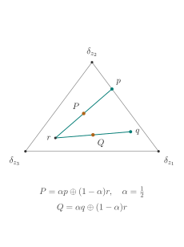
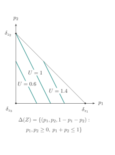
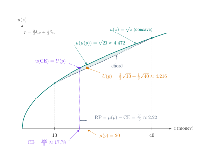

<!-- Generated from LaTeX. Edit the source, not this file. Source SHA256: fae60c82d8ac5326cd33808d5d31a36e3fbccdf13798d8cb9b15fdddd5ef786b -->

Baiying · According to lectures by Prof. R.C., Shanghai Jiao Tong University

<nav class="latex-editions" aria-label="Reading formats">LECTURE NOTES<a href="./decision-theory/Decision-Theory.pdf">Download PDF ↗</a></nav>

## 1. From Observed Choice to Utility

### 1.1. Choice and Utility

我们关心决策者是如何做出决策的. 记所有可能被选择的元素 (alternatives) 构成的集合为 <math xmlns="http://www.w3.org/1998/Math/MathML"><semantics><mrow><mstyle scriptlevel="0" displaystyle="true"><mi>X</mi></mstyle></mrow><annotation encoding="application/x-tex">\displaystyle X</annotation></semantics></math>X. 在每次进行具体的选择时, 决策者会被提供一个 choice set (或称菜单) <math xmlns="http://www.w3.org/1998/Math/MathML"><semantics><mrow><mstyle scriptlevel="0" displaystyle="true"><mi>A</mi><mo>⊆</mo><mi>X</mi></mstyle></mrow><annotation encoding="application/x-tex">\displaystyle A \subseteq X</annotation></semantics></math>A⊆X, 决策者会从中选择一些元素, 记为 <math xmlns="http://www.w3.org/1998/Math/MathML"><semantics><mrow><mstyle scriptlevel="0" displaystyle="true"><mi>c</mi><mo stretchy="false">(</mo><mi>A</mi><mo stretchy="false">)</mo></mstyle></mrow><annotation encoding="application/x-tex">\displaystyle c(A)</annotation></semantics></math>c(A). 
记所有可能的菜单为 <math xmlns="http://www.w3.org/1998/Math/MathML"><semantics><mrow><mstyle scriptlevel="0" displaystyle="true"><mi mathvariant="script">A</mi><mo>=</mo><msup><mn>2</mn><mi>X</mi></msup><mo>∖</mo><mo stretchy="false">{</mo><mi mathvariant="normal">∅</mi><mo stretchy="false">}</mo></mstyle></mrow><annotation encoding="application/x-tex">\displaystyle \mathcal{A} = 2^X \setminus \{\varnothing\}</annotation></semantics></math>A=2X∖{∅} (排除了不做选择的情况). 有时, 我们只能得到决策者在某些菜单下的选择, 记为 <math xmlns="http://www.w3.org/1998/Math/MathML"><semantics><mrow><mstyle scriptlevel="0" displaystyle="true"><mi mathvariant="script">B</mi><mo>⊆</mo><mi mathvariant="script">A</mi></mstyle></mrow><annotation encoding="application/x-tex">\displaystyle \mathcal{B} \subseteq \mathcal{A}</annotation></semantics></math>B⊆A. 于是我们有一个选择函数 <math xmlns="http://www.w3.org/1998/Math/MathML"><semantics><mrow><mstyle scriptlevel="0" displaystyle="true"><mi>c</mi><mo>:</mo><mi mathvariant="script">B</mi><mo>→</mo><mi mathvariant="script">A</mi></mstyle></mrow><annotation encoding="application/x-tex">\displaystyle c: \mathcal{B} \to \mathcal{A}</annotation></semantics></math>c:B→A, 其输入为某个菜单, 输出为决策者在该菜单下的选择.

直观上, 一个 choice function 输入某个 菜单, 输出一个子集, 要求不能选择出 菜单 中没有的元素.

<section class="latex-block latex-definition" id="latex-defblock-1-1-1" aria-label="Definition 1.1.1">
Definition 1.1.1　Choice Function

对于一个函数 <math xmlns="http://www.w3.org/1998/Math/MathML"><semantics><mrow><mstyle scriptlevel="0" displaystyle="true"><mi>c</mi><mo>:</mo><mi mathvariant="script">B</mi><mo>→</mo><mi mathvariant="script">A</mi></mstyle></mrow><annotation encoding="application/x-tex">\displaystyle c: \mathcal{B} \to \mathcal{A}</annotation></semantics></math>c:B→A, 如果 <math xmlns="http://www.w3.org/1998/Math/MathML"><semantics><mrow><mstyle scriptlevel="0" displaystyle="true"><mi>c</mi><mo stretchy="false">(</mo><mi>A</mi><mo stretchy="false">)</mo><mo>⊆</mo><mi>A</mi></mstyle></mrow><annotation encoding="application/x-tex">\displaystyle c(A) \subseteq A</annotation></semantics></math>c(A)⊆A 对所有 <math xmlns="http://www.w3.org/1998/Math/MathML"><semantics><mrow><mstyle scriptlevel="0" displaystyle="true"><mi>A</mi><mo>∈</mo><mi mathvariant="script">B</mi></mstyle></mrow><annotation encoding="application/x-tex">\displaystyle A \in \mathcal{B}</annotation></semantics></math>A∈B 成立, 则称 <math xmlns="http://www.w3.org/1998/Math/MathML"><semantics><mrow><mstyle scriptlevel="0" displaystyle="true"><mi>c</mi></mstyle></mrow><annotation encoding="application/x-tex">\displaystyle c</annotation></semantics></math>c 是一个 choice function.
</section>

接着我们想排除一些不合理的选择. 例如, <math xmlns="http://www.w3.org/1998/Math/MathML"><semantics><mrow><mstyle scriptlevel="0" displaystyle="true"><mi>x</mi><mo separator="true">,</mo><mi>y</mi></mstyle></mrow><annotation encoding="application/x-tex">\displaystyle x,y</annotation></semantics></math>x,y 两个元素同时出现在两份 菜单 <math xmlns="http://www.w3.org/1998/Math/MathML"><semantics><mrow><mstyle scriptlevel="0" displaystyle="true"><mi>A</mi><mo separator="true">,</mo><mi>B</mi></mstyle></mrow><annotation encoding="application/x-tex">\displaystyle A, B</annotation></semantics></math>A,B 中, 在 <math xmlns="http://www.w3.org/1998/Math/MathML"><semantics><mrow><mstyle scriptlevel="0" displaystyle="true"><mi>A</mi></mstyle></mrow><annotation encoding="application/x-tex">\displaystyle A</annotation></semantics></math>A 中选择了 <math xmlns="http://www.w3.org/1998/Math/MathML"><semantics><mrow><mstyle scriptlevel="0" displaystyle="true"><mi>x</mi></mstyle></mrow><annotation encoding="application/x-tex">\displaystyle x</annotation></semantics></math>x, 然而在 <math xmlns="http://www.w3.org/1998/Math/MathML"><semantics><mrow><mstyle scriptlevel="0" displaystyle="true"><mi>B</mi></mstyle></mrow><annotation encoding="application/x-tex">\displaystyle B</annotation></semantics></math>B 中却只选 <math xmlns="http://www.w3.org/1998/Math/MathML"><semantics><mrow><mstyle scriptlevel="0" displaystyle="true"><mi>y</mi></mstyle></mrow><annotation encoding="application/x-tex">\displaystyle y</annotation></semantics></math>y 而不选 <math xmlns="http://www.w3.org/1998/Math/MathML"><semantics><mrow><mstyle scriptlevel="0" displaystyle="true"><mi>x</mi></mstyle></mrow><annotation encoding="application/x-tex">\displaystyle x</annotation></semantics></math>x, 这是不合理的. 因此我们得到了如下行为公理假设<a href="#latex-fn-1" role="doc-noteref">1</a>.

<section class="latex-block latex-axiom" id="latex-axiomblock-1-1-1" aria-label="Axiom 1.1.1">
Axiom 1.1.1　Weak Axiom of Revealed Preference (WARP)

若 <math xmlns="http://www.w3.org/1998/Math/MathML"><semantics><mrow><mstyle scriptlevel="0" displaystyle="true"><mi>x</mi><mo separator="true">,</mo><mi>y</mi><mo>∈</mo><mi>A</mi><mo>∩</mo><mi>B</mi></mstyle></mrow><annotation encoding="application/x-tex">\displaystyle x, y \in A\cap B</annotation></semantics></math>x,y∈A∩B, 且 <math xmlns="http://www.w3.org/1998/Math/MathML"><semantics><mrow><mstyle scriptlevel="0" displaystyle="true"><mi>x</mi><mo>∈</mo><mi>c</mi><mo stretchy="false">(</mo><mi>A</mi><mo stretchy="false">)</mo><mo separator="true">,</mo><mi>y</mi><mo>∈</mo><mi>c</mi><mo stretchy="false">(</mo><mi>B</mi><mo stretchy="false">)</mo></mstyle></mrow><annotation encoding="application/x-tex">\displaystyle x \in c(A), y \in c(B)</annotation></semantics></math>x∈c(A),y∈c(B), 则 <math xmlns="http://www.w3.org/1998/Math/MathML"><semantics><mrow><mstyle scriptlevel="0" displaystyle="true"><mi>x</mi><mo>∈</mo><mi>c</mi><mo stretchy="false">(</mo><mi>B</mi><mo stretchy="false">)</mo></mstyle></mrow><annotation encoding="application/x-tex">\displaystyle x \in c(B)</annotation></semantics></math>x∈c(B).
</section>
<section class="latex-block latex-lemma" id="latex-lemmablock-1-1-1" aria-label="Lemma 1.1.1">
Lemma 1.1.1　Transitivity of Choice

给定 <math xmlns="http://www.w3.org/1998/Math/MathML"><semantics><mrow><mstyle scriptlevel="0" displaystyle="true"><mi>c</mi><mo>:</mo><mi mathvariant="script">A</mi><mo>→</mo><mi mathvariant="script">A</mi></mstyle></mrow><annotation encoding="application/x-tex">\displaystyle c: \mathcal{A} \to \mathcal{A}</annotation></semantics></math>c:A→A 满足 WARP, 则 <math xmlns="http://www.w3.org/1998/Math/MathML"><semantics><mrow><mstyle scriptlevel="0" displaystyle="true"><mi>c</mi></mstyle></mrow><annotation encoding="application/x-tex">\displaystyle c</annotation></semantics></math>c 满足 doubleton-transitivity, 即若 <math xmlns="http://www.w3.org/1998/Math/MathML"><semantics><mrow><mstyle scriptlevel="0" displaystyle="true"><mi>x</mi><mo>∈</mo><mi>c</mi><mo stretchy="false">(</mo><mo stretchy="false">{</mo><mi>x</mi><mo separator="true">,</mo><mi>y</mi><mo stretchy="false">}</mo><mo stretchy="false">)</mo><mo separator="true">,</mo><mi>y</mi><mo>∈</mo><mi>c</mi><mo stretchy="false">(</mo><mo stretchy="false">{</mo><mi>y</mi><mo separator="true">,</mo><mi>z</mi><mo stretchy="false">}</mo><mo stretchy="false">)</mo></mstyle></mrow><annotation encoding="application/x-tex">\displaystyle x \in c(\{x,y\}), y \in c(\{y,z\})</annotation></semantics></math>x∈c({x,y}),y∈c({y,z}) 则 <math xmlns="http://www.w3.org/1998/Math/MathML"><semantics><mrow><mstyle scriptlevel="0" displaystyle="true"><mi>x</mi><mo>∈</mo><mi>c</mi><mo stretchy="false">(</mo><mo stretchy="false">{</mo><mi>x</mi><mo separator="true">,</mo><mi>z</mi><mo stretchy="false">}</mo><mo stretchy="false">)</mo></mstyle></mrow><annotation encoding="application/x-tex">\displaystyle x \in c(\{x,z\})</annotation></semantics></math>x∈c({x,z}).

Proof.

用反证法. 假设 <math xmlns="http://www.w3.org/1998/Math/MathML"><semantics><mrow><mstyle scriptlevel="0" displaystyle="true"><mi>x</mi><mo>∈</mo><mi>c</mi><mo stretchy="false">(</mo><mo stretchy="false">{</mo><mi>x</mi><mo separator="true">,</mo><mi>y</mi><mo stretchy="false">}</mo><mo stretchy="false">)</mo><mo separator="true">,</mo><mi>y</mi><mo>∈</mo><mi>c</mi><mo stretchy="false">(</mo><mo stretchy="false">{</mo><mi>y</mi><mo separator="true">,</mo><mi>z</mi><mo stretchy="false">}</mo><mo stretchy="false">)</mo></mstyle></mrow><annotation encoding="application/x-tex">\displaystyle x \in c(\{x,y\}), y \in c(\{y,z\})</annotation></semantics></math>x∈c({x,y}),y∈c({y,z}) 但 <math xmlns="http://www.w3.org/1998/Math/MathML"><semantics><mrow><mstyle scriptlevel="0" displaystyle="true"><mi>x</mi><mo mathvariant="normal">∉</mo><mi>c</mi><mo stretchy="false">(</mo><mo stretchy="false">{</mo><mi>x</mi><mo separator="true">,</mo><mi>z</mi><mo stretchy="false">}</mo><mo stretchy="false">)</mo></mstyle></mrow><annotation encoding="application/x-tex">\displaystyle x \notin c(\{x,z\})</annotation></semantics></math>x∈/c({x,z}). 则 <math xmlns="http://www.w3.org/1998/Math/MathML"><semantics><mrow><mstyle scriptlevel="0" displaystyle="true"><mi>c</mi><mo stretchy="false">(</mo><mo stretchy="false">{</mo><mi>x</mi><mo separator="true">,</mo><mi>z</mi><mo stretchy="false">}</mo><mo stretchy="false">)</mo><mo>=</mo><mo stretchy="false">{</mo><mi>z</mi><mo stretchy="false">}</mo></mstyle></mrow><annotation encoding="application/x-tex">\displaystyle c(\{x,z\}) = \{z\}</annotation></semantics></math>c({x,z})={z}. 此时考虑三元组 <math xmlns="http://www.w3.org/1998/Math/MathML"><semantics><mrow><mstyle scriptlevel="0" displaystyle="true"><mo stretchy="false">{</mo><mi>x</mi><mo separator="true">,</mo><mi>y</mi><mo separator="true">,</mo><mi>z</mi><mo stretchy="false">}</mo></mstyle></mrow><annotation encoding="application/x-tex">\displaystyle \{x,y,z\}</annotation></semantics></math>{x,y,z}.

(1) 若 <math xmlns="http://www.w3.org/1998/Math/MathML"><semantics><mrow><mstyle scriptlevel="0" displaystyle="true"><mi>x</mi><mo>∈</mo><mi>c</mi><mo stretchy="false">(</mo><mo stretchy="false">{</mo><mi>x</mi><mo separator="true">,</mo><mi>y</mi><mo separator="true">,</mo><mi>z</mi><mo stretchy="false">}</mo><mo stretchy="false">)</mo></mstyle></mrow><annotation encoding="application/x-tex">\displaystyle x \in c(\{x,y,z\})</annotation></semantics></math>x∈c({x,y,z}), 则由于 <math xmlns="http://www.w3.org/1998/Math/MathML"><semantics><mrow><mstyle scriptlevel="0" displaystyle="true"><mi>z</mi><mo>∈</mo><mi>c</mi><mo stretchy="false">(</mo><mo stretchy="false">{</mo><mi>x</mi><mo separator="true">,</mo><mi>z</mi><mo stretchy="false">}</mo><mo stretchy="false">)</mo></mstyle></mrow><annotation encoding="application/x-tex">\displaystyle z \in c(\{x,z\})</annotation></semantics></math>z∈c({x,z}), 根据 WARP, 有 <math xmlns="http://www.w3.org/1998/Math/MathML"><semantics><mrow><mstyle scriptlevel="0" displaystyle="true"><mi>x</mi><mo>∈</mo><mi>c</mi><mo stretchy="false">(</mo><mo stretchy="false">{</mo><mi>x</mi><mo separator="true">,</mo><mi>z</mi><mo stretchy="false">}</mo><mo stretchy="false">)</mo></mstyle></mrow><annotation encoding="application/x-tex">\displaystyle x \in c(\{x,z\})</annotation></semantics></math>x∈c({x,z}). 但 <math xmlns="http://www.w3.org/1998/Math/MathML"><semantics><mrow><mstyle scriptlevel="0" displaystyle="true"><mi>x</mi><mo mathvariant="normal">∉</mo><mi>c</mi><mo stretchy="false">(</mo><mo stretchy="false">{</mo><mi>x</mi><mo separator="true">,</mo><mi>z</mi><mo stretchy="false">}</mo><mo stretchy="false">)</mo></mstyle></mrow><annotation encoding="application/x-tex">\displaystyle x \notin c(\{x,z\})</annotation></semantics></math>x∈/c({x,z}), 矛盾.

(2) 若 <math xmlns="http://www.w3.org/1998/Math/MathML"><semantics><mrow><mstyle scriptlevel="0" displaystyle="true"><mi>y</mi><mo>∈</mo><mi>c</mi><mo stretchy="false">(</mo><mo stretchy="false">{</mo><mi>x</mi><mo separator="true">,</mo><mi>y</mi><mo separator="true">,</mo><mi>z</mi><mo stretchy="false">}</mo><mo stretchy="false">)</mo></mstyle></mrow><annotation encoding="application/x-tex">\displaystyle y \in c(\{x,y,z\})</annotation></semantics></math>y∈c({x,y,z}), 则由于 <math xmlns="http://www.w3.org/1998/Math/MathML"><semantics><mrow><mstyle scriptlevel="0" displaystyle="true"><mi>x</mi><mo>∈</mo><mi>c</mi><mo stretchy="false">(</mo><mo stretchy="false">{</mo><mi>x</mi><mo separator="true">,</mo><mi>y</mi><mo stretchy="false">}</mo><mo stretchy="false">)</mo></mstyle></mrow><annotation encoding="application/x-tex">\displaystyle x \in c(\{x,y\})</annotation></semantics></math>x∈c({x,y}), 根据 WARP, 有 <math xmlns="http://www.w3.org/1998/Math/MathML"><semantics><mrow><mstyle scriptlevel="0" displaystyle="true"><mi>x</mi><mo>∈</mo><mi>c</mi><mo stretchy="false">(</mo><mo stretchy="false">{</mo><mi>x</mi><mo separator="true">,</mo><mi>y</mi><mo separator="true">,</mo><mi>z</mi><mo stretchy="false">}</mo><mo stretchy="false">)</mo></mstyle></mrow><annotation encoding="application/x-tex">\displaystyle x \in c(\{x,y,z\})</annotation></semantics></math>x∈c({x,y,z}). 但 (1) 已经证明了 <math xmlns="http://www.w3.org/1998/Math/MathML"><semantics><mrow><mstyle scriptlevel="0" displaystyle="true"><mi>x</mi><mo mathvariant="normal">∉</mo><mi>c</mi><mo stretchy="false">(</mo><mo stretchy="false">{</mo><mi>x</mi><mo separator="true">,</mo><mi>y</mi><mo separator="true">,</mo><mi>z</mi><mo stretchy="false">}</mo><mo stretchy="false">)</mo></mstyle></mrow><annotation encoding="application/x-tex">\displaystyle x \notin c(\{x,y,z\})</annotation></semantics></math>x∈/c({x,y,z}), 矛盾.

(3) 若 <math xmlns="http://www.w3.org/1998/Math/MathML"><semantics><mrow><mstyle scriptlevel="0" displaystyle="true"><mi>z</mi><mo>∈</mo><mi>c</mi><mo stretchy="false">(</mo><mo stretchy="false">{</mo><mi>x</mi><mo separator="true">,</mo><mi>y</mi><mo separator="true">,</mo><mi>z</mi><mo stretchy="false">}</mo><mo stretchy="false">)</mo></mstyle></mrow><annotation encoding="application/x-tex">\displaystyle z \in c(\{x,y,z\})</annotation></semantics></math>z∈c({x,y,z}), 则由于 <math xmlns="http://www.w3.org/1998/Math/MathML"><semantics><mrow><mstyle scriptlevel="0" displaystyle="true"><mi>y</mi><mo>∈</mo><mi>c</mi><mo stretchy="false">(</mo><mo stretchy="false">{</mo><mi>y</mi><mo separator="true">,</mo><mi>z</mi><mo stretchy="false">}</mo><mo stretchy="false">)</mo></mstyle></mrow><annotation encoding="application/x-tex">\displaystyle y \in c(\{y,z\})</annotation></semantics></math>y∈c({y,z}), 根据 WARP, 有 <math xmlns="http://www.w3.org/1998/Math/MathML"><semantics><mrow><mstyle scriptlevel="0" displaystyle="true"><mi>y</mi><mo>∈</mo><mi>c</mi><mo stretchy="false">(</mo><mo stretchy="false">{</mo><mi>x</mi><mo separator="true">,</mo><mi>y</mi><mo separator="true">,</mo><mi>z</mi><mo stretchy="false">}</mo><mo stretchy="false">)</mo></mstyle></mrow><annotation encoding="application/x-tex">\displaystyle y \in c(\{x,y,z\})</annotation></semantics></math>y∈c({x,y,z}). 而这与 (2) 矛盾.

因此 <math xmlns="http://www.w3.org/1998/Math/MathML"><semantics><mrow><mstyle scriptlevel="0" displaystyle="true"><mi>c</mi></mstyle></mrow><annotation encoding="application/x-tex">\displaystyle c</annotation></semantics></math>c 满足 doubleton-transitivity.
□

</section>

当决策者按照 WARP 所描述的决策方式进行决策时, 经济学家发现, 这样的行为就好像背后对应着一个 效用表示, 给每一个 alternative 进行打分, 然后总是选择效用得分最高的 alternative.

<section class="latex-block latex-definition" id="latex-defblock-1-1-2" aria-label="Definition 1.1.2">
Definition 1.1.2　Utility Representation

若存在一个函数 <math xmlns="http://www.w3.org/1998/Math/MathML"><semantics><mrow><mstyle scriptlevel="0" displaystyle="true"><mi>U</mi><mo>:</mo><mi>X</mi><mo>→</mo><mi mathvariant="double-struck">R</mi></mstyle></mrow><annotation encoding="application/x-tex">\displaystyle U: X \to \R</annotation></semantics></math>U:X→R, 使得对于所有 <math xmlns="http://www.w3.org/1998/Math/MathML"><semantics><mrow><mstyle scriptlevel="0" displaystyle="true"><mi>A</mi><mo>∈</mo><mi mathvariant="script">B</mi></mstyle></mrow><annotation encoding="application/x-tex">\displaystyle A \in \mathcal{B}</annotation></semantics></math>A∈B, 有 <math xmlns="http://www.w3.org/1998/Math/MathML"><semantics><mrow><mstyle scriptlevel="0" displaystyle="true"><mi>c</mi><mo stretchy="false">(</mo><mi>A</mi><mo stretchy="false">)</mo><mo>=</mo><mo stretchy="false">{</mo><mi>x</mi><mo>∈</mo><mi>A</mi><mo>∣</mo><mi>U</mi><mo stretchy="false">(</mo><mi>x</mi><mo stretchy="false">)</mo><mo>≥</mo><mi>U</mi><mo stretchy="false">(</mo><mi>y</mi><mo stretchy="false">)</mo><mtext> for all </mtext><mi>y</mi><mo>∈</mo><mi>A</mi><mo stretchy="false">}</mo></mstyle></mrow><annotation encoding="application/x-tex">\displaystyle c(A) = \{x \in A \mid U(x) \geq U(y) \text{ for all } y \in A\}</annotation></semantics></math>c(A)={x∈A∣U(x)≥U(y) for all y∈A}, 则称 <math xmlns="http://www.w3.org/1998/Math/MathML"><semantics><mrow><mstyle scriptlevel="0" displaystyle="true"><mi>U</mi></mstyle></mrow><annotation encoding="application/x-tex">\displaystyle U</annotation></semantics></math>U 是选择 <math xmlns="http://www.w3.org/1998/Math/MathML"><semantics><mrow><mstyle scriptlevel="0" displaystyle="true"><mi>c</mi></mstyle></mrow><annotation encoding="application/x-tex">\displaystyle c</annotation></semantics></math>c 的 效用表示.
</section>

可以证明数学上, 效用表示 的存在性等价于 WARP 的成立.

<section class="latex-block latex-theorem" id="latex-thmblock-1-1-1" aria-label="Theorem 1.1.1">
Theorem 1.1.1　Utility Representation Theorem

给定一个有限集合 <math xmlns="http://www.w3.org/1998/Math/MathML"><semantics><mrow><mstyle scriptlevel="0" displaystyle="true"><mi>X</mi></mstyle></mrow><annotation encoding="application/x-tex">\displaystyle X</annotation></semantics></math>X 以及一个选择函数 <math xmlns="http://www.w3.org/1998/Math/MathML"><semantics><mrow><mstyle scriptlevel="0" displaystyle="true"><mi>c</mi><mo>:</mo><mi mathvariant="script">A</mi><mo>→</mo><mi mathvariant="script">A</mi></mstyle></mrow><annotation encoding="application/x-tex">\displaystyle c: \mathcal{A} \to \mathcal{A}</annotation></semantics></math>c:A→A. (1) <math xmlns="http://www.w3.org/1998/Math/MathML"><semantics><mrow><mstyle scriptlevel="0" displaystyle="true"><mi>c</mi></mstyle></mrow><annotation encoding="application/x-tex">\displaystyle c</annotation></semantics></math>c 满足 WARP  <math xmlns="http://www.w3.org/1998/Math/MathML"><semantics><mrow><mstyle scriptlevel="0" displaystyle="true"><mtext>  </mtext><mo>⟺</mo><mtext>  </mtext></mstyle></mrow><annotation encoding="application/x-tex">\displaystyle \iff</annotation></semantics></math>⟺ (2) 存在一个函数 <math xmlns="http://www.w3.org/1998/Math/MathML"><semantics><mrow><mstyle scriptlevel="0" displaystyle="true"><mi>U</mi><mo>:</mo><mi>X</mi><mo>→</mo><mi mathvariant="double-struck">R</mi></mstyle></mrow><annotation encoding="application/x-tex">\displaystyle U: X \to \R</annotation></semantics></math>U:X→R, 使得对于所有 <math xmlns="http://www.w3.org/1998/Math/MathML"><semantics><mrow><mstyle scriptlevel="0" displaystyle="true"><mi>A</mi><mo>∈</mo><mi mathvariant="script">B</mi></mstyle></mrow><annotation encoding="application/x-tex">\displaystyle A \in \mathcal{B}</annotation></semantics></math>A∈B, 有

<math xmlns="http://www.w3.org/1998/Math/MathML" display="block"><semantics><mtable width="100%"><mtr><mtd width="50%"></mtd><mtd><mrow><mi>c</mi><mo stretchy="false">(</mo><mi>A</mi><mo stretchy="false">)</mo><mo>=</mo><mo stretchy="false">{</mo><mi>x</mi><mo>∈</mo><mi>A</mi><mo>∣</mo><mi>U</mi><mo stretchy="false">(</mo><mi>x</mi><mo stretchy="false">)</mo><mo>≥</mo><mi>U</mi><mo stretchy="false">(</mo><mi>y</mi><mo stretchy="false">)</mo><mo separator="true">,</mo><mtext> </mtext><mi mathvariant="normal">∀</mi><mi>y</mi><mo>∈</mo><mi>A</mi><mo stretchy="false">}</mo><mi mathvariant="normal">.</mi></mrow></mtd><mtd width="50%"></mtd><mtd><mtext>(1)</mtext></mtd></mtr></mtable><annotation encoding="application/x-tex">c(A) = \{x \in A \mid U(x) \geq U(y) ,~\forall y \in A\}.
    \tag{1}</annotation></semantics></math>c(A)={x∈A∣U(x)≥U(y), ∀y∈A}.(1)

Proof.

(2) <math xmlns="http://www.w3.org/1998/Math/MathML"><semantics><mrow><mstyle scriptlevel="0" displaystyle="true"><mo>⇒</mo></mstyle></mrow><annotation encoding="application/x-tex">\displaystyle \Rightarrow</annotation></semantics></math>⇒ (1): 假设存在 <math xmlns="http://www.w3.org/1998/Math/MathML"><semantics><mrow><mstyle scriptlevel="0" displaystyle="true"><mi>U</mi></mstyle></mrow><annotation encoding="application/x-tex">\displaystyle U</annotation></semantics></math>U, 则由于 <math xmlns="http://www.w3.org/1998/Math/MathML"><semantics><mrow><mstyle scriptlevel="0" displaystyle="true"><mi>x</mi><mo>∈</mo><mi>c</mi><mo stretchy="false">(</mo><mi>A</mi><mo stretchy="false">)</mo></mstyle></mrow><annotation encoding="application/x-tex">\displaystyle x \in c(A)</annotation></semantics></math>x∈c(A), 有 <math xmlns="http://www.w3.org/1998/Math/MathML"><semantics><mrow><mstyle scriptlevel="0" displaystyle="true"><mi>U</mi><mo stretchy="false">(</mo><mi>x</mi><mo stretchy="false">)</mo><mo>≥</mo><mi>U</mi><mo stretchy="false">(</mo><mi>z</mi><mo stretchy="false">)</mo></mstyle></mrow><annotation encoding="application/x-tex">\displaystyle U(x) \geq U(z)</annotation></semantics></math>U(x)≥U(z) for all <math xmlns="http://www.w3.org/1998/Math/MathML"><semantics><mrow><mstyle scriptlevel="0" displaystyle="true"><mi>z</mi><mo>∈</mo><mi>A</mi></mstyle></mrow><annotation encoding="application/x-tex">\displaystyle z \in A</annotation></semantics></math>z∈A, 故 <math xmlns="http://www.w3.org/1998/Math/MathML"><semantics><mrow><mstyle scriptlevel="0" displaystyle="true"><mi>U</mi><mo stretchy="false">(</mo><mi>x</mi><mo stretchy="false">)</mo><mo>≥</mo><mi>U</mi><mo stretchy="false">(</mo><mi>y</mi><mo stretchy="false">)</mo></mstyle></mrow><annotation encoding="application/x-tex">\displaystyle U(x) \geq U(y)</annotation></semantics></math>U(x)≥U(y). 由于 <math xmlns="http://www.w3.org/1998/Math/MathML"><semantics><mrow><mstyle scriptlevel="0" displaystyle="true"><mi>y</mi><mo>∈</mo><mi>c</mi><mo stretchy="false">(</mo><mi>B</mi><mo stretchy="false">)</mo></mstyle></mrow><annotation encoding="application/x-tex">\displaystyle y \in c(B)</annotation></semantics></math>y∈c(B), 有 <math xmlns="http://www.w3.org/1998/Math/MathML"><semantics><mrow><mstyle scriptlevel="0" displaystyle="true"><mi>U</mi><mo stretchy="false">(</mo><mi>y</mi><mo stretchy="false">)</mo><mo>≥</mo><mi>U</mi><mo stretchy="false">(</mo><mi>s</mi><mo stretchy="false">)</mo></mstyle></mrow><annotation encoding="application/x-tex">\displaystyle U(y) \geq U(s)</annotation></semantics></math>U(y)≥U(s) 对于所有 <math xmlns="http://www.w3.org/1998/Math/MathML"><semantics><mrow><mstyle scriptlevel="0" displaystyle="true"><mi>s</mi><mo>∈</mo><mi>B</mi></mstyle></mrow><annotation encoding="application/x-tex">\displaystyle s \in B</annotation></semantics></math>s∈B, 故 <math xmlns="http://www.w3.org/1998/Math/MathML"><semantics><mrow><mstyle scriptlevel="0" displaystyle="true"><mi>U</mi><mo stretchy="false">(</mo><mi>x</mi><mo stretchy="false">)</mo><mo>≥</mo><mi>U</mi><mo stretchy="false">(</mo><mi>s</mi><mo stretchy="false">)</mo></mstyle></mrow><annotation encoding="application/x-tex">\displaystyle U(x) \geq U(s)</annotation></semantics></math>U(x)≥U(s) 对于所有 <math xmlns="http://www.w3.org/1998/Math/MathML"><semantics><mrow><mstyle scriptlevel="0" displaystyle="true"><mi>s</mi><mo>∈</mo><mi>B</mi></mstyle></mrow><annotation encoding="application/x-tex">\displaystyle s \in B</annotation></semantics></math>s∈B. 因此 <math xmlns="http://www.w3.org/1998/Math/MathML"><semantics><mrow><mstyle scriptlevel="0" displaystyle="true"><mi>x</mi><mo>∈</mo><mi>c</mi><mo stretchy="false">(</mo><mi>B</mi><mo stretchy="false">)</mo></mstyle></mrow><annotation encoding="application/x-tex">\displaystyle x \in c(B)</annotation></semantics></math>x∈c(B).
□

</section>

然而, 上述的命题只说明了 <math xmlns="http://www.w3.org/1998/Math/MathML"><semantics><mrow><mstyle scriptlevel="0" displaystyle="true"><mi>U</mi></mstyle></mrow><annotation encoding="application/x-tex">\displaystyle U</annotation></semantics></math>U 的存在性, 其具体形式并不一定唯一. 事实上, 若 <math xmlns="http://www.w3.org/1998/Math/MathML"><semantics><mrow><mstyle scriptlevel="0" displaystyle="true"><mi>c</mi></mstyle></mrow><annotation encoding="application/x-tex">\displaystyle c</annotation></semantics></math>c 对应了一个 效用表示 <math xmlns="http://www.w3.org/1998/Math/MathML"><semantics><mrow><mstyle scriptlevel="0" displaystyle="true"><mi>U</mi></mstyle></mrow><annotation encoding="application/x-tex">\displaystyle U</annotation></semantics></math>U, 则 <math xmlns="http://www.w3.org/1998/Math/MathML"><semantics><mrow><mstyle scriptlevel="0" displaystyle="true"><mi>U</mi></mstyle></mrow><annotation encoding="application/x-tex">\displaystyle U</annotation></semantics></math>U 的任意严格单增变换也对应了一个效用表示. 此即为效用表示的识别性问题: 我们只关心 utility 所导出的序关系, 而具体的效用值是没有意义的.

<section class="latex-block latex-proposition" id="latex-propositionblock-1-1-1" aria-label="Proposition 1.1.1">
Proposition 1.1.1　Strict Monotonicity of Utility Representation

假设 <math xmlns="http://www.w3.org/1998/Math/MathML"><semantics><mrow><mstyle scriptlevel="0" displaystyle="true"><mi>c</mi><mo>:</mo><mi mathvariant="script">A</mi><mo>→</mo><mi mathvariant="script">A</mi></mstyle></mrow><annotation encoding="application/x-tex">\displaystyle c: \mathcal{A} \to \mathcal{A}</annotation></semantics></math>c:A→A 对应一个效用表示 <math xmlns="http://www.w3.org/1998/Math/MathML"><semantics><mrow><mstyle scriptlevel="0" displaystyle="true"><mi>U</mi><mo>:</mo><mi>X</mi><mo>→</mo><mi mathvariant="double-struck">R</mi></mstyle></mrow><annotation encoding="application/x-tex">\displaystyle U: X \to \R</annotation></semantics></math>U:X→R. 此时, (1) <math xmlns="http://www.w3.org/1998/Math/MathML"><semantics><mrow><mstyle scriptlevel="0" displaystyle="true"><mi>c</mi></mstyle></mrow><annotation encoding="application/x-tex">\displaystyle c</annotation></semantics></math>c 同时对应另一个效用表示 <math xmlns="http://www.w3.org/1998/Math/MathML"><semantics><mrow><mstyle scriptlevel="0" displaystyle="true"><mi>V</mi><mo>:</mo><mi>X</mi><mo>→</mo><mi mathvariant="double-struck">R</mi></mstyle></mrow><annotation encoding="application/x-tex">\displaystyle V: X \to \R</annotation></semantics></math>V:X→R, 当且仅当 (2) <math xmlns="http://www.w3.org/1998/Math/MathML"><semantics><mrow><mstyle scriptlevel="0" displaystyle="true"><mi>V</mi><mo>=</mo><mi>f</mi><mo>∘</mo><mi>U</mi></mstyle></mrow><annotation encoding="application/x-tex">\displaystyle V = f \circ U</annotation></semantics></math>V=f∘U 对于某个严格单增函数 <math xmlns="http://www.w3.org/1998/Math/MathML"><semantics><mrow><mstyle scriptlevel="0" displaystyle="true"><mi>f</mi><mo>:</mo><mi mathvariant="double-struck">R</mi><mo>→</mo><mi mathvariant="double-struck">R</mi></mstyle></mrow><annotation encoding="application/x-tex">\displaystyle f: \R \to \R</annotation></semantics></math>f:R→R.

Proof.

(2) <math xmlns="http://www.w3.org/1998/Math/MathML"><semantics><mrow><mstyle scriptlevel="0" displaystyle="true"><mo>⇒</mo></mstyle></mrow><annotation encoding="application/x-tex">\displaystyle \Rightarrow</annotation></semantics></math>⇒ (1): <em>假设存在严格递增的函数 <math xmlns="http://www.w3.org/1998/Math/MathML"><semantics><mrow><mstyle scriptlevel="0" displaystyle="true"><mi>f</mi><mo>:</mo><mi mathvariant="double-struck">R</mi><mo>→</mo><mi mathvariant="double-struck">R</mi></mstyle></mrow><annotation encoding="application/x-tex">\displaystyle f: \R \to \R</annotation></semantics></math>f:R→R, 使得 <math xmlns="http://www.w3.org/1998/Math/MathML"><semantics><mrow><mstyle scriptlevel="0" displaystyle="true"><mi>V</mi><mo>=</mo><mi>f</mi><mo>∘</mo><mi>U</mi></mstyle></mrow><annotation encoding="application/x-tex">\displaystyle V = f \circ U</annotation></semantics></math>V=f∘U; 则 <math xmlns="http://www.w3.org/1998/Math/MathML"><semantics><mrow><mstyle scriptlevel="0" displaystyle="true"><mi>V</mi></mstyle></mrow><annotation encoding="application/x-tex">\displaystyle V</annotation></semantics></math>V 也可以作为 <math xmlns="http://www.w3.org/1998/Math/MathML"><semantics><mrow><mstyle scriptlevel="0" displaystyle="true"><mi>c</mi></mstyle></mrow><annotation encoding="application/x-tex">\displaystyle c</annotation></semantics></math>c 的效用表示.</em> 因为 <math xmlns="http://www.w3.org/1998/Math/MathML"><semantics><mrow><mstyle scriptlevel="0" displaystyle="true"><mi>f</mi></mstyle></mrow><annotation encoding="application/x-tex">\displaystyle f</annotation></semantics></math>f 是严格递增的, 故对于任意 <math xmlns="http://www.w3.org/1998/Math/MathML"><semantics><mrow><mstyle scriptlevel="0" displaystyle="true"><mi>x</mi><mo separator="true">,</mo><mi>y</mi><mo>∈</mo><mi>X</mi></mstyle></mrow><annotation encoding="application/x-tex">\displaystyle x, y \in X</annotation></semantics></math>x,y∈X, 有 <math xmlns="http://www.w3.org/1998/Math/MathML"><semantics><mrow><mstyle scriptlevel="0" displaystyle="true"><mi>U</mi><mo stretchy="false">(</mo><mi>x</mi><mo stretchy="false">)</mo><mo>≥</mo><mi>U</mi><mo stretchy="false">(</mo><mi>y</mi><mo stretchy="false">)</mo><mtext>  </mtext><mo>⟺</mo><mtext>  </mtext><mi>f</mi><mo stretchy="false">(</mo><mi>U</mi><mo stretchy="false">(</mo><mi>x</mi><mo stretchy="false">)</mo><mo stretchy="false">)</mo><mo>≥</mo><mi>f</mi><mo stretchy="false">(</mo><mi>U</mi><mo stretchy="false">(</mo><mi>y</mi><mo stretchy="false">)</mo><mo stretchy="false">)</mo></mstyle></mrow><annotation encoding="application/x-tex">\displaystyle U(x) \geq U(y) \iff f(U(x)) \geq f(U(y))</annotation></semantics></math>U(x)≥U(y)⟺f(U(x))≥f(U(y)). 因此 <math xmlns="http://www.w3.org/1998/Math/MathML"><semantics><mrow><mstyle scriptlevel="0" displaystyle="true"><mi>c</mi><mo stretchy="false">(</mo><mi>A</mi><mo stretchy="false">)</mo><mo>=</mo><mo stretchy="false">{</mo><mi>x</mi><mo>∈</mo><mi>A</mi><mo>∣</mo><mi>V</mi><mo stretchy="false">(</mo><mi>x</mi><mo stretchy="false">)</mo><mo>≥</mo><mi>V</mi><mo stretchy="false">(</mo><mi>y</mi><mo stretchy="false">)</mo><mtext> for all </mtext><mi>y</mi><mo>∈</mo><mi>A</mi><mo stretchy="false">}</mo></mstyle></mrow><annotation encoding="application/x-tex">\displaystyle c(A) = \{x \in A \mid V(x) \geq V(y) \text{ for all } y \in A\}</annotation></semantics></math>c(A)={x∈A∣V(x)≥V(y) for all y∈A}.

(1) <math xmlns="http://www.w3.org/1998/Math/MathML"><semantics><mrow><mstyle scriptlevel="0" displaystyle="true"><mo>⇒</mo></mstyle></mrow><annotation encoding="application/x-tex">\displaystyle \Rightarrow</annotation></semantics></math>⇒ (2): <em>假设 <math xmlns="http://www.w3.org/1998/Math/MathML"><semantics><mrow><mstyle scriptlevel="0" displaystyle="true"><mi>c</mi></mstyle></mrow><annotation encoding="application/x-tex">\displaystyle c</annotation></semantics></math>c 同时对应另一个效用表示 <math xmlns="http://www.w3.org/1998/Math/MathML"><semantics><mrow><mstyle scriptlevel="0" displaystyle="true"><mi>V</mi><mo>:</mo><mi>X</mi><mo>→</mo><mi mathvariant="double-struck">R</mi></mstyle></mrow><annotation encoding="application/x-tex">\displaystyle V: X \to \R</annotation></semantics></math>V:X→R. 则 <math xmlns="http://www.w3.org/1998/Math/MathML"><semantics><mrow><mstyle scriptlevel="0" displaystyle="true"><mi>V</mi><mo>=</mo><mi>f</mi><mo>∘</mo><mi>U</mi></mstyle></mrow><annotation encoding="application/x-tex">\displaystyle V = f \circ U</annotation></semantics></math>V=f∘U 对于某个严格单增函数 <math xmlns="http://www.w3.org/1998/Math/MathML"><semantics><mrow><mstyle scriptlevel="0" displaystyle="true"><mi>f</mi><mo>:</mo><mi mathvariant="double-struck">R</mi><mo>→</mo><mi mathvariant="double-struck">R</mi></mstyle></mrow><annotation encoding="application/x-tex">\displaystyle f: \R \to \R</annotation></semantics></math>f:R→R.</em> <math xmlns="http://www.w3.org/1998/Math/MathML"><semantics><mrow><mstyle scriptlevel="0" displaystyle="true"><mi>U</mi><mo separator="true">,</mo><mi>V</mi></mstyle></mrow><annotation encoding="application/x-tex">\displaystyle U,V</annotation></semantics></math>U,V 都能作为 <math xmlns="http://www.w3.org/1998/Math/MathML"><semantics><mrow><mstyle scriptlevel="0" displaystyle="true"><mi>c</mi></mstyle></mrow><annotation encoding="application/x-tex">\displaystyle c</annotation></semantics></math>c 的效用表示, 故对于任意的 <math xmlns="http://www.w3.org/1998/Math/MathML"><semantics><mrow><mstyle scriptlevel="0" displaystyle="true"><mi>x</mi><mo separator="true">,</mo><mi>y</mi><mo>∈</mo><mi>X</mi></mstyle></mrow><annotation encoding="application/x-tex">\displaystyle x, y \in X</annotation></semantics></math>x,y∈X, 有 <math xmlns="http://www.w3.org/1998/Math/MathML"><semantics><mrow><mstyle scriptlevel="0" displaystyle="true"><mi>U</mi><mo stretchy="false">(</mo><mi>x</mi><mo stretchy="false">)</mo><mo>≥</mo><mi>U</mi><mo stretchy="false">(</mo><mi>y</mi><mo stretchy="false">)</mo><mtext>  </mtext><mo>⟺</mo><mtext>  </mtext><mi>x</mi><mo>∈</mo><mi>c</mi><mo stretchy="false">(</mo><mi>A</mi><mo stretchy="false">)</mo><mtext>  </mtext><mo>⟺</mo><mtext>  </mtext><mi>V</mi><mo stretchy="false">(</mo><mi>x</mi><mo stretchy="false">)</mo><mo>≥</mo><mi>V</mi><mo stretchy="false">(</mo><mi>y</mi><mo stretchy="false">)</mo></mstyle></mrow><annotation encoding="application/x-tex">\displaystyle U(x) \geq U(y) \iff x \in c(A) \iff V(x) \geq V(y)</annotation></semantics></math>U(x)≥U(y)⟺x∈c(A)⟺V(x)≥V(y). 规定 <math xmlns="http://www.w3.org/1998/Math/MathML"><semantics><mrow><mstyle scriptlevel="0" displaystyle="true"><mi>f</mi><mo stretchy="false">(</mo><mi>U</mi><mo stretchy="false">(</mo><mi>x</mi><mo stretchy="false">)</mo><mo stretchy="false">)</mo><mo>=</mo><mi>V</mi><mo stretchy="false">(</mo><mi>x</mi><mo stretchy="false">)</mo></mstyle></mrow><annotation encoding="application/x-tex">\displaystyle f(U(x)) = V(x)</annotation></semantics></math>f(U(x))=V(x) <math xmlns="http://www.w3.org/1998/Math/MathML"><semantics><mrow><mstyle scriptlevel="0" displaystyle="true"><mi mathvariant="normal">∀</mi><mi>x</mi><mo>∈</mo><mi>X</mi></mstyle></mrow><annotation encoding="application/x-tex">\displaystyle \forall x \in X</annotation></semantics></math>∀x∈X, 我们需要检验这样的构造是合理的: (i) 首先 <math xmlns="http://www.w3.org/1998/Math/MathML"><semantics><mrow><mstyle scriptlevel="0" displaystyle="true"><mi>f</mi></mstyle></mrow><annotation encoding="application/x-tex">\displaystyle f</annotation></semantics></math>f 是一个单值映射, 即对于任意 <math xmlns="http://www.w3.org/1998/Math/MathML"><semantics><mrow><mstyle scriptlevel="0" displaystyle="true"><mi>x</mi><mo separator="true">,</mo><mi>y</mi><mo>∈</mo><mi>X</mi></mstyle></mrow><annotation encoding="application/x-tex">\displaystyle x, y \in X</annotation></semantics></math>x,y∈X, 有 <math xmlns="http://www.w3.org/1998/Math/MathML"><semantics><mrow><mstyle scriptlevel="0" displaystyle="true"><mi>U</mi><mo stretchy="false">(</mo><mi>x</mi><mo stretchy="false">)</mo><mo>=</mo><mi>U</mi><mo stretchy="false">(</mo><mi>y</mi><mo stretchy="false">)</mo><mtext>  </mtext><mo>⟺</mo><mtext>  </mtext><mi>f</mi><mo stretchy="false">(</mo><mi>U</mi><mo stretchy="false">(</mo><mi>x</mi><mo stretchy="false">)</mo><mo stretchy="false">)</mo><mo>=</mo><mi>f</mi><mo stretchy="false">(</mo><mi>U</mi><mo stretchy="false">(</mo><mi>y</mi><mo stretchy="false">)</mo><mo stretchy="false">)</mo></mstyle></mrow><annotation encoding="application/x-tex">\displaystyle U(x) = U(y) \iff f(U(x)) = f(U(y))</annotation></semantics></math>U(x)=U(y)⟺f(U(x))=f(U(y)). (ii) 其次 <math xmlns="http://www.w3.org/1998/Math/MathML"><semantics><mrow><mstyle scriptlevel="0" displaystyle="true"><mi>f</mi></mstyle></mrow><annotation encoding="application/x-tex">\displaystyle f</annotation></semantics></math>f 是严格递增的, 即对于任意 <math xmlns="http://www.w3.org/1998/Math/MathML"><semantics><mrow><mstyle scriptlevel="0" displaystyle="true"><mi>x</mi><mo separator="true">,</mo><mi>y</mi><mo>∈</mo><mi>X</mi></mstyle></mrow><annotation encoding="application/x-tex">\displaystyle x, y \in X</annotation></semantics></math>x,y∈X, 有 <math xmlns="http://www.w3.org/1998/Math/MathML"><semantics><mrow><mstyle scriptlevel="0" displaystyle="true"><mi>U</mi><mo stretchy="false">(</mo><mi>x</mi><mo stretchy="false">)</mo><mo>&gt;</mo><mi>U</mi><mo stretchy="false">(</mo><mi>y</mi><mo stretchy="false">)</mo><mtext>  </mtext><mo>⟺</mo><mtext>  </mtext><mi>f</mi><mo stretchy="false">(</mo><mi>U</mi><mo stretchy="false">(</mo><mi>x</mi><mo stretchy="false">)</mo><mo stretchy="false">)</mo><mo>&gt;</mo><mi>f</mi><mo stretchy="false">(</mo><mi>U</mi><mo stretchy="false">(</mo><mi>y</mi><mo stretchy="false">)</mo><mo stretchy="false">)</mo></mstyle></mrow><annotation encoding="application/x-tex">\displaystyle U(x) &gt; U(y) \iff f(U(x)) &gt; f(U(y))</annotation></semantics></math>U(x)&gt;U(y)⟺f(U(x))&gt;f(U(y)). 故 <math xmlns="http://www.w3.org/1998/Math/MathML"><semantics><mrow><mstyle scriptlevel="0" displaystyle="true"><mi>f</mi></mstyle></mrow><annotation encoding="application/x-tex">\displaystyle f</annotation></semantics></math>f 符合要求.
□

</section>

事实上, 这也是合理的, 因为我们只能观察到人们选择了某种东西而放弃了另一种, 除此之外我们没有关于选择的任何信息.

### 1.2. Other Axioms

WARP 是一种刻画效用最大化的行为公理. 然而其并不是唯一的.

<section class="latex-block latex-axiom" id="latex-axiomblock-1-2-1" aria-label="Axiom 1.2.1">
Axiom 1.2.1　Condition <math xmlns="http://www.w3.org/1998/Math/MathML"><semantics><mrow><mstyle scriptlevel="0" displaystyle="true"><mi>α</mi></mstyle></mrow><annotation encoding="application/x-tex">\displaystyle \alpha</annotation></semantics></math>α

给定 菜单 <math xmlns="http://www.w3.org/1998/Math/MathML"><semantics><mrow><mstyle scriptlevel="0" displaystyle="true"><mi>B</mi><mo>⊆</mo><mi>A</mi></mstyle></mrow><annotation encoding="application/x-tex">\displaystyle B \subseteq A</annotation></semantics></math>B⊆A, 若 <math xmlns="http://www.w3.org/1998/Math/MathML"><semantics><mrow><mstyle scriptlevel="0" displaystyle="true"><mi>x</mi><mo>∈</mo><mi>c</mi><mo stretchy="false">(</mo><mi>A</mi><mo stretchy="false">)</mo><mo>∩</mo><mi>B</mi></mstyle></mrow><annotation encoding="application/x-tex">\displaystyle x \in c(A) \cap B</annotation></semantics></math>x∈c(A)∩B, 则 <math xmlns="http://www.w3.org/1998/Math/MathML"><semantics><mrow><mstyle scriptlevel="0" displaystyle="true"><mi>x</mi><mo>∈</mo><mi>c</mi><mo stretchy="false">(</mo><mi>B</mi><mo stretchy="false">)</mo></mstyle></mrow><annotation encoding="application/x-tex">\displaystyle x \in c(B)</annotation></semantics></math>x∈c(B)<a href="#latex-fn-2" role="doc-noteref">2</a>.
<aside class="latex-footnotes" aria-label="Footnotes">
<a class="footnote-number" href="#latex-fnref-2">2</a> 
即, 原来被选择的元素在缩小 菜单 后仍应被选择.
 <a href="#latex-fnref-2" aria-label="Return to text">↩</a>
</aside></section>
<section class="latex-block latex-axiom" id="latex-axiomblock-1-2-2" aria-label="Axiom 1.2.2">
Axiom 1.2.2　Condition <math xmlns="http://www.w3.org/1998/Math/MathML"><semantics><mrow><mstyle scriptlevel="0" displaystyle="true"><mi>β</mi></mstyle></mrow><annotation encoding="application/x-tex">\displaystyle \beta</annotation></semantics></math>β

给定 <math xmlns="http://www.w3.org/1998/Math/MathML"><semantics><mrow><mstyle scriptlevel="0" displaystyle="true"><mi>B</mi><mo>⊆</mo><mi>A</mi></mstyle></mrow><annotation encoding="application/x-tex">\displaystyle B \subseteq A</annotation></semantics></math>B⊆A, 若 <math xmlns="http://www.w3.org/1998/Math/MathML"><semantics><mrow><mstyle scriptlevel="0" displaystyle="true"><mi>x</mi><mo>∈</mo><mi>c</mi><mo stretchy="false">(</mo><mi>B</mi><mo stretchy="false">)</mo></mstyle></mrow><annotation encoding="application/x-tex">\displaystyle x \in c(B)</annotation></semantics></math>x∈c(B), 且 <math xmlns="http://www.w3.org/1998/Math/MathML"><semantics><mrow><mstyle scriptlevel="0" displaystyle="true"><mi>c</mi><mo stretchy="false">(</mo><mi>A</mi><mo stretchy="false">)</mo><mo>∩</mo><mi>B</mi><mo mathvariant="normal">≠</mo><mi mathvariant="normal">∅</mi></mstyle></mrow><annotation encoding="application/x-tex">\displaystyle c(A) \cap B \neq \varnothing</annotation></semantics></math>c(A)∩B=∅, 则 <math xmlns="http://www.w3.org/1998/Math/MathML"><semantics><mrow><mstyle scriptlevel="0" displaystyle="true"><mi>x</mi><mo>∈</mo><mi>c</mi><mo stretchy="false">(</mo><mi>A</mi><mo stretchy="false">)</mo></mstyle></mrow><annotation encoding="application/x-tex">\displaystyle x \in c(A)</annotation></semantics></math>x∈c(A)<a href="#latex-fn-3" role="doc-noteref">3</a>.
<aside class="latex-footnotes" aria-label="Footnotes">
<a class="footnote-number" href="#latex-fnref-3">3</a> 
即, 原来被选择的元素在扩大 菜单 后, 若大 菜单 中的最优选择至少有一个是出自小 菜单, 则小 菜单 中的最优选择仍然被选择.
 <a href="#latex-fnref-3" aria-label="Return to text">↩</a>
</aside></section>

上述两个公理还可以合并为如下公理.

<section class="latex-block latex-axiom" id="latex-axiomblock-1-2-3" aria-label="Axiom 1.2.3">
Axiom 1.2.3　Houthakker&#x27;s Axiom

给定 <math xmlns="http://www.w3.org/1998/Math/MathML"><semantics><mrow><mstyle scriptlevel="0" displaystyle="true"><mi>B</mi><mo>⊆</mo><mi>A</mi></mstyle></mrow><annotation encoding="application/x-tex">\displaystyle B \subseteq A</annotation></semantics></math>B⊆A, 若 <math xmlns="http://www.w3.org/1998/Math/MathML"><semantics><mrow><mstyle scriptlevel="0" displaystyle="true"><mi>c</mi><mo stretchy="false">(</mo><mi>A</mi><mo stretchy="false">)</mo><mo>∩</mo><mi>B</mi><mo mathvariant="normal">≠</mo><mi mathvariant="normal">∅</mi></mstyle></mrow><annotation encoding="application/x-tex">\displaystyle c(A) \cap B \neq \varnothing</annotation></semantics></math>c(A)∩B=∅, 则 <math xmlns="http://www.w3.org/1998/Math/MathML"><semantics><mrow><mstyle scriptlevel="0" displaystyle="true"><mi>c</mi><mo stretchy="false">(</mo><mi>A</mi><mo stretchy="false">)</mo><mo>∩</mo><mi>B</mi><mo>⊆</mo><mi>c</mi><mo stretchy="false">(</mo><mi>B</mi><mo stretchy="false">)</mo></mstyle></mrow><annotation encoding="application/x-tex">\displaystyle c(A) \cap B \subseteq c(B)</annotation></semantics></math>c(A)∩B⊆c(B).
</section>
<section class="latex-block latex-theorem" id="latex-thmblock-1-2-1" aria-label="Theorem 1.2.1">
Theorem 1.2.1

给定 <math xmlns="http://www.w3.org/1998/Math/MathML"><semantics><mrow><mstyle scriptlevel="0" displaystyle="true"><mi>X</mi></mstyle></mrow><annotation encoding="application/x-tex">\displaystyle X</annotation></semantics></math>X 为有限集, <math xmlns="http://www.w3.org/1998/Math/MathML"><semantics><mrow><mstyle scriptlevel="0" displaystyle="true"><mi>c</mi><mo>:</mo><mi mathvariant="script">A</mi><mo>→</mo><mi mathvariant="script">A</mi></mstyle></mrow><annotation encoding="application/x-tex">\displaystyle c: \mathcal{A} \to \mathcal{A}</annotation></semantics></math>c:A→A. 则 (1) <math xmlns="http://www.w3.org/1998/Math/MathML"><semantics><mrow><mstyle scriptlevel="0" displaystyle="true"><mi>c</mi></mstyle></mrow><annotation encoding="application/x-tex">\displaystyle c</annotation></semantics></math>c 满足 WARP <math xmlns="http://www.w3.org/1998/Math/MathML"><semantics><mrow><mstyle scriptlevel="0" displaystyle="true"><mtext>  </mtext><mo>⟺</mo><mtext>  </mtext></mstyle></mrow><annotation encoding="application/x-tex">\displaystyle \iff</annotation></semantics></math>⟺ (2) <math xmlns="http://www.w3.org/1998/Math/MathML"><semantics><mrow><mstyle scriptlevel="0" displaystyle="true"><mi>c</mi></mstyle></mrow><annotation encoding="application/x-tex">\displaystyle c</annotation></semantics></math>c 满足 <math xmlns="http://www.w3.org/1998/Math/MathML"><semantics><mrow><mstyle scriptlevel="0" displaystyle="true"><mi>α</mi><mo>+</mo><mi>β</mi></mstyle></mrow><annotation encoding="application/x-tex">\displaystyle \alpha+\beta</annotation></semantics></math>α+β <math xmlns="http://www.w3.org/1998/Math/MathML"><semantics><mrow><mstyle scriptlevel="0" displaystyle="true"><mtext>  </mtext><mo>⟺</mo><mtext>  </mtext></mstyle></mrow><annotation encoding="application/x-tex">\displaystyle \iff</annotation></semantics></math>⟺ (3) <math xmlns="http://www.w3.org/1998/Math/MathML"><semantics><mrow><mstyle scriptlevel="0" displaystyle="true"><mi>c</mi></mstyle></mrow><annotation encoding="application/x-tex">\displaystyle c</annotation></semantics></math>c 具有效用表示.

Proof.

只需证明 WARP <math xmlns="http://www.w3.org/1998/Math/MathML"><semantics><mrow><mstyle scriptlevel="0" displaystyle="true"><mtext>  </mtext><mo>⟺</mo><mtext>  </mtext></mstyle></mrow><annotation encoding="application/x-tex">\displaystyle \iff</annotation></semantics></math>⟺ <math xmlns="http://www.w3.org/1998/Math/MathML"><semantics><mrow><mstyle scriptlevel="0" displaystyle="true"><mi>α</mi><mo>+</mo><mi>β</mi></mstyle></mrow><annotation encoding="application/x-tex">\displaystyle \alpha+\beta</annotation></semantics></math>α+β.

<ul><li>
(1) <math xmlns="http://www.w3.org/1998/Math/MathML"><semantics><mrow><mstyle scriptlevel="0" displaystyle="true"><mo>⇒</mo></mstyle></mrow><annotation encoding="application/x-tex">\displaystyle \Rightarrow</annotation></semantics></math>⇒ <math xmlns="http://www.w3.org/1998/Math/MathML"><semantics><mrow><mstyle scriptlevel="0" displaystyle="true"><mi>α</mi></mstyle></mrow><annotation encoding="application/x-tex">\displaystyle \alpha</annotation></semantics></math>α: 只需任取 <math xmlns="http://www.w3.org/1998/Math/MathML"><semantics><mrow><mstyle scriptlevel="0" displaystyle="true"><mi>y</mi><mo>∈</mo><mi>B</mi><mo>⊆</mo><mi>A</mi></mstyle></mrow><annotation encoding="application/x-tex">\displaystyle y \in B \subseteq A</annotation></semantics></math>y∈B⊆A, 则 <math xmlns="http://www.w3.org/1998/Math/MathML"><semantics><mrow><mstyle scriptlevel="0" displaystyle="true"><mi>x</mi><mo separator="true">,</mo><mi>y</mi><mo>∈</mo><mi>A</mi><mo>∩</mo><mi>B</mi></mstyle></mrow><annotation encoding="application/x-tex">\displaystyle x,y \in A \cap B</annotation></semantics></math>x,y∈A∩B, 且 <math xmlns="http://www.w3.org/1998/Math/MathML"><semantics><mrow><mstyle scriptlevel="0" displaystyle="true"><mi>x</mi><mo>∈</mo><mi>c</mi><mo stretchy="false">(</mo><mi>A</mi><mo stretchy="false">)</mo><mo separator="true">,</mo><mi>y</mi><mo>∈</mo><mi>c</mi><mo stretchy="false">(</mo><mi>B</mi><mo stretchy="false">)</mo></mstyle></mrow><annotation encoding="application/x-tex">\displaystyle x \in c(A), y \in c(B)</annotation></semantics></math>x∈c(A),y∈c(B), 根据 WARP, 有 <math xmlns="http://www.w3.org/1998/Math/MathML"><semantics><mrow><mstyle scriptlevel="0" displaystyle="true"><mi>x</mi><mo>∈</mo><mi>c</mi><mo stretchy="false">(</mo><mi>B</mi><mo stretchy="false">)</mo></mstyle></mrow><annotation encoding="application/x-tex">\displaystyle x \in c(B)</annotation></semantics></math>x∈c(B).
</li><li>
(1) <math xmlns="http://www.w3.org/1998/Math/MathML"><semantics><mrow><mstyle scriptlevel="0" displaystyle="true"><mo>⇒</mo></mstyle></mrow><annotation encoding="application/x-tex">\displaystyle \Rightarrow</annotation></semantics></math>⇒ <math xmlns="http://www.w3.org/1998/Math/MathML"><semantics><mrow><mstyle scriptlevel="0" displaystyle="true"><mi>β</mi></mstyle></mrow><annotation encoding="application/x-tex">\displaystyle \beta</annotation></semantics></math>β:  取 <math xmlns="http://www.w3.org/1998/Math/MathML"><semantics><mrow><mstyle scriptlevel="0" displaystyle="true"><mi>y</mi><mo>∈</mo><mi>c</mi><mo stretchy="false">(</mo><mi>A</mi><mo stretchy="false">)</mo><mo>∩</mo><mi>B</mi><mo>⊆</mo><mi>A</mi><mo>∩</mo><mi>B</mi></mstyle></mrow><annotation encoding="application/x-tex">\displaystyle y \in c(A) \cap B \subseteq A\cap B</annotation></semantics></math>y∈c(A)∩B⊆A∩B. 且有 <math xmlns="http://www.w3.org/1998/Math/MathML"><semantics><mrow><mstyle scriptlevel="0" displaystyle="true"><mi>x</mi><mo>∈</mo><mi>B</mi><mo>⊆</mo><mi>A</mi><mo>=</mo><mi>A</mi><mo>∩</mo><mi>B</mi></mstyle></mrow><annotation encoding="application/x-tex">\displaystyle x \in B \subseteq A = A \cap B</annotation></semantics></math>x∈B⊆A=A∩B, <math xmlns="http://www.w3.org/1998/Math/MathML"><semantics><mrow><mstyle scriptlevel="0" displaystyle="true"><mi>x</mi><mo>∈</mo><mi>c</mi><mo stretchy="false">(</mo><mi>B</mi><mo stretchy="false">)</mo></mstyle></mrow><annotation encoding="application/x-tex">\displaystyle x \in c(B)</annotation></semantics></math>x∈c(B), <math xmlns="http://www.w3.org/1998/Math/MathML"><semantics><mrow><mstyle scriptlevel="0" displaystyle="true"><mi>y</mi><mo>∈</mo><mi>c</mi><mo stretchy="false">(</mo><mi>A</mi><mo stretchy="false">)</mo></mstyle></mrow><annotation encoding="application/x-tex">\displaystyle y \in c(A)</annotation></semantics></math>y∈c(A), 根据 WARP, 有 <math xmlns="http://www.w3.org/1998/Math/MathML"><semantics><mrow><mstyle scriptlevel="0" displaystyle="true"><mi>x</mi><mo>∈</mo><mi>c</mi><mo stretchy="false">(</mo><mi>A</mi><mo stretchy="false">)</mo></mstyle></mrow><annotation encoding="application/x-tex">\displaystyle x \in c(A)</annotation></semantics></math>x∈c(A).
</li><li>
<math xmlns="http://www.w3.org/1998/Math/MathML"><semantics><mrow><mstyle scriptlevel="0" displaystyle="true"><mi>α</mi><mo>+</mo><mi>β</mi></mstyle></mrow><annotation encoding="application/x-tex">\displaystyle \alpha+\beta</annotation></semantics></math>α+β <math xmlns="http://www.w3.org/1998/Math/MathML"><semantics><mrow><mstyle scriptlevel="0" displaystyle="true"><mo>⇒</mo></mstyle></mrow><annotation encoding="application/x-tex">\displaystyle \Rightarrow</annotation></semantics></math>⇒ WARP: 定义 <math xmlns="http://www.w3.org/1998/Math/MathML"><semantics><mrow><mstyle scriptlevel="0" displaystyle="true"><mi>D</mi><mo>=</mo><mo stretchy="false">{</mo><mi>x</mi><mo separator="true">,</mo><mi>y</mi><mo stretchy="false">}</mo></mstyle></mrow><annotation encoding="application/x-tex">\displaystyle D = \{x,y\}</annotation></semantics></math>D={x,y}. 因为 <math xmlns="http://www.w3.org/1998/Math/MathML"><semantics><mrow><mstyle scriptlevel="0" displaystyle="true"><mi>x</mi><mo>∈</mo><mi>c</mi><mo stretchy="false">(</mo><mi>A</mi><mo stretchy="false">)</mo><mo>⊆</mo><mi>A</mi></mstyle></mrow><annotation encoding="application/x-tex">\displaystyle x \in c(A) \subseteq A</annotation></semantics></math>x∈c(A)⊆A, 且 <math xmlns="http://www.w3.org/1998/Math/MathML"><semantics><mrow><mstyle scriptlevel="0" displaystyle="true"><mi>y</mi><mo>∈</mo><mi>A</mi></mstyle></mrow><annotation encoding="application/x-tex">\displaystyle y \in A</annotation></semantics></math>y∈A, 因此 <math xmlns="http://www.w3.org/1998/Math/MathML"><semantics><mrow><mstyle scriptlevel="0" displaystyle="true"><mi>D</mi><mo>=</mo><mo stretchy="false">{</mo><mi>x</mi><mo separator="true">,</mo><mi>y</mi><mo stretchy="false">}</mo><mo>⊆</mo><mi>A</mi></mstyle></mrow><annotation encoding="application/x-tex">\displaystyle D = \{x,y\} \subseteq A</annotation></semantics></math>D={x,y}⊆A. 根据 <math xmlns="http://www.w3.org/1998/Math/MathML"><semantics><mrow><mstyle scriptlevel="0" displaystyle="true"><mi>α</mi></mstyle></mrow><annotation encoding="application/x-tex">\displaystyle \alpha</annotation></semantics></math>α: <math xmlns="http://www.w3.org/1998/Math/MathML"><semantics><mrow><mstyle scriptlevel="0" displaystyle="true"><mi>x</mi><mo>∈</mo><mi>c</mi><mo stretchy="false">(</mo><mi>A</mi><mo stretchy="false">)</mo><mo separator="true">,</mo><mi>x</mi><mo>∈</mo><mi>D</mi><mo>⊆</mo><mi>A</mi></mstyle></mrow><annotation encoding="application/x-tex">\displaystyle x\in c(A), x \in D \subseteq A</annotation></semantics></math>x∈c(A),x∈D⊆A, 故 <math xmlns="http://www.w3.org/1998/Math/MathML"><semantics><mrow><mstyle scriptlevel="0" displaystyle="true"><mi>x</mi><mo>∈</mo><mi>c</mi><mo stretchy="false">(</mo><mi>D</mi><mo stretchy="false">)</mo></mstyle></mrow><annotation encoding="application/x-tex">\displaystyle x \in c(D)</annotation></semantics></math>x∈c(D). 同理, 因为 <math xmlns="http://www.w3.org/1998/Math/MathML"><semantics><mrow><mstyle scriptlevel="0" displaystyle="true"><mi>y</mi><mo>∈</mo><mi>c</mi><mo stretchy="false">(</mo><mi>B</mi><mo stretchy="false">)</mo><mo>⊆</mo><mi>B</mi></mstyle></mrow><annotation encoding="application/x-tex">\displaystyle y \in c(B) \subseteq B</annotation></semantics></math>y∈c(B)⊆B, 且 <math xmlns="http://www.w3.org/1998/Math/MathML"><semantics><mrow><mstyle scriptlevel="0" displaystyle="true"><mi>x</mi><mo>∈</mo><mi>B</mi></mstyle></mrow><annotation encoding="application/x-tex">\displaystyle x \in B</annotation></semantics></math>x∈B, 因此 <math xmlns="http://www.w3.org/1998/Math/MathML"><semantics><mrow><mstyle scriptlevel="0" displaystyle="true"><mi>D</mi><mo>=</mo><mo stretchy="false">{</mo><mi>x</mi><mo separator="true">,</mo><mi>y</mi><mo stretchy="false">}</mo><mo>⊆</mo><mi>B</mi></mstyle></mrow><annotation encoding="application/x-tex">\displaystyle D = \{x,y\} \subseteq B</annotation></semantics></math>D={x,y}⊆B. 根据 <math xmlns="http://www.w3.org/1998/Math/MathML"><semantics><mrow><mstyle scriptlevel="0" displaystyle="true"><mi>α</mi></mstyle></mrow><annotation encoding="application/x-tex">\displaystyle \alpha</annotation></semantics></math>α: <math xmlns="http://www.w3.org/1998/Math/MathML"><semantics><mrow><mstyle scriptlevel="0" displaystyle="true"><mi>y</mi><mo>∈</mo><mi>c</mi><mo stretchy="false">(</mo><mi>B</mi><mo stretchy="false">)</mo><mo separator="true">,</mo><mi>y</mi><mo>∈</mo><mi>D</mi><mo>⊆</mo><mi>B</mi></mstyle></mrow><annotation encoding="application/x-tex">\displaystyle y\in c(B), y \in D \subseteq B</annotation></semantics></math>y∈c(B),y∈D⊆B, 故 <math xmlns="http://www.w3.org/1998/Math/MathML"><semantics><mrow><mstyle scriptlevel="0" displaystyle="true"><mi>y</mi><mo>∈</mo><mi>c</mi><mo stretchy="false">(</mo><mi>D</mi><mo stretchy="false">)</mo></mstyle></mrow><annotation encoding="application/x-tex">\displaystyle y \in c(D)</annotation></semantics></math>y∈c(D). 于是有 <math xmlns="http://www.w3.org/1998/Math/MathML"><semantics><mrow><mstyle scriptlevel="0" displaystyle="true"><mo stretchy="false">{</mo><mi>x</mi><mo separator="true">,</mo><mi>y</mi><mo stretchy="false">}</mo><mo>⊆</mo><mi>c</mi><mo stretchy="false">(</mo><mi>D</mi><mo stretchy="false">)</mo></mstyle></mrow><annotation encoding="application/x-tex">\displaystyle \{x,y\} \subseteq c(D)</annotation></semantics></math>{x,y}⊆c(D). 根据 <math xmlns="http://www.w3.org/1998/Math/MathML"><semantics><mrow><mstyle scriptlevel="0" displaystyle="true"><mi>β</mi></mstyle></mrow><annotation encoding="application/x-tex">\displaystyle \beta</annotation></semantics></math>β: <math xmlns="http://www.w3.org/1998/Math/MathML"><semantics><mrow><mstyle scriptlevel="0" displaystyle="true"><mo stretchy="false">{</mo><mi>x</mi><mo separator="true">,</mo><mi>y</mi><mo stretchy="false">}</mo><mo>⊆</mo><mi>c</mi><mo stretchy="false">(</mo><mi>D</mi><mo stretchy="false">)</mo></mstyle></mrow><annotation encoding="application/x-tex">\displaystyle \{x,y\} \subseteq c(D)</annotation></semantics></math>{x,y}⊆c(D), 且 <math xmlns="http://www.w3.org/1998/Math/MathML"><semantics><mrow><mstyle scriptlevel="0" displaystyle="true"><mi>D</mi><mo>⊆</mo><mi>B</mi></mstyle></mrow><annotation encoding="application/x-tex">\displaystyle D \subseteq B</annotation></semantics></math>D⊆B, 而 <math xmlns="http://www.w3.org/1998/Math/MathML"><semantics><mrow><mstyle scriptlevel="0" displaystyle="true"><mi>y</mi><mo>∈</mo><mi>c</mi><mo stretchy="false">(</mo><mi>B</mi><mo stretchy="false">)</mo></mstyle></mrow><annotation encoding="application/x-tex">\displaystyle y \in c(B)</annotation></semantics></math>y∈c(B), 故 <math xmlns="http://www.w3.org/1998/Math/MathML"><semantics><mrow><mstyle scriptlevel="0" displaystyle="true"><mi>x</mi><mo>∈</mo><mi>c</mi><mo stretchy="false">(</mo><mi>B</mi><mo stretchy="false">)</mo></mstyle></mrow><annotation encoding="application/x-tex">\displaystyle x \in c(B)</annotation></semantics></math>x∈c(B).
</li></ul>□

</section>

事实上, WARP <math xmlns="http://www.w3.org/1998/Math/MathML"><semantics><mrow><mstyle scriptlevel="0" displaystyle="true"><mtext>  </mtext><mo>⟹</mo><mtext>  </mtext></mstyle></mrow><annotation encoding="application/x-tex">\displaystyle \implies</annotation></semantics></math>⟹ <math xmlns="http://www.w3.org/1998/Math/MathML"><semantics><mrow><mstyle scriptlevel="0" displaystyle="true"><mi>α</mi><mo>+</mo><mi>β</mi></mstyle></mrow><annotation encoding="application/x-tex">\displaystyle \alpha+\beta</annotation></semantics></math>α+β 时, 可以将 <math xmlns="http://www.w3.org/1998/Math/MathML"><semantics><mrow><mstyle scriptlevel="0" displaystyle="true"><mi>c</mi></mstyle></mrow><annotation encoding="application/x-tex">\displaystyle c</annotation></semantics></math>c 放宽为 <math xmlns="http://www.w3.org/1998/Math/MathML"><semantics><mrow><mstyle scriptlevel="0" displaystyle="true"><mi>c</mi><mo>:</mo><mi mathvariant="script">B</mi><mo>→</mo><mi mathvariant="script">A</mi></mstyle></mrow><annotation encoding="application/x-tex">\displaystyle c: \mathcal{B} \to \mathcal{A}</annotation></semantics></math>c:B→A, 其中 <math xmlns="http://www.w3.org/1998/Math/MathML"><semantics><mrow><mstyle scriptlevel="0" displaystyle="true"><mi mathvariant="script">B</mi><mo>⊆</mo><mi mathvariant="script">A</mi></mstyle></mrow><annotation encoding="application/x-tex">\displaystyle \mathcal{B} \subseteq \mathcal{A}</annotation></semantics></math>B⊆A, 因为其证明并不依赖任何其他集合; 然而反过来, 由于我们引入了 <math xmlns="http://www.w3.org/1998/Math/MathML"><semantics><mrow><mstyle scriptlevel="0" displaystyle="true"><mi>D</mi></mstyle></mrow><annotation encoding="application/x-tex">\displaystyle D</annotation></semantics></math>D 作为辅助集合, 故该方向并不能对任意子集 <math xmlns="http://www.w3.org/1998/Math/MathML"><semantics><mrow><mstyle scriptlevel="0" displaystyle="true"><mi mathvariant="script">B</mi></mstyle></mrow><annotation encoding="application/x-tex">\displaystyle \mathcal{B}</annotation></semantics></math>B 成立. 我们可以构造如下反例说明, 若允许 <math xmlns="http://www.w3.org/1998/Math/MathML"><semantics><mrow><mstyle scriptlevel="0" displaystyle="true"><mi>c</mi><mo>:</mo><mi mathvariant="script">B</mi><mo>→</mo><mi mathvariant="script">A</mi></mstyle></mrow><annotation encoding="application/x-tex">\displaystyle c: \mathcal{B} \to \mathcal{A}</annotation></semantics></math>c:B→A (即在数据不充分的条件下), 存在 <math xmlns="http://www.w3.org/1998/Math/MathML"><semantics><mrow><mstyle scriptlevel="0" displaystyle="true"><mi>α</mi><mo>+</mo><mi>β</mi></mstyle></mrow><annotation encoding="application/x-tex">\displaystyle \alpha + \beta</annotation></semantics></math>α+β 满足但 WARP 不满足的情况.

<section class="latex-block latex-example" id="latex-exampleblock-1-2-1" aria-label="Example 1.2.1">
Example 1.2.1　Counter-example to <math xmlns="http://www.w3.org/1998/Math/MathML"><semantics><mrow><mstyle scriptlevel="0" displaystyle="true"><mi>α</mi><mo>+</mo><mi>β</mi></mstyle></mrow><annotation encoding="application/x-tex">\displaystyle \alpha+\beta</annotation></semantics></math>α+β <math xmlns="http://www.w3.org/1998/Math/MathML"><semantics><mrow><mstyle scriptlevel="0" displaystyle="true"><mo>⇏</mo></mstyle></mrow><annotation encoding="application/x-tex">\displaystyle \nRightarrow</annotation></semantics></math>⇏ WARP

令 <math xmlns="http://www.w3.org/1998/Math/MathML"><semantics><mrow><mstyle scriptlevel="0" displaystyle="true"><mi>X</mi><mo>=</mo><mo stretchy="false">{</mo><mi>x</mi><mo separator="true">,</mo><mi>y</mi><mo separator="true">,</mo><mi>z</mi><mo separator="true">,</mo><mi>w</mi><mo stretchy="false">}</mo></mstyle></mrow><annotation encoding="application/x-tex">\displaystyle X= \{x,y,z,w\}</annotation></semantics></math>X={x,y,z,w}, <math xmlns="http://www.w3.org/1998/Math/MathML"><semantics><mrow><mstyle scriptlevel="0" displaystyle="true"><mi>A</mi><mo>=</mo><mo stretchy="false">{</mo><mi>x</mi><mo separator="true">,</mo><mi>y</mi><mo separator="true">,</mo><mi>z</mi><mo stretchy="false">}</mo></mstyle></mrow><annotation encoding="application/x-tex">\displaystyle A = \{x, y,z\}</annotation></semantics></math>A={x,y,z}, <math xmlns="http://www.w3.org/1998/Math/MathML"><semantics><mrow><mstyle scriptlevel="0" displaystyle="true"><mi>B</mi><mo>=</mo><mo stretchy="false">{</mo><mi>x</mi><mo separator="true">,</mo><mi>y</mi><mo separator="true">,</mo><mi>w</mi><mo stretchy="false">}</mo></mstyle></mrow><annotation encoding="application/x-tex">\displaystyle B = \{x, y, w\}</annotation></semantics></math>B={x,y,w}. 定义 <math xmlns="http://www.w3.org/1998/Math/MathML"><semantics><mrow><mstyle scriptlevel="0" displaystyle="true"><mi>c</mi><mo stretchy="false">(</mo><mi>A</mi><mo stretchy="false">)</mo><mo>=</mo><mo stretchy="false">{</mo><mi>x</mi><mo stretchy="false">}</mo></mstyle></mrow><annotation encoding="application/x-tex">\displaystyle c(A) = \{x\}</annotation></semantics></math>c(A)={x}, <math xmlns="http://www.w3.org/1998/Math/MathML"><semantics><mrow><mstyle scriptlevel="0" displaystyle="true"><mi>c</mi><mo stretchy="false">(</mo><mi>B</mi><mo stretchy="false">)</mo><mo>=</mo><mo stretchy="false">{</mo><mi>y</mi><mo stretchy="false">}</mo></mstyle></mrow><annotation encoding="application/x-tex">\displaystyle c(B) = \{y\}</annotation></semantics></math>c(B)={y}. 显然 <math xmlns="http://www.w3.org/1998/Math/MathML"><semantics><mrow><mstyle scriptlevel="0" displaystyle="true"><mi>c</mi></mstyle></mrow><annotation encoding="application/x-tex">\displaystyle c</annotation></semantics></math>c 不满足 WARP, 但满足 <math xmlns="http://www.w3.org/1998/Math/MathML"><semantics><mrow><mstyle scriptlevel="0" displaystyle="true"><mi>α</mi><mo>+</mo><mi>β</mi></mstyle></mrow><annotation encoding="application/x-tex">\displaystyle \alpha+\beta</annotation></semantics></math>α+β. 这是因为, <math xmlns="http://www.w3.org/1998/Math/MathML"><semantics><mrow><mstyle scriptlevel="0" displaystyle="true"><mi>A</mi></mstyle></mrow><annotation encoding="application/x-tex">\displaystyle A</annotation></semantics></math>A 和 <math xmlns="http://www.w3.org/1998/Math/MathML"><semantics><mrow><mstyle scriptlevel="0" displaystyle="true"><mi>B</mi></mstyle></mrow><annotation encoding="application/x-tex">\displaystyle B</annotation></semantics></math>B 不满足包含关系, 故 <math xmlns="http://www.w3.org/1998/Math/MathML"><semantics><mrow><mstyle scriptlevel="0" displaystyle="true"><mi>α</mi></mstyle></mrow><annotation encoding="application/x-tex">\displaystyle \alpha</annotation></semantics></math>α 或 <math xmlns="http://www.w3.org/1998/Math/MathML"><semantics><mrow><mstyle scriptlevel="0" displaystyle="true"><mi>β</mi></mstyle></mrow><annotation encoding="application/x-tex">\displaystyle \beta</annotation></semantics></math>β 的前提条件不成立 (注意: 在形式逻辑中, 若命题的前提条件不成立, 命题显然成立).
</section>

注意, 在构造这个反例的时候, 我们只给出了 <math xmlns="http://www.w3.org/1998/Math/MathML"><semantics><mrow><mstyle scriptlevel="0" displaystyle="true"><mi mathvariant="script">B</mi><mo>=</mo><mo stretchy="false">{</mo><mi>A</mi><mo separator="true">,</mo><mi>B</mi><mo stretchy="false">}</mo></mstyle></mrow><annotation encoding="application/x-tex">\displaystyle \mathcal{B}  = \{A, B\}</annotation></semantics></math>B={A,B} 这两个 菜单 的选择函数, 而没有给出我们证明中最重要的 <math xmlns="http://www.w3.org/1998/Math/MathML"><semantics><mrow><mstyle scriptlevel="0" displaystyle="true"><mo stretchy="false">{</mo><mi>x</mi><mo separator="true">,</mo><mi>y</mi><mo stretchy="false">}</mo></mstyle></mrow><annotation encoding="application/x-tex">\displaystyle \{x,y\}</annotation></semantics></math>{x,y} 这个 subset 的选择. 故在这样数据缺乏的情况下, 无法推出 WARP 也是情理之中的. 换言之, 若能确保 <math xmlns="http://www.w3.org/1998/Math/MathML"><semantics><mrow><mstyle scriptlevel="0" displaystyle="true"><mi mathvariant="script">B</mi></mstyle></mrow><annotation encoding="application/x-tex">\displaystyle \mathcal{B}</annotation></semantics></math>B 中至少包含所有的二元组, 即 <math xmlns="http://www.w3.org/1998/Math/MathML"><semantics><mrow><mstyle scriptlevel="0" displaystyle="true"><mi mathvariant="normal">∀</mi><mi>x</mi><mo separator="true">,</mo><mi>y</mi><mo>∈</mo><mi>X</mi></mstyle></mrow><annotation encoding="application/x-tex">\displaystyle \forall x,y \in X</annotation></semantics></math>∀x,y∈X, 有 <math xmlns="http://www.w3.org/1998/Math/MathML"><semantics><mrow><mstyle scriptlevel="0" displaystyle="true"><mo stretchy="false">{</mo><mi>x</mi><mo separator="true">,</mo><mi>y</mi><mo stretchy="false">}</mo><mo>∈</mo><mi mathvariant="script">B</mi></mstyle></mrow><annotation encoding="application/x-tex">\displaystyle \{x,y\} \in \mathcal{B}</annotation></semantics></math>{x,y}∈B, 则可以推出 WARP.

### 1.3. Limited Dataset

继承上述讨论, 当选择的数据不充分时, 即使一个人的行为满足 WARP, 也未必能够存在对应的效用表示. 回忆 utility representation theorem <a href="#latex-thmblock-1-1-1" class="latex-ref">1.1.1</a>, 命题的等价性要求 <math xmlns="http://www.w3.org/1998/Math/MathML"><semantics><mrow><mstyle scriptlevel="0" displaystyle="true"><mi mathvariant="normal">∣</mi><mi>X</mi><mi mathvariant="normal">∣</mi><mo>&lt;</mo><mi mathvariant="normal">∞</mi></mstyle></mrow><annotation encoding="application/x-tex">\displaystyle |X| &lt; \infty</annotation></semantics></math>∣X∣&lt;∞ 以及 <math xmlns="http://www.w3.org/1998/Math/MathML"><semantics><mrow><mstyle scriptlevel="0" displaystyle="true"><mi>c</mi><mo>:</mo><mi mathvariant="script">A</mi><mo>→</mo><mi mathvariant="script">A</mi></mstyle></mrow><annotation encoding="application/x-tex">\displaystyle c: \mathcal{A} \to \mathcal{A}</annotation></semantics></math>c:A→A. 本小节暂时放宽到 <math xmlns="http://www.w3.org/1998/Math/MathML"><semantics><mrow><mstyle scriptlevel="0" displaystyle="true"><mi>c</mi><mo>:</mo><mi mathvariant="script">B</mi><mo>→</mo><mi mathvariant="script">A</mi></mstyle></mrow><annotation encoding="application/x-tex">\displaystyle c: \mathcal{B} \to \mathcal{A}</annotation></semantics></math>c:B→A 的情况.

考虑一个简单的反例.

<section class="latex-block latex-example" id="latex-exampleblock-1-3-1" aria-label="Example 1.3.1">
Example 1.3.1

令 <math xmlns="http://www.w3.org/1998/Math/MathML"><semantics><mrow><mstyle scriptlevel="0" displaystyle="true"><mi>X</mi><mo>=</mo><mo stretchy="false">{</mo><mi>x</mi><mo separator="true">,</mo><mi>y</mi><mo separator="true">,</mo><mi>z</mi><mo stretchy="false">}</mo></mstyle></mrow><annotation encoding="application/x-tex">\displaystyle X= \{x,y,z\}</annotation></semantics></math>X={x,y,z}. <math xmlns="http://www.w3.org/1998/Math/MathML"><semantics><mrow><mstyle scriptlevel="0" displaystyle="true"><mi>c</mi><mo stretchy="false">(</mo><mo stretchy="false">{</mo><mi>x</mi><mo separator="true">,</mo><mi>y</mi><mo stretchy="false">}</mo><mo stretchy="false">)</mo><mo>=</mo><mo stretchy="false">{</mo><mi>x</mi><mo stretchy="false">}</mo></mstyle></mrow><annotation encoding="application/x-tex">\displaystyle c(\{x,y\}) = \{x\}</annotation></semantics></math>c({x,y})={x}, <math xmlns="http://www.w3.org/1998/Math/MathML"><semantics><mrow><mstyle scriptlevel="0" displaystyle="true"><mi>c</mi><mo stretchy="false">(</mo><mo stretchy="false">{</mo><mi>y</mi><mo separator="true">,</mo><mi>z</mi><mo stretchy="false">}</mo><mo stretchy="false">)</mo><mo>=</mo><mo stretchy="false">{</mo><mi>y</mi><mo stretchy="false">}</mo></mstyle></mrow><annotation encoding="application/x-tex">\displaystyle c(\{y,z\}) = \{y\}</annotation></semantics></math>c({y,z})={y}, <math xmlns="http://www.w3.org/1998/Math/MathML"><semantics><mrow><mstyle scriptlevel="0" displaystyle="true"><mi>c</mi><mo stretchy="false">(</mo><mo stretchy="false">{</mo><mi>x</mi><mo separator="true">,</mo><mi>z</mi><mo stretchy="false">}</mo><mo stretchy="false">)</mo><mo>=</mo><mo stretchy="false">{</mo><mi>z</mi><mo stretchy="false">}</mo></mstyle></mrow><annotation encoding="application/x-tex">\displaystyle c(\{x,z\}) = \{z\}</annotation></semantics></math>c({x,z})={z}. 显然是不存在一个效用表示的 (<math xmlns="http://www.w3.org/1998/Math/MathML"><semantics><mrow><mstyle scriptlevel="0" displaystyle="true"><mi>x</mi><mo>≻</mo><mi>y</mi><mo>≻</mo><mi>z</mi><mo>≻</mo><mi>x</mi></mstyle></mrow><annotation encoding="application/x-tex">\displaystyle x \succ y \succ z \succ x</annotation></semantics></math>x≻y≻z≻x), 但其满足 WARP. 同样, 这也是因为, WARP 的命题前提条件 (<math xmlns="http://www.w3.org/1998/Math/MathML"><semantics><mrow><mstyle scriptlevel="0" displaystyle="true"><mi>x</mi><mo separator="true">,</mo><mi>y</mi><mo>∈</mo><mi>A</mi><mo>∩</mo><mi>B</mi></mstyle></mrow><annotation encoding="application/x-tex">\displaystyle x,y \in A \cap B</annotation></semantics></math>x,y∈A∩B) 不成立, 故 WARP 的命题成立, 但无法推出效用表示的存在性.

换言之, 正是因为我们还没有观察到该决策者在 <math xmlns="http://www.w3.org/1998/Math/MathML"><semantics><mrow><mstyle scriptlevel="0" displaystyle="true"><mo stretchy="false">{</mo><mi>x</mi><mo separator="true">,</mo><mi>y</mi><mo separator="true">,</mo><mi>z</mi><mo stretchy="false">}</mo></mstyle></mrow><annotation encoding="application/x-tex">\displaystyle \{x,y,z\}</annotation></semantics></math>{x,y,z} 这个 菜单 中的选择, 因此才暂时认为 WARP 是满足的. 若有朝一日, 数据充分了, 出现了决策者在 <math xmlns="http://www.w3.org/1998/Math/MathML"><semantics><mrow><mstyle scriptlevel="0" displaystyle="true"><mo stretchy="false">{</mo><mi>x</mi><mo separator="true">,</mo><mi>y</mi><mo separator="true">,</mo><mi>z</mi><mo stretchy="false">}</mo></mstyle></mrow><annotation encoding="application/x-tex">\displaystyle \{x,y,z\}</annotation></semantics></math>{x,y,z} 中的选择, 则不管其如何选择, 都可以观察到 WARP 的违反.
</section>

在上述的例子中, 明明只要观察到三元组 <math xmlns="http://www.w3.org/1998/Math/MathML"><semantics><mrow><mstyle scriptlevel="0" displaystyle="true"><mo stretchy="false">{</mo><mi>x</mi><mo separator="true">,</mo><mi>y</mi><mo separator="true">,</mo><mi>z</mi><mo stretchy="false">}</mo></mstyle></mrow><annotation encoding="application/x-tex">\displaystyle \{x,y,z\}</annotation></semantics></math>{x,y,z} 的选择, 不论决策者如何选我们都能够推翻 WARP (也就是其实我们已经观察到问题的存在了), 因此除了寄期望于更多的数据, 或许我们应该进一步改进 WARP 的定义. 本质上, WARP 每次都是在进行两两比较. 只要两两比较的序关系是合理的, 就认为 WARP 是满足的. 然而, 这并不能保证三元组的选择是合理的. 因此, 我们或许需要考虑一个能够考虑任意长度的选择序列的公理. 这就是 GARP (Generalized Axiom of Revealed Preference).

<section class="latex-block latex-axiom" id="latex-axiomblock-1-3-1" aria-label="Axiom 1.3.1">
Axiom 1.3.1　Generalized Axiom of Revealed Preference (GARP)

若对于 <math xmlns="http://www.w3.org/1998/Math/MathML"><semantics><mrow><mstyle scriptlevel="0" displaystyle="true"><mi>i</mi><mo>=</mo><mn>1</mn><mo separator="true">,</mo><mo>⋯</mo><mtext> </mtext><mo separator="true">,</mo><mi>N</mi><mo>−</mo><mn>1</mn></mstyle></mrow><annotation encoding="application/x-tex">\displaystyle i = 1, \cdots, N-1</annotation></semantics></math>i=1,⋯,N−1, 有 <math xmlns="http://www.w3.org/1998/Math/MathML"><semantics><mrow><mstyle scriptlevel="0" displaystyle="true"><msub><mi>x</mi><mi>i</mi></msub><mo>∈</mo><mi>c</mi><mo stretchy="false">(</mo><msub><mi>A</mi><mi>i</mi></msub><mo stretchy="false">)</mo></mstyle></mrow><annotation encoding="application/x-tex">\displaystyle x_i \in c(A_i)</annotation></semantics></math>xi​∈c(Ai​) 且 <math xmlns="http://www.w3.org/1998/Math/MathML"><semantics><mrow><mstyle scriptlevel="0" displaystyle="true"><msub><mi>x</mi><mrow><mi>i</mi><mo>+</mo><mn>1</mn></mrow></msub><mo>∈</mo><msub><mi>A</mi><mi>i</mi></msub></mstyle></mrow><annotation encoding="application/x-tex">\displaystyle x_{i+1} \in A_i</annotation></semantics></math>xi+1​∈Ai​ <a href="#latex-fn-4" role="doc-noteref">4</a> (其中 <math xmlns="http://www.w3.org/1998/Math/MathML"><semantics><mrow><mstyle scriptlevel="0" displaystyle="true"><msub><mi>A</mi><mi>i</mi></msub><mo>∈</mo><mi mathvariant="script">B</mi></mstyle></mrow><annotation encoding="application/x-tex">\displaystyle A_i \in \mathcal{B}</annotation></semantics></math>Ai​∈B), 则不存在 <math xmlns="http://www.w3.org/1998/Math/MathML"><semantics><mrow><mstyle scriptlevel="0" displaystyle="true"><mi>A</mi><mo>∈</mo><mi mathvariant="script">B</mi></mstyle></mrow><annotation encoding="application/x-tex">\displaystyle A \in \mathcal{B}</annotation></semantics></math>A∈B 使得 <math xmlns="http://www.w3.org/1998/Math/MathML"><semantics><mrow><mstyle scriptlevel="0" displaystyle="true"><msub><mi>x</mi><mi>N</mi></msub><mo>∈</mo><mi>c</mi><mo stretchy="false">(</mo><mi>A</mi><mo stretchy="false">)</mo></mstyle></mrow><annotation encoding="application/x-tex">\displaystyle x_N \in c(A)</annotation></semantics></math>xN​∈c(A) 且 <math xmlns="http://www.w3.org/1998/Math/MathML"><semantics><mrow><mstyle scriptlevel="0" displaystyle="true"><msub><mi>x</mi><mn>1</mn></msub><mo>∈</mo><mi>A</mi><mo>∖</mo><mi>c</mi><mo stretchy="false">(</mo><mi>A</mi><mo stretchy="false">)</mo></mstyle></mrow><annotation encoding="application/x-tex">\displaystyle x_1 \in A \setminus c(A)</annotation></semantics></math>x1​∈A∖c(A) <a href="#latex-fn-5" role="doc-noteref">5</a>.
<aside class="latex-footnotes" aria-label="Footnotes">
<a class="footnote-number" href="#latex-fnref-4">4</a> 
即, 在进行第 <math xmlns="http://www.w3.org/1998/Math/MathML"><semantics><mrow><mstyle scriptlevel="0" displaystyle="true"><mi>i</mi></mstyle></mrow><annotation encoding="application/x-tex">\displaystyle i</annotation></semantics></math>i 次选择时, 决策者虽然有机会选择 <math xmlns="http://www.w3.org/1998/Math/MathML"><semantics><mrow><mstyle scriptlevel="0" displaystyle="true"><msub><mi>x</mi><mrow><mi>i</mi><mo>+</mo><mn>1</mn></mrow></msub></mstyle></mrow><annotation encoding="application/x-tex">\displaystyle x_{i+1}</annotation></semantics></math>xi+1​, 但却选择了 <math xmlns="http://www.w3.org/1998/Math/MathML"><semantics><mrow><mstyle scriptlevel="0" displaystyle="true"><msub><mi>x</mi><mi>i</mi></msub></mstyle></mrow><annotation encoding="application/x-tex">\displaystyle x_i</annotation></semantics></math>xi​.
 <a href="#latex-fnref-4" aria-label="Return to text">↩</a>

<a class="footnote-number" href="#latex-fnref-5">5</a> 
即, 在进行第 <math xmlns="http://www.w3.org/1998/Math/MathML"><semantics><mrow><mstyle scriptlevel="0" displaystyle="true"><mi>N</mi></mstyle></mrow><annotation encoding="application/x-tex">\displaystyle N</annotation></semantics></math>N 次选择时, 决策者虽然有机会选择 <math xmlns="http://www.w3.org/1998/Math/MathML"><semantics><mrow><mstyle scriptlevel="0" displaystyle="true"><msub><mi>x</mi><mn>1</mn></msub></mstyle></mrow><annotation encoding="application/x-tex">\displaystyle x_1</annotation></semantics></math>x1​, 但却选择了 <math xmlns="http://www.w3.org/1998/Math/MathML"><semantics><mrow><mstyle scriptlevel="0" displaystyle="true"><msub><mi>x</mi><mi>N</mi></msub></mstyle></mrow><annotation encoding="application/x-tex">\displaystyle x_N</annotation></semantics></math>xN​.
 <a href="#latex-fnref-5" aria-label="Return to text">↩</a>
</aside></section>

如果用 <math xmlns="http://www.w3.org/1998/Math/MathML"><semantics><mrow><mstyle scriptlevel="0" displaystyle="true"><msub><mo>⪰</mo><mi>R</mi></msub></mstyle></mrow><annotation encoding="application/x-tex">\displaystyle \succeq_R</annotation></semantics></math>⪰R​ 来表示决策者通过选择表现出的 relative weak preferrence, 则 GARP 粗略地讲表示: 如果 <math xmlns="http://www.w3.org/1998/Math/MathML"><semantics><mrow><mstyle scriptlevel="0" displaystyle="true"><msub><mi>x</mi><mn>1</mn></msub><msub><mo>⪰</mo><mi>R</mi></msub><msub><mi>x</mi><mn>2</mn></msub><msub><mo>⪰</mo><mi>R</mi></msub><mo>⋯</mo><msub><mo>⪰</mo><mi>R</mi></msub><msub><mi>x</mi><mi>N</mi></msub></mstyle></mrow><annotation encoding="application/x-tex">\displaystyle x_1 \succeq_R x_2 \succeq_R \cdots \succeq_R x_N</annotation></semantics></math>x1​⪰R​x2​⪰R​⋯⪰R​xN​, 则不可能出现 <math xmlns="http://www.w3.org/1998/Math/MathML"><semantics><mrow><mstyle scriptlevel="0" displaystyle="true"><msub><mi>x</mi><mi>N</mi></msub><msub><mo>⪰</mo><mi>R</mi></msub><msub><mi>x</mi><mn>1</mn></msub></mstyle></mrow><annotation encoding="application/x-tex">\displaystyle x_N \succeq_R x_1</annotation></semantics></math>xN​⪰R​x1​. 也就是说, 决策者的选择不能出现循环<a href="#latex-fn-6" role="doc-noteref">6</a>.

<section class="latex-block latex-theorem" id="latex-thmblock-1-3-1" aria-label="Theorem 1.3.1">
Theorem 1.3.1

给定 <math xmlns="http://www.w3.org/1998/Math/MathML"><semantics><mrow><mstyle scriptlevel="0" displaystyle="true"><mi>X</mi></mstyle></mrow><annotation encoding="application/x-tex">\displaystyle X</annotation></semantics></math>X 为有限集, <math xmlns="http://www.w3.org/1998/Math/MathML"><semantics><mrow><mstyle scriptlevel="0" displaystyle="true"><mi>c</mi><mo>:</mo><mi mathvariant="script">B</mi><mo>→</mo><mi mathvariant="script">A</mi></mstyle></mrow><annotation encoding="application/x-tex">\displaystyle c: \mathcal{B} \to \mathcal{A}</annotation></semantics></math>c:B→A. 则 (1) <math xmlns="http://www.w3.org/1998/Math/MathML"><semantics><mrow><mstyle scriptlevel="0" displaystyle="true"><mi>c</mi></mstyle></mrow><annotation encoding="application/x-tex">\displaystyle c</annotation></semantics></math>c 满足 GARP <math xmlns="http://www.w3.org/1998/Math/MathML"><semantics><mrow><mstyle scriptlevel="0" displaystyle="true"><mtext>  </mtext><mo>⟺</mo><mtext>  </mtext></mstyle></mrow><annotation encoding="application/x-tex">\displaystyle \iff</annotation></semantics></math>⟺ (2) <math xmlns="http://www.w3.org/1998/Math/MathML"><semantics><mrow><mstyle scriptlevel="0" displaystyle="true"><mi>c</mi></mstyle></mrow><annotation encoding="application/x-tex">\displaystyle c</annotation></semantics></math>c 具有效用表示.

Proof.

(2) <math xmlns="http://www.w3.org/1998/Math/MathML"><semantics><mrow><mstyle scriptlevel="0" displaystyle="true"><mo>⇒</mo></mstyle></mrow><annotation encoding="application/x-tex">\displaystyle \Rightarrow</annotation></semantics></math>⇒ (1): 假设存在 <math xmlns="http://www.w3.org/1998/Math/MathML"><semantics><mrow><mstyle scriptlevel="0" displaystyle="true"><mi>U</mi></mstyle></mrow><annotation encoding="application/x-tex">\displaystyle U</annotation></semantics></math>U, 则由于 <math xmlns="http://www.w3.org/1998/Math/MathML"><semantics><mrow><mstyle scriptlevel="0" displaystyle="true"><msub><mi>x</mi><mi>i</mi></msub><mo>∈</mo><mi>c</mi><mo stretchy="false">(</mo><msub><mi>A</mi><mi>i</mi></msub><mo stretchy="false">)</mo></mstyle></mrow><annotation encoding="application/x-tex">\displaystyle x_i \in c(A_i)</annotation></semantics></math>xi​∈c(Ai​), 有 <math xmlns="http://www.w3.org/1998/Math/MathML"><semantics><mrow><mstyle scriptlevel="0" displaystyle="true"><mi>U</mi><mo stretchy="false">(</mo><msub><mi>x</mi><mi>i</mi></msub><mo stretchy="false">)</mo><mo>≥</mo><mi>U</mi><mo stretchy="false">(</mo><mi>y</mi><mo stretchy="false">)</mo></mstyle></mrow><annotation encoding="application/x-tex">\displaystyle U(x_i) \geq U(y)</annotation></semantics></math>U(xi​)≥U(y) for all <math xmlns="http://www.w3.org/1998/Math/MathML"><semantics><mrow><mstyle scriptlevel="0" displaystyle="true"><mi>y</mi><mo>∈</mo><msub><mi>A</mi><mi>i</mi></msub></mstyle></mrow><annotation encoding="application/x-tex">\displaystyle y \in A_i</annotation></semantics></math>y∈Ai​, 故 <math xmlns="http://www.w3.org/1998/Math/MathML"><semantics><mrow><mstyle scriptlevel="0" displaystyle="true"><mi>U</mi><mo stretchy="false">(</mo><msub><mi>x</mi><mi>i</mi></msub><mo stretchy="false">)</mo><mo>≥</mo><mi>U</mi><mo stretchy="false">(</mo><msub><mi>x</mi><mrow><mi>i</mi><mo>+</mo><mn>1</mn></mrow></msub><mo stretchy="false">)</mo></mstyle></mrow><annotation encoding="application/x-tex">\displaystyle U(x_i) \geq U(x_{i+1})</annotation></semantics></math>U(xi​)≥U(xi+1​). 因此 <math xmlns="http://www.w3.org/1998/Math/MathML"><semantics><mrow><mstyle scriptlevel="0" displaystyle="true"><mi>U</mi><mo stretchy="false">(</mo><msub><mi>x</mi><mn>1</mn></msub><mo stretchy="false">)</mo><mo>≥</mo><mi>U</mi><mo stretchy="false">(</mo><msub><mi>x</mi><mn>2</mn></msub><mo stretchy="false">)</mo><mo>≥</mo><mo>⋯</mo><mo>≥</mo><mi>U</mi><mo stretchy="false">(</mo><msub><mi>x</mi><mi>N</mi></msub><mo stretchy="false">)</mo></mstyle></mrow><annotation encoding="application/x-tex">\displaystyle U(x_1) \geq U(x_2) \geq \cdots \geq U(x_N)</annotation></semantics></math>U(x1​)≥U(x2​)≥⋯≥U(xN​). 若存在 <math xmlns="http://www.w3.org/1998/Math/MathML"><semantics><mrow><mstyle scriptlevel="0" displaystyle="true"><mi>A</mi><mo>∈</mo><mi mathvariant="script">B</mi></mstyle></mrow><annotation encoding="application/x-tex">\displaystyle A \in \mathcal{B}</annotation></semantics></math>A∈B 使得 <math xmlns="http://www.w3.org/1998/Math/MathML"><semantics><mrow><mstyle scriptlevel="0" displaystyle="true"><msub><mi>x</mi><mi>N</mi></msub><mo>∈</mo><mi>c</mi><mo stretchy="false">(</mo><mi>A</mi><mo stretchy="false">)</mo></mstyle></mrow><annotation encoding="application/x-tex">\displaystyle x_N \in c(A)</annotation></semantics></math>xN​∈c(A) 且 <math xmlns="http://www.w3.org/1998/Math/MathML"><semantics><mrow><mstyle scriptlevel="0" displaystyle="true"><msub><mi>x</mi><mn>1</mn></msub><mo>∈</mo><mi>A</mi><mo>∖</mo><mi>c</mi><mo stretchy="false">(</mo><mi>A</mi><mo stretchy="false">)</mo></mstyle></mrow><annotation encoding="application/x-tex">\displaystyle x_1 \in A \setminus c(A)</annotation></semantics></math>x1​∈A∖c(A), 则有 <math xmlns="http://www.w3.org/1998/Math/MathML"><semantics><mrow><mstyle scriptlevel="0" displaystyle="true"><mi>U</mi><mo stretchy="false">(</mo><msub><mi>x</mi><mi>N</mi></msub><mo stretchy="false">)</mo><mo>&gt;</mo><mi>U</mi><mo stretchy="false">(</mo><msub><mi>x</mi><mn>1</mn></msub><mo stretchy="false">)</mo></mstyle></mrow><annotation encoding="application/x-tex">\displaystyle U(x_N) &gt; U(x_1)</annotation></semantics></math>U(xN​)&gt;U(x1​), 矛盾.

(1) <math xmlns="http://www.w3.org/1998/Math/MathML"><semantics><mrow><mstyle scriptlevel="0" displaystyle="true"><mo>⇒</mo></mstyle></mrow><annotation encoding="application/x-tex">\displaystyle \Rightarrow</annotation></semantics></math>⇒ (2): 假设 <math xmlns="http://www.w3.org/1998/Math/MathML"><semantics><mrow><mstyle scriptlevel="0" displaystyle="true"><mi>c</mi></mstyle></mrow><annotation encoding="application/x-tex">\displaystyle c</annotation></semantics></math>c 满足 GARP, 则可以构造一个效用表示.
□

</section>

类似前面 <math xmlns="http://www.w3.org/1998/Math/MathML"><semantics><mrow><mstyle scriptlevel="0" displaystyle="true"><mi>α</mi><mo>+</mo><mi>β</mi></mstyle></mrow><annotation encoding="application/x-tex">\displaystyle \alpha + \beta</annotation></semantics></math>α+β 的讨论, 若想要 WARP 和效用表示在 <math xmlns="http://www.w3.org/1998/Math/MathML"><semantics><mrow><mstyle scriptlevel="0" displaystyle="true"><mi>c</mi><mo>:</mo><mi mathvariant="script">B</mi><mo>→</mo><mi mathvariant="script">A</mi></mstyle></mrow><annotation encoding="application/x-tex">\displaystyle c: \mathcal{B} \to \mathcal{A}</annotation></semantics></math>c:B→A 的情况下等价, 则需要 <math xmlns="http://www.w3.org/1998/Math/MathML"><semantics><mrow><mstyle scriptlevel="0" displaystyle="true"><mi mathvariant="script">B</mi></mstyle></mrow><annotation encoding="application/x-tex">\displaystyle \mathcal{B}</annotation></semantics></math>B 至少包含所有的二元组和三元组. 注意区分, 和 <math xmlns="http://www.w3.org/1998/Math/MathML"><semantics><mrow><mstyle scriptlevel="0" displaystyle="true"><mi>α</mi><mo>+</mo><mi>β</mi></mstyle></mrow><annotation encoding="application/x-tex">\displaystyle \alpha + \beta</annotation></semantics></math>α+β 的情况不同, 这里的三元组是必要的. 因为前者只需要 <math xmlns="http://www.w3.org/1998/Math/MathML"><semantics><mrow><mstyle scriptlevel="0" displaystyle="true"><mi>D</mi><mo>=</mo><mo stretchy="false">{</mo><mi>x</mi><mo separator="true">,</mo><mi>y</mi><mo stretchy="false">}</mo></mstyle></mrow><annotation encoding="application/x-tex">\displaystyle D = \{x,y\}</annotation></semantics></math>D={x,y} 作为辅助集合, 而后者需要排除 <math xmlns="http://www.w3.org/1998/Math/MathML"><semantics><mrow><mstyle scriptlevel="0" displaystyle="true"><mi>x</mi><mo>⪰</mo><mi>y</mi><mo>⪰</mo><mi>z</mi><mo>⪰</mo><mi>x</mi></mstyle></mrow><annotation encoding="application/x-tex">\displaystyle x \succeq y \succeq z \succeq x</annotation></semantics></math>x⪰y⪰z⪰x 这样的循环, 因此需要 <math xmlns="http://www.w3.org/1998/Math/MathML"><semantics><mrow><mstyle scriptlevel="0" displaystyle="true"><mo stretchy="false">{</mo><mi>x</mi><mo separator="true">,</mo><mi>y</mi><mo separator="true">,</mo><mi>z</mi><mo stretchy="false">}</mo></mstyle></mrow><annotation encoding="application/x-tex">\displaystyle \{x,y,z\}</annotation></semantics></math>{x,y,z} 作为辅助集合.

### 1.4. Preference

至此我们可以定义 preference. Preference 是一个二元关系. 若 <math xmlns="http://www.w3.org/1998/Math/MathML"><semantics><mrow><mstyle scriptlevel="0" displaystyle="true"><mi>x</mi><mo>⪰</mo><mi>y</mi></mstyle></mrow><annotation encoding="application/x-tex">\displaystyle x \succeq y</annotation></semantics></math>x⪰y, 则称 <math xmlns="http://www.w3.org/1998/Math/MathML"><semantics><mrow><mstyle scriptlevel="0" displaystyle="true"><mi>x</mi></mstyle></mrow><annotation encoding="application/x-tex">\displaystyle x</annotation></semantics></math>x 弱偏好于 <math xmlns="http://www.w3.org/1998/Math/MathML"><semantics><mrow><mstyle scriptlevel="0" displaystyle="true"><mi>y</mi></mstyle></mrow><annotation encoding="application/x-tex">\displaystyle y</annotation></semantics></math>y. 对应于选择函数, 则为 <math xmlns="http://www.w3.org/1998/Math/MathML"><semantics><mrow><mstyle scriptlevel="0" displaystyle="true"><mi>x</mi><mo>∈</mo><mi>c</mi><mo stretchy="false">(</mo><mo stretchy="false">{</mo><mi>x</mi><mo separator="true">,</mo><mi>y</mi><mo stretchy="false">}</mo><mo stretchy="false">)</mo></mstyle></mrow><annotation encoding="application/x-tex">\displaystyle x \in c(\{x,y\})</annotation></semantics></math>x∈c({x,y}) 若 <math xmlns="http://www.w3.org/1998/Math/MathML"><semantics><mrow><mstyle scriptlevel="0" displaystyle="true"><mi>x</mi><mo>≻</mo><mi>y</mi></mstyle></mrow><annotation encoding="application/x-tex">\displaystyle x \succ y</annotation></semantics></math>x≻y, 则称 <math xmlns="http://www.w3.org/1998/Math/MathML"><semantics><mrow><mstyle scriptlevel="0" displaystyle="true"><mi>x</mi></mstyle></mrow><annotation encoding="application/x-tex">\displaystyle x</annotation></semantics></math>x 强偏好于 <math xmlns="http://www.w3.org/1998/Math/MathML"><semantics><mrow><mstyle scriptlevel="0" displaystyle="true"><mi>y</mi></mstyle></mrow><annotation encoding="application/x-tex">\displaystyle y</annotation></semantics></math>y, 对应于 <math xmlns="http://www.w3.org/1998/Math/MathML"><semantics><mrow><mstyle scriptlevel="0" displaystyle="true"><mi>c</mi><mo stretchy="false">(</mo><mo stretchy="false">{</mo><mi>x</mi><mo separator="true">,</mo><mi>y</mi><mo stretchy="false">}</mo><mo stretchy="false">)</mo><mo>=</mo><mo stretchy="false">{</mo><mi>x</mi><mo stretchy="false">}</mo></mstyle></mrow><annotation encoding="application/x-tex">\displaystyle c(\{x,y\}) = \{x\}</annotation></semantics></math>c({x,y})={x}. 若 <math xmlns="http://www.w3.org/1998/Math/MathML"><semantics><mrow><mstyle scriptlevel="0" displaystyle="true"><mi>x</mi><mo>∼</mo><mi>y</mi></mstyle></mrow><annotation encoding="application/x-tex">\displaystyle x \sim y</annotation></semantics></math>x∼y, 则称 <math xmlns="http://www.w3.org/1998/Math/MathML"><semantics><mrow><mstyle scriptlevel="0" displaystyle="true"><mi>x</mi></mstyle></mrow><annotation encoding="application/x-tex">\displaystyle x</annotation></semantics></math>x 与 <math xmlns="http://www.w3.org/1998/Math/MathML"><semantics><mrow><mstyle scriptlevel="0" displaystyle="true"><mi>y</mi></mstyle></mrow><annotation encoding="application/x-tex">\displaystyle y</annotation></semantics></math>y 无差异, 对应于 <math xmlns="http://www.w3.org/1998/Math/MathML"><semantics><mrow><mstyle scriptlevel="0" displaystyle="true"><mi>c</mi><mo stretchy="false">(</mo><mo stretchy="false">{</mo><mi>x</mi><mo separator="true">,</mo><mi>y</mi><mo stretchy="false">}</mo><mo stretchy="false">)</mo><mo>=</mo><mo stretchy="false">{</mo><mi>x</mi><mo separator="true">,</mo><mi>y</mi><mo stretchy="false">}</mo></mstyle></mrow><annotation encoding="application/x-tex">\displaystyle c(\{x,y\}) = \{x,y\}</annotation></semantics></math>c({x,y})={x,y}. 从行为主义的视角, 只要我们掌握了所有的二元菜单的选择, 就可以构造出完整的 preference. 可以证明, choice 和 preference 彼此是相互唯一确定的.

<section class="latex-block latex-example" id="latex-exampleblock-1-4-1" aria-label="Example 1.4.1">
Example 1.4.1

给定 <math xmlns="http://www.w3.org/1998/Math/MathML"><semantics><mrow><mstyle scriptlevel="0" displaystyle="true"><mo>⪰</mo></mstyle></mrow><annotation encoding="application/x-tex">\displaystyle \succeq</annotation></semantics></math>⪰ 是由 <math xmlns="http://www.w3.org/1998/Math/MathML"><semantics><mrow><mstyle scriptlevel="0" displaystyle="true"><mi>c</mi><mo>:</mo><mi mathvariant="script">B</mi><mo>→</mo><mi mathvariant="script">A</mi></mstyle></mrow><annotation encoding="application/x-tex">\displaystyle c: \mathcal{B} \to \mathcal{A}</annotation></semantics></math>c:B→A 诱导的偏序关系. 证明强偏好和无差异的定义是合理的.
    假设 <math xmlns="http://www.w3.org/1998/Math/MathML"><semantics><mrow><mstyle scriptlevel="0" displaystyle="true"><mi>x</mi><mo separator="true">,</mo><mi>y</mi><mo>∈</mo><mi>X</mi></mstyle></mrow><annotation encoding="application/x-tex">\displaystyle x,y \in X</annotation></semantics></math>x,y∈X 是两个不同元素, 且 <math xmlns="http://www.w3.org/1998/Math/MathML"><semantics><mrow><mstyle scriptlevel="0" displaystyle="true"><mo stretchy="false">{</mo><mi>x</mi><mo separator="true">,</mo><mi>y</mi><mo stretchy="false">}</mo><mo>∈</mo><mi mathvariant="script">B</mi></mstyle></mrow><annotation encoding="application/x-tex">\displaystyle \{x,y\} \in \mathcal{B}</annotation></semantics></math>{x,y}∈B, 则有

<ul><li>
<math xmlns="http://www.w3.org/1998/Math/MathML"><semantics><mrow><mstyle scriptlevel="0" displaystyle="true"><mi>x</mi><mo>≻</mo><mi>y</mi></mstyle></mrow><annotation encoding="application/x-tex">\displaystyle x \succ y</annotation></semantics></math>x≻y <math xmlns="http://www.w3.org/1998/Math/MathML"><semantics><mrow><mstyle scriptlevel="0" displaystyle="true"><mtext>  </mtext><mo>⟺</mo><mtext>  </mtext></mstyle></mrow><annotation encoding="application/x-tex">\displaystyle \iff</annotation></semantics></math>⟺ <math xmlns="http://www.w3.org/1998/Math/MathML"><semantics><mrow><mstyle scriptlevel="0" displaystyle="true"><mi>c</mi><mo stretchy="false">(</mo><mo stretchy="false">{</mo><mi>x</mi><mo separator="true">,</mo><mi>y</mi><mo stretchy="false">}</mo><mo stretchy="false">)</mo></mstyle></mrow><annotation encoding="application/x-tex">\displaystyle c(\{x,y\})</annotation></semantics></math>c({x,y}) = {<math xmlns="http://www.w3.org/1998/Math/MathML"><semantics><mrow><mstyle scriptlevel="0" displaystyle="true"><mi>x</mi></mstyle></mrow><annotation encoding="application/x-tex">\displaystyle x</annotation></semantics></math>x}. 根据定义, <math xmlns="http://www.w3.org/1998/Math/MathML"><semantics><mrow><mstyle scriptlevel="0" displaystyle="true"><mi>x</mi><mo>≻</mo><mi>y</mi></mstyle></mrow><annotation encoding="application/x-tex">\displaystyle x \succ y</annotation></semantics></math>x≻y <math xmlns="http://www.w3.org/1998/Math/MathML"><semantics><mrow><mstyle scriptlevel="0" displaystyle="true"><mtext>  </mtext><mo>⟺</mo><mtext>  </mtext></mstyle></mrow><annotation encoding="application/x-tex">\displaystyle \iff</annotation></semantics></math>⟺ <math xmlns="http://www.w3.org/1998/Math/MathML"><semantics><mrow><mstyle scriptlevel="0" displaystyle="true"><mi>x</mi><mo>⪰</mo><mi>y</mi></mstyle></mrow><annotation encoding="application/x-tex">\displaystyle x \succeq y</annotation></semantics></math>x⪰y 且 <math xmlns="http://www.w3.org/1998/Math/MathML"><semantics><mrow><mstyle scriptlevel="0" displaystyle="true"><mi>y</mi><mo>⪰̸</mo><mi>x</mi></mstyle></mrow><annotation encoding="application/x-tex">\displaystyle y \not\succeq x</annotation></semantics></math>y⪰x <math xmlns="http://www.w3.org/1998/Math/MathML"><semantics><mrow><mstyle scriptlevel="0" displaystyle="true"><mtext>  </mtext><mo>⟺</mo><mtext>  </mtext></mstyle></mrow><annotation encoding="application/x-tex">\displaystyle \iff</annotation></semantics></math>⟺ <math xmlns="http://www.w3.org/1998/Math/MathML"><semantics><mrow><mstyle scriptlevel="0" displaystyle="true"><mi>x</mi><mo>∈</mo><mi>c</mi><mo stretchy="false">(</mo><mo stretchy="false">{</mo><mi>x</mi><mo separator="true">,</mo><mi>y</mi><mo stretchy="false">}</mo><mo stretchy="false">)</mo></mstyle></mrow><annotation encoding="application/x-tex">\displaystyle x \in c(\{x,y\})</annotation></semantics></math>x∈c({x,y}) 且 <math xmlns="http://www.w3.org/1998/Math/MathML"><semantics><mrow><mstyle scriptlevel="0" displaystyle="true"><mi>y</mi><mo mathvariant="normal">∉</mo><mi>c</mi><mo stretchy="false">(</mo><mo stretchy="false">{</mo><mi>x</mi><mo separator="true">,</mo><mi>y</mi><mo stretchy="false">}</mo><mo stretchy="false">)</mo></mstyle></mrow><annotation encoding="application/x-tex">\displaystyle y \notin c(\{x,y\})</annotation></semantics></math>y∈/c({x,y}). 而又知, <math xmlns="http://www.w3.org/1998/Math/MathML"><semantics><mrow><mstyle scriptlevel="0" displaystyle="true"><mi>c</mi><mo stretchy="false">(</mo><mo stretchy="false">{</mo><mi>x</mi><mo separator="true">,</mo><mi>y</mi><mo stretchy="false">}</mo><mo stretchy="false">)</mo></mstyle></mrow><annotation encoding="application/x-tex">\displaystyle c(\{x,y\})</annotation></semantics></math>c({x,y}) 只能是 <math xmlns="http://www.w3.org/1998/Math/MathML"><semantics><mrow><mstyle scriptlevel="0" displaystyle="true"><mo stretchy="false">{</mo><mi>x</mi><mo stretchy="false">}</mo><mo separator="true">,</mo><mo stretchy="false">{</mo><mi>y</mi><mo stretchy="false">}</mo><mo separator="true">,</mo><mo stretchy="false">{</mo><mi>x</mi><mo separator="true">,</mo><mi>y</mi><mo stretchy="false">}</mo></mstyle></mrow><annotation encoding="application/x-tex">\displaystyle \{x\}, \{y\}, \{x,y\}</annotation></semantics></math>{x},{y},{x,y} 中的一个, 故 <math xmlns="http://www.w3.org/1998/Math/MathML"><semantics><mrow><mstyle scriptlevel="0" displaystyle="true"><mi>x</mi><mo>≻</mo><mi>y</mi></mstyle></mrow><annotation encoding="application/x-tex">\displaystyle x \succ y</annotation></semantics></math>x≻y <math xmlns="http://www.w3.org/1998/Math/MathML"><semantics><mrow><mstyle scriptlevel="0" displaystyle="true"><mtext>  </mtext><mo>⟺</mo><mtext>  </mtext></mstyle></mrow><annotation encoding="application/x-tex">\displaystyle \iff</annotation></semantics></math>⟺ <math xmlns="http://www.w3.org/1998/Math/MathML"><semantics><mrow><mstyle scriptlevel="0" displaystyle="true"><mi>c</mi><mo stretchy="false">(</mo><mo stretchy="false">{</mo><mi>x</mi><mo separator="true">,</mo><mi>y</mi><mo stretchy="false">}</mo><mo stretchy="false">)</mo><mo>=</mo><mo stretchy="false">{</mo><mi>x</mi><mo stretchy="false">}</mo></mstyle></mrow><annotation encoding="application/x-tex">\displaystyle c(\{x,y\}) = \{x\}</annotation></semantics></math>c({x,y})={x}.
</li><li>
<math xmlns="http://www.w3.org/1998/Math/MathML"><semantics><mrow><mstyle scriptlevel="0" displaystyle="true"><mi>x</mi><mo>∼</mo><mi>y</mi></mstyle></mrow><annotation encoding="application/x-tex">\displaystyle x \sim y</annotation></semantics></math>x∼y <math xmlns="http://www.w3.org/1998/Math/MathML"><semantics><mrow><mstyle scriptlevel="0" displaystyle="true"><mtext>  </mtext><mo>⟺</mo><mtext>  </mtext></mstyle></mrow><annotation encoding="application/x-tex">\displaystyle \iff</annotation></semantics></math>⟺ <math xmlns="http://www.w3.org/1998/Math/MathML"><semantics><mrow><mstyle scriptlevel="0" displaystyle="true"><mi>c</mi><mo stretchy="false">(</mo><mo stretchy="false">{</mo><mi>x</mi><mo separator="true">,</mo><mi>y</mi><mo stretchy="false">}</mo><mo stretchy="false">)</mo><mo>=</mo><mo stretchy="false">{</mo><mi>x</mi><mo separator="true">,</mo><mi>y</mi><mo stretchy="false">}</mo></mstyle></mrow><annotation encoding="application/x-tex">\displaystyle c(\{x,y\}) = \{x,y\}</annotation></semantics></math>c({x,y})={x,y}. 根据定义, <math xmlns="http://www.w3.org/1998/Math/MathML"><semantics><mrow><mstyle scriptlevel="0" displaystyle="true"><mi>x</mi><mo>∼</mo><mi>y</mi></mstyle></mrow><annotation encoding="application/x-tex">\displaystyle x \sim y</annotation></semantics></math>x∼y <math xmlns="http://www.w3.org/1998/Math/MathML"><semantics><mrow><mstyle scriptlevel="0" displaystyle="true"><mtext>  </mtext><mo>⟺</mo><mtext>  </mtext></mstyle></mrow><annotation encoding="application/x-tex">\displaystyle \iff</annotation></semantics></math>⟺ <math xmlns="http://www.w3.org/1998/Math/MathML"><semantics><mrow><mstyle scriptlevel="0" displaystyle="true"><mi>x</mi><mo>⪰</mo><mi>y</mi></mstyle></mrow><annotation encoding="application/x-tex">\displaystyle x \succeq y</annotation></semantics></math>x⪰y 且 <math xmlns="http://www.w3.org/1998/Math/MathML"><semantics><mrow><mstyle scriptlevel="0" displaystyle="true"><mi>y</mi><mo>⪰</mo><mi>x</mi></mstyle></mrow><annotation encoding="application/x-tex">\displaystyle y \succeq x</annotation></semantics></math>y⪰x <math xmlns="http://www.w3.org/1998/Math/MathML"><semantics><mrow><mstyle scriptlevel="0" displaystyle="true"><mtext>  </mtext><mo>⟺</mo><mtext>  </mtext></mstyle></mrow><annotation encoding="application/x-tex">\displaystyle \iff</annotation></semantics></math>⟺ <math xmlns="http://www.w3.org/1998/Math/MathML"><semantics><mrow><mstyle scriptlevel="0" displaystyle="true"><mi>x</mi><mo>∈</mo><mi>c</mi><mo stretchy="false">(</mo><mo stretchy="false">{</mo><mi>x</mi><mo separator="true">,</mo><mi>y</mi><mo stretchy="false">}</mo><mo stretchy="false">)</mo></mstyle></mrow><annotation encoding="application/x-tex">\displaystyle x \in c(\{x,y\})</annotation></semantics></math>x∈c({x,y}) 且 <math xmlns="http://www.w3.org/1998/Math/MathML"><semantics><mrow><mstyle scriptlevel="0" displaystyle="true"><mi>y</mi><mo>∈</mo><mi>c</mi><mo stretchy="false">(</mo><mo stretchy="false">{</mo><mi>x</mi><mo separator="true">,</mo><mi>y</mi><mo stretchy="false">}</mo><mo stretchy="false">)</mo></mstyle></mrow><annotation encoding="application/x-tex">\displaystyle y \in c(\{x,y\})</annotation></semantics></math>y∈c({x,y}). 故只能是 <math xmlns="http://www.w3.org/1998/Math/MathML"><semantics><mrow><mstyle scriptlevel="0" displaystyle="true"><mi>c</mi><mo stretchy="false">(</mo><mo stretchy="false">{</mo><mi>x</mi><mo separator="true">,</mo><mi>y</mi><mo stretchy="false">}</mo><mo stretchy="false">)</mo><mo>=</mo><mo stretchy="false">{</mo><mi>x</mi><mo separator="true">,</mo><mi>y</mi><mo stretchy="false">}</mo></mstyle></mrow><annotation encoding="application/x-tex">\displaystyle c(\{x,y\}) = \{x,y\}</annotation></semantics></math>c({x,y})={x,y}.
</li></ul>

然而, 若 <math xmlns="http://www.w3.org/1998/Math/MathML"><semantics><mrow><mstyle scriptlevel="0" displaystyle="true"><mo stretchy="false">{</mo><mi>x</mi><mo separator="true">,</mo><mi>y</mi><mo stretchy="false">}</mo><mo mathvariant="normal">∉</mo><mi mathvariant="script">B</mi></mstyle></mrow><annotation encoding="application/x-tex">\displaystyle \{x,y\} \notin \mathcal{B}</annotation></semantics></math>{x,y}∈/B, 则无法判断 <math xmlns="http://www.w3.org/1998/Math/MathML"><semantics><mrow><mstyle scriptlevel="0" displaystyle="true"><mi>x</mi></mstyle></mrow><annotation encoding="application/x-tex">\displaystyle x</annotation></semantics></math>x 和 <math xmlns="http://www.w3.org/1998/Math/MathML"><semantics><mrow><mstyle scriptlevel="0" displaystyle="true"><mi>y</mi></mstyle></mrow><annotation encoding="application/x-tex">\displaystyle y</annotation></semantics></math>y 的强偏好和无差异关系.
</section>

偏好关系具有 completeness 和 transitivity 两个性质. Completeness 表示对于任意两个元素 <math xmlns="http://www.w3.org/1998/Math/MathML"><semantics><mrow><mstyle scriptlevel="0" displaystyle="true"><mi>x</mi><mo separator="true">,</mo><mi>y</mi><mo>∈</mo><mi>X</mi></mstyle></mrow><annotation encoding="application/x-tex">\displaystyle x,y \in X</annotation></semantics></math>x,y∈X, 要么 <math xmlns="http://www.w3.org/1998/Math/MathML"><semantics><mrow><mstyle scriptlevel="0" displaystyle="true"><mi>x</mi><mo>⪰</mo><mi>y</mi></mstyle></mrow><annotation encoding="application/x-tex">\displaystyle x \succeq y</annotation></semantics></math>x⪰y, 要么 <math xmlns="http://www.w3.org/1998/Math/MathML"><semantics><mrow><mstyle scriptlevel="0" displaystyle="true"><mi>y</mi><mo>⪰</mo><mi>x</mi></mstyle></mrow><annotation encoding="application/x-tex">\displaystyle y \succeq x</annotation></semantics></math>y⪰x. Transitivity 表示对于任意三个元素 <math xmlns="http://www.w3.org/1998/Math/MathML"><semantics><mrow><mstyle scriptlevel="0" displaystyle="true"><mi>x</mi><mo separator="true">,</mo><mi>y</mi><mo separator="true">,</mo><mi>z</mi><mo>∈</mo><mi>X</mi></mstyle></mrow><annotation encoding="application/x-tex">\displaystyle x,y,z \in X</annotation></semantics></math>x,y,z∈X, 若 <math xmlns="http://www.w3.org/1998/Math/MathML"><semantics><mrow><mstyle scriptlevel="0" displaystyle="true"><mi>x</mi><mo>⪰</mo><mi>y</mi></mstyle></mrow><annotation encoding="application/x-tex">\displaystyle x \succeq y</annotation></semantics></math>x⪰y 且 <math xmlns="http://www.w3.org/1998/Math/MathML"><semantics><mrow><mstyle scriptlevel="0" displaystyle="true"><mi>y</mi><mo>⪰</mo><mi>z</mi></mstyle></mrow><annotation encoding="application/x-tex">\displaystyle y \succeq z</annotation></semantics></math>y⪰z, 则 <math xmlns="http://www.w3.org/1998/Math/MathML"><semantics><mrow><mstyle scriptlevel="0" displaystyle="true"><mi>x</mi><mo>⪰</mo><mi>z</mi></mstyle></mrow><annotation encoding="application/x-tex">\displaystyle x \succeq z</annotation></semantics></math>x⪰z. 此外, 称偏好关系 <math xmlns="http://www.w3.org/1998/Math/MathML"><semantics><mrow><mstyle scriptlevel="0" displaystyle="true"><mo>⪰</mo></mstyle></mrow><annotation encoding="application/x-tex">\displaystyle \succeq</annotation></semantics></math>⪰ 对应一个效用表示, 若存在一个函数 <math xmlns="http://www.w3.org/1998/Math/MathML"><semantics><mrow><mstyle scriptlevel="0" displaystyle="true"><mi>U</mi><mo>:</mo><mi>X</mi><mo>→</mo><mi mathvariant="double-struck">R</mi></mstyle></mrow><annotation encoding="application/x-tex">\displaystyle U: X \to \R</annotation></semantics></math>U:X→R, 使得对于任意两个元素 <math xmlns="http://www.w3.org/1998/Math/MathML"><semantics><mrow><mstyle scriptlevel="0" displaystyle="true"><mi>x</mi><mo separator="true">,</mo><mi>y</mi><mo>∈</mo><mi>X</mi></mstyle></mrow><annotation encoding="application/x-tex">\displaystyle x,y \in X</annotation></semantics></math>x,y∈X, 有 <math xmlns="http://www.w3.org/1998/Math/MathML"><semantics><mrow><mstyle scriptlevel="0" displaystyle="true"><mi>x</mi><mo>⪰</mo><mi>y</mi><mtext>  </mtext><mo>⟺</mo><mtext>  </mtext><mi>U</mi><mo stretchy="false">(</mo><mi>x</mi><mo stretchy="false">)</mo><mo>≥</mo><mi>U</mi><mo stretchy="false">(</mo><mi>y</mi><mo stretchy="false">)</mo></mstyle></mrow><annotation encoding="application/x-tex">\displaystyle x \succeq y \iff U(x) \geq U(y)</annotation></semantics></math>x⪰y⟺U(x)≥U(y).

<section class="latex-block latex-theorem" id="latex-thmblock-1-4-1" aria-label="Theorem 1.4.1">
Theorem 1.4.1

给定 <math xmlns="http://www.w3.org/1998/Math/MathML"><semantics><mrow><mstyle scriptlevel="0" displaystyle="true"><mi>X</mi></mstyle></mrow><annotation encoding="application/x-tex">\displaystyle X</annotation></semantics></math>X 为有限集, <math xmlns="http://www.w3.org/1998/Math/MathML"><semantics><mrow><mstyle scriptlevel="0" displaystyle="true"><mo>⪰</mo></mstyle></mrow><annotation encoding="application/x-tex">\displaystyle \succeq</annotation></semantics></math>⪰ 为 <math xmlns="http://www.w3.org/1998/Math/MathML"><semantics><mrow><mstyle scriptlevel="0" displaystyle="true"><mi>X</mi></mstyle></mrow><annotation encoding="application/x-tex">\displaystyle X</annotation></semantics></math>X 上的二元关系. 则 (1) <math xmlns="http://www.w3.org/1998/Math/MathML"><semantics><mrow><mstyle scriptlevel="0" displaystyle="true"><mo>⪰</mo></mstyle></mrow><annotation encoding="application/x-tex">\displaystyle \succeq</annotation></semantics></math>⪰ 是 complete 且 transitive <math xmlns="http://www.w3.org/1998/Math/MathML"><semantics><mrow><mstyle scriptlevel="0" displaystyle="true"><mtext>  </mtext><mo>⟺</mo><mtext>  </mtext></mstyle></mrow><annotation encoding="application/x-tex">\displaystyle \iff</annotation></semantics></math>⟺ (2) <math xmlns="http://www.w3.org/1998/Math/MathML"><semantics><mrow><mstyle scriptlevel="0" displaystyle="true"><mo>⪰</mo></mstyle></mrow><annotation encoding="application/x-tex">\displaystyle \succeq</annotation></semantics></math>⪰ 具有效用表示.

Proof.

(1) <math xmlns="http://www.w3.org/1998/Math/MathML"><semantics><mrow><mstyle scriptlevel="0" displaystyle="true"><mo>⇒</mo></mstyle></mrow><annotation encoding="application/x-tex">\displaystyle \Rightarrow</annotation></semantics></math>⇒ (2): 假设 <math xmlns="http://www.w3.org/1998/Math/MathML"><semantics><mrow><mstyle scriptlevel="0" displaystyle="true"><mo>⪰</mo></mstyle></mrow><annotation encoding="application/x-tex">\displaystyle \succeq</annotation></semantics></math>⪰ 是 complete 且 transitive, 则可以将所有的选项划分为若干个 indifference class, 并根据偏好顺序记为 <math xmlns="http://www.w3.org/1998/Math/MathML"><semantics><mrow><mstyle scriptlevel="0" displaystyle="true"><msub><mi>C</mi><mn>1</mn></msub><mo>≻</mo><msub><mi>C</mi><mn>2</mn></msub><mo>≻</mo><mo>⋯</mo><mo>≻</mo><msub><mi>C</mi><mi>k</mi></msub></mstyle></mrow><annotation encoding="application/x-tex">\displaystyle C_1 \succ C_2 \succ \cdots \succ C_k</annotation></semantics></math>C1​≻C2​≻⋯≻Ck​. 令 <math xmlns="http://www.w3.org/1998/Math/MathML"><semantics><mrow><mstyle scriptlevel="0" displaystyle="true"><mi>U</mi><mo stretchy="false">(</mo><mi>x</mi><mo stretchy="false">)</mo><mo>=</mo><mi>k</mi><mo>−</mo><mi>i</mi></mstyle></mrow><annotation encoding="application/x-tex">\displaystyle U(x) = k - i</annotation></semantics></math>U(x)=k−i, 其中 <math xmlns="http://www.w3.org/1998/Math/MathML"><semantics><mrow><mstyle scriptlevel="0" displaystyle="true"><mi>x</mi><mo>∈</mo><msub><mi>C</mi><mi>i</mi></msub></mstyle></mrow><annotation encoding="application/x-tex">\displaystyle x \in C_i</annotation></semantics></math>x∈Ci​. 则 <math xmlns="http://www.w3.org/1998/Math/MathML"><semantics><mrow><mstyle scriptlevel="0" displaystyle="true"><mi>U</mi></mstyle></mrow><annotation encoding="application/x-tex">\displaystyle U</annotation></semantics></math>U 是 <math xmlns="http://www.w3.org/1998/Math/MathML"><semantics><mrow><mstyle scriptlevel="0" displaystyle="true"><mo>⪰</mo></mstyle></mrow><annotation encoding="application/x-tex">\displaystyle \succeq</annotation></semantics></math>⪰ 的效用表示, 即 <math xmlns="http://www.w3.org/1998/Math/MathML"><semantics><mrow><mstyle scriptlevel="0" displaystyle="true"><mi>x</mi><mo>⪰</mo><mi>y</mi><mtext>  </mtext><mo>⟺</mo><mtext>  </mtext><mi>U</mi><mo stretchy="false">(</mo><mi>x</mi><mo stretchy="false">)</mo><mo>≥</mo><mi>U</mi><mo stretchy="false">(</mo><mi>y</mi><mo stretchy="false">)</mo></mstyle></mrow><annotation encoding="application/x-tex">\displaystyle x \succeq y \iff U(x) \geq U(y)</annotation></semantics></math>x⪰y⟺U(x)≥U(y).

(2) <math xmlns="http://www.w3.org/1998/Math/MathML"><semantics><mrow><mstyle scriptlevel="0" displaystyle="true"><mo>⇒</mo></mstyle></mrow><annotation encoding="application/x-tex">\displaystyle \Rightarrow</annotation></semantics></math>⇒ (1): 假设存在 <math xmlns="http://www.w3.org/1998/Math/MathML"><semantics><mrow><mstyle scriptlevel="0" displaystyle="true"><mi>U</mi></mstyle></mrow><annotation encoding="application/x-tex">\displaystyle U</annotation></semantics></math>U 使得 <math xmlns="http://www.w3.org/1998/Math/MathML"><semantics><mrow><mstyle scriptlevel="0" displaystyle="true"><mi>x</mi><mo>⪰</mo><mi>y</mi><mtext>  </mtext><mo>⟺</mo><mtext>  </mtext><mi>U</mi><mo stretchy="false">(</mo><mi>x</mi><mo stretchy="false">)</mo><mo>≥</mo><mi>U</mi><mo stretchy="false">(</mo><mi>y</mi><mo stretchy="false">)</mo></mstyle></mrow><annotation encoding="application/x-tex">\displaystyle x \succeq y \iff U(x) \geq U(y)</annotation></semantics></math>x⪰y⟺U(x)≥U(y), 则对于任意两个元素 <math xmlns="http://www.w3.org/1998/Math/MathML"><semantics><mrow><mstyle scriptlevel="0" displaystyle="true"><mi>x</mi><mo separator="true">,</mo><mi>y</mi><mo>∈</mo><mi>X</mi></mstyle></mrow><annotation encoding="application/x-tex">\displaystyle x,y \in X</annotation></semantics></math>x,y∈X, 两个实数 <math xmlns="http://www.w3.org/1998/Math/MathML"><semantics><mrow><mstyle scriptlevel="0" displaystyle="true"><mi>U</mi><mo stretchy="false">(</mo><mi>x</mi><mo stretchy="false">)</mo><mo separator="true">,</mo><mi>U</mi><mo stretchy="false">(</mo><mi>y</mi><mo stretchy="false">)</mo></mstyle></mrow><annotation encoding="application/x-tex">\displaystyle U(x), U(y)</annotation></semantics></math>U(x),U(y) 是完备的; 并且对于任意三个元素 <math xmlns="http://www.w3.org/1998/Math/MathML"><semantics><mrow><mstyle scriptlevel="0" displaystyle="true"><mi>x</mi><mo separator="true">,</mo><mi>y</mi><mo separator="true">,</mo><mi>z</mi><mo>∈</mo><mi>X</mi></mstyle></mrow><annotation encoding="application/x-tex">\displaystyle x,y,z \in X</annotation></semantics></math>x,y,z∈X, 若 <math xmlns="http://www.w3.org/1998/Math/MathML"><semantics><mrow><mstyle scriptlevel="0" displaystyle="true"><mi>U</mi><mo stretchy="false">(</mo><mi>x</mi><mo stretchy="false">)</mo><mo>≥</mo><mi>U</mi><mo stretchy="false">(</mo><mi>y</mi><mo stretchy="false">)</mo></mstyle></mrow><annotation encoding="application/x-tex">\displaystyle U(x) \geq U(y)</annotation></semantics></math>U(x)≥U(y) 且 <math xmlns="http://www.w3.org/1998/Math/MathML"><semantics><mrow><mstyle scriptlevel="0" displaystyle="true"><mi>U</mi><mo stretchy="false">(</mo><mi>y</mi><mo stretchy="false">)</mo><mo>≥</mo><mi>U</mi><mo stretchy="false">(</mo><mi>z</mi><mo stretchy="false">)</mo></mstyle></mrow><annotation encoding="application/x-tex">\displaystyle U(y) \geq U(z)</annotation></semantics></math>U(y)≥U(z), 则 <math xmlns="http://www.w3.org/1998/Math/MathML"><semantics><mrow><mstyle scriptlevel="0" displaystyle="true"><mi>U</mi><mo stretchy="false">(</mo><mi>x</mi><mo stretchy="false">)</mo><mo>≥</mo><mi>U</mi><mo stretchy="false">(</mo><mi>z</mi><mo stretchy="false">)</mo></mstyle></mrow><annotation encoding="application/x-tex">\displaystyle U(x) \geq U(z)</annotation></semantics></math>U(x)≥U(z), 故 <math xmlns="http://www.w3.org/1998/Math/MathML"><semantics><mrow><mstyle scriptlevel="0" displaystyle="true"><mo>⪰</mo></mstyle></mrow><annotation encoding="application/x-tex">\displaystyle \succeq</annotation></semantics></math>⪰ 是 complete 且 transitive.
□

</section>

## 2. Choice under uncertainty

上一章 讨论了在确定性环境中的决策问题, 然而更多的选择在进行的时候是具有不确定性的. 
给定一个集合 <math xmlns="http://www.w3.org/1998/Math/MathML"><semantics><mrow><mstyle scriptlevel="0" displaystyle="true"><mi>Z</mi><mo>=</mo><mo stretchy="false">{</mo><msub><mi>z</mi><mn>1</mn></msub><mo separator="true">,</mo><msub><mi>z</mi><mn>2</mn></msub><mo separator="true">,</mo><mo>…</mo><mo separator="true">,</mo><msub><mi>z</mi><mi>n</mi></msub><mo stretchy="false">}</mo></mstyle></mrow><annotation encoding="application/x-tex">\displaystyle Z =\{z_1,z_2,\ldots,z_n\}</annotation></semantics></math>Z={z1​,z2​,…,zn​} 表示所有最终可能发生的结果. 对于最终发生的事件, 决策者是具有偏好的. 然而事件的发生是概率性的, 记 <math xmlns="http://www.w3.org/1998/Math/MathML"><semantics><mrow><mstyle scriptlevel="0" displaystyle="true"><mi mathvariant="bold-italic">p</mi><mo>=</mo><mo stretchy="false">(</mo><msub><mi>p</mi><mn>1</mn></msub><mo separator="true">,</mo><msub><mi>p</mi><mn>2</mn></msub><mo separator="true">,</mo><mo>…</mo><mo separator="true">,</mo><msub><mi>p</mi><mi>n</mi></msub><mo stretchy="false">)</mo><mo>∈</mo><mi mathvariant="normal">Δ</mi><mo stretchy="false">(</mo><mi>Z</mi><mo stretchy="false">)</mo></mstyle></mrow><annotation encoding="application/x-tex">\displaystyle \vp = (p_1, p_2, \ldots, p_n) \in \Delta(Z)</annotation></semantics></math>p=(p1​,p2​,…,pn​)∈Δ(Z) 为一个概率分布, 其中 <math xmlns="http://www.w3.org/1998/Math/MathML"><semantics><mrow><mstyle scriptlevel="0" displaystyle="true"><mi mathvariant="normal">Δ</mi><mo stretchy="false">(</mo><mi>Z</mi><mo stretchy="false">)</mo><mo>=</mo><mo stretchy="false">{</mo><mi mathvariant="bold-italic">p</mi><mo>∈</mo><msup><mi mathvariant="double-struck">R</mi><mi>n</mi></msup><mo>:</mo><munderover><mo>∑</mo><mrow><mi>i</mi><mo>=</mo><mn>1</mn></mrow><mi>n</mi></munderover><msub><mi>p</mi><mi>i</mi></msub><mo>=</mo><mn>1</mn><mo separator="true">,</mo><msub><mi>p</mi><mi>i</mi></msub><mo>≥</mo><mn>0</mn><mo stretchy="false">}</mo></mstyle></mrow><annotation encoding="application/x-tex">\displaystyle \Delta(Z) = \{\vp \in \R^n : \sum_{i=1}^n p_i = 1, p_i \geq 0\}</annotation></semantics></math>Δ(Z)={p∈Rn:i=1∑n​pi​=1,pi​≥0} 作为 probability simplex 表示所有可能的概率分布的集合.

在之前的确定性模型中, 我们给定所有可选的 alternatives 记为 <math xmlns="http://www.w3.org/1998/Math/MathML"><semantics><mrow><mstyle scriptlevel="0" displaystyle="true"><mi>X</mi></mstyle></mrow><annotation encoding="application/x-tex">\displaystyle X</annotation></semantics></math>X, 每次会提供一个 choice set <math xmlns="http://www.w3.org/1998/Math/MathML"><semantics><mrow><mstyle scriptlevel="0" displaystyle="true"><mi>A</mi><mo>⊆</mo><mi>X</mi></mstyle></mrow><annotation encoding="application/x-tex">\displaystyle A \subseteq X</annotation></semantics></math>A⊆X, 决策者会选择其中的一些元素 <math xmlns="http://www.w3.org/1998/Math/MathML"><semantics><mrow><mstyle scriptlevel="0" displaystyle="true"><mi>c</mi><mo stretchy="false">(</mo><mi>A</mi><mo stretchy="false">)</mo><mo>⊆</mo><mi>A</mi></mstyle></mrow><annotation encoding="application/x-tex">\displaystyle c(A) \subseteq A</annotation></semantics></math>c(A)⊆A. 而在当前的不确定性模型中, 决策者虽然有对最终结果 <math xmlns="http://www.w3.org/1998/Math/MathML"><semantics><mrow><mstyle scriptlevel="0" displaystyle="true"><mi>Z</mi></mstyle></mrow><annotation encoding="application/x-tex">\displaystyle Z</annotation></semantics></math>Z 的偏好, 但是他无法直接选择最终结果, 而是只能各种概率分布 <math xmlns="http://www.w3.org/1998/Math/MathML"><semantics><mrow><mstyle scriptlevel="0" displaystyle="true"><mi mathvariant="bold-italic">p</mi><mo>∈</mo><mi mathvariant="normal">Δ</mi><mo stretchy="false">(</mo><mi>Z</mi><mo stretchy="false">)</mo><mo>=</mo><mo>:</mo><mi>X</mi></mstyle></mrow><annotation encoding="application/x-tex">\displaystyle \vp \in \Delta(Z) =: X</annotation></semantics></math>p∈Δ(Z)=:X 作为选择的来源, 有时也会形象地将每次待选择的结果称为一个 lottery (抽奖).

一个不太恰当的例子, 例如 <math xmlns="http://www.w3.org/1998/Math/MathML"><semantics><mrow><mstyle scriptlevel="0" displaystyle="true"><mi>Z</mi><mo>=</mo><mo stretchy="false">{</mo><mtext>Rich</mtext><mo separator="true">,</mo><mtext>Fair</mtext><mo separator="true">,</mo><mtext>Poor</mtext><mo stretchy="false">}</mo></mstyle></mrow><annotation encoding="application/x-tex">\displaystyle Z = \{\text{Rich}, \text{Fair}, \text{Poor}\}</annotation></semantics></math>Z={Rich,Fair,Poor}, <math xmlns="http://www.w3.org/1998/Math/MathML"><semantics><mrow><mstyle scriptlevel="0" displaystyle="true"><mi>X</mi><mo>=</mo><mo stretchy="false">{</mo><msub><mi mathvariant="bold-italic">p</mi><mn>1</mn></msub><mo separator="true">,</mo><msub><mi mathvariant="bold-italic">p</mi><mn>2</mn></msub><mo separator="true">,</mo><mo>…</mo><mo stretchy="false">}</mo></mstyle></mrow><annotation encoding="application/x-tex">\displaystyle X = \{\vp_1, \vp_2, \ldots\}</annotation></semantics></math>X={p1​,p2​,…}. 而 <math xmlns="http://www.w3.org/1998/Math/MathML"><semantics><mrow><mstyle scriptlevel="0" displaystyle="true"><mi>A</mi><mo>=</mo><mo stretchy="false">{</mo><msub><mi mathvariant="bold-italic">p</mi><mn>1</mn></msub><mo separator="true">,</mo><msub><mi mathvariant="bold-italic">p</mi><mn>2</mn></msub><mo stretchy="false">}</mo><mo>⊆</mo><mi>X</mi></mstyle></mrow><annotation encoding="application/x-tex">\displaystyle A = \{\vp_1, \vp_2\} \subseteq X</annotation></semantics></math>A={p1​,p2​}⊆X 表示比如一个即将毕业的决策者, 在进行一次具体的决策时, 只能在例如找工作和读研究生之间二选一, 其中找工作对应 <math xmlns="http://www.w3.org/1998/Math/MathML"><semantics><mrow><mstyle scriptlevel="0" displaystyle="true"><msub><mi mathvariant="bold-italic">p</mi><mn>1</mn></msub><mo>=</mo><mo stretchy="false">(</mo><mn>0.3</mn><mo separator="true">,</mo><mn>0.4</mn><mo separator="true">,</mo><mn>0.3</mn><mo stretchy="false">)</mo></mstyle></mrow><annotation encoding="application/x-tex">\displaystyle \vp_1 = (0.3, 0.4, 0.3)</annotation></semantics></math>p1​=(0.3,0.4,0.3), 读研究生对应 <math xmlns="http://www.w3.org/1998/Math/MathML"><semantics><mrow><mstyle scriptlevel="0" displaystyle="true"><msub><mi mathvariant="bold-italic">p</mi><mn>2</mn></msub><mo>=</mo><mo stretchy="false">(</mo><mn>0.5</mn><mo separator="true">,</mo><mn>0.1</mn><mo separator="true">,</mo><mn>0.4</mn><mo stretchy="false">)</mo></mstyle></mrow><annotation encoding="application/x-tex">\displaystyle \vp_2 = (0.5, 0.1, 0.4)</annotation></semantics></math>p2​=(0.5,0.1,0.4). 决策者不能选择结果, 只能选择跟随哪个概率分布.

### 2.1. Objective risk and expected utility

首先给出在不确定性环境下的效用表示.

<section class="latex-block latex-definition" id="latex-defblock-2-1-1" aria-label="Definition 2.1.1">
Definition 2.1.1　Expected Utility (EU) Representation of Choice

称选择函数 <math xmlns="http://www.w3.org/1998/Math/MathML"><semantics><mrow><mstyle scriptlevel="0" displaystyle="true"><mi>c</mi><mo>:</mo><mi mathvariant="script">A</mi><mo>→</mo><mi mathvariant="script">A</mi></mstyle></mrow><annotation encoding="application/x-tex">\displaystyle c: \mathcal{A} \to \mathcal{A}</annotation></semantics></math>c:A→A 对应一个期望效用表示, 若存在一个函数 <math xmlns="http://www.w3.org/1998/Math/MathML"><semantics><mrow><mstyle scriptlevel="0" displaystyle="true"><mi>u</mi><mo>:</mo><mi>Z</mi><mo>→</mo><mi mathvariant="double-struck">R</mi></mstyle></mrow><annotation encoding="application/x-tex">\displaystyle u: Z \to \R</annotation></semantics></math>u:Z→R, 使得对于所有 <math xmlns="http://www.w3.org/1998/Math/MathML"><semantics><mrow><mstyle scriptlevel="0" displaystyle="true"><mi>A</mi><mo>∈</mo><mi mathvariant="script">A</mi></mstyle></mrow><annotation encoding="application/x-tex">\displaystyle A \in \mathcal{A}</annotation></semantics></math>A∈A, 有

<math xmlns="http://www.w3.org/1998/Math/MathML" display="block"><semantics><mtable width="100%"><mtr><mtd width="50%"></mtd><mtd><mrow><mi>c</mi><mo stretchy="false">(</mo><mi>A</mi><mo stretchy="false">)</mo><mo>=</mo><mo stretchy="false">{</mo><mi mathvariant="bold-italic">p</mi><mo>∈</mo><mi>A</mi><mo>:</mo><mi>U</mi><mo stretchy="false">(</mo><mi mathvariant="bold-italic">p</mi><mo stretchy="false">)</mo><mo>≥</mo><mi>U</mi><mo stretchy="false">(</mo><mi mathvariant="bold-italic">q</mi><mo stretchy="false">)</mo><mo separator="true">,</mo><mtext> </mtext><mi mathvariant="normal">∀</mi><mi mathvariant="bold-italic">q</mi><mo>∈</mo><mi>A</mi><mo stretchy="false">}</mo><mo separator="true">,</mo><mspace width="1em"/><mi>U</mi><mo stretchy="false">(</mo><mi mathvariant="bold-italic">p</mi><mo stretchy="false">)</mo><mo>=</mo><munderover><mo>∑</mo><mrow><mi>i</mi><mo>=</mo><mn>1</mn></mrow><mi>n</mi></munderover><msub><mi>p</mi><mi>i</mi></msub><mi>u</mi><mo stretchy="false">(</mo><msub><mi>z</mi><mi>i</mi></msub><mo stretchy="false">)</mo></mrow></mtd><mtd width="50%"></mtd><mtd><mtext>(2)</mtext></mtd></mtr></mtable><annotation encoding="application/x-tex">c(A) = \{\vp\in A : U(\vp) \geq U(\vq), ~\forall \vq \in A\}, \quad U(\vp) = \sum_{i=1}^n p_i u(z_i)
    \tag{2}</annotation></semantics></math>c(A)={p∈A:U(p)≥U(q), ∀q∈A},U(p)=i=1∑n​pi​u(zi​)(2)

称 <math xmlns="http://www.w3.org/1998/Math/MathML"><semantics><mrow><mstyle scriptlevel="0" displaystyle="true"><mi>u</mi></mstyle></mrow><annotation encoding="application/x-tex">\displaystyle u</annotation></semantics></math>u 是对最终结果的效用表示 (Bernoulli utility function).
</section>

本质上, EU 仍然是在做期望效用最大化: <math xmlns="http://www.w3.org/1998/Math/MathML"><semantics><mrow><mstyle scriptlevel="0" displaystyle="true"><mi>c</mi><mo stretchy="false">(</mo><mi>A</mi><mo stretchy="false">)</mo><mo>=</mo><msub><mrow><mi mathvariant="normal">arg max</mi><mo>⁡</mo></mrow><mrow><mi mathvariant="bold-italic">p</mi><mo>∈</mo><mi>A</mi></mrow></msub><mi>U</mi><mo stretchy="false">(</mo><mi mathvariant="bold-italic">p</mi><mo stretchy="false">)</mo></mstyle></mrow><annotation encoding="application/x-tex">\displaystyle c(A) = \argmax_{\vp \in A} U(\vp)</annotation></semantics></math>c(A)=argmaxp∈A​U(p). 真正特殊的是, EU 给效用 <math xmlns="http://www.w3.org/1998/Math/MathML"><semantics><mrow><mstyle scriptlevel="0" displaystyle="true"><mi>U</mi></mstyle></mrow><annotation encoding="application/x-tex">\displaystyle U</annotation></semantics></math>U 施加了一个特殊的线性结构 : <math xmlns="http://www.w3.org/1998/Math/MathML"><semantics><mrow><mstyle scriptlevel="0" displaystyle="true"><mi>U</mi><mo stretchy="false">(</mo><mi mathvariant="bold-italic">p</mi><mo stretchy="false">)</mo><mo>=</mo><munderover><mo>∑</mo><mrow><mi>i</mi><mo>=</mo><mn>1</mn></mrow><mi>n</mi></munderover><msub><mi>p</mi><mi>i</mi></msub><mi>u</mi><mo stretchy="false">(</mo><msub><mi>z</mi><mi>i</mi></msub><mo stretchy="false">)</mo></mstyle></mrow><annotation encoding="application/x-tex">\displaystyle U(\vp) = \sum_{i=1}^n p_i u(z_i)</annotation></semantics></math>U(p)=i=1∑n​pi​u(zi​), 其中 <math xmlns="http://www.w3.org/1998/Math/MathML"><semantics><mrow><mstyle scriptlevel="0" displaystyle="true"><mi>u</mi><mo>:</mo><mi>Z</mi><mo>→</mo><mi mathvariant="double-struck">R</mi></mstyle></mrow><annotation encoding="application/x-tex">\displaystyle u: Z \to \R</annotation></semantics></math>u:Z→R 是对最终结果的效用表示.

为了进一步理解 EU 之合理性, 首先引入一个新的运算 <math xmlns="http://www.w3.org/1998/Math/MathML"><semantics><mrow><mstyle scriptlevel="0" displaystyle="true"><mo>⊕</mo></mstyle></mrow><annotation encoding="application/x-tex">\displaystyle \oplus</annotation></semantics></math>⊕ 作为两个 lotteries <math xmlns="http://www.w3.org/1998/Math/MathML"><semantics><mrow><mstyle scriptlevel="0" displaystyle="true"><mi mathvariant="bold-italic">p</mi><mo separator="true">,</mo><mi mathvariant="bold-italic">q</mi><mo>∈</mo><mi mathvariant="normal">Δ</mi><mo stretchy="false">(</mo><mi>Z</mi><mo stretchy="false">)</mo></mstyle></mrow><annotation encoding="application/x-tex">\displaystyle \vp, \vq \in \Delta(Z)</annotation></semantics></math>p,q∈Δ(Z) 的 convex combination, 即 <math xmlns="http://www.w3.org/1998/Math/MathML"><semantics><mrow><mstyle scriptlevel="0" displaystyle="true"><mi mathvariant="normal">∀</mi><mi>α</mi><mo>∈</mo><mo stretchy="false">[</mo><mn>0</mn><mo separator="true">,</mo><mn>1</mn><mo stretchy="false">]</mo></mstyle></mrow><annotation encoding="application/x-tex">\displaystyle \forall \alpha \in [0,1]</annotation></semantics></math>∀α∈[0,1], 有

<math xmlns="http://www.w3.org/1998/Math/MathML" display="block"><semantics><mtable width="100%"><mtr><mtd width="50%"></mtd><mtd><mrow><mi>α</mi><mi mathvariant="bold-italic">p</mi><mo>⊕</mo><mo stretchy="false">(</mo><mn>1</mn><mo>−</mo><mi>α</mi><mo stretchy="false">)</mo><mi mathvariant="bold-italic">q</mi><mo>=</mo><mo stretchy="false">(</mo><mi>α</mi><msub><mi>p</mi><mn>1</mn></msub><mo>+</mo><mo stretchy="false">(</mo><mn>1</mn><mo>−</mo><mi>α</mi><mo stretchy="false">)</mo><msub><mi>q</mi><mn>1</mn></msub><mo separator="true">,</mo><mo>…</mo><mo separator="true">,</mo><mi>α</mi><msub><mi>p</mi><mi>n</mi></msub><mo>+</mo><mo stretchy="false">(</mo><mn>1</mn><mo>−</mo><mi>α</mi><mo stretchy="false">)</mo><msub><mi>q</mi><mi>n</mi></msub><mo stretchy="false">)</mo><mo>∈</mo><mi mathvariant="normal">Δ</mi><mo stretchy="false">(</mo><mi>Z</mi><mo stretchy="false">)</mo><mi mathvariant="normal">.</mi></mrow></mtd><mtd width="50%"></mtd><mtd><mtext>(3)</mtext></mtd></mtr></mtable><annotation encoding="application/x-tex">\alpha \vp \oplus (1-\alpha) \vq = (\alpha p_1 + (1-\alpha) q_1, \ldots, \alpha p_n + (1-\alpha) q_n) \in \Delta(Z).
\tag{3}</annotation></semantics></math>αp⊕(1−α)q=(αp1​+(1−α)q1​,…,αpn​+(1−α)qn​)∈Δ(Z).(3)

<section class="latex-block latex-axiom" id="latex-axiomblock-2-1-1" aria-label="Axiom 2.1.1">
Axiom 2.1.1　Independence Axiom

对于任意 <math xmlns="http://www.w3.org/1998/Math/MathML"><semantics><mrow><mstyle scriptlevel="0" displaystyle="true"><mi mathvariant="bold-italic">p</mi><mo separator="true">,</mo><mi mathvariant="bold-italic">q</mi><mo separator="true">,</mo><mi mathvariant="bold-italic">r</mi><mo>∈</mo><mi mathvariant="normal">Δ</mi><mo stretchy="false">(</mo><mi>Z</mi><mo stretchy="false">)</mo></mstyle></mrow><annotation encoding="application/x-tex">\displaystyle \vp, \vq, \vr \in \Delta(Z)</annotation></semantics></math>p,q,r∈Δ(Z), 若 <math xmlns="http://www.w3.org/1998/Math/MathML"><semantics><mrow><mstyle scriptlevel="0" displaystyle="true"><mi mathvariant="bold-italic">p</mi><mo>⪰</mo><mi mathvariant="bold-italic">q</mi></mstyle></mrow><annotation encoding="application/x-tex">\displaystyle \vp \succeq \vq</annotation></semantics></math>p⪰q, 则对于任意 <math xmlns="http://www.w3.org/1998/Math/MathML"><semantics><mrow><mstyle scriptlevel="0" displaystyle="true"><mi>α</mi><mo>∈</mo><mo stretchy="false">[</mo><mn>0</mn><mo separator="true">,</mo><mn>1</mn><mo stretchy="false">]</mo></mstyle></mrow><annotation encoding="application/x-tex">\displaystyle \alpha \in [0,1]</annotation></semantics></math>α∈[0,1], 有 <math xmlns="http://www.w3.org/1998/Math/MathML"><semantics><mrow><mstyle scriptlevel="0" displaystyle="true"><mi>α</mi><mi mathvariant="bold-italic">p</mi><mo>⊕</mo><mo stretchy="false">(</mo><mn>1</mn><mo>−</mo><mi>α</mi><mo stretchy="false">)</mo><mi mathvariant="bold-italic">r</mi><mo>⪰</mo><mi>α</mi><mi mathvariant="bold-italic">q</mi><mo>⊕</mo><mo stretchy="false">(</mo><mn>1</mn><mo>−</mo><mi>α</mi><mo stretchy="false">)</mo><mi mathvariant="bold-italic">r</mi></mstyle></mrow><annotation encoding="application/x-tex">\displaystyle \alpha \vp \oplus (1-\alpha) \vr \succeq \alpha \vq \oplus (1-\alpha) \vr</annotation></semantics></math>αp⊕(1−α)r⪰αq⊕(1−α)r <a href="#latex-fn-7" role="doc-noteref">7</a>.
<aside class="latex-footnotes" aria-label="Footnotes">
<a class="footnote-number" href="#latex-fnref-7">7</a> 
直观上, 若在混合前 <math xmlns="http://www.w3.org/1998/Math/MathML"><semantics><mrow><mstyle scriptlevel="0" displaystyle="true"><mi mathvariant="bold-italic">p</mi></mstyle></mrow><annotation encoding="application/x-tex">\displaystyle \vp</annotation></semantics></math>p 至少不劣于 <math xmlns="http://www.w3.org/1998/Math/MathML"><semantics><mrow><mstyle scriptlevel="0" displaystyle="true"><mi mathvariant="bold-italic">q</mi></mstyle></mrow><annotation encoding="application/x-tex">\displaystyle \vq</annotation></semantics></math>q, 则在以同权重进行混合后得到的结果的偏好应当保持不变. 这已经初具线性结构的雏形, 如果将 <math xmlns="http://www.w3.org/1998/Math/MathML"><semantics><mrow><mstyle scriptlevel="0" displaystyle="true"><mi mathvariant="bold-italic">r</mi></mstyle></mrow><annotation encoding="application/x-tex">\displaystyle \vr</annotation></semantics></math>r 理解成某种背景风险, 那么很自然, 两种 lottery 不应该因为背景风险的加入而改变
 <a href="#latex-fnref-7" aria-label="Return to text">↩</a>
</aside></section>
<section class="latex-block latex-axiom" id="latex-axiomblock-2-1-2" aria-label="Axiom 2.1.2">
Axiom 2.1.2　Continuity Axiom

对于任意 <math xmlns="http://www.w3.org/1998/Math/MathML"><semantics><mrow><mstyle scriptlevel="0" displaystyle="true"><mi mathvariant="bold-italic">p</mi><mo separator="true">,</mo><mi mathvariant="bold-italic">q</mi><mo separator="true">,</mo><mi mathvariant="bold-italic">r</mi><mo>∈</mo><mi mathvariant="normal">Δ</mi><mo stretchy="false">(</mo><mi>Z</mi><mo stretchy="false">)</mo></mstyle></mrow><annotation encoding="application/x-tex">\displaystyle \vp, \vq, \vr \in \Delta(Z)</annotation></semantics></math>p,q,r∈Δ(Z), 若 <math xmlns="http://www.w3.org/1998/Math/MathML"><semantics><mrow><mstyle scriptlevel="0" displaystyle="true"><mi mathvariant="bold-italic">p</mi><mo>≻</mo><mi mathvariant="bold-italic">q</mi><mo>≻</mo><mi mathvariant="bold-italic">r</mi></mstyle></mrow><annotation encoding="application/x-tex">\displaystyle \vp \succ \vq \succ \vr</annotation></semantics></math>p≻q≻r, 则存在 <math xmlns="http://www.w3.org/1998/Math/MathML"><semantics><mrow><mstyle scriptlevel="0" displaystyle="true"><mi>α</mi><mo>∈</mo><mo stretchy="false">(</mo><mn>0</mn><mo separator="true">,</mo><mn>1</mn><mo stretchy="false">)</mo></mstyle></mrow><annotation encoding="application/x-tex">\displaystyle \alpha \in (0,1)</annotation></semantics></math>α∈(0,1), 使得 <math xmlns="http://www.w3.org/1998/Math/MathML"><semantics><mrow><mstyle scriptlevel="0" displaystyle="true"><mi>α</mi><mi mathvariant="bold-italic">p</mi><mo>⊕</mo><mo stretchy="false">(</mo><mn>1</mn><mo>−</mo><mi>α</mi><mo stretchy="false">)</mo><mi mathvariant="bold-italic">r</mi><mo>∼</mo><mi mathvariant="bold-italic">q</mi></mstyle></mrow><annotation encoding="application/x-tex">\displaystyle \alpha \vp \oplus (1-\alpha) \vr \sim \vq</annotation></semantics></math>αp⊕(1−α)r∼q <a href="#latex-fn-8" role="doc-noteref">8</a>.
<aside class="latex-footnotes" aria-label="Footnotes">
<a class="footnote-number" href="#latex-fnref-8">8</a> 
直观上, 将最好的 lottery <math xmlns="http://www.w3.org/1998/Math/MathML"><semantics><mrow><mstyle scriptlevel="0" displaystyle="true"><mi mathvariant="bold-italic">p</mi></mstyle></mrow><annotation encoding="application/x-tex">\displaystyle \vp</annotation></semantics></math>p 和最差的 lottery <math xmlns="http://www.w3.org/1998/Math/MathML"><semantics><mrow><mstyle scriptlevel="0" displaystyle="true"><mi mathvariant="bold-italic">r</mi></mstyle></mrow><annotation encoding="application/x-tex">\displaystyle \vr</annotation></semantics></math>r 进行 convex combination, 可以得到一个介于两者之间的 lottery, 其偏好应当与中间的 <math xmlns="http://www.w3.org/1998/Math/MathML"><semantics><mrow><mstyle scriptlevel="0" displaystyle="true"><mi mathvariant="bold-italic">q</mi></mstyle></mrow><annotation encoding="application/x-tex">\displaystyle \vq</annotation></semantics></math>q 相同.
 <a href="#latex-fnref-8" aria-label="Return to text">↩</a>
</aside></section>

上述两个公理加上 WARP, 可以立刻得到 EU 表示.

<section class="latex-block latex-theorem" id="latex-thmblock-2-1-1" aria-label="Theorem 2.1.1">
Theorem 2.1.1　EU representation theorem

给定 <math xmlns="http://www.w3.org/1998/Math/MathML"><semantics><mrow><mstyle scriptlevel="0" displaystyle="true"><mi>c</mi><mo>:</mo><mi mathvariant="script">A</mi><mo>→</mo><mi mathvariant="script">A</mi></mstyle></mrow><annotation encoding="application/x-tex">\displaystyle c: \mathcal{A} \to \mathcal{A}</annotation></semantics></math>c:A→A 满足 WARP, 则 (1) <math xmlns="http://www.w3.org/1998/Math/MathML"><semantics><mrow><mstyle scriptlevel="0" displaystyle="true"><mi>c</mi></mstyle></mrow><annotation encoding="application/x-tex">\displaystyle c</annotation></semantics></math>c 满足 independence (Axiom <a href="#latex-axiomblock-2-1-1" class="latex-ref">2.1.1</a>) 和 continuity (Axiom <a href="#latex-axiomblock-2-1-2" class="latex-ref">2.1.2</a>) 当且仅当 (2) <math xmlns="http://www.w3.org/1998/Math/MathML"><semantics><mrow><mstyle scriptlevel="0" displaystyle="true"><mi>c</mi></mstyle></mrow><annotation encoding="application/x-tex">\displaystyle c</annotation></semantics></math>c 对应一个期望效用表示.

Proof.

(2) <math xmlns="http://www.w3.org/1998/Math/MathML"><semantics><mrow><mstyle scriptlevel="0" displaystyle="true"><mo>⇒</mo></mstyle></mrow><annotation encoding="application/x-tex">\displaystyle \Rightarrow</annotation></semantics></math>⇒ (1): 假设存在 <math xmlns="http://www.w3.org/1998/Math/MathML"><semantics><mrow><mstyle scriptlevel="0" displaystyle="true"><mi>u</mi><mo>:</mo><mi>Z</mi><mo>→</mo><mi mathvariant="double-struck">R</mi></mstyle></mrow><annotation encoding="application/x-tex">\displaystyle u: Z \to \R</annotation></semantics></math>u:Z→R, 且有 <math xmlns="http://www.w3.org/1998/Math/MathML"><semantics><mrow><mstyle scriptlevel="0" displaystyle="true"><mi>U</mi><mo stretchy="false">(</mo><mi mathvariant="bold-italic">p</mi><mo stretchy="false">)</mo><mo>=</mo><munderover><mo>∑</mo><mrow><mi>i</mi><mo>=</mo><mn>1</mn></mrow><mi>n</mi></munderover><msub><mi>p</mi><mi>i</mi></msub><mi>u</mi><mo stretchy="false">(</mo><msub><mi>z</mi><mi>i</mi></msub><mo stretchy="false">)</mo></mstyle></mrow><annotation encoding="application/x-tex">\displaystyle U(\vp) = \sum_{i=1}^n p_i u(z_i)</annotation></semantics></math>U(p)=i=1∑n​pi​u(zi​).

独立性对应于:

<math xmlns="http://www.w3.org/1998/Math/MathML" display="block"><semantics><mtable rowspacing="0.25em" columnalign="right left" columnspacing="0em"><mtr><mtd><mstyle scriptlevel="0" displaystyle="true"><mrow><mi>U</mi><mo stretchy="false">(</mo><mi>α</mi><mi mathvariant="bold-italic">p</mi><mo>⊕</mo><mo stretchy="false">(</mo><mn>1</mn><mo>−</mo><mi>α</mi><mo stretchy="false">)</mo><mi mathvariant="bold-italic">r</mi><mo stretchy="false">)</mo><mo>−</mo><mi>U</mi><mo stretchy="false">(</mo><mi>α</mi><mi mathvariant="bold-italic">q</mi><mo>⊕</mo><mo stretchy="false">(</mo><mn>1</mn><mo>−</mo><mi>α</mi><mo stretchy="false">)</mo><mi mathvariant="bold-italic">r</mi><mo stretchy="false">)</mo></mrow></mstyle></mtd><mtd><mstyle scriptlevel="0" displaystyle="true"><mrow><mrow></mrow><mo>=</mo><mo stretchy="false">[</mo><mi>U</mi><mo stretchy="false">(</mo><mi>α</mi><mi mathvariant="bold-italic">p</mi><mo stretchy="false">)</mo><mo>+</mo><mi>U</mi><mo stretchy="false">(</mo><mo stretchy="false">(</mo><mn>1</mn><mo>−</mo><mi>α</mi><mo stretchy="false">)</mo><mi mathvariant="bold-italic">r</mi><mo stretchy="false">)</mo><mo stretchy="false">]</mo><mo>−</mo><mo stretchy="false">[</mo><mi>U</mi><mo stretchy="false">(</mo><mi>α</mi><mi mathvariant="bold-italic">q</mi><mo stretchy="false">)</mo><mo>+</mo><mi>U</mi><mo stretchy="false">(</mo><mo stretchy="false">(</mo><mn>1</mn><mo>−</mo><mi>α</mi><mo stretchy="false">)</mo><mi mathvariant="bold-italic">r</mi><mo stretchy="false">)</mo><mo stretchy="false">]</mo></mrow></mstyle></mtd></mtr><mtr><mtd><mstyle scriptlevel="0" displaystyle="true"><mrow></mrow></mstyle></mtd><mtd><mstyle scriptlevel="0" displaystyle="true"><mrow><mrow></mrow><mo>=</mo><mi>α</mi><mo stretchy="false">(</mo><mi>U</mi><mo stretchy="false">(</mo><mi mathvariant="bold-italic">p</mi><mo stretchy="false">)</mo><mo>−</mo><mi>U</mi><mo stretchy="false">(</mo><mi mathvariant="bold-italic">q</mi><mo stretchy="false">)</mo><mo stretchy="false">)</mo><mi mathvariant="normal">.</mi></mrow></mstyle></mtd></mtr></mtable><annotation encoding="application/x-tex">\begin{aligned}
            U(\alpha \vp \oplus (1-\alpha) \vr) - U(\alpha \vq \oplus (1-\alpha) \vr) &amp;= [U(\alpha \vp) + U((1-\alpha) \vr)] - [U(\alpha \vq) + U((1-\alpha) \vr)] \\
            &amp;= \alpha (U(\vp) - U(\vq)).
        \end{aligned}
    </annotation></semantics></math>U(αp⊕(1−α)r)−U(αq⊕(1−α)r)​=[U(αp)+U((1−α)r)]−[U(αq)+U((1−α)r)]=α(U(p)−U(q)).​

因此, 给定 <math xmlns="http://www.w3.org/1998/Math/MathML"><semantics><mrow><mstyle scriptlevel="0" displaystyle="true"><mi>α</mi><mo>&gt;</mo><mn>0</mn></mstyle></mrow><annotation encoding="application/x-tex">\displaystyle \alpha &gt; 0</annotation></semantics></math>α&gt;0,

<math xmlns="http://www.w3.org/1998/Math/MathML" display="block"><semantics><mrow><mi>U</mi><mo stretchy="false">(</mo><mi mathvariant="bold-italic">p</mi><mo stretchy="false">)</mo><mo>≥</mo><mi>U</mi><mo stretchy="false">(</mo><mi mathvariant="bold-italic">q</mi><mo stretchy="false">)</mo><mtext>  </mtext><mo>⟺</mo><mtext>  </mtext><mi>U</mi><mo stretchy="false">(</mo><mi>α</mi><mi mathvariant="bold-italic">p</mi><mo>⊕</mo><mo stretchy="false">(</mo><mn>1</mn><mo>−</mo><mi>α</mi><mo stretchy="false">)</mo><mi mathvariant="bold-italic">r</mi><mo stretchy="false">)</mo><mo>≥</mo><mi>U</mi><mo stretchy="false">(</mo><mi>α</mi><mi mathvariant="bold-italic">q</mi><mo>⊕</mo><mo stretchy="false">(</mo><mn>1</mn><mo>−</mo><mi>α</mi><mo stretchy="false">)</mo><mi mathvariant="bold-italic">r</mi><mo stretchy="false">)</mo><mi mathvariant="normal">.</mi></mrow><annotation encoding="application/x-tex">
        U(\vp) \geq U(\vq) \iff U(\alpha \vp \oplus (1-\alpha) \vr) \geq U(\alpha \vq \oplus (1-\alpha) \vr).
    </annotation></semantics></math>U(p)≥U(q)⟺U(αp⊕(1−α)r)≥U(αq⊕(1−α)r).

对于连续性, 在 EU 下, <math xmlns="http://www.w3.org/1998/Math/MathML"><semantics><mrow><mstyle scriptlevel="0" displaystyle="true"><mi>U</mi><mo stretchy="false">(</mo><mi mathvariant="bold-italic">p</mi><mo stretchy="false">)</mo><mo>&gt;</mo><mi>U</mi><mo stretchy="false">(</mo><mi mathvariant="bold-italic">q</mi><mo stretchy="false">)</mo><mo>&gt;</mo><mi>U</mi><mo stretchy="false">(</mo><mi mathvariant="bold-italic">r</mi><mo stretchy="false">)</mo></mstyle></mrow><annotation encoding="application/x-tex">\displaystyle U(\vp) &gt; U(\vq) &gt; U(\vr)</annotation></semantics></math>U(p)&gt;U(q)&gt;U(r), 我们希望找到一个 <math xmlns="http://www.w3.org/1998/Math/MathML"><semantics><mrow><mstyle scriptlevel="0" displaystyle="true"><mi>α</mi><mo>∈</mo><mo stretchy="false">(</mo><mn>0</mn><mo separator="true">,</mo><mn>1</mn><mo stretchy="false">)</mo></mstyle></mrow><annotation encoding="application/x-tex">\displaystyle \alpha \in (0,1)</annotation></semantics></math>α∈(0,1), 满足 <math xmlns="http://www.w3.org/1998/Math/MathML"><semantics><mrow><mstyle scriptlevel="0" displaystyle="true"><mi>U</mi><mo stretchy="false">(</mo><mi>α</mi><mi mathvariant="bold-italic">p</mi><mo>⊕</mo><mo stretchy="false">(</mo><mn>1</mn><mo>−</mo><mi>α</mi><mo stretchy="false">)</mo><mi mathvariant="bold-italic">r</mi><mo stretchy="false">)</mo><mo>=</mo><mi>U</mi><mo stretchy="false">(</mo><mi mathvariant="bold-italic">q</mi><mo stretchy="false">)</mo></mstyle></mrow><annotation encoding="application/x-tex">\displaystyle U(\alpha \vp \oplus (1-\alpha) \vr) = U(\vq)</annotation></semantics></math>U(αp⊕(1−α)r)=U(q), 因此 <math xmlns="http://www.w3.org/1998/Math/MathML"><semantics><mrow><mstyle scriptlevel="0" displaystyle="true"><mi>α</mi><mi>U</mi><mo stretchy="false">(</mo><mi mathvariant="bold-italic">p</mi><mo stretchy="false">)</mo><mo>+</mo><mo stretchy="false">(</mo><mn>1</mn><mo>−</mo><mi>α</mi><mo stretchy="false">)</mo><mi>U</mi><mo stretchy="false">(</mo><mi mathvariant="bold-italic">r</mi><mo stretchy="false">)</mo><mo>=</mo><mi>U</mi><mo stretchy="false">(</mo><mi mathvariant="bold-italic">q</mi><mo stretchy="false">)</mo></mstyle></mrow><annotation encoding="application/x-tex">\displaystyle \alpha U(\vp) + (1-\alpha) U(\vr) = U(\vq)</annotation></semantics></math>αU(p)+(1−α)U(r)=U(q), 解出

<math xmlns="http://www.w3.org/1998/Math/MathML" display="block"><semantics><mrow><mi>α</mi><mo>=</mo><mfrac><mrow><mi>U</mi><mo stretchy="false">(</mo><mi mathvariant="bold-italic">q</mi><mo stretchy="false">)</mo><mo>−</mo><mi>U</mi><mo stretchy="false">(</mo><mi mathvariant="bold-italic">r</mi><mo stretchy="false">)</mo></mrow><mrow><mi>U</mi><mo stretchy="false">(</mo><mi mathvariant="bold-italic">p</mi><mo stretchy="false">)</mo><mo>−</mo><mi>U</mi><mo stretchy="false">(</mo><mi mathvariant="bold-italic">r</mi><mo stretchy="false">)</mo></mrow></mfrac><mo>∈</mo><mo stretchy="false">(</mo><mn>0</mn><mo separator="true">,</mo><mn>1</mn><mo stretchy="false">)</mo><mi mathvariant="normal">.</mi></mrow><annotation encoding="application/x-tex">
        \alpha = \frac{U(\vq) - U(\vr)}{U(\vp) - U(\vr)} \in (0,1).
    </annotation></semantics></math>α=U(p)−U(r)U(q)−U(r)​∈(0,1).□

</section>

在反方向的证明中用到了如下引理.

<section class="latex-block latex-lemma" id="latex-lemmablock-2-1-1" aria-label="Lemma 2.1.1">
Lemma 2.1.1

假定 <math xmlns="http://www.w3.org/1998/Math/MathML"><semantics><mrow><mstyle scriptlevel="0" displaystyle="true"><mo>⪰</mo></mstyle></mrow><annotation encoding="application/x-tex">\displaystyle \succeq</annotation></semantics></math>⪰ 满足独立性. 不失一般性, 假设 <math xmlns="http://www.w3.org/1998/Math/MathML"><semantics><mrow><mstyle scriptlevel="0" displaystyle="true"><msub><mi>p</mi><mn>1</mn></msub><mo mathvariant="normal">≠</mo><msub><mi>q</mi><mn>1</mn></msub></mstyle></mrow><annotation encoding="application/x-tex">\displaystyle p_1 \neq q_1</annotation></semantics></math>p1​=q1​ 而对于所有 <math xmlns="http://www.w3.org/1998/Math/MathML"><semantics><mrow><mstyle scriptlevel="0" displaystyle="true"><mi>i</mi><mo>=</mo><mn>2</mn><mo separator="true">,</mo><mo>…</mo><mi>K</mi></mstyle></mrow><annotation encoding="application/x-tex">\displaystyle i = 2, \ldots K</annotation></semantics></math>i=2,…K, <math xmlns="http://www.w3.org/1998/Math/MathML"><semantics><mrow><mstyle scriptlevel="0" displaystyle="true"><msub><mi>p</mi><mi>i</mi></msub><mo>=</mo><msub><mi>q</mi><mi>i</mi></msub></mstyle></mrow><annotation encoding="application/x-tex">\displaystyle p_i = q_i</annotation></semantics></math>pi​=qi​. 由此分别构成凸组合 <math xmlns="http://www.w3.org/1998/Math/MathML"><semantics><mrow><mstyle scriptlevel="0" displaystyle="true"><msubsup><mo>⊕</mo><mrow><mi>i</mi><mo>=</mo><mn>1</mn></mrow><mi>K</mi></msubsup><msub><mi>p</mi><mi>i</mi></msub><msub><mi>α</mi><mi>i</mi></msub></mstyle></mrow><annotation encoding="application/x-tex">\displaystyle \oplus_{i=1}^K p_i \alpha_i</annotation></semantics></math>⊕i=1K​pi​αi​ 和 <math xmlns="http://www.w3.org/1998/Math/MathML"><semantics><mrow><mstyle scriptlevel="0" displaystyle="true"><msubsup><mo>⊕</mo><mrow><mi>i</mi><mo>=</mo><mn>1</mn></mrow><mi>K</mi></msubsup><msub><mi>q</mi><mi>i</mi></msub><msub><mi>α</mi><mi>i</mi></msub></mstyle></mrow><annotation encoding="application/x-tex">\displaystyle \oplus_{i=1}^K q_i \alpha_i</annotation></semantics></math>⊕i=1K​qi​αi​, 其中 <math xmlns="http://www.w3.org/1998/Math/MathML"><semantics><mrow><mstyle scriptlevel="0" displaystyle="true"><msub><mi>α</mi><mi>i</mi></msub><mo>∈</mo><mo stretchy="false">[</mo><mn>0</mn><mo separator="true">,</mo><mn>1</mn><mo stretchy="false">]</mo></mstyle></mrow><annotation encoding="application/x-tex">\displaystyle \alpha_i \in [0,1]</annotation></semantics></math>αi​∈[0,1] 且 <math xmlns="http://www.w3.org/1998/Math/MathML"><semantics><mrow><mstyle scriptlevel="0" displaystyle="true"><munderover><mo>∑</mo><mrow><mi>i</mi><mo>=</mo><mn>1</mn></mrow><mi>K</mi></munderover><msub><mi>α</mi><mi>i</mi></msub><mo>=</mo><mn>1</mn></mstyle></mrow><annotation encoding="application/x-tex">\displaystyle \sum_{i=1}^K \alpha_i = 1</annotation></semantics></math>i=1∑K​αi​=1.
    则 <math xmlns="http://www.w3.org/1998/Math/MathML"><semantics><mrow><mstyle scriptlevel="0" displaystyle="true"><mi mathvariant="bold-italic">p</mi><mo>⪰</mo><mi mathvariant="bold-italic">q</mi><mtext>  </mtext><mo>⟺</mo><mtext>  </mtext><msub><mi>p</mi><mn>1</mn></msub><mo>≥</mo><msub><mi>q</mi><mn>1</mn></msub></mstyle></mrow><annotation encoding="application/x-tex">\displaystyle \vp \succeq \vq \iff p_1 \geq q_1</annotation></semantics></math>p⪰q⟺p1​≥q1​<a href="#latex-fn-9" role="doc-noteref">9</a>.

Proof.

记 <math xmlns="http://www.w3.org/1998/Math/MathML"><semantics><mrow><mstyle scriptlevel="0" displaystyle="true"><mi mathvariant="bold-italic">r</mi><mo>=</mo><msubsup><mo>⊕</mo><mrow><mi>i</mi><mo>=</mo><mn>2</mn></mrow><mi>K</mi></msubsup><msub><mi>p</mi><mi>i</mi></msub><msub><mi>α</mi><mi>i</mi></msub><mo>=</mo><msubsup><mo>⊕</mo><mrow><mi>i</mi><mo>=</mo><mn>2</mn></mrow><mi>K</mi></msubsup><msub><mi>q</mi><mi>i</mi></msub><msub><mi>α</mi><mi>i</mi></msub></mstyle></mrow><annotation encoding="application/x-tex">\displaystyle \vr = \oplus_{i=2}^K p_i \alpha_i = \oplus_{i=2}^K q_i \alpha_i</annotation></semantics></math>r=⊕i=2K​pi​αi​=⊕i=2K​qi​αi​, 则 <math xmlns="http://www.w3.org/1998/Math/MathML"><semantics><mrow><mstyle scriptlevel="0" displaystyle="true"><mi mathvariant="bold-italic">p</mi><mo>=</mo><msub><mi>p</mi><mn>1</mn></msub><msub><mi>α</mi><mn>1</mn></msub><mo>⊕</mo><mo stretchy="false">(</mo><mn>1</mn><mo>−</mo><msub><mi>α</mi><mn>1</mn></msub><mo stretchy="false">)</mo><mi mathvariant="bold-italic">r</mi></mstyle></mrow><annotation encoding="application/x-tex">\displaystyle \vp = p_1 \alpha_1 \oplus (1-\alpha_1) \vr</annotation></semantics></math>p=p1​α1​⊕(1−α1​)r 且 <math xmlns="http://www.w3.org/1998/Math/MathML"><semantics><mrow><mstyle scriptlevel="0" displaystyle="true"><mi mathvariant="bold-italic">q</mi><mo>=</mo><msub><mi>q</mi><mn>1</mn></msub><msub><mi>α</mi><mn>1</mn></msub><mo>⊕</mo><mo stretchy="false">(</mo><mn>1</mn><mo>−</mo><msub><mi>α</mi><mn>1</mn></msub><mo stretchy="false">)</mo><mi mathvariant="bold-italic">r</mi></mstyle></mrow><annotation encoding="application/x-tex">\displaystyle \vq = q_1 \alpha_1 \oplus (1-\alpha_1) \vr</annotation></semantics></math>q=q1​α1​⊕(1−α1​)r. 根据独立性, 有

<math xmlns="http://www.w3.org/1998/Math/MathML" display="block"><semantics><mrow><mi mathvariant="bold-italic">p</mi><mo>⪰</mo><mi mathvariant="bold-italic">q</mi><mtext>  </mtext><mo>⟺</mo><mtext>  </mtext><msub><mi>p</mi><mn>1</mn></msub><msub><mi>α</mi><mn>1</mn></msub><mo>⊕</mo><mo stretchy="false">(</mo><mn>1</mn><mo>−</mo><msub><mi>α</mi><mn>1</mn></msub><mo stretchy="false">)</mo><mi mathvariant="bold-italic">r</mi><mo>⪰</mo><msub><mi>q</mi><mn>1</mn></msub><msub><mi>α</mi><mn>1</mn></msub><mo>⊕</mo><mo stretchy="false">(</mo><mn>1</mn><mo>−</mo><msub><mi>α</mi><mn>1</mn></msub><mo stretchy="false">)</mo><mi mathvariant="bold-italic">r</mi><mtext>  </mtext><mo>⟺</mo><mtext>  </mtext><msub><mi>p</mi><mn>1</mn></msub><mo>⪰</mo><msub><mi>q</mi><mn>1</mn></msub><mi mathvariant="normal">.</mi></mrow><annotation encoding="application/x-tex">
            \vp \succeq \vq \iff p_1 \alpha_1 \oplus (1-\alpha_1) \vr \succeq q_1 \alpha_1 \oplus (1-\alpha_1) \vr \iff p_1 \succeq q_1.
        </annotation></semantics></math>p⪰q⟺p1​α1​⊕(1−α1​)r⪰q1​α1​⊕(1−α1​)r⟺p1​⪰q1​.□

<aside class="latex-footnotes" aria-label="Footnotes">
<a class="footnote-number" href="#latex-fnref-9">9</a> 
该引理说明, 对于复杂的 lottery, 其偏好只取决于不相同维度的成分.
 <a href="#latex-fnref-9" aria-label="Return to text">↩</a>
</aside></section>

<figure>
<figcaption id="latex-caption-2-1">Figure 2.1. Mixing with a common lottery <math xmlns="http://www.w3.org/1998/Math/MathML"><semantics><mrow><mstyle scriptlevel="0" displaystyle="true"><mi>r</mi></mstyle></mrow><annotation encoding="application/x-tex">\displaystyle r</annotation></semantics></math>r.</figcaption></figure>
<figure>
<figcaption id="latex-caption-2-2">Figure 2.2. Indifference curves of <math xmlns="http://www.w3.org/1998/Math/MathML"><semantics><mrow><mstyle scriptlevel="0" displaystyle="true"><mi>U</mi><mo stretchy="false">(</mo><mi mathvariant="bold-italic">p</mi><mo stretchy="false">)</mo><mo>=</mo><mn>2</mn><msub><mi>p</mi><mn>1</mn></msub><mo>+</mo><msub><mi>p</mi><mn>2</mn></msub></mstyle></mrow><annotation encoding="application/x-tex">\displaystyle U(\vp)=2p_1+p_2</annotation></semantics></math>U(p)=2p1​+p2​.</figcaption></figure>

如图 <a href="#latex-caption-2-1" class="latex-ref">2.1</a> 所示, <math xmlns="http://www.w3.org/1998/Math/MathML"><semantics><mrow><mstyle scriptlevel="0" displaystyle="true"><msub><mi>δ</mi><msub><mi>z</mi><mi>i</mi></msub></msub></mstyle></mrow><annotation encoding="application/x-tex">\displaystyle \delta_{z_i}</annotation></semantics></math>δzi​​ 表示一个 degenerate lottery, 即 <math xmlns="http://www.w3.org/1998/Math/MathML"><semantics><mrow><mstyle scriptlevel="0" displaystyle="true"><msub><mi>z</mi><mi>i</mi></msub></mstyle></mrow><annotation encoding="application/x-tex">\displaystyle z_i</annotation></semantics></math>zi​ 以概率 1 发生. 因此整个三角形区域即为 <math xmlns="http://www.w3.org/1998/Math/MathML"><semantics><mrow><mstyle scriptlevel="0" displaystyle="true"><mi mathvariant="normal">Δ</mi><mo stretchy="false">(</mo><mi>Z</mi><mo stretchy="false">)</mo></mstyle></mrow><annotation encoding="application/x-tex">\displaystyle \Delta(Z)</annotation></semantics></math>Δ(Z), 其中每个点 <math xmlns="http://www.w3.org/1998/Math/MathML"><semantics><mrow><mstyle scriptlevel="0" displaystyle="true"><mo stretchy="false">(</mo><msub><mi>p</mi><mn>1</mn></msub><mo separator="true">,</mo><msub><mi>p</mi><mn>2</mn></msub><mo separator="true">,</mo><mn>1</mn><mo>−</mo><msub><mi>p</mi><mn>1</mn></msub><mo>−</mo><msub><mi>p</mi><mn>2</mn></msub><mo stretchy="false">)</mo></mstyle></mrow><annotation encoding="application/x-tex">\displaystyle (p_1,p_2,1-p_1-p_2)</annotation></semantics></math>(p1​,p2​,1−p1​−p2​) 表示一个 lottery <math xmlns="http://www.w3.org/1998/Math/MathML"><semantics><mrow><mstyle scriptlevel="0" displaystyle="true"><mi mathvariant="bold-italic">p</mi><mo>=</mo><mo stretchy="false">(</mo><msub><mi>p</mi><mn>1</mn></msub><mo separator="true">,</mo><msub><mi>p</mi><mn>2</mn></msub><mo separator="true">,</mo><mn>1</mn><mo>−</mo><msub><mi>p</mi><mn>1</mn></msub><mo>−</mo><msub><mi>p</mi><mn>2</mn></msub><mo stretchy="false">)</mo></mstyle></mrow><annotation encoding="application/x-tex">\displaystyle \vp = (p_1,p_2,1-p_1-p_2)</annotation></semantics></math>p=(p1​,p2​,1−p1​−p2​). 该图即可解释 independence axiom 的含义, 即若 <math xmlns="http://www.w3.org/1998/Math/MathML"><semantics><mrow><mstyle scriptlevel="0" displaystyle="true"><mi mathvariant="bold-italic">p</mi><mo>⪰</mo><mi mathvariant="bold-italic">q</mi></mstyle></mrow><annotation encoding="application/x-tex">\displaystyle \vp \succeq \vq</annotation></semantics></math>p⪰q, 则在混合了同一个 lottery <math xmlns="http://www.w3.org/1998/Math/MathML"><semantics><mrow><mstyle scriptlevel="0" displaystyle="true"><mi>r</mi></mstyle></mrow><annotation encoding="application/x-tex">\displaystyle r</annotation></semantics></math>r 后, 沿着相同比例取连线上的点 <math xmlns="http://www.w3.org/1998/Math/MathML"><semantics><mrow><mstyle scriptlevel="0" displaystyle="true"><mi>P</mi></mstyle></mrow><annotation encoding="application/x-tex">\displaystyle P</annotation></semantics></math>P 和 <math xmlns="http://www.w3.org/1998/Math/MathML"><semantics><mrow><mstyle scriptlevel="0" displaystyle="true"><mi>Q</mi></mstyle></mrow><annotation encoding="application/x-tex">\displaystyle Q</annotation></semantics></math>Q, 仍然有 <math xmlns="http://www.w3.org/1998/Math/MathML"><semantics><mrow><mstyle scriptlevel="0" displaystyle="true"><mi>P</mi><mo>⪰</mo><mi>Q</mi></mstyle></mrow><annotation encoding="application/x-tex">\displaystyle P \succeq Q</annotation></semantics></math>P⪰Q.

图 <a href="#latex-caption-2-2" class="latex-ref">2.2</a> 则展示了无差异曲线. 首先注意到, 给定三个确定性结果 <math xmlns="http://www.w3.org/1998/Math/MathML"><semantics><mrow><mstyle scriptlevel="0" displaystyle="true"><mi>Z</mi><mo>=</mo><mo stretchy="false">{</mo><msub><mi>z</mi><mn>1</mn></msub><mo separator="true">,</mo><msub><mi>z</mi><mn>2</mn></msub><mo separator="true">,</mo><msub><mi>z</mi><mn>3</mn></msub><mo stretchy="false">}</mo></mstyle></mrow><annotation encoding="application/x-tex">\displaystyle Z = \{z_1, z_2, z_3\}</annotation></semantics></math>Z={z1​,z2​,z3​}, 它们构成了一个 2 维的单纯形 <math xmlns="http://www.w3.org/1998/Math/MathML"><semantics><mrow><mstyle scriptlevel="0" displaystyle="true"><mi>X</mi><mo>=</mo><mi mathvariant="normal">Δ</mi><mo stretchy="false">(</mo><mi>Z</mi><mo stretchy="false">)</mo></mstyle></mrow><annotation encoding="application/x-tex">\displaystyle X = \Delta(Z)</annotation></semantics></math>X=Δ(Z). EU 的效用函数 <math xmlns="http://www.w3.org/1998/Math/MathML"><semantics><mrow><mstyle scriptlevel="0" displaystyle="true"><mi>U</mi><mo stretchy="false">(</mo><mi mathvariant="bold-italic">p</mi><mo stretchy="false">)</mo><mo>=</mo><msub><mi>p</mi><mn>1</mn></msub><mi>u</mi><mo stretchy="false">(</mo><msub><mi>z</mi><mn>1</mn></msub><mo stretchy="false">)</mo><mo>+</mo><msub><mi>p</mi><mn>2</mn></msub><mi>u</mi><mo stretchy="false">(</mo><msub><mi>z</mi><mn>2</mn></msub><mo stretchy="false">)</mo><mo>+</mo><mo stretchy="false">(</mo><mn>1</mn><mo>−</mo><msub><mi>p</mi><mn>1</mn></msub><mo>−</mo><msub><mi>p</mi><mn>2</mn></msub><mo stretchy="false">)</mo><mi>u</mi><mo stretchy="false">(</mo><msub><mi>z</mi><mn>3</mn></msub><mo stretchy="false">)</mo></mstyle></mrow><annotation encoding="application/x-tex">\displaystyle U(\vp) = p_1 u(z_1) + p_2 u(z_2) + (1-p_1-p_2) u(z_3)</annotation></semantics></math>U(p)=p1​u(z1​)+p2​u(z2​)+(1−p1​−p2​)u(z3​) 是一个关于 <math xmlns="http://www.w3.org/1998/Math/MathML"><semantics><mrow><mstyle scriptlevel="0" displaystyle="true"><msub><mi>p</mi><mn>1</mn></msub></mstyle></mrow><annotation encoding="application/x-tex">\displaystyle p_1</annotation></semantics></math>p1​ 和 <math xmlns="http://www.w3.org/1998/Math/MathML"><semantics><mrow><mstyle scriptlevel="0" displaystyle="true"><msub><mi>p</mi><mn>2</mn></msub></mstyle></mrow><annotation encoding="application/x-tex">\displaystyle p_2</annotation></semantics></math>p2​ 的线性函数, 因此其无差异曲线是平行的直线. 这里强调, 是期望效用表示限制了无差异必须是平行的. 如果只是单纯的按照 identification 的讨论, 只要对效用套用 <math xmlns="http://www.w3.org/1998/Math/MathML"><semantics><mrow><mstyle scriptlevel="0" displaystyle="true"><mi>f</mi></mstyle></mrow><annotation encoding="application/x-tex">\displaystyle f</annotation></semantics></math>f 单调递增, 得到的无差异集合就是不变的. EU 的假说限制了这一点.

<section class="latex-block latex-example" id="latex-exampleblock-2-1-1" aria-label="Example 2.1.1">
Example 2.1.1　Allais Paradox: Critic against EU

考虑如下两种 scenario.

<ol><li>
选择 <math xmlns="http://www.w3.org/1998/Math/MathML"><semantics><mrow><mstyle scriptlevel="0" displaystyle="true"><mi>P</mi></mstyle></mrow><annotation encoding="application/x-tex">\displaystyle P</annotation></semantics></math>P: 以 100% 的概率获得 10 亿美元, 或者选择 <math xmlns="http://www.w3.org/1998/Math/MathML"><semantics><mrow><mstyle scriptlevel="0" displaystyle="true"><mi>Q</mi></mstyle></mrow><annotation encoding="application/x-tex">\displaystyle Q</annotation></semantics></math>Q: 以 89% 的概率获得 10 亿美元, 以 10% 的概率获得 50 亿美元, 以 1% 的概率获得 0 美元.

大多数人选择了 <math xmlns="http://www.w3.org/1998/Math/MathML"><semantics><mrow><mstyle scriptlevel="0" displaystyle="true"><mi>P</mi></mstyle></mrow><annotation encoding="application/x-tex">\displaystyle P</annotation></semantics></math>P. 10 亿美元的巨款已经足以让人满足, 因此没必要冒险去追求 50 亿美元, 因为还有可能一无所获.
</li><li>
选择 <math xmlns="http://www.w3.org/1998/Math/MathML"><semantics><mrow><mstyle scriptlevel="0" displaystyle="true"><msup><mi>P</mi><mo mathvariant="normal" lspace="0em" rspace="0em">′</mo></msup></mstyle></mrow><annotation encoding="application/x-tex">\displaystyle P&#x27;</annotation></semantics></math>P′: 以 11% 的概率获得 10 亿美元, 以 89% 的概率获得 0 美元, 或者选择 <math xmlns="http://www.w3.org/1998/Math/MathML"><semantics><mrow><mstyle scriptlevel="0" displaystyle="true"><msup><mi>Q</mi><mo mathvariant="normal" lspace="0em" rspace="0em">′</mo></msup></mstyle></mrow><annotation encoding="application/x-tex">\displaystyle Q&#x27;</annotation></semantics></math>Q′: 以 10% 的概率获得 50 亿美元, 以 90% 的概率获得 0 美元.

大多数人选择了 <math xmlns="http://www.w3.org/1998/Math/MathML"><semantics><mrow><mstyle scriptlevel="0" displaystyle="true"><msup><mi>Q</mi><mo mathvariant="normal" lspace="0em" rspace="0em">′</mo></msup></mstyle></mrow><annotation encoding="application/x-tex">\displaystyle Q&#x27;</annotation></semantics></math>Q′. 因为反正大概率是 0 美元, 那么不如多支付一点风险去博取更高的收益.
</li></ol>

<table><tr><th>Lottery</th><th>获得 0</th><th>获得 10 亿</th><th>获得 50 亿</th></tr><tr><td><math xmlns="http://www.w3.org/1998/Math/MathML"><semantics><mrow><mstyle scriptlevel="0" displaystyle="true"><mi>P</mi></mstyle></mrow><annotation encoding="application/x-tex">\displaystyle P</annotation></semantics></math>P</td><td>0%</td><td>100%</td><td>0%</td></tr><tr><td><math xmlns="http://www.w3.org/1998/Math/MathML"><semantics><mrow><mstyle scriptlevel="0" displaystyle="true"><mi>Q</mi></mstyle></mrow><annotation encoding="application/x-tex">\displaystyle Q</annotation></semantics></math>Q</td><td>1%</td><td>89%</td><td>10%</td></tr><tr><td><math xmlns="http://www.w3.org/1998/Math/MathML"><semantics><mrow><mstyle scriptlevel="0" displaystyle="true"><msup><mi>P</mi><mo mathvariant="normal" lspace="0em" rspace="0em">′</mo></msup></mstyle></mrow><annotation encoding="application/x-tex">\displaystyle P&#x27;</annotation></semantics></math>P′</td><td>89%</td><td>11%</td><td>0%</td></tr><tr><td><math xmlns="http://www.w3.org/1998/Math/MathML"><semantics><mrow><mstyle scriptlevel="0" displaystyle="true"><msup><mi>Q</mi><mo mathvariant="normal" lspace="0em" rspace="0em">′</mo></msup></mstyle></mrow><annotation encoding="application/x-tex">\displaystyle Q&#x27;</annotation></semantics></math>Q′</td><td>90%</td><td>0%</td><td>10%</td></tr></table>

然而, 虽然这两种 scenario 下的选择是符合我们直觉的, 但是却不能被 EU 同时解释.

<ul><li>
若选择 <math xmlns="http://www.w3.org/1998/Math/MathML"><semantics><mrow><mstyle scriptlevel="0" displaystyle="true"><mi>P</mi><mo>≻</mo><mi>Q</mi></mstyle></mrow><annotation encoding="application/x-tex">\displaystyle P \succ Q</annotation></semantics></math>P≻Q, 则说明 <math xmlns="http://www.w3.org/1998/Math/MathML"><semantics><mrow><mstyle scriptlevel="0" displaystyle="true"><msub><mi>u</mi><mn>10</mn></msub><mo>&gt;</mo><mn>0.89</mn><msub><mi>u</mi><mn>10</mn></msub><mo>+</mo><mn>0.1</mn><msub><mi>u</mi><mn>50</mn></msub><mo>+</mo><mn>0.01</mn><msub><mi>u</mi><mn>0</mn></msub></mstyle></mrow><annotation encoding="application/x-tex">\displaystyle u_{10} &gt; 0.89 u_{10} + 0.1 u_{50} + 0.01 u_0</annotation></semantics></math>u10​&gt;0.89u10​+0.1u50​+0.01u0​, 整理有 <math xmlns="http://www.w3.org/1998/Math/MathML"><semantics><mrow><mstyle scriptlevel="0" displaystyle="true"><mn>0.11</mn><msub><mi>u</mi><mn>10</mn></msub><mo>&gt;</mo><mn>0.1</mn><msub><mi>u</mi><mn>50</mn></msub><mo>+</mo><mn>0.01</mn><msub><mi>u</mi><mn>0</mn></msub></mstyle></mrow><annotation encoding="application/x-tex">\displaystyle 0.11 u_{10} &gt; 0.1 u_{50} + 0.01 u_0</annotation></semantics></math>0.11u10​&gt;0.1u50​+0.01u0​.
</li><li>
若选择 <math xmlns="http://www.w3.org/1998/Math/MathML"><semantics><mrow><mstyle scriptlevel="0" displaystyle="true"><msup><mi>Q</mi><mo mathvariant="normal" lspace="0em" rspace="0em">′</mo></msup><mo>≻</mo><msup><mi>P</mi><mo mathvariant="normal" lspace="0em" rspace="0em">′</mo></msup></mstyle></mrow><annotation encoding="application/x-tex">\displaystyle Q&#x27; \succ P&#x27;</annotation></semantics></math>Q′≻P′, 则说明 <math xmlns="http://www.w3.org/1998/Math/MathML"><semantics><mrow><mstyle scriptlevel="0" displaystyle="true"><mn>0.1</mn><msub><mi>u</mi><mn>50</mn></msub><mo>+</mo><mn>0.9</mn><msub><mi>u</mi><mn>0</mn></msub><mo>&gt;</mo><mn>0.11</mn><msub><mi>u</mi><mn>10</mn></msub><mo>+</mo><mn>0.89</mn><msub><mi>u</mi><mn>0</mn></msub></mstyle></mrow><annotation encoding="application/x-tex">\displaystyle 0.1 u_{50} + 0.9 u_0 &gt; 0.11 u_{10} + 0.89 u_0</annotation></semantics></math>0.1u50​+0.9u0​&gt;0.11u10​+0.89u0​, 整理有 <math xmlns="http://www.w3.org/1998/Math/MathML"><semantics><mrow><mstyle scriptlevel="0" displaystyle="true"><mn>0.01</mn><msub><mi>u</mi><mn>0</mn></msub><mo>+</mo><mn>0.1</mn><msub><mi>u</mi><mn>50</mn></msub><mo>&gt;</mo><mn>0.11</mn><msub><mi>u</mi><mn>10</mn></msub></mstyle></mrow><annotation encoding="application/x-tex">\displaystyle 0.01 u_{0} + 0.1 u_{50} &gt; 0.11 u_{10}</annotation></semantics></math>0.01u0​+0.1u50​&gt;0.11u10​.
</li></ul>

将两者相加, 得到 <math xmlns="http://www.w3.org/1998/Math/MathML"><semantics><mrow><mstyle scriptlevel="0" displaystyle="true"><mn>0.11</mn><msub><mi>u</mi><mn>10</mn></msub><mo>&gt;</mo><mn>0.01</mn><msub><mi>u</mi><mn>0</mn></msub><mo>+</mo><mn>0.1</mn><msub><mi>u</mi><mn>50</mn></msub><mo>&gt;</mo><mn>0.11</mn><msub><mi>u</mi><mn>10</mn></msub></mstyle></mrow><annotation encoding="application/x-tex">\displaystyle 0.11 u_{10} &gt; 0.01 u_{0} + 0.1 u_{50} &gt; 0.11 u_{10}</annotation></semantics></math>0.11u10​&gt;0.01u0​+0.1u50​&gt;0.11u10​, 矛盾. 任何 Bernoulli utility function 都无法同时解释这两种 scenario 下的选择.

这也可以通过 independence axiom 来理解. 对于两组 scenario, 可以重新表述如下.

<ul><li>
第一组: <math xmlns="http://www.w3.org/1998/Math/MathML"><semantics><mrow><mstyle scriptlevel="0" displaystyle="true"><mi>P</mi></mstyle></mrow><annotation encoding="application/x-tex">\displaystyle P</annotation></semantics></math>P 和 <math xmlns="http://www.w3.org/1998/Math/MathML"><semantics><mrow><mstyle scriptlevel="0" displaystyle="true"><mi>Q</mi></mstyle></mrow><annotation encoding="application/x-tex">\displaystyle Q</annotation></semantics></math>Q 都具有 89% 的概率获得 10 亿美元, 然后要么以 <math xmlns="http://www.w3.org/1998/Math/MathML"><semantics><mrow><mstyle scriptlevel="0" displaystyle="true"><mi>S</mi></mstyle></mrow><annotation encoding="application/x-tex">\displaystyle S</annotation></semantics></math>S: 确定获得 10 亿美元, 要么以 <math xmlns="http://www.w3.org/1998/Math/MathML"><semantics><mrow><mstyle scriptlevel="0" displaystyle="true"><mi>T</mi></mstyle></mrow><annotation encoding="application/x-tex">\displaystyle T</annotation></semantics></math>T: 以 <math xmlns="http://www.w3.org/1998/Math/MathML"><semantics><mrow><mstyle scriptlevel="0" displaystyle="true"><mn>1</mn><mi mathvariant="normal">/</mi><mn>11</mn></mstyle></mrow><annotation encoding="application/x-tex">\displaystyle 1/11</annotation></semantics></math>1/11 的概率获得 0 美元, <math xmlns="http://www.w3.org/1998/Math/MathML"><semantics><mrow><mstyle scriptlevel="0" displaystyle="true"><mn>10</mn><mi mathvariant="normal">/</mi><mn>11</mn></mstyle></mrow><annotation encoding="application/x-tex">\displaystyle 10/11</annotation></semantics></math>10/11 的概率获得 50 亿美元.

<math xmlns="http://www.w3.org/1998/Math/MathML" display="block"><semantics><mrow><mi>P</mi><mo>=</mo><mn>0.89</mn><msub><mi>δ</mi><mn>10</mn></msub><mo>⊕</mo><mn>0.11</mn><mi>S</mi><mo separator="true">,</mo><mspace width="1em"/><mi>Q</mi><mo>=</mo><mn>0.89</mn><msub><mi>δ</mi><mn>10</mn></msub><mo>⊕</mo><mn>0.11</mn><mi>T</mi></mrow><annotation encoding="application/x-tex">
            P = 0.89 \delta_{10} \oplus 0.11 S, \quad Q = 0.89 \delta_{10} \oplus 0.11 T
        </annotation></semantics></math>P=0.89δ10​⊕0.11S,Q=0.89δ10​⊕0.11T</li><li>
第二组: <math xmlns="http://www.w3.org/1998/Math/MathML"><semantics><mrow><mstyle scriptlevel="0" displaystyle="true"><msup><mi>P</mi><mo mathvariant="normal" lspace="0em" rspace="0em">′</mo></msup></mstyle></mrow><annotation encoding="application/x-tex">\displaystyle P&#x27;</annotation></semantics></math>P′ 和 <math xmlns="http://www.w3.org/1998/Math/MathML"><semantics><mrow><mstyle scriptlevel="0" displaystyle="true"><msup><mi>Q</mi><mo mathvariant="normal" lspace="0em" rspace="0em">′</mo></msup></mstyle></mrow><annotation encoding="application/x-tex">\displaystyle Q&#x27;</annotation></semantics></math>Q′ 都具有 89% 的概率获得 0 美元, 然后要么以 <math xmlns="http://www.w3.org/1998/Math/MathML"><semantics><mrow><mstyle scriptlevel="0" displaystyle="true"><msup><mi>S</mi><mo mathvariant="normal" lspace="0em" rspace="0em">′</mo></msup></mstyle></mrow><annotation encoding="application/x-tex">\displaystyle S&#x27;</annotation></semantics></math>S′: 确定性获得 10 亿美元, 要么以 <math xmlns="http://www.w3.org/1998/Math/MathML"><semantics><mrow><mstyle scriptlevel="0" displaystyle="true"><msup><mi>T</mi><mo mathvariant="normal" lspace="0em" rspace="0em">′</mo></msup></mstyle></mrow><annotation encoding="application/x-tex">\displaystyle T&#x27;</annotation></semantics></math>T′: <math xmlns="http://www.w3.org/1998/Math/MathML"><semantics><mrow><mstyle scriptlevel="0" displaystyle="true"><mn>1</mn><mi mathvariant="normal">/</mi><mn>11</mn></mstyle></mrow><annotation encoding="application/x-tex">\displaystyle 1/11</annotation></semantics></math>1/11 的概率获得 0 美元, <math xmlns="http://www.w3.org/1998/Math/MathML"><semantics><mrow><mstyle scriptlevel="0" displaystyle="true"><mn>10</mn><mi mathvariant="normal">/</mi><mn>11</mn></mstyle></mrow><annotation encoding="application/x-tex">\displaystyle 10/11</annotation></semantics></math>10/11 的概率获得 50 亿美元.

<math xmlns="http://www.w3.org/1998/Math/MathML" display="block"><semantics><mrow><msup><mi>P</mi><mo mathvariant="normal" lspace="0em" rspace="0em">′</mo></msup><mo>=</mo><mn>0.89</mn><msub><mi>δ</mi><mn>0</mn></msub><mo>⊕</mo><mn>0.11</mn><mi>S</mi><mo separator="true">,</mo><mspace width="1em"/><msup><mi>Q</mi><mo mathvariant="normal" lspace="0em" rspace="0em">′</mo></msup><mo>=</mo><mn>0.89</mn><msub><mi>δ</mi><mn>0</mn></msub><mo>⊕</mo><mn>0.11</mn><mi>T</mi></mrow><annotation encoding="application/x-tex">
            P&#x27; = 0.89 \delta_{0} \oplus 0.11 S, \quad Q&#x27; = 0.89 \delta_{0} \oplus 0.11 T
        </annotation></semantics></math>P′=0.89δ0​⊕0.11S,Q′=0.89δ0​⊕0.11T</li></ul>

可见, 这两个 scenario 中, 只有 89% 的那个部分对应的汇报是不同的. 余下 11% 的部分, 也就是 <math xmlns="http://www.w3.org/1998/Math/MathML"><semantics><mrow><mstyle scriptlevel="0" displaystyle="true"><mi>S</mi></mstyle></mrow><annotation encoding="application/x-tex">\displaystyle S</annotation></semantics></math>S 和 <math xmlns="http://www.w3.org/1998/Math/MathML"><semantics><mrow><mstyle scriptlevel="0" displaystyle="true"><mi>T</mi></mstyle></mrow><annotation encoding="application/x-tex">\displaystyle T</annotation></semantics></math>T, 是完全相同的. 因此根据 independence axiom,

<math xmlns="http://www.w3.org/1998/Math/MathML" display="block"><semantics><mrow><mi>P</mi><mo>⪰</mo><mi>Q</mi><mtext>  </mtext><mo>⟺</mo><mtext>  </mtext><mi>S</mi><mo>⪰</mo><mi>T</mi><mtext>  </mtext><mo>⟺</mo><mtext>  </mtext><msup><mi>P</mi><mo mathvariant="normal" lspace="0em" rspace="0em">′</mo></msup><mo>⪰</mo><msup><mi>Q</mi><mo mathvariant="normal" lspace="0em" rspace="0em">′</mo></msup><mi mathvariant="normal">.</mi></mrow><annotation encoding="application/x-tex">
        P \succeq Q \iff S \succeq T \iff P&#x27; \succeq Q&#x27;.
    </annotation></semantics></math>P⪰Q⟺S⪰T⟺P′⪰Q′.

然而, 实际上大多数人选择了 <math xmlns="http://www.w3.org/1998/Math/MathML"><semantics><mrow><mstyle scriptlevel="0" displaystyle="true"><mi>P</mi><mo>≻</mo><mi>Q</mi></mstyle></mrow><annotation encoding="application/x-tex">\displaystyle P \succ Q</annotation></semantics></math>P≻Q 和 <math xmlns="http://www.w3.org/1998/Math/MathML"><semantics><mrow><mstyle scriptlevel="0" displaystyle="true"><msup><mi>Q</mi><mo mathvariant="normal" lspace="0em" rspace="0em">′</mo></msup><mo>≻</mo><msup><mi>P</mi><mo mathvariant="normal" lspace="0em" rspace="0em">′</mo></msup></mstyle></mrow><annotation encoding="application/x-tex">\displaystyle Q&#x27; \succ P&#x27;</annotation></semantics></math>Q′≻P′, 二者矛盾. 可见, 人类对相同的 11% 的风险的分支的偏好, 可能会受到不同的 89% 的风险分支的影响, 而这正是 independence axiom 所不允许的.
</section>

下面是关于期望效用的识别性问题. 回顾, 对于一般效用而言, 任意严格递增变换都可以表示同样的效用. 而对于期望效用而言, 由于其特殊的线性结构, 其严格递增变换的范围被限制到了 positive affine transformation.

<section class="latex-block latex-proposition" id="latex-propositionblock-2-1-1" aria-label="Proposition 2.1.1">
Proposition 2.1.1

给定 <math xmlns="http://www.w3.org/1998/Math/MathML"><semantics><mrow><mstyle scriptlevel="0" displaystyle="true"><mi>c</mi><mo>:</mo><mi mathvariant="script">A</mi><mo>→</mo><mi mathvariant="script">A</mi></mstyle></mrow><annotation encoding="application/x-tex">\displaystyle c: \mathcal{A} \to \mathcal{A}</annotation></semantics></math>c:A→A 同时能够被 <math xmlns="http://www.w3.org/1998/Math/MathML"><semantics><mrow><mstyle scriptlevel="0" displaystyle="true"><mi>u</mi><mo>:</mo><mi>Z</mi><mo>→</mo><mi mathvariant="double-struck">R</mi></mstyle></mrow><annotation encoding="application/x-tex">\displaystyle u: Z \to \R</annotation></semantics></math>u:Z→R 和 <math xmlns="http://www.w3.org/1998/Math/MathML"><semantics><mrow><mstyle scriptlevel="0" displaystyle="true"><mi>v</mi><mo>:</mo><mi>Z</mi><mo>→</mo><mi mathvariant="double-struck">R</mi></mstyle></mrow><annotation encoding="application/x-tex">\displaystyle v: Z \to \R</annotation></semantics></math>v:Z→R 两个 Bernoulli utility function 表示, 当且仅当存在 <math xmlns="http://www.w3.org/1998/Math/MathML"><semantics><mrow><mstyle scriptlevel="0" displaystyle="true"><mi>α</mi><mo>&gt;</mo><mn>0</mn></mstyle></mrow><annotation encoding="application/x-tex">\displaystyle \alpha &gt; 0</annotation></semantics></math>α&gt;0 和 <math xmlns="http://www.w3.org/1998/Math/MathML"><semantics><mrow><mstyle scriptlevel="0" displaystyle="true"><mi>β</mi><mo>∈</mo><mi mathvariant="double-struck">R</mi></mstyle></mrow><annotation encoding="application/x-tex">\displaystyle \beta \in \R</annotation></semantics></math>β∈R, 使得 <math xmlns="http://www.w3.org/1998/Math/MathML"><semantics><mrow><mstyle scriptlevel="0" displaystyle="true"><mi>v</mi><mo stretchy="false">(</mo><mi>z</mi><mo stretchy="false">)</mo><mo>=</mo><mi>α</mi><mi>u</mi><mo stretchy="false">(</mo><mi>z</mi><mo stretchy="false">)</mo><mo>+</mo><mi>β</mi></mstyle></mrow><annotation encoding="application/x-tex">\displaystyle v(z) = \alpha u(z) + \beta</annotation></semantics></math>v(z)=αu(z)+β 对于所有 <math xmlns="http://www.w3.org/1998/Math/MathML"><semantics><mrow><mstyle scriptlevel="0" displaystyle="true"><mi>z</mi><mo>∈</mo><mi>Z</mi></mstyle></mrow><annotation encoding="application/x-tex">\displaystyle z \in Z</annotation></semantics></math>z∈Z 成立.

Proof.

<math xmlns="http://www.w3.org/1998/Math/MathML"><semantics><mrow><mstyle scriptlevel="0" displaystyle="true"><mo stretchy="false">(</mo><mo>⇒</mo><mo stretchy="false">)</mo></mstyle></mrow><annotation encoding="application/x-tex">\displaystyle (\Rightarrow)</annotation></semantics></math>(⇒) 假设 <math xmlns="http://www.w3.org/1998/Math/MathML"><semantics><mrow><mstyle scriptlevel="0" displaystyle="true"><mi>u</mi><mo separator="true">,</mo><mi>v</mi></mstyle></mrow><annotation encoding="application/x-tex">\displaystyle u,v</annotation></semantics></math>u,v 都是同一个行为的 Bernoulli utility function, 则二者相差一个 positive affine transformation.

取 <math xmlns="http://www.w3.org/1998/Math/MathML"><semantics><mrow><mstyle scriptlevel="0" displaystyle="true"><msup><mi>z</mi><mo>∗</mo></msup><mo>=</mo><msub><mrow><mi mathvariant="normal">arg max</mi><mo>⁡</mo></mrow><mrow><mi>z</mi><mo>∈</mo><mi>Z</mi></mrow></msub><mi>u</mi><mo stretchy="false">(</mo><mi>z</mi><mo stretchy="false">)</mo></mstyle></mrow><annotation encoding="application/x-tex">\displaystyle z^* = \argmax_{z \in Z} u(z)</annotation></semantics></math>z∗=argmaxz∈Z​u(z), <math xmlns="http://www.w3.org/1998/Math/MathML"><semantics><mrow><mstyle scriptlevel="0" displaystyle="true"><msub><mi>z</mi><mo>∗</mo></msub><mo>=</mo><msub><mrow><mi mathvariant="normal">arg min</mi><mo>⁡</mo></mrow><mrow><mi>z</mi><mo>∈</mo><mi>Z</mi></mrow></msub><mi>u</mi><mo stretchy="false">(</mo><mi>z</mi><mo stretchy="false">)</mo></mstyle></mrow><annotation encoding="application/x-tex">\displaystyle z_* = \argmin_{z \in Z} u(z)</annotation></semantics></math>z∗​=argminz∈Z​u(z), 即给出确定性结果 <math xmlns="http://www.w3.org/1998/Math/MathML"><semantics><mrow><mstyle scriptlevel="0" displaystyle="true"><mi>Z</mi></mstyle></mrow><annotation encoding="application/x-tex">\displaystyle Z</annotation></semantics></math>Z 的最好与最坏结果.我们想证明, 任意的结果都可以看作是最好和最坏结果的 convex combination.

若 <math xmlns="http://www.w3.org/1998/Math/MathML"><semantics><mrow><mstyle scriptlevel="0" displaystyle="true"><mi>u</mi><mo stretchy="false">(</mo><msup><mi>z</mi><mo>∗</mo></msup><mo stretchy="false">)</mo><mo>=</mo><mi>u</mi><mo stretchy="false">(</mo><msub><mi>z</mi><mo>∗</mo></msub><mo stretchy="false">)</mo></mstyle></mrow><annotation encoding="application/x-tex">\displaystyle u(z^*) = u(z_*)</annotation></semantics></math>u(z∗)=u(z∗​), 则所有的 <math xmlns="http://www.w3.org/1998/Math/MathML"><semantics><mrow><mstyle scriptlevel="0" displaystyle="true"><mi>z</mi><mo>∈</mo><mi>Z</mi></mstyle></mrow><annotation encoding="application/x-tex">\displaystyle z \in Z</annotation></semantics></math>z∈Z 都是 indifference, 则对于任意 lottery <math xmlns="http://www.w3.org/1998/Math/MathML"><semantics><mrow><mstyle scriptlevel="0" displaystyle="true"><mi mathvariant="bold-italic">p</mi></mstyle></mrow><annotation encoding="application/x-tex">\displaystyle \vp</annotation></semantics></math>p, 都有 <math xmlns="http://www.w3.org/1998/Math/MathML"><semantics><mrow><mstyle scriptlevel="0" displaystyle="true"><mi>U</mi><mo stretchy="false">(</mo><mi mathvariant="bold-italic">p</mi><mo stretchy="false">)</mo></mstyle></mrow><annotation encoding="application/x-tex">\displaystyle U(\vp)</annotation></semantics></math>U(p) 是相同常数. 此时, 取 <math xmlns="http://www.w3.org/1998/Math/MathML"><semantics><mrow><mstyle scriptlevel="0" displaystyle="true"><mi>α</mi><mo>=</mo><mn>1</mn><mo separator="true">,</mo><mi>β</mi><mo>=</mo><mi>v</mi><mo stretchy="false">(</mo><msup><mi>z</mi><mo>∗</mo></msup><mo stretchy="false">)</mo><mo>−</mo><mi>u</mi><mo stretchy="false">(</mo><msup><mi>z</mi><mo>∗</mo></msup><mo stretchy="false">)</mo></mstyle></mrow><annotation encoding="application/x-tex">\displaystyle \alpha = 1, \beta = v(z^*) - u(z^*)</annotation></semantics></math>α=1,β=v(z∗)−u(z∗), 则 <math xmlns="http://www.w3.org/1998/Math/MathML"><semantics><mrow><mstyle scriptlevel="0" displaystyle="true"><mi>v</mi><mo stretchy="false">(</mo><mi>z</mi><mo stretchy="false">)</mo><mo>=</mo><mi>u</mi><mo stretchy="false">(</mo><mi>z</mi><mo stretchy="false">)</mo><mo>+</mo><mi>β</mi></mstyle></mrow><annotation encoding="application/x-tex">\displaystyle v(z) = u(z) + \beta</annotation></semantics></math>v(z)=u(z)+β , 该方向是平凡的.

若 <math xmlns="http://www.w3.org/1998/Math/MathML"><semantics><mrow><mstyle scriptlevel="0" displaystyle="true"><mi>u</mi><mo stretchy="false">(</mo><msup><mi>z</mi><mo>∗</mo></msup><mo stretchy="false">)</mo><mo>&gt;</mo><mi>u</mi><mo stretchy="false">(</mo><msub><mi>z</mi><mo>∗</mo></msub><mo stretchy="false">)</mo></mstyle></mrow><annotation encoding="application/x-tex">\displaystyle u(z^*) &gt; u(z_*)</annotation></semantics></math>u(z∗)&gt;u(z∗​), 则可以推得 <math xmlns="http://www.w3.org/1998/Math/MathML"><semantics><mrow><mstyle scriptlevel="0" displaystyle="true"><mi>v</mi><mo stretchy="false">(</mo><msup><mi>z</mi><mo>∗</mo></msup><mo stretchy="false">)</mo><mo>&gt;</mo><mi>v</mi><mo stretchy="false">(</mo><msub><mi>z</mi><mo>∗</mo></msub><mo stretchy="false">)</mo></mstyle></mrow><annotation encoding="application/x-tex">\displaystyle v(z^*) &gt; v(z_*)</annotation></semantics></math>v(z∗)&gt;v(z∗​). 此时, 根据中值定理, 对于任意确定性结果 <math xmlns="http://www.w3.org/1998/Math/MathML"><semantics><mrow><mstyle scriptlevel="0" displaystyle="true"><mi>z</mi><mo>∈</mo><mi>Z</mi></mstyle></mrow><annotation encoding="application/x-tex">\displaystyle z \in Z</annotation></semantics></math>z∈Z, 都存在这一个权重 <math xmlns="http://www.w3.org/1998/Math/MathML"><semantics><mrow><mstyle scriptlevel="0" displaystyle="true"><msub><mi>γ</mi><mi>z</mi></msub></mstyle></mrow><annotation encoding="application/x-tex">\displaystyle \gamma_z</annotation></semantics></math>γz​, 使得其可以看作是 <math xmlns="http://www.w3.org/1998/Math/MathML"><semantics><mrow><mstyle scriptlevel="0" displaystyle="true"><msup><mi>z</mi><mo>∗</mo></msup></mstyle></mrow><annotation encoding="application/x-tex">\displaystyle z^*</annotation></semantics></math>z∗ 和 <math xmlns="http://www.w3.org/1998/Math/MathML"><semantics><mrow><mstyle scriptlevel="0" displaystyle="true"><msub><mi>z</mi><mo>∗</mo></msub></mstyle></mrow><annotation encoding="application/x-tex">\displaystyle z_*</annotation></semantics></math>z∗​ 的 convex combination, 即 <math xmlns="http://www.w3.org/1998/Math/MathML"><semantics><mrow><mstyle scriptlevel="0" displaystyle="true"><mi>U</mi><mo stretchy="false">(</mo><msub><mi>δ</mi><mi>z</mi></msub><mo stretchy="false">)</mo><mo>=</mo><mi>U</mi><mo stretchy="false">(</mo><msub><mi>γ</mi><mi>z</mi></msub><msub><mi>δ</mi><msup><mi>z</mi><mo>∗</mo></msup></msub><mo>⊕</mo><mo stretchy="false">(</mo><mn>1</mn><mo>−</mo><msub><mi>γ</mi><mi>z</mi></msub><mo stretchy="false">)</mo><msub><mi>δ</mi><msub><mi>z</mi><mo>∗</mo></msub></msub><mo stretchy="false">)</mo></mstyle></mrow><annotation encoding="application/x-tex">\displaystyle U(\delta_z) = U(\gamma_z \delta_{z^*} \oplus (1-\gamma_z) \delta_{z_*})</annotation></semantics></math>U(δz​)=U(γz​δz∗​⊕(1−γz​)δz∗​​), 其中 <math xmlns="http://www.w3.org/1998/Math/MathML"><semantics><mrow><mstyle scriptlevel="0" displaystyle="true"><msub><mi>δ</mi><mi>z</mi></msub></mstyle></mrow><annotation encoding="application/x-tex">\displaystyle \delta_z</annotation></semantics></math>δz​ 表示一个 degenerate lottery, 即 <math xmlns="http://www.w3.org/1998/Math/MathML"><semantics><mrow><mstyle scriptlevel="0" displaystyle="true"><mi>z</mi></mstyle></mrow><annotation encoding="application/x-tex">\displaystyle z</annotation></semantics></math>z 以概率 1 发生. 由于 <math xmlns="http://www.w3.org/1998/Math/MathML"><semantics><mrow><mstyle scriptlevel="0" displaystyle="true"><msub><mi>δ</mi><mi>z</mi></msub></mstyle></mrow><annotation encoding="application/x-tex">\displaystyle \delta_z</annotation></semantics></math>δz​ 和 <math xmlns="http://www.w3.org/1998/Math/MathML"><semantics><mrow><mstyle scriptlevel="0" displaystyle="true"><msub><mi>γ</mi><mi>z</mi></msub><msub><mi>δ</mi><msup><mi>z</mi><mo>∗</mo></msup></msub><mo>⊕</mo><mo stretchy="false">(</mo><mn>1</mn><mo>−</mo><msub><mi>γ</mi><mi>z</mi></msub><mo stretchy="false">)</mo><msub><mi>δ</mi><msub><mi>z</mi><mo>∗</mo></msub></msub></mstyle></mrow><annotation encoding="application/x-tex">\displaystyle \gamma_z \delta_{z^*} \oplus (1-\gamma_z) \delta_{z_*}</annotation></semantics></math>γz​δz∗​⊕(1−γz​)δz∗​​ 是无差异的, 故 <math xmlns="http://www.w3.org/1998/Math/MathML"><semantics><mrow><mstyle scriptlevel="0" displaystyle="true"><mi>u</mi><mo stretchy="false">(</mo><mi>z</mi><mo stretchy="false">)</mo><mo>=</mo><msub><mi>γ</mi><mi>z</mi></msub><mi>u</mi><mo stretchy="false">(</mo><msup><mi>z</mi><mo>∗</mo></msup><mo stretchy="false">)</mo><mo>+</mo><mo stretchy="false">(</mo><mn>1</mn><mo>−</mo><msub><mi>γ</mi><mi>z</mi></msub><mo stretchy="false">)</mo><mi>u</mi><mo stretchy="false">(</mo><msub><mi>z</mi><mo>∗</mo></msub><mo stretchy="false">)</mo></mstyle></mrow><annotation encoding="application/x-tex">\displaystyle u(z) = \gamma_z u(z^*) + (1-\gamma_z) u(z_*)</annotation></semantics></math>u(z)=γz​u(z∗)+(1−γz​)u(z∗​), 从而得到

<math xmlns="http://www.w3.org/1998/Math/MathML" display="block"><semantics><mrow><msub><mi>γ</mi><mi>z</mi></msub><mo>=</mo><mfrac><mrow><mi>u</mi><mo stretchy="false">(</mo><mi>z</mi><mo stretchy="false">)</mo><mo>−</mo><mi>u</mi><mo stretchy="false">(</mo><msub><mi>z</mi><mo>∗</mo></msub><mo stretchy="false">)</mo></mrow><mrow><mi>u</mi><mo stretchy="false">(</mo><msup><mi>z</mi><mo>∗</mo></msup><mo stretchy="false">)</mo><mo>−</mo><mi>u</mi><mo stretchy="false">(</mo><msub><mi>z</mi><mo>∗</mo></msub><mo stretchy="false">)</mo></mrow></mfrac><mi mathvariant="normal">.</mi></mrow><annotation encoding="application/x-tex">
            \gamma_z = \frac{u(z) - u(z_*)}{u(z^*) - u(z_*)}.
        </annotation></semantics></math>γz​=u(z∗)−u(z∗​)u(z)−u(z∗​)​.

而由于 <math xmlns="http://www.w3.org/1998/Math/MathML"><semantics><mrow><mstyle scriptlevel="0" displaystyle="true"><mi>v</mi></mstyle></mrow><annotation encoding="application/x-tex">\displaystyle v</annotation></semantics></math>v 也可以表示同样的选择函数, 则有

<math xmlns="http://www.w3.org/1998/Math/MathML" display="block"><semantics><mrow><mi>v</mi><mo stretchy="false">(</mo><mi>z</mi><mo stretchy="false">)</mo><mo>=</mo><mi>V</mi><mo stretchy="false">(</mo><msub><mi>δ</mi><mi>z</mi></msub><mo stretchy="false">)</mo><mo>=</mo><mi>V</mi><mo stretchy="false">(</mo><msub><mi>γ</mi><mi>z</mi></msub><msub><mi>δ</mi><msup><mi>z</mi><mo>∗</mo></msup></msub><mo>⊕</mo><mo stretchy="false">(</mo><mn>1</mn><mo>−</mo><msub><mi>γ</mi><mi>z</mi></msub><mo stretchy="false">)</mo><msub><mi>δ</mi><msub><mi>z</mi><mo>∗</mo></msub></msub><mo stretchy="false">)</mo><mo>=</mo><msub><mi>γ</mi><mi>z</mi></msub><mi>v</mi><mo stretchy="false">(</mo><msup><mi>z</mi><mo>∗</mo></msup><mo stretchy="false">)</mo><mo>+</mo><mo stretchy="false">(</mo><mn>1</mn><mo>−</mo><msub><mi>γ</mi><mi>z</mi></msub><mo stretchy="false">)</mo><mi>v</mi><mo stretchy="false">(</mo><msub><mi>z</mi><mo>∗</mo></msub><mo stretchy="false">)</mo><mi mathvariant="normal">.</mi></mrow><annotation encoding="application/x-tex">
            v(z) = V(\delta_z) = V(\gamma_z \delta_{z^*} \oplus (1-\gamma_z) \delta_{z_*}) = \gamma_z v(z^*) + (1-\gamma_z) v(z_*).
        </annotation></semantics></math>v(z)=V(δz​)=V(γz​δz∗​⊕(1−γz​)δz∗​​)=γz​v(z∗)+(1−γz​)v(z∗​).

代入 <math xmlns="http://www.w3.org/1998/Math/MathML"><semantics><mrow><mstyle scriptlevel="0" displaystyle="true"><msub><mi>γ</mi><mi>z</mi></msub></mstyle></mrow><annotation encoding="application/x-tex">\displaystyle \gamma_z</annotation></semantics></math>γz​, 得到

<math xmlns="http://www.w3.org/1998/Math/MathML" display="block"><semantics><mtable rowspacing="0.25em" columnalign="right left" columnspacing="0em"><mtr><mtd><mstyle scriptlevel="0" displaystyle="true"><mrow><mi>v</mi><mo stretchy="false">(</mo><mi>z</mi><mo stretchy="false">)</mo></mrow></mstyle></mtd><mtd><mstyle scriptlevel="0" displaystyle="true"><mrow><mrow></mrow><mo>=</mo><mfrac><mrow><mi>u</mi><mo stretchy="false">(</mo><mi>z</mi><mo stretchy="false">)</mo><mo>−</mo><mi>u</mi><mo stretchy="false">(</mo><msub><mi>z</mi><mo>∗</mo></msub><mo stretchy="false">)</mo></mrow><mrow><mi>u</mi><mo stretchy="false">(</mo><msup><mi>z</mi><mo>∗</mo></msup><mo stretchy="false">)</mo><mo>−</mo><mi>u</mi><mo stretchy="false">(</mo><msub><mi>z</mi><mo>∗</mo></msub><mo stretchy="false">)</mo></mrow></mfrac><mi>v</mi><mo stretchy="false">(</mo><msup><mi>z</mi><mo>∗</mo></msup><mo stretchy="false">)</mo><mo>+</mo><mrow><mo fence="true">(</mo><mn>1</mn><mo>−</mo><mfrac><mrow><mi>u</mi><mo stretchy="false">(</mo><mi>z</mi><mo stretchy="false">)</mo><mo>−</mo><mi>u</mi><mo stretchy="false">(</mo><msub><mi>z</mi><mo>∗</mo></msub><mo stretchy="false">)</mo></mrow><mrow><mi>u</mi><mo stretchy="false">(</mo><msup><mi>z</mi><mo>∗</mo></msup><mo stretchy="false">)</mo><mo>−</mo><mi>u</mi><mo stretchy="false">(</mo><msub><mi>z</mi><mo>∗</mo></msub><mo stretchy="false">)</mo></mrow></mfrac><mo fence="true">)</mo></mrow><mi>v</mi><mo stretchy="false">(</mo><msub><mi>z</mi><mo>∗</mo></msub><mo stretchy="false">)</mo></mrow></mstyle></mtd></mtr><mtr><mtd><mstyle scriptlevel="0" displaystyle="true"><mrow></mrow></mstyle></mtd><mtd><mstyle scriptlevel="0" displaystyle="true"><mrow><mrow></mrow><mo>=</mo><mfrac><mrow><mi>v</mi><mo stretchy="false">(</mo><msup><mi>z</mi><mo>∗</mo></msup><mo stretchy="false">)</mo><mo>−</mo><mi>v</mi><mo stretchy="false">(</mo><msub><mi>z</mi><mo>∗</mo></msub><mo stretchy="false">)</mo></mrow><mrow><mi>u</mi><mo stretchy="false">(</mo><msup><mi>z</mi><mo>∗</mo></msup><mo stretchy="false">)</mo><mo>−</mo><mi>u</mi><mo stretchy="false">(</mo><msub><mi>z</mi><mo>∗</mo></msub><mo stretchy="false">)</mo></mrow></mfrac><mi>u</mi><mo stretchy="false">(</mo><mi>z</mi><mo stretchy="false">)</mo><mo>+</mo><mfrac><mrow><mi>u</mi><mo stretchy="false">(</mo><msup><mi>z</mi><mo>∗</mo></msup><mo stretchy="false">)</mo><mi>v</mi><mo stretchy="false">(</mo><msub><mi>z</mi><mo>∗</mo></msub><mo stretchy="false">)</mo><mo>−</mo><mi>u</mi><mo stretchy="false">(</mo><msub><mi>z</mi><mo>∗</mo></msub><mo stretchy="false">)</mo><mi>v</mi><mo stretchy="false">(</mo><msup><mi>z</mi><mo>∗</mo></msup><mo stretchy="false">)</mo></mrow><mrow><mi>u</mi><mo stretchy="false">(</mo><msup><mi>z</mi><mo>∗</mo></msup><mo stretchy="false">)</mo><mo>−</mo><mi>u</mi><mo stretchy="false">(</mo><msub><mi>z</mi><mo>∗</mo></msub><mo stretchy="false">)</mo></mrow></mfrac><mi mathvariant="normal">.</mi></mrow></mstyle></mtd></mtr></mtable><annotation encoding="application/x-tex">
        \begin{aligned}
            v(z) &amp;= \frac{u(z) - u(z_*)}{u(z^*) - u(z_*)} v(z^*) + \left(1 - \frac{u(z) - u(z_*)}{u(z^*) - u(z_*)}\right) v(z_*) 
            \\
            &amp;= \frac{v(z^*) - v(z_*)}{u(z^*) - u(z_*)} u(z) + \frac{u(z^*) v(z_*) - u(z_*) v(z^*)}{u(z^*) - u(z_*)}.
        \end{aligned}
        </annotation></semantics></math>v(z)​=u(z∗)−u(z∗​)u(z)−u(z∗​)​v(z∗)+(1−u(z∗)−u(z∗​)u(z)−u(z∗​)​)v(z∗​)=u(z∗)−u(z∗​)v(z∗)−v(z∗​)​u(z)+u(z∗)−u(z∗​)u(z∗)v(z∗​)−u(z∗​)v(z∗)​.​

<math xmlns="http://www.w3.org/1998/Math/MathML"><semantics><mrow><mstyle scriptlevel="0" displaystyle="true"><mo stretchy="false">(</mo><mo>⇐</mo><mo stretchy="false">)</mo></mstyle></mrow><annotation encoding="application/x-tex">\displaystyle (\Leftarrow)</annotation></semantics></math>(⇐) 假设 <math xmlns="http://www.w3.org/1998/Math/MathML"><semantics><mrow><mstyle scriptlevel="0" displaystyle="true"><mi>u</mi></mstyle></mrow><annotation encoding="application/x-tex">\displaystyle u</annotation></semantics></math>u 是 <math xmlns="http://www.w3.org/1998/Math/MathML"><semantics><mrow><mstyle scriptlevel="0" displaystyle="true"><mi>c</mi></mstyle></mrow><annotation encoding="application/x-tex">\displaystyle c</annotation></semantics></math>c 的 Bernoulli utility function, 且 <math xmlns="http://www.w3.org/1998/Math/MathML"><semantics><mrow><mstyle scriptlevel="0" displaystyle="true"><mi>v</mi><mo stretchy="false">(</mo><mi>z</mi><mo stretchy="false">)</mo><mo>=</mo><mi>α</mi><mi>u</mi><mo stretchy="false">(</mo><mi>z</mi><mo stretchy="false">)</mo><mo>+</mo><mi>β</mi></mstyle></mrow><annotation encoding="application/x-tex">\displaystyle v(z) = \alpha u(z) + \beta</annotation></semantics></math>v(z)=αu(z)+β, 则 <math xmlns="http://www.w3.org/1998/Math/MathML"><semantics><mrow><mstyle scriptlevel="0" displaystyle="true"><mi>v</mi></mstyle></mrow><annotation encoding="application/x-tex">\displaystyle v</annotation></semantics></math>v 也是 <math xmlns="http://www.w3.org/1998/Math/MathML"><semantics><mrow><mstyle scriptlevel="0" displaystyle="true"><mi>c</mi></mstyle></mrow><annotation encoding="application/x-tex">\displaystyle c</annotation></semantics></math>c 的 Bernoulli utility function. 则通过 <math xmlns="http://www.w3.org/1998/Math/MathML"><semantics><mrow><mstyle scriptlevel="0" displaystyle="true"><mi>v</mi></mstyle></mrow><annotation encoding="application/x-tex">\displaystyle v</annotation></semantics></math>v 诱导出的 Expected Utility 表示为

<math xmlns="http://www.w3.org/1998/Math/MathML" display="block"><semantics><mrow><mi>V</mi><mo stretchy="false">(</mo><mi mathvariant="bold-italic">p</mi><mo stretchy="false">)</mo><mo>=</mo><munderover><mo>∑</mo><mrow><mi>i</mi><mo>=</mo><mn>1</mn></mrow><mi>n</mi></munderover><msub><mi>p</mi><mi>i</mi></msub><mi>v</mi><mo stretchy="false">(</mo><msub><mi>z</mi><mi>i</mi></msub><mo stretchy="false">)</mo><mo>=</mo><munderover><mo>∑</mo><mrow><mi>i</mi><mo>=</mo><mn>1</mn></mrow><mi>n</mi></munderover><msub><mi>p</mi><mi>i</mi></msub><mo stretchy="false">(</mo><mi>α</mi><mi>u</mi><mo stretchy="false">(</mo><msub><mi>z</mi><mi>i</mi></msub><mo stretchy="false">)</mo><mo>+</mo><mi>β</mi><mo stretchy="false">)</mo><mo>=</mo><mi>α</mi><munderover><mo>∑</mo><mrow><mi>i</mi><mo>=</mo><mn>1</mn></mrow><mi>n</mi></munderover><msub><mi>p</mi><mi>i</mi></msub><mi>u</mi><mo stretchy="false">(</mo><msub><mi>z</mi><mi>i</mi></msub><mo stretchy="false">)</mo><mo>+</mo><mi>β</mi><munderover><mo>∑</mo><mrow><mi>i</mi><mo>=</mo><mn>1</mn></mrow><mi>n</mi></munderover><msub><mi>p</mi><mi>i</mi></msub><mo>=</mo><mi>α</mi><mi>U</mi><mo stretchy="false">(</mo><mi mathvariant="bold-italic">p</mi><mo stretchy="false">)</mo><mo>+</mo><mi>β</mi><mi mathvariant="normal">.</mi></mrow><annotation encoding="application/x-tex">
            V(\vp) = \sum_{i=1}^n p_i v(z_i) = \sum_{i=1}^n p_i (\alpha u(z_i) + \beta) = \alpha \sum_{i=1}^n p_i u(z_i) + \beta \sum_{i=1}^n p_i = \alpha U(\vp) + \beta.
        </annotation></semantics></math>V(p)=i=1∑n​pi​v(zi​)=i=1∑n​pi​(αu(zi​)+β)=αi=1∑n​pi​u(zi​)+βi=1∑n​pi​=αU(p)+β.

因此, 对于任意 <math xmlns="http://www.w3.org/1998/Math/MathML"><semantics><mrow><mstyle scriptlevel="0" displaystyle="true"><mi mathvariant="bold-italic">p</mi><mo separator="true">,</mo><mi mathvariant="bold-italic">q</mi><mo>∈</mo><mi mathvariant="normal">Δ</mi><mo stretchy="false">(</mo><mi>Z</mi><mo stretchy="false">)</mo></mstyle></mrow><annotation encoding="application/x-tex">\displaystyle \vp, \vq \in \Delta(Z)</annotation></semantics></math>p,q∈Δ(Z), 有 <math xmlns="http://www.w3.org/1998/Math/MathML"><semantics><mrow><mstyle scriptlevel="0" displaystyle="true"><msub><mrow><mi mathvariant="normal">arg max</mi><mo>⁡</mo></mrow><mrow><mi mathvariant="bold-italic">p</mi><mo>∈</mo><mi>A</mi></mrow></msub><mi>U</mi><mo stretchy="false">(</mo><mi mathvariant="bold-italic">p</mi><mo stretchy="false">)</mo><mo>=</mo><msub><mrow><mi mathvariant="normal">arg max</mi><mo>⁡</mo></mrow><mrow><mi mathvariant="bold-italic">p</mi><mo>∈</mo><mi>A</mi></mrow></msub><mi>V</mi><mo stretchy="false">(</mo><mi mathvariant="bold-italic">p</mi><mo stretchy="false">)</mo></mstyle></mrow><annotation encoding="application/x-tex">\displaystyle \argmax_{\vp \in A} U(\vp) = \argmax_{\vp \in A} V(\vp)</annotation></semantics></math>argmaxp∈A​U(p)=argmaxp∈A​V(p), 即 <math xmlns="http://www.w3.org/1998/Math/MathML"><semantics><mrow><mstyle scriptlevel="0" displaystyle="true"><mi>v</mi></mstyle></mrow><annotation encoding="application/x-tex">\displaystyle v</annotation></semantics></math>v 也可以表示同样的选择函数 <math xmlns="http://www.w3.org/1998/Math/MathML"><semantics><mrow><mstyle scriptlevel="0" displaystyle="true"><mi>c</mi></mstyle></mrow><annotation encoding="application/x-tex">\displaystyle c</annotation></semantics></math>c.
□

</section>

该命题揭示了一个重要问题: 在 EU 中, Bernoulli utility 的曲率是有行为含义的. Positive affine transformation 会保留曲率的符号, 因此可以用来刻画风险偏好. 这也会在下一个章节详细讨论.

### 2.2. Risk attitudes

下面为了方便讨论, 假设 <math xmlns="http://www.w3.org/1998/Math/MathML"><semantics><mrow><mstyle scriptlevel="0" displaystyle="true"><mi>Z</mi><mo>=</mo><mi mathvariant="double-struck">R</mi></mstyle></mrow><annotation encoding="application/x-tex">\displaystyle Z = \R</annotation></semantics></math>Z=R, 即最终结果是一个实数, 例如金钱. 对应的 lottery 则是 <math xmlns="http://www.w3.org/1998/Math/MathML"><semantics><mrow><mstyle scriptlevel="0" displaystyle="true"><mi mathvariant="double-struck">R</mi></mstyle></mrow><annotation encoding="application/x-tex">\displaystyle \R</annotation></semantics></math>R 上的概率分布 <math xmlns="http://www.w3.org/1998/Math/MathML"><semantics><mrow><mstyle scriptlevel="0" displaystyle="true"><mi mathvariant="bold-italic">p</mi><mo>∈</mo><mi mathvariant="normal">Δ</mi><mo stretchy="false">(</mo><mi mathvariant="double-struck">R</mi><mo stretchy="false">)</mo></mstyle></mrow><annotation encoding="application/x-tex">\displaystyle \vp \in \Delta(\R)</annotation></semantics></math>p∈Δ(R). 不过为了简化问题, 只考虑离散且有限 support 的情况.

首先考虑一个比较直观的例子.

<section class="latex-block latex-example" id="latex-exampleblock-2-2-1" aria-label="Example 2.2.1">
Example 2.2.1

给定两个 lottery: <math xmlns="http://www.w3.org/1998/Math/MathML"><semantics><mrow><mstyle scriptlevel="0" displaystyle="true"><mi mathvariant="bold-italic">q</mi></mstyle></mrow><annotation encoding="application/x-tex">\displaystyle \vq</annotation></semantics></math>q 以 50% 的概率获得 10 元, 以 50% 的概率获得 20 元; <math xmlns="http://www.w3.org/1998/Math/MathML"><semantics><mrow><mstyle scriptlevel="0" displaystyle="true"><mi mathvariant="bold-italic">p</mi></mstyle></mrow><annotation encoding="application/x-tex">\displaystyle \vp</annotation></semantics></math>p 以 25% 的概率获得 10 元, 以 25% 的概率获得 20 元, 以 50% 的概率获得  40 元. 则直观上, <math xmlns="http://www.w3.org/1998/Math/MathML"><semantics><mrow><mstyle scriptlevel="0" displaystyle="true"><mi mathvariant="bold-italic">p</mi></mstyle></mrow><annotation encoding="application/x-tex">\displaystyle \vp</annotation></semantics></math>p 会更好, 因为其相当于将 10 元和 20 元的部分概率转移到了更好的结果 (40 元).

注意, 在令 <math xmlns="http://www.w3.org/1998/Math/MathML"><semantics><mrow><mstyle scriptlevel="0" displaystyle="true"><mi>Z</mi><mo>=</mo><mi mathvariant="double-struck">R</mi></mstyle></mrow><annotation encoding="application/x-tex">\displaystyle Z = \R</annotation></semantics></math>Z=R 后, 可能会突然有些混淆效用的期望 EU 与 <math xmlns="http://www.w3.org/1998/Math/MathML"><semantics><mrow><mstyle scriptlevel="0" displaystyle="true"><mi>Z</mi></mstyle></mrow><annotation encoding="application/x-tex">\displaystyle Z</annotation></semantics></math>Z 的期望. 如在本例中, <math xmlns="http://www.w3.org/1998/Math/MathML"><semantics><mrow><mstyle scriptlevel="0" displaystyle="true"><mi mathvariant="double-struck">E</mi><mo stretchy="false">[</mo><mi mathvariant="bold-italic">p</mi><mo stretchy="false">]</mo><mo>=</mo><mn>27.5</mn></mstyle></mrow><annotation encoding="application/x-tex">\displaystyle \E[\vp] = 27.5</annotation></semantics></math>E[p]=27.5, 而 <math xmlns="http://www.w3.org/1998/Math/MathML"><semantics><mrow><mstyle scriptlevel="0" displaystyle="true"><mi mathvariant="double-struck">E</mi><mo stretchy="false">[</mo><mi mathvariant="bold-italic">q</mi><mo stretchy="false">]</mo><mo>=</mo><mn>15</mn></mstyle></mrow><annotation encoding="application/x-tex">\displaystyle \E[\vq] = 15</annotation></semantics></math>E[q]=15.  仅比较两个 lottery 的均值一般并不能判断期望效用的大小, 因为这还与 <math xmlns="http://www.w3.org/1998/Math/MathML"><semantics><mrow><mstyle scriptlevel="0" displaystyle="true"><mi>u</mi></mstyle></mrow><annotation encoding="application/x-tex">\displaystyle u</annotation></semantics></math>u 的具体性质有关. 例如, 若 <math xmlns="http://www.w3.org/1998/Math/MathML"><semantics><mrow><mstyle scriptlevel="0" displaystyle="true"><mi>u</mi><mo stretchy="false">(</mo><mi>z</mi><mo stretchy="false">)</mo><mo>=</mo><mi>z</mi></mstyle></mrow><annotation encoding="application/x-tex">\displaystyle u(z) = z</annotation></semantics></math>u(z)=z, 则 <math xmlns="http://www.w3.org/1998/Math/MathML"><semantics><mrow><mstyle scriptlevel="0" displaystyle="true"><mi>U</mi><mo stretchy="false">(</mo><mi mathvariant="bold-italic">p</mi><mo stretchy="false">)</mo><mo>=</mo><mn>27.5</mn><mo>&gt;</mo><mi>U</mi><mo stretchy="false">(</mo><mi mathvariant="bold-italic">q</mi><mo stretchy="false">)</mo><mo>=</mo><mn>15</mn></mstyle></mrow><annotation encoding="application/x-tex">\displaystyle U(\vp) = 27.5 &gt; U(\vq) = 15</annotation></semantics></math>U(p)=27.5&gt;U(q)=15; 而若 <math xmlns="http://www.w3.org/1998/Math/MathML"><semantics><mrow><mstyle scriptlevel="0" displaystyle="true"><mi>u</mi><mo stretchy="false">(</mo><mi>z</mi><mo stretchy="false">)</mo><mo>=</mo><msqrt><mi>z</mi></msqrt></mstyle></mrow><annotation encoding="application/x-tex">\displaystyle u(z) = \sqrt{z}</annotation></semantics></math>u(z)=z<svg xmlns="http://www.w3.org/2000/svg" width="400em" height="1.08em" viewBox="0 0 400000 1080" preserveAspectRatio="xMinYMin slice"><path d="M95,702
c-2.7,0,-7.17,-2.7,-13.5,-8c-5.8,-5.3,-9.5,-10,-9.5,-14
c0,-2,0.3,-3.3,1,-4c1.3,-2.7,23.83,-20.7,67.5,-54
c44.2,-33.3,65.8,-50.3,66.5,-51c1.3,-1.3,3,-2,5,-2c4.7,0,8.7,3.3,12,10
s173,378,173,378c0.7,0,35.3,-71,104,-213c68.7,-142,137.5,-285,206.5,-429
c69,-144,104.5,-217.7,106.5,-221
l0 -0
c5.3,-9.3,12,-14,20,-14
H400000v40H845.2724
s-225.272,467,-225.272,467s-235,486,-235,486c-2.7,4.7,-9,7,-19,7
c-6,0,-10,-1,-12,-3s-194,-422,-194,-422s-65,47,-65,47z
M834 80h400000v40h-400000z"/></svg>​, 则 <math xmlns="http://www.w3.org/1998/Math/MathML"><semantics><mrow><mstyle scriptlevel="0" displaystyle="true"><mi>U</mi><mo stretchy="false">(</mo><mi mathvariant="bold-italic">p</mi><mo stretchy="false">)</mo><mo>≈</mo><mn>5.071</mn></mstyle></mrow><annotation encoding="application/x-tex">\displaystyle U(\vp) \approx 5.071</annotation></semantics></math>U(p)≈5.071, 而 <math xmlns="http://www.w3.org/1998/Math/MathML"><semantics><mrow><mstyle scriptlevel="0" displaystyle="true"><mi>U</mi><mo stretchy="false">(</mo><mi mathvariant="bold-italic">q</mi><mo stretchy="false">)</mo><mo>≈</mo><mn>3.817</mn></mstyle></mrow><annotation encoding="application/x-tex">\displaystyle U(\vq) \approx 3.817</annotation></semantics></math>U(q)≈3.817, 则 <math xmlns="http://www.w3.org/1998/Math/MathML"><semantics><mrow><mstyle scriptlevel="0" displaystyle="true"><mi mathvariant="bold-italic">p</mi></mstyle></mrow><annotation encoding="application/x-tex">\displaystyle \vp</annotation></semantics></math>p 的期望效用仍然更高. 本例中 <math xmlns="http://www.w3.org/1998/Math/MathML"><semantics><mrow><mstyle scriptlevel="0" displaystyle="true"><mi mathvariant="bold-italic">p</mi></mstyle></mrow><annotation encoding="application/x-tex">\displaystyle \vp</annotation></semantics></math>p 将概率移向更高的结果, 因此只要 <math xmlns="http://www.w3.org/1998/Math/MathML"><semantics><mrow><mstyle scriptlevel="0" displaystyle="true"><mi>u</mi></mstyle></mrow><annotation encoding="application/x-tex">\displaystyle u</annotation></semantics></math>u 严格递增就有 <math xmlns="http://www.w3.org/1998/Math/MathML"><semantics><mrow><mstyle scriptlevel="0" displaystyle="true"><mi mathvariant="bold-italic">p</mi><mo>≻</mo><mi mathvariant="bold-italic">q</mi></mstyle></mrow><annotation encoding="application/x-tex">\displaystyle \vp \succ \vq</annotation></semantics></math>p≻q. 一般而言, 不能简单地认为 <math xmlns="http://www.w3.org/1998/Math/MathML"><semantics><mrow><mstyle scriptlevel="0" displaystyle="true"><mi mathvariant="double-struck">E</mi><mo stretchy="false">[</mo><mi mathvariant="bold-italic">p</mi><mo stretchy="false">]</mo><mo>&gt;</mo><mi mathvariant="double-struck">E</mi><mo stretchy="false">[</mo><mi mathvariant="bold-italic">q</mi><mo stretchy="false">]</mo></mstyle></mrow><annotation encoding="application/x-tex">\displaystyle \E[\vp] &gt; \E[\vq]</annotation></semantics></math>E[p]&gt;E[q] 就意味着 <math xmlns="http://www.w3.org/1998/Math/MathML"><semantics><mrow><mstyle scriptlevel="0" displaystyle="true"><mi mathvariant="bold-italic">p</mi><mo>≻</mo><mi mathvariant="bold-italic">q</mi></mstyle></mrow><annotation encoding="application/x-tex">\displaystyle \vp \succ \vq</annotation></semantics></math>p≻q. 例如, 对于一些 `赌徒&#x27;, 反而风险是一个其追求的刺激的目标.
</section>

因此, 在讨论决策者对于风险的态度之前, 先考虑一个或许独立于 <math xmlns="http://www.w3.org/1998/Math/MathML"><semantics><mrow><mstyle scriptlevel="0" displaystyle="true"><mi>u</mi></mstyle></mrow><annotation encoding="application/x-tex">\displaystyle u</annotation></semantics></math>u 的概念, 作为一个更独立客观的标尺.

<section class="latex-block latex-definition" id="latex-defblock-2-2-1" aria-label="Definition 2.2.1">
Definition 2.2.1　First-order Stochastic Dominance (FOSD)

给定两个 lottery <math xmlns="http://www.w3.org/1998/Math/MathML"><semantics><mrow><mstyle scriptlevel="0" displaystyle="true"><mi mathvariant="bold-italic">p</mi><mo separator="true">,</mo><mi mathvariant="bold-italic">q</mi><mo>∈</mo><mi mathvariant="normal">Δ</mi><mo stretchy="false">(</mo><mi mathvariant="double-struck">R</mi><mo stretchy="false">)</mo></mstyle></mrow><annotation encoding="application/x-tex">\displaystyle \vp, \vq \in \Delta(\R)</annotation></semantics></math>p,q∈Δ(R), 称 <math xmlns="http://www.w3.org/1998/Math/MathML"><semantics><mrow><mstyle scriptlevel="0" displaystyle="true"><mi mathvariant="bold-italic">p</mi></mstyle></mrow><annotation encoding="application/x-tex">\displaystyle \vp</annotation></semantics></math>p first-order stochastically dominates <math xmlns="http://www.w3.org/1998/Math/MathML"><semantics><mrow><mstyle scriptlevel="0" displaystyle="true"><mi mathvariant="bold-italic">q</mi></mstyle></mrow><annotation encoding="application/x-tex">\displaystyle \vq</annotation></semantics></math>q, 记为 <math xmlns="http://www.w3.org/1998/Math/MathML"><semantics><mrow><mstyle scriptlevel="0" displaystyle="true"><mi mathvariant="bold-italic">p</mi><msub><mo>⪰</mo><mtext>FOSD</mtext></msub><mi mathvariant="bold-italic">q</mi></mstyle></mrow><annotation encoding="application/x-tex">\displaystyle \vp \succeq_{\text{FOSD}} \vq</annotation></semantics></math>p⪰FOSD​q, 当且仅当对于任意 <math xmlns="http://www.w3.org/1998/Math/MathML"><semantics><mrow><mstyle scriptlevel="0" displaystyle="true"><mi>z</mi><mo>∈</mo><mi mathvariant="double-struck">R</mi></mstyle></mrow><annotation encoding="application/x-tex">\displaystyle z \in \R</annotation></semantics></math>z∈R, 有

<math xmlns="http://www.w3.org/1998/Math/MathML" display="block"><semantics><mrow><munder><mo>∑</mo><mrow><msup><mi>z</mi><mo mathvariant="normal" lspace="0em" rspace="0em">′</mo></msup><mo>≥</mo><mi>z</mi></mrow></munder><mi>p</mi><mo stretchy="false">(</mo><msup><mi>z</mi><mo mathvariant="normal" lspace="0em" rspace="0em">′</mo></msup><mo stretchy="false">)</mo><mo>≥</mo><munder><mo>∑</mo><mrow><msup><mi>z</mi><mo mathvariant="normal" lspace="0em" rspace="0em">′</mo></msup><mo>≥</mo><mi>z</mi></mrow></munder><mi>q</mi><mo stretchy="false">(</mo><msup><mi>z</mi><mo mathvariant="normal" lspace="0em" rspace="0em">′</mo></msup><mo stretchy="false">)</mo><mi mathvariant="normal">.</mi></mrow><annotation encoding="application/x-tex">
        \sum_{z&#x27; \geq z} p(z&#x27;) \geq \sum_{z&#x27; \geq z} q(z&#x27;).
    </annotation></semantics></math>z′≥z∑​p(z′)≥z′≥z∑​q(z′).

直观上, FOSD 以概率的语言可以表述为, 对于任意阈值 <math xmlns="http://www.w3.org/1998/Math/MathML"><semantics><mrow><mstyle scriptlevel="0" displaystyle="true"><mi>z</mi></mstyle></mrow><annotation encoding="application/x-tex">\displaystyle z</annotation></semantics></math>z,

<math xmlns="http://www.w3.org/1998/Math/MathML" display="block"><semantics><mrow><msub><mi mathvariant="double-struck">P</mi><mi mathvariant="bold-italic">p</mi></msub><mo stretchy="false">(</mo><mi>Z</mi><mo>≥</mo><mi>z</mi><mo stretchy="false">)</mo><mo>≥</mo><msub><mi mathvariant="double-struck">P</mi><mi mathvariant="bold-italic">q</mi></msub><mo stretchy="false">(</mo><mi>Z</mi><mo>≥</mo><mi>z</mi><mo stretchy="false">)</mo><mo separator="true">,</mo></mrow><annotation encoding="application/x-tex">
        \mathbb{P}_\vp(Z \geq z) \geq \mathbb{P}_\vq(Z \geq z),
    </annotation></semantics></math>Pp​(Z≥z)≥Pq​(Z≥z),

即 <math xmlns="http://www.w3.org/1998/Math/MathML"><semantics><mrow><mstyle scriptlevel="0" displaystyle="true"><mi mathvariant="bold-italic">p</mi></mstyle></mrow><annotation encoding="application/x-tex">\displaystyle \vp</annotation></semantics></math>p 在任意阈值上都至少不劣于 <math xmlns="http://www.w3.org/1998/Math/MathML"><semantics><mrow><mstyle scriptlevel="0" displaystyle="true"><mi mathvariant="bold-italic">q</mi></mstyle></mrow><annotation encoding="application/x-tex">\displaystyle \vq</annotation></semantics></math>q. 或, <math xmlns="http://www.w3.org/1998/Math/MathML"><semantics><mrow><mstyle scriptlevel="0" displaystyle="true"><mi mathvariant="bold-italic">p</mi></mstyle></mrow><annotation encoding="application/x-tex">\displaystyle \vp</annotation></semantics></math>p 的累积分布函数 (CDF) 在任意点上都不高于 <math xmlns="http://www.w3.org/1998/Math/MathML"><semantics><mrow><mstyle scriptlevel="0" displaystyle="true"><mi mathvariant="bold-italic">q</mi></mstyle></mrow><annotation encoding="application/x-tex">\displaystyle \vq</annotation></semantics></math>q 的 CDF. 这也可以理解为, <math xmlns="http://www.w3.org/1998/Math/MathML"><semantics><mrow><mstyle scriptlevel="0" displaystyle="true"><mi mathvariant="bold-italic">p</mi></mstyle></mrow><annotation encoding="application/x-tex">\displaystyle \vp</annotation></semantics></math>p 的分布在所有的阈值上都至少不劣于 <math xmlns="http://www.w3.org/1998/Math/MathML"><semantics><mrow><mstyle scriptlevel="0" displaystyle="true"><mi mathvariant="bold-italic">q</mi></mstyle></mrow><annotation encoding="application/x-tex">\displaystyle \vq</annotation></semantics></math>q, 因此 <math xmlns="http://www.w3.org/1998/Math/MathML"><semantics><mrow><mstyle scriptlevel="0" displaystyle="true"><mi mathvariant="bold-italic">p</mi></mstyle></mrow><annotation encoding="application/x-tex">\displaystyle \vp</annotation></semantics></math>p 是更好的选择.
</section>

FOSD 是一个独立于效用函数的概念, 其单纯的刻画了两个 lottery 的分布特征, 而不涉及决策者的偏好. 进一步, 我们考虑那些按照 FOSD 进行选择的决策者, 称为其偏好 <math xmlns="http://www.w3.org/1998/Math/MathML"><semantics><mrow><mstyle scriptlevel="0" displaystyle="true"><mo>⪰</mo></mstyle></mrow><annotation encoding="application/x-tex">\displaystyle \succeq</annotation></semantics></math>⪰ 满足 FOSD. 具体定义如下.

<section class="latex-block latex-definition" id="latex-defblock-2-2-2" aria-label="Definition 2.2.2">
Definition 2.2.2　FOSD Preference

称决策者的偏好 <math xmlns="http://www.w3.org/1998/Math/MathML"><semantics><mrow><mstyle scriptlevel="0" displaystyle="true"><mo>⪰</mo></mstyle></mrow><annotation encoding="application/x-tex">\displaystyle \succeq</annotation></semantics></math>⪰ 满足 FOSD, 当且仅当对于任意两个 lottery <math xmlns="http://www.w3.org/1998/Math/MathML"><semantics><mrow><mstyle scriptlevel="0" displaystyle="true"><mi mathvariant="bold-italic">p</mi><mo separator="true">,</mo><mi mathvariant="bold-italic">q</mi><mo>∈</mo><mi mathvariant="normal">Δ</mi><mo stretchy="false">(</mo><mi mathvariant="double-struck">R</mi><mo stretchy="false">)</mo></mstyle></mrow><annotation encoding="application/x-tex">\displaystyle \vp, \vq \in \Delta(\R)</annotation></semantics></math>p,q∈Δ(R), 若 <math xmlns="http://www.w3.org/1998/Math/MathML"><semantics><mrow><mstyle scriptlevel="0" displaystyle="true"><mi mathvariant="bold-italic">p</mi><msub><mo>⪰</mo><mtext>FOSD</mtext></msub><mi mathvariant="bold-italic">q</mi></mstyle></mrow><annotation encoding="application/x-tex">\displaystyle \vp \succeq_{\text{FOSD}} \vq</annotation></semantics></math>p⪰FOSD​q, 则 <math xmlns="http://www.w3.org/1998/Math/MathML"><semantics><mrow><mstyle scriptlevel="0" displaystyle="true"><mi mathvariant="bold-italic">p</mi><mo>⪰</mo><mi mathvariant="bold-italic">q</mi></mstyle></mrow><annotation encoding="application/x-tex">\displaystyle \vp \succeq \vq</annotation></semantics></math>p⪰q, 当且仅当 <math xmlns="http://www.w3.org/1998/Math/MathML"><semantics><mrow><mstyle scriptlevel="0" displaystyle="true"><mi mathvariant="bold-italic">p</mi></mstyle></mrow><annotation encoding="application/x-tex">\displaystyle \vp</annotation></semantics></math>p, <math xmlns="http://www.w3.org/1998/Math/MathML"><semantics><mrow><mstyle scriptlevel="0" displaystyle="true"><mi mathvariant="bold-italic">q</mi></mstyle></mrow><annotation encoding="application/x-tex">\displaystyle \vq</annotation></semantics></math>q 同分布时取等.
</section>
<section class="latex-block latex-proposition" id="latex-propositionblock-2-2-1" aria-label="Proposition 2.2.1">
Proposition 2.2.1

若决策者的偏好 <math xmlns="http://www.w3.org/1998/Math/MathML"><semantics><mrow><mstyle scriptlevel="0" displaystyle="true"><mo>⪰</mo></mstyle></mrow><annotation encoding="application/x-tex">\displaystyle \succeq</annotation></semantics></math>⪰ 满足 EU , 且 <math xmlns="http://www.w3.org/1998/Math/MathML"><semantics><mrow><mstyle scriptlevel="0" displaystyle="true"><mi>u</mi></mstyle></mrow><annotation encoding="application/x-tex">\displaystyle u</annotation></semantics></math>u 是严格递增的, 则 <math xmlns="http://www.w3.org/1998/Math/MathML"><semantics><mrow><mstyle scriptlevel="0" displaystyle="true"><mo>⪰</mo></mstyle></mrow><annotation encoding="application/x-tex">\displaystyle \succeq</annotation></semantics></math>⪰ 满足 FOSD.

Proof.

要证明,  若 <em>[P]</em>:  存在 <math xmlns="http://www.w3.org/1998/Math/MathML"><semantics><mrow><mstyle scriptlevel="0" displaystyle="true"><mi>u</mi></mstyle></mrow><annotation encoding="application/x-tex">\displaystyle u</annotation></semantics></math>u 严格递增且 <math xmlns="http://www.w3.org/1998/Math/MathML"><semantics><mrow><mstyle scriptlevel="0" displaystyle="true"><mi mathvariant="bold-italic">p</mi><mo>⪰</mo><mi mathvariant="bold-italic">q</mi></mstyle></mrow><annotation encoding="application/x-tex">\displaystyle \vp \succeq \vq</annotation></semantics></math>p⪰q <math xmlns="http://www.w3.org/1998/Math/MathML"><semantics><mrow><mstyle scriptlevel="0" displaystyle="true"><mtext>  </mtext><mo>⟺</mo><mtext>  </mtext></mstyle></mrow><annotation encoding="application/x-tex">\displaystyle \iff</annotation></semantics></math>⟺ <math xmlns="http://www.w3.org/1998/Math/MathML"><semantics><mrow><mstyle scriptlevel="0" displaystyle="true"><mi>U</mi><mo stretchy="false">(</mo><mi mathvariant="bold-italic">p</mi><mo stretchy="false">)</mo><mo>≥</mo><mi>U</mi><mo stretchy="false">(</mo><mi mathvariant="bold-italic">q</mi><mo stretchy="false">)</mo></mstyle></mrow><annotation encoding="application/x-tex">\displaystyle U(\vp) \geq U(\vq)</annotation></semantics></math>U(p)≥U(q) , 则 <em>[Q]</em> : <math xmlns="http://www.w3.org/1998/Math/MathML"><semantics><mrow><mstyle scriptlevel="0" displaystyle="true"><mi mathvariant="bold-italic">p</mi><msub><mo>⪰</mo><mtext>FOSD</mtext></msub><mi mathvariant="bold-italic">q</mi></mstyle></mrow><annotation encoding="application/x-tex">\displaystyle \vp \succeq_{\text{FOSD}} \vq</annotation></semantics></math>p⪰FOSD​q <math xmlns="http://www.w3.org/1998/Math/MathML"><semantics><mrow><mstyle scriptlevel="0" displaystyle="true"><mtext>  </mtext><mo>⟹</mo><mtext>  </mtext></mstyle></mrow><annotation encoding="application/x-tex">\displaystyle \implies</annotation></semantics></math>⟹ <math xmlns="http://www.w3.org/1998/Math/MathML"><semantics><mrow><mstyle scriptlevel="0" displaystyle="true"><mi mathvariant="bold-italic">p</mi><mo>⪰</mo><mi mathvariant="bold-italic">q</mi></mstyle></mrow><annotation encoding="application/x-tex">\displaystyle \vp \succeq \vq</annotation></semantics></math>p⪰q , 即若 <math xmlns="http://www.w3.org/1998/Math/MathML"><semantics><mrow><mstyle scriptlevel="0" displaystyle="true"><munder><mo>∑</mo><mrow><msup><mi>z</mi><mo mathvariant="normal" lspace="0em" rspace="0em">′</mo></msup><mo>≥</mo><mi>z</mi></mrow></munder><mi>p</mi><mo stretchy="false">(</mo><msup><mi>z</mi><mo mathvariant="normal" lspace="0em" rspace="0em">′</mo></msup><mo stretchy="false">)</mo><mo>≥</mo><munder><mo>∑</mo><mrow><msup><mi>z</mi><mo mathvariant="normal" lspace="0em" rspace="0em">′</mo></msup><mo>≥</mo><mi>z</mi></mrow></munder><mi>q</mi><mo stretchy="false">(</mo><msup><mi>z</mi><mo mathvariant="normal" lspace="0em" rspace="0em">′</mo></msup><mo stretchy="false">)</mo></mstyle></mrow><annotation encoding="application/x-tex">\displaystyle \sum_{z&#x27; \geq z} p(z&#x27;) \geq \sum_{z&#x27; \geq z} q(z&#x27;)</annotation></semantics></math>z′≥z∑​p(z′)≥z′≥z∑​q(z′) 对于任意 <math xmlns="http://www.w3.org/1998/Math/MathML"><semantics><mrow><mstyle scriptlevel="0" displaystyle="true"><mi>z</mi></mstyle></mrow><annotation encoding="application/x-tex">\displaystyle z</annotation></semantics></math>z, 则 <math xmlns="http://www.w3.org/1998/Math/MathML"><semantics><mrow><mstyle scriptlevel="0" displaystyle="true"><munderover><mo>∑</mo><mrow><mi>i</mi><mo>=</mo><mn>1</mn></mrow><mi>n</mi></munderover><msub><mi>p</mi><mi>i</mi></msub><mi>u</mi><mo stretchy="false">(</mo><msub><mi>z</mi><mi>i</mi></msub><mo stretchy="false">)</mo><mo>≥</mo><munderover><mo>∑</mo><mrow><mi>i</mi><mo>=</mo><mn>1</mn></mrow><mi>n</mi></munderover><msub><mi>q</mi><mi>i</mi></msub><mi>u</mi><mo stretchy="false">(</mo><msub><mi>z</mi><mi>i</mi></msub><mo stretchy="false">)</mo></mstyle></mrow><annotation encoding="application/x-tex">\displaystyle \sum_{i=1}^n p_i u(z_i) \geq \sum_{i=1}^n q_i u(z_i)</annotation></semantics></math>i=1∑n​pi​u(zi​)≥i=1∑n​qi​u(zi​) (且若二者不同分布则严格大于).

简化记号, 记 <math xmlns="http://www.w3.org/1998/Math/MathML"><semantics><mrow><mstyle scriptlevel="0" displaystyle="true"><msub><mi>p</mi><mi>i</mi></msub><mo>=</mo><mi>p</mi><mo stretchy="false">(</mo><msub><mi>z</mi><mi>i</mi></msub><mo stretchy="false">)</mo></mstyle></mrow><annotation encoding="application/x-tex">\displaystyle p_i = p(z_i)</annotation></semantics></math>pi​=p(zi​), <math xmlns="http://www.w3.org/1998/Math/MathML"><semantics><mrow><mstyle scriptlevel="0" displaystyle="true"><msub><mi>q</mi><mi>i</mi></msub><mo>=</mo><mi>q</mi><mo stretchy="false">(</mo><msub><mi>z</mi><mi>i</mi></msub><mo stretchy="false">)</mo></mstyle></mrow><annotation encoding="application/x-tex">\displaystyle q_i = q(z_i)</annotation></semantics></math>qi​=q(zi​), 且不妨 <math xmlns="http://www.w3.org/1998/Math/MathML"><semantics><mrow><mstyle scriptlevel="0" displaystyle="true"><msub><mi>z</mi><mn>1</mn></msub><mo>&lt;</mo><msub><mi>z</mi><mn>2</mn></msub><mo>&lt;</mo><mo>…</mo><mo>&lt;</mo><msub><mi>z</mi><mi>n</mi></msub></mstyle></mrow><annotation encoding="application/x-tex">\displaystyle z_1 &lt; z_2 &lt; \ldots &lt; z_n</annotation></semantics></math>z1​&lt;z2​&lt;…&lt;zn​. 定义累计概率

<math xmlns="http://www.w3.org/1998/Math/MathML" display="block"><semantics><mrow><msub><mi>S</mi><mi>p</mi></msub><mo stretchy="false">(</mo><mi>i</mi><mo stretchy="false">)</mo><mo>=</mo><munderover><mo>∑</mo><mrow><mi>j</mi><mo>=</mo><mi>i</mi></mrow><mi>n</mi></munderover><msub><mi>p</mi><mi>j</mi></msub><mo separator="true">,</mo><mspace width="1em"/><msub><mi>S</mi><mi>q</mi></msub><mo stretchy="false">(</mo><mi>i</mi><mo stretchy="false">)</mo><mo>=</mo><munderover><mo>∑</mo><mrow><mi>j</mi><mo>=</mo><mi>i</mi></mrow><mi>n</mi></munderover><msub><mi>q</mi><mi>j</mi></msub><mi mathvariant="normal">.</mi></mrow><annotation encoding="application/x-tex">
            S_p(i) = \sum_{j=i}^n p_j, \quad S_q(i) = \sum_{j=i}^n q_j.
        </annotation></semantics></math>Sp​(i)=j=i∑n​pj​,Sq​(i)=j=i∑n​qj​.

则 FOSD 保证对于任意 <math xmlns="http://www.w3.org/1998/Math/MathML"><semantics><mrow><mstyle scriptlevel="0" displaystyle="true"><mi>i</mi></mstyle></mrow><annotation encoding="application/x-tex">\displaystyle i</annotation></semantics></math>i, 有 <math xmlns="http://www.w3.org/1998/Math/MathML"><semantics><mrow><mstyle scriptlevel="0" displaystyle="true"><msub><mi>S</mi><mi>p</mi></msub><mo stretchy="false">(</mo><mi>i</mi><mo stretchy="false">)</mo><mo>≥</mo><msub><mi>S</mi><mi>q</mi></msub><mo stretchy="false">(</mo><mi>i</mi><mo stretchy="false">)</mo></mstyle></mrow><annotation encoding="application/x-tex">\displaystyle S_p(i) \geq S_q(i)</annotation></semantics></math>Sp​(i)≥Sq​(i). 由于 <math xmlns="http://www.w3.org/1998/Math/MathML"><semantics><mrow><mstyle scriptlevel="0" displaystyle="true"><mi>u</mi></mstyle></mrow><annotation encoding="application/x-tex">\displaystyle u</annotation></semantics></math>u 严格递增, 我们可以写出

<math xmlns="http://www.w3.org/1998/Math/MathML" display="block"><semantics><mrow><mi>u</mi><mo stretchy="false">(</mo><msub><mi>z</mi><mi>i</mi></msub><mo stretchy="false">)</mo><mo>−</mo><mi>u</mi><mo stretchy="false">(</mo><msub><mi>z</mi><mrow><mi>i</mi><mo>−</mo><mn>1</mn></mrow></msub><mo stretchy="false">)</mo><mo>&gt;</mo><mn>0</mn><mo separator="true">,</mo><mspace width="1em"/><mi mathvariant="normal">∀</mi><mi>i</mi><mo>=</mo><mn>2</mn><mo separator="true">,</mo><mo>…</mo><mo separator="true">,</mo><mi>n</mi><mi mathvariant="normal">.</mi></mrow><annotation encoding="application/x-tex">
            u(z_i) - u(z_{i-1}) &gt; 0, \quad \forall i = 2, \ldots, n.
        </annotation></semantics></math>u(zi​)−u(zi−1​)&gt;0,∀i=2,…,n.

因此, 我们可以将期望效用的差值写成

<math xmlns="http://www.w3.org/1998/Math/MathML" display="block"><semantics><mrow><mi>U</mi><mo stretchy="false">(</mo><mi mathvariant="bold-italic">p</mi><mo stretchy="false">)</mo><mo>−</mo><mi>U</mi><mo stretchy="false">(</mo><mi mathvariant="bold-italic">q</mi><mo stretchy="false">)</mo><mo>=</mo><munderover><mo>∑</mo><mrow><mi>i</mi><mo>=</mo><mn>1</mn></mrow><mi>n</mi></munderover><msub><mi>p</mi><mi>i</mi></msub><mi>u</mi><mo stretchy="false">(</mo><msub><mi>z</mi><mi>i</mi></msub><mo stretchy="false">)</mo><mo>−</mo><munderover><mo>∑</mo><mrow><mi>i</mi><mo>=</mo><mn>1</mn></mrow><mi>n</mi></munderover><msub><mi>q</mi><mi>i</mi></msub><mi>u</mi><mo stretchy="false">(</mo><msub><mi>z</mi><mi>i</mi></msub><mo stretchy="false">)</mo><mo>=</mo><munderover><mo>∑</mo><mrow><mi>i</mi><mo>=</mo><mn>2</mn></mrow><mi>n</mi></munderover><mo stretchy="false">(</mo><msub><mi>S</mi><mi>p</mi></msub><mo stretchy="false">(</mo><mi>i</mi><mo stretchy="false">)</mo><mo>−</mo><msub><mi>S</mi><mi>q</mi></msub><mo stretchy="false">(</mo><mi>i</mi><mo stretchy="false">)</mo><mo stretchy="false">)</mo><mo stretchy="false">(</mo><mi>u</mi><mo stretchy="false">(</mo><msub><mi>z</mi><mi>i</mi></msub><mo stretchy="false">)</mo><mo>−</mo><mi>u</mi><mo stretchy="false">(</mo><msub><mi>z</mi><mrow><mi>i</mi><mo>−</mo><mn>1</mn></mrow></msub><mo stretchy="false">)</mo><mo stretchy="false">)</mo><mi mathvariant="normal">.</mi></mrow><annotation encoding="application/x-tex">
            U(\vp) - U(\vq) = \sum_{i=1}^n p_i u(z_i) - \sum_{i=1}^n q_i u(z_i) = \sum_{i=2}^n (S_p(i) - S_q(i)) (u(z_i) - u(z_{i-1})).
        </annotation></semantics></math>U(p)−U(q)=i=1∑n​pi​u(zi​)−i=1∑n​qi​u(zi​)=i=2∑n​(Sp​(i)−Sq​(i))(u(zi​)−u(zi−1​)).

由于 <math xmlns="http://www.w3.org/1998/Math/MathML"><semantics><mrow><mstyle scriptlevel="0" displaystyle="true"><msub><mi>S</mi><mi>p</mi></msub><mo stretchy="false">(</mo><mi>i</mi><mo stretchy="false">)</mo><mo>−</mo><msub><mi>S</mi><mi>q</mi></msub><mo stretchy="false">(</mo><mi>i</mi><mo stretchy="false">)</mo><mo>≥</mo><mn>0</mn></mstyle></mrow><annotation encoding="application/x-tex">\displaystyle S_p(i) - S_q(i) \geq 0</annotation></semantics></math>Sp​(i)−Sq​(i)≥0, 且 <math xmlns="http://www.w3.org/1998/Math/MathML"><semantics><mrow><mstyle scriptlevel="0" displaystyle="true"><mi>u</mi><mo stretchy="false">(</mo><msub><mi>z</mi><mi>i</mi></msub><mo stretchy="false">)</mo><mo>−</mo><mi>u</mi><mo stretchy="false">(</mo><msub><mi>z</mi><mrow><mi>i</mi><mo>−</mo><mn>1</mn></mrow></msub><mo stretchy="false">)</mo><mo>&gt;</mo><mn>0</mn></mstyle></mrow><annotation encoding="application/x-tex">\displaystyle u(z_i) - u(z_{i-1}) &gt; 0</annotation></semantics></math>u(zi​)−u(zi−1​)&gt;0,
        因此 <math xmlns="http://www.w3.org/1998/Math/MathML"><semantics><mrow><mstyle scriptlevel="0" displaystyle="true"><mi>U</mi><mo stretchy="false">(</mo><mi mathvariant="bold-italic">p</mi><mo stretchy="false">)</mo><mo>−</mo><mi>U</mi><mo stretchy="false">(</mo><mi mathvariant="bold-italic">q</mi><mo stretchy="false">)</mo><mo>≥</mo><mn>0</mn></mstyle></mrow><annotation encoding="application/x-tex">\displaystyle U(\vp) - U(\vq) \geq 0</annotation></semantics></math>U(p)−U(q)≥0, 且若 <math xmlns="http://www.w3.org/1998/Math/MathML"><semantics><mrow><mstyle scriptlevel="0" displaystyle="true"><mi mathvariant="bold-italic">p</mi></mstyle></mrow><annotation encoding="application/x-tex">\displaystyle \vp</annotation></semantics></math>p 和 <math xmlns="http://www.w3.org/1998/Math/MathML"><semantics><mrow><mstyle scriptlevel="0" displaystyle="true"><mi mathvariant="bold-italic">q</mi></mstyle></mrow><annotation encoding="application/x-tex">\displaystyle \vq</annotation></semantics></math>q 不同分布, 则至少存在一个 <math xmlns="http://www.w3.org/1998/Math/MathML"><semantics><mrow><mstyle scriptlevel="0" displaystyle="true"><mi>i</mi></mstyle></mrow><annotation encoding="application/x-tex">\displaystyle i</annotation></semantics></math>i 使得 <math xmlns="http://www.w3.org/1998/Math/MathML"><semantics><mrow><mstyle scriptlevel="0" displaystyle="true"><msub><mi>S</mi><mi>p</mi></msub><mo stretchy="false">(</mo><mi>i</mi><mo stretchy="false">)</mo><mo>−</mo><msub><mi>S</mi><mi>q</mi></msub><mo stretchy="false">(</mo><mi>i</mi><mo stretchy="false">)</mo><mo>&gt;</mo><mn>0</mn></mstyle></mrow><annotation encoding="application/x-tex">\displaystyle S_p(i) - S_q(i) &gt; 0</annotation></semantics></math>Sp​(i)−Sq​(i)&gt;0, 从而 <math xmlns="http://www.w3.org/1998/Math/MathML"><semantics><mrow><mstyle scriptlevel="0" displaystyle="true"><mi>U</mi><mo stretchy="false">(</mo><mi mathvariant="bold-italic">p</mi><mo stretchy="false">)</mo><mo>−</mo><mi>U</mi><mo stretchy="false">(</mo><mi mathvariant="bold-italic">q</mi><mo stretchy="false">)</mo><mo>&gt;</mo><mn>0</mn></mstyle></mrow><annotation encoding="application/x-tex">\displaystyle U(\vp) - U(\vq) &gt; 0</annotation></semantics></math>U(p)−U(q)&gt;0.
□

</section>

给定一个 lottery <math xmlns="http://www.w3.org/1998/Math/MathML"><semantics><mrow><mstyle scriptlevel="0" displaystyle="true"><mi mathvariant="bold-italic">p</mi></mstyle></mrow><annotation encoding="application/x-tex">\displaystyle \vp</annotation></semantics></math>p, 记其期望为 <math xmlns="http://www.w3.org/1998/Math/MathML"><semantics><mrow><mstyle scriptlevel="0" displaystyle="true"><mi>μ</mi><mo stretchy="false">(</mo><mi mathvariant="bold-italic">p</mi><mo stretchy="false">)</mo><mo>=</mo><munder><mo>∑</mo><mi>z</mi></munder><mi>p</mi><mo stretchy="false">(</mo><mi>z</mi><mo stretchy="false">)</mo><mi>z</mi></mstyle></mrow><annotation encoding="application/x-tex">\displaystyle \mu(\vp) = \sum_{z} p(z) z</annotation></semantics></math>μ(p)=z∑​p(z)z. 并且记 <math xmlns="http://www.w3.org/1998/Math/MathML"><semantics><mrow><mstyle scriptlevel="0" displaystyle="true"><msub><mi>δ</mi><mrow><mi>μ</mi><mo stretchy="false">(</mo><mi mathvariant="bold-italic">p</mi><mo stretchy="false">)</mo></mrow></msub></mstyle></mrow><annotation encoding="application/x-tex">\displaystyle \delta_{\mu(\vp)}</annotation></semantics></math>δμ(p)​ 为一个 degenerate lottery, 即以概率 1 获得 <math xmlns="http://www.w3.org/1998/Math/MathML"><semantics><mrow><mstyle scriptlevel="0" displaystyle="true"><mi>μ</mi><mo stretchy="false">(</mo><mi mathvariant="bold-italic">p</mi><mo stretchy="false">)</mo></mstyle></mrow><annotation encoding="application/x-tex">\displaystyle \mu(\vp)</annotation></semantics></math>μ(p). 则 <math xmlns="http://www.w3.org/1998/Math/MathML"><semantics><mrow><mstyle scriptlevel="0" displaystyle="true"><msub><mi>δ</mi><mrow><mi>μ</mi><mo stretchy="false">(</mo><mi mathvariant="bold-italic">p</mi><mo stretchy="false">)</mo></mrow></msub></mstyle></mrow><annotation encoding="application/x-tex">\displaystyle \delta_{\mu(\vp)}</annotation></semantics></math>δμ(p)​ 是一个确定性结果, 且其期望与 <math xmlns="http://www.w3.org/1998/Math/MathML"><semantics><mrow><mstyle scriptlevel="0" displaystyle="true"><mi mathvariant="bold-italic">p</mi></mstyle></mrow><annotation encoding="application/x-tex">\displaystyle \vp</annotation></semantics></math>p 相同. 因此, 比较 <math xmlns="http://www.w3.org/1998/Math/MathML"><semantics><mrow><mstyle scriptlevel="0" displaystyle="true"><mi mathvariant="bold-italic">p</mi></mstyle></mrow><annotation encoding="application/x-tex">\displaystyle \vp</annotation></semantics></math>p 与 <math xmlns="http://www.w3.org/1998/Math/MathML"><semantics><mrow><mstyle scriptlevel="0" displaystyle="true"><msub><mi>δ</mi><mrow><mi>μ</mi><mo stretchy="false">(</mo><mi mathvariant="bold-italic">p</mi><mo stretchy="false">)</mo></mrow></msub></mstyle></mrow><annotation encoding="application/x-tex">\displaystyle \delta_{\mu(\vp)}</annotation></semantics></math>δμ(p)​, 二者具有相同的期望收益, 但不同的风险. 我们可以以此来刻画决策者对于风险的态度.

<section class="latex-block latex-definition" id="latex-defblock-2-2-3" aria-label="Definition 2.2.3">
Definition 2.2.3

给定一个偏好关系 <math xmlns="http://www.w3.org/1998/Math/MathML"><semantics><mrow><mstyle scriptlevel="0" displaystyle="true"><mo>⪰</mo></mstyle></mrow><annotation encoding="application/x-tex">\displaystyle \succeq</annotation></semantics></math>⪰, 有如下定义.

<ul><li>
Risk-averse: <math xmlns="http://www.w3.org/1998/Math/MathML"><semantics><mrow><mstyle scriptlevel="0" displaystyle="true"><msub><mi>δ</mi><mrow><mi>μ</mi><mo stretchy="false">(</mo><mi mathvariant="bold-italic">p</mi><mo stretchy="false">)</mo></mrow></msub><mo>⪰</mo><mi mathvariant="bold-italic">p</mi></mstyle></mrow><annotation encoding="application/x-tex">\displaystyle \delta_{\mu(\vp)} \succeq \vp</annotation></semantics></math>δμ(p)​⪰p 对于任意 <math xmlns="http://www.w3.org/1998/Math/MathML"><semantics><mrow><mstyle scriptlevel="0" displaystyle="true"><mi mathvariant="bold-italic">p</mi><mo>∈</mo><mi mathvariant="normal">Δ</mi><mo stretchy="false">(</mo><mi mathvariant="double-struck">R</mi><mo stretchy="false">)</mo></mstyle></mrow><annotation encoding="application/x-tex">\displaystyle \vp \in \Delta(\R)</annotation></semantics></math>p∈Δ(R). 若严格不等, 则称为 strictly risk-averse.
</li><li>
Risk-neutral: <math xmlns="http://www.w3.org/1998/Math/MathML"><semantics><mrow><mstyle scriptlevel="0" displaystyle="true"><msub><mi>δ</mi><mrow><mi>μ</mi><mo stretchy="false">(</mo><mi mathvariant="bold-italic">p</mi><mo stretchy="false">)</mo></mrow></msub><mo>∼</mo><mi mathvariant="bold-italic">p</mi></mstyle></mrow><annotation encoding="application/x-tex">\displaystyle \delta_{\mu(\vp)} \sim \vp</annotation></semantics></math>δμ(p)​∼p 对于任意 <math xmlns="http://www.w3.org/1998/Math/MathML"><semantics><mrow><mstyle scriptlevel="0" displaystyle="true"><mi mathvariant="bold-italic">p</mi><mo>∈</mo><mi mathvariant="normal">Δ</mi><mo stretchy="false">(</mo><mi mathvariant="double-struck">R</mi><mo stretchy="false">)</mo></mstyle></mrow><annotation encoding="application/x-tex">\displaystyle \vp \in \Delta(\R)</annotation></semantics></math>p∈Δ(R).
</li><li>
Risk-loving: <math xmlns="http://www.w3.org/1998/Math/MathML"><semantics><mrow><mstyle scriptlevel="0" displaystyle="true"><msub><mi>δ</mi><mrow><mi>μ</mi><mo stretchy="false">(</mo><mi mathvariant="bold-italic">p</mi><mo stretchy="false">)</mo></mrow></msub><mo>⪯</mo><mi mathvariant="bold-italic">p</mi></mstyle></mrow><annotation encoding="application/x-tex">\displaystyle \delta_{\mu(\vp)} \preceq \vp</annotation></semantics></math>δμ(p)​⪯p 对于任意 <math xmlns="http://www.w3.org/1998/Math/MathML"><semantics><mrow><mstyle scriptlevel="0" displaystyle="true"><mi mathvariant="bold-italic">p</mi><mo>∈</mo><mi mathvariant="normal">Δ</mi><mo stretchy="false">(</mo><mi mathvariant="double-struck">R</mi><mo stretchy="false">)</mo></mstyle></mrow><annotation encoding="application/x-tex">\displaystyle \vp \in \Delta(\R)</annotation></semantics></math>p∈Δ(R). 若严格不等, 则称为 strictly risk-loving.
</li></ul></section>

在以往的讨论中, 我们只能刻画一个人的选择能否被效用函数表示. 现在通过期望效用的特殊结构, 我们可以进一步把效用函数的数学性质 (曲率) 与决策者的风险态度联系起来.

<section class="latex-block latex-proposition" id="latex-propositionblock-2-2-2" aria-label="Proposition 2.2.2">
Proposition 2.2.2

假设偏好关系 <math xmlns="http://www.w3.org/1998/Math/MathML"><semantics><mrow><mstyle scriptlevel="0" displaystyle="true"><mo>⪰</mo></mstyle></mrow><annotation encoding="application/x-tex">\displaystyle \succeq</annotation></semantics></math>⪰ 满足 EU: <math xmlns="http://www.w3.org/1998/Math/MathML"><semantics><mrow><mstyle scriptlevel="0" displaystyle="true"><mi>U</mi><mo stretchy="false">(</mo><mi mathvariant="bold-italic">p</mi><mo stretchy="false">)</mo><mo>=</mo><munder><mo>∑</mo><mi>z</mi></munder><mi>p</mi><mo stretchy="false">(</mo><mi>z</mi><mo stretchy="false">)</mo><mi>u</mi><mo stretchy="false">(</mo><mi>z</mi><mo stretchy="false">)</mo></mstyle></mrow><annotation encoding="application/x-tex">\displaystyle U(\vp) = \sum_{z} p(z) u(z)</annotation></semantics></math>U(p)=z∑​p(z)u(z), 且 <math xmlns="http://www.w3.org/1998/Math/MathML"><semantics><mrow><mstyle scriptlevel="0" displaystyle="true"><mi>u</mi></mstyle></mrow><annotation encoding="application/x-tex">\displaystyle u</annotation></semantics></math>u 是严格递增的, 则有如下结论.

<ul><li>
<math xmlns="http://www.w3.org/1998/Math/MathML"><semantics><mrow><mstyle scriptlevel="0" displaystyle="true"><mo>⪰</mo></mstyle></mrow><annotation encoding="application/x-tex">\displaystyle \succeq</annotation></semantics></math>⪰ 是 risk-averse 当且仅当 <math xmlns="http://www.w3.org/1998/Math/MathML"><semantics><mrow><mstyle scriptlevel="0" displaystyle="true"><mi>u</mi></mstyle></mrow><annotation encoding="application/x-tex">\displaystyle u</annotation></semantics></math>u 是 concave, 若 strictly risk-averse, 则 <math xmlns="http://www.w3.org/1998/Math/MathML"><semantics><mrow><mstyle scriptlevel="0" displaystyle="true"><mi>u</mi></mstyle></mrow><annotation encoding="application/x-tex">\displaystyle u</annotation></semantics></math>u 是 strictly concave.
</li><li>
<math xmlns="http://www.w3.org/1998/Math/MathML"><semantics><mrow><mstyle scriptlevel="0" displaystyle="true"><mo>⪰</mo></mstyle></mrow><annotation encoding="application/x-tex">\displaystyle \succeq</annotation></semantics></math>⪰ 是 risk-neutral 当且仅当 <math xmlns="http://www.w3.org/1998/Math/MathML"><semantics><mrow><mstyle scriptlevel="0" displaystyle="true"><mi>u</mi></mstyle></mrow><annotation encoding="application/x-tex">\displaystyle u</annotation></semantics></math>u 是 affine, 即 <math xmlns="http://www.w3.org/1998/Math/MathML"><semantics><mrow><mstyle scriptlevel="0" displaystyle="true"><mi>u</mi><mo stretchy="false">(</mo><mi>z</mi><mo stretchy="false">)</mo><mo>=</mo><mi>α</mi><mi>z</mi><mo>+</mo><mi>β</mi></mstyle></mrow><annotation encoding="application/x-tex">\displaystyle u(z) = \alpha z + \beta</annotation></semantics></math>u(z)=αz+β.
</li><li>
<math xmlns="http://www.w3.org/1998/Math/MathML"><semantics><mrow><mstyle scriptlevel="0" displaystyle="true"><mo>⪰</mo></mstyle></mrow><annotation encoding="application/x-tex">\displaystyle \succeq</annotation></semantics></math>⪰ 是 risk-loving 当且仅当 <math xmlns="http://www.w3.org/1998/Math/MathML"><semantics><mrow><mstyle scriptlevel="0" displaystyle="true"><mi>u</mi></mstyle></mrow><annotation encoding="application/x-tex">\displaystyle u</annotation></semantics></math>u 是 convex, 若 strictly risk-loving, 则 <math xmlns="http://www.w3.org/1998/Math/MathML"><semantics><mrow><mstyle scriptlevel="0" displaystyle="true"><mi>u</mi></mstyle></mrow><annotation encoding="application/x-tex">\displaystyle u</annotation></semantics></math>u 是 strictly convex.
</li></ul>

注意, EU 定义出的这三种风险态度并不是完备的, 即, 存在决策者, 不属于上述任何一种风险态度.

Proof.

下以 risk-averse 为例, 其他类似. 假设 <math xmlns="http://www.w3.org/1998/Math/MathML"><semantics><mrow><mstyle scriptlevel="0" displaystyle="true"><mi>u</mi></mstyle></mrow><annotation encoding="application/x-tex">\displaystyle u</annotation></semantics></math>u 是 concave. 根据 EU, <math xmlns="http://www.w3.org/1998/Math/MathML"><semantics><mrow><mstyle scriptlevel="0" displaystyle="true"><mi>U</mi><mo stretchy="false">(</mo><mi mathvariant="bold-italic">p</mi><mo stretchy="false">)</mo><mo>=</mo><munder><mo>∑</mo><mi>z</mi></munder><mi>p</mi><mo stretchy="false">(</mo><mi>z</mi><mo stretchy="false">)</mo><mi>u</mi><mo stretchy="false">(</mo><mi>z</mi><mo stretchy="false">)</mo></mstyle></mrow><annotation encoding="application/x-tex">\displaystyle U(\vp) = \sum_{z} p(z) u(z)</annotation></semantics></math>U(p)=z∑​p(z)u(z), 另一方面, <math xmlns="http://www.w3.org/1998/Math/MathML"><semantics><mrow><mstyle scriptlevel="0" displaystyle="true"><mi>U</mi><mo stretchy="false">(</mo><msub><mi>δ</mi><mrow><mi>μ</mi><mo stretchy="false">(</mo><mi mathvariant="bold-italic">p</mi><mo stretchy="false">)</mo></mrow></msub><mo stretchy="false">)</mo><mo>=</mo><mi>u</mi><mo stretchy="false">(</mo><mi>μ</mi><mo stretchy="false">(</mo><mi mathvariant="bold-italic">p</mi><mo stretchy="false">)</mo><mo stretchy="false">)</mo><mo>=</mo><mi>u</mi><mrow><mo fence="true">(</mo><munder><mo>∑</mo><mi>z</mi></munder><mi>p</mi><mo stretchy="false">(</mo><mi>z</mi><mo stretchy="false">)</mo><mi>z</mi><mo fence="true">)</mo></mrow></mstyle></mrow><annotation encoding="application/x-tex">\displaystyle U(\delta_{\mu(\vp)}) = u(\mu(\vp)) = u\left(\sum_{z} p(z) z\right)</annotation></semantics></math>U(δμ(p)​)=u(μ(p))=u(z∑​p(z)z). 根据 Jensen&#x27;s inequality, 有

<math xmlns="http://www.w3.org/1998/Math/MathML" display="block"><semantics><mrow><mi>u</mi><mrow><mo fence="true">(</mo><munder><mo>∑</mo><mi>z</mi></munder><mi>p</mi><mo stretchy="false">(</mo><mi>z</mi><mo stretchy="false">)</mo><mi>z</mi><mo fence="true">)</mo></mrow><mo>≥</mo><munder><mo>∑</mo><mi>z</mi></munder><mi>p</mi><mo stretchy="false">(</mo><mi>z</mi><mo stretchy="false">)</mo><mi>u</mi><mo stretchy="false">(</mo><mi>z</mi><mo stretchy="false">)</mo><mo separator="true">,</mo></mrow><annotation encoding="application/x-tex">
            u\left(\sum_{z} p(z) z\right) \geq \sum_{z} p(z) u(z),
        </annotation></semantics></math>u(z∑​p(z)z)≥z∑​p(z)u(z),

因此 <math xmlns="http://www.w3.org/1998/Math/MathML"><semantics><mrow><mstyle scriptlevel="0" displaystyle="true"><msub><mi>δ</mi><mrow><mi>μ</mi><mo stretchy="false">(</mo><mi mathvariant="bold-italic">p</mi><mo stretchy="false">)</mo></mrow></msub><mo>⪰</mo><mi mathvariant="bold-italic">p</mi></mstyle></mrow><annotation encoding="application/x-tex">\displaystyle \delta_{\mu(\vp)} \succeq \vp</annotation></semantics></math>δμ(p)​⪰p.
□

</section>

回到 identification 的问题. 只有在引入期望效用后, 我们才终于可以讨论<em>边际效用递减</em>等概念. 这是因为, 普通的 utility representation 只保留了偏好的序关系, 任何严格递增的变换都可以表示同样的偏好, 任何超过 ordinality 的概念都没有意义. 但是, 在期望效用下, 效用表示不再是任意的, 而是以 <math xmlns="http://www.w3.org/1998/Math/MathML"><semantics><mrow><mstyle scriptlevel="0" displaystyle="true"><mi>U</mi><mo stretchy="false">(</mo><mi mathvariant="bold-italic">p</mi><mo stretchy="false">)</mo><mo>=</mo><munder><mo>∑</mo><mi>z</mi></munder><mi>p</mi><mo stretchy="false">(</mo><mi>z</mi><mo stretchy="false">)</mo><mi>u</mi><mo stretchy="false">(</mo><mi>z</mi><mo stretchy="false">)</mo></mstyle></mrow><annotation encoding="application/x-tex">\displaystyle U(\vp) = \sum_{z} p(z) u(z)</annotation></semantics></math>U(p)=z∑​p(z)u(z) 的形式, 这让曲率信息有了意义. 当然, 此时的效用函数仍然不是唯一的, positive affine transformation 仍然可以表示同样的偏好, 但是这样的变换只会改变函数值的大小, 但是不会改变曲率的符号. 通过更多的结构假设, 我们识别到了更多的信息.

对于 risk-averse 的决策者, 根据定义 <math xmlns="http://www.w3.org/1998/Math/MathML"><semantics><mrow><mstyle scriptlevel="0" displaystyle="true"><msub><mi>δ</mi><mrow><mi>μ</mi><mo stretchy="false">(</mo><mi mathvariant="bold-italic">p</mi><mo stretchy="false">)</mo></mrow></msub><mo>⪰</mo><mi mathvariant="bold-italic">p</mi></mstyle></mrow><annotation encoding="application/x-tex">\displaystyle \delta_{\mu(\vp)} \succeq \vp</annotation></semantics></math>δμ(p)​⪰p. 因此, 若想要其接受一个随机 lottery <math xmlns="http://www.w3.org/1998/Math/MathML"><semantics><mrow><mstyle scriptlevel="0" displaystyle="true"><mi mathvariant="bold-italic">p</mi></mstyle></mrow><annotation encoding="application/x-tex">\displaystyle \vp</annotation></semantics></math>p, 则必须要给其更多的期望收益, 即风险补偿或风险溢价 (risk premium). 换言之, 我们也可以计算一个确定性收益, 使其与随机 lottery <math xmlns="http://www.w3.org/1998/Math/MathML"><semantics><mrow><mstyle scriptlevel="0" displaystyle="true"><mi mathvariant="bold-italic">p</mi></mstyle></mrow><annotation encoding="application/x-tex">\displaystyle \vp</annotation></semantics></math>p 无差异. 这个确定性收益即为 certainty equivalent (CE).

<section class="latex-block latex-definition" id="latex-defblock-2-2-4" aria-label="Definition 2.2.4">
Definition 2.2.4　Certainty Equivalent (CE) &amp; Risk Premium (RP)
<ul><li>
给定一个偏好关系 <math xmlns="http://www.w3.org/1998/Math/MathML"><semantics><mrow><mstyle scriptlevel="0" displaystyle="true"><mo>⪰</mo></mstyle></mrow><annotation encoding="application/x-tex">\displaystyle \succeq</annotation></semantics></math>⪰, 对于任意 lottery <math xmlns="http://www.w3.org/1998/Math/MathML"><semantics><mrow><mstyle scriptlevel="0" displaystyle="true"><mi mathvariant="bold-italic">p</mi><mo>∈</mo><mi mathvariant="normal">Δ</mi><mo stretchy="false">(</mo><mi mathvariant="double-struck">R</mi><mo stretchy="false">)</mo></mstyle></mrow><annotation encoding="application/x-tex">\displaystyle \vp \in \Delta(\R)</annotation></semantics></math>p∈Δ(R), 若存在一个确定性收益 <math xmlns="http://www.w3.org/1998/Math/MathML"><semantics><mrow><mstyle scriptlevel="0" displaystyle="true"><mi>z</mi><mo>∈</mo><mi mathvariant="double-struck">R</mi></mstyle></mrow><annotation encoding="application/x-tex">\displaystyle z \in \R</annotation></semantics></math>z∈R, 使得 <math xmlns="http://www.w3.org/1998/Math/MathML"><semantics><mrow><mstyle scriptlevel="0" displaystyle="true"><msub><mi>δ</mi><mi>z</mi></msub><mo>∼</mo><mi mathvariant="bold-italic">p</mi></mstyle></mrow><annotation encoding="application/x-tex">\displaystyle \delta_z \sim \vp</annotation></semantics></math>δz​∼p, 则称 <math xmlns="http://www.w3.org/1998/Math/MathML"><semantics><mrow><mstyle scriptlevel="0" displaystyle="true"><mi>z</mi></mstyle></mrow><annotation encoding="application/x-tex">\displaystyle z</annotation></semantics></math>z 为 <math xmlns="http://www.w3.org/1998/Math/MathML"><semantics><mrow><mstyle scriptlevel="0" displaystyle="true"><mi mathvariant="bold-italic">p</mi></mstyle></mrow><annotation encoding="application/x-tex">\displaystyle \vp</annotation></semantics></math>p 的 certainty equivalent, 记为 <math xmlns="http://www.w3.org/1998/Math/MathML"><semantics><mrow><mstyle scriptlevel="0" displaystyle="true"><mtext>CE</mtext><mo stretchy="false">(</mo><mi mathvariant="bold-italic">p</mi><mo separator="true">,</mo><mo>⪰</mo><mo stretchy="false">)</mo></mstyle></mrow><annotation encoding="application/x-tex">\displaystyle \text{CE}(\vp, \succeq)</annotation></semantics></math>CE(p,⪰), 并记对应的退化 lottery 为 <math xmlns="http://www.w3.org/1998/Math/MathML"><semantics><mrow><mstyle scriptlevel="0" displaystyle="true"><msub><mi>δ</mi><mrow><mtext>CE</mtext><mo stretchy="false">(</mo><mi mathvariant="bold-italic">p</mi><mo separator="true">,</mo><mo>⪰</mo><mo stretchy="false">)</mo></mrow></msub></mstyle></mrow><annotation encoding="application/x-tex">\displaystyle \delta_{\text{CE}(\vp, \succeq)}</annotation></semantics></math>δCE(p,⪰)​.
</li><li>
对应的 risk premium 定义为 <math xmlns="http://www.w3.org/1998/Math/MathML"><semantics><mrow><mstyle scriptlevel="0" displaystyle="true"><mtext>RP</mtext><mo stretchy="false">(</mo><mi mathvariant="bold-italic">p</mi><mo separator="true">,</mo><mo>⪰</mo><mo stretchy="false">)</mo><mo>=</mo><mi>μ</mi><mo stretchy="false">(</mo><mi mathvariant="bold-italic">p</mi><mo stretchy="false">)</mo><mo>−</mo><mtext>CE</mtext><mo stretchy="false">(</mo><mi mathvariant="bold-italic">p</mi><mo separator="true">,</mo><mo>⪰</mo><mo stretchy="false">)</mo></mstyle></mrow><annotation encoding="application/x-tex">\displaystyle \text{RP}(\vp, \succeq) = \mu(\vp) - \text{CE}(\vp, \succeq)</annotation></semantics></math>RP(p,⪰)=μ(p)−CE(p,⪰), 即风险溢价是使得随机 lottery <math xmlns="http://www.w3.org/1998/Math/MathML"><semantics><mrow><mstyle scriptlevel="0" displaystyle="true"><mi mathvariant="bold-italic">p</mi></mstyle></mrow><annotation encoding="application/x-tex">\displaystyle \vp</annotation></semantics></math>p 与确定性收益 <math xmlns="http://www.w3.org/1998/Math/MathML"><semantics><mrow><mstyle scriptlevel="0" displaystyle="true"><mtext>CE</mtext><mo stretchy="false">(</mo><mi mathvariant="bold-italic">p</mi><mo separator="true">,</mo><mo>⪰</mo><mo stretchy="false">)</mo></mstyle></mrow><annotation encoding="application/x-tex">\displaystyle \text{CE}(\vp, \succeq)</annotation></semantics></math>CE(p,⪰) 无差异的所需支付的额外期望收益.
</li></ul></section>

注意, 这里关于 CE 和 RP 的定义, 并不要求偏好关系 <math xmlns="http://www.w3.org/1998/Math/MathML"><semantics><mrow><mstyle scriptlevel="0" displaystyle="true"><mo>⪰</mo></mstyle></mrow><annotation encoding="application/x-tex">\displaystyle \succeq</annotation></semantics></math>⪰ 满足 EU, 而仅仅依赖于无差异的概念. 因此, 只要观察到一个决策者对一个随机性 lottery 与一个确定性收益无差异, 即使违反 independence 没有 EU representation, 也都可以计算出其 CE 和 RP.

当然, 如果进一步假设其偏好满足 EU, 且当 Bernoulli utility 具有一些良好的函数性质, 此时可以直接计算 CE 为 <math xmlns="http://www.w3.org/1998/Math/MathML"><semantics><mrow><mstyle scriptlevel="0" displaystyle="true"><mtext>CE</mtext><mo stretchy="false">(</mo><mi mathvariant="bold-italic">p</mi><mo separator="true">,</mo><mo>⪰</mo><mo stretchy="false">)</mo><mo>=</mo><msup><mi>u</mi><mrow><mo>−</mo><mn>1</mn></mrow></msup><mo stretchy="false">(</mo><mi mathvariant="double-struck">E</mi><mo stretchy="false">(</mo><mi>u</mi><mo stretchy="false">)</mo><mo stretchy="false">)</mo></mstyle></mrow><annotation encoding="application/x-tex">\displaystyle  \text{CE}(\vp, \succeq) = u^{-1}(\E(u))</annotation></semantics></math>CE(p,⪰)=u−1(E(u)). 此外, 若 <math xmlns="http://www.w3.org/1998/Math/MathML"><semantics><mrow><mstyle scriptlevel="0" displaystyle="true"><mi>u</mi></mstyle></mrow><annotation encoding="application/x-tex">\displaystyle u</annotation></semantics></math>u 是严格递增的, 则 CE 是唯一的.

<section class="latex-block latex-proposition" id="latex-propositionblock-2-2-3" aria-label="Proposition 2.2.3">
Proposition 2.2.3

如果偏好关系 <math xmlns="http://www.w3.org/1998/Math/MathML"><semantics><mrow><mstyle scriptlevel="0" displaystyle="true"><mo>⪰</mo></mstyle></mrow><annotation encoding="application/x-tex">\displaystyle \succeq</annotation></semantics></math>⪰ 满足 EU，且 Bernoulli utility <math xmlns="http://www.w3.org/1998/Math/MathML"><semantics><mrow><mstyle scriptlevel="0" displaystyle="true"><mi>u</mi></mstyle></mrow><annotation encoding="application/x-tex">\displaystyle u</annotation></semantics></math>u 是严格递增且连续<a href="#latex-fn-10" role="doc-noteref">10</a>的，则每个 <math xmlns="http://www.w3.org/1998/Math/MathML"><semantics><mrow><mstyle scriptlevel="0" displaystyle="true"><mi mathvariant="bold-italic">p</mi><mo>∈</mo><mi mathvariant="normal">Δ</mi><mo stretchy="false">(</mo><mi mathvariant="double-struck">R</mi><mo stretchy="false">)</mo></mstyle></mrow><annotation encoding="application/x-tex">\displaystyle \vp \in \Delta(\R)</annotation></semantics></math>p∈Δ(R) 都唯一存在一个对应的 certainty equivalent <math xmlns="http://www.w3.org/1998/Math/MathML"><semantics><mrow><mstyle scriptlevel="0" displaystyle="true"><mtext>CE</mtext><mo stretchy="false">(</mo><mi mathvariant="bold-italic">p</mi><mo separator="true">,</mo><mo>⪰</mo><mo stretchy="false">)</mo></mstyle></mrow><annotation encoding="application/x-tex">\displaystyle \text{CE}(\vp, \succeq)</annotation></semantics></math>CE(p,⪰).

Proof.

已知: 存在 <math xmlns="http://www.w3.org/1998/Math/MathML"><semantics><mrow><mstyle scriptlevel="0" displaystyle="true"><mi>u</mi></mstyle></mrow><annotation encoding="application/x-tex">\displaystyle u</annotation></semantics></math>u 严格递增, 使得 <math xmlns="http://www.w3.org/1998/Math/MathML"><semantics><mrow><mstyle scriptlevel="0" displaystyle="true"><mi mathvariant="bold-italic">p</mi><mo>⪰</mo><mi mathvariant="bold-italic">q</mi></mstyle></mrow><annotation encoding="application/x-tex">\displaystyle \vp \succeq \vq</annotation></semantics></math>p⪰q <math xmlns="http://www.w3.org/1998/Math/MathML"><semantics><mrow><mstyle scriptlevel="0" displaystyle="true"><mtext>  </mtext><mo>⟺</mo><mtext>  </mtext></mstyle></mrow><annotation encoding="application/x-tex">\displaystyle \iff</annotation></semantics></math>⟺ <math xmlns="http://www.w3.org/1998/Math/MathML"><semantics><mrow><mstyle scriptlevel="0" displaystyle="true"><mi>U</mi><mo stretchy="false">(</mo><mi mathvariant="bold-italic">p</mi><mo stretchy="false">)</mo><mo>≥</mo><mi>U</mi><mo stretchy="false">(</mo><mi mathvariant="bold-italic">q</mi><mo stretchy="false">)</mo></mstyle></mrow><annotation encoding="application/x-tex">\displaystyle U(\vp) \geq U(\vq)</annotation></semantics></math>U(p)≥U(q), 且 <math xmlns="http://www.w3.org/1998/Math/MathML"><semantics><mrow><mstyle scriptlevel="0" displaystyle="true"><mi>U</mi><mo stretchy="false">(</mo><mi mathvariant="bold-italic">p</mi><mo stretchy="false">)</mo><mo>=</mo><munder><mo>∑</mo><mi>z</mi></munder><mi>p</mi><mo stretchy="false">(</mo><mi>z</mi><mo stretchy="false">)</mo><mi>u</mi><mo stretchy="false">(</mo><mi>z</mi><mo stretchy="false">)</mo></mstyle></mrow><annotation encoding="application/x-tex">\displaystyle U(\vp) = \sum_{z} p(z) u(z)</annotation></semantics></math>U(p)=z∑​p(z)u(z). 欲证: <math xmlns="http://www.w3.org/1998/Math/MathML"><semantics><mrow><mstyle scriptlevel="0" displaystyle="true"><mi mathvariant="normal">∀</mi><mi mathvariant="bold-italic">p</mi><mo>∈</mo><mi mathvariant="normal">Δ</mi><mo stretchy="false">(</mo><mi mathvariant="double-struck">R</mi><mo stretchy="false">)</mo></mstyle></mrow><annotation encoding="application/x-tex">\displaystyle \forall \vp \in \Delta(\R)</annotation></semantics></math>∀p∈Δ(R), 存在唯一的 <math xmlns="http://www.w3.org/1998/Math/MathML"><semantics><mrow><mstyle scriptlevel="0" displaystyle="true"><mi>c</mi><mo>∈</mo><mi mathvariant="double-struck">R</mi></mstyle></mrow><annotation encoding="application/x-tex">\displaystyle c \in \R</annotation></semantics></math>c∈R, 使得 <math xmlns="http://www.w3.org/1998/Math/MathML"><semantics><mrow><mstyle scriptlevel="0" displaystyle="true"><msub><mi>δ</mi><mi>c</mi></msub><mo>∼</mo><mi mathvariant="bold-italic">p</mi></mstyle></mrow><annotation encoding="application/x-tex">\displaystyle \delta_c \sim \vp</annotation></semantics></math>δc​∼p.

若有 <math xmlns="http://www.w3.org/1998/Math/MathML"><semantics><mrow><mstyle scriptlevel="0" displaystyle="true"><msub><mi>δ</mi><mi>c</mi></msub><mo>∼</mo><mi mathvariant="bold-italic">p</mi></mstyle></mrow><annotation encoding="application/x-tex">\displaystyle \delta_c \sim \vp</annotation></semantics></math>δc​∼p, 则有 <math xmlns="http://www.w3.org/1998/Math/MathML"><semantics><mrow><mstyle scriptlevel="0" displaystyle="true"><mi>U</mi><mo stretchy="false">(</mo><mi mathvariant="bold-italic">p</mi><mo stretchy="false">)</mo><mo>=</mo><mi>U</mi><mo stretchy="false">(</mo><msub><mi>δ</mi><mi>c</mi></msub><mo stretchy="false">)</mo></mstyle></mrow><annotation encoding="application/x-tex">\displaystyle U(\vp) = U(\delta_c)</annotation></semantics></math>U(p)=U(δc​), 即 <math xmlns="http://www.w3.org/1998/Math/MathML"><semantics><mrow><mstyle scriptlevel="0" displaystyle="true"><munder><mo>∑</mo><msup><mi>z</mi><mo mathvariant="normal" lspace="0em" rspace="0em">′</mo></msup></munder><mi>p</mi><mo stretchy="false">(</mo><msup><mi>z</mi><mo mathvariant="normal" lspace="0em" rspace="0em">′</mo></msup><mo stretchy="false">)</mo><mi>u</mi><mo stretchy="false">(</mo><msup><mi>z</mi><mo mathvariant="normal" lspace="0em" rspace="0em">′</mo></msup><mo stretchy="false">)</mo><mo>=</mo><mi>u</mi><mo stretchy="false">(</mo><mi>c</mi><mo stretchy="false">)</mo></mstyle></mrow><annotation encoding="application/x-tex">\displaystyle \sum_{z&#x27;} p(z&#x27;) u(z&#x27;) = u(c)</annotation></semantics></math>z′∑​p(z′)u(z′)=u(c). 对于存在性, 相当于证明, 对于任意 <math xmlns="http://www.w3.org/1998/Math/MathML"><semantics><mrow><mstyle scriptlevel="0" displaystyle="true"><mi mathvariant="bold-italic">p</mi></mstyle></mrow><annotation encoding="application/x-tex">\displaystyle \vp</annotation></semantics></math>p, 方程 <math xmlns="http://www.w3.org/1998/Math/MathML"><semantics><mrow><mstyle scriptlevel="0" displaystyle="true"><mi>u</mi><mo stretchy="false">(</mo><mi>c</mi><mo stretchy="false">)</mo><mo>=</mo><mi>U</mi><mo stretchy="false">(</mo><mi mathvariant="bold-italic">p</mi><mo stretchy="false">)</mo><mo>=</mo><munder><mo>∑</mo><msup><mi>z</mi><mo mathvariant="normal" lspace="0em" rspace="0em">′</mo></msup></munder><mi>p</mi><mo stretchy="false">(</mo><msup><mi>z</mi><mo mathvariant="normal" lspace="0em" rspace="0em">′</mo></msup><mo stretchy="false">)</mo><mi>u</mi><mo stretchy="false">(</mo><msup><mi>z</mi><mo mathvariant="normal" lspace="0em" rspace="0em">′</mo></msup><mo stretchy="false">)</mo></mstyle></mrow><annotation encoding="application/x-tex">\displaystyle u(c) = U(\vp) = \sum_{z&#x27;} p(z&#x27;) u(z&#x27;)</annotation></semantics></math>u(c)=U(p)=z′∑​p(z′)u(z′) 有解. 若假设 <math xmlns="http://www.w3.org/1998/Math/MathML"><semantics><mrow><mstyle scriptlevel="0" displaystyle="true"><mi>u</mi></mstyle></mrow><annotation encoding="application/x-tex">\displaystyle u</annotation></semantics></math>u 是连续的, 则根据 intermediate value theorem, 定存在 <math xmlns="http://www.w3.org/1998/Math/MathML"><semantics><mrow><mstyle scriptlevel="0" displaystyle="true"><mi>c</mi><mo>∈</mo><mo stretchy="false">[</mo><mi>min</mi><mo>⁡</mo><mi>Z</mi><mo separator="true">,</mo><mi>max</mi><mo>⁡</mo><mi>Z</mi><mo stretchy="false">]</mo></mstyle></mrow><annotation encoding="application/x-tex">\displaystyle c \in [\min Z, \max Z]</annotation></semantics></math>c∈[minZ,maxZ], 使得 <math xmlns="http://www.w3.org/1998/Math/MathML"><semantics><mrow><mstyle scriptlevel="0" displaystyle="true"><mi>u</mi><mo stretchy="false">(</mo><mi>c</mi><mo stretchy="false">)</mo><mo>=</mo><mi>U</mi><mo stretchy="false">(</mo><mi mathvariant="bold-italic">p</mi><mo stretchy="false">)</mo></mstyle></mrow><annotation encoding="application/x-tex">\displaystyle u(c) = U(\vp)</annotation></semantics></math>u(c)=U(p). 故存在性成立. 故存在性成立. 对于唯一性, 由于 <math xmlns="http://www.w3.org/1998/Math/MathML"><semantics><mrow><mstyle scriptlevel="0" displaystyle="true"><mi>u</mi></mstyle></mrow><annotation encoding="application/x-tex">\displaystyle u</annotation></semantics></math>u 是严格递增的, 则 <math xmlns="http://www.w3.org/1998/Math/MathML"><semantics><mrow><mstyle scriptlevel="0" displaystyle="true"><mi>u</mi><mo stretchy="false">(</mo><msub><mi>c</mi><mn>1</mn></msub><mo stretchy="false">)</mo><mo>=</mo><mi>u</mi><mo stretchy="false">(</mo><msub><mi>c</mi><mn>2</mn></msub><mo stretchy="false">)</mo></mstyle></mrow><annotation encoding="application/x-tex">\displaystyle u(c_1) = u(c_2)</annotation></semantics></math>u(c1​)=u(c2​) <math xmlns="http://www.w3.org/1998/Math/MathML"><semantics><mrow><mstyle scriptlevel="0" displaystyle="true"><mtext>  </mtext><mo>⟹</mo><mtext>  </mtext></mstyle></mrow><annotation encoding="application/x-tex">\displaystyle \implies</annotation></semantics></math>⟹ <math xmlns="http://www.w3.org/1998/Math/MathML"><semantics><mrow><mstyle scriptlevel="0" displaystyle="true"><msub><mi>c</mi><mn>1</mn></msub><mo>=</mo><msub><mi>c</mi><mn>2</mn></msub></mstyle></mrow><annotation encoding="application/x-tex">\displaystyle c_1 = c_2</annotation></semantics></math>c1​=c2​. 因此, CE 是唯一的.
□

<aside class="latex-footnotes" aria-label="Footnotes">
<a class="footnote-number" href="#latex-fnref-10">10</a> 
somehow RC 的 note 中并没有给出 <math xmlns="http://www.w3.org/1998/Math/MathML"><semantics><mrow><mstyle scriptlevel="0" displaystyle="true"><mi>u</mi></mstyle></mrow><annotation encoding="application/x-tex">\displaystyle u</annotation></semantics></math>u 的连续性, 不过这个是原问题存在性的必要条件
 <a href="#latex-fnref-10" aria-label="Return to text">↩</a>
</aside></section>

下面是一个具体的简单计算和对应的理解.

<section class="latex-block latex-example" id="latex-exampleblock-2-2-2" aria-label="Example 2.2.2">
Example 2.2.2

如图是一个具体的计算例子. 假设 <math xmlns="http://www.w3.org/1998/Math/MathML"><semantics><mrow><mstyle scriptlevel="0" displaystyle="true"><mi>Z</mi><mo>=</mo><mo stretchy="false">{</mo><mn>10</mn><mo separator="true">,</mo><mn>40</mn><mo stretchy="false">}</mo></mstyle></mrow><annotation encoding="application/x-tex">\displaystyle Z = \{10, 40\}</annotation></semantics></math>Z={10,40}, 且 <math xmlns="http://www.w3.org/1998/Math/MathML"><semantics><mrow><mstyle scriptlevel="0" displaystyle="true"><mi mathvariant="bold-italic">p</mi><mo>=</mo><mo stretchy="false">(</mo><mn>2</mn><mi mathvariant="normal">/</mi><mn>3</mn><mo separator="true">,</mo><mn>1</mn><mi mathvariant="normal">/</mi><mn>3</mn><mo stretchy="false">)</mo></mstyle></mrow><annotation encoding="application/x-tex">\displaystyle \vp = (2/3, 1/3)</annotation></semantics></math>p=(2/3,1/3), 则 <math xmlns="http://www.w3.org/1998/Math/MathML"><semantics><mrow><mstyle scriptlevel="0" displaystyle="true"><mi>μ</mi><mo stretchy="false">(</mo><mi mathvariant="bold-italic">p</mi><mo stretchy="false">)</mo><mo>=</mo><mn>20</mn></mstyle></mrow><annotation encoding="application/x-tex">\displaystyle \mu(\vp) = 20</annotation></semantics></math>μ(p)=20. 假设 Bernoulli utility 为 <math xmlns="http://www.w3.org/1998/Math/MathML"><semantics><mrow><mstyle scriptlevel="0" displaystyle="true"><mi>u</mi><mo stretchy="false">(</mo><mi>z</mi><mo stretchy="false">)</mo><mo>=</mo><msqrt><mi>z</mi></msqrt></mstyle></mrow><annotation encoding="application/x-tex">\displaystyle u(z) = \sqrt{z}</annotation></semantics></math>u(z)=z<svg xmlns="http://www.w3.org/2000/svg" width="400em" height="1.08em" viewBox="0 0 400000 1080" preserveAspectRatio="xMinYMin slice"><path d="M95,702
c-2.7,0,-7.17,-2.7,-13.5,-8c-5.8,-5.3,-9.5,-10,-9.5,-14
c0,-2,0.3,-3.3,1,-4c1.3,-2.7,23.83,-20.7,67.5,-54
c44.2,-33.3,65.8,-50.3,66.5,-51c1.3,-1.3,3,-2,5,-2c4.7,0,8.7,3.3,12,10
s173,378,173,378c0.7,0,35.3,-71,104,-213c68.7,-142,137.5,-285,206.5,-429
c69,-144,104.5,-217.7,106.5,-221
l0 -0
c5.3,-9.3,12,-14,20,-14
H400000v40H845.2724
s-225.272,467,-225.272,467s-235,486,-235,486c-2.7,4.7,-9,7,-19,7
c-6,0,-10,-1,-12,-3s-194,-422,-194,-422s-65,47,-65,47z
M834 80h400000v40h-400000z"/></svg>​, 则 <math xmlns="http://www.w3.org/1998/Math/MathML"><semantics><mrow><mstyle scriptlevel="0" displaystyle="true"><mi mathvariant="double-struck">E</mi><mo stretchy="false">(</mo><mi>u</mi><mo stretchy="false">)</mo><mo>=</mo><mo stretchy="false">(</mo><mn>2</mn><mi mathvariant="normal">/</mi><mn>3</mn><mo stretchy="false">)</mo><msqrt><mn>10</mn></msqrt><mo>+</mo><mo stretchy="false">(</mo><mn>1</mn><mi mathvariant="normal">/</mi><mn>3</mn><mo stretchy="false">)</mo><msqrt><mn>40</mn></msqrt><mo>≈</mo><mn>4.22</mn></mstyle></mrow><annotation encoding="application/x-tex">\displaystyle \E(u) = (2/3)\sqrt{10} + (1/3)\sqrt{40} \approx 4.22</annotation></semantics></math>E(u)=(2/3)10<svg xmlns="http://www.w3.org/2000/svg" width="400em" height="1.08em" viewBox="0 0 400000 1080" preserveAspectRatio="xMinYMin slice"><path d="M95,702
c-2.7,0,-7.17,-2.7,-13.5,-8c-5.8,-5.3,-9.5,-10,-9.5,-14
c0,-2,0.3,-3.3,1,-4c1.3,-2.7,23.83,-20.7,67.5,-54
c44.2,-33.3,65.8,-50.3,66.5,-51c1.3,-1.3,3,-2,5,-2c4.7,0,8.7,3.3,12,10
s173,378,173,378c0.7,0,35.3,-71,104,-213c68.7,-142,137.5,-285,206.5,-429
c69,-144,104.5,-217.7,106.5,-221
l0 -0
c5.3,-9.3,12,-14,20,-14
H400000v40H845.2724
s-225.272,467,-225.272,467s-235,486,-235,486c-2.7,4.7,-9,7,-19,7
c-6,0,-10,-1,-12,-3s-194,-422,-194,-422s-65,47,-65,47z
M834 80h400000v40h-400000z"/></svg>​+(1/3)40<svg xmlns="http://www.w3.org/2000/svg" width="400em" height="1.08em" viewBox="0 0 400000 1080" preserveAspectRatio="xMinYMin slice"><path d="M95,702
c-2.7,0,-7.17,-2.7,-13.5,-8c-5.8,-5.3,-9.5,-10,-9.5,-14
c0,-2,0.3,-3.3,1,-4c1.3,-2.7,23.83,-20.7,67.5,-54
c44.2,-33.3,65.8,-50.3,66.5,-51c1.3,-1.3,3,-2,5,-2c4.7,0,8.7,3.3,12,10
s173,378,173,378c0.7,0,35.3,-71,104,-213c68.7,-142,137.5,-285,206.5,-429
c69,-144,104.5,-217.7,106.5,-221
l0 -0
c5.3,-9.3,12,-14,20,-14
H400000v40H845.2724
s-225.272,467,-225.272,467s-235,486,-235,486c-2.7,4.7,-9,7,-19,7
c-6,0,-10,-1,-12,-3s-194,-422,-194,-422s-65,47,-65,47z
M834 80h400000v40h-400000z"/></svg>​≈4.22. 则 CE 为 <math xmlns="http://www.w3.org/1998/Math/MathML"><semantics><mrow><mstyle scriptlevel="0" displaystyle="true"><mtext>CE</mtext><mo stretchy="false">(</mo><mi mathvariant="bold-italic">p</mi><mo separator="true">,</mo><mo>⪰</mo><mo stretchy="false">)</mo><mo>=</mo><msup><mi>u</mi><mrow><mo>−</mo><mn>1</mn></mrow></msup><mo stretchy="false">(</mo><mi mathvariant="double-struck">E</mi><mo stretchy="false">(</mo><mi>u</mi><mo stretchy="false">)</mo><mo stretchy="false">)</mo><mo>≈</mo><mn>17.78</mn></mstyle></mrow><annotation encoding="application/x-tex">\displaystyle \text{CE}(\vp, \succeq) = u^{-1}(\E(u)) \approx 17.78</annotation></semantics></math>CE(p,⪰)=u−1(E(u))≈17.78, 且 RP 为 <math xmlns="http://www.w3.org/1998/Math/MathML"><semantics><mrow><mstyle scriptlevel="0" displaystyle="true"><mtext>RP</mtext><mo stretchy="false">(</mo><mi mathvariant="bold-italic">p</mi><mo separator="true">,</mo><mo>⪰</mo><mo stretchy="false">)</mo><mo>=</mo><mi>μ</mi><mo stretchy="false">(</mo><mi mathvariant="bold-italic">p</mi><mo stretchy="false">)</mo><mo>−</mo><mtext>CE</mtext><mo stretchy="false">(</mo><mi mathvariant="bold-italic">p</mi><mo separator="true">,</mo><mo>⪰</mo><mo stretchy="false">)</mo><mo>≈</mo><mn>2.22</mn></mstyle></mrow><annotation encoding="application/x-tex">\displaystyle \text{RP}(\vp, \succeq) = \mu(\vp) - \text{CE}(\vp, \succeq) \approx 2.22</annotation></semantics></math>RP(p,⪰)=μ(p)−CE(p,⪰)≈2.22.

<figcaption id="latex-caption-2-3">Figure 2.3. Certainty equivalent and risk premium for <math xmlns="http://www.w3.org/1998/Math/MathML"><semantics><mrow><mstyle scriptlevel="0" displaystyle="true"><mi>u</mi><mo stretchy="false">(</mo><mi>z</mi><mo stretchy="false">)</mo><mo>=</mo><msqrt><mi>z</mi></msqrt></mstyle></mrow><annotation encoding="application/x-tex">\displaystyle u(z)=\sqrt{z}</annotation></semantics></math>u(z)=z<svg xmlns="http://www.w3.org/2000/svg" width="400em" height="1.08em" viewBox="0 0 400000 1080" preserveAspectRatio="xMinYMin slice"><path d="M95,702
c-2.7,0,-7.17,-2.7,-13.5,-8c-5.8,-5.3,-9.5,-10,-9.5,-14
c0,-2,0.3,-3.3,1,-4c1.3,-2.7,23.83,-20.7,67.5,-54
c44.2,-33.3,65.8,-50.3,66.5,-51c1.3,-1.3,3,-2,5,-2c4.7,0,8.7,3.3,12,10
s173,378,173,378c0.7,0,35.3,-71,104,-213c68.7,-142,137.5,-285,206.5,-429
c69,-144,104.5,-217.7,106.5,-221
l0 -0
c5.3,-9.3,12,-14,20,-14
H400000v40H845.2724
s-225.272,467,-225.272,467s-235,486,-235,486c-2.7,4.7,-9,7,-19,7
c-6,0,-10,-1,-12,-3s-194,-422,-194,-422s-65,47,-65,47z
M834 80h400000v40h-400000z"/></svg>​.</figcaption>
</section>
<section class="latex-block latex-proposition" id="latex-propositionblock-2-2-4" aria-label="Proposition 2.2.4">
Proposition 2.2.4

假设偏好关系 <math xmlns="http://www.w3.org/1998/Math/MathML"><semantics><mrow><mstyle scriptlevel="0" displaystyle="true"><mo>⪰</mo></mstyle></mrow><annotation encoding="application/x-tex">\displaystyle \succeq</annotation></semantics></math>⪰ 满足 EU，且 Bernoulli utility <math xmlns="http://www.w3.org/1998/Math/MathML"><semantics><mrow><mstyle scriptlevel="0" displaystyle="true"><mi>u</mi></mstyle></mrow><annotation encoding="application/x-tex">\displaystyle u</annotation></semantics></math>u 是严格递增的，则有如下命题等价.

<ol><li>
<math xmlns="http://www.w3.org/1998/Math/MathML"><semantics><mrow><mstyle scriptlevel="0" displaystyle="true"><mo>⪰</mo></mstyle></mrow><annotation encoding="application/x-tex">\displaystyle \succeq</annotation></semantics></math>⪰ 是 risk-averse.
</li><li>
对于任意 <math xmlns="http://www.w3.org/1998/Math/MathML"><semantics><mrow><mstyle scriptlevel="0" displaystyle="true"><mi mathvariant="bold-italic">p</mi></mstyle></mrow><annotation encoding="application/x-tex">\displaystyle \vp</annotation></semantics></math>p, <math xmlns="http://www.w3.org/1998/Math/MathML"><semantics><mrow><mstyle scriptlevel="0" displaystyle="true"><mtext>CE</mtext><mo stretchy="false">(</mo><mi mathvariant="bold-italic">p</mi><mo separator="true">,</mo><mo>⪰</mo><mo stretchy="false">)</mo><mo>≤</mo><mi>μ</mi><mo stretchy="false">(</mo><mi mathvariant="bold-italic">p</mi><mo stretchy="false">)</mo></mstyle></mrow><annotation encoding="application/x-tex">\displaystyle \text{CE}(\vp, \succeq) \leq \mu(\vp)</annotation></semantics></math>CE(p,⪰)≤μ(p).
</li><li>
对于任意 <math xmlns="http://www.w3.org/1998/Math/MathML"><semantics><mrow><mstyle scriptlevel="0" displaystyle="true"><mi mathvariant="bold-italic">p</mi></mstyle></mrow><annotation encoding="application/x-tex">\displaystyle \vp</annotation></semantics></math>p, <math xmlns="http://www.w3.org/1998/Math/MathML"><semantics><mrow><mstyle scriptlevel="0" displaystyle="true"><mtext>RP</mtext><mo stretchy="false">(</mo><mi mathvariant="bold-italic">p</mi><mo separator="true">,</mo><mo>⪰</mo><mo stretchy="false">)</mo><mo>≥</mo><mn>0</mn></mstyle></mrow><annotation encoding="application/x-tex">\displaystyle \text{RP}(\vp, \succeq) \geq 0</annotation></semantics></math>RP(p,⪰)≥0.
</li></ol>

Proof.

(2) <math xmlns="http://www.w3.org/1998/Math/MathML"><semantics><mrow><mstyle scriptlevel="0" displaystyle="true"><mo>⇔</mo></mstyle></mrow><annotation encoding="application/x-tex">\displaystyle \Leftrightarrow</annotation></semantics></math>⇔ (3): 由定义可知，<math xmlns="http://www.w3.org/1998/Math/MathML"><semantics><mrow><mstyle scriptlevel="0" displaystyle="true"><mtext>RP</mtext><mo stretchy="false">(</mo><mi mathvariant="bold-italic">p</mi><mo separator="true">,</mo><mo>⪰</mo><mo stretchy="false">)</mo><mo>=</mo><mi>μ</mi><mo stretchy="false">(</mo><mi mathvariant="bold-italic">p</mi><mo stretchy="false">)</mo><mo>−</mo><mtext>CE</mtext><mo stretchy="false">(</mo><mi mathvariant="bold-italic">p</mi><mo separator="true">,</mo><mo>⪰</mo><mo stretchy="false">)</mo></mstyle></mrow><annotation encoding="application/x-tex">\displaystyle \text{RP}(\vp, \succeq) = \mu(\vp) - \text{CE}(\vp, \succeq)</annotation></semantics></math>RP(p,⪰)=μ(p)−CE(p,⪰)，因此 <math xmlns="http://www.w3.org/1998/Math/MathML"><semantics><mrow><mstyle scriptlevel="0" displaystyle="true"><mtext>CE</mtext><mo stretchy="false">(</mo><mi mathvariant="bold-italic">p</mi><mo separator="true">,</mo><mo>⪰</mo><mo stretchy="false">)</mo><mo>≤</mo><mi>μ</mi><mo stretchy="false">(</mo><mi mathvariant="bold-italic">p</mi><mo stretchy="false">)</mo></mstyle></mrow><annotation encoding="application/x-tex">\displaystyle \text{CE}(\vp, \succeq) \leq \mu(\vp)</annotation></semantics></math>CE(p,⪰)≤μ(p) 当且仅当 <math xmlns="http://www.w3.org/1998/Math/MathML"><semantics><mrow><mstyle scriptlevel="0" displaystyle="true"><mtext>RP</mtext><mo stretchy="false">(</mo><mi mathvariant="bold-italic">p</mi><mo separator="true">,</mo><mo>⪰</mo><mo stretchy="false">)</mo><mo>≥</mo><mn>0</mn></mstyle></mrow><annotation encoding="application/x-tex">\displaystyle \text{RP}(\vp, \succeq) \geq 0</annotation></semantics></math>RP(p,⪰)≥0。

(1) <math xmlns="http://www.w3.org/1998/Math/MathML"><semantics><mrow><mstyle scriptlevel="0" displaystyle="true"><mo>⇒</mo></mstyle></mrow><annotation encoding="application/x-tex">\displaystyle \Rightarrow</annotation></semantics></math>⇒ (2): 假设 <math xmlns="http://www.w3.org/1998/Math/MathML"><semantics><mrow><mstyle scriptlevel="0" displaystyle="true"><mo>⪰</mo></mstyle></mrow><annotation encoding="application/x-tex">\displaystyle \succeq</annotation></semantics></math>⪰ 是 risk-averse, 则对于任意 <math xmlns="http://www.w3.org/1998/Math/MathML"><semantics><mrow><mstyle scriptlevel="0" displaystyle="true"><mi mathvariant="bold-italic">p</mi></mstyle></mrow><annotation encoding="application/x-tex">\displaystyle \vp</annotation></semantics></math>p，有 <math xmlns="http://www.w3.org/1998/Math/MathML"><semantics><mrow><mstyle scriptlevel="0" displaystyle="true"><msub><mi>δ</mi><mrow><mi>μ</mi><mo stretchy="false">(</mo><mi mathvariant="bold-italic">p</mi><mo stretchy="false">)</mo></mrow></msub><mo>⪰</mo><mi mathvariant="bold-italic">p</mi></mstyle></mrow><annotation encoding="application/x-tex">\displaystyle \delta_{\mu(\vp)} \succeq \vp</annotation></semantics></math>δμ(p)​⪰p. 根据 CE 的定义, <math xmlns="http://www.w3.org/1998/Math/MathML"><semantics><mrow><mstyle scriptlevel="0" displaystyle="true"><msub><mi>δ</mi><mrow><mtext>CE</mtext><mo stretchy="false">(</mo><mi mathvariant="bold-italic">p</mi><mo separator="true">,</mo><mo>⪰</mo><mo stretchy="false">)</mo></mrow></msub><mo>∼</mo><mi mathvariant="bold-italic">p</mi></mstyle></mrow><annotation encoding="application/x-tex">\displaystyle \delta_{\text{CE}(\vp, \succeq)} \sim \vp</annotation></semantics></math>δCE(p,⪰)​∼p, 因此根据期望效用表示, <math xmlns="http://www.w3.org/1998/Math/MathML"><semantics><mrow><mstyle scriptlevel="0" displaystyle="true"><mi>u</mi><mo stretchy="false">(</mo><mtext>CE</mtext><mo stretchy="false">(</mo><mi mathvariant="bold-italic">p</mi><mo separator="true">,</mo><mo>⪰</mo><mo stretchy="false">)</mo><mo stretchy="false">)</mo><mo>=</mo><mi>U</mi><mo stretchy="false">(</mo><msub><mi>δ</mi><mrow><mtext>CE</mtext><mo stretchy="false">(</mo><mi mathvariant="bold-italic">p</mi><mo separator="true">,</mo><mo>⪰</mo><mo stretchy="false">)</mo></mrow></msub><mo stretchy="false">)</mo><mo>=</mo><mi>U</mi><mo stretchy="false">(</mo><mi mathvariant="bold-italic">p</mi><mo stretchy="false">)</mo><mo>≤</mo><mi>U</mi><mo stretchy="false">(</mo><msub><mi>δ</mi><mrow><mi>μ</mi><mo stretchy="false">(</mo><mi mathvariant="bold-italic">p</mi><mo stretchy="false">)</mo></mrow></msub><mo stretchy="false">)</mo><mo>=</mo><mi>u</mi><mo stretchy="false">(</mo><mi>μ</mi><mo stretchy="false">(</mo><mi mathvariant="bold-italic">p</mi><mo stretchy="false">)</mo><mo stretchy="false">)</mo></mstyle></mrow><annotation encoding="application/x-tex">\displaystyle u(\text{CE}(\vp, \succeq)) = U(\delta_{\text{CE}(\vp, \succeq)}) = U(\vp) \leq U(\delta_{\mu(\vp)}) = u(\mu(\vp))</annotation></semantics></math>u(CE(p,⪰))=U(δCE(p,⪰)​)=U(p)≤U(δμ(p)​)=u(μ(p)). 由于 <math xmlns="http://www.w3.org/1998/Math/MathML"><semantics><mrow><mstyle scriptlevel="0" displaystyle="true"><mi>u</mi></mstyle></mrow><annotation encoding="application/x-tex">\displaystyle u</annotation></semantics></math>u 是严格递增的，所以 <math xmlns="http://www.w3.org/1998/Math/MathML"><semantics><mrow><mstyle scriptlevel="0" displaystyle="true"><mtext>CE</mtext><mo stretchy="false">(</mo><mi mathvariant="bold-italic">p</mi><mo separator="true">,</mo><mo>⪰</mo><mo stretchy="false">)</mo><mo>≤</mo><mi>μ</mi><mo stretchy="false">(</mo><mi mathvariant="bold-italic">p</mi><mo stretchy="false">)</mo></mstyle></mrow><annotation encoding="application/x-tex">\displaystyle \text{CE}(\vp, \succeq) \leq \mu(\vp)</annotation></semantics></math>CE(p,⪰)≤μ(p)。

(2) <math xmlns="http://www.w3.org/1998/Math/MathML"><semantics><mrow><mstyle scriptlevel="0" displaystyle="true"><mo>⇒</mo></mstyle></mrow><annotation encoding="application/x-tex">\displaystyle \Rightarrow</annotation></semantics></math>⇒ (1): 假设对于任意 <math xmlns="http://www.w3.org/1998/Math/MathML"><semantics><mrow><mstyle scriptlevel="0" displaystyle="true"><mi mathvariant="bold-italic">p</mi></mstyle></mrow><annotation encoding="application/x-tex">\displaystyle \vp</annotation></semantics></math>p, <math xmlns="http://www.w3.org/1998/Math/MathML"><semantics><mrow><mstyle scriptlevel="0" displaystyle="true"><mtext>CE</mtext><mo stretchy="false">(</mo><mi mathvariant="bold-italic">p</mi><mo separator="true">,</mo><mo>⪰</mo><mo stretchy="false">)</mo><mo>≤</mo><mi>μ</mi><mo stretchy="false">(</mo><mi mathvariant="bold-italic">p</mi><mo stretchy="false">)</mo></mstyle></mrow><annotation encoding="application/x-tex">\displaystyle \text{CE}(\vp, \succeq) \leq \mu(\vp)</annotation></semantics></math>CE(p,⪰)≤μ(p), 而由于 <math xmlns="http://www.w3.org/1998/Math/MathML"><semantics><mrow><mstyle scriptlevel="0" displaystyle="true"><mi>u</mi></mstyle></mrow><annotation encoding="application/x-tex">\displaystyle u</annotation></semantics></math>u 是严格递增的, 则有 <math xmlns="http://www.w3.org/1998/Math/MathML"><semantics><mrow><mstyle scriptlevel="0" displaystyle="true"><mi>u</mi><mo stretchy="false">(</mo><mtext>CE</mtext><mo stretchy="false">(</mo><mi mathvariant="bold-italic">p</mi><mo separator="true">,</mo><mo>⪰</mo><mo stretchy="false">)</mo><mo stretchy="false">)</mo><mo>≤</mo><mi>u</mi><mo stretchy="false">(</mo><mi>μ</mi><mo stretchy="false">(</mo><mi mathvariant="bold-italic">p</mi><mo stretchy="false">)</mo><mo stretchy="false">)</mo></mstyle></mrow><annotation encoding="application/x-tex">\displaystyle u(\text{CE}(\vp, \succeq)) \leq u(\mu(\vp))</annotation></semantics></math>u(CE(p,⪰))≤u(μ(p)). 根据 CE 的定义, <math xmlns="http://www.w3.org/1998/Math/MathML"><semantics><mrow><mstyle scriptlevel="0" displaystyle="true"><mi>u</mi><mo stretchy="false">(</mo><mtext>CE</mtext><mo stretchy="false">(</mo><mi mathvariant="bold-italic">p</mi><mo separator="true">,</mo><mo>⪰</mo><mo stretchy="false">)</mo><mo stretchy="false">)</mo><mo>=</mo><mi>U</mi><mo stretchy="false">(</mo><mi mathvariant="bold-italic">p</mi><mo stretchy="false">)</mo></mstyle></mrow><annotation encoding="application/x-tex">\displaystyle u(\text{CE}(\vp, \succeq)) = U(\vp)</annotation></semantics></math>u(CE(p,⪰))=U(p), 而 <math xmlns="http://www.w3.org/1998/Math/MathML"><semantics><mrow><mstyle scriptlevel="0" displaystyle="true"><mi>u</mi><mo stretchy="false">(</mo><mi>μ</mi><mo stretchy="false">(</mo><mi mathvariant="bold-italic">p</mi><mo stretchy="false">)</mo><mo stretchy="false">)</mo><mo>=</mo><mi>U</mi><mo stretchy="false">(</mo><msub><mi>δ</mi><mrow><mi>μ</mi><mo stretchy="false">(</mo><mi mathvariant="bold-italic">p</mi><mo stretchy="false">)</mo></mrow></msub><mo stretchy="false">)</mo></mstyle></mrow><annotation encoding="application/x-tex">\displaystyle u(\mu(\vp)) = U(\delta_{\mu(\vp)})</annotation></semantics></math>u(μ(p))=U(δμ(p)​). 因此, 对于任意 <math xmlns="http://www.w3.org/1998/Math/MathML"><semantics><mrow><mstyle scriptlevel="0" displaystyle="true"><mi mathvariant="bold-italic">p</mi></mstyle></mrow><annotation encoding="application/x-tex">\displaystyle \vp</annotation></semantics></math>p, 有 <math xmlns="http://www.w3.org/1998/Math/MathML"><semantics><mrow><mstyle scriptlevel="0" displaystyle="true"><mi>U</mi><mo stretchy="false">(</mo><msub><mi>δ</mi><mrow><mi>μ</mi><mo stretchy="false">(</mo><mi mathvariant="bold-italic">p</mi><mo stretchy="false">)</mo></mrow></msub><mo stretchy="false">)</mo><mo>≥</mo><mi>U</mi><mo stretchy="false">(</mo><mi mathvariant="bold-italic">p</mi><mo stretchy="false">)</mo></mstyle></mrow><annotation encoding="application/x-tex">\displaystyle U(\delta_{\mu(\vp)}) \geq U(\vp)</annotation></semantics></math>U(δμ(p)​)≥U(p), 即 <math xmlns="http://www.w3.org/1998/Math/MathML"><semantics><mrow><mstyle scriptlevel="0" displaystyle="true"><msub><mi>δ</mi><mrow><mi>μ</mi><mo stretchy="false">(</mo><mi mathvariant="bold-italic">p</mi><mo stretchy="false">)</mo></mrow></msub><mo>⪰</mo><mi mathvariant="bold-italic">p</mi></mstyle></mrow><annotation encoding="application/x-tex">\displaystyle \delta_{\mu(\vp)} \succeq \vp</annotation></semantics></math>δμ(p)​⪰p. 因此 <math xmlns="http://www.w3.org/1998/Math/MathML"><semantics><mrow><mstyle scriptlevel="0" displaystyle="true"><mo>⪰</mo></mstyle></mrow><annotation encoding="application/x-tex">\displaystyle \succeq</annotation></semantics></math>⪰ 是 risk-averse。
□

</section>

### 2.3. Comparing Risk Attitudes

在之前的分析中已经刻画了决策者的风险态度和 Bernoulli utility 的曲率之间的关系. 现在我们进一步考虑, 当有两个决策者时该如何比较彼此的风险态度.

首先给出一个决策者比另一个决策者更加厌恶风险的具体定义. 直观上, 若一个决策者比另一个决策者更加厌恶风险, 则对于任意 lottery <math xmlns="http://www.w3.org/1998/Math/MathML"><semantics><mrow><mstyle scriptlevel="0" displaystyle="true"><mi mathvariant="bold-italic">p</mi></mstyle></mrow><annotation encoding="application/x-tex">\displaystyle \vp</annotation></semantics></math>p, 其所需的 risk premium 都应该更高.

<section class="latex-block latex-definition" id="latex-defblock-2-3-1" aria-label="Definition 2.3.1">
Definition 2.3.1

设有两个决策者, 其偏好关系分别为 <math xmlns="http://www.w3.org/1998/Math/MathML"><semantics><mrow><mstyle scriptlevel="0" displaystyle="true"><msub><mo>⪰</mo><mn>1</mn></msub></mstyle></mrow><annotation encoding="application/x-tex">\displaystyle \succeq_1</annotation></semantics></math>⪰1​ 和 <math xmlns="http://www.w3.org/1998/Math/MathML"><semantics><mrow><mstyle scriptlevel="0" displaystyle="true"><msub><mo>⪰</mo><mn>2</mn></msub></mstyle></mrow><annotation encoding="application/x-tex">\displaystyle \succeq_2</annotation></semantics></math>⪰2​. 称 <math xmlns="http://www.w3.org/1998/Math/MathML"><semantics><mrow><mstyle scriptlevel="0" displaystyle="true"><msub><mo>⪰</mo><mn>1</mn></msub></mstyle></mrow><annotation encoding="application/x-tex">\displaystyle \succeq_1</annotation></semantics></math>⪰1​ 比 <math xmlns="http://www.w3.org/1998/Math/MathML"><semantics><mrow><mstyle scriptlevel="0" displaystyle="true"><msub><mo>⪰</mo><mn>2</mn></msub></mstyle></mrow><annotation encoding="application/x-tex">\displaystyle \succeq_2</annotation></semantics></math>⪰2​ 更加 risk-averse, 当且仅当对于任意 <math xmlns="http://www.w3.org/1998/Math/MathML"><semantics><mrow><mstyle scriptlevel="0" displaystyle="true"><mi mathvariant="bold-italic">p</mi><mo>∈</mo><mi>X</mi></mstyle></mrow><annotation encoding="application/x-tex">\displaystyle \vp \in X</annotation></semantics></math>p∈X, 任意 <math xmlns="http://www.w3.org/1998/Math/MathML"><semantics><mrow><mstyle scriptlevel="0" displaystyle="true"><mi>z</mi><mo>∈</mo><mi>Z</mi></mstyle></mrow><annotation encoding="application/x-tex">\displaystyle z \in Z</annotation></semantics></math>z∈Z,  <math xmlns="http://www.w3.org/1998/Math/MathML"><semantics><mrow><mstyle scriptlevel="0" displaystyle="true"><msub><mi>δ</mi><mi>z</mi></msub><msub><mo>⪰</mo><mn>2</mn></msub><mi mathvariant="bold-italic">p</mi></mstyle></mrow><annotation encoding="application/x-tex">\displaystyle \delta_z \succeq_2 \vp</annotation></semantics></math>δz​⪰2​p 总能推出 <math xmlns="http://www.w3.org/1998/Math/MathML"><semantics><mrow><mstyle scriptlevel="0" displaystyle="true"><msub><mi>δ</mi><mi>z</mi></msub><msub><mo>⪰</mo><mn>1</mn></msub><mi mathvariant="bold-italic">p</mi></mstyle></mrow><annotation encoding="application/x-tex">\displaystyle \delta_z \succeq_1 \vp</annotation></semantics></math>δz​⪰1​p <a href="#latex-fn-11" role="doc-noteref">11</a>.
<aside class="latex-footnotes" aria-label="Footnotes">
<a class="footnote-number" href="#latex-fnref-11">11</a> 
直观上, 对于同一个 lottery, 如果其中一个人已经接受确定性的某个结果 <math xmlns="http://www.w3.org/1998/Math/MathML"><semantics><mrow><mstyle scriptlevel="0" displaystyle="true"><mi>z</mi></mstyle></mrow><annotation encoding="application/x-tex">\displaystyle z</annotation></semantics></math>z, 总能得到另一个人一定也会接受确定性的结果, 则可以说明第二个人的风险厌恶程度大于等于第一个人.
 <a href="#latex-fnref-11" aria-label="Return to text">↩</a>
</aside></section>

下面的命题还从 CE 和效用表示的角度刻画了两个决策者的风险态度的比较.

<section class="latex-block latex-proposition" id="latex-propositionblock-2-3-1" aria-label="Proposition 2.3.1">
Proposition 2.3.1

给定 <math xmlns="http://www.w3.org/1998/Math/MathML"><semantics><mrow><mstyle scriptlevel="0" displaystyle="true"><msub><mo>⪰</mo><mn>1</mn></msub></mstyle></mrow><annotation encoding="application/x-tex">\displaystyle \succeq_1</annotation></semantics></math>⪰1​ 和 <math xmlns="http://www.w3.org/1998/Math/MathML"><semantics><mrow><mstyle scriptlevel="0" displaystyle="true"><msub><mo>⪰</mo><mn>2</mn></msub></mstyle></mrow><annotation encoding="application/x-tex">\displaystyle \succeq_2</annotation></semantics></math>⪰2​ 两个偏好关系, 且其都满足 EU, 且 Bernoulli utility 分别为 <math xmlns="http://www.w3.org/1998/Math/MathML"><semantics><mrow><mstyle scriptlevel="0" displaystyle="true"><msub><mi>u</mi><mn>1</mn></msub></mstyle></mrow><annotation encoding="application/x-tex">\displaystyle u_1</annotation></semantics></math>u1​ 和 <math xmlns="http://www.w3.org/1998/Math/MathML"><semantics><mrow><mstyle scriptlevel="0" displaystyle="true"><msub><mi>u</mi><mn>2</mn></msub></mstyle></mrow><annotation encoding="application/x-tex">\displaystyle u_2</annotation></semantics></math>u2​, 且均严格递增, 则有如下等价命题.

<ol><li>
<math xmlns="http://www.w3.org/1998/Math/MathML"><semantics><mrow><mstyle scriptlevel="0" displaystyle="true"><msub><mo>⪰</mo><mn>1</mn></msub></mstyle></mrow><annotation encoding="application/x-tex">\displaystyle \succeq_1</annotation></semantics></math>⪰1​ 比 <math xmlns="http://www.w3.org/1998/Math/MathML"><semantics><mrow><mstyle scriptlevel="0" displaystyle="true"><msub><mo>⪰</mo><mn>2</mn></msub></mstyle></mrow><annotation encoding="application/x-tex">\displaystyle \succeq_2</annotation></semantics></math>⪰2​ 更加 risk-averse.
</li><li>
对于任意 <math xmlns="http://www.w3.org/1998/Math/MathML"><semantics><mrow><mstyle scriptlevel="0" displaystyle="true"><mi mathvariant="bold-italic">p</mi><mo>∈</mo><mi>X</mi></mstyle></mrow><annotation encoding="application/x-tex">\displaystyle \vp \in X</annotation></semantics></math>p∈X, <math xmlns="http://www.w3.org/1998/Math/MathML"><semantics><mrow><mstyle scriptlevel="0" displaystyle="true"><mtext>CE</mtext><mo stretchy="false">(</mo><mi mathvariant="bold-italic">p</mi><mo separator="true">,</mo><msub><mo>⪰</mo><mn>1</mn></msub><mo stretchy="false">)</mo><mo>≤</mo><mtext>CE</mtext><mo stretchy="false">(</mo><mi mathvariant="bold-italic">p</mi><mo separator="true">,</mo><msub><mo>⪰</mo><mn>2</mn></msub><mo stretchy="false">)</mo></mstyle></mrow><annotation encoding="application/x-tex">\displaystyle \text{CE}(\vp, \succeq_1) \leq \text{CE}(\vp, \succeq_2)</annotation></semantics></math>CE(p,⪰1​)≤CE(p,⪰2​).
</li><li>
<math xmlns="http://www.w3.org/1998/Math/MathML"><semantics><mrow><mstyle scriptlevel="0" displaystyle="true"><msub><mi>u</mi><mn>1</mn></msub><mo>=</mo><mi>ϕ</mi><mo stretchy="false">(</mo><msub><mi>u</mi><mn>2</mn></msub><mo stretchy="false">)</mo></mstyle></mrow><annotation encoding="application/x-tex">\displaystyle u_1 = \phi(u_2)</annotation></semantics></math>u1​=ϕ(u2​), 其中 <math xmlns="http://www.w3.org/1998/Math/MathML"><semantics><mrow><mstyle scriptlevel="0" displaystyle="true"><mi>ϕ</mi></mstyle></mrow><annotation encoding="application/x-tex">\displaystyle \phi</annotation></semantics></math>ϕ 是一个严格递增且 concave 的函数.
</li></ol></section>
<section class="latex-block latex-example" id="latex-exampleblock-2-3-1" aria-label="Example 2.3.1">
Example 2.3.1

例如给定两个决策者, 其 Bernoulli utility 分别为 <math xmlns="http://www.w3.org/1998/Math/MathML"><semantics><mrow><mstyle scriptlevel="0" displaystyle="true"><msub><mi>u</mi><mn>1</mn></msub><mo stretchy="false">(</mo><mi>z</mi><mo stretchy="false">)</mo><mo>=</mo><msup><mi>z</mi><mi>a</mi></msup></mstyle></mrow><annotation encoding="application/x-tex">\displaystyle u_1(z) = z^a</annotation></semantics></math>u1​(z)=za 和 <math xmlns="http://www.w3.org/1998/Math/MathML"><semantics><mrow><mstyle scriptlevel="0" displaystyle="true"><msub><mi>u</mi><mn>2</mn></msub><mo stretchy="false">(</mo><mi>z</mi><mo stretchy="false">)</mo><mo>=</mo><msup><mi>z</mi><mi>b</mi></msup></mstyle></mrow><annotation encoding="application/x-tex">\displaystyle u_2(z) = z^b</annotation></semantics></math>u2​(z)=zb, 且 <math xmlns="http://www.w3.org/1998/Math/MathML"><semantics><mrow><mstyle scriptlevel="0" displaystyle="true"><mn>0</mn><mo>&lt;</mo><mi>a</mi><mo>&lt;</mo><mi>b</mi><mo>&lt;</mo><mn>1</mn></mstyle></mrow><annotation encoding="application/x-tex">\displaystyle 0 &lt; a &lt; b &lt; 1</annotation></semantics></math>0&lt;a&lt;b&lt;1. 考虑严格递增且凹的函数 <math xmlns="http://www.w3.org/1998/Math/MathML"><semantics><mrow><mstyle scriptlevel="0" displaystyle="true"><mi>ϕ</mi><mo stretchy="false">(</mo><mi>t</mi><mo stretchy="false">)</mo><mo>=</mo><msup><mi>t</mi><mrow><mi>a</mi><mi mathvariant="normal">/</mi><mi>b</mi></mrow></msup></mstyle></mrow><annotation encoding="application/x-tex">\displaystyle \phi(t) = t^{a/b}</annotation></semantics></math>ϕ(t)=ta/b, 使得 <math xmlns="http://www.w3.org/1998/Math/MathML"><semantics><mrow><mstyle scriptlevel="0" displaystyle="true"><msub><mi>u</mi><mn>1</mn></msub><mo stretchy="false">(</mo><mi>z</mi><mo stretchy="false">)</mo><mo>=</mo><mi>ϕ</mi><mo stretchy="false">(</mo><msub><mi>u</mi><mn>2</mn></msub><mo stretchy="false">(</mo><mi>z</mi><mo stretchy="false">)</mo><mo stretchy="false">)</mo></mstyle></mrow><annotation encoding="application/x-tex">\displaystyle u_1(z) = \phi(u_2(z))</annotation></semantics></math>u1​(z)=ϕ(u2​(z)). 因此, 根据上述命题, <math xmlns="http://www.w3.org/1998/Math/MathML"><semantics><mrow><mstyle scriptlevel="0" displaystyle="true"><msub><mo>⪰</mo><mn>1</mn></msub></mstyle></mrow><annotation encoding="application/x-tex">\displaystyle \succeq_1</annotation></semantics></math>⪰1​ 比 <math xmlns="http://www.w3.org/1998/Math/MathML"><semantics><mrow><mstyle scriptlevel="0" displaystyle="true"><msub><mo>⪰</mo><mn>2</mn></msub></mstyle></mrow><annotation encoding="application/x-tex">\displaystyle \succeq_2</annotation></semantics></math>⪰2​ 更加 risk-averse. 直观上, 由于 <math xmlns="http://www.w3.org/1998/Math/MathML"><semantics><mrow><mstyle scriptlevel="0" displaystyle="true"><mi>a</mi><mo>&lt;</mo><mi>b</mi></mstyle></mrow><annotation encoding="application/x-tex">\displaystyle a &lt; b</annotation></semantics></math>a&lt;b, 则 <math xmlns="http://www.w3.org/1998/Math/MathML"><semantics><mrow><mstyle scriptlevel="0" displaystyle="true"><msub><mi>u</mi><mn>1</mn></msub></mstyle></mrow><annotation encoding="application/x-tex">\displaystyle u_1</annotation></semantics></math>u1​ 的曲率更大, 因此其风险厌恶程度更高.
</section>

### 2.4. Arrow Pratt Measure of Risk Aversion

上述的命题给出了判断两个决策者风险厌恶程度的一个判断方法. 然而每次若都需要对于 <math xmlns="http://www.w3.org/1998/Math/MathML"><semantics><mrow><mstyle scriptlevel="0" displaystyle="true"><mi>ϕ</mi></mstyle></mrow><annotation encoding="application/x-tex">\displaystyle \phi</annotation></semantics></math>ϕ 进行构造并判断凹性无疑是较为麻烦的. 本节试图通过一个参数 Arrow Pratt measure 来直观的给出风险厌恶程度的判断.

<section class="latex-block latex-definition" id="latex-defblock-2-4-1" aria-label="Definition 2.4.1">
Definition 2.4.1　Coefficient of Absolute Risk Aversion

假设 Bernoulli utility function <math xmlns="http://www.w3.org/1998/Math/MathML"><semantics><mrow><mstyle scriptlevel="0" displaystyle="true"><mi>u</mi></mstyle></mrow><annotation encoding="application/x-tex">\displaystyle u</annotation></semantics></math>u 是二阶可微, 严格递增的, 且对于任意 <math xmlns="http://www.w3.org/1998/Math/MathML"><semantics><mrow><mstyle scriptlevel="0" displaystyle="true"><mi>z</mi><mo>∈</mo><mi mathvariant="double-struck">R</mi></mstyle></mrow><annotation encoding="application/x-tex">\displaystyle z \in \R</annotation></semantics></math>z∈R 有 <math xmlns="http://www.w3.org/1998/Math/MathML"><semantics><mrow><mstyle scriptlevel="0" displaystyle="true"><msup><mi>u</mi><mo mathvariant="normal" lspace="0em" rspace="0em">′</mo></msup><mo stretchy="false">(</mo><mi>z</mi><mo stretchy="false">)</mo><mo>&gt;</mo><mn>0</mn></mstyle></mrow><annotation encoding="application/x-tex">\displaystyle u&#x27;(z) &gt; 0</annotation></semantics></math>u′(z)&gt;0. 给定 <math xmlns="http://www.w3.org/1998/Math/MathML"><semantics><mrow><mstyle scriptlevel="0" displaystyle="true"><mi>z</mi><mo>∈</mo><mi>Z</mi></mstyle></mrow><annotation encoding="application/x-tex">\displaystyle z \in Z</annotation></semantics></math>z∈Z 为确定性数值结果, 以及一个 Bernoulli utility function <math xmlns="http://www.w3.org/1998/Math/MathML"><semantics><mrow><mstyle scriptlevel="0" displaystyle="true"><mi>u</mi></mstyle></mrow><annotation encoding="application/x-tex">\displaystyle u</annotation></semantics></math>u, 定义效用函数 <math xmlns="http://www.w3.org/1998/Math/MathML"><semantics><mrow><mstyle scriptlevel="0" displaystyle="true"><mi>u</mi></mstyle></mrow><annotation encoding="application/x-tex">\displaystyle u</annotation></semantics></math>u 在水平 <math xmlns="http://www.w3.org/1998/Math/MathML"><semantics><mrow><mstyle scriptlevel="0" displaystyle="true"><mi>z</mi></mstyle></mrow><annotation encoding="application/x-tex">\displaystyle z</annotation></semantics></math>z 上的 coefficient of absolute risk aversion <math xmlns="http://www.w3.org/1998/Math/MathML"><semantics><mrow><mstyle scriptlevel="0" displaystyle="true"><msub><mi>A</mi><mi>u</mi></msub><mo>:</mo><mi mathvariant="double-struck">R</mi><mo>→</mo><mi mathvariant="double-struck">R</mi></mstyle></mrow><annotation encoding="application/x-tex">\displaystyle A_u: \R \to \R</annotation></semantics></math>Au​:R→R 为

<math xmlns="http://www.w3.org/1998/Math/MathML" display="block"><semantics><mrow><msub><mi>A</mi><mi>u</mi></msub><mo stretchy="false">(</mo><mi>z</mi><mo stretchy="false">)</mo><mo>=</mo><mo>−</mo><mfrac><mrow><msup><mi>u</mi><mrow><mo mathvariant="normal">′</mo><mo mathvariant="normal">′</mo></mrow></msup><mo stretchy="false">(</mo><mi>z</mi><mo stretchy="false">)</mo></mrow><mrow><msup><mi>u</mi><mo mathvariant="normal" lspace="0em" rspace="0em">′</mo></msup><mo stretchy="false">(</mo><mi>z</mi><mo stretchy="false">)</mo></mrow></mfrac><mi mathvariant="normal">.</mi></mrow><annotation encoding="application/x-tex">
        A_u(z) = -\frac{u&#x27;&#x27;(z)}{u&#x27;(z)}.
    </annotation></semantics></math>Au​(z)=−u′(z)u′′(z)​.

事实上, 注意到 <math xmlns="http://www.w3.org/1998/Math/MathML"><semantics><mrow><mstyle scriptlevel="0" displaystyle="true"><msub><mi>A</mi><mi>u</mi></msub><mo stretchy="false">(</mo><mi>z</mi><mo stretchy="false">)</mo><mo>=</mo><mo>−</mo><mfrac><mi>d</mi><mrow><mi>d</mi><mi>z</mi></mrow></mfrac><mi>ln</mi><mo>⁡</mo><msup><mi>u</mi><mo mathvariant="normal" lspace="0em" rspace="0em">′</mo></msup><mo stretchy="false">(</mo><mi>z</mi><mo stretchy="false">)</mo></mstyle></mrow><annotation encoding="application/x-tex">\displaystyle A_u(z) = -\frac{d}{dz} \ln u&#x27;(z)</annotation></semantics></math>Au​(z)=−dzd​lnu′(z), 因此 <math xmlns="http://www.w3.org/1998/Math/MathML"><semantics><mrow><mstyle scriptlevel="0" displaystyle="true"><msub><mi>A</mi><mi>u</mi></msub><mo stretchy="false">(</mo><mi>z</mi><mo stretchy="false">)</mo></mstyle></mrow><annotation encoding="application/x-tex">\displaystyle A_u(z)</annotation></semantics></math>Au​(z) 可以理解为当财富增加一个单位时, 边际效用的相对变化率.
</section>

回顾, 对于两个 Bernoulli utility functions <math xmlns="http://www.w3.org/1998/Math/MathML"><semantics><mrow><mstyle scriptlevel="0" displaystyle="true"><mi>u</mi></mstyle></mrow><annotation encoding="application/x-tex">\displaystyle u</annotation></semantics></math>u 和 <math xmlns="http://www.w3.org/1998/Math/MathML"><semantics><mrow><mstyle scriptlevel="0" displaystyle="true"><mi>v</mi></mstyle></mrow><annotation encoding="application/x-tex">\displaystyle v</annotation></semantics></math>v, 若 <math xmlns="http://www.w3.org/1998/Math/MathML"><semantics><mrow><mstyle scriptlevel="0" displaystyle="true"><mi>u</mi><mo>=</mo><mi>α</mi><mi>v</mi><mo>+</mo><mi>β</mi></mstyle></mrow><annotation encoding="application/x-tex">\displaystyle u = \alpha v + \beta</annotation></semantics></math>u=αv+β, 即二者描述了同样的偏好, 则有 <math xmlns="http://www.w3.org/1998/Math/MathML"><semantics><mrow><mstyle scriptlevel="0" displaystyle="true"><msub><mi>A</mi><mi>u</mi></msub><mo stretchy="false">(</mo><mi>z</mi><mo stretchy="false">)</mo><mo>=</mo><msub><mi>A</mi><mi>v</mi></msub><mo stretchy="false">(</mo><mi>z</mi><mo stretchy="false">)</mo></mstyle></mrow><annotation encoding="application/x-tex">\displaystyle A_u(z) = A_v(z)</annotation></semantics></math>Au​(z)=Av​(z). 这也和我们对该系数的直观理解一致. 而对于两个不同的 Bernoulli utility functions <math xmlns="http://www.w3.org/1998/Math/MathML"><semantics><mrow><mstyle scriptlevel="0" displaystyle="true"><mi>u</mi></mstyle></mrow><annotation encoding="application/x-tex">\displaystyle u</annotation></semantics></math>u 和 <math xmlns="http://www.w3.org/1998/Math/MathML"><semantics><mrow><mstyle scriptlevel="0" displaystyle="true"><mi>v</mi></mstyle></mrow><annotation encoding="application/x-tex">\displaystyle v</annotation></semantics></math>v, 若 <math xmlns="http://www.w3.org/1998/Math/MathML"><semantics><mrow><mstyle scriptlevel="0" displaystyle="true"><msub><mi>A</mi><mi>u</mi></msub><mo stretchy="false">(</mo><mi>z</mi><mo stretchy="false">)</mo><mo>&gt;</mo><msub><mi>A</mi><mi>v</mi></msub><mo stretchy="false">(</mo><mi>z</mi><mo stretchy="false">)</mo></mstyle></mrow><annotation encoding="application/x-tex">\displaystyle A_u(z) &gt; A_v(z)</annotation></semantics></math>Au​(z)&gt;Av​(z), 则可以理解为在 <math xmlns="http://www.w3.org/1998/Math/MathML"><semantics><mrow><mstyle scriptlevel="0" displaystyle="true"><mi>z</mi></mstyle></mrow><annotation encoding="application/x-tex">\displaystyle z</annotation></semantics></math>z 附近, <math xmlns="http://www.w3.org/1998/Math/MathML"><semantics><mrow><mstyle scriptlevel="0" displaystyle="true"><mi>u</mi></mstyle></mrow><annotation encoding="application/x-tex">\displaystyle u</annotation></semantics></math>u 的曲率更大, 因此其对于风险的厌恶程度更高.

<section class="latex-block latex-proposition" id="latex-propositionblock-2-4-1" aria-label="Proposition 2.4.1">
Proposition 2.4.1

假设定义在同一段区间 <math xmlns="http://www.w3.org/1998/Math/MathML"><semantics><mrow><mstyle scriptlevel="0" displaystyle="true"><mi>I</mi><mo>⊂</mo><mi>Z</mi></mstyle></mrow><annotation encoding="application/x-tex">\displaystyle I \subset Z</annotation></semantics></math>I⊂Z 上的两个 Bernoulli utility functions <math xmlns="http://www.w3.org/1998/Math/MathML"><semantics><mrow><mstyle scriptlevel="0" displaystyle="true"><mi>u</mi></mstyle></mrow><annotation encoding="application/x-tex">\displaystyle u</annotation></semantics></math>u 和 <math xmlns="http://www.w3.org/1998/Math/MathML"><semantics><mrow><mstyle scriptlevel="0" displaystyle="true"><mi>v</mi></mstyle></mrow><annotation encoding="application/x-tex">\displaystyle v</annotation></semantics></math>v 都是二阶可微, 严格递增的. 则如下两个条件等价.

<ol><li>
对于任意 <math xmlns="http://www.w3.org/1998/Math/MathML"><semantics><mrow><mstyle scriptlevel="0" displaystyle="true"><mi>z</mi><mo>∈</mo><mi>I</mi></mstyle></mrow><annotation encoding="application/x-tex">\displaystyle z \in I</annotation></semantics></math>z∈I, 有 <math xmlns="http://www.w3.org/1998/Math/MathML"><semantics><mrow><mstyle scriptlevel="0" displaystyle="true"><msub><mi>A</mi><mi>u</mi></msub><mo stretchy="false">(</mo><mi>z</mi><mo stretchy="false">)</mo><mo>≥</mo><msub><mi>A</mi><mi>v</mi></msub><mo stretchy="false">(</mo><mi>z</mi><mo stretchy="false">)</mo></mstyle></mrow><annotation encoding="application/x-tex">\displaystyle A_u(z) \geq A_v(z)</annotation></semantics></math>Au​(z)≥Av​(z).
</li><li>
存在一个严格递增且 concave 的函数 <math xmlns="http://www.w3.org/1998/Math/MathML"><semantics><mrow><mstyle scriptlevel="0" displaystyle="true"><mi>ϕ</mi></mstyle></mrow><annotation encoding="application/x-tex">\displaystyle \phi</annotation></semantics></math>ϕ, 使得 <math xmlns="http://www.w3.org/1998/Math/MathML"><semantics><mrow><mstyle scriptlevel="0" displaystyle="true"><mi>u</mi><mo>=</mo><mi>ϕ</mi><mo stretchy="false">(</mo><mi>v</mi><mo stretchy="false">)</mo></mstyle></mrow><annotation encoding="application/x-tex">\displaystyle u = \phi(v)</annotation></semantics></math>u=ϕ(v) (即 <math xmlns="http://www.w3.org/1998/Math/MathML"><semantics><mrow><mstyle scriptlevel="0" displaystyle="true"><msub><mo>⪰</mo><mi>u</mi></msub></mstyle></mrow><annotation encoding="application/x-tex">\displaystyle \succeq_u</annotation></semantics></math>⪰u​ 比 <math xmlns="http://www.w3.org/1998/Math/MathML"><semantics><mrow><mstyle scriptlevel="0" displaystyle="true"><msub><mo>⪰</mo><mi>v</mi></msub></mstyle></mrow><annotation encoding="application/x-tex">\displaystyle \succeq_v</annotation></semantics></math>⪰v​ 更加 risk-averse).
</li></ol></section>

上面的 <math xmlns="http://www.w3.org/1998/Math/MathML"><semantics><mrow><mstyle scriptlevel="0" displaystyle="true"><msub><mi>A</mi><mi>u</mi></msub><mo stretchy="false">(</mo><mi>z</mi><mo stretchy="false">)</mo></mstyle></mrow><annotation encoding="application/x-tex">\displaystyle A_u(z)</annotation></semantics></math>Au​(z) 还仍然是一个函数的概念, 需要逐点研究在不同 <math xmlns="http://www.w3.org/1998/Math/MathML"><semantics><mrow><mstyle scriptlevel="0" displaystyle="true"><mi>z</mi></mstyle></mrow><annotation encoding="application/x-tex">\displaystyle z</annotation></semantics></math>z 下的风险厌恶程度. 下面给出一个更为概括的风险厌恶常数, 直接表明一个决策者的风险厌恶程度.

<section class="latex-block latex-definition" id="latex-defblock-2-4-2" aria-label="Definition 2.4.2">
Definition 2.4.2　Constant Absolute Risk Aversion (CARA)

若对于任意 <math xmlns="http://www.w3.org/1998/Math/MathML"><semantics><mrow><mstyle scriptlevel="0" displaystyle="true"><mi>z</mi><mo>∈</mo><mi>Z</mi></mstyle></mrow><annotation encoding="application/x-tex">\displaystyle z \in Z</annotation></semantics></math>z∈Z, <math xmlns="http://www.w3.org/1998/Math/MathML"><semantics><mrow><mstyle scriptlevel="0" displaystyle="true"><mi>a</mi><mo>≥</mo><mn>0</mn></mstyle></mrow><annotation encoding="application/x-tex">\displaystyle a \geq 0</annotation></semantics></math>a≥0 定义为决策者的一个风险厌恶参数, <math xmlns="http://www.w3.org/1998/Math/MathML"><semantics><mrow><mstyle scriptlevel="0" displaystyle="true"><msub><mi>u</mi><mi>a</mi></msub></mstyle></mrow><annotation encoding="application/x-tex">\displaystyle u_a</annotation></semantics></math>ua​ 为参数为 <math xmlns="http://www.w3.org/1998/Math/MathML"><semantics><mrow><mstyle scriptlevel="0" displaystyle="true"><mi>a</mi></mstyle></mrow><annotation encoding="application/x-tex">\displaystyle a</annotation></semantics></math>a 的 Bernoulli utility function (其中 <math xmlns="http://www.w3.org/1998/Math/MathML"><semantics><mrow><mstyle scriptlevel="0" displaystyle="true"><mi>a</mi></mstyle></mrow><annotation encoding="application/x-tex">\displaystyle a</annotation></semantics></math>a 越大, 表明风险厌恶程度越高). 定义一个 specific class of Bernoulli utility functions 为

<math xmlns="http://www.w3.org/1998/Math/MathML" display="block"><semantics><mrow><msub><mi>u</mi><mi>a</mi></msub><mo stretchy="false">(</mo><mi>z</mi><mo stretchy="false">)</mo><mo>=</mo><mrow><mo fence="true">{</mo><mtable rowspacing="0.36em" columnalign="left left" columnspacing="1em"><mtr><mtd><mstyle scriptlevel="0" displaystyle="false"><mrow><mfrac><mn>1</mn><mi>a</mi></mfrac><mo stretchy="false">(</mo><mn>1</mn><mo>−</mo><msup><mi>e</mi><mrow><mo>−</mo><mi>a</mi><mi>z</mi></mrow></msup><mo stretchy="false">)</mo><mo separator="true">,</mo></mrow></mstyle></mtd><mtd><mstyle scriptlevel="0" displaystyle="false"><mrow><mi>a</mi><mo>&gt;</mo><mn>0</mn><mo separator="true">,</mo></mrow></mstyle></mtd></mtr><mtr><mtd><mstyle scriptlevel="0" displaystyle="false"><mrow><mi>z</mi><mo separator="true">,</mo></mrow></mstyle></mtd><mtd><mstyle scriptlevel="0" displaystyle="false"><mrow><mi>a</mi><mo>=</mo><mn>0.</mn></mrow></mstyle></mtd></mtr></mtable></mrow></mrow><annotation encoding="application/x-tex">
        u_a(z) = \begin{cases}
            \frac{1}{a} (1- e^{-az}), &amp; a &gt; 0, \\
            z, &amp; a = 0.
        \end{cases}
    </annotation></semantics></math>ua​(z)={a1​(1−e−az),z,​a&gt;0,a=0.​</section>

该函数具有一个良好的性质, 即其 coefficient of absolute risk aversion 为常数 <a href="#latex-fn-12" role="doc-noteref">12</a>. 具体地, 对于任意 <math xmlns="http://www.w3.org/1998/Math/MathML"><semantics><mrow><mstyle scriptlevel="0" displaystyle="true"><mi>a</mi><mo>≥</mo><mn>0</mn></mstyle></mrow><annotation encoding="application/x-tex">\displaystyle a \geq 0</annotation></semantics></math>a≥0, 有

<math xmlns="http://www.w3.org/1998/Math/MathML" display="block"><semantics><mrow><msub><mi>A</mi><msub><mi>u</mi><mi>a</mi></msub></msub><mo stretchy="false">(</mo><mi>z</mi><mo stretchy="false">)</mo><mo>=</mo><mi>a</mi><mo separator="true">,</mo><mspace width="1em"/><mi mathvariant="normal">∀</mi><mi>z</mi><mo>∈</mo><mi>Z</mi><mi mathvariant="normal">.</mi></mrow><annotation encoding="application/x-tex">
        A_{u_a}(z) = a, \quad \forall z \in Z.
    </annotation></semantics></math>Aua​​(z)=a,∀z∈Z.

因此, 该类函数可以直接通过参数 <math xmlns="http://www.w3.org/1998/Math/MathML"><semantics><mrow><mstyle scriptlevel="0" displaystyle="true"><mi>a</mi></mstyle></mrow><annotation encoding="application/x-tex">\displaystyle a</annotation></semantics></math>a 来刻画决策者的风险厌恶程度:

<ul><li>
<math xmlns="http://www.w3.org/1998/Math/MathML"><semantics><mrow><mstyle scriptlevel="0" displaystyle="true"><mi>a</mi><mo>=</mo><mn>0</mn></mstyle></mrow><annotation encoding="application/x-tex">\displaystyle a = 0</annotation></semantics></math>a=0: 决策者是 risk-neutral, 即不厌恶风险.
</li><li>
<math xmlns="http://www.w3.org/1998/Math/MathML"><semantics><mrow><mstyle scriptlevel="0" displaystyle="true"><mi>a</mi><mo>&gt;</mo><mn>0</mn></mstyle></mrow><annotation encoding="application/x-tex">\displaystyle a &gt; 0</annotation></semantics></math>a&gt;0: 决策者是 strictly risk-averse, 且 <math xmlns="http://www.w3.org/1998/Math/MathML"><semantics><mrow><mstyle scriptlevel="0" displaystyle="true"><mi>a</mi></mstyle></mrow><annotation encoding="application/x-tex">\displaystyle a</annotation></semantics></math>a 越大, 风险厌恶程度越高.
</li><li>
<math xmlns="http://www.w3.org/1998/Math/MathML"><semantics><mrow><mstyle scriptlevel="0" displaystyle="true"><mi>a</mi><mo>&gt;</mo><mi>b</mi><mo>≥</mo><mn>0</mn></mstyle></mrow><annotation encoding="application/x-tex">\displaystyle a&gt;b \geq 0</annotation></semantics></math>a&gt;b≥0: 决策者 <math xmlns="http://www.w3.org/1998/Math/MathML"><semantics><mrow><mstyle scriptlevel="0" displaystyle="true"><mi>a</mi></mstyle></mrow><annotation encoding="application/x-tex">\displaystyle a</annotation></semantics></math>a 比决策者 <math xmlns="http://www.w3.org/1998/Math/MathML"><semantics><mrow><mstyle scriptlevel="0" displaystyle="true"><mi>b</mi></mstyle></mrow><annotation encoding="application/x-tex">\displaystyle b</annotation></semantics></math>b 更加 risk-averse.
</li></ul>

可以进一步将  CARA 的效用函数带入 CE 的定义, 从而表示出 CE 的具体计算公式<a href="#latex-fn-13" role="doc-noteref">13</a>:

<math xmlns="http://www.w3.org/1998/Math/MathML" display="block"><semantics><mrow><mtext>CE</mtext><mo stretchy="false">(</mo><mi mathvariant="bold-italic">p</mi><mo separator="true">,</mo><mo>⪰</mo><mo stretchy="false">)</mo><mo>=</mo><mo>−</mo><mfrac><mn>1</mn><mi>a</mi></mfrac><mi>ln</mi><mo>⁡</mo><mrow><mo fence="true">(</mo><munder><mo>∑</mo><mi>z</mi></munder><mi>p</mi><mo stretchy="false">(</mo><mi>z</mi><mo stretchy="false">)</mo><msup><mi>e</mi><mrow><mo>−</mo><mi>a</mi><mi>z</mi></mrow></msup><mo fence="true">)</mo></mrow><mo separator="true">,</mo><mspace width="1em"/><mi>a</mi><mo>&gt;</mo><mn>0.</mn></mrow><annotation encoding="application/x-tex">
    \text{CE}(\vp, \succeq) =  -\frac{1}{a} \ln \left( \sum_{z} p(z) e^{-az} \right), \quad a &gt; 0.
</annotation></semantics></math>CE(p,⪰)=−a1​ln(z∑​p(z)e−az),a&gt;0.

有了这样一个闭式解, 我们可以做一些有趣的推导分析.

<section class="latex-block latex-example" id="latex-exampleblock-2-4-1" aria-label="Example 2.4.1">
Example 2.4.1　Striking prediction

给定固定的随机投资收益 <math xmlns="http://www.w3.org/1998/Math/MathML"><semantics><mrow><mstyle scriptlevel="0" displaystyle="true"><mi mathvariant="bold-italic">p</mi></mstyle></mrow><annotation encoding="application/x-tex">\displaystyle \vp</annotation></semantics></math>p, 初始财富 <math xmlns="http://www.w3.org/1998/Math/MathML"><semantics><mrow><mstyle scriptlevel="0" displaystyle="true"><mi mathvariant="bold-italic">w</mi></mstyle></mrow><annotation encoding="application/x-tex">\displaystyle \vw</annotation></semantics></math>w , 以及对应的 CARA Bernoulli utility <math xmlns="http://www.w3.org/1998/Math/MathML"><semantics><mrow><mstyle scriptlevel="0" displaystyle="true"><msub><mi>u</mi><mi>a</mi></msub><mo stretchy="false">(</mo><mi>z</mi><mo stretchy="false">)</mo><mo>=</mo><mo stretchy="false">(</mo><mn>1</mn><mo>−</mo><msup><mi>e</mi><mrow><mo>−</mo><mi>a</mi><mi>z</mi></mrow></msup><mo stretchy="false">)</mo><mi mathvariant="normal">/</mi><mi>a</mi></mstyle></mrow><annotation encoding="application/x-tex">\displaystyle u_a(z) = (1- e^{-az})/a</annotation></semantics></math>ua​(z)=(1−e−az)/a, 则

<math xmlns="http://www.w3.org/1998/Math/MathML" display="block"><semantics><mrow><mtext>CE</mtext><mo stretchy="false">(</mo><mi mathvariant="bold-italic">p</mi><mo>+</mo><mi mathvariant="bold-italic">w</mi><mo separator="true">,</mo><msub><mi>u</mi><mi>a</mi></msub><mo stretchy="false">)</mo><mo>=</mo><mi mathvariant="bold-italic">w</mi><mo>+</mo><mtext>CE</mtext><mo stretchy="false">(</mo><mi mathvariant="bold-italic">p</mi><mo separator="true">,</mo><msub><mi>u</mi><mi>a</mi></msub><mo stretchy="false">)</mo><mi mathvariant="normal">.</mi></mrow><annotation encoding="application/x-tex">
        \text{CE}(\vp+\vw, u_a) = \vw + \text{CE}(\vp, u_a).
    </annotation></semantics></math>CE(p+w,ua​)=w+CE(p,ua​).

这意味着, 同一项风险投资给决策者带来的确定性等价, 与决策者的初始财富无关. 这也反映着, CARA 不仅给出了一个具体的计算公式, 更是排除了(或者说框定了)某些特定的决策行为.

当然, 这样的行为本身并不一定绝对合理, 比如有些决策者可能其对风险的厌恶程度会随财富值的增加而降低, 即相当于考虑 <math xmlns="http://www.w3.org/1998/Math/MathML"><semantics><mrow><mstyle scriptlevel="0" displaystyle="true"><msub><mi>A</mi><mi>u</mi></msub><mo stretchy="false">(</mo><mi>z</mi><mo stretchy="false">)</mo></mstyle></mrow><annotation encoding="application/x-tex">\displaystyle A_u(z)</annotation></semantics></math>Au​(z) 随 <math xmlns="http://www.w3.org/1998/Math/MathML"><semantics><mrow><mstyle scriptlevel="0" displaystyle="true"><mi>z</mi></mstyle></mrow><annotation encoding="application/x-tex">\displaystyle z</annotation></semantics></math>z 递减, 也即所谓的 DARA (decreasing absolute risk aversion).
</section>

另外再考虑 relative risk aversion 的概念.

<section class="latex-block latex-definition" id="latex-defblock-2-4-3" aria-label="Definition 2.4.3">
Definition 2.4.3

给定 <math xmlns="http://www.w3.org/1998/Math/MathML"><semantics><mrow><mstyle scriptlevel="0" displaystyle="true"><mi>z</mi><mo>&gt;</mo><mn>0</mn></mstyle></mrow><annotation encoding="application/x-tex">\displaystyle z&gt;0</annotation></semantics></math>z&gt;0, 定义效用函数 <math xmlns="http://www.w3.org/1998/Math/MathML"><semantics><mrow><mstyle scriptlevel="0" displaystyle="true"><mi>u</mi></mstyle></mrow><annotation encoding="application/x-tex">\displaystyle u</annotation></semantics></math>u 在水平 <math xmlns="http://www.w3.org/1998/Math/MathML"><semantics><mrow><mstyle scriptlevel="0" displaystyle="true"><mi>z</mi></mstyle></mrow><annotation encoding="application/x-tex">\displaystyle z</annotation></semantics></math>z 上的 coefficient of relative risk aversion <math xmlns="http://www.w3.org/1998/Math/MathML"><semantics><mrow><mstyle scriptlevel="0" displaystyle="true"><msub><mi>R</mi><mi>u</mi></msub><mo>:</mo><mi mathvariant="double-struck">R</mi><mo>→</mo><mi mathvariant="double-struck">R</mi></mstyle></mrow><annotation encoding="application/x-tex">\displaystyle R_u: \R \to \R</annotation></semantics></math>Ru​:R→R 为

<math xmlns="http://www.w3.org/1998/Math/MathML" display="block"><semantics><mrow><msub><mi>R</mi><mi>u</mi></msub><mo stretchy="false">(</mo><mi>z</mi><mo stretchy="false">)</mo><mo>:</mo><mo>=</mo><mi>z</mi><msub><mi>A</mi><mi>u</mi></msub><mo stretchy="false">(</mo><mi>z</mi><mo stretchy="false">)</mo><mo>=</mo><mo>−</mo><mfrac><mrow><mi>z</mi><msup><mi>u</mi><mrow><mo mathvariant="normal">′</mo><mo mathvariant="normal">′</mo></mrow></msup><mo stretchy="false">(</mo><mi>z</mi><mo stretchy="false">)</mo></mrow><mrow><msup><mi>u</mi><mo mathvariant="normal" lspace="0em" rspace="0em">′</mo></msup><mo stretchy="false">(</mo><mi>z</mi><mo stretchy="false">)</mo></mrow></mfrac><mi mathvariant="normal">.</mi></mrow><annotation encoding="application/x-tex">
        R_u(z) := z A_u(z) = -\frac{z u&#x27;&#x27;(z)}{u&#x27;(z)}.
    </annotation></semantics></math>Ru​(z):=zAu​(z)=−u′(z)zu′′(z)​.

事实上,

<math xmlns="http://www.w3.org/1998/Math/MathML" display="block"><semantics><mrow><msub><mi>R</mi><mi>u</mi></msub><mo stretchy="false">(</mo><mi>z</mi><mo stretchy="false">)</mo><mo>=</mo><mo>−</mo><mfrac><mi>d</mi><mrow><mi>d</mi><mi>log</mi><mo>⁡</mo><mi>z</mi></mrow></mfrac><mi>log</mi><mo>⁡</mo><msup><mi>u</mi><mo mathvariant="normal" lspace="0em" rspace="0em">′</mo></msup><mo stretchy="false">(</mo><mi>z</mi><mo stretchy="false">)</mo><mo separator="true">,</mo></mrow><annotation encoding="application/x-tex">
        R_u(z) = -\frac{d}{d \log z} \log u&#x27;(z),
    </annotation></semantics></math>Ru​(z)=−dlogzd​logu′(z),

也即当 <math xmlns="http://www.w3.org/1998/Math/MathML"><semantics><mrow><mstyle scriptlevel="0" displaystyle="true"><mi>z</mi></mstyle></mrow><annotation encoding="application/x-tex">\displaystyle z</annotation></semantics></math>z 发生一个百分比的变化时, 边际效用的相对变化率.
</section>

也可以类似地证明, 若 <math xmlns="http://www.w3.org/1998/Math/MathML"><semantics><mrow><mstyle scriptlevel="0" displaystyle="true"><mi>u</mi><mo stretchy="false">(</mo><mi>z</mi><mo stretchy="false">)</mo><mo>=</mo><mi>a</mi><mi>v</mi><mo stretchy="false">(</mo><mi>z</mi><mo stretchy="false">)</mo><mo>+</mo><mi>b</mi></mstyle></mrow><annotation encoding="application/x-tex">\displaystyle u(z)= a v(z) + b</annotation></semantics></math>u(z)=av(z)+b, 则 <math xmlns="http://www.w3.org/1998/Math/MathML"><semantics><mrow><mstyle scriptlevel="0" displaystyle="true"><msub><mi>R</mi><mi>u</mi></msub><mo stretchy="false">(</mo><mi>z</mi><mo stretchy="false">)</mo><mo>=</mo><msub><mi>R</mi><mi>v</mi></msub><mo stretchy="false">(</mo><mi>z</mi><mo stretchy="false">)</mo></mstyle></mrow><annotation encoding="application/x-tex">\displaystyle R_u(z) = R_v(z)</annotation></semantics></math>Ru​(z)=Rv​(z). 并且进一步, 与 CARA 思路类似, 若对某个固定的 <math xmlns="http://www.w3.org/1998/Math/MathML"><semantics><mrow><mstyle scriptlevel="0" displaystyle="true"><mi>γ</mi><mo>&gt;</mo><mn>0</mn></mstyle></mrow><annotation encoding="application/x-tex">\displaystyle \gamma &gt; 0</annotation></semantics></math>γ&gt;0, 令 <math xmlns="http://www.w3.org/1998/Math/MathML"><semantics><mrow><mstyle scriptlevel="0" displaystyle="true"><msub><mi>R</mi><mi>u</mi></msub><mo stretchy="false">(</mo><mi>z</mi><mo stretchy="false">)</mo><mo>=</mo><mi>γ</mi></mstyle></mrow><annotation encoding="application/x-tex">\displaystyle R_u(z) = \gamma</annotation></semantics></math>Ru​(z)=γ 对所有 <math xmlns="http://www.w3.org/1998/Math/MathML"><semantics><mrow><mstyle scriptlevel="0" displaystyle="true"><mi>z</mi><mo>&gt;</mo><mn>0</mn></mstyle></mrow><annotation encoding="application/x-tex">\displaystyle z &gt; 0</annotation></semantics></math>z&gt;0 成立, 则可以类似得到相对风险厌恶常数. 其对应的 Bernoulli utility function 为

<math xmlns="http://www.w3.org/1998/Math/MathML" display="block"><semantics><mrow><msub><mi>u</mi><mi>γ</mi></msub><mo stretchy="false">(</mo><mi>z</mi><mo stretchy="false">)</mo><mo>=</mo><mrow><mo fence="true">{</mo><mtable rowspacing="0.36em" columnalign="left left" columnspacing="1em"><mtr><mtd><mstyle scriptlevel="0" displaystyle="false"><mrow><mfrac><mrow><msup><mi>z</mi><mrow><mn>1</mn><mo>−</mo><mi>γ</mi></mrow></msup><mo>−</mo><mn>1</mn></mrow><mrow><mn>1</mn><mo>−</mo><mi>γ</mi></mrow></mfrac><mo separator="true">,</mo></mrow></mstyle></mtd><mtd><mstyle scriptlevel="0" displaystyle="false"><mrow><mi>γ</mi><mo mathvariant="normal">≠</mo><mn>1</mn><mo separator="true">,</mo></mrow></mstyle></mtd></mtr><mtr><mtd><mstyle scriptlevel="0" displaystyle="false"><mrow><mi>ln</mi><mo>⁡</mo><mi>z</mi><mo separator="true">,</mo></mrow></mstyle></mtd><mtd><mstyle scriptlevel="0" displaystyle="false"><mrow><mi>γ</mi><mo>=</mo><mn>1.</mn></mrow></mstyle></mtd></mtr></mtable></mrow></mrow><annotation encoding="application/x-tex">
    u_\gamma(z) = \begin{cases}
        \frac{z^{1-\gamma}-1}{1-\gamma}, &amp; \gamma \neq 1, \\
        \ln z, &amp; \gamma = 1.
    \end{cases}
</annotation></semantics></math>uγ​(z)={1−γz1−γ−1​,lnz,​γ=1,γ=1.​

求解其 Absolute Risk Aversion 和 Relative Risk Aversion 的系数, 可以得到

<math xmlns="http://www.w3.org/1998/Math/MathML" display="block"><semantics><mrow><msub><mi>A</mi><msub><mi>u</mi><mi>γ</mi></msub></msub><mo stretchy="false">(</mo><mi>z</mi><mo stretchy="false">)</mo><mo>=</mo><mfrac><mi>γ</mi><mi>z</mi></mfrac><mo separator="true">,</mo><mspace width="1em"/><msub><mi>R</mi><msub><mi>u</mi><mi>γ</mi></msub></msub><mo stretchy="false">(</mo><mi>z</mi><mo stretchy="false">)</mo><mo>=</mo><mi>γ</mi><mi mathvariant="normal">.</mi></mrow><annotation encoding="application/x-tex">
    A_{u_\gamma}(z) = \frac{\gamma}{z}, \quad   
R_{u_\gamma}(z) = \gamma.
</annotation></semantics></math>Auγ​​(z)=zγ​,Ruγ​​(z)=γ.

因此, CRRA 当 <math xmlns="http://www.w3.org/1998/Math/MathML"><semantics><mrow><mstyle scriptlevel="0" displaystyle="true"><mi>γ</mi><mo>&gt;</mo><mn>0</mn></mstyle></mrow><annotation encoding="application/x-tex">\displaystyle \gamma &gt; 0</annotation></semantics></math>γ&gt;0 时, 决策者同时满足 DARA, 即随着财富的增加, 决策者的风险厌恶程度会降低. 此外, 若有同时有两个决策者有 <math xmlns="http://www.w3.org/1998/Math/MathML"><semantics><mrow><mstyle scriptlevel="0" displaystyle="true"><msub><mi>γ</mi><mn>1</mn></msub><mo>&gt;</mo><msub><mi>γ</mi><mn>2</mn></msub><mo>&gt;</mo><mn>0</mn></mstyle></mrow><annotation encoding="application/x-tex">\displaystyle \gamma_1 &gt; \gamma_2 &gt; 0</annotation></semantics></math>γ1​&gt;γ2​&gt;0, 则对应 <math xmlns="http://www.w3.org/1998/Math/MathML"><semantics><mrow><mstyle scriptlevel="0" displaystyle="true"><msub><mi>A</mi><msub><mi>u</mi><msub><mi>γ</mi><mn>1</mn></msub></msub></msub><mo stretchy="false">(</mo><mi>z</mi><mo stretchy="false">)</mo><mo>&gt;</mo><msub><mi>A</mi><msub><mi>u</mi><msub><mi>γ</mi><mn>2</mn></msub></msub></msub><mo stretchy="false">(</mo><mi>z</mi><mo stretchy="false">)</mo></mstyle></mrow><annotation encoding="application/x-tex">\displaystyle A_{u_{\gamma_1}}(z) &gt; A_{u_{\gamma_2}}(z)</annotation></semantics></math>Auγ1​​​(z)&gt;Auγ2​​​(z), 因而 <math xmlns="http://www.w3.org/1998/Math/MathML"><semantics><mrow><mstyle scriptlevel="0" displaystyle="true"><msub><mo>⪰</mo><msub><mi>γ</mi><mn>1</mn></msub></msub></mstyle></mrow><annotation encoding="application/x-tex">\displaystyle \succeq_{\gamma_1}</annotation></semantics></math>⪰γ1​​ 比 <math xmlns="http://www.w3.org/1998/Math/MathML"><semantics><mrow><mstyle scriptlevel="0" displaystyle="true"><msub><mo>⪰</mo><msub><mi>γ</mi><mn>2</mn></msub></msub></mstyle></mrow><annotation encoding="application/x-tex">\displaystyle \succeq_{\gamma_2}</annotation></semantics></math>⪰γ2​​ 更加 risk-averse.

接下来再仔细讨论一下 CRRA 中的 relativity. 若假设随机财富 <math xmlns="http://www.w3.org/1998/Math/MathML"><semantics><mrow><mstyle scriptlevel="0" displaystyle="true"><mi>Z</mi></mstyle></mrow><annotation encoding="application/x-tex">\displaystyle Z</annotation></semantics></math>Z 服从分布 <math xmlns="http://www.w3.org/1998/Math/MathML"><semantics><mrow><mstyle scriptlevel="0" displaystyle="true"><mi>p</mi></mstyle></mrow><annotation encoding="application/x-tex">\displaystyle p</annotation></semantics></math>p, 则记将其放大 <math xmlns="http://www.w3.org/1998/Math/MathML"><semantics><mrow><mstyle scriptlevel="0" displaystyle="true"><mi>λ</mi><mo>&gt;</mo><mn>0</mn></mstyle></mrow><annotation encoding="application/x-tex">\displaystyle \lambda &gt; 0</annotation></semantics></math>λ&gt;0 倍后的分布为 <math xmlns="http://www.w3.org/1998/Math/MathML"><semantics><mrow><mstyle scriptlevel="0" displaystyle="true"><mi>λ</mi><mi>Z</mi></mstyle></mrow><annotation encoding="application/x-tex">\displaystyle \lambda Z</annotation></semantics></math>λZ, 则有

<math xmlns="http://www.w3.org/1998/Math/MathML" display="block"><semantics><mrow><mtext>CE</mtext><mo stretchy="false">(</mo><mi>λ</mi><mi mathvariant="bold-italic">p</mi><mo separator="true">,</mo><msub><mi>u</mi><mi>γ</mi></msub><mo stretchy="false">)</mo><mo>=</mo><mi>λ</mi><mtext>CE</mtext><mo stretchy="false">(</mo><mi mathvariant="bold-italic">p</mi><mo separator="true">,</mo><msub><mi>u</mi><mi>γ</mi></msub><mo stretchy="false">)</mo><mspace width="1em"/><mtext>RP</mtext><mo stretchy="false">(</mo><mi>λ</mi><mi mathvariant="bold-italic">p</mi><mo separator="true">,</mo><msub><mi>u</mi><mi>γ</mi></msub><mo stretchy="false">)</mo><mo>=</mo><mi>λ</mi><mtext>RP</mtext><mo stretchy="false">(</mo><mi mathvariant="bold-italic">p</mi><mo separator="true">,</mo><msub><mi>u</mi><mi>γ</mi></msub><mo stretchy="false">)</mo><mi mathvariant="normal">.</mi></mrow><annotation encoding="application/x-tex">
    \text{CE}(\lambda \vp,  u_\gamma) = \lambda \text{CE}(\vp, u_\gamma) \quad \text{RP}(\lambda \vp,  u_\gamma) = \lambda \text{RP}(\vp, u_\gamma).
</annotation></semantics></math>CE(λp,uγ​)=λCE(p,uγ​)RP(λp,uγ​)=λRP(p,uγ​).

回顾 CARA, 其研究的是加法关系的不变性 <math xmlns="http://www.w3.org/1998/Math/MathML"><semantics><mrow><mstyle scriptlevel="0" displaystyle="true"><mtext>CE</mtext><mo stretchy="false">(</mo><mi mathvariant="bold-italic">p</mi><mo>+</mo><mi mathvariant="bold-italic">w</mi><mo separator="true">,</mo><msub><mi>u</mi><mi>a</mi></msub><mo stretchy="false">)</mo><mo>=</mo><mi mathvariant="bold-italic">w</mi><mo>+</mo><mtext>CE</mtext><mo stretchy="false">(</mo><mi mathvariant="bold-italic">p</mi><mo separator="true">,</mo><msub><mi>u</mi><mi>a</mi></msub><mo stretchy="false">)</mo></mstyle></mrow><annotation encoding="application/x-tex">\displaystyle \text{CE}(\vp+\vw, u_a) = \vw + \text{CE}(\vp, u_a)</annotation></semantics></math>CE(p+w,ua​)=w+CE(p,ua​), 而 CRRA 研究的是乘法关系 <math xmlns="http://www.w3.org/1998/Math/MathML"><semantics><mrow><mstyle scriptlevel="0" displaystyle="true"><mtext>CE</mtext><mo stretchy="false">(</mo><mi>λ</mi><mi mathvariant="bold-italic">p</mi><mo separator="true">,</mo><msub><mi>u</mi><mi>γ</mi></msub><mo stretchy="false">)</mo><mo>=</mo><mi>λ</mi><mtext>CE</mtext><mo stretchy="false">(</mo><mi mathvariant="bold-italic">p</mi><mo separator="true">,</mo><msub><mi>u</mi><mi>γ</mi></msub><mo stretchy="false">)</mo></mstyle></mrow><annotation encoding="application/x-tex">\displaystyle \text{CE}(\lambda \vp,  u_\gamma) = \lambda \text{CE}(\vp, u_\gamma)</annotation></semantics></math>CE(λp,uγ​)=λCE(p,uγ​). 这也反映了两者的不同的风险态度.

## 3. Stochastic Choice

在第一章我们主要研究 <math xmlns="http://www.w3.org/1998/Math/MathML"><semantics><mrow><mstyle scriptlevel="0" displaystyle="true"><mi>c</mi><mo>:</mo><mi mathvariant="script">A</mi><mo>→</mo><mi mathvariant="script">A</mi></mstyle></mrow><annotation encoding="application/x-tex">\displaystyle c: \mathcal{A} \to \mathcal{A}</annotation></semantics></math>c:A→A, 其中每一个选择都是确定的. 然而, 在现实生活中, 我们经常观察到一个决策者在面对同样的 choice set 时, 其选择结果却是随机的. 例如在面对同一个菜单时, 同一个顾客也可能在不同时候选择不同的菜品; 或者说是一个群体中的许多人进行选择, 群体中的每个人的选择是不同的. 因此我们需要引入 stochastic choice 的概念, 以便更好地刻画现实生活中的决策行为.

记 <math xmlns="http://www.w3.org/1998/Math/MathML"><semantics><mrow><mstyle scriptlevel="0" displaystyle="true"><mi>X</mi></mstyle></mrow><annotation encoding="application/x-tex">\displaystyle X</annotation></semantics></math>X 为全部的 alternatives, <math xmlns="http://www.w3.org/1998/Math/MathML"><semantics><mrow><mstyle scriptlevel="0" displaystyle="true"><mi mathvariant="script">A</mi><mo>⊂</mo><msup><mn>2</mn><mi>X</mi></msup></mstyle></mrow><annotation encoding="application/x-tex">\displaystyle \mathcal{A} \subset 2^X</annotation></semantics></math>A⊂2X 为所有可能的 choice sets, <math xmlns="http://www.w3.org/1998/Math/MathML"><semantics><mrow><mstyle scriptlevel="0" displaystyle="true"><mi>A</mi><mo>∈</mo><mi mathvariant="script">A</mi></mstyle></mrow><annotation encoding="application/x-tex">\displaystyle A \in \mathcal{A}</annotation></semantics></math>A∈A 为一个 choice set. 我们此时能够观察到的数据是通过 <math xmlns="http://www.w3.org/1998/Math/MathML"><semantics><mrow><mstyle scriptlevel="0" displaystyle="true"><mi>ρ</mi><mo>:</mo><mi>X</mi><mo>×</mo><mi mathvariant="script">A</mi><mo>→</mo><mo stretchy="false">[</mo><mn>0</mn><mo separator="true">,</mo><mn>1</mn><mo stretchy="false">]</mo></mstyle></mrow><annotation encoding="application/x-tex">\displaystyle \rho: X \times \mathcal{A} \to [0,1]</annotation></semantics></math>ρ:X×A→[0,1] 来刻画的, 其中 <math xmlns="http://www.w3.org/1998/Math/MathML"><semantics><mrow><mstyle scriptlevel="0" displaystyle="true"><mi>ρ</mi><mo stretchy="false">(</mo><mi>x</mi><mo separator="true">,</mo><mi>A</mi><mo stretchy="false">)</mo></mstyle></mrow><annotation encoding="application/x-tex">\displaystyle \rho(x, A)</annotation></semantics></math>ρ(x,A) 表示在 choice set <math xmlns="http://www.w3.org/1998/Math/MathML"><semantics><mrow><mstyle scriptlevel="0" displaystyle="true"><mi>A</mi></mstyle></mrow><annotation encoding="application/x-tex">\displaystyle A</annotation></semantics></math>A 中选择 alternative <math xmlns="http://www.w3.org/1998/Math/MathML"><semantics><mrow><mstyle scriptlevel="0" displaystyle="true"><mi>x</mi></mstyle></mrow><annotation encoding="application/x-tex">\displaystyle x</annotation></semantics></math>x 的概率. 例如, 对于 <math xmlns="http://www.w3.org/1998/Math/MathML"><semantics><mrow><mstyle scriptlevel="0" displaystyle="true"><mi>X</mi><mo>=</mo><mo stretchy="false">{</mo><msub><mi>x</mi><mn>1</mn></msub><mo separator="true">,</mo><msub><mi>x</mi><mn>2</mn></msub><mo separator="true">,</mo><msub><mi>x</mi><mn>3</mn></msub><mo stretchy="false">}</mo></mstyle></mrow><annotation encoding="application/x-tex">\displaystyle X = \{x_1, x_2, x_3\}</annotation></semantics></math>X={x1​,x2​,x3​}, <math xmlns="http://www.w3.org/1998/Math/MathML"><semantics><mrow><mstyle scriptlevel="0" displaystyle="true"><mi>A</mi><mo>=</mo><mo stretchy="false">{</mo><msub><mi>x</mi><mn>1</mn></msub><mo separator="true">,</mo><msub><mi>x</mi><mn>2</mn></msub><mo stretchy="false">}</mo></mstyle></mrow><annotation encoding="application/x-tex">\displaystyle A = \{x_1, x_2\}</annotation></semantics></math>A={x1​,x2​}, 则 <math xmlns="http://www.w3.org/1998/Math/MathML"><semantics><mrow><mstyle scriptlevel="0" displaystyle="true"><mi>ρ</mi><mo stretchy="false">(</mo><msub><mi>x</mi><mn>1</mn></msub><mo separator="true">,</mo><mi>A</mi><mo stretchy="false">)</mo><mo>=</mo><mn>0.7</mn></mstyle></mrow><annotation encoding="application/x-tex">\displaystyle \rho(x_1, A) = 0.7</annotation></semantics></math>ρ(x1​,A)=0.7, <math xmlns="http://www.w3.org/1998/Math/MathML"><semantics><mrow><mstyle scriptlevel="0" displaystyle="true"><mi>ρ</mi><mo stretchy="false">(</mo><msub><mi>x</mi><mn>2</mn></msub><mo separator="true">,</mo><mi>A</mi><mo stretchy="false">)</mo><mo>=</mo><mn>0.3</mn></mstyle></mrow><annotation encoding="application/x-tex">\displaystyle \rho(x_2, A) = 0.3</annotation></semantics></math>ρ(x2​,A)=0.3, 即表示面对同样的菜单 <math xmlns="http://www.w3.org/1998/Math/MathML"><semantics><mrow><mstyle scriptlevel="0" displaystyle="true"><mi>A</mi></mstyle></mrow><annotation encoding="application/x-tex">\displaystyle A</annotation></semantics></math>A 时, 有 70% 的概率选择 <math xmlns="http://www.w3.org/1998/Math/MathML"><semantics><mrow><mstyle scriptlevel="0" displaystyle="true"><msub><mi>x</mi><mn>1</mn></msub></mstyle></mrow><annotation encoding="application/x-tex">\displaystyle x_1</annotation></semantics></math>x1​, 30% 的概率选择 <math xmlns="http://www.w3.org/1998/Math/MathML"><semantics><mrow><mstyle scriptlevel="0" displaystyle="true"><msub><mi>x</mi><mn>2</mn></msub></mstyle></mrow><annotation encoding="application/x-tex">\displaystyle x_2</annotation></semantics></math>x2​.   故有如下定义 .

<section class="latex-block latex-definition" id="latex-defblock-3-0-1" aria-label="Definition 3.0.1">
Definition 3.0.1　Random Choice Function

给定有限非空集合 <math xmlns="http://www.w3.org/1998/Math/MathML"><semantics><mrow><mstyle scriptlevel="0" displaystyle="true"><mi>X</mi></mstyle></mrow><annotation encoding="application/x-tex">\displaystyle X</annotation></semantics></math>X, 且 <math xmlns="http://www.w3.org/1998/Math/MathML"><semantics><mrow><mstyle scriptlevel="0" displaystyle="true"><mi mathvariant="script">A</mi><mo>⊂</mo><msup><mn>2</mn><mi>X</mi></msup><mo>∖</mo><mo stretchy="false">{</mo><mi mathvariant="normal">∅</mi><mo stretchy="false">}</mo></mstyle></mrow><annotation encoding="application/x-tex">\displaystyle \mathcal{A} \subset 2^X \setminus \{\emptyset\}</annotation></semantics></math>A⊂2X∖{∅} 为所有可能的 choice sets. 定义一个随机选择函数 <math xmlns="http://www.w3.org/1998/Math/MathML"><semantics><mrow><mstyle scriptlevel="0" displaystyle="true"><mi>ρ</mi><mo>:</mo><mi>X</mi><mo>×</mo><mi mathvariant="script">A</mi><mo>→</mo><mo stretchy="false">[</mo><mn>0</mn><mo separator="true">,</mo><mn>1</mn><mo stretchy="false">]</mo></mstyle></mrow><annotation encoding="application/x-tex">\displaystyle \rho: X \times \mathcal{A} \to [0,1]</annotation></semantics></math>ρ:X×A→[0,1] 表示在面对任意菜单 <math xmlns="http://www.w3.org/1998/Math/MathML"><semantics><mrow><mstyle scriptlevel="0" displaystyle="true"><mi>A</mi></mstyle></mrow><annotation encoding="application/x-tex">\displaystyle A</annotation></semantics></math>A 时选择 <math xmlns="http://www.w3.org/1998/Math/MathML"><semantics><mrow><mstyle scriptlevel="0" displaystyle="true"><mi>x</mi></mstyle></mrow><annotation encoding="application/x-tex">\displaystyle x</annotation></semantics></math>x 的概率, 并满足归一化 <math xmlns="http://www.w3.org/1998/Math/MathML"><semantics><mrow><mstyle scriptlevel="0" displaystyle="true"><munder><mo>∑</mo><mrow><mi>x</mi><mo>∈</mo><mi>A</mi></mrow></munder><mi>ρ</mi><mo stretchy="false">(</mo><mi>x</mi><mo separator="true">,</mo><mi>A</mi><mo stretchy="false">)</mo><mo>=</mo><mn>1</mn></mstyle></mrow><annotation encoding="application/x-tex">\displaystyle \sum_{x \in A} \rho(x, A) = 1</annotation></semantics></math>x∈A∑​ρ(x,A)=1.
</section>

再次强调, 在本章的分析中, 一般可以将 <math xmlns="http://www.w3.org/1998/Math/MathML"><semantics><mrow><mstyle scriptlevel="0" displaystyle="true"><mi>ρ</mi></mstyle></mrow><annotation encoding="application/x-tex">\displaystyle \rho</annotation></semantics></math>ρ 理解为统计得到的数据的频率或概率, 起作用和第一张的 choice function <math xmlns="http://www.w3.org/1998/Math/MathML"><semantics><mrow><mstyle scriptlevel="0" displaystyle="true"><mi>c</mi></mstyle></mrow><annotation encoding="application/x-tex">\displaystyle c</annotation></semantics></math>c 是类似的, 只是 <math xmlns="http://www.w3.org/1998/Math/MathML"><semantics><mrow><mstyle scriptlevel="0" displaystyle="true"><mi>c</mi></mstyle></mrow><annotation encoding="application/x-tex">\displaystyle c</annotation></semantics></math>c 是确定性的, 而 <math xmlns="http://www.w3.org/1998/Math/MathML"><semantics><mrow><mstyle scriptlevel="0" displaystyle="true"><mi>ρ</mi></mstyle></mrow><annotation encoding="application/x-tex">\displaystyle \rho</annotation></semantics></math>ρ 是随机性的.

### 3.1. Random Utility Model (RUM)

回顾, 在 Chapter 1 中, 有 <math xmlns="http://www.w3.org/1998/Math/MathML"><semantics><mrow><mstyle scriptlevel="0" displaystyle="true"><mi>U</mi><mo>:</mo><mi>X</mi><mo>→</mo><mi mathvariant="double-struck">R</mi></mstyle></mrow><annotation encoding="application/x-tex">\displaystyle U: X \to \R</annotation></semantics></math>U:X→R 为一个 utility function, 决策者在面对菜单 <math xmlns="http://www.w3.org/1998/Math/MathML"><semantics><mrow><mstyle scriptlevel="0" displaystyle="true"><mi>A</mi></mstyle></mrow><annotation encoding="application/x-tex">\displaystyle A</annotation></semantics></math>A 时, 选择 <math xmlns="http://www.w3.org/1998/Math/MathML"><semantics><mrow><mstyle scriptlevel="0" displaystyle="true"><mi>x</mi><mo>∈</mo><msub><mrow><mi mathvariant="normal">arg max</mi><mo>⁡</mo></mrow><mrow><mi>y</mi><mo>∈</mo><mi>A</mi></mrow></msub><mi>U</mi><mo stretchy="false">(</mo><mi>y</mi><mo stretchy="false">)</mo></mstyle></mrow><annotation encoding="application/x-tex">\displaystyle x \in \argmax_{y \in A} U(y)</annotation></semantics></math>x∈argmaxy∈A​U(y). 而当随机性的选择出现时, 我们认为决策者仍然可以对应着一个效用最大化的选择, 但每次的效用函数 (即偏好关系) 都是随机的. 例如, 可能某次是 <math xmlns="http://www.w3.org/1998/Math/MathML"><semantics><mrow><mstyle scriptlevel="0" displaystyle="true"><msub><mi>x</mi><mn>1</mn></msub><mo>≻</mo><msub><mi>x</mi><mn>2</mn></msub><mo>≻</mo><msub><mi>x</mi><mn>3</mn></msub></mstyle></mrow><annotation encoding="application/x-tex">\displaystyle x_1 \succ x_2 \succ x_3</annotation></semantics></math>x1​≻x2​≻x3​ 故选择 <math xmlns="http://www.w3.org/1998/Math/MathML"><semantics><mrow><mstyle scriptlevel="0" displaystyle="true"><msub><mi>x</mi><mn>1</mn></msub></mstyle></mrow><annotation encoding="application/x-tex">\displaystyle x_1</annotation></semantics></math>x1​, 而另一次是 <math xmlns="http://www.w3.org/1998/Math/MathML"><semantics><mrow><mstyle scriptlevel="0" displaystyle="true"><msub><mi>x</mi><mn>2</mn></msub><mo>≻</mo><msub><mi>x</mi><mn>1</mn></msub><mo>≻</mo><msub><mi>x</mi><mn>3</mn></msub></mstyle></mrow><annotation encoding="application/x-tex">\displaystyle x_2 \succ x_1 \succ x_3</annotation></semantics></math>x2​≻x1​≻x3​ 故选择 <math xmlns="http://www.w3.org/1998/Math/MathML"><semantics><mrow><mstyle scriptlevel="0" displaystyle="true"><msub><mi>x</mi><mn>2</mn></msub></mstyle></mrow><annotation encoding="application/x-tex">\displaystyle x_2</annotation></semantics></math>x2​.

因此, 记 <math xmlns="http://www.w3.org/1998/Math/MathML"><semantics><mrow><mstyle scriptlevel="0" displaystyle="true"><mi mathvariant="script">U</mi><mo>=</mo><mo stretchy="false">{</mo><mi>U</mi><mo>:</mo><mi>X</mi><mo>→</mo><mi mathvariant="double-struck">R</mi><mo>∣</mo><mi>U</mi><mo stretchy="false">(</mo><mi>x</mi><mo stretchy="false">)</mo><mo mathvariant="normal">≠</mo><mi>U</mi><mo stretchy="false">(</mo><mi>y</mi><mo stretchy="false">)</mo><mo separator="true">,</mo><mi mathvariant="normal">∀</mi><mi>x</mi><mo mathvariant="normal">≠</mo><mi>y</mi><mo stretchy="false">}</mo></mstyle></mrow><annotation encoding="application/x-tex">\displaystyle \mathcal{U} = \{U: X \to \R \mid U(x) \neq U(y), \forall x \neq y\}</annotation></semantics></math>U={U:X→R∣U(x)=U(y),∀x=y} 为所有可能的效用函数的集合, 并且假设其是单射 (即不同的选项的效用不同). 进一步, 回顾, 同一个偏好关系的 utility function 本身可能是无穷多的 (只要是严格递增的变换都可以), 因此我们需要将 <math xmlns="http://www.w3.org/1998/Math/MathML"><semantics><mrow><mstyle scriptlevel="0" displaystyle="true"><mi mathvariant="script">U</mi></mstyle></mrow><annotation encoding="application/x-tex">\displaystyle \mathcal{U}</annotation></semantics></math>U 按照最终所代表的排序关系进行等价标准化, 记为 <math xmlns="http://www.w3.org/1998/Math/MathML"><semantics><mrow><mstyle scriptlevel="0" displaystyle="true"><msup><mi mathvariant="script">U</mi><mo>∗</mo></msup><mo>=</mo><mo stretchy="false">{</mo><msup><mi>U</mi><mo>∗</mo></msup><mo>:</mo><mi>X</mi><mo>→</mo><mo stretchy="false">{</mo><mn>1</mn><mo separator="true">,</mo><mn>2</mn><mo separator="true">,</mo><mo>…</mo><mo separator="true">,</mo><mi mathvariant="normal">∣</mi><mi>X</mi><mi mathvariant="normal">∣</mi><mo stretchy="false">}</mo><mo stretchy="false">}</mo></mstyle></mrow><annotation encoding="application/x-tex">\displaystyle \mathcal{U}^* = \{U^*: X \to \{1,2, \ldots, |X|\}\}</annotation></semantics></math>U∗={U∗:X→{1,2,…,∣X∣}}. 显然, <math xmlns="http://www.w3.org/1998/Math/MathML"><semantics><mrow><mstyle scriptlevel="0" displaystyle="true"><msup><mi mathvariant="script">U</mi><mo>∗</mo></msup></mstyle></mrow><annotation encoding="application/x-tex">\displaystyle \mathcal{U}^*</annotation></semantics></math>U∗ 是有限的, 且 <math xmlns="http://www.w3.org/1998/Math/MathML"><semantics><mrow><mstyle scriptlevel="0" displaystyle="true"><mi mathvariant="normal">∣</mi><msup><mi mathvariant="script">U</mi><mo>∗</mo></msup><mi mathvariant="normal">∣</mi><mo>=</mo><mi mathvariant="normal">∣</mi><mi>X</mi><mi mathvariant="normal">∣</mi><mo stretchy="false">!</mo></mstyle></mrow><annotation encoding="application/x-tex">\displaystyle |\mathcal{U}^*| = |X|!</annotation></semantics></math>∣U∗∣=∣X∣!, 即对 <math xmlns="http://www.w3.org/1998/Math/MathML"><semantics><mrow><mstyle scriptlevel="0" displaystyle="true"><mi>X</mi></mstyle></mrow><annotation encoding="application/x-tex">\displaystyle X</annotation></semantics></math>X 中元素的全排列.

<section class="latex-block latex-definition" id="latex-defblock-3-1-1" aria-label="Definition 3.1.1">
Definition 3.1.1　Random Utility Model (RUM)

给定一个随机选择函数 <math xmlns="http://www.w3.org/1998/Math/MathML"><semantics><mrow><mstyle scriptlevel="0" displaystyle="true"><mi>ρ</mi><mo>:</mo><mi>X</mi><mo>×</mo><mi mathvariant="script">A</mi><mo>→</mo><mo stretchy="false">[</mo><mn>0</mn><mo separator="true">,</mo><mn>1</mn><mo stretchy="false">]</mo></mstyle></mrow><annotation encoding="application/x-tex">\displaystyle \rho: X \times \mathcal{A} \to [0,1]</annotation></semantics></math>ρ:X×A→[0,1], 称 <math xmlns="http://www.w3.org/1998/Math/MathML"><semantics><mrow><mstyle scriptlevel="0" displaystyle="true"><mi>ρ</mi></mstyle></mrow><annotation encoding="application/x-tex">\displaystyle \rho</annotation></semantics></math>ρ 给出一个 Random Utility Model (RUM), 当且仅当存在一个概率分布 <math xmlns="http://www.w3.org/1998/Math/MathML"><semantics><mrow><mstyle scriptlevel="0" displaystyle="true"><mi>μ</mi><mo>∈</mo><mi mathvariant="normal">Δ</mi><mo stretchy="false">(</mo><msup><mi mathvariant="script">U</mi><mo>∗</mo></msup><mo stretchy="false">)</mo></mstyle></mrow><annotation encoding="application/x-tex">\displaystyle \mu \in \Delta(\mathcal{U}^*)</annotation></semantics></math>μ∈Δ(U∗)<a href="#latex-fn-14" role="doc-noteref">14</a>, 使得对于任意 <math xmlns="http://www.w3.org/1998/Math/MathML"><semantics><mrow><mstyle scriptlevel="0" displaystyle="true"><mi>A</mi><mo>∈</mo><mi mathvariant="script">A</mi></mstyle></mrow><annotation encoding="application/x-tex">\displaystyle A \in \mathcal{A}</annotation></semantics></math>A∈A, 任意 <math xmlns="http://www.w3.org/1998/Math/MathML"><semantics><mrow><mstyle scriptlevel="0" displaystyle="true"><mi>x</mi><mo>∈</mo><mi>A</mi></mstyle></mrow><annotation encoding="application/x-tex">\displaystyle x \in A</annotation></semantics></math>x∈A, 有

<math xmlns="http://www.w3.org/1998/Math/MathML" display="block"><semantics><mtable rowspacing="0.25em" columnalign="right left" columnspacing="0em"><mtr><mtd><mstyle scriptlevel="0" displaystyle="true"><mrow><mi>ρ</mi><mo stretchy="false">(</mo><mi>x</mi><mo separator="true">,</mo><mi>A</mi><mo stretchy="false">)</mo></mrow></mstyle></mtd><mtd><mstyle scriptlevel="0" displaystyle="true"><mrow><mrow></mrow><mo>=</mo><munder><mo>∑</mo><mi>U</mi></munder><mi>μ</mi><mo stretchy="false">(</mo><mi>U</mi><mo stretchy="false">)</mo><mo>⋅</mo><mn mathvariant="double-struck">1</mn><mrow><mo fence="true">{</mo><mi>U</mi><mo>∈</mo><msup><mi mathvariant="script">U</mi><mo>∗</mo></msup><mo>:</mo><mi>U</mi><mo stretchy="false">(</mo><mi>x</mi><mo stretchy="false">)</mo><mo>&gt;</mo><mi>U</mi><mo stretchy="false">(</mo><mi>y</mi><mo stretchy="false">)</mo><mo separator="true">,</mo><mi mathvariant="normal">∀</mi><mi>y</mi><mo>∈</mo><mi>A</mi><mo>∖</mo><mo stretchy="false">{</mo><mi>x</mi><mo stretchy="false">}</mo><mo fence="true">}</mo></mrow></mrow></mstyle></mtd></mtr><mtr><mtd><mstyle scriptlevel="0" displaystyle="true"><mrow></mrow></mstyle></mtd><mtd><mstyle scriptlevel="0" displaystyle="true"><mrow><mrow></mrow><mo>=</mo><munder><mo>∑</mo><mi>U</mi></munder><mi>μ</mi><mo stretchy="false">(</mo><mi>U</mi><mo stretchy="false">)</mo><mo>⋅</mo><mn mathvariant="double-struck">1</mn><mo stretchy="false">{</mo><mi>x</mi><mo>=</mo><msub><mrow><mi mathvariant="normal">arg max</mi><mo>⁡</mo></mrow><mrow><mi>y</mi><mo>∈</mo><mi>A</mi></mrow></msub><mi>U</mi><mo stretchy="false">(</mo><mi>y</mi><mo stretchy="false">)</mo><mo stretchy="false">}</mo></mrow></mstyle></mtd></mtr></mtable><annotation encoding="application/x-tex">
    \begin{aligned}
         \rho(x, A) &amp;= \sum_{U } \mu(U) \cdot \mathds{1}\left\{
            U \in \mathcal{U}^*: U(x) &gt; U(y), \forall y \in A \setminus \{x\}
        \right\} \\&amp;= \sum_U \mu(U) \cdot \mathds{1} \{
            x = \argmax_{y \in A} U(y)
        \}
    \end{aligned}
    </annotation></semantics></math>ρ(x,A)​=U∑​μ(U)⋅1{U∈U∗:U(x)&gt;U(y),∀y∈A∖{x}}=U∑​μ(U)⋅1{x=argmaxy∈A​U(y)}​<aside class="latex-footnotes" aria-label="Footnotes">
<a class="footnote-number" href="#latex-fnref-14">14</a> 
注意区分 <math xmlns="http://www.w3.org/1998/Math/MathML"><semantics><mrow><mstyle scriptlevel="0" displaystyle="true"><mi>μ</mi><mo stretchy="false">(</mo><mo>⋅</mo><mo stretchy="false">)</mo></mstyle></mrow><annotation encoding="application/x-tex">\displaystyle \mu(\cdot)</annotation></semantics></math>μ(⋅) 与 <math xmlns="http://www.w3.org/1998/Math/MathML"><semantics><mrow><mstyle scriptlevel="0" displaystyle="true"><mi>ρ</mi><mo stretchy="false">(</mo><mo>⋅</mo><mo separator="true">,</mo><mo>⋅</mo><mo stretchy="false">)</mo></mstyle></mrow><annotation encoding="application/x-tex">\displaystyle \rho(\cdot,\cdot)</annotation></semantics></math>ρ(⋅,⋅): <math xmlns="http://www.w3.org/1998/Math/MathML"><semantics><mrow><mstyle scriptlevel="0" displaystyle="true"><mi>μ</mi><mo stretchy="false">(</mo><mi>U</mi><mo stretchy="false">)</mo></mstyle></mrow><annotation encoding="application/x-tex">\displaystyle \mu(U)</annotation></semantics></math>μ(U) 表示的是某种效用/偏好关系的分布, 是先验固定的; <math xmlns="http://www.w3.org/1998/Math/MathML"><semantics><mrow><mstyle scriptlevel="0" displaystyle="true"><mi>ρ</mi><mo stretchy="false">(</mo><mi>x</mi><mo separator="true">,</mo><mi>A</mi><mo stretchy="false">)</mo></mstyle></mrow><annotation encoding="application/x-tex">\displaystyle \rho(x,A)</annotation></semantics></math>ρ(x,A) 是在一个具体给定的菜单下, 根据 <math xmlns="http://www.w3.org/1998/Math/MathML"><semantics><mrow><mstyle scriptlevel="0" displaystyle="true"><mi>μ</mi></mstyle></mrow><annotation encoding="application/x-tex">\displaystyle \mu</annotation></semantics></math>μ 最终选出的某种实现的概率
 <a href="#latex-fnref-14" aria-label="Return to text">↩</a>
</aside></section>

通过一个具体例子辅助理解 RUM. 假设 <math xmlns="http://www.w3.org/1998/Math/MathML"><semantics><mrow><mstyle scriptlevel="0" displaystyle="true"><mi>X</mi><mo>=</mo><mo stretchy="false">{</mo><mi>x</mi><mo separator="true">,</mo><mi>y</mi><mo separator="true">,</mo><mi>z</mi><mo stretchy="false">}</mo></mstyle></mrow><annotation encoding="application/x-tex">\displaystyle X = \{x,y,z\}</annotation></semantics></math>X={x,y,z}. 并且有三种效用排序:

<ul><li>
<math xmlns="http://www.w3.org/1998/Math/MathML"><semantics><mrow><mstyle scriptlevel="0" displaystyle="true"><msub><mi>U</mi><mn>1</mn></msub></mstyle></mrow><annotation encoding="application/x-tex">\displaystyle U_1</annotation></semantics></math>U1​: <math xmlns="http://www.w3.org/1998/Math/MathML"><semantics><mrow><mstyle scriptlevel="0" displaystyle="true"><mi>x</mi><mo>≻</mo><mi>y</mi><mo>≻</mo><mi>z</mi></mstyle></mrow><annotation encoding="application/x-tex">\displaystyle x \succ y\succ z</annotation></semantics></math>x≻y≻z, 发生概率 <math xmlns="http://www.w3.org/1998/Math/MathML"><semantics><mrow><mstyle scriptlevel="0" displaystyle="true"><mi>μ</mi><mo stretchy="false">(</mo><msub><mi>U</mi><mn>1</mn></msub><mo stretchy="false">)</mo><mo>=</mo><mn>0.3</mn></mstyle></mrow><annotation encoding="application/x-tex">\displaystyle \mu(U_1) = 0.3</annotation></semantics></math>μ(U1​)=0.3.
</li><li>
<math xmlns="http://www.w3.org/1998/Math/MathML"><semantics><mrow><mstyle scriptlevel="0" displaystyle="true"><msub><mi>U</mi><mn>2</mn></msub></mstyle></mrow><annotation encoding="application/x-tex">\displaystyle U_2</annotation></semantics></math>U2​: <math xmlns="http://www.w3.org/1998/Math/MathML"><semantics><mrow><mstyle scriptlevel="0" displaystyle="true"><mi>y</mi><mo>≻</mo><mi>z</mi><mo>≻</mo><mi>x</mi></mstyle></mrow><annotation encoding="application/x-tex">\displaystyle y \succ z \succ x</annotation></semantics></math>y≻z≻x, 发生概率 <math xmlns="http://www.w3.org/1998/Math/MathML"><semantics><mrow><mstyle scriptlevel="0" displaystyle="true"><mi>μ</mi><mo stretchy="false">(</mo><msub><mi>U</mi><mn>2</mn></msub><mo stretchy="false">)</mo><mo>=</mo><mn>0.1</mn></mstyle></mrow><annotation encoding="application/x-tex">\displaystyle \mu(U_2) = 0.1</annotation></semantics></math>μ(U2​)=0.1.
</li><li>
<math xmlns="http://www.w3.org/1998/Math/MathML"><semantics><mrow><mstyle scriptlevel="0" displaystyle="true"><msub><mi>U</mi><mn>3</mn></msub></mstyle></mrow><annotation encoding="application/x-tex">\displaystyle U_3</annotation></semantics></math>U3​: <math xmlns="http://www.w3.org/1998/Math/MathML"><semantics><mrow><mstyle scriptlevel="0" displaystyle="true"><mi>z</mi><mo>≻</mo><mi>x</mi><mo>≻</mo><mi>y</mi></mstyle></mrow><annotation encoding="application/x-tex">\displaystyle z \succ x \succ y</annotation></semantics></math>z≻x≻y, 发生概率 <math xmlns="http://www.w3.org/1998/Math/MathML"><semantics><mrow><mstyle scriptlevel="0" displaystyle="true"><mi>μ</mi><mo stretchy="false">(</mo><msub><mi>U</mi><mn>3</mn></msub><mo stretchy="false">)</mo><mo>=</mo><mn>0.6</mn></mstyle></mrow><annotation encoding="application/x-tex">\displaystyle \mu(U_3) = 0.6</annotation></semantics></math>μ(U3​)=0.6.
</li></ul>

考虑菜单 <math xmlns="http://www.w3.org/1998/Math/MathML"><semantics><mrow><mstyle scriptlevel="0" displaystyle="true"><mi>A</mi><mo>=</mo><mo stretchy="false">{</mo><mi>x</mi><mo separator="true">,</mo><mi>y</mi><mo separator="true">,</mo><mi>z</mi><mo stretchy="false">}</mo></mstyle></mrow><annotation encoding="application/x-tex">\displaystyle A = \{x,y,z\}</annotation></semantics></math>A={x,y,z}, 则有每次相当于先抽取要给效用函数(偏好排序), 然后按照该偏好进行效用最大. 故 <math xmlns="http://www.w3.org/1998/Math/MathML"><semantics><mrow><mstyle scriptlevel="0" displaystyle="true"><mi>ρ</mi><mo stretchy="false">(</mo><mi>x</mi><mo separator="true">,</mo><mi>A</mi><mo stretchy="false">)</mo><mo>=</mo><mn>0.3</mn></mstyle></mrow><annotation encoding="application/x-tex">\displaystyle \rho(x, A) = 0.3</annotation></semantics></math>ρ(x,A)=0.3, <math xmlns="http://www.w3.org/1998/Math/MathML"><semantics><mrow><mstyle scriptlevel="0" displaystyle="true"><mi>ρ</mi><mo stretchy="false">(</mo><mi>y</mi><mo separator="true">,</mo><mi>A</mi><mo stretchy="false">)</mo><mo>=</mo><mn>0.1</mn></mstyle></mrow><annotation encoding="application/x-tex">\displaystyle \rho(y, A) = 0.1</annotation></semantics></math>ρ(y,A)=0.1, <math xmlns="http://www.w3.org/1998/Math/MathML"><semantics><mrow><mstyle scriptlevel="0" displaystyle="true"><mi>ρ</mi><mo stretchy="false">(</mo><mi>z</mi><mo separator="true">,</mo><mi>A</mi><mo stretchy="false">)</mo><mo>=</mo><mn>0.6</mn></mstyle></mrow><annotation encoding="application/x-tex">\displaystyle \rho(z, A) = 0.6</annotation></semantics></math>ρ(z,A)=0.6. 
而若考虑菜单 <math xmlns="http://www.w3.org/1998/Math/MathML"><semantics><mrow><mstyle scriptlevel="0" displaystyle="true"><mi>B</mi><mo>=</mo><mo stretchy="false">{</mo><mi>x</mi><mo separator="true">,</mo><mi>y</mi><mo stretchy="false">}</mo></mstyle></mrow><annotation encoding="application/x-tex">\displaystyle B = \{x,y\}</annotation></semantics></math>B={x,y}, 相当于我们只关注 <math xmlns="http://www.w3.org/1998/Math/MathML"><semantics><mrow><mstyle scriptlevel="0" displaystyle="true"><msub><mi>U</mi><mn>1</mn></msub><mo separator="true">,</mo><msub><mi>U</mi><mn>2</mn></msub><mo separator="true">,</mo><msub><mi>U</mi><mn>3</mn></msub></mstyle></mrow><annotation encoding="application/x-tex">\displaystyle U_1, U_2, U_3</annotation></semantics></math>U1​,U2​,U3​ 在 <math xmlns="http://www.w3.org/1998/Math/MathML"><semantics><mrow><mstyle scriptlevel="0" displaystyle="true"><mi>x</mi><mo separator="true">,</mo><mi>y</mi></mstyle></mrow><annotation encoding="application/x-tex">\displaystyle x,y</annotation></semantics></math>x,y 上的排序, 则有 <math xmlns="http://www.w3.org/1998/Math/MathML"><semantics><mrow><mstyle scriptlevel="0" displaystyle="true"><mi>ρ</mi><mo stretchy="false">(</mo><mi>x</mi><mo separator="true">,</mo><mi>B</mi><mo stretchy="false">)</mo><mo>=</mo><mi>μ</mi><mo stretchy="false">(</mo><msub><mi>U</mi><mn>1</mn></msub><mo stretchy="false">)</mo><mo>+</mo><mi>μ</mi><mo stretchy="false">(</mo><msub><mi>U</mi><mn>3</mn></msub><mo stretchy="false">)</mo><mo>=</mo><mn>0.3</mn><mo>+</mo><mn>0.6</mn><mo>=</mo><mn>0.9</mn></mstyle></mrow><annotation encoding="application/x-tex">\displaystyle \rho(x, B) = \mu(U_1) + \mu(U_3) = 0.3 + 0.6 = 0.9</annotation></semantics></math>ρ(x,B)=μ(U1​)+μ(U3​)=0.3+0.6=0.9, <math xmlns="http://www.w3.org/1998/Math/MathML"><semantics><mrow><mstyle scriptlevel="0" displaystyle="true"><mi>ρ</mi><mo stretchy="false">(</mo><mi>y</mi><mo separator="true">,</mo><mi>B</mi><mo stretchy="false">)</mo><mo>=</mo><mi>μ</mi><mo stretchy="false">(</mo><msub><mi>U</mi><mn>2</mn></msub><mo stretchy="false">)</mo><mo>=</mo><mn>0.1</mn></mstyle></mrow><annotation encoding="application/x-tex">\displaystyle \rho(y, B) = \mu(U_2) = 0.1</annotation></semantics></math>ρ(y,B)=μ(U2​)=0.1. 当菜单从 <math xmlns="http://www.w3.org/1998/Math/MathML"><semantics><mrow><mstyle scriptlevel="0" displaystyle="true"><mi>A</mi></mstyle></mrow><annotation encoding="application/x-tex">\displaystyle A</annotation></semantics></math>A 缩小到 <math xmlns="http://www.w3.org/1998/Math/MathML"><semantics><mrow><mstyle scriptlevel="0" displaystyle="true"><mi>B</mi></mstyle></mrow><annotation encoding="application/x-tex">\displaystyle B</annotation></semantics></math>B, 原先最喜欢的某一个元素 (<math xmlns="http://www.w3.org/1998/Math/MathML"><semantics><mrow><mstyle scriptlevel="0" displaystyle="true"><mi>z</mi></mstyle></mrow><annotation encoding="application/x-tex">\displaystyle z</annotation></semantics></math>z) 无法 `下单&#x27; 了, 因此只得被迫在余下菜单有的项目中选择相对最偏好的.

故这里强调, <math xmlns="http://www.w3.org/1998/Math/MathML"><semantics><mrow><mstyle scriptlevel="0" displaystyle="true"><mi>μ</mi></mstyle></mrow><annotation encoding="application/x-tex">\displaystyle \mu</annotation></semantics></math>μ 是定义在 <math xmlns="http://www.w3.org/1998/Math/MathML"><semantics><mrow><mstyle scriptlevel="0" displaystyle="true"><msup><mi mathvariant="script">U</mi><mo>∗</mo></msup></mstyle></mrow><annotation encoding="application/x-tex">\displaystyle \mathcal{U}^*</annotation></semantics></math>U∗ 上的概率分布, 其与具体的菜单是独立的. 可以认为, 决策者自己先会对各种可能的偏好排序对应一定的选择几率. 菜单本身将不会改变效用被抽到的几率, 只会影响最终的选择结果. 或者从群体的角度, 群体中的每个人都有自己固定的效用排序 <math xmlns="http://www.w3.org/1998/Math/MathML"><semantics><mrow><mstyle scriptlevel="0" displaystyle="true"><mi>U</mi></mstyle></mrow><annotation encoding="application/x-tex">\displaystyle U</annotation></semantics></math>U, 但是每个人的排序彼此是不一样的. 故 <math xmlns="http://www.w3.org/1998/Math/MathML"><semantics><mrow><mstyle scriptlevel="0" displaystyle="true"><mi>μ</mi></mstyle></mrow><annotation encoding="application/x-tex">\displaystyle \mu</annotation></semantics></math>μ 可以理解为群体中每种效用排序的比例. RUM 并不区分这两种随机性的来源.

<section class="latex-block latex-axiom" id="latex-axiomblock-3-1-1" aria-label="Axiom 3.1.1">
Axiom 3.1.1　Regularity

若 <math xmlns="http://www.w3.org/1998/Math/MathML"><semantics><mrow><mstyle scriptlevel="0" displaystyle="true"><mi>x</mi><mo>∈</mo><mi>B</mi><mo>⊆</mo><mi>A</mi></mstyle></mrow><annotation encoding="application/x-tex">\displaystyle x \in B \subseteq A</annotation></semantics></math>x∈B⊆A, 则 <math xmlns="http://www.w3.org/1998/Math/MathML"><semantics><mrow><mstyle scriptlevel="0" displaystyle="true"><mi>ρ</mi><mo stretchy="false">(</mo><mi>x</mi><mo separator="true">,</mo><mi>B</mi><mo stretchy="false">)</mo><mo>≥</mo><mi>ρ</mi><mo stretchy="false">(</mo><mi>x</mi><mo separator="true">,</mo><mi>A</mi><mo stretchy="false">)</mo></mstyle></mrow><annotation encoding="application/x-tex">\displaystyle \rho(x, B) \geq \rho(x, A)</annotation></semantics></math>ρ(x,B)≥ρ(x,A)<a href="#latex-fn-15" role="doc-noteref">15</a>.
<aside class="latex-footnotes" aria-label="Footnotes">
<a class="footnote-number" href="#latex-fnref-15">15</a> 
直观上, 当我们从一个大菜单缩小到一个小菜单时, 若一个元素在删减前后都能选择, 菜单的缩小应该提升 (至少持平) 该元素被选中的概率.
 <a href="#latex-fnref-15" aria-label="Return to text">↩</a>
</aside></section>

同样再次强调, 这是一个 axiom, 是用来区分一部分的选择行为, 而不是强行 impose 的要求或者数学推导的内容. 不过可以保证, 若 <math xmlns="http://www.w3.org/1998/Math/MathML"><semantics><mrow><mstyle scriptlevel="0" displaystyle="true"><mi>ρ</mi></mstyle></mrow><annotation encoding="application/x-tex">\displaystyle \rho</annotation></semantics></math>ρ 给出一个 RUM, 则 <math xmlns="http://www.w3.org/1998/Math/MathML"><semantics><mrow><mstyle scriptlevel="0" displaystyle="true"><mi>ρ</mi></mstyle></mrow><annotation encoding="application/x-tex">\displaystyle \rho</annotation></semantics></math>ρ 必然满足 Regularity.

<section class="latex-block latex-proposition" id="latex-propositionblock-3-1-1" aria-label="Proposition 3.1.1">
Proposition 3.1.1　RUM <math xmlns="http://www.w3.org/1998/Math/MathML"><semantics><mrow><mstyle scriptlevel="0" displaystyle="true"><mo>⇒</mo></mstyle></mrow><annotation encoding="application/x-tex">\displaystyle \Rightarrow</annotation></semantics></math>⇒ Regularity

若 <math xmlns="http://www.w3.org/1998/Math/MathML"><semantics><mrow><mstyle scriptlevel="0" displaystyle="true"><mi>ρ</mi></mstyle></mrow><annotation encoding="application/x-tex">\displaystyle \rho</annotation></semantics></math>ρ 给出一个 RUM, 则 <math xmlns="http://www.w3.org/1998/Math/MathML"><semantics><mrow><mstyle scriptlevel="0" displaystyle="true"><mi>ρ</mi></mstyle></mrow><annotation encoding="application/x-tex">\displaystyle \rho</annotation></semantics></math>ρ 必然满足 Regularity.

Proof.

给定要给菜单 <math xmlns="http://www.w3.org/1998/Math/MathML"><semantics><mrow><mstyle scriptlevel="0" displaystyle="true"><mi>A</mi></mstyle></mrow><annotation encoding="application/x-tex">\displaystyle A</annotation></semantics></math>A, 记其中所有能够最终选出 <math xmlns="http://www.w3.org/1998/Math/MathML"><semantics><mrow><mstyle scriptlevel="0" displaystyle="true"><mi>x</mi></mstyle></mrow><annotation encoding="application/x-tex">\displaystyle x</annotation></semantics></math>x 的效用函数组成的集合为 <math xmlns="http://www.w3.org/1998/Math/MathML"><semantics><mrow><mstyle scriptlevel="0" displaystyle="true"><mi>N</mi><mo stretchy="false">(</mo><mi>x</mi><mo separator="true">,</mo><mi>A</mi><mo stretchy="false">)</mo><mo>:</mo><mo>=</mo><mo stretchy="false">{</mo><mi>U</mi><mo>∈</mo><msup><mi mathvariant="script">U</mi><mo>∗</mo></msup><mo>∣</mo><mi>x</mi><mo>=</mo><msub><mrow><mi mathvariant="normal">arg max</mi><mo>⁡</mo></mrow><mrow><mi>y</mi><mo>∈</mo><mi>A</mi></mrow></msub><mi>U</mi><mo stretchy="false">(</mo><mi>y</mi><mo stretchy="false">)</mo><mo stretchy="false">}</mo></mstyle></mrow><annotation encoding="application/x-tex">\displaystyle N(x, A) := \{U \in \mathcal{U}^* \mid x = \argmax_{y \in A} U(y)\}</annotation></semantics></math>N(x,A):={U∈U∗∣x=argmaxy∈A​U(y)}, 则此时 <math xmlns="http://www.w3.org/1998/Math/MathML"><semantics><mrow><mstyle scriptlevel="0" displaystyle="true"><mi>ρ</mi></mstyle></mrow><annotation encoding="application/x-tex">\displaystyle \rho</annotation></semantics></math>ρ 可以更简洁地表示为 <math xmlns="http://www.w3.org/1998/Math/MathML"><semantics><mrow><mstyle scriptlevel="0" displaystyle="true"><mi>ρ</mi><mo stretchy="false">(</mo><mi>x</mi><mo separator="true">,</mo><mi>A</mi><mo stretchy="false">)</mo><mo>=</mo><munder><mo>∑</mo><mrow><mi>U</mi><mo>∈</mo><mi>N</mi><mo stretchy="false">(</mo><mi>x</mi><mo separator="true">,</mo><mi>A</mi><mo stretchy="false">)</mo></mrow></munder><mi>μ</mi><mo stretchy="false">(</mo><mi>U</mi><mo stretchy="false">)</mo></mstyle></mrow><annotation encoding="application/x-tex">\displaystyle \rho(x, A) = \sum_{U \in N(x, A)} \mu(U)</annotation></semantics></math>ρ(x,A)=U∈N(x,A)∑​μ(U). 根据题设 <math xmlns="http://www.w3.org/1998/Math/MathML"><semantics><mrow><mstyle scriptlevel="0" displaystyle="true"><mi>x</mi><mo>∈</mo><mi>B</mi><mo>⊆</mo><mi>A</mi></mstyle></mrow><annotation encoding="application/x-tex">\displaystyle x \in B \subseteq A</annotation></semantics></math>x∈B⊆A, 欲证 <math xmlns="http://www.w3.org/1998/Math/MathML"><semantics><mrow><mstyle scriptlevel="0" displaystyle="true"><mi>ρ</mi><mo stretchy="false">(</mo><mi>x</mi><mo separator="true">,</mo><mi>B</mi><mo stretchy="false">)</mo><mo>≥</mo><mi>ρ</mi><mo stretchy="false">(</mo><mi>x</mi><mo separator="true">,</mo><mi>A</mi><mo stretchy="false">)</mo></mstyle></mrow><annotation encoding="application/x-tex">\displaystyle \rho(x, B) \geq \rho(x, A)</annotation></semantics></math>ρ(x,B)≥ρ(x,A).

由于 <math xmlns="http://www.w3.org/1998/Math/MathML"><semantics><mrow><mstyle scriptlevel="0" displaystyle="true"><mi>B</mi><mo>⊆</mo><mi>A</mi></mstyle></mrow><annotation encoding="application/x-tex">\displaystyle B \subseteq A</annotation></semantics></math>B⊆A, 因此对任意效用函数 <math xmlns="http://www.w3.org/1998/Math/MathML"><semantics><mrow><mstyle scriptlevel="0" displaystyle="true"><mi>U</mi><mo>∈</mo><mi>N</mi><mo stretchy="false">(</mo><mi>x</mi><mo separator="true">,</mo><mi>A</mi><mo stretchy="false">)</mo></mstyle></mrow><annotation encoding="application/x-tex">\displaystyle U \in N(x, A)</annotation></semantics></math>U∈N(x,A) (即其在大菜单中认为 <math xmlns="http://www.w3.org/1998/Math/MathML"><semantics><mrow><mstyle scriptlevel="0" displaystyle="true"><mi>x</mi></mstyle></mrow><annotation encoding="application/x-tex">\displaystyle x</annotation></semantics></math>x 是最优的), 其在小菜单中也必然认为 <math xmlns="http://www.w3.org/1998/Math/MathML"><semantics><mrow><mstyle scriptlevel="0" displaystyle="true"><mi>x</mi></mstyle></mrow><annotation encoding="application/x-tex">\displaystyle x</annotation></semantics></math>x 是最优的, 即 <math xmlns="http://www.w3.org/1998/Math/MathML"><semantics><mrow><mstyle scriptlevel="0" displaystyle="true"><mi>U</mi><mo>∈</mo><mi>N</mi><mo stretchy="false">(</mo><mi>x</mi><mo separator="true">,</mo><mi>B</mi><mo stretchy="false">)</mo></mstyle></mrow><annotation encoding="application/x-tex">\displaystyle U \in N(x, B)</annotation></semantics></math>U∈N(x,B). 因此有 <math xmlns="http://www.w3.org/1998/Math/MathML"><semantics><mrow><mstyle scriptlevel="0" displaystyle="true"><mi>N</mi><mo stretchy="false">(</mo><mi>x</mi><mo separator="true">,</mo><mi>A</mi><mo stretchy="false">)</mo><mo>⊆</mo><mi>N</mi><mo stretchy="false">(</mo><mi>x</mi><mo separator="true">,</mo><mi>B</mi><mo stretchy="false">)</mo></mstyle></mrow><annotation encoding="application/x-tex">\displaystyle N(x, A) \subseteq N(x, B)</annotation></semantics></math>N(x,A)⊆N(x,B), 从而 <math xmlns="http://www.w3.org/1998/Math/MathML"><semantics><mrow><mstyle scriptlevel="0" displaystyle="true"><mi>μ</mi><mo stretchy="false">(</mo><mi>N</mi><mo stretchy="false">(</mo><mi>x</mi><mo separator="true">,</mo><mi>A</mi><mo stretchy="false">)</mo><mo stretchy="false">)</mo><mo>≤</mo><mi>μ</mi><mo stretchy="false">(</mo><mi>N</mi><mo stretchy="false">(</mo><mi>x</mi><mo separator="true">,</mo><mi>B</mi><mo stretchy="false">)</mo><mo stretchy="false">)</mo></mstyle></mrow><annotation encoding="application/x-tex">\displaystyle \mu(N(x, A)) \leq \mu(N(x, B))</annotation></semantics></math>μ(N(x,A))≤μ(N(x,B)), 即 <math xmlns="http://www.w3.org/1998/Math/MathML"><semantics><mrow><mstyle scriptlevel="0" displaystyle="true"><mi>ρ</mi><mo stretchy="false">(</mo><mi>x</mi><mo separator="true">,</mo><mi>A</mi><mo stretchy="false">)</mo><mo>≤</mo><mi>ρ</mi><mo stretchy="false">(</mo><mi>x</mi><mo separator="true">,</mo><mi>B</mi><mo stretchy="false">)</mo></mstyle></mrow><annotation encoding="application/x-tex">\displaystyle \rho(x, A) \leq \rho(x, B)</annotation></semantics></math>ρ(x,A)≤ρ(x,B).
□

</section>
<section class="latex-block latex-proposition" id="latex-propositionblock-3-1-2" aria-label="Proposition 3.1.2">
Proposition 3.1.2　<math xmlns="http://www.w3.org/1998/Math/MathML"><semantics><mrow><mstyle scriptlevel="0" displaystyle="true"><mi mathvariant="normal">∣</mi><mi>X</mi><mi mathvariant="normal">∣</mi><mo>≤</mo><mn>3</mn></mstyle></mrow><annotation encoding="application/x-tex">\displaystyle |X|\leq 3</annotation></semantics></math>∣X∣≤3: Regularity <math xmlns="http://www.w3.org/1998/Math/MathML"><semantics><mrow><mstyle scriptlevel="0" displaystyle="true"><mo>⇒</mo></mstyle></mrow><annotation encoding="application/x-tex">\displaystyle \Rightarrow</annotation></semantics></math>⇒ RUM

若 <math xmlns="http://www.w3.org/1998/Math/MathML"><semantics><mrow><mstyle scriptlevel="0" displaystyle="true"><mi mathvariant="normal">∣</mi><mi>X</mi><mi mathvariant="normal">∣</mi><mo>≤</mo><mn>3</mn></mstyle></mrow><annotation encoding="application/x-tex">\displaystyle |X| \leq 3</annotation></semantics></math>∣X∣≤3, 则 Regularity 也是 RUM 的充分条件.

Proof.

假设 <math xmlns="http://www.w3.org/1998/Math/MathML"><semantics><mrow><mstyle scriptlevel="0" displaystyle="true"><mi>X</mi><mo>=</mo><mo stretchy="false">{</mo><mi>x</mi><mo separator="true">,</mo><mi>y</mi><mo separator="true">,</mo><mi>z</mi><mo stretchy="false">}</mo></mstyle></mrow><annotation encoding="application/x-tex">\displaystyle X = \{x,y,z\}</annotation></semantics></math>X={x,y,z}. 现在已知 <math xmlns="http://www.w3.org/1998/Math/MathML"><semantics><mrow><mstyle scriptlevel="0" displaystyle="true"><mi>x</mi><mo>∈</mo><mi>B</mi><mo>⊆</mo><mi>A</mi></mstyle></mrow><annotation encoding="application/x-tex">\displaystyle x \in B \subseteq A</annotation></semantics></math>x∈B⊆A 则有 <math xmlns="http://www.w3.org/1998/Math/MathML"><semantics><mrow><mstyle scriptlevel="0" displaystyle="true"><mi>ρ</mi><mo stretchy="false">(</mo><mi>x</mi><mo separator="true">,</mo><mi>B</mi><mo stretchy="false">)</mo><mo>≥</mo><mi>ρ</mi><mo stretchy="false">(</mo><mi>x</mi><mo separator="true">,</mo><mi>A</mi><mo stretchy="false">)</mo></mstyle></mrow><annotation encoding="application/x-tex">\displaystyle \rho(x, B) \geq \rho(x, A)</annotation></semantics></math>ρ(x,B)≥ρ(x,A). 我们需要构造一个分布 <math xmlns="http://www.w3.org/1998/Math/MathML"><semantics><mrow><mstyle scriptlevel="0" displaystyle="true"><mi>μ</mi><mo>∈</mo><mi mathvariant="normal">Δ</mi><mo stretchy="false">(</mo><msup><mi mathvariant="script">U</mi><mo>∗</mo></msup><mo stretchy="false">)</mo></mstyle></mrow><annotation encoding="application/x-tex">\displaystyle \mu \in \Delta(\mathcal{U}^*)</annotation></semantics></math>μ∈Δ(U∗), 使得 <math xmlns="http://www.w3.org/1998/Math/MathML"><semantics><mrow><mstyle scriptlevel="0" displaystyle="true"><mi>ρ</mi></mstyle></mrow><annotation encoding="application/x-tex">\displaystyle \rho</annotation></semantics></math>ρ 给出一个 RUM.

不妨记 <math xmlns="http://www.w3.org/1998/Math/MathML"><semantics><mrow><mstyle scriptlevel="0" displaystyle="true"><msub><mi>U</mi><mrow><mi>x</mi><mo separator="true">,</mo><mi>y</mi><mo separator="true">,</mo><mi>z</mi></mrow></msub></mstyle></mrow><annotation encoding="application/x-tex">\displaystyle U_{x,y,z}</annotation></semantics></math>Ux,y,z​ 为 <math xmlns="http://www.w3.org/1998/Math/MathML"><semantics><mrow><mstyle scriptlevel="0" displaystyle="true"><mi>x</mi><mo>≻</mo><mi>y</mi><mo>≻</mo><mi>z</mi></mstyle></mrow><annotation encoding="application/x-tex">\displaystyle x \succ y \succ z</annotation></semantics></math>x≻y≻z 的效用函数, 其余的全排列类似定义, 共计 <math xmlns="http://www.w3.org/1998/Math/MathML"><semantics><mrow><mstyle scriptlevel="0" displaystyle="true"><mn>6</mn></mstyle></mrow><annotation encoding="application/x-tex">\displaystyle 6</annotation></semantics></math>6 个. 且对诸如 <math xmlns="http://www.w3.org/1998/Math/MathML"><semantics><mrow><mstyle scriptlevel="0" displaystyle="true"><msub><mi>U</mi><mrow><mi>x</mi><mo separator="true">,</mo><mi>y</mi><mo separator="true">,</mo><mi>z</mi></mrow></msub></mstyle></mrow><annotation encoding="application/x-tex">\displaystyle U_{x,y,z}</annotation></semantics></math>Ux,y,z​, 令 <math xmlns="http://www.w3.org/1998/Math/MathML"><semantics><mrow><mstyle scriptlevel="0" displaystyle="true"><msub><mi>U</mi><mrow><mi>x</mi><mo separator="true">,</mo><mi>y</mi><mo separator="true">,</mo><mi>z</mi></mrow></msub><mo stretchy="false">(</mo><mi>x</mi><mo stretchy="false">)</mo><mo>=</mo><mn>3</mn><mo separator="true">,</mo><msub><mi>U</mi><mrow><mi>x</mi><mo separator="true">,</mo><mi>y</mi><mo separator="true">,</mo><mi>z</mi></mrow></msub><mo stretchy="false">(</mo><mi>y</mi><mo stretchy="false">)</mo><mo>=</mo><mn>2</mn><mo separator="true">,</mo><msub><mi>U</mi><mrow><mi>x</mi><mo separator="true">,</mo><mi>y</mi><mo separator="true">,</mo><mi>z</mi></mrow></msub><mo stretchy="false">(</mo><mi>z</mi><mo stretchy="false">)</mo><mo>=</mo><mn>1</mn></mstyle></mrow><annotation encoding="application/x-tex">\displaystyle U_{x,y,z}(x) = 3, U_{x,y,z}(y) = 2, U_{x,y,z}(z) = 1</annotation></semantics></math>Ux,y,z​(x)=3,Ux,y,z​(y)=2,Ux,y,z​(z)=1. 其余同理. 证明的任务是 <em>(1)</em> 对任意 <math xmlns="http://www.w3.org/1998/Math/MathML"><semantics><mrow><mstyle scriptlevel="0" displaystyle="true"><mi>U</mi><mo>∈</mo><msup><mi mathvariant="script">U</mi><mo>∗</mo></msup></mstyle></mrow><annotation encoding="application/x-tex">\displaystyle U \in \mathcal{U}^*</annotation></semantics></math>U∈U∗, 构造一个 <math xmlns="http://www.w3.org/1998/Math/MathML"><semantics><mrow><mstyle scriptlevel="0" displaystyle="true"><mi>μ</mi><mo stretchy="false">(</mo><mi>U</mi><mo stretchy="false">)</mo><mo>≥</mo><mn>0</mn></mstyle></mrow><annotation encoding="application/x-tex">\displaystyle \mu(U) \geq 0</annotation></semantics></math>μ(U)≥0, <em>(2)</em> 使得 <math xmlns="http://www.w3.org/1998/Math/MathML"><semantics><mrow><mstyle scriptlevel="0" displaystyle="true"><munder><mo>∑</mo><mrow><mi>U</mi><mo>∈</mo><msup><mi mathvariant="script">U</mi><mo>∗</mo></msup></mrow></munder><mi>μ</mi><mo stretchy="false">(</mo><mi>U</mi><mo stretchy="false">)</mo><mo>=</mo><mn>1</mn></mstyle></mrow><annotation encoding="application/x-tex">\displaystyle \sum_{U \in \mathcal{U}^*} \mu(U) = 1</annotation></semantics></math>U∈U∗∑​μ(U)=1, <em>(3)</em> 且对于任意 <math xmlns="http://www.w3.org/1998/Math/MathML"><semantics><mrow><mstyle scriptlevel="0" displaystyle="true"><mi>A</mi><mo>∈</mo><mi mathvariant="script">A</mi></mstyle></mrow><annotation encoding="application/x-tex">\displaystyle A \in \mathcal{A}</annotation></semantics></math>A∈A, 任意 <math xmlns="http://www.w3.org/1998/Math/MathML"><semantics><mrow><mstyle scriptlevel="0" displaystyle="true"><mi>x</mi><mo>∈</mo><mi>A</mi></mstyle></mrow><annotation encoding="application/x-tex">\displaystyle x \in A</annotation></semantics></math>x∈A, 有 <math xmlns="http://www.w3.org/1998/Math/MathML"><semantics><mrow><mstyle scriptlevel="0" displaystyle="true"><mi>ρ</mi><mo stretchy="false">(</mo><mi>x</mi><mo separator="true">,</mo><mi>A</mi><mo stretchy="false">)</mo><mo>=</mo><munder><mo>∑</mo><mrow><mi>U</mi><mo>∈</mo><mi>N</mi><mo stretchy="false">(</mo><mi>x</mi><mo separator="true">,</mo><mi>A</mi><mo stretchy="false">)</mo></mrow></munder><mi>μ</mi><mo stretchy="false">(</mo><mi>U</mi><mo stretchy="false">)</mo></mstyle></mrow><annotation encoding="application/x-tex">\displaystyle \rho(x, A) = \sum_{U \in N(x, A)} \mu(U)</annotation></semantics></math>ρ(x,A)=U∈N(x,A)∑​μ(U).

下先直接给出构造: 令 <math xmlns="http://www.w3.org/1998/Math/MathML"><semantics><mrow><mstyle scriptlevel="0" displaystyle="true"><mi>μ</mi><mo stretchy="false">(</mo><msub><mi>U</mi><mrow><mi>x</mi><mo separator="true">,</mo><mi>y</mi><mo separator="true">,</mo><mi>z</mi></mrow></msub><mo stretchy="false">)</mo><mo>:</mo><mo>=</mo><mi>ρ</mi><mo stretchy="false">(</mo><mi>y</mi><mo separator="true">,</mo><mo stretchy="false">{</mo><mi>y</mi><mo separator="true">,</mo><mi>z</mi><mo stretchy="false">}</mo><mo stretchy="false">)</mo><mo>−</mo><mi>ρ</mi><mo stretchy="false">(</mo><mi>y</mi><mo separator="true">,</mo><mo stretchy="false">{</mo><mi>x</mi><mo separator="true">,</mo><mi>y</mi><mo separator="true">,</mo><mi>z</mi><mo stretchy="false">}</mo><mo stretchy="false">)</mo></mstyle></mrow><annotation encoding="application/x-tex">\displaystyle \mu(U_{x,y,z}) := \rho(y, \{y,z\}) - \rho(y, \{x,y,z\})</annotation></semantics></math>μ(Ux,y,z​):=ρ(y,{y,z})−ρ(y,{x,y,z})<a href="#latex-fn-16" role="doc-noteref">16</a>.

根据 regularity, <math xmlns="http://www.w3.org/1998/Math/MathML"><semantics><mrow><mstyle scriptlevel="0" displaystyle="true"><mi>ρ</mi><mo stretchy="false">(</mo><mi>y</mi><mo separator="true">,</mo><mo stretchy="false">{</mo><mi>y</mi><mo separator="true">,</mo><mi>z</mi><mo stretchy="false">}</mo><mo stretchy="false">)</mo><mo>≥</mo><mi>ρ</mi><mo stretchy="false">(</mo><mi>y</mi><mo separator="true">,</mo><mo stretchy="false">{</mo><mi>x</mi><mo separator="true">,</mo><mi>y</mi><mo separator="true">,</mo><mi>z</mi><mo stretchy="false">}</mo><mo stretchy="false">)</mo></mstyle></mrow><annotation encoding="application/x-tex">\displaystyle \rho(y, \{y,z\}) \geq \rho(y, \{x,y,z\})</annotation></semantics></math>ρ(y,{y,z})≥ρ(y,{x,y,z}), 因此 <math xmlns="http://www.w3.org/1998/Math/MathML"><semantics><mrow><mstyle scriptlevel="0" displaystyle="true"><mi>μ</mi><mo stretchy="false">(</mo><msub><mi>U</mi><mrow><mi>x</mi><mo separator="true">,</mo><mi>y</mi><mo separator="true">,</mo><mi>z</mi></mrow></msub><mo stretchy="false">)</mo><mo>≥</mo><mn>0</mn></mstyle></mrow><annotation encoding="application/x-tex">\displaystyle \mu(U_{x,y,z}) \geq 0</annotation></semantics></math>μ(Ux,y,z​)≥0. 其余的 <math xmlns="http://www.w3.org/1998/Math/MathML"><semantics><mrow><mstyle scriptlevel="0" displaystyle="true"><mi>μ</mi><mo stretchy="false">(</mo><mi>U</mi><mo stretchy="false">)</mo></mstyle></mrow><annotation encoding="application/x-tex">\displaystyle \mu(U)</annotation></semantics></math>μ(U) 类似定义. 故 (1) 成立.

考虑在 <math xmlns="http://www.w3.org/1998/Math/MathML"><semantics><mrow><mstyle scriptlevel="0" displaystyle="true"><mo stretchy="false">{</mo><mi>x</mi><mo separator="true">,</mo><mi>y</mi><mo separator="true">,</mo><mi>z</mi><mo stretchy="false">}</mo></mstyle></mrow><annotation encoding="application/x-tex">\displaystyle \{x,y,z\}</annotation></semantics></math>{x,y,z} 中选择 <math xmlns="http://www.w3.org/1998/Math/MathML"><semantics><mrow><mstyle scriptlevel="0" displaystyle="true"><mi>x</mi></mstyle></mrow><annotation encoding="application/x-tex">\displaystyle x</annotation></semantics></math>x 的情况, 即

<math xmlns="http://www.w3.org/1998/Math/MathML" display="block"><semantics><mtable rowspacing="0.25em" columnalign="right left" columnspacing="0em"><mtr><mtd><mstyle scriptlevel="0" displaystyle="true"><mrow><mi>μ</mi><mo stretchy="false">(</mo><msub><mi>U</mi><mrow><mi>x</mi><mo separator="true">,</mo><mi>y</mi><mo separator="true">,</mo><mi>z</mi></mrow></msub><mo stretchy="false">)</mo><mo>+</mo><mi>μ</mi><mo stretchy="false">(</mo><msub><mi>U</mi><mrow><mi>x</mi><mo separator="true">,</mo><mi>z</mi><mo separator="true">,</mo><mi>y</mi></mrow></msub><mo stretchy="false">)</mo></mrow></mstyle></mtd><mtd><mstyle scriptlevel="0" displaystyle="true"><mrow><mrow></mrow><mo>=</mo><mo stretchy="false">[</mo><mi>ρ</mi><mo stretchy="false">(</mo><mi>y</mi><mo separator="true">,</mo><mo stretchy="false">{</mo><mi>y</mi><mo separator="true">,</mo><mi>z</mi><mo stretchy="false">}</mo><mo stretchy="false">)</mo><mo>−</mo><mi>ρ</mi><mo stretchy="false">(</mo><mi>y</mi><mo separator="true">,</mo><mo stretchy="false">{</mo><mi>x</mi><mo separator="true">,</mo><mi>y</mi><mo separator="true">,</mo><mi>z</mi><mo stretchy="false">}</mo><mo stretchy="false">)</mo><mo stretchy="false">]</mo><mo>+</mo><mo stretchy="false">[</mo><mi>ρ</mi><mo stretchy="false">(</mo><mi>z</mi><mo separator="true">,</mo><mo stretchy="false">{</mo><mi>y</mi><mo separator="true">,</mo><mi>z</mi><mo stretchy="false">}</mo><mo stretchy="false">)</mo><mo>−</mo><mi>ρ</mi><mo stretchy="false">(</mo><mi>z</mi><mo separator="true">,</mo><mo stretchy="false">{</mo><mi>x</mi><mo separator="true">,</mo><mi>y</mi><mo separator="true">,</mo><mi>z</mi><mo stretchy="false">}</mo><mo stretchy="false">)</mo><mo stretchy="false">]</mo></mrow></mstyle></mtd></mtr><mtr><mtd><mstyle scriptlevel="0" displaystyle="true"><mrow></mrow></mstyle></mtd><mtd><mstyle scriptlevel="0" displaystyle="true"><mrow><mrow></mrow><mo>=</mo><mo stretchy="false">[</mo><mi>ρ</mi><mo stretchy="false">(</mo><mi>y</mi><mo separator="true">,</mo><mo stretchy="false">{</mo><mi>y</mi><mo separator="true">,</mo><mi>z</mi><mo stretchy="false">}</mo><mo stretchy="false">)</mo><mo>+</mo><mi>ρ</mi><mo stretchy="false">(</mo><mi>z</mi><mo separator="true">,</mo><mo stretchy="false">{</mo><mi>y</mi><mo separator="true">,</mo><mi>z</mi><mo stretchy="false">}</mo><mo stretchy="false">)</mo><mo stretchy="false">]</mo><mo>−</mo><mo stretchy="false">[</mo><mi>ρ</mi><mo stretchy="false">(</mo><mi>y</mi><mo separator="true">,</mo><mo stretchy="false">{</mo><mi>x</mi><mo separator="true">,</mo><mi>y</mi><mo separator="true">,</mo><mi>z</mi><mo stretchy="false">}</mo><mo stretchy="false">)</mo><mo>+</mo><mi>ρ</mi><mo stretchy="false">(</mo><mi>z</mi><mo separator="true">,</mo><mo stretchy="false">{</mo><mi>x</mi><mo separator="true">,</mo><mi>y</mi><mo separator="true">,</mo><mi>z</mi><mo stretchy="false">}</mo><mo stretchy="false">)</mo><mo stretchy="false">]</mo></mrow></mstyle></mtd></mtr><mtr><mtd><mstyle scriptlevel="0" displaystyle="true"><mrow></mrow></mstyle></mtd><mtd><mstyle scriptlevel="0" displaystyle="true"><mrow><mrow></mrow><mo>=</mo><mn>1</mn><mo>−</mo><mo stretchy="false">[</mo><mi>ρ</mi><mo stretchy="false">(</mo><mi>y</mi><mo separator="true">,</mo><mo stretchy="false">{</mo><mi>x</mi><mo separator="true">,</mo><mi>y</mi><mo separator="true">,</mo><mi>z</mi><mo stretchy="false">}</mo><mo stretchy="false">)</mo><mo>+</mo><mi>ρ</mi><mo stretchy="false">(</mo><mi>z</mi><mo separator="true">,</mo><mo stretchy="false">{</mo><mi>x</mi><mo separator="true">,</mo><mi>y</mi><mo separator="true">,</mo><mi>z</mi><mo stretchy="false">}</mo><mo stretchy="false">)</mo><mo stretchy="false">]</mo></mrow></mstyle></mtd></mtr><mtr><mtd><mstyle scriptlevel="0" displaystyle="true"><mrow></mrow></mstyle></mtd><mtd><mstyle scriptlevel="0" displaystyle="true"><mrow><mrow></mrow><mo>=</mo><mi>ρ</mi><mo stretchy="false">(</mo><mi>x</mi><mo separator="true">,</mo><mo stretchy="false">{</mo><mi>x</mi><mo separator="true">,</mo><mi>y</mi><mo separator="true">,</mo><mi>z</mi><mo stretchy="false">}</mo><mo stretchy="false">)</mo><mo separator="true">,</mo></mrow></mstyle></mtd></mtr></mtable><annotation encoding="application/x-tex">
        \begin{aligned}
            \mu(U_{x,y,z}) + \mu(U_{x,z,y}) &amp;= [\rho(y, \{y,z\}) - \rho(y, \{x,y,z\})] + [\rho(z, \{y,z\}) - \rho(z, \{x,y,z\})] \\&amp;= [\rho(y, \{y,z\}) + \rho(z, \{y,z\})] - [\rho(y, \{x,y,z\}) + \rho(z, \{x,y,z\})] \\&amp;= 1 - [\rho(y, \{x,y,z\}) + \rho(z, \{x,y,z\})] \\&amp;= \rho(x, \{x,y,z\}),
        \end{aligned}
        </annotation></semantics></math>μ(Ux,y,z​)+μ(Ux,z,y​)​=[ρ(y,{y,z})−ρ(y,{x,y,z})]+[ρ(z,{y,z})−ρ(z,{x,y,z})]=[ρ(y,{y,z})+ρ(z,{y,z})]−[ρ(y,{x,y,z})+ρ(z,{x,y,z})]=1−[ρ(y,{x,y,z})+ρ(z,{x,y,z})]=ρ(x,{x,y,z}),​

同理, <math xmlns="http://www.w3.org/1998/Math/MathML"><semantics><mrow><mstyle scriptlevel="0" displaystyle="true"><mi>μ</mi><mo stretchy="false">(</mo><msub><mi>U</mi><mrow><mi>y</mi><mo separator="true">,</mo><mi>x</mi><mo separator="true">,</mo><mi>z</mi></mrow></msub><mo stretchy="false">)</mo><mo>+</mo><mi>μ</mi><mo stretchy="false">(</mo><msub><mi>U</mi><mrow><mi>y</mi><mo separator="true">,</mo><mi>z</mi><mo separator="true">,</mo><mi>x</mi></mrow></msub><mo stretchy="false">)</mo><mo>=</mo><mi>ρ</mi><mo stretchy="false">(</mo><mi>y</mi><mo separator="true">,</mo><mo stretchy="false">{</mo><mi>x</mi><mo separator="true">,</mo><mi>y</mi><mo separator="true">,</mo><mi>z</mi><mo stretchy="false">}</mo><mo stretchy="false">)</mo></mstyle></mrow><annotation encoding="application/x-tex">\displaystyle \mu(U_{y,x,z}) + \mu(U_{y,z,x}) = \rho(y, \{x,y,z\})</annotation></semantics></math>μ(Uy,x,z​)+μ(Uy,z,x​)=ρ(y,{x,y,z}), <math xmlns="http://www.w3.org/1998/Math/MathML"><semantics><mrow><mstyle scriptlevel="0" displaystyle="true"><mi>μ</mi><mo stretchy="false">(</mo><msub><mi>U</mi><mrow><mi>z</mi><mo separator="true">,</mo><mi>x</mi><mo separator="true">,</mo><mi>y</mi></mrow></msub><mo stretchy="false">)</mo><mo>+</mo><mi>μ</mi><mo stretchy="false">(</mo><msub><mi>U</mi><mrow><mi>z</mi><mo separator="true">,</mo><mi>y</mi><mo separator="true">,</mo><mi>x</mi></mrow></msub><mo stretchy="false">)</mo><mo>=</mo><mi>ρ</mi><mo stretchy="false">(</mo><mi>z</mi><mo separator="true">,</mo><mo stretchy="false">{</mo><mi>x</mi><mo separator="true">,</mo><mi>y</mi><mo separator="true">,</mo><mi>z</mi><mo stretchy="false">}</mo><mo stretchy="false">)</mo></mstyle></mrow><annotation encoding="application/x-tex">\displaystyle \mu(U_{z,x,y}) + \mu(U_{z,y,x}) = \rho(z, \{x,y,z\})</annotation></semantics></math>μ(Uz,x,y​)+μ(Uz,y,x​)=ρ(z,{x,y,z}). 将三者相加, 有:

<math xmlns="http://www.w3.org/1998/Math/MathML" display="block"><semantics><mrow><munder><mo>∑</mo><mrow><mi>U</mi><mo>∈</mo><msup><mi mathvariant="script">U</mi><mo>∗</mo></msup></mrow></munder><mi>μ</mi><mo stretchy="false">(</mo><mi>U</mi><mo stretchy="false">)</mo><mo>=</mo><mi>ρ</mi><mo stretchy="false">(</mo><mi>x</mi><mo separator="true">,</mo><mo stretchy="false">{</mo><mi>x</mi><mo separator="true">,</mo><mi>y</mi><mo separator="true">,</mo><mi>z</mi><mo stretchy="false">}</mo><mo stretchy="false">)</mo><mo>+</mo><mi>ρ</mi><mo stretchy="false">(</mo><mi>y</mi><mo separator="true">,</mo><mo stretchy="false">{</mo><mi>x</mi><mo separator="true">,</mo><mi>y</mi><mo separator="true">,</mo><mi>z</mi><mo stretchy="false">}</mo><mo stretchy="false">)</mo><mo>+</mo><mi>ρ</mi><mo stretchy="false">(</mo><mi>z</mi><mo separator="true">,</mo><mo stretchy="false">{</mo><mi>x</mi><mo separator="true">,</mo><mi>y</mi><mo separator="true">,</mo><mi>z</mi><mo stretchy="false">}</mo><mo stretchy="false">)</mo><mo>=</mo><mn>1.</mn></mrow><annotation encoding="application/x-tex">
            \sum_{U \in \mathcal{U}^*} \mu(U) = \rho(x, \{x,y,z\}) + \rho(y, \{x,y,z\}) + \rho(z, \{x,y,z\}) = 1.
        </annotation></semantics></math>U∈U∗∑​μ(U)=ρ(x,{x,y,z})+ρ(y,{x,y,z})+ρ(z,{x,y,z})=1.

故 (2) 成立.

最终要验证 <math xmlns="http://www.w3.org/1998/Math/MathML"><semantics><mrow><mstyle scriptlevel="0" displaystyle="true"><mi>ρ</mi><mo stretchy="false">(</mo><mi>x</mi><mo separator="true">,</mo><mi>A</mi><mo stretchy="false">)</mo><mo>=</mo><munder><mo>∑</mo><mrow><mi>U</mi><mo>∈</mo><mi>N</mi><mo stretchy="false">(</mo><mi>x</mi><mo separator="true">,</mo><mi>A</mi><mo stretchy="false">)</mo></mrow></munder><mi>μ</mi><mo stretchy="false">(</mo><mi>U</mi><mo stretchy="false">)</mo></mstyle></mrow><annotation encoding="application/x-tex">\displaystyle \rho(x, A) = \sum_{U \in N(x, A)} \mu(U)</annotation></semantics></math>ρ(x,A)=U∈N(x,A)∑​μ(U), 相当于验证所有的三,二, 一元集合的情况. 对于三元集合 <math xmlns="http://www.w3.org/1998/Math/MathML"><semantics><mrow><mstyle scriptlevel="0" displaystyle="true"><mo stretchy="false">{</mo><mi>x</mi><mo separator="true">,</mo><mi>y</mi><mo separator="true">,</mo><mi>z</mi><mo stretchy="false">}</mo></mstyle></mrow><annotation encoding="application/x-tex">\displaystyle \{x,y,z\}</annotation></semantics></math>{x,y,z}, 在前面已经展示过, <math xmlns="http://www.w3.org/1998/Math/MathML"><semantics><mrow><mstyle scriptlevel="0" displaystyle="true"><mi>ρ</mi><mo stretchy="false">(</mo><mi>x</mi><mo separator="true">,</mo><mo stretchy="false">{</mo><mi>x</mi><mo separator="true">,</mo><mi>y</mi><mo separator="true">,</mo><mi>z</mi><mo stretchy="false">}</mo><mo stretchy="false">)</mo><mo>=</mo><mi>μ</mi><mo stretchy="false">(</mo><msub><mi>U</mi><mrow><mi>x</mi><mo separator="true">,</mo><mi>y</mi><mo separator="true">,</mo><mi>z</mi></mrow></msub><mo stretchy="false">)</mo><mo>+</mo><mi>μ</mi><mo stretchy="false">(</mo><msub><mi>U</mi><mrow><mi>x</mi><mo separator="true">,</mo><mi>z</mi><mo separator="true">,</mo><mi>y</mi></mrow></msub><mo stretchy="false">)</mo></mstyle></mrow><annotation encoding="application/x-tex">\displaystyle \rho(x, \{x,y,z\}) = \mu(U_{x,y,z}) + \mu(U_{x,z,y})</annotation></semantics></math>ρ(x,{x,y,z})=μ(Ux,y,z​)+μ(Ux,z,y​), 确实符合 RUM.  对于二元集合, 例如 <math xmlns="http://www.w3.org/1998/Math/MathML"><semantics><mrow><mstyle scriptlevel="0" displaystyle="true"><mo stretchy="false">{</mo><mi>x</mi><mo separator="true">,</mo><mi>y</mi><mo stretchy="false">}</mo></mstyle></mrow><annotation encoding="application/x-tex">\displaystyle \{x,y\}</annotation></semantics></math>{x,y}, 则对应的排序为 <math xmlns="http://www.w3.org/1998/Math/MathML"><semantics><mrow><mstyle scriptlevel="0" displaystyle="true"><msub><mi>U</mi><mrow><mi>x</mi><mo separator="true">,</mo><mi>y</mi><mo separator="true">,</mo><mi>z</mi></mrow></msub><mo separator="true">,</mo><msub><mi>U</mi><mrow><mi>x</mi><mo separator="true">,</mo><mi>z</mi><mo separator="true">,</mo><mi>y</mi></mrow></msub><mo separator="true">,</mo><msub><mi>U</mi><mrow><mi>z</mi><mo separator="true">,</mo><mi>x</mi><mo separator="true">,</mo><mi>y</mi></mrow></msub></mstyle></mrow><annotation encoding="application/x-tex">\displaystyle U_{x,y,z}, U_{x,z,y}, U_{z,x,y}</annotation></semantics></math>Ux,y,z​,Ux,z,y​,Uz,x,y​ 这三种情况. 根据 <math xmlns="http://www.w3.org/1998/Math/MathML"><semantics><mrow><mstyle scriptlevel="0" displaystyle="true"><mi>μ</mi></mstyle></mrow><annotation encoding="application/x-tex">\displaystyle \mu</annotation></semantics></math>μ 的构造, 有

<math xmlns="http://www.w3.org/1998/Math/MathML" display="block"><semantics><mrow><mo stretchy="false">[</mo><mi>μ</mi><mo stretchy="false">(</mo><msub><mi>U</mi><mrow><mi>x</mi><mo separator="true">,</mo><mi>y</mi><mo separator="true">,</mo><mi>z</mi></mrow></msub><mo stretchy="false">)</mo><mo>+</mo><mi>μ</mi><mo stretchy="false">(</mo><msub><mi>U</mi><mrow><mi>x</mi><mo separator="true">,</mo><mi>z</mi><mo separator="true">,</mo><mi>y</mi></mrow></msub><mo stretchy="false">)</mo><mo stretchy="false">]</mo><mo>+</mo><mi>μ</mi><mo stretchy="false">(</mo><msub><mi>U</mi><mrow><mi>z</mi><mo separator="true">,</mo><mi>x</mi><mo separator="true">,</mo><mi>y</mi></mrow></msub><mo stretchy="false">)</mo><mo>=</mo><mi>ρ</mi><mo stretchy="false">(</mo><mi>x</mi><mo separator="true">,</mo><mo stretchy="false">{</mo><mi>x</mi><mo separator="true">,</mo><mi>y</mi><mo separator="true">,</mo><mi>z</mi><mo stretchy="false">}</mo><mo stretchy="false">)</mo><mo>+</mo><mo stretchy="false">[</mo><mi>ρ</mi><mo stretchy="false">(</mo><mi>x</mi><mo separator="true">,</mo><mo stretchy="false">{</mo><mi>x</mi><mo separator="true">,</mo><mi>y</mi><mo stretchy="false">}</mo><mo stretchy="false">)</mo><mo>−</mo><mi>ρ</mi><mo stretchy="false">(</mo><mi>x</mi><mo separator="true">,</mo><mo stretchy="false">{</mo><mi>x</mi><mo separator="true">,</mo><mi>y</mi><mo separator="true">,</mo><mi>z</mi><mo stretchy="false">}</mo><mo stretchy="false">)</mo><mo stretchy="false">]</mo><mo>=</mo><mi>ρ</mi><mo stretchy="false">(</mo><mi>x</mi><mo separator="true">,</mo><mo stretchy="false">{</mo><mi>x</mi><mo separator="true">,</mo><mi>y</mi><mo stretchy="false">}</mo><mo stretchy="false">)</mo><mo separator="true">,</mo></mrow><annotation encoding="application/x-tex">
            [\mu(U_{x,y,z}) + \mu(U_{x,z,y})] + \mu(U_{z,x,y}) = \rho(x, \{x,y,z\}) + [\rho(x, \{x,y\}) - \rho(x, \{x,y,z\})] = \rho(x, \{x,y\}),
        </annotation></semantics></math>[μ(Ux,y,z​)+μ(Ux,z,y​)]+μ(Uz,x,y​)=ρ(x,{x,y,z})+[ρ(x,{x,y})−ρ(x,{x,y,z})]=ρ(x,{x,y}),

其余几种状况同理. 故二元组符合. 最终对于一元集合 <math xmlns="http://www.w3.org/1998/Math/MathML"><semantics><mrow><mstyle scriptlevel="0" displaystyle="true"><mo stretchy="false">{</mo><mi>x</mi><mo stretchy="false">}</mo></mstyle></mrow><annotation encoding="application/x-tex">\displaystyle \{x\}</annotation></semantics></math>{x}, 则 <math xmlns="http://www.w3.org/1998/Math/MathML"><semantics><mrow><mstyle scriptlevel="0" displaystyle="true"><mi>ρ</mi><mo stretchy="false">(</mo><mi>x</mi><mo separator="true">,</mo><mo stretchy="false">{</mo><mi>x</mi><mo stretchy="false">}</mo><mo stretchy="false">)</mo><mo>=</mo><mn>1</mn></mstyle></mrow><annotation encoding="application/x-tex">\displaystyle \rho(x, \{x\}) = 1</annotation></semantics></math>ρ(x,{x})=1, 且 <math xmlns="http://www.w3.org/1998/Math/MathML"><semantics><mrow><mstyle scriptlevel="0" displaystyle="true"><mi>N</mi><mo stretchy="false">(</mo><mi>x</mi><mo separator="true">,</mo><mo stretchy="false">{</mo><mi>x</mi><mo stretchy="false">}</mo><mo stretchy="false">)</mo><mo>=</mo><msup><mi mathvariant="script">U</mi><mo>∗</mo></msup></mstyle></mrow><annotation encoding="application/x-tex">\displaystyle N(x, \{x\}) = \mathcal{U}^*</annotation></semantics></math>N(x,{x})=U∗, 因此 <math xmlns="http://www.w3.org/1998/Math/MathML"><semantics><mrow><mstyle scriptlevel="0" displaystyle="true"><munder><mo>∑</mo><mrow><mi>U</mi><mo>∈</mo><mi>N</mi><mo stretchy="false">(</mo><mi>x</mi><mo separator="true">,</mo><mo stretchy="false">{</mo><mi>x</mi><mo stretchy="false">}</mo><mo stretchy="false">)</mo></mrow></munder><mi>μ</mi><mo stretchy="false">(</mo><mi>U</mi><mo stretchy="false">)</mo><mo>=</mo><munder><mo>∑</mo><mrow><mi>U</mi><mo>∈</mo><msup><mi mathvariant="script">U</mi><mo>∗</mo></msup></mrow></munder><mi>μ</mi><mo stretchy="false">(</mo><mi>U</mi><mo stretchy="false">)</mo><mo>=</mo><mn>1</mn></mstyle></mrow><annotation encoding="application/x-tex">\displaystyle \sum_{U \in N(x, \{x\})} \mu(U) = \sum_{U \in \mathcal{U}^*} \mu(U) = 1</annotation></semantics></math>U∈N(x,{x})∑​μ(U)=U∈U∗∑​μ(U)=1, 符合 RUM. 故 (3) 成立.
□

<aside class="latex-footnotes" aria-label="Footnotes">
<a class="footnote-number" href="#latex-fnref-16">16</a> 
直觉上, 若 RUM 真的成立, 则 <math xmlns="http://www.w3.org/1998/Math/MathML"><semantics><mrow><mstyle scriptlevel="0" displaystyle="true"><mi>ρ</mi><mo stretchy="false">(</mo><mi>y</mi><mo separator="true">,</mo><mo stretchy="false">{</mo><mi>y</mi><mo separator="true">,</mo><mi>z</mi><mo stretchy="false">}</mo><mo stretchy="false">)</mo></mstyle></mrow><annotation encoding="application/x-tex">\displaystyle \rho(y, \{y,z\})</annotation></semantics></math>ρ(y,{y,z}) 表示从 <math xmlns="http://www.w3.org/1998/Math/MathML"><semantics><mrow><mstyle scriptlevel="0" displaystyle="true"><mo stretchy="false">{</mo><mi>y</mi><mo separator="true">,</mo><mi>z</mi><mo stretchy="false">}</mo></mstyle></mrow><annotation encoding="application/x-tex">\displaystyle \{y,z\}</annotation></semantics></math>{y,z} 中选择 <math xmlns="http://www.w3.org/1998/Math/MathML"><semantics><mrow><mstyle scriptlevel="0" displaystyle="true"><mi>y</mi></mstyle></mrow><annotation encoding="application/x-tex">\displaystyle y</annotation></semantics></math>y 的概率, 对于 6 种可能的排列, 即对应着 <math xmlns="http://www.w3.org/1998/Math/MathML"><semantics><mrow><mstyle scriptlevel="0" displaystyle="true"><msub><mi>U</mi><mrow><mi>y</mi><mo separator="true">,</mo><mi>z</mi><mo separator="true">,</mo><mi>x</mi></mrow></msub></mstyle></mrow><annotation encoding="application/x-tex">\displaystyle U_{y,z,x}</annotation></semantics></math>Uy,z,x​, <math xmlns="http://www.w3.org/1998/Math/MathML"><semantics><mrow><mstyle scriptlevel="0" displaystyle="true"><msub><mi>U</mi><mrow><mi>y</mi><mo separator="true">,</mo><mi>x</mi><mo separator="true">,</mo><mi>z</mi></mrow></msub></mstyle></mrow><annotation encoding="application/x-tex">\displaystyle U_{y,x,z}</annotation></semantics></math>Uy,x,z​, <math xmlns="http://www.w3.org/1998/Math/MathML"><semantics><mrow><mstyle scriptlevel="0" displaystyle="true"><msub><mi>U</mi><mrow><mi>x</mi><mo separator="true">,</mo><mi>y</mi><mo separator="true">,</mo><mi>z</mi></mrow></msub></mstyle></mrow><annotation encoding="application/x-tex">\displaystyle U_{x,y,z}</annotation></semantics></math>Ux,y,z​ 这三种情况. 而 <math xmlns="http://www.w3.org/1998/Math/MathML"><semantics><mrow><mstyle scriptlevel="0" displaystyle="true"><mi>ρ</mi><mo stretchy="false">(</mo><mi>y</mi><mo separator="true">,</mo><mo stretchy="false">{</mo><mi>x</mi><mo separator="true">,</mo><mi>y</mi><mo separator="true">,</mo><mi>z</mi><mo stretchy="false">}</mo><mo stretchy="false">)</mo></mstyle></mrow><annotation encoding="application/x-tex">\displaystyle \rho(y, \{x,y,z\})</annotation></semantics></math>ρ(y,{x,y,z}) 表示从 <math xmlns="http://www.w3.org/1998/Math/MathML"><semantics><mrow><mstyle scriptlevel="0" displaystyle="true"><mo stretchy="false">{</mo><mi>x</mi><mo separator="true">,</mo><mi>y</mi><mo separator="true">,</mo><mi>z</mi><mo stretchy="false">}</mo></mstyle></mrow><annotation encoding="application/x-tex">\displaystyle \{x,y,z\}</annotation></semantics></math>{x,y,z} 中选择 <math xmlns="http://www.w3.org/1998/Math/MathML"><semantics><mrow><mstyle scriptlevel="0" displaystyle="true"><mi>y</mi></mstyle></mrow><annotation encoding="application/x-tex">\displaystyle y</annotation></semantics></math>y 的概率, 对应着 <math xmlns="http://www.w3.org/1998/Math/MathML"><semantics><mrow><mstyle scriptlevel="0" displaystyle="true"><msub><mi>U</mi><mrow><mi>y</mi><mo separator="true">,</mo><mi>z</mi><mo separator="true">,</mo><mi>x</mi></mrow></msub></mstyle></mrow><annotation encoding="application/x-tex">\displaystyle U_{y,z,x}</annotation></semantics></math>Uy,z,x​, <math xmlns="http://www.w3.org/1998/Math/MathML"><semantics><mrow><mstyle scriptlevel="0" displaystyle="true"><msub><mi>U</mi><mrow><mi>y</mi><mo separator="true">,</mo><mi>x</mi><mo separator="true">,</mo><mi>z</mi></mrow></msub></mstyle></mrow><annotation encoding="application/x-tex">\displaystyle U_{y,x,z}</annotation></semantics></math>Uy,x,z​ 这两种情况. 因此 <math xmlns="http://www.w3.org/1998/Math/MathML"><semantics><mrow><mstyle scriptlevel="0" displaystyle="true"><mi>ρ</mi><mo stretchy="false">(</mo><mi>y</mi><mo separator="true">,</mo><mo stretchy="false">{</mo><mi>y</mi><mo separator="true">,</mo><mi>z</mi><mo stretchy="false">}</mo><mo stretchy="false">)</mo><mo>−</mo><mi>ρ</mi><mo stretchy="false">(</mo><mi>y</mi><mo separator="true">,</mo><mo stretchy="false">{</mo><mi>x</mi><mo separator="true">,</mo><mi>y</mi><mo separator="true">,</mo><mi>z</mi><mo stretchy="false">}</mo><mo stretchy="false">)</mo></mstyle></mrow><annotation encoding="application/x-tex">\displaystyle \rho(y, \{y,z\}) - \rho(y, \{x,y,z\})</annotation></semantics></math>ρ(y,{y,z})−ρ(y,{x,y,z}) 就是对应着 <math xmlns="http://www.w3.org/1998/Math/MathML"><semantics><mrow><mstyle scriptlevel="0" displaystyle="true"><msub><mi>U</mi><mrow><mi>x</mi><mo separator="true">,</mo><mi>y</mi><mo separator="true">,</mo><mi>z</mi></mrow></msub></mstyle></mrow><annotation encoding="application/x-tex">\displaystyle U_{x,y,z}</annotation></semantics></math>Ux,y,z​ 的概率.
 <a href="#latex-fnref-16" aria-label="Return to text">↩</a>
</aside></section>

之所以上述定理的成立依赖三元组, 是因为例如 <math xmlns="http://www.w3.org/1998/Math/MathML"><semantics><mrow><mstyle scriptlevel="0" displaystyle="true"><mi>y</mi></mstyle></mrow><annotation encoding="application/x-tex">\displaystyle y</annotation></semantics></math>y 在 <math xmlns="http://www.w3.org/1998/Math/MathML"><semantics><mrow><mstyle scriptlevel="0" displaystyle="true"><mo stretchy="false">{</mo><mi>y</mi><mo separator="true">,</mo><mi>z</mi><mo stretchy="false">}</mo></mstyle></mrow><annotation encoding="application/x-tex">\displaystyle \{y,z\}</annotation></semantics></math>{y,z} 中最优 加之 <math xmlns="http://www.w3.org/1998/Math/MathML"><semantics><mrow><mstyle scriptlevel="0" displaystyle="true"><mi>y</mi></mstyle></mrow><annotation encoding="application/x-tex">\displaystyle y</annotation></semantics></math>y 在 <math xmlns="http://www.w3.org/1998/Math/MathML"><semantics><mrow><mstyle scriptlevel="0" displaystyle="true"><mo stretchy="false">{</mo><mi>x</mi><mo separator="true">,</mo><mi>y</mi><mo separator="true">,</mo><mi>z</mi><mo stretchy="false">}</mo></mstyle></mrow><annotation encoding="application/x-tex">\displaystyle \{x,y,z\}</annotation></semantics></math>{x,y,z} 中不是最优, 就可以唯一确定  <math xmlns="http://www.w3.org/1998/Math/MathML"><semantics><mrow><mstyle scriptlevel="0" displaystyle="true"><mi>x</mi><mo>≻</mo><mi>y</mi><mo>≻</mo><mi>z</mi></mstyle></mrow><annotation encoding="application/x-tex">\displaystyle x \succ y \succ z</annotation></semantics></math>x≻y≻z , 然而这在四元组中则无法唯一确定. 这使得 <math xmlns="http://www.w3.org/1998/Math/MathML"><semantics><mrow><mstyle scriptlevel="0" displaystyle="true"><mi>ρ</mi><mo stretchy="false">(</mo><mi>y</mi><mo separator="true">,</mo><mrow><mi>y</mi><mo separator="true">,</mo><mi>z</mi></mrow><mo stretchy="false">)</mo><mo>−</mo><mi>ρ</mi><mo stretchy="false">(</mo><mi>y</mi><mo separator="true">,</mo><mi>X</mi><mo stretchy="false">)</mo></mstyle></mrow><annotation encoding="application/x-tex">\displaystyle \rho(y, {y,z}) - \rho(y, X)</annotation></semantics></math>ρ(y,y,z)−ρ(y,X) 的构造无法唯一确定特定的排序.

<section class="latex-block latex-example" id="latex-exampleblock-3-1-1" aria-label="Example 3.1.1">
Example 3.1.1　Counterexample for <math xmlns="http://www.w3.org/1998/Math/MathML"><semantics><mrow><mstyle scriptlevel="0" displaystyle="true"><mi mathvariant="normal">∣</mi><mi>X</mi><mi mathvariant="normal">∣</mi><mo>=</mo><mn>4</mn></mstyle></mrow><annotation encoding="application/x-tex">\displaystyle |X|=4</annotation></semantics></math>∣X∣=4

如下是一个四元组 <math xmlns="http://www.w3.org/1998/Math/MathML"><semantics><mrow><mstyle scriptlevel="0" displaystyle="true"><mo stretchy="false">{</mo><mi>x</mi><mo separator="true">,</mo><mi>y</mi><mo separator="true">,</mo><mi>z</mi><mo separator="true">,</mo><mi>w</mi><mo stretchy="false">}</mo></mstyle></mrow><annotation encoding="application/x-tex">\displaystyle \{x,y,z,w\}</annotation></semantics></math>{x,y,z,w} 的反例. 令所有一元组均必然被选中, 例如 <math xmlns="http://www.w3.org/1998/Math/MathML"><semantics><mrow><mstyle scriptlevel="0" displaystyle="true"><mi>ρ</mi><mo stretchy="false">(</mo><mi>x</mi><mo separator="true">,</mo><mo stretchy="false">{</mo><mi>x</mi><mo stretchy="false">}</mo><mo stretchy="false">)</mo><mo>=</mo><mn>1</mn></mstyle></mrow><annotation encoding="application/x-tex">\displaystyle \rho(x, \{x\}) = 1</annotation></semantics></math>ρ(x,{x})=1, 其余同理. 令所有二元组中选中的概率为 <math xmlns="http://www.w3.org/1998/Math/MathML"><semantics><mrow><mstyle scriptlevel="0" displaystyle="true"><mn>1</mn><mi mathvariant="normal">/</mi><mn>2</mn></mstyle></mrow><annotation encoding="application/x-tex">\displaystyle 1/2</annotation></semantics></math>1/2, 例如 <math xmlns="http://www.w3.org/1998/Math/MathML"><semantics><mrow><mstyle scriptlevel="0" displaystyle="true"><mi>ρ</mi><mo stretchy="false">(</mo><mi>x</mi><mo separator="true">,</mo><mo stretchy="false">{</mo><mi>x</mi><mo separator="true">,</mo><mi>y</mi><mo stretchy="false">}</mo><mo stretchy="false">)</mo><mo>=</mo><mn>1</mn><mi mathvariant="normal">/</mi><mn>2</mn></mstyle></mrow><annotation encoding="application/x-tex">\displaystyle \rho(x, \{x,y\}) = 1/2</annotation></semantics></math>ρ(x,{x,y})=1/2, 其余同理. 对于三元组和四元组, 其定义如下, 其中 -- 表示该元素不在该菜单中.

<table><tr><th>菜单 <math xmlns="http://www.w3.org/1998/Math/MathML"><semantics><mrow><mstyle scriptlevel="0" displaystyle="true"><mi>A</mi></mstyle></mrow><annotation encoding="application/x-tex">\displaystyle A</annotation></semantics></math>A</th><th><math xmlns="http://www.w3.org/1998/Math/MathML"><semantics><mrow><mstyle scriptlevel="0" displaystyle="true"><mi>ρ</mi><mo stretchy="false">(</mo><mi>a</mi><mo separator="true">,</mo><mi>A</mi><mo stretchy="false">)</mo></mstyle></mrow><annotation encoding="application/x-tex">\displaystyle \rho(a,A)</annotation></semantics></math>ρ(a,A)</th><th><math xmlns="http://www.w3.org/1998/Math/MathML"><semantics><mrow><mstyle scriptlevel="0" displaystyle="true"><mi>ρ</mi><mo stretchy="false">(</mo><mi>b</mi><mo separator="true">,</mo><mi>A</mi><mo stretchy="false">)</mo></mstyle></mrow><annotation encoding="application/x-tex">\displaystyle \rho(b,A)</annotation></semantics></math>ρ(b,A)</th><th><math xmlns="http://www.w3.org/1998/Math/MathML"><semantics><mrow><mstyle scriptlevel="0" displaystyle="true"><mi>ρ</mi><mo stretchy="false">(</mo><mi>c</mi><mo separator="true">,</mo><mi>A</mi><mo stretchy="false">)</mo></mstyle></mrow><annotation encoding="application/x-tex">\displaystyle \rho(c,A)</annotation></semantics></math>ρ(c,A)</th><th><math xmlns="http://www.w3.org/1998/Math/MathML"><semantics><mrow><mstyle scriptlevel="0" displaystyle="true"><mi>ρ</mi><mo stretchy="false">(</mo><mi>d</mi><mo separator="true">,</mo><mi>A</mi><mo stretchy="false">)</mo></mstyle></mrow><annotation encoding="application/x-tex">\displaystyle \rho(d,A)</annotation></semantics></math>ρ(d,A)</th></tr><tr><td><math xmlns="http://www.w3.org/1998/Math/MathML"><semantics><mrow><mstyle scriptlevel="0" displaystyle="true"><mo stretchy="false">{</mo><mi>a</mi><mo separator="true">,</mo><mi>b</mi><mo separator="true">,</mo><mi>c</mi><mo stretchy="false">}</mo></mstyle></mrow><annotation encoding="application/x-tex">\displaystyle \{a,b,c\}</annotation></semantics></math>{a,b,c}</td><td><math xmlns="http://www.w3.org/1998/Math/MathML"><semantics><mrow><mstyle scriptlevel="0" displaystyle="true"><mn>1</mn><mi mathvariant="normal">/</mi><mn>2</mn></mstyle></mrow><annotation encoding="application/x-tex">\displaystyle 1/2</annotation></semantics></math>1/2</td><td><math xmlns="http://www.w3.org/1998/Math/MathML"><semantics><mrow><mstyle scriptlevel="0" displaystyle="true"><mn>0</mn></mstyle></mrow><annotation encoding="application/x-tex">\displaystyle 0</annotation></semantics></math>0</td><td><math xmlns="http://www.w3.org/1998/Math/MathML"><semantics><mrow><mstyle scriptlevel="0" displaystyle="true"><mn>1</mn><mi mathvariant="normal">/</mi><mn>2</mn></mstyle></mrow><annotation encoding="application/x-tex">\displaystyle 1/2</annotation></semantics></math>1/2</td><td>—</td></tr><tr><td><math xmlns="http://www.w3.org/1998/Math/MathML"><semantics><mrow><mstyle scriptlevel="0" displaystyle="true"><mo stretchy="false">{</mo><mi>a</mi><mo separator="true">,</mo><mi>b</mi><mo separator="true">,</mo><mi>d</mi><mo stretchy="false">}</mo></mstyle></mrow><annotation encoding="application/x-tex">\displaystyle \{a,b,d\}</annotation></semantics></math>{a,b,d}</td><td><math xmlns="http://www.w3.org/1998/Math/MathML"><semantics><mrow><mstyle scriptlevel="0" displaystyle="true"><mn>1</mn><mi mathvariant="normal">/</mi><mn>2</mn></mstyle></mrow><annotation encoding="application/x-tex">\displaystyle 1/2</annotation></semantics></math>1/2</td><td><math xmlns="http://www.w3.org/1998/Math/MathML"><semantics><mrow><mstyle scriptlevel="0" displaystyle="true"><mn>0</mn></mstyle></mrow><annotation encoding="application/x-tex">\displaystyle 0</annotation></semantics></math>0</td><td>—</td><td><math xmlns="http://www.w3.org/1998/Math/MathML"><semantics><mrow><mstyle scriptlevel="0" displaystyle="true"><mn>1</mn><mi mathvariant="normal">/</mi><mn>2</mn></mstyle></mrow><annotation encoding="application/x-tex">\displaystyle 1/2</annotation></semantics></math>1/2</td></tr><tr><td><math xmlns="http://www.w3.org/1998/Math/MathML"><semantics><mrow><mstyle scriptlevel="0" displaystyle="true"><mo stretchy="false">{</mo><mi>a</mi><mo separator="true">,</mo><mi>c</mi><mo separator="true">,</mo><mi>d</mi><mo stretchy="false">}</mo></mstyle></mrow><annotation encoding="application/x-tex">\displaystyle \{a,c,d\}</annotation></semantics></math>{a,c,d}</td><td><math xmlns="http://www.w3.org/1998/Math/MathML"><semantics><mrow><mstyle scriptlevel="0" displaystyle="true"><mn>0</mn></mstyle></mrow><annotation encoding="application/x-tex">\displaystyle 0</annotation></semantics></math>0</td><td>—</td><td><math xmlns="http://www.w3.org/1998/Math/MathML"><semantics><mrow><mstyle scriptlevel="0" displaystyle="true"><mn>1</mn><mi mathvariant="normal">/</mi><mn>2</mn></mstyle></mrow><annotation encoding="application/x-tex">\displaystyle 1/2</annotation></semantics></math>1/2</td><td><math xmlns="http://www.w3.org/1998/Math/MathML"><semantics><mrow><mstyle scriptlevel="0" displaystyle="true"><mn>1</mn><mi mathvariant="normal">/</mi><mn>2</mn></mstyle></mrow><annotation encoding="application/x-tex">\displaystyle 1/2</annotation></semantics></math>1/2</td></tr><tr><td><math xmlns="http://www.w3.org/1998/Math/MathML"><semantics><mrow><mstyle scriptlevel="0" displaystyle="true"><mo stretchy="false">{</mo><mi>b</mi><mo separator="true">,</mo><mi>c</mi><mo separator="true">,</mo><mi>d</mi><mo stretchy="false">}</mo></mstyle></mrow><annotation encoding="application/x-tex">\displaystyle \{b,c,d\}</annotation></semantics></math>{b,c,d}</td><td>—</td><td><math xmlns="http://www.w3.org/1998/Math/MathML"><semantics><mrow><mstyle scriptlevel="0" displaystyle="true"><mn>0</mn></mstyle></mrow><annotation encoding="application/x-tex">\displaystyle 0</annotation></semantics></math>0</td><td><math xmlns="http://www.w3.org/1998/Math/MathML"><semantics><mrow><mstyle scriptlevel="0" displaystyle="true"><mn>1</mn><mi mathvariant="normal">/</mi><mn>2</mn></mstyle></mrow><annotation encoding="application/x-tex">\displaystyle 1/2</annotation></semantics></math>1/2</td><td><math xmlns="http://www.w3.org/1998/Math/MathML"><semantics><mrow><mstyle scriptlevel="0" displaystyle="true"><mn>1</mn><mi mathvariant="normal">/</mi><mn>2</mn></mstyle></mrow><annotation encoding="application/x-tex">\displaystyle 1/2</annotation></semantics></math>1/2</td></tr><tr><td><math xmlns="http://www.w3.org/1998/Math/MathML"><semantics><mrow><mstyle scriptlevel="0" displaystyle="true"><mo stretchy="false">{</mo><mi>a</mi><mo separator="true">,</mo><mi>b</mi><mo separator="true">,</mo><mi>c</mi><mo separator="true">,</mo><mi>d</mi><mo stretchy="false">}</mo></mstyle></mrow><annotation encoding="application/x-tex">\displaystyle \{a,b,c,d\}</annotation></semantics></math>{a,b,c,d}</td><td><math xmlns="http://www.w3.org/1998/Math/MathML"><semantics><mrow><mstyle scriptlevel="0" displaystyle="true"><mn>0</mn></mstyle></mrow><annotation encoding="application/x-tex">\displaystyle 0</annotation></semantics></math>0</td><td><math xmlns="http://www.w3.org/1998/Math/MathML"><semantics><mrow><mstyle scriptlevel="0" displaystyle="true"><mn>0</mn></mstyle></mrow><annotation encoding="application/x-tex">\displaystyle 0</annotation></semantics></math>0</td><td><math xmlns="http://www.w3.org/1998/Math/MathML"><semantics><mrow><mstyle scriptlevel="0" displaystyle="true"><mn>1</mn><mi mathvariant="normal">/</mi><mn>2</mn></mstyle></mrow><annotation encoding="application/x-tex">\displaystyle 1/2</annotation></semantics></math>1/2</td><td><math xmlns="http://www.w3.org/1998/Math/MathML"><semantics><mrow><mstyle scriptlevel="0" displaystyle="true"><mn>1</mn><mi mathvariant="normal">/</mi><mn>2</mn></mstyle></mrow><annotation encoding="application/x-tex">\displaystyle 1/2</annotation></semantics></math>1/2</td></tr></table>

容易检查, 当菜单逐渐缩小, 每个元素被选中的概率都不会降低, 因此满足 Regularity. 下通过反证法证明无法找到一个对应的 RUM.

Proof.

假设存在一个固定的 <math xmlns="http://www.w3.org/1998/Math/MathML"><semantics><mrow><mstyle scriptlevel="0" displaystyle="true"><mi>μ</mi></mstyle></mrow><annotation encoding="application/x-tex">\displaystyle \mu</annotation></semantics></math>μ 可以解释这样的 <math xmlns="http://www.w3.org/1998/Math/MathML"><semantics><mrow><mstyle scriptlevel="0" displaystyle="true"><mi>ρ</mi></mstyle></mrow><annotation encoding="application/x-tex">\displaystyle \rho</annotation></semantics></math>ρ. 定义 <math xmlns="http://www.w3.org/1998/Math/MathML"><semantics><mrow><mstyle scriptlevel="0" displaystyle="true"><msub><mi>E</mi><mrow><mi>a</mi><mi>b</mi></mrow></msub><mo>:</mo><mo>=</mo><mo stretchy="false">{</mo><mi>U</mi><mo>:</mo><mi>U</mi><mo stretchy="false">(</mo><mi>a</mi><mo stretchy="false">)</mo><mo>&gt;</mo><mi>U</mi><mo stretchy="false">(</mo><mi>b</mi><mo stretchy="false">)</mo><mo stretchy="false">}</mo></mstyle></mrow><annotation encoding="application/x-tex">\displaystyle E_{ab} := \{U: U(a) &gt; U(b)\}</annotation></semantics></math>Eab​:={U:U(a)&gt;U(b)}, 表示在所有的效用函数中认为 <math xmlns="http://www.w3.org/1998/Math/MathML"><semantics><mrow><mstyle scriptlevel="0" displaystyle="true"><mi>a</mi></mstyle></mrow><annotation encoding="application/x-tex">\displaystyle a</annotation></semantics></math>a 比 <math xmlns="http://www.w3.org/1998/Math/MathML"><semantics><mrow><mstyle scriptlevel="0" displaystyle="true"><mi>b</mi></mstyle></mrow><annotation encoding="application/x-tex">\displaystyle b</annotation></semantics></math>b 更优的效用函数的集合, <math xmlns="http://www.w3.org/1998/Math/MathML"><semantics><mrow><mstyle scriptlevel="0" displaystyle="true"><msub><mi>E</mi><mrow><mi>a</mi><mi>b</mi><mi>c</mi></mrow></msub><mo>:</mo><mo>=</mo><mo stretchy="false">{</mo><mi>U</mi><mo>:</mo><mi>U</mi><mo stretchy="false">(</mo><mi>a</mi><mo stretchy="false">)</mo><mo>&gt;</mo><mi>U</mi><mo stretchy="false">(</mo><mi>b</mi><mo stretchy="false">)</mo><mo separator="true">,</mo><mi>U</mi><mo stretchy="false">(</mo><mi>a</mi><mo stretchy="false">)</mo><mo>&gt;</mo><mi>U</mi><mo stretchy="false">(</mo><mi>c</mi><mo stretchy="false">)</mo><mo stretchy="false">}</mo></mstyle></mrow><annotation encoding="application/x-tex">\displaystyle E_{abc} := \{U: U(a) &gt; U(b), U(a) &gt; U(c)\}</annotation></semantics></math>Eabc​:={U:U(a)&gt;U(b),U(a)&gt;U(c)}, 表示在所有的效用函数中认为 <math xmlns="http://www.w3.org/1998/Math/MathML"><semantics><mrow><mstyle scriptlevel="0" displaystyle="true"><mi>a</mi></mstyle></mrow><annotation encoding="application/x-tex">\displaystyle a</annotation></semantics></math>a 比 <math xmlns="http://www.w3.org/1998/Math/MathML"><semantics><mrow><mstyle scriptlevel="0" displaystyle="true"><mi>b</mi></mstyle></mrow><annotation encoding="application/x-tex">\displaystyle b</annotation></semantics></math>b 和 <math xmlns="http://www.w3.org/1998/Math/MathML"><semantics><mrow><mstyle scriptlevel="0" displaystyle="true"><mi>c</mi></mstyle></mrow><annotation encoding="application/x-tex">\displaystyle c</annotation></semantics></math>c 更优的效用函数的集合 (不要求 <math xmlns="http://www.w3.org/1998/Math/MathML"><semantics><mrow><mstyle scriptlevel="0" displaystyle="true"><mi>b</mi></mstyle></mrow><annotation encoding="application/x-tex">\displaystyle b</annotation></semantics></math>b 和 <math xmlns="http://www.w3.org/1998/Math/MathML"><semantics><mrow><mstyle scriptlevel="0" displaystyle="true"><mi>c</mi></mstyle></mrow><annotation encoding="application/x-tex">\displaystyle c</annotation></semantics></math>c 的相对大小). 其余类似定义.

根据 RUM, <math xmlns="http://www.w3.org/1998/Math/MathML"><semantics><mrow><mstyle scriptlevel="0" displaystyle="true"><mi>ρ</mi><mo stretchy="false">(</mo><mi>a</mi><mo separator="true">,</mo><mo stretchy="false">{</mo><mi>a</mi><mo separator="true">,</mo><mi>b</mi><mo stretchy="false">}</mo><mo stretchy="false">)</mo></mstyle></mrow><annotation encoding="application/x-tex">\displaystyle \rho(a, \{a,b\})</annotation></semantics></math>ρ(a,{a,b}) 表示在 <math xmlns="http://www.w3.org/1998/Math/MathML"><semantics><mrow><mstyle scriptlevel="0" displaystyle="true"><mo stretchy="false">{</mo><mi>a</mi><mo separator="true">,</mo><mi>b</mi><mo stretchy="false">}</mo></mstyle></mrow><annotation encoding="application/x-tex">\displaystyle \{a,b\}</annotation></semantics></math>{a,b} 中选择 <math xmlns="http://www.w3.org/1998/Math/MathML"><semantics><mrow><mstyle scriptlevel="0" displaystyle="true"><mi>a</mi></mstyle></mrow><annotation encoding="application/x-tex">\displaystyle a</annotation></semantics></math>a 的概率, 其恰好等于 <math xmlns="http://www.w3.org/1998/Math/MathML"><semantics><mrow><mstyle scriptlevel="0" displaystyle="true"><mi>μ</mi><mo stretchy="false">(</mo><msub><mi>E</mi><mrow><mi>a</mi><mi>b</mi></mrow></msub><mo stretchy="false">)</mo></mstyle></mrow><annotation encoding="application/x-tex">\displaystyle \mu(E_{ab})</annotation></semantics></math>μ(Eab​), 故 <math xmlns="http://www.w3.org/1998/Math/MathML"><semantics><mrow><mstyle scriptlevel="0" displaystyle="true"><mi>μ</mi><mo stretchy="false">(</mo><msub><mi>E</mi><mrow><mi>a</mi><mi>b</mi></mrow></msub><mo stretchy="false">)</mo><mo>=</mo><mi>ρ</mi><mo stretchy="false">(</mo><mi>a</mi><mo separator="true">,</mo><mo stretchy="false">{</mo><mi>a</mi><mo separator="true">,</mo><mi>b</mi><mo stretchy="false">}</mo><mo stretchy="false">)</mo><mo>=</mo><mn>1</mn><mi mathvariant="normal">/</mi><mn>2</mn></mstyle></mrow><annotation encoding="application/x-tex">\displaystyle \mu(E_{ab}) = \rho(a, \{a,b\}) = 1/2</annotation></semantics></math>μ(Eab​)=ρ(a,{a,b})=1/2. 另一方面, <math xmlns="http://www.w3.org/1998/Math/MathML"><semantics><mrow><mstyle scriptlevel="0" displaystyle="true"><mi>ρ</mi><mo stretchy="false">(</mo><mi>a</mi><mo separator="true">,</mo><mo stretchy="false">{</mo><mi>a</mi><mo separator="true">,</mo><mi>b</mi><mo separator="true">,</mo><mi>c</mi><mo stretchy="false">}</mo><mo stretchy="false">)</mo></mstyle></mrow><annotation encoding="application/x-tex">\displaystyle \rho(a, \{a,b,c\})</annotation></semantics></math>ρ(a,{a,b,c}) 表示在 <math xmlns="http://www.w3.org/1998/Math/MathML"><semantics><mrow><mstyle scriptlevel="0" displaystyle="true"><mo stretchy="false">{</mo><mi>a</mi><mo separator="true">,</mo><mi>b</mi><mo separator="true">,</mo><mi>c</mi><mo stretchy="false">}</mo></mstyle></mrow><annotation encoding="application/x-tex">\displaystyle \{a,b,c\}</annotation></semantics></math>{a,b,c} 中选择 <math xmlns="http://www.w3.org/1998/Math/MathML"><semantics><mrow><mstyle scriptlevel="0" displaystyle="true"><mi>a</mi></mstyle></mrow><annotation encoding="application/x-tex">\displaystyle a</annotation></semantics></math>a 的概率, 其恰好等于 <math xmlns="http://www.w3.org/1998/Math/MathML"><semantics><mrow><mstyle scriptlevel="0" displaystyle="true"><mi>μ</mi><mo stretchy="false">(</mo><msub><mi>E</mi><mrow><mi>a</mi><mi>b</mi><mi>c</mi></mrow></msub><mo stretchy="false">)</mo></mstyle></mrow><annotation encoding="application/x-tex">\displaystyle \mu(E_{abc})</annotation></semantics></math>μ(Eabc​), 故 <math xmlns="http://www.w3.org/1998/Math/MathML"><semantics><mrow><mstyle scriptlevel="0" displaystyle="true"><mi>μ</mi><mo stretchy="false">(</mo><msub><mi>E</mi><mrow><mi>a</mi><mi>b</mi><mi>c</mi></mrow></msub><mo stretchy="false">)</mo><mo>=</mo><mi>ρ</mi><mo stretchy="false">(</mo><mi>a</mi><mo separator="true">,</mo><mo stretchy="false">{</mo><mi>a</mi><mo separator="true">,</mo><mi>b</mi><mo separator="true">,</mo><mi>c</mi><mo stretchy="false">}</mo><mo stretchy="false">)</mo><mo>=</mo><mn>1</mn><mi mathvariant="normal">/</mi><mn>2</mn></mstyle></mrow><annotation encoding="application/x-tex">\displaystyle \mu(E_{abc}) = \rho(a, \{a,b,c\}) = 1/2</annotation></semantics></math>μ(Eabc​)=ρ(a,{a,b,c})=1/2.

因此我们得到等量关系 <math xmlns="http://www.w3.org/1998/Math/MathML"><semantics><mrow><mstyle scriptlevel="0" displaystyle="true"><mi>μ</mi><mo stretchy="false">(</mo><msub><mi>E</mi><mrow><mi>a</mi><mi>b</mi></mrow></msub><mo stretchy="false">)</mo><mo>=</mo><mi>μ</mi><mo stretchy="false">(</mo><msub><mi>E</mi><mrow><mi>a</mi><mi>b</mi><mi>c</mi></mrow></msub><mo stretchy="false">)</mo><mo>=</mo><mn>1</mn><mi mathvariant="normal">/</mi><mn>2</mn></mstyle></mrow><annotation encoding="application/x-tex">\displaystyle \mu(E_{ab}) = \mu(E_{abc}) = 1/2</annotation></semantics></math>μ(Eab​)=μ(Eabc​)=1/2, 即 <math xmlns="http://www.w3.org/1998/Math/MathML"><semantics><mrow><mstyle scriptlevel="0" displaystyle="true"><mi>μ</mi><mo stretchy="false">(</mo><msub><mi>E</mi><mrow><mi>a</mi><mi>b</mi></mrow></msub><mo>∖</mo><msub><mi>E</mi><mrow><mi>a</mi><mi>b</mi><mi>c</mi></mrow></msub><mo stretchy="false">)</mo><mo>=</mo><mn>0</mn></mstyle></mrow><annotation encoding="application/x-tex">\displaystyle \mu(E_{ab} \setminus E_{abc}) = 0</annotation></semantics></math>μ(Eab​∖Eabc​)=0.  也即所有 <math xmlns="http://www.w3.org/1998/Math/MathML"><semantics><mrow><mstyle scriptlevel="0" displaystyle="true"><mi>a</mi></mstyle></mrow><annotation encoding="application/x-tex">\displaystyle a</annotation></semantics></math>a 优于 <math xmlns="http://www.w3.org/1998/Math/MathML"><semantics><mrow><mstyle scriptlevel="0" displaystyle="true"><mi>b</mi></mstyle></mrow><annotation encoding="application/x-tex">\displaystyle b</annotation></semantics></math>b 的效用函数, 都必须同时认为 <math xmlns="http://www.w3.org/1998/Math/MathML"><semantics><mrow><mstyle scriptlevel="0" displaystyle="true"><mi>a</mi></mstyle></mrow><annotation encoding="application/x-tex">\displaystyle a</annotation></semantics></math>a 优于 <math xmlns="http://www.w3.org/1998/Math/MathML"><semantics><mrow><mstyle scriptlevel="0" displaystyle="true"><mi>c</mi></mstyle></mrow><annotation encoding="application/x-tex">\displaystyle c</annotation></semantics></math>c. 同理, 将 <math xmlns="http://www.w3.org/1998/Math/MathML"><semantics><mrow><mstyle scriptlevel="0" displaystyle="true"><mi>c</mi></mstyle></mrow><annotation encoding="application/x-tex">\displaystyle c</annotation></semantics></math>c 替换为 <math xmlns="http://www.w3.org/1998/Math/MathML"><semantics><mrow><mstyle scriptlevel="0" displaystyle="true"><mi>d</mi></mstyle></mrow><annotation encoding="application/x-tex">\displaystyle d</annotation></semantics></math>d, 则有 <math xmlns="http://www.w3.org/1998/Math/MathML"><semantics><mrow><mstyle scriptlevel="0" displaystyle="true"><mi>μ</mi><mo stretchy="false">(</mo><msub><mi>E</mi><mrow><mi>a</mi><mi>b</mi></mrow></msub><mo>∖</mo><msub><mi>E</mi><mrow><mi>a</mi><mi>b</mi><mi>d</mi></mrow></msub><mo stretchy="false">)</mo><mo>=</mo><mn>0</mn></mstyle></mrow><annotation encoding="application/x-tex">\displaystyle \mu(E_{ab} \setminus E_{abd}) = 0</annotation></semantics></math>μ(Eab​∖Eabd​)=0, 即所有 <math xmlns="http://www.w3.org/1998/Math/MathML"><semantics><mrow><mstyle scriptlevel="0" displaystyle="true"><mi>a</mi></mstyle></mrow><annotation encoding="application/x-tex">\displaystyle a</annotation></semantics></math>a 优于 <math xmlns="http://www.w3.org/1998/Math/MathML"><semantics><mrow><mstyle scriptlevel="0" displaystyle="true"><mi>b</mi></mstyle></mrow><annotation encoding="application/x-tex">\displaystyle b</annotation></semantics></math>b 的效用函数, 都必须同时认为 <math xmlns="http://www.w3.org/1998/Math/MathML"><semantics><mrow><mstyle scriptlevel="0" displaystyle="true"><mi>a</mi></mstyle></mrow><annotation encoding="application/x-tex">\displaystyle a</annotation></semantics></math>a 优于 <math xmlns="http://www.w3.org/1998/Math/MathML"><semantics><mrow><mstyle scriptlevel="0" displaystyle="true"><mi>d</mi></mstyle></mrow><annotation encoding="application/x-tex">\displaystyle d</annotation></semantics></math>d. 因此, 所有 <math xmlns="http://www.w3.org/1998/Math/MathML"><semantics><mrow><mstyle scriptlevel="0" displaystyle="true"><mi>a</mi></mstyle></mrow><annotation encoding="application/x-tex">\displaystyle a</annotation></semantics></math>a 优于 <math xmlns="http://www.w3.org/1998/Math/MathML"><semantics><mrow><mstyle scriptlevel="0" displaystyle="true"><mi>b</mi></mstyle></mrow><annotation encoding="application/x-tex">\displaystyle b</annotation></semantics></math>b 的效用函数, 都必须同时认为 <math xmlns="http://www.w3.org/1998/Math/MathML"><semantics><mrow><mstyle scriptlevel="0" displaystyle="true"><mi>a</mi></mstyle></mrow><annotation encoding="application/x-tex">\displaystyle a</annotation></semantics></math>a 优于 <math xmlns="http://www.w3.org/1998/Math/MathML"><semantics><mrow><mstyle scriptlevel="0" displaystyle="true"><mi>c</mi></mstyle></mrow><annotation encoding="application/x-tex">\displaystyle c</annotation></semantics></math>c 和 <math xmlns="http://www.w3.org/1998/Math/MathML"><semantics><mrow><mstyle scriptlevel="0" displaystyle="true"><mi>d</mi></mstyle></mrow><annotation encoding="application/x-tex">\displaystyle d</annotation></semantics></math>d.

故只要 <math xmlns="http://www.w3.org/1998/Math/MathML"><semantics><mrow><mstyle scriptlevel="0" displaystyle="true"><mi>a</mi></mstyle></mrow><annotation encoding="application/x-tex">\displaystyle a</annotation></semantics></math>a 优于 <math xmlns="http://www.w3.org/1998/Math/MathML"><semantics><mrow><mstyle scriptlevel="0" displaystyle="true"><mi>b</mi></mstyle></mrow><annotation encoding="application/x-tex">\displaystyle b</annotation></semantics></math>b, 则 <math xmlns="http://www.w3.org/1998/Math/MathML"><semantics><mrow><mstyle scriptlevel="0" displaystyle="true"><mi>a</mi></mstyle></mrow><annotation encoding="application/x-tex">\displaystyle a</annotation></semantics></math>a 必然是最优的, 即 <math xmlns="http://www.w3.org/1998/Math/MathML"><semantics><mrow><mstyle scriptlevel="0" displaystyle="true"><mi>μ</mi><mo stretchy="false">(</mo><msub><mi>E</mi><mrow><mi>a</mi><mi>b</mi><mi>c</mi><mi>d</mi></mrow></msub><mo stretchy="false">)</mo><mo>=</mo><mi>μ</mi><mo stretchy="false">(</mo><msub><mi>E</mi><mrow><mi>a</mi><mi>b</mi></mrow></msub><mo stretchy="false">)</mo><mo>=</mo><mn>1</mn><mi mathvariant="normal">/</mi><mn>2</mn></mstyle></mrow><annotation encoding="application/x-tex">\displaystyle \mu(E_{abcd}) = \mu(E_{ab}) = 1/2</annotation></semantics></math>μ(Eabcd​)=μ(Eab​)=1/2. 另一方面, 根据 <math xmlns="http://www.w3.org/1998/Math/MathML"><semantics><mrow><mstyle scriptlevel="0" displaystyle="true"><mi>ρ</mi><mo stretchy="false">(</mo><mi>a</mi><mo separator="true">,</mo><mo stretchy="false">{</mo><mi>a</mi><mo separator="true">,</mo><mi>b</mi><mo separator="true">,</mo><mi>c</mi><mo separator="true">,</mo><mi>d</mi><mo stretchy="false">}</mo><mo stretchy="false">)</mo><mo>=</mo><mn>0</mn></mstyle></mrow><annotation encoding="application/x-tex">\displaystyle \rho(a, \{a,b,c,d\}) = 0</annotation></semantics></math>ρ(a,{a,b,c,d})=0, 则有 <math xmlns="http://www.w3.org/1998/Math/MathML"><semantics><mrow><mstyle scriptlevel="0" displaystyle="true"><mi>μ</mi><mo stretchy="false">(</mo><msub><mi>E</mi><mrow><mi>a</mi><mi>b</mi><mi>c</mi><mi>d</mi></mrow></msub><mo stretchy="false">)</mo><mo>=</mo><mn>0</mn></mstyle></mrow><annotation encoding="application/x-tex">\displaystyle \mu(E_{abcd}) = 0</annotation></semantics></math>μ(Eabcd​)=0. 这就产生了矛盾. 因此无法找到一个对应的 RUM.
□

最后尝试再从直观上理解这个问题. 考虑例子中与 <math xmlns="http://www.w3.org/1998/Math/MathML"><semantics><mrow><mstyle scriptlevel="0" displaystyle="true"><mi>a</mi></mstyle></mrow><annotation encoding="application/x-tex">\displaystyle a</annotation></semantics></math>a 有关的几个菜单:

<math xmlns="http://www.w3.org/1998/Math/MathML" display="block"><semantics><mtable rowspacing="0.25em" columnalign="right left right left" columnspacing="0em 1em 0em"><mtr><mtd><mstyle scriptlevel="0" displaystyle="true"><mrow><mi>ρ</mi><mo stretchy="false">(</mo><mi>a</mi><mo separator="true">,</mo><mo stretchy="false">{</mo><mi>a</mi><mo separator="true">,</mo><mi>b</mi><mo stretchy="false">}</mo><mo stretchy="false">)</mo></mrow></mstyle></mtd><mtd><mstyle scriptlevel="0" displaystyle="true"><mrow><mrow></mrow><mo>=</mo><mn>1</mn><mi mathvariant="normal">/</mi><mn>2</mn><mo separator="true">,</mo></mrow></mstyle></mtd><mtd><mstyle scriptlevel="0" displaystyle="true"><mrow><mspace width="2em"/><mi>ρ</mi><mo stretchy="false">(</mo><mi>a</mi><mo separator="true">,</mo><mo stretchy="false">{</mo><mi>a</mi><mo separator="true">,</mo><mi>b</mi><mo separator="true">,</mo><mi>c</mi><mo stretchy="false">}</mo><mo stretchy="false">)</mo></mrow></mstyle></mtd><mtd><mstyle scriptlevel="0" displaystyle="true"><mrow><mrow></mrow><mo>=</mo><mn>1</mn><mi mathvariant="normal">/</mi><mn>2</mn><mo separator="true">,</mo></mrow></mstyle></mtd></mtr><mtr><mtd><mstyle scriptlevel="0" displaystyle="true"><mrow><mi>ρ</mi><mo stretchy="false">(</mo><mi>a</mi><mo separator="true">,</mo><mo stretchy="false">{</mo><mi>a</mi><mo separator="true">,</mo><mi>b</mi><mo separator="true">,</mo><mi>d</mi><mo stretchy="false">}</mo><mo stretchy="false">)</mo></mrow></mstyle></mtd><mtd><mstyle scriptlevel="0" displaystyle="true"><mrow><mrow></mrow><mo>=</mo><mn>1</mn><mi mathvariant="normal">/</mi><mn>2</mn><mo separator="true">,</mo></mrow></mstyle></mtd><mtd><mstyle scriptlevel="0" displaystyle="true"><mrow><mspace width="2em"/><mi>ρ</mi><mo stretchy="false">(</mo><mi>a</mi><mo separator="true">,</mo><mo stretchy="false">{</mo><mi>a</mi><mo separator="true">,</mo><mi>b</mi><mo separator="true">,</mo><mi>c</mi><mo separator="true">,</mo><mi>d</mi><mo stretchy="false">}</mo><mo stretchy="false">)</mo></mrow></mstyle></mtd><mtd><mstyle scriptlevel="0" displaystyle="true"><mrow><mrow></mrow><mo>=</mo><mn>0.</mn></mrow></mstyle></mtd></mtr></mtable><annotation encoding="application/x-tex">
\begin{aligned}
    \rho(a, \{a,b\})   &amp;= 1/2, &amp; \qquad \rho(a, \{a,b,c\})   &amp;= 1/2, \\
    \rho(a, \{a,b,d\}) &amp;= 1/2, &amp; \qquad \rho(a, \{a,b,c,d\}) &amp;= 0.
\end{aligned}
</annotation></semantics></math>ρ(a,{a,b})ρ(a,{a,b,d})​=1/2,=1/2,​ρ(a,{a,b,c})ρ(a,{a,b,c,d})​=1/2,=0.​

从 <math xmlns="http://www.w3.org/1998/Math/MathML"><semantics><mrow><mstyle scriptlevel="0" displaystyle="true"><mo stretchy="false">{</mo><mi>a</mi><mo separator="true">,</mo><mi>b</mi><mo stretchy="false">}</mo></mstyle></mrow><annotation encoding="application/x-tex">\displaystyle \{a,b\}</annotation></semantics></math>{a,b} 加入 <math xmlns="http://www.w3.org/1998/Math/MathML"><semantics><mrow><mstyle scriptlevel="0" displaystyle="true"><mi>c</mi></mstyle></mrow><annotation encoding="application/x-tex">\displaystyle c</annotation></semantics></math>c 或 <math xmlns="http://www.w3.org/1998/Math/MathML"><semantics><mrow><mstyle scriptlevel="0" displaystyle="true"><mi>d</mi></mstyle></mrow><annotation encoding="application/x-tex">\displaystyle d</annotation></semantics></math>d, 都不会改变 <math xmlns="http://www.w3.org/1998/Math/MathML"><semantics><mrow><mstyle scriptlevel="0" displaystyle="true"><mi>a</mi></mstyle></mrow><annotation encoding="application/x-tex">\displaystyle a</annotation></semantics></math>a 被选中的概率, 这意味着在那些最终给出 <math xmlns="http://www.w3.org/1998/Math/MathML"><semantics><mrow><mstyle scriptlevel="0" displaystyle="true"><mi>a</mi></mstyle></mrow><annotation encoding="application/x-tex">\displaystyle a</annotation></semantics></math>a 选项的效用排序中, 几乎没有人认为 <math xmlns="http://www.w3.org/1998/Math/MathML"><semantics><mrow><mstyle scriptlevel="0" displaystyle="true"><mi>c</mi></mstyle></mrow><annotation encoding="application/x-tex">\displaystyle c</annotation></semantics></math>c 或 <math xmlns="http://www.w3.org/1998/Math/MathML"><semantics><mrow><mstyle scriptlevel="0" displaystyle="true"><mi>d</mi></mstyle></mrow><annotation encoding="application/x-tex">\displaystyle d</annotation></semantics></math>d 比 <math xmlns="http://www.w3.org/1998/Math/MathML"><semantics><mrow><mstyle scriptlevel="0" displaystyle="true"><mi>a</mi></mstyle></mrow><annotation encoding="application/x-tex">\displaystyle a</annotation></semantics></math>a 更优. 然而, 当我们同时加入 <math xmlns="http://www.w3.org/1998/Math/MathML"><semantics><mrow><mstyle scriptlevel="0" displaystyle="true"><mi>c</mi></mstyle></mrow><annotation encoding="application/x-tex">\displaystyle c</annotation></semantics></math>c 和 <math xmlns="http://www.w3.org/1998/Math/MathML"><semantics><mrow><mstyle scriptlevel="0" displaystyle="true"><mi>d</mi></mstyle></mrow><annotation encoding="application/x-tex">\displaystyle d</annotation></semantics></math>d, 则 <math xmlns="http://www.w3.org/1998/Math/MathML"><semantics><mrow><mstyle scriptlevel="0" displaystyle="true"><mi>a</mi></mstyle></mrow><annotation encoding="application/x-tex">\displaystyle a</annotation></semantics></math>a 被选中的概率直接降为 0. 这是违背 RUM 的直觉的, 但这样的问题却不能被 Regularity 所排除, 因为 Regularity 只能够去探测一组探测关系之间的合理性. 而 RUM 是一个更严格的要求, 关注的是所有菜单都能被一个 <math xmlns="http://www.w3.org/1998/Math/MathML"><semantics><mrow><mstyle scriptlevel="0" displaystyle="true"><mi>μ</mi></mstyle></mrow><annotation encoding="application/x-tex">\displaystyle \mu</annotation></semantics></math>μ 联合解释.
</section>

反过来, 我们又可以证明, 如果 <math xmlns="http://www.w3.org/1998/Math/MathML"><semantics><mrow><mstyle scriptlevel="0" displaystyle="true"><mi>X</mi><mo>=</mo><mo stretchy="false">{</mo><mi>x</mi><mo separator="true">,</mo><mi>y</mi><mo stretchy="false">}</mo></mstyle></mrow><annotation encoding="application/x-tex">\displaystyle X = \{x,y\}</annotation></semantics></math>X={x,y} 是一个二元组, 则甚至不需要 regularity 的假设.

<section class="latex-block latex-proposition" id="latex-propositionblock-3-1-3" aria-label="Proposition 3.1.3">
Proposition 3.1.3

给定 <math xmlns="http://www.w3.org/1998/Math/MathML"><semantics><mrow><mstyle scriptlevel="0" displaystyle="true"><mi>X</mi><mo>=</mo><mo stretchy="false">{</mo><mi>x</mi><mo separator="true">,</mo><mi>y</mi><mo stretchy="false">}</mo></mstyle></mrow><annotation encoding="application/x-tex">\displaystyle X = \{x,y\}</annotation></semantics></math>X={x,y}, 则任意随机选择函数 <math xmlns="http://www.w3.org/1998/Math/MathML"><semantics><mrow><mstyle scriptlevel="0" displaystyle="true"><mi>ρ</mi><mo>:</mo><mi>X</mi><mo>×</mo><mi mathvariant="script">A</mi><mo>→</mo><mo stretchy="false">[</mo><mn>0</mn><mo separator="true">,</mo><mn>1</mn><mo stretchy="false">]</mo></mstyle></mrow><annotation encoding="application/x-tex">\displaystyle \rho: X \times \mathcal{A} \to [0,1]</annotation></semantics></math>ρ:X×A→[0,1] 都可以被一个 RUM 所解释.

Proof.

一元组的情况是平凡的, 因为 <math xmlns="http://www.w3.org/1998/Math/MathML"><semantics><mrow><mstyle scriptlevel="0" displaystyle="true"><mi>ρ</mi><mo stretchy="false">(</mo><mi>x</mi><mo separator="true">,</mo><mo stretchy="false">{</mo><mi>x</mi><mo stretchy="false">}</mo><mo stretchy="false">)</mo><mo>=</mo><mi>ρ</mi><mo stretchy="false">(</mo><mi>y</mi><mo separator="true">,</mo><mo stretchy="false">{</mo><mi>y</mi><mo stretchy="false">}</mo><mo stretchy="false">)</mo><mo>=</mo><mn>1</mn></mstyle></mrow><annotation encoding="application/x-tex">\displaystyle \rho(x, \{x\}) = \rho(y, \{y\}) = 1</annotation></semantics></math>ρ(x,{x})=ρ(y,{y})=1. 对于二元组 <math xmlns="http://www.w3.org/1998/Math/MathML"><semantics><mrow><mstyle scriptlevel="0" displaystyle="true"><mo stretchy="false">{</mo><mi>x</mi><mo separator="true">,</mo><mi>y</mi><mo stretchy="false">}</mo></mstyle></mrow><annotation encoding="application/x-tex">\displaystyle \{x,y\}</annotation></semantics></math>{x,y}, 由于 <math xmlns="http://www.w3.org/1998/Math/MathML"><semantics><mrow><mstyle scriptlevel="0" displaystyle="true"><mi>ρ</mi><mo stretchy="false">(</mo><mi>x</mi><mo separator="true">,</mo><mo stretchy="false">{</mo><mi>x</mi><mo separator="true">,</mo><mi>y</mi><mo stretchy="false">}</mo><mo stretchy="false">)</mo><mo>+</mo><mi>ρ</mi><mo stretchy="false">(</mo><mi>y</mi><mo separator="true">,</mo><mo stretchy="false">{</mo><mi>x</mi><mo separator="true">,</mo><mi>y</mi><mo stretchy="false">}</mo><mo stretchy="false">)</mo><mo>=</mo><mn>1</mn></mstyle></mrow><annotation encoding="application/x-tex">\displaystyle \rho(x, \{x,y\}) + \rho(y, \{x,y\}) = 1</annotation></semantics></math>ρ(x,{x,y})+ρ(y,{x,y})=1, 不妨记 <math xmlns="http://www.w3.org/1998/Math/MathML"><semantics><mrow><mstyle scriptlevel="0" displaystyle="true"><mi>ρ</mi><mo stretchy="false">(</mo><mi>x</mi><mo separator="true">,</mo><mo stretchy="false">{</mo><mi>x</mi><mo separator="true">,</mo><mi>y</mi><mo stretchy="false">}</mo><mo stretchy="false">)</mo><mo>=</mo><msub><mi>ρ</mi><mi>x</mi></msub></mstyle></mrow><annotation encoding="application/x-tex">\displaystyle \rho(x, \{x,y\}) = \rho_x</annotation></semantics></math>ρ(x,{x,y})=ρx​, 则 <math xmlns="http://www.w3.org/1998/Math/MathML"><semantics><mrow><mstyle scriptlevel="0" displaystyle="true"><mi>ρ</mi><mo stretchy="false">(</mo><mi>y</mi><mo separator="true">,</mo><mo stretchy="false">{</mo><mi>x</mi><mo separator="true">,</mo><mi>y</mi><mo stretchy="false">}</mo><mo stretchy="false">)</mo><mo>=</mo><mn>1</mn><mo>−</mo><msub><mi>ρ</mi><mi>x</mi></msub></mstyle></mrow><annotation encoding="application/x-tex">\displaystyle \rho(y, \{x,y\}) = 1 - \rho_x</annotation></semantics></math>ρ(y,{x,y})=1−ρx​. 此时一共只有两种可行的排序: <math xmlns="http://www.w3.org/1998/Math/MathML"><semantics><mrow><mstyle scriptlevel="0" displaystyle="true"><msup><mi mathvariant="script">U</mi><mo>∗</mo></msup><mo>=</mo><mo stretchy="false">{</mo><msub><mi>U</mi><mrow><mi>x</mi><mo separator="true">,</mo><mi>y</mi></mrow></msub><mo separator="true">,</mo><msub><mi>U</mi><mrow><mi>y</mi><mo separator="true">,</mo><mi>x</mi></mrow></msub><mo stretchy="false">}</mo></mstyle></mrow><annotation encoding="application/x-tex">\displaystyle \mathcal{U}^* = \{U_{x,y}, U_{y,x}\}</annotation></semantics></math>U∗={Ux,y​,Uy,x​}, 其中 <math xmlns="http://www.w3.org/1998/Math/MathML"><semantics><mrow><mstyle scriptlevel="0" displaystyle="true"><msub><mi>U</mi><mrow><mi>x</mi><mo separator="true">,</mo><mi>y</mi></mrow></msub></mstyle></mrow><annotation encoding="application/x-tex">\displaystyle U_{x,y}</annotation></semantics></math>Ux,y​ 表示 <math xmlns="http://www.w3.org/1998/Math/MathML"><semantics><mrow><mstyle scriptlevel="0" displaystyle="true"><mi>x</mi><mo>≻</mo><mi>y</mi></mstyle></mrow><annotation encoding="application/x-tex">\displaystyle x \succ y</annotation></semantics></math>x≻y, 反之同理.

因此不妨定义: <math xmlns="http://www.w3.org/1998/Math/MathML"><semantics><mrow><mstyle scriptlevel="0" displaystyle="true"><mi>μ</mi><mo stretchy="false">(</mo><msub><mi>U</mi><mrow><mi>x</mi><mo separator="true">,</mo><mi>y</mi></mrow></msub><mo stretchy="false">)</mo><mo>=</mo><msub><mi>ρ</mi><mi>x</mi></msub></mstyle></mrow><annotation encoding="application/x-tex">\displaystyle \mu(U_{x,y}) = \rho_x</annotation></semantics></math>μ(Ux,y​)=ρx​, <math xmlns="http://www.w3.org/1998/Math/MathML"><semantics><mrow><mstyle scriptlevel="0" displaystyle="true"><mi>μ</mi><mo stretchy="false">(</mo><msub><mi>U</mi><mrow><mi>y</mi><mo separator="true">,</mo><mi>x</mi></mrow></msub><mo stretchy="false">)</mo><mo>=</mo><mn>1</mn><mo>−</mo><msub><mi>ρ</mi><mi>x</mi></msub></mstyle></mrow><annotation encoding="application/x-tex">\displaystyle \mu(U_{y,x}) = 1 - \rho_x</annotation></semantics></math>μ(Uy,x​)=1−ρx​. 则有 <math xmlns="http://www.w3.org/1998/Math/MathML"><semantics><mrow><mstyle scriptlevel="0" displaystyle="true"><mi>ρ</mi><mo stretchy="false">(</mo><mi>x</mi><mo separator="true">,</mo><mo stretchy="false">{</mo><mi>x</mi><mo separator="true">,</mo><mi>y</mi><mo stretchy="false">}</mo><mo stretchy="false">)</mo><mo>=</mo><mi>μ</mi><mo stretchy="false">(</mo><msub><mi>U</mi><mrow><mi>x</mi><mo separator="true">,</mo><mi>y</mi></mrow></msub><mo stretchy="false">)</mo><mo>=</mo><msub><mi>ρ</mi><mi>x</mi></msub></mstyle></mrow><annotation encoding="application/x-tex">\displaystyle \rho(x, \{x,y\}) = \mu(U_{x,y}) = \rho_x</annotation></semantics></math>ρ(x,{x,y})=μ(Ux,y​)=ρx​, <math xmlns="http://www.w3.org/1998/Math/MathML"><semantics><mrow><mstyle scriptlevel="0" displaystyle="true"><mi>ρ</mi><mo stretchy="false">(</mo><mi>y</mi><mo separator="true">,</mo><mo stretchy="false">{</mo><mi>x</mi><mo separator="true">,</mo><mi>y</mi><mo stretchy="false">}</mo><mo stretchy="false">)</mo><mo>=</mo><mi>μ</mi><mo stretchy="false">(</mo><msub><mi>U</mi><mrow><mi>y</mi><mo separator="true">,</mo><mi>x</mi></mrow></msub><mo stretchy="false">)</mo><mo>=</mo><mn>1</mn><mo>−</mo><msub><mi>ρ</mi><mi>x</mi></msub></mstyle></mrow><annotation encoding="application/x-tex">\displaystyle \rho(y, \{x,y\}) = \mu(U_{y,x}) = 1 - \rho_x</annotation></semantics></math>ρ(y,{x,y})=μ(Uy,x​)=1−ρx​. 故 <math xmlns="http://www.w3.org/1998/Math/MathML"><semantics><mrow><mstyle scriptlevel="0" displaystyle="true"><mi>ρ</mi></mstyle></mrow><annotation encoding="application/x-tex">\displaystyle \rho</annotation></semantics></math>ρ 可以被一个 RUM 所解释.
□

</section>

### 3.2. Identification of RUM

在讨论完存在性后, 接下来考虑 RUM 的可识别性问题. 也即, 给定一个随机选择函数 <math xmlns="http://www.w3.org/1998/Math/MathML"><semantics><mrow><mstyle scriptlevel="0" displaystyle="true"><mi>ρ</mi></mstyle></mrow><annotation encoding="application/x-tex">\displaystyle \rho</annotation></semantics></math>ρ, 是否可以唯一地确定一个概率分布 <math xmlns="http://www.w3.org/1998/Math/MathML"><semantics><mrow><mstyle scriptlevel="0" displaystyle="true"><mi>μ</mi></mstyle></mrow><annotation encoding="application/x-tex">\displaystyle \mu</annotation></semantics></math>μ 来解释 <math xmlns="http://www.w3.org/1998/Math/MathML"><semantics><mrow><mstyle scriptlevel="0" displaystyle="true"><mi>ρ</mi></mstyle></mrow><annotation encoding="application/x-tex">\displaystyle \rho</annotation></semantics></math>ρ?

事实上, 问题的回答是否定的. 也即, 可能存在两个不同的概率分布 <math xmlns="http://www.w3.org/1998/Math/MathML"><semantics><mrow><mstyle scriptlevel="0" displaystyle="true"><msub><mi>μ</mi><mn>1</mn></msub></mstyle></mrow><annotation encoding="application/x-tex">\displaystyle \mu_1</annotation></semantics></math>μ1​ 和 <math xmlns="http://www.w3.org/1998/Math/MathML"><semantics><mrow><mstyle scriptlevel="0" displaystyle="true"><msub><mi>μ</mi><mn>2</mn></msub></mstyle></mrow><annotation encoding="application/x-tex">\displaystyle \mu_2</annotation></semantics></math>μ2​, 使得它们都可以解释同一个随机选择函数 <math xmlns="http://www.w3.org/1998/Math/MathML"><semantics><mrow><mstyle scriptlevel="0" displaystyle="true"><mi>ρ</mi></mstyle></mrow><annotation encoding="application/x-tex">\displaystyle \rho</annotation></semantics></math>ρ. 因此, 即便我们知道了决策者最终的选择行为, 也无法唯一地确定其背后的偏好分布. 这是比第一章的 identification 更弱的地方: 第一章中, 尽管效用函数可以通过严格递增的变换进行等价, 但至少可以唯一确定其偏好的序关系; 而在随机选择中, 这样的序关系也是无法唯一识别的.

<section class="latex-block latex-example" id="latex-exampleblock-3-2-1" aria-label="Example 3.2.1">
Example 3.2.1

考虑一个四元组 <math xmlns="http://www.w3.org/1998/Math/MathML"><semantics><mrow><mstyle scriptlevel="0" displaystyle="true"><mi>X</mi><mo>=</mo><mo stretchy="false">{</mo><mi>x</mi><mo separator="true">,</mo><mi>y</mi><mo separator="true">,</mo><mi>z</mi><mo separator="true">,</mo><mi>w</mi><mo stretchy="false">}</mo></mstyle></mrow><annotation encoding="application/x-tex">\displaystyle X = \{x,y,z,w\}</annotation></semantics></math>X={x,y,z,w}. 这里构造两种不同的概率分布 <math xmlns="http://www.w3.org/1998/Math/MathML"><semantics><mrow><mstyle scriptlevel="0" displaystyle="true"><msub><mi>μ</mi><mn>1</mn></msub></mstyle></mrow><annotation encoding="application/x-tex">\displaystyle \mu_1</annotation></semantics></math>μ1​ 和 <math xmlns="http://www.w3.org/1998/Math/MathML"><semantics><mrow><mstyle scriptlevel="0" displaystyle="true"><msub><mi>μ</mi><mn>2</mn></msub></mstyle></mrow><annotation encoding="application/x-tex">\displaystyle \mu_2</annotation></semantics></math>μ2​, 使得它们都可以解释同一个随机选择函数 <math xmlns="http://www.w3.org/1998/Math/MathML"><semantics><mrow><mstyle scriptlevel="0" displaystyle="true"><mi>ρ</mi></mstyle></mrow><annotation encoding="application/x-tex">\displaystyle \rho</annotation></semantics></math>ρ.

<ol><li>
<math xmlns="http://www.w3.org/1998/Math/MathML"><semantics><mrow><mstyle scriptlevel="0" displaystyle="true"><msub><mi>μ</mi><mn>1</mn></msub></mstyle></mrow><annotation encoding="application/x-tex">\displaystyle \mu_1</annotation></semantics></math>μ1​ 的构造. 考虑两个效用函数

<ul><li>
<math xmlns="http://www.w3.org/1998/Math/MathML"><semantics><mrow><mstyle scriptlevel="0" displaystyle="true"><mi>U</mi></mstyle></mrow><annotation encoding="application/x-tex">\displaystyle U</annotation></semantics></math>U: <math xmlns="http://www.w3.org/1998/Math/MathML"><semantics><mrow><mstyle scriptlevel="0" displaystyle="true"><mi>x</mi><mo>≻</mo><mi>y</mi><mo>≻</mo><mi>z</mi><mo>≻</mo><mi>w</mi></mstyle></mrow><annotation encoding="application/x-tex">\displaystyle x \succ y \succ z \succ w</annotation></semantics></math>x≻y≻z≻w, 发生概率 <math xmlns="http://www.w3.org/1998/Math/MathML"><semantics><mrow><mstyle scriptlevel="0" displaystyle="true"><msub><mi>μ</mi><mn>1</mn></msub><mo stretchy="false">(</mo><mi>U</mi><mo stretchy="false">)</mo><mo>=</mo><mn>0.5</mn></mstyle></mrow><annotation encoding="application/x-tex">\displaystyle \mu_1(U) = 0.5</annotation></semantics></math>μ1​(U)=0.5.
</li><li>
<math xmlns="http://www.w3.org/1998/Math/MathML"><semantics><mrow><mstyle scriptlevel="0" displaystyle="true"><mi>V</mi></mstyle></mrow><annotation encoding="application/x-tex">\displaystyle V</annotation></semantics></math>V: <math xmlns="http://www.w3.org/1998/Math/MathML"><semantics><mrow><mstyle scriptlevel="0" displaystyle="true"><mi>y</mi><mo>≻</mo><mi>x</mi><mo>≻</mo><mi>w</mi><mo>≻</mo><mi>z</mi></mstyle></mrow><annotation encoding="application/x-tex">\displaystyle y \succ x \succ w \succ z</annotation></semantics></math>y≻x≻w≻z, 发生概率 <math xmlns="http://www.w3.org/1998/Math/MathML"><semantics><mrow><mstyle scriptlevel="0" displaystyle="true"><msub><mi>μ</mi><mn>1</mn></msub><mo stretchy="false">(</mo><mi>V</mi><mo stretchy="false">)</mo><mo>=</mo><mn>0.5</mn></mstyle></mrow><annotation encoding="application/x-tex">\displaystyle \mu_1(V) = 0.5</annotation></semantics></math>μ1​(V)=0.5.
</li></ul></li><li>
<math xmlns="http://www.w3.org/1998/Math/MathML"><semantics><mrow><mstyle scriptlevel="0" displaystyle="true"><msub><mi>μ</mi><mn>2</mn></msub></mstyle></mrow><annotation encoding="application/x-tex">\displaystyle \mu_2</annotation></semantics></math>μ2​ 的构造. 考虑两个效用函数

<ul><li>
<math xmlns="http://www.w3.org/1998/Math/MathML"><semantics><mrow><mstyle scriptlevel="0" displaystyle="true"><msup><mi>U</mi><mo mathvariant="normal" lspace="0em" rspace="0em">′</mo></msup></mstyle></mrow><annotation encoding="application/x-tex">\displaystyle U&#x27;</annotation></semantics></math>U′: <math xmlns="http://www.w3.org/1998/Math/MathML"><semantics><mrow><mstyle scriptlevel="0" displaystyle="true"><mi>x</mi><mo>≻</mo><mi>y</mi><mo>≻</mo><mi>w</mi><mo>≻</mo><mi>z</mi></mstyle></mrow><annotation encoding="application/x-tex">\displaystyle x \succ y \succ w \succ z</annotation></semantics></math>x≻y≻w≻z, 发生概率 <math xmlns="http://www.w3.org/1998/Math/MathML"><semantics><mrow><mstyle scriptlevel="0" displaystyle="true"><msub><mi>μ</mi><mn>2</mn></msub><mo stretchy="false">(</mo><msup><mi>U</mi><mo mathvariant="normal" lspace="0em" rspace="0em">′</mo></msup><mo stretchy="false">)</mo><mo>=</mo><mn>0.5</mn></mstyle></mrow><annotation encoding="application/x-tex">\displaystyle \mu_2(U&#x27;) = 0.5</annotation></semantics></math>μ2​(U′)=0.5.
</li><li>
<math xmlns="http://www.w3.org/1998/Math/MathML"><semantics><mrow><mstyle scriptlevel="0" displaystyle="true"><msup><mi>V</mi><mo mathvariant="normal" lspace="0em" rspace="0em">′</mo></msup></mstyle></mrow><annotation encoding="application/x-tex">\displaystyle V&#x27;</annotation></semantics></math>V′: <math xmlns="http://www.w3.org/1998/Math/MathML"><semantics><mrow><mstyle scriptlevel="0" displaystyle="true"><mi>y</mi><mo>≻</mo><mi>x</mi><mo>≻</mo><mi>z</mi><mo>≻</mo><mi>w</mi></mstyle></mrow><annotation encoding="application/x-tex">\displaystyle y \succ x \succ z \succ w</annotation></semantics></math>y≻x≻z≻w, 发生概率 <math xmlns="http://www.w3.org/1998/Math/MathML"><semantics><mrow><mstyle scriptlevel="0" displaystyle="true"><msub><mi>μ</mi><mn>2</mn></msub><mo stretchy="false">(</mo><msup><mi>V</mi><mo mathvariant="normal" lspace="0em" rspace="0em">′</mo></msup><mo stretchy="false">)</mo><mo>=</mo><mn>0.5</mn></mstyle></mrow><annotation encoding="application/x-tex">\displaystyle \mu_2(V&#x27;) = 0.5</annotation></semantics></math>μ2​(V′)=0.5.
</li></ul></li></ol>

显然, <math xmlns="http://www.w3.org/1998/Math/MathML"><semantics><mrow><mstyle scriptlevel="0" displaystyle="true"><msub><mi>μ</mi><mn>1</mn></msub></mstyle></mrow><annotation encoding="application/x-tex">\displaystyle \mu_1</annotation></semantics></math>μ1​ 和 <math xmlns="http://www.w3.org/1998/Math/MathML"><semantics><mrow><mstyle scriptlevel="0" displaystyle="true"><msub><mi>μ</mi><mn>2</mn></msub></mstyle></mrow><annotation encoding="application/x-tex">\displaystyle \mu_2</annotation></semantics></math>μ2​ 是不同的概率分布. 下说明其们都可以解释同一个随机选择函数 <math xmlns="http://www.w3.org/1998/Math/MathML"><semantics><mrow><mstyle scriptlevel="0" displaystyle="true"><mi>ρ</mi></mstyle></mrow><annotation encoding="application/x-tex">\displaystyle \rho</annotation></semantics></math>ρ. 菜单共有 <math xmlns="http://www.w3.org/1998/Math/MathML"><semantics><mrow><mstyle scriptlevel="0" displaystyle="true"><msup><mn>2</mn><mn>4</mn></msup><mo>−</mo><mn>1</mn><mo>=</mo><mn>15</mn></mstyle></mrow><annotation encoding="application/x-tex">\displaystyle 2^4 - 1 = 15</annotation></semantics></math>24−1=15 种, 根据元素分布可以分为如下几种情况.

<ul><li>
若 <math xmlns="http://www.w3.org/1998/Math/MathML"><semantics><mrow><mstyle scriptlevel="0" displaystyle="true"><mi>x</mi></mstyle></mrow><annotation encoding="application/x-tex">\displaystyle x</annotation></semantics></math>x 和 <math xmlns="http://www.w3.org/1998/Math/MathML"><semantics><mrow><mstyle scriptlevel="0" displaystyle="true"><mi>y</mi></mstyle></mrow><annotation encoding="application/x-tex">\displaystyle y</annotation></semantics></math>y 都在菜单中, 则 <math xmlns="http://www.w3.org/1998/Math/MathML"><semantics><mrow><mstyle scriptlevel="0" displaystyle="true"><msub><mi>ρ</mi><mn>1</mn></msub><mo stretchy="false">(</mo><mi>x</mi><mo separator="true">,</mo><mi>A</mi><mo stretchy="false">)</mo><mo>=</mo><msub><mi>ρ</mi><mn>2</mn></msub><mo stretchy="false">(</mo><mi>x</mi><mo separator="true">,</mo><mi>A</mi><mo stretchy="false">)</mo><mo>=</mo><mn>0.5</mn></mstyle></mrow><annotation encoding="application/x-tex">\displaystyle \rho_1(x, A) = \rho_2(x, A) = 0.5</annotation></semantics></math>ρ1​(x,A)=ρ2​(x,A)=0.5, <math xmlns="http://www.w3.org/1998/Math/MathML"><semantics><mrow><mstyle scriptlevel="0" displaystyle="true"><msub><mi>ρ</mi><mn>1</mn></msub><mo stretchy="false">(</mo><mi>y</mi><mo separator="true">,</mo><mi>A</mi><mo stretchy="false">)</mo><mo>=</mo><msub><mi>ρ</mi><mn>2</mn></msub><mo stretchy="false">(</mo><mi>y</mi><mo separator="true">,</mo><mi>A</mi><mo stretchy="false">)</mo><mo>=</mo><mn>0.5</mn></mstyle></mrow><annotation encoding="application/x-tex">\displaystyle \rho_1(y, A) = \rho_2(y, A) = 0.5</annotation></semantics></math>ρ1​(y,A)=ρ2​(y,A)=0.5.
</li><li>
若 <math xmlns="http://www.w3.org/1998/Math/MathML"><semantics><mrow><mstyle scriptlevel="0" displaystyle="true"><mi>x</mi></mstyle></mrow><annotation encoding="application/x-tex">\displaystyle x</annotation></semantics></math>x 在菜单中, <math xmlns="http://www.w3.org/1998/Math/MathML"><semantics><mrow><mstyle scriptlevel="0" displaystyle="true"><mi>y</mi></mstyle></mrow><annotation encoding="application/x-tex">\displaystyle y</annotation></semantics></math>y 不在菜单中, 则 <math xmlns="http://www.w3.org/1998/Math/MathML"><semantics><mrow><mstyle scriptlevel="0" displaystyle="true"><msub><mi>ρ</mi><mn>1</mn></msub><mo stretchy="false">(</mo><mi>x</mi><mo separator="true">,</mo><mi>A</mi><mo stretchy="false">)</mo><mo>=</mo><msub><mi>ρ</mi><mn>2</mn></msub><mo stretchy="false">(</mo><mi>x</mi><mo separator="true">,</mo><mi>A</mi><mo stretchy="false">)</mo><mo>=</mo><mn>1</mn></mstyle></mrow><annotation encoding="application/x-tex">\displaystyle \rho_1(x, A) = \rho_2(x, A) = 1</annotation></semantics></math>ρ1​(x,A)=ρ2​(x,A)=1, <math xmlns="http://www.w3.org/1998/Math/MathML"><semantics><mrow><mstyle scriptlevel="0" displaystyle="true"><msub><mi>ρ</mi><mn>1</mn></msub><mo stretchy="false">(</mo><mi>y</mi><mo separator="true">,</mo><mi>A</mi><mo stretchy="false">)</mo><mo>=</mo><msub><mi>ρ</mi><mn>2</mn></msub><mo stretchy="false">(</mo><mi>y</mi><mo separator="true">,</mo><mi>A</mi><mo stretchy="false">)</mo><mo>=</mo><mn>0</mn></mstyle></mrow><annotation encoding="application/x-tex">\displaystyle \rho_1(y, A) = \rho_2(y, A) = 0</annotation></semantics></math>ρ1​(y,A)=ρ2​(y,A)=0.
</li><li>
若 <math xmlns="http://www.w3.org/1998/Math/MathML"><semantics><mrow><mstyle scriptlevel="0" displaystyle="true"><mi>y</mi></mstyle></mrow><annotation encoding="application/x-tex">\displaystyle y</annotation></semantics></math>y 在菜单中, <math xmlns="http://www.w3.org/1998/Math/MathML"><semantics><mrow><mstyle scriptlevel="0" displaystyle="true"><mi>x</mi></mstyle></mrow><annotation encoding="application/x-tex">\displaystyle x</annotation></semantics></math>x 不在菜单中, 则 <math xmlns="http://www.w3.org/1998/Math/MathML"><semantics><mrow><mstyle scriptlevel="0" displaystyle="true"><msub><mi>ρ</mi><mn>1</mn></msub><mo stretchy="false">(</mo><mi>x</mi><mo separator="true">,</mo><mi>A</mi><mo stretchy="false">)</mo><mo>=</mo><msub><mi>ρ</mi><mn>2</mn></msub><mo stretchy="false">(</mo><mi>x</mi><mo separator="true">,</mo><mi>A</mi><mo stretchy="false">)</mo><mo>=</mo><mn>0</mn></mstyle></mrow><annotation encoding="application/x-tex">\displaystyle \rho_1(x, A) = \rho_2(x, A) = 0</annotation></semantics></math>ρ1​(x,A)=ρ2​(x,A)=0, <math xmlns="http://www.w3.org/1998/Math/MathML"><semantics><mrow><mstyle scriptlevel="0" displaystyle="true"><msub><mi>ρ</mi><mn>1</mn></msub><mo stretchy="false">(</mo><mi>y</mi><mo separator="true">,</mo><mi>A</mi><mo stretchy="false">)</mo><mo>=</mo><msub><mi>ρ</mi><mn>2</mn></msub><mo stretchy="false">(</mo><mi>y</mi><mo separator="true">,</mo><mi>A</mi><mo stretchy="false">)</mo><mo>=</mo><mn>1</mn></mstyle></mrow><annotation encoding="application/x-tex">\displaystyle \rho_1(y, A) = \rho_2(y, A) = 1</annotation></semantics></math>ρ1​(y,A)=ρ2​(y,A)=1.
</li><li>
若 <math xmlns="http://www.w3.org/1998/Math/MathML"><semantics><mrow><mstyle scriptlevel="0" displaystyle="true"><mi>x</mi></mstyle></mrow><annotation encoding="application/x-tex">\displaystyle x</annotation></semantics></math>x 和 <math xmlns="http://www.w3.org/1998/Math/MathML"><semantics><mrow><mstyle scriptlevel="0" displaystyle="true"><mi>y</mi></mstyle></mrow><annotation encoding="application/x-tex">\displaystyle y</annotation></semantics></math>y 都不在菜单中, 则 <math xmlns="http://www.w3.org/1998/Math/MathML"><semantics><mrow><mstyle scriptlevel="0" displaystyle="true"><msub><mi>ρ</mi><mn>1</mn></msub><mo stretchy="false">(</mo><mi>z</mi><mo separator="true">,</mo><mi>A</mi><mo stretchy="false">)</mo><mo>=</mo><msub><mi>ρ</mi><mn>2</mn></msub><mo stretchy="false">(</mo><mi>z</mi><mo separator="true">,</mo><mi>A</mi><mo stretchy="false">)</mo><mo>=</mo><mn>0.5</mn></mstyle></mrow><annotation encoding="application/x-tex">\displaystyle \rho_1(z, A) = \rho_2(z, A) = 0.5</annotation></semantics></math>ρ1​(z,A)=ρ2​(z,A)=0.5, <math xmlns="http://www.w3.org/1998/Math/MathML"><semantics><mrow><mstyle scriptlevel="0" displaystyle="true"><msub><mi>ρ</mi><mn>1</mn></msub><mo stretchy="false">(</mo><mi>w</mi><mo separator="true">,</mo><mi>A</mi><mo stretchy="false">)</mo><mo>=</mo><msub><mi>ρ</mi><mn>2</mn></msub><mo stretchy="false">(</mo><mi>w</mi><mo separator="true">,</mo><mi>A</mi><mo stretchy="false">)</mo><mo>=</mo><mn>0.5</mn></mstyle></mrow><annotation encoding="application/x-tex">\displaystyle \rho_1(w, A) = \rho_2(w, A) = 0.5</annotation></semantics></math>ρ1​(w,A)=ρ2​(w,A)=0.5.
</li></ul>

故 <math xmlns="http://www.w3.org/1998/Math/MathML"><semantics><mrow><mstyle scriptlevel="0" displaystyle="true"><msub><mi>μ</mi><mn>1</mn></msub></mstyle></mrow><annotation encoding="application/x-tex">\displaystyle \mu_1</annotation></semantics></math>μ1​ 和 <math xmlns="http://www.w3.org/1998/Math/MathML"><semantics><mrow><mstyle scriptlevel="0" displaystyle="true"><msub><mi>μ</mi><mn>2</mn></msub></mstyle></mrow><annotation encoding="application/x-tex">\displaystyle \mu_2</annotation></semantics></math>μ2​ 都可以解释同一个随机选择函数 <math xmlns="http://www.w3.org/1998/Math/MathML"><semantics><mrow><mstyle scriptlevel="0" displaystyle="true"><mi>ρ</mi></mstyle></mrow><annotation encoding="application/x-tex">\displaystyle \rho</annotation></semantics></math>ρ, 但它们是不同的概率分布. 这说明了 RUM 的不可识别性.
</section>

Stochastic 模型, 虽然从直观上, 引入了更多更加详细的数据, 但是由于建模的复杂性, 反而使得我们无法唯一地识别出决策者的偏好分布. 这也可以通过代数严格说明.

<section class="latex-block latex-remark" id="latex-remark-3-1" aria-label="Remark 3.1">
Remark 3.1　RUM 的代数表示

给定有限集 <math xmlns="http://www.w3.org/1998/Math/MathML"><semantics><mrow><mstyle scriptlevel="0" displaystyle="true"><mi>X</mi></mstyle></mrow><annotation encoding="application/x-tex">\displaystyle X</annotation></semantics></math>X, 故 <math xmlns="http://www.w3.org/1998/Math/MathML"><semantics><mrow><mstyle scriptlevel="0" displaystyle="true"><msup><mi mathvariant="script">U</mi><mo>∗</mo></msup></mstyle></mrow><annotation encoding="application/x-tex">\displaystyle \mathcal{U}^*</annotation></semantics></math>U∗ 是有限的, 其大小为 <math xmlns="http://www.w3.org/1998/Math/MathML"><semantics><mrow><mstyle scriptlevel="0" displaystyle="true"><mi mathvariant="normal">∣</mi><mi>X</mi><mi mathvariant="normal">∣</mi><mo stretchy="false">!</mo><mo>:</mo><mo>=</mo><mi>n</mi><mo stretchy="false">!</mo></mstyle></mrow><annotation encoding="application/x-tex">\displaystyle |X|! := n!</annotation></semantics></math>∣X∣!:=n!. 定义所有可能的偏好的概率分布为 <math xmlns="http://www.w3.org/1998/Math/MathML"><semantics><mrow><mstyle scriptlevel="0" displaystyle="true"><mi mathvariant="bold-italic">μ</mi><mo>:</mo><mo>=</mo><mo stretchy="false">(</mo><mi>μ</mi><mo stretchy="false">(</mo><msub><mi>U</mi><mn>1</mn></msub><mo stretchy="false">)</mo><mo separator="true">,</mo><mo>…</mo><mo separator="true">,</mo><mi>μ</mi><mo stretchy="false">(</mo><msub><mi>U</mi><mrow><mi>n</mi><mo stretchy="false">!</mo></mrow></msub><mo stretchy="false">)</mo><msup><mo stretchy="false">)</mo><mi mathvariant="normal">⊤</mi></msup><mo>∈</mo><msup><mi mathvariant="double-struck">R</mi><mrow><mi>n</mi><mo stretchy="false">!</mo></mrow></msup></mstyle></mrow><annotation encoding="application/x-tex">\displaystyle \bm{\mu} := (\mu(U_1), \ldots, \mu(U_{n!}))^\top \in \R^{n!}</annotation></semantics></math>μ:=(μ(U1​),…,μ(Un!​))⊤∈Rn!, 且要求 <math xmlns="http://www.w3.org/1998/Math/MathML"><semantics><mrow><mstyle scriptlevel="0" displaystyle="true"><mi mathvariant="bold-italic">μ</mi><mo>∈</mo><mi mathvariant="normal">Δ</mi><mo stretchy="false">(</mo><msup><mi mathvariant="script">U</mi><mo>∗</mo></msup><mo stretchy="false">)</mo></mstyle></mrow><annotation encoding="application/x-tex">\displaystyle \bm{\mu} \in \Delta(\mathcal{U}^*)</annotation></semantics></math>μ∈Δ(U∗). <math xmlns="http://www.w3.org/1998/Math/MathML"><semantics><mrow><mstyle scriptlevel="0" displaystyle="true"><mi mathvariant="bold-italic">μ</mi></mstyle></mrow><annotation encoding="application/x-tex">\displaystyle \bm{\mu}</annotation></semantics></math>μ 就是我们想要从数据中识别的对象.

考虑选择概率 <math xmlns="http://www.w3.org/1998/Math/MathML"><semantics><mrow><mstyle scriptlevel="0" displaystyle="true"><mi>ρ</mi><mo stretchy="false">(</mo><mi>x</mi><mo separator="true">,</mo><mi>A</mi><mo stretchy="false">)</mo></mstyle></mrow><annotation encoding="application/x-tex">\displaystyle \rho(x, A)</annotation></semantics></math>ρ(x,A), 其中 <math xmlns="http://www.w3.org/1998/Math/MathML"><semantics><mrow><mstyle scriptlevel="0" displaystyle="true"><mi>x</mi><mo>∈</mo><mi>A</mi></mstyle></mrow><annotation encoding="application/x-tex">\displaystyle x \in A</annotation></semantics></math>x∈A, <math xmlns="http://www.w3.org/1998/Math/MathML"><semantics><mrow><mstyle scriptlevel="0" displaystyle="true"><mi>A</mi><mo>∈</mo><mi mathvariant="script">A</mi></mstyle></mrow><annotation encoding="application/x-tex">\displaystyle A \in \mathcal{A}</annotation></semantics></math>A∈A, 故每一个合法的 <math xmlns="http://www.w3.org/1998/Math/MathML"><semantics><mrow><mstyle scriptlevel="0" displaystyle="true"><mo stretchy="false">(</mo><mi>x</mi><mo separator="true">,</mo><mi>A</mi><mo stretchy="false">)</mo></mstyle></mrow><annotation encoding="application/x-tex">\displaystyle (x, A)</annotation></semantics></math>(x,A) 对应一个概率, 其中大小为 <math xmlns="http://www.w3.org/1998/Math/MathML"><semantics><mrow><mstyle scriptlevel="0" displaystyle="true"><mi>k</mi></mstyle></mrow><annotation encoding="application/x-tex">\displaystyle k</annotation></semantics></math>k 的菜单共有 <math xmlns="http://www.w3.org/1998/Math/MathML"><semantics><mrow><mstyle scriptlevel="0" displaystyle="true"><mrow><mo fence="true">(</mo><mfrac linethickness="0px"><mi>n</mi><mi>k</mi></mfrac><mo fence="true">)</mo></mrow></mstyle></mrow><annotation encoding="application/x-tex">\displaystyle \binom{n}{k}</annotation></semantics></math>(kn​) 种, 故所有可能的 <math xmlns="http://www.w3.org/1998/Math/MathML"><semantics><mrow><mstyle scriptlevel="0" displaystyle="true"><mo stretchy="false">(</mo><mi>x</mi><mo separator="true">,</mo><mi>A</mi><mo stretchy="false">)</mo></mstyle></mrow><annotation encoding="application/x-tex">\displaystyle (x, A)</annotation></semantics></math>(x,A) 对应的概率共有 <math xmlns="http://www.w3.org/1998/Math/MathML"><semantics><mrow><mstyle scriptlevel="0" displaystyle="true"><munderover><mo>∑</mo><mrow><mi>k</mi><mo>=</mo><mn>1</mn></mrow><mi>n</mi></munderover><mi>k</mi><mrow><mo fence="true">(</mo><mfrac linethickness="0px"><mi>n</mi><mi>k</mi></mfrac><mo fence="true">)</mo></mrow><mo>≡</mo><mi>n</mi><msup><mn>2</mn><mrow><mi>n</mi><mo>−</mo><mn>1</mn></mrow></msup></mstyle></mrow><annotation encoding="application/x-tex">\displaystyle \sum_{k=1}^n k \binom{n}{k} \equiv n 2^{n-1}</annotation></semantics></math>k=1∑n​k(kn​)≡n2n−1 种. 故我们可以将所有的 <math xmlns="http://www.w3.org/1998/Math/MathML"><semantics><mrow><mstyle scriptlevel="0" displaystyle="true"><mi>ρ</mi><mo stretchy="false">(</mo><mi>x</mi><mo separator="true">,</mo><mi>A</mi><mo stretchy="false">)</mo></mstyle></mrow><annotation encoding="application/x-tex">\displaystyle \rho(x, A)</annotation></semantics></math>ρ(x,A) 组成一个向量 <math xmlns="http://www.w3.org/1998/Math/MathML"><semantics><mrow><mstyle scriptlevel="0" displaystyle="true"><mi mathvariant="bold-italic">ρ</mi><mo>∈</mo><msup><mi mathvariant="double-struck">R</mi><mrow><mi>n</mi><msup><mn>2</mn><mrow><mi>n</mi><mo>−</mo><mn>1</mn></mrow></msup></mrow></msup></mstyle></mrow><annotation encoding="application/x-tex">\displaystyle \bm{\rho} \in \R^{n 2^{n-1}}</annotation></semantics></math>ρ∈Rn2n−1. 故可以定义选择矩阵 <math xmlns="http://www.w3.org/1998/Math/MathML"><semantics><mrow><mstyle scriptlevel="0" displaystyle="true"><mi mathvariant="bold-italic">M</mi><mo>∈</mo><mo stretchy="false">{</mo><mn>0</mn><mo separator="true">,</mo><mn>1</mn><msup><mo stretchy="false">}</mo><mrow><mi>n</mi><msup><mn>2</mn><mrow><mi>n</mi><mo>−</mo><mn>1</mn></mrow></msup><mo>×</mo><mi>n</mi><mo stretchy="false">!</mo></mrow></msup></mstyle></mrow><annotation encoding="application/x-tex">\displaystyle \bm{M} \in \{0,1\}^{n 2^{n-1} \times n!}</annotation></semantics></math>M∈{0,1}n2n−1×n!, 其中 <math xmlns="http://www.w3.org/1998/Math/MathML"><semantics><mrow><mstyle scriptlevel="0" displaystyle="true"><msub><mi mathvariant="bold-italic">M</mi><mrow><mo stretchy="false">(</mo><mi>x</mi><mo separator="true">,</mo><mi>A</mi><mo stretchy="false">)</mo><mo separator="true">,</mo><mi>U</mi></mrow></msub><mo>=</mo><mn>1</mn></mstyle></mrow><annotation encoding="application/x-tex">\displaystyle \bm{M}_{(x,A), U} = 1</annotation></semantics></math>M(x,A),U​=1 当且仅当 <math xmlns="http://www.w3.org/1998/Math/MathML"><semantics><mrow><mstyle scriptlevel="0" displaystyle="true"><mi>x</mi><mo>=</mo><msub><mrow><mi mathvariant="normal">arg max</mi><mo>⁡</mo></mrow><mrow><mi>y</mi><mo>∈</mo><mi>A</mi></mrow></msub><mi>U</mi><mo stretchy="false">(</mo><mi>y</mi><mo stretchy="false">)</mo></mstyle></mrow><annotation encoding="application/x-tex">\displaystyle x = \argmax_{y \in A} U(y)</annotation></semantics></math>x=argmaxy∈A​U(y), 否则为 0, 即 <math xmlns="http://www.w3.org/1998/Math/MathML"><semantics><mrow><mstyle scriptlevel="0" displaystyle="true"><mi>M</mi></mstyle></mrow><annotation encoding="application/x-tex">\displaystyle M</annotation></semantics></math>M 的第 <math xmlns="http://www.w3.org/1998/Math/MathML"><semantics><mrow><mstyle scriptlevel="0" displaystyle="true"><mo stretchy="false">(</mo><mi>x</mi><mo separator="true">,</mo><mi>A</mi><mo stretchy="false">)</mo></mstyle></mrow><annotation encoding="application/x-tex">\displaystyle (x,A)</annotation></semantics></math>(x,A) 行 <math xmlns="http://www.w3.org/1998/Math/MathML"><semantics><mrow><mstyle scriptlevel="0" displaystyle="true"><mi>j</mi></mstyle></mrow><annotation encoding="application/x-tex">\displaystyle j</annotation></semantics></math>j 列表示决策者若其的偏好为 <math xmlns="http://www.w3.org/1998/Math/MathML"><semantics><mrow><mstyle scriptlevel="0" displaystyle="true"><msub><mi>U</mi><mi>j</mi></msub></mstyle></mrow><annotation encoding="application/x-tex">\displaystyle U_j</annotation></semantics></math>Uj​, 则在菜单 <math xmlns="http://www.w3.org/1998/Math/MathML"><semantics><mrow><mstyle scriptlevel="0" displaystyle="true"><mi>A</mi></mstyle></mrow><annotation encoding="application/x-tex">\displaystyle A</annotation></semantics></math>A 中是否会选择 <math xmlns="http://www.w3.org/1998/Math/MathML"><semantics><mrow><mstyle scriptlevel="0" displaystyle="true"><mi>x</mi></mstyle></mrow><annotation encoding="application/x-tex">\displaystyle x</annotation></semantics></math>x. 
    因此, 我们有

<math xmlns="http://www.w3.org/1998/Math/MathML" display="block"><semantics><mrow><mi mathvariant="bold-italic">ρ</mi><mo>=</mo><mi mathvariant="bold-italic">M</mi><mi mathvariant="bold-italic">μ</mi><mo separator="true">,</mo></mrow><annotation encoding="application/x-tex">
        \bm{\rho} = \bm{M} \bm{\mu},
    </annotation></semantics></math>ρ=Mμ,

且 <math xmlns="http://www.w3.org/1998/Math/MathML"><semantics><mrow><mstyle scriptlevel="0" displaystyle="true"><mi mathvariant="bold-italic">μ</mi><mo>∈</mo><mi mathvariant="normal">Δ</mi><mo stretchy="false">(</mo><msup><mi mathvariant="script">U</mi><mo>∗</mo></msup><mo stretchy="false">)</mo></mstyle></mrow><annotation encoding="application/x-tex">\displaystyle \bm{\mu} \in \Delta(\mathcal{U}^*)</annotation></semantics></math>μ∈Δ(U∗). 可以证明, 当 <math xmlns="http://www.w3.org/1998/Math/MathML"><semantics><mrow><mstyle scriptlevel="0" displaystyle="true"><mi>n</mi><mo>≥</mo><mn>4</mn></mstyle></mrow><annotation encoding="application/x-tex">\displaystyle n \geq 4</annotation></semantics></math>n≥4 时, 该系统是欠定的, 故 <math xmlns="http://www.w3.org/1998/Math/MathML"><semantics><mrow><mstyle scriptlevel="0" displaystyle="true"><mi mathvariant="bold-italic">μ</mi></mstyle></mrow><annotation encoding="application/x-tex">\displaystyle \bm{\mu}</annotation></semantics></math>μ 无法唯一确定. 这也就说明了 RUM 的不可识别性. 当 <math xmlns="http://www.w3.org/1998/Math/MathML"><semantics><mrow><mstyle scriptlevel="0" displaystyle="true"><mi>n</mi><mo>=</mo><mn>2</mn><mo separator="true">,</mo><mn>3</mn></mstyle></mrow><annotation encoding="application/x-tex">\displaystyle n = 2,3</annotation></semantics></math>n=2,3 时, 该系统是满秩的, 故 <math xmlns="http://www.w3.org/1998/Math/MathML"><semantics><mrow><mstyle scriptlevel="0" displaystyle="true"><mi mathvariant="bold-italic">μ</mi></mstyle></mrow><annotation encoding="application/x-tex">\displaystyle \bm{\mu}</annotation></semantics></math>μ 可以唯一确定. 而在 <math xmlns="http://www.w3.org/1998/Math/MathML"><semantics><mrow><mstyle scriptlevel="0" displaystyle="true"><mi>n</mi><mo>=</mo><mn>3</mn></mstyle></mrow><annotation encoding="application/x-tex">\displaystyle n=3</annotation></semantics></math>n=3 时, 需要 regularity 的假设, 以保证 <math xmlns="http://www.w3.org/1998/Math/MathML"><semantics><mrow><mstyle scriptlevel="0" displaystyle="true"><mi mathvariant="bold-italic">μ</mi><mo>∈</mo><mi mathvariant="normal">Δ</mi><mo stretchy="false">(</mo><msup><mi mathvariant="script">U</mi><mo>∗</mo></msup><mo stretchy="false">)</mo></mstyle></mrow><annotation encoding="application/x-tex">\displaystyle \bm{\mu} \in \Delta(\mathcal{U}^*)</annotation></semantics></math>μ∈Δ(U∗).

RUM 总体的存在性求解过程因此也可以归结为如下优化问题. (识别性相当于讨论解集解的数量)

<math xmlns="http://www.w3.org/1998/Math/MathML" display="block"><semantics><mtable rowspacing="0.25em" columnalign="right left" columnspacing="0em"><mtr><mtd><mstyle scriptlevel="0" displaystyle="true"><mtext>find </mtext></mstyle></mtd><mtd><mstyle scriptlevel="0" displaystyle="true"><mrow><mrow></mrow><mi mathvariant="bold-italic">μ</mi><mo>∈</mo><msup><mi mathvariant="double-struck">R</mi><mrow><mi>n</mi><mo stretchy="false">!</mo></mrow></msup></mrow></mstyle></mtd></mtr><mtr><mtd><mstyle scriptlevel="0" displaystyle="true"><mtext>s.t. </mtext></mstyle></mtd><mtd><mstyle scriptlevel="0" displaystyle="true"><mrow><mrow></mrow><mi mathvariant="bold-italic">ρ</mi><mo>=</mo><mi mathvariant="bold-italic">M</mi><mi mathvariant="bold-italic">μ</mi><mo separator="true">,</mo></mrow></mstyle></mtd></mtr><mtr><mtd><mstyle scriptlevel="0" displaystyle="true"><mrow></mrow></mstyle></mtd><mtd><mstyle scriptlevel="0" displaystyle="true"><mrow><mrow></mrow><mi mathvariant="bold-italic">μ</mi><mo>≥</mo><mn>0</mn><mo separator="true">,</mo><mspace width="1em"/><msup><mi mathvariant="bold">1</mi><mi mathvariant="normal">⊤</mi></msup><mi mathvariant="bold-italic">μ</mi><mo>=</mo><mn>1.</mn></mrow></mstyle></mtd></mtr></mtable><annotation encoding="application/x-tex">
    \begin{aligned}
        \text{find } &amp; \bm{\mu} \in \R^{n!} \\
        \text{s.t. } &amp; \bm{\rho} = \bm{M} \bm{\mu}, \\
        &amp;  \bm{\mu} \geq 0, \quad  \bm{1}^\top \bm{\mu} = 1.
    \end{aligned}
    </annotation></semantics></math>find s.t. ​μ∈Rn!ρ=Mμ,μ≥0,1⊤μ=1.​</section>

### 3.3. Luce Representation

RUM model 给出了一个对随机选择的一种刻画方式, 然而其具有两个重要问题: (1) 模型相对复杂, 对于一个 <math xmlns="http://www.w3.org/1998/Math/MathML"><semantics><mrow><mstyle scriptlevel="0" displaystyle="true"><mi>n</mi></mstyle></mrow><annotation encoding="application/x-tex">\displaystyle n</annotation></semantics></math>n 元组, 我们需要给 <math xmlns="http://www.w3.org/1998/Math/MathML"><semantics><mrow><mstyle scriptlevel="0" displaystyle="true"><mi>n</mi><mo stretchy="false">!</mo></mstyle></mrow><annotation encoding="application/x-tex">\displaystyle n!</annotation></semantics></math>n! 个偏好排序的概率分布, 这对于大 <math xmlns="http://www.w3.org/1998/Math/MathML"><semantics><mrow><mstyle scriptlevel="0" displaystyle="true"><mi>n</mi></mstyle></mrow><annotation encoding="application/x-tex">\displaystyle n</annotation></semantics></math>n 来说是不可行的; (2) RUM 的不可识别性, 即使我们知道了 <math xmlns="http://www.w3.org/1998/Math/MathML"><semantics><mrow><mstyle scriptlevel="0" displaystyle="true"><mi>ρ</mi></mstyle></mrow><annotation encoding="application/x-tex">\displaystyle \rho</annotation></semantics></math>ρ, 也无法唯一地确定 <math xmlns="http://www.w3.org/1998/Math/MathML"><semantics><mrow><mstyle scriptlevel="0" displaystyle="true"><mi>μ</mi></mstyle></mrow><annotation encoding="application/x-tex">\displaystyle \mu</annotation></semantics></math>μ. Luce representation 是对 RUM 的一种简化, 其试图通过牺牲一些模型的灵活性, 来换取更简单的模型和更好的可识别性.

简而言之, 对于任意的菜单 <math xmlns="http://www.w3.org/1998/Math/MathML"><semantics><mrow><mstyle scriptlevel="0" displaystyle="true"><mi>A</mi></mstyle></mrow><annotation encoding="application/x-tex">\displaystyle A</annotation></semantics></math>A, Luce representation 相当于直接给每一个元素 <math xmlns="http://www.w3.org/1998/Math/MathML"><semantics><mrow><mstyle scriptlevel="0" displaystyle="true"><mi>x</mi><mo>∈</mo><mi>A</mi></mstyle></mrow><annotation encoding="application/x-tex">\displaystyle x \in A</annotation></semantics></math>x∈A 进行打分, 记为 <math xmlns="http://www.w3.org/1998/Math/MathML"><semantics><mrow><mstyle scriptlevel="0" displaystyle="true"><mi>w</mi><mo stretchy="false">(</mo><mi>x</mi><mo stretchy="false">)</mo></mstyle></mrow><annotation encoding="application/x-tex">\displaystyle w(x)</annotation></semantics></math>w(x), 然后通过这些分数来计算选择概率.

<section class="latex-block latex-definition" id="latex-defblock-3-3-1" aria-label="Definition 3.3.1">
Definition 3.3.1　Luce Representation

给定一个随机选择函数 <math xmlns="http://www.w3.org/1998/Math/MathML"><semantics><mrow><mstyle scriptlevel="0" displaystyle="true"><mi>ρ</mi><mo>:</mo><mi>X</mi><mo>×</mo><mi mathvariant="script">A</mi><mo>→</mo><mo stretchy="false">[</mo><mn>0</mn><mo separator="true">,</mo><mn>1</mn><mo stretchy="false">]</mo></mstyle></mrow><annotation encoding="application/x-tex">\displaystyle \rho: X \times \mathcal{A} \to [0,1]</annotation></semantics></math>ρ:X×A→[0,1], 称 <math xmlns="http://www.w3.org/1998/Math/MathML"><semantics><mrow><mstyle scriptlevel="0" displaystyle="true"><mi>ρ</mi></mstyle></mrow><annotation encoding="application/x-tex">\displaystyle \rho</annotation></semantics></math>ρ 给出一个 Luce representation, 当且仅当存在一个函数 <math xmlns="http://www.w3.org/1998/Math/MathML"><semantics><mrow><mstyle scriptlevel="0" displaystyle="true"><mi>w</mi><mo>:</mo><mi>X</mi><mo>→</mo><msub><mi mathvariant="double-struck">R</mi><mrow><mo>&gt;</mo><mn>0</mn></mrow></msub></mstyle></mrow><annotation encoding="application/x-tex">\displaystyle w: X \to \R_{&gt;0}</annotation></semantics></math>w:X→R&gt;0​, 使得对于任意 <math xmlns="http://www.w3.org/1998/Math/MathML"><semantics><mrow><mstyle scriptlevel="0" displaystyle="true"><mi>A</mi><mo>∈</mo><mi mathvariant="script">A</mi></mstyle></mrow><annotation encoding="application/x-tex">\displaystyle A \in \mathcal{A}</annotation></semantics></math>A∈A, 任意 <math xmlns="http://www.w3.org/1998/Math/MathML"><semantics><mrow><mstyle scriptlevel="0" displaystyle="true"><mi>x</mi><mo>∈</mo><mi>A</mi></mstyle></mrow><annotation encoding="application/x-tex">\displaystyle x \in A</annotation></semantics></math>x∈A, 有

<math xmlns="http://www.w3.org/1998/Math/MathML" display="block"><semantics><mrow><mi>ρ</mi><mo stretchy="false">(</mo><mi>x</mi><mo separator="true">,</mo><mi>A</mi><mo stretchy="false">)</mo><mo>=</mo><mfrac><mrow><mi>w</mi><mo stretchy="false">(</mo><mi>x</mi><mo stretchy="false">)</mo></mrow><mrow><munder><mo>∑</mo><mrow><mi>y</mi><mo>∈</mo><mi>A</mi></mrow></munder><mi>w</mi><mo stretchy="false">(</mo><mi>y</mi><mo stretchy="false">)</mo></mrow></mfrac><mi mathvariant="normal">.</mi></mrow><annotation encoding="application/x-tex">
        \rho(x, A) = \frac{w(x)}{\sum_{y \in A} w(y)}.
    </annotation></semantics></math>ρ(x,A)=∑y∈A​w(y)w(x)​.</section>

对于 Luce representation, 我们可以将其理解为每一个元素都有一个固定的权重, <math xmlns="http://www.w3.org/1998/Math/MathML"><semantics><mrow><mstyle scriptlevel="0" displaystyle="true"><mi>w</mi></mstyle></mrow><annotation encoding="application/x-tex">\displaystyle w</annotation></semantics></math>w 越高, 则其被选中的概率越大. 并且不难计算, 其有如下性质.

<section class="latex-block latex-proposition" id="latex-propositionblock-3-3-1" aria-label="Proposition 3.3.1">
Proposition 3.3.1

若 <math xmlns="http://www.w3.org/1998/Math/MathML"><semantics><mrow><mstyle scriptlevel="0" displaystyle="true"><mi>ρ</mi></mstyle></mrow><annotation encoding="application/x-tex">\displaystyle \rho</annotation></semantics></math>ρ 给出一个 Luce representation, 则对于任意 <math xmlns="http://www.w3.org/1998/Math/MathML"><semantics><mrow><mstyle scriptlevel="0" displaystyle="true"><mi>A</mi><mo separator="true">,</mo><mi>B</mi><mo>∈</mo><mi mathvariant="script">A</mi></mstyle></mrow><annotation encoding="application/x-tex">\displaystyle A,B \in \mathcal{A}</annotation></semantics></math>A,B∈A, 任意 <math xmlns="http://www.w3.org/1998/Math/MathML"><semantics><mrow><mstyle scriptlevel="0" displaystyle="true"><mi>x</mi><mo separator="true">,</mo><mi>y</mi><mo>∈</mo><mi>A</mi><mo>∩</mo><mi>B</mi></mstyle></mrow><annotation encoding="application/x-tex">\displaystyle x,y \in A \cap B</annotation></semantics></math>x,y∈A∩B, 有

<math xmlns="http://www.w3.org/1998/Math/MathML" display="block"><semantics><mrow><mfrac><mrow><mi>ρ</mi><mo stretchy="false">(</mo><mi>x</mi><mo separator="true">,</mo><mi>A</mi><mo stretchy="false">)</mo></mrow><mrow><mi>ρ</mi><mo stretchy="false">(</mo><mi>y</mi><mo separator="true">,</mo><mi>A</mi><mo stretchy="false">)</mo></mrow></mfrac><mo>=</mo><mfrac><mrow><mi>ρ</mi><mo stretchy="false">(</mo><mi>x</mi><mo separator="true">,</mo><mi>B</mi><mo stretchy="false">)</mo></mrow><mrow><mi>ρ</mi><mo stretchy="false">(</mo><mi>y</mi><mo separator="true">,</mo><mi>B</mi><mo stretchy="false">)</mo></mrow></mfrac><mo>=</mo><mfrac><mrow><mi>w</mi><mo stretchy="false">(</mo><mi>x</mi><mo stretchy="false">)</mo></mrow><mrow><mi>w</mi><mo stretchy="false">(</mo><mi>y</mi><mo stretchy="false">)</mo></mrow></mfrac><mi mathvariant="normal">.</mi></mrow><annotation encoding="application/x-tex">
        \frac{\rho(x, A)}{\rho(y, A)} = \frac{\rho(x, B)}{\rho(y, B)} = \frac{w(x)}{w(y)}.
    </annotation></semantics></math>ρ(y,A)ρ(x,A)​=ρ(y,B)ρ(x,B)​=w(y)w(x)​.

Proof.

由 Luce representation 的定义, 有

<math xmlns="http://www.w3.org/1998/Math/MathML" display="block"><semantics><mrow><mfrac><mrow><mi>ρ</mi><mo stretchy="false">(</mo><mi>x</mi><mo separator="true">,</mo><mi>A</mi><mo stretchy="false">)</mo></mrow><mrow><mi>ρ</mi><mo stretchy="false">(</mo><mi>y</mi><mo separator="true">,</mo><mi>A</mi><mo stretchy="false">)</mo></mrow></mfrac><mo>=</mo><mfrac><mfrac><mrow><mi>w</mi><mo stretchy="false">(</mo><mi>x</mi><mo stretchy="false">)</mo></mrow><mrow><munder><mo>∑</mo><mrow><mi>z</mi><mo>∈</mo><mi>A</mi></mrow></munder><mi>w</mi><mo stretchy="false">(</mo><mi>z</mi><mo stretchy="false">)</mo></mrow></mfrac><mfrac><mrow><mi>w</mi><mo stretchy="false">(</mo><mi>y</mi><mo stretchy="false">)</mo></mrow><mrow><munder><mo>∑</mo><mrow><mi>z</mi><mo>∈</mo><mi>A</mi></mrow></munder><mi>w</mi><mo stretchy="false">(</mo><mi>z</mi><mo stretchy="false">)</mo></mrow></mfrac></mfrac><mo>=</mo><mfrac><mrow><mi>w</mi><mo stretchy="false">(</mo><mi>x</mi><mo stretchy="false">)</mo></mrow><mrow><mi>w</mi><mo stretchy="false">(</mo><mi>y</mi><mo stretchy="false">)</mo></mrow></mfrac><mi mathvariant="normal">.</mi></mrow><annotation encoding="application/x-tex">
            \frac{\rho(x, A)}{\rho(y, A)} = \frac{\frac{w(x)}{\sum_{z \in A} w(z)}}{\frac{w(y)}{\sum_{z \in A} w(z)}} = \frac{w(x)}{w(y)}.
        </annotation></semantics></math>ρ(y,A)ρ(x,A)​=∑z∈A​w(z)w(y)​∑z∈A​w(z)w(x)​​=w(y)w(x)​.

同理,

<math xmlns="http://www.w3.org/1998/Math/MathML" display="block"><semantics><mrow><mfrac><mrow><mi>ρ</mi><mo stretchy="false">(</mo><mi>x</mi><mo separator="true">,</mo><mi>B</mi><mo stretchy="false">)</mo></mrow><mrow><mi>ρ</mi><mo stretchy="false">(</mo><mi>y</mi><mo separator="true">,</mo><mi>B</mi><mo stretchy="false">)</mo></mrow></mfrac><mo>=</mo><mfrac><mfrac><mrow><mi>w</mi><mo stretchy="false">(</mo><mi>x</mi><mo stretchy="false">)</mo></mrow><mrow><munder><mo>∑</mo><mrow><mi>z</mi><mo>∈</mo><mi>B</mi></mrow></munder><mi>w</mi><mo stretchy="false">(</mo><mi>z</mi><mo stretchy="false">)</mo></mrow></mfrac><mfrac><mrow><mi>w</mi><mo stretchy="false">(</mo><mi>y</mi><mo stretchy="false">)</mo></mrow><mrow><munder><mo>∑</mo><mrow><mi>z</mi><mo>∈</mo><mi>B</mi></mrow></munder><mi>w</mi><mo stretchy="false">(</mo><mi>z</mi><mo stretchy="false">)</mo></mrow></mfrac></mfrac><mo>=</mo><mfrac><mrow><mi>w</mi><mo stretchy="false">(</mo><mi>x</mi><mo stretchy="false">)</mo></mrow><mrow><mi>w</mi><mo stretchy="false">(</mo><mi>y</mi><mo stretchy="false">)</mo></mrow></mfrac><mi mathvariant="normal">.</mi></mrow><annotation encoding="application/x-tex">
            \frac{\rho(x, B)}{\rho(y, B)} = \frac{\frac{w(x)}{\sum_{z \in B} w(z)}}{\frac{w(y)}{\sum_{z \in B} w(z)}} = \frac{w(x)}{w(y)}.
        </annotation></semantics></math>ρ(y,B)ρ(x,B)​=∑z∈B​w(z)w(y)​∑z∈B​w(z)w(x)​​=w(y)w(x)​.

因此, 对于任意 <math xmlns="http://www.w3.org/1998/Math/MathML"><semantics><mrow><mstyle scriptlevel="0" displaystyle="true"><mi>A</mi><mo separator="true">,</mo><mi>B</mi><mo>∈</mo><mi mathvariant="script">A</mi></mstyle></mrow><annotation encoding="application/x-tex">\displaystyle A,B \in \mathcal{A}</annotation></semantics></math>A,B∈A, 任意 <math xmlns="http://www.w3.org/1998/Math/MathML"><semantics><mrow><mstyle scriptlevel="0" displaystyle="true"><mi>x</mi><mo separator="true">,</mo><mi>y</mi><mo>∈</mo><mi>A</mi><mo>∩</mo><mi>B</mi></mstyle></mrow><annotation encoding="application/x-tex">\displaystyle x,y \in A \cap B</annotation></semantics></math>x,y∈A∩B, 有 <math xmlns="http://www.w3.org/1998/Math/MathML"><semantics><mrow><mstyle scriptlevel="0" displaystyle="true"><mfrac><mrow><mi>ρ</mi><mo stretchy="false">(</mo><mi>x</mi><mo separator="true">,</mo><mi>A</mi><mo stretchy="false">)</mo></mrow><mrow><mi>ρ</mi><mo stretchy="false">(</mo><mi>y</mi><mo separator="true">,</mo><mi>A</mi><mo stretchy="false">)</mo></mrow></mfrac><mo>=</mo><mfrac><mrow><mi>ρ</mi><mo stretchy="false">(</mo><mi>x</mi><mo separator="true">,</mo><mi>B</mi><mo stretchy="false">)</mo></mrow><mrow><mi>ρ</mi><mo stretchy="false">(</mo><mi>y</mi><mo separator="true">,</mo><mi>B</mi><mo stretchy="false">)</mo></mrow></mfrac></mstyle></mrow><annotation encoding="application/x-tex">\displaystyle \frac{\rho(x, A)}{\rho(y, A)} = \frac{\rho(x, B)}{\rho(y, B)}</annotation></semantics></math>ρ(y,A)ρ(x,A)​=ρ(y,B)ρ(x,B)​.
□

</section>

若 <math xmlns="http://www.w3.org/1998/Math/MathML"><semantics><mrow><mstyle scriptlevel="0" displaystyle="true"><mi>x</mi></mstyle></mrow><annotation encoding="application/x-tex">\displaystyle x</annotation></semantics></math>x 和 <math xmlns="http://www.w3.org/1998/Math/MathML"><semantics><mrow><mstyle scriptlevel="0" displaystyle="true"><mi>y</mi></mstyle></mrow><annotation encoding="application/x-tex">\displaystyle y</annotation></semantics></math>y 在两个不同的菜单中都存在, 则其被选中的概率比是固定的. 这是比 regularity 更强的结论.

<section class="latex-block latex-proposition" id="latex-propositionblock-3-3-2" aria-label="Proposition 3.3.2">
Proposition 3.3.2　Luce Representation <math xmlns="http://www.w3.org/1998/Math/MathML"><semantics><mrow><mstyle scriptlevel="0" displaystyle="true"><mo>⇒</mo></mstyle></mrow><annotation encoding="application/x-tex">\displaystyle \Rightarrow</annotation></semantics></math>⇒ Regularity

若 <math xmlns="http://www.w3.org/1998/Math/MathML"><semantics><mrow><mstyle scriptlevel="0" displaystyle="true"><mi>ρ</mi></mstyle></mrow><annotation encoding="application/x-tex">\displaystyle \rho</annotation></semantics></math>ρ 给出一个 Luce representation, 则 <math xmlns="http://www.w3.org/1998/Math/MathML"><semantics><mrow><mstyle scriptlevel="0" displaystyle="true"><mi>ρ</mi></mstyle></mrow><annotation encoding="application/x-tex">\displaystyle \rho</annotation></semantics></math>ρ 必然满足 Regularity.

Proof.

欲证明 <math xmlns="http://www.w3.org/1998/Math/MathML"><semantics><mrow><mstyle scriptlevel="0" displaystyle="true"><mi>ρ</mi><mo stretchy="false">(</mo><mi>x</mi><mo separator="true">,</mo><mi>B</mi><mo stretchy="false">)</mo><mo>≥</mo><mi>ρ</mi><mo stretchy="false">(</mo><mi>x</mi><mo separator="true">,</mo><mi>A</mi><mo stretchy="false">)</mo></mstyle></mrow><annotation encoding="application/x-tex">\displaystyle \rho(x, B) \geq \rho(x, A)</annotation></semantics></math>ρ(x,B)≥ρ(x,A), 其中 <math xmlns="http://www.w3.org/1998/Math/MathML"><semantics><mrow><mstyle scriptlevel="0" displaystyle="true"><mi>x</mi><mo>∈</mo><mi>B</mi><mo>⊆</mo><mi>A</mi></mstyle></mrow><annotation encoding="application/x-tex">\displaystyle x \in B \subseteq A</annotation></semantics></math>x∈B⊆A. 根据 Luce representation 的定义, 有

<math xmlns="http://www.w3.org/1998/Math/MathML" display="block"><semantics><mrow><mi>ρ</mi><mo stretchy="false">(</mo><mi>x</mi><mo separator="true">,</mo><mi>B</mi><mo stretchy="false">)</mo><mo>=</mo><mfrac><mrow><mi>w</mi><mo stretchy="false">(</mo><mi>x</mi><mo stretchy="false">)</mo></mrow><mrow><munder><mo>∑</mo><mrow><mi>y</mi><mo>∈</mo><mi>B</mi></mrow></munder><mi>w</mi><mo stretchy="false">(</mo><mi>y</mi><mo stretchy="false">)</mo></mrow></mfrac><mo separator="true">,</mo><mspace width="1em"/><mi>ρ</mi><mo stretchy="false">(</mo><mi>x</mi><mo separator="true">,</mo><mi>A</mi><mo stretchy="false">)</mo><mo>=</mo><mfrac><mrow><mi>w</mi><mo stretchy="false">(</mo><mi>x</mi><mo stretchy="false">)</mo></mrow><mrow><munder><mo>∑</mo><mrow><mi>y</mi><mo>∈</mo><mi>A</mi></mrow></munder><mi>w</mi><mo stretchy="false">(</mo><mi>y</mi><mo stretchy="false">)</mo></mrow></mfrac><mi mathvariant="normal">.</mi></mrow><annotation encoding="application/x-tex">
            \rho(x, B) = \frac{w(x)}{\sum_{y \in B} w(y)}, \quad \rho(x, A) = \frac{w(x)}{\sum_{y \in A} w(y)}.
        </annotation></semantics></math>ρ(x,B)=∑y∈B​w(y)w(x)​,ρ(x,A)=∑y∈A​w(y)w(x)​.

由于 <math xmlns="http://www.w3.org/1998/Math/MathML"><semantics><mrow><mstyle scriptlevel="0" displaystyle="true"><mi>B</mi><mo>⊆</mo><mi>A</mi></mstyle></mrow><annotation encoding="application/x-tex">\displaystyle B \subseteq A</annotation></semantics></math>B⊆A, 则 <math xmlns="http://www.w3.org/1998/Math/MathML"><semantics><mrow><mstyle scriptlevel="0" displaystyle="true"><munder><mo>∑</mo><mrow><mi>y</mi><mo>∈</mo><mi>B</mi></mrow></munder><mi>w</mi><mo stretchy="false">(</mo><mi>y</mi><mo stretchy="false">)</mo><mo>≤</mo><munder><mo>∑</mo><mrow><mi>y</mi><mo>∈</mo><mi>A</mi></mrow></munder><mi>w</mi><mo stretchy="false">(</mo><mi>y</mi><mo stretchy="false">)</mo></mstyle></mrow><annotation encoding="application/x-tex">\displaystyle \sum_{y \in B} w(y) \leq \sum_{y \in A} w(y)</annotation></semantics></math>y∈B∑​w(y)≤y∈A∑​w(y),  因此 <math xmlns="http://www.w3.org/1998/Math/MathML"><semantics><mrow><mstyle scriptlevel="0" displaystyle="true"><mi>ρ</mi><mo stretchy="false">(</mo><mi>x</mi><mo separator="true">,</mo><mi>B</mi><mo stretchy="false">)</mo><mo>≥</mo><mi>ρ</mi><mo stretchy="false">(</mo><mi>x</mi><mo separator="true">,</mo><mi>A</mi><mo stretchy="false">)</mo></mstyle></mrow><annotation encoding="application/x-tex">\displaystyle \rho(x, B) \geq \rho(x, A)</annotation></semantics></math>ρ(x,B)≥ρ(x,A). 故 Regularity 成立.
□

</section>

此外, 若我们将 Proposition <a href="#latex-propositionblock-3-3-1" class="latex-ref">3.3.1</a> 中的结论 <math xmlns="http://www.w3.org/1998/Math/MathML"><semantics><mrow><mstyle scriptlevel="0" displaystyle="true"><mfrac><mrow><mi>ρ</mi><mo stretchy="false">(</mo><mi>x</mi><mo separator="true">,</mo><mi>A</mi><mo stretchy="false">)</mo></mrow><mrow><mi>ρ</mi><mo stretchy="false">(</mo><mi>y</mi><mo separator="true">,</mo><mi>A</mi><mo stretchy="false">)</mo></mrow></mfrac><mo>=</mo><mfrac><mrow><mi>ρ</mi><mo stretchy="false">(</mo><mi>x</mi><mo separator="true">,</mo><mi>B</mi><mo stretchy="false">)</mo></mrow><mrow><mi>ρ</mi><mo stretchy="false">(</mo><mi>y</mi><mo separator="true">,</mo><mi>B</mi><mo stretchy="false">)</mo></mrow></mfrac></mstyle></mrow><annotation encoding="application/x-tex">\displaystyle \frac{\rho(x, A)}{\rho(y, A)} = \frac{\rho(x, B)}{\rho(y, B)}</annotation></semantics></math>ρ(y,A)ρ(x,A)​=ρ(y,B)ρ(x,B)​ 作为一个 axiom (注意这里并不指定任何 <math xmlns="http://www.w3.org/1998/Math/MathML"><semantics><mrow><mstyle scriptlevel="0" displaystyle="true"><mi>w</mi></mstyle></mrow><annotation encoding="application/x-tex">\displaystyle w</annotation></semantics></math>w), 则可以证明 IIA (Independence of Irrelevant Alternatives) 是 Luce representation 的充分必要条件. 这里具体陈述如下.

<section class="latex-block latex-axiom" id="latex-axiomblock-3-3-1" aria-label="Axiom 3.3.1">
Axiom 3.3.1　Independence of Irrelevant Alternatives (IIA)

对于任意 <math xmlns="http://www.w3.org/1998/Math/MathML"><semantics><mrow><mstyle scriptlevel="0" displaystyle="true"><mi>x</mi><mo separator="true">,</mo><mi>y</mi><mo>∈</mo><mi>X</mi></mstyle></mrow><annotation encoding="application/x-tex">\displaystyle x, y \in X</annotation></semantics></math>x,y∈X 以及 <math xmlns="http://www.w3.org/1998/Math/MathML"><semantics><mrow><mstyle scriptlevel="0" displaystyle="true"><mi>A</mi><mo>∈</mo><mi mathvariant="script">A</mi></mstyle></mrow><annotation encoding="application/x-tex">\displaystyle A \in \mathcal{A}</annotation></semantics></math>A∈A, 其中 <math xmlns="http://www.w3.org/1998/Math/MathML"><semantics><mrow><mstyle scriptlevel="0" displaystyle="true"><mo stretchy="false">{</mo><mi>x</mi><mo separator="true">,</mo><mi>y</mi><mo stretchy="false">}</mo><mo>⊆</mo><mi>A</mi></mstyle></mrow><annotation encoding="application/x-tex">\displaystyle \{x,y\} \subseteq A</annotation></semantics></math>{x,y}⊆A, 称 <math xmlns="http://www.w3.org/1998/Math/MathML"><semantics><mrow><mstyle scriptlevel="0" displaystyle="true"><mi>ρ</mi></mstyle></mrow><annotation encoding="application/x-tex">\displaystyle \rho</annotation></semantics></math>ρ 满足 IIA, 若

<math xmlns="http://www.w3.org/1998/Math/MathML" display="block"><semantics><mrow><mfrac><mrow><mi>ρ</mi><mo stretchy="false">(</mo><mi>x</mi><mo separator="true">,</mo><mi>A</mi><mo stretchy="false">)</mo></mrow><mrow><mi>ρ</mi><mo stretchy="false">(</mo><mi>y</mi><mo separator="true">,</mo><mi>A</mi><mo stretchy="false">)</mo></mrow></mfrac><mo>=</mo><mfrac><mrow><mi>ρ</mi><mo stretchy="false">(</mo><mi>x</mi><mo separator="true">,</mo><mo stretchy="false">{</mo><mi>x</mi><mo separator="true">,</mo><mi>y</mi><mo stretchy="false">}</mo><mo stretchy="false">)</mo></mrow><mrow><mi>ρ</mi><mo stretchy="false">(</mo><mi>y</mi><mo separator="true">,</mo><mo stretchy="false">{</mo><mi>x</mi><mo separator="true">,</mo><mi>y</mi><mo stretchy="false">}</mo><mo stretchy="false">)</mo></mrow></mfrac><mi mathvariant="normal">.</mi></mrow><annotation encoding="application/x-tex">
        \frac{\rho(x, A)}{\rho(y, A)} = \frac{\rho(x, \{x,y\})}{\rho(y, \{x,y\})}.
    </annotation></semantics></math>ρ(y,A)ρ(x,A)​=ρ(y,{x,y})ρ(x,{x,y})​.</section>
<section class="latex-block latex-theorem" id="latex-thmblock-3-3-1" aria-label="Theorem 3.3.1">
Theorem 3.3.1

假设 <math xmlns="http://www.w3.org/1998/Math/MathML"><semantics><mrow><mstyle scriptlevel="0" displaystyle="true"><mi>X</mi></mstyle></mrow><annotation encoding="application/x-tex">\displaystyle X</annotation></semantics></math>X 是非空有限集, <math xmlns="http://www.w3.org/1998/Math/MathML"><semantics><mrow><mstyle scriptlevel="0" displaystyle="true"><mi>ρ</mi><mo>&gt;</mo><mn>0</mn></mstyle></mrow><annotation encoding="application/x-tex">\displaystyle \rho &gt; 0</annotation></semantics></math>ρ&gt;0 是一个随机选择函数, 则 <math xmlns="http://www.w3.org/1998/Math/MathML"><semantics><mrow><mstyle scriptlevel="0" displaystyle="true"><mi>ρ</mi></mstyle></mrow><annotation encoding="application/x-tex">\displaystyle \rho</annotation></semantics></math>ρ 给出一个 Luce representation 当且仅当 <math xmlns="http://www.w3.org/1998/Math/MathML"><semantics><mrow><mstyle scriptlevel="0" displaystyle="true"><mi>ρ</mi></mstyle></mrow><annotation encoding="application/x-tex">\displaystyle \rho</annotation></semantics></math>ρ 满足 IIA.
</section>

并且, 若将 Luce 的表示归一化 <math xmlns="http://www.w3.org/1998/Math/MathML"><semantics><mrow><mstyle scriptlevel="0" displaystyle="true"><munder><mo>∑</mo><mrow><mi>x</mi><mo>∈</mo><mi>X</mi></mrow></munder><mi>w</mi><mo stretchy="false">(</mo><mi>x</mi><mo stretchy="false">)</mo><mo>=</mo><mn>1</mn></mstyle></mrow><annotation encoding="application/x-tex">\displaystyle \sum_{x \in X} w(x) = 1</annotation></semantics></math>x∈X∑​w(x)=1, 则 <math xmlns="http://www.w3.org/1998/Math/MathML"><semantics><mrow><mstyle scriptlevel="0" displaystyle="true"><mi>w</mi></mstyle></mrow><annotation encoding="application/x-tex">\displaystyle w</annotation></semantics></math>w 可以被唯一确定 (因为其只具有<math xmlns="http://www.w3.org/1998/Math/MathML"><semantics><mrow><mstyle scriptlevel="0" displaystyle="true"><mi>n</mi><mo>−</mo><mn>1</mn></mstyle></mrow><annotation encoding="application/x-tex">\displaystyle n-1</annotation></semantics></math>n−1个自由度). 这就解决了 RUM 的不可识别性问题.
<aside class="latex-footnotes" aria-label="Footnotes">
<a class="footnote-number" href="#latex-fnref-1">1</a> 
Axiom 在这里应当被理解为是一种对决策者行为的某种要求. 其不是被证明出的结论, 而是对一系列选择行为的特征的总结概括. 贯穿全文的一个研究方法论都将是, 我们会提出一些 axioms, 其刻画了一些选择的行为. 现实中有人可能如此行事, 也有可能并不. 然而如果我们承认接受这些 axiom, 那么按照这种 axiom 行事的决策者, 其背后就好像对应着某种数学模型理论, 能够解释这种行为. 不过我们同时还应该意识到, 决策者在做决策的时候并不会进行那些复杂的逻辑运算, 我们作为观测者也不能声称理解了决策者的内心 (就像 RC 非常排斥理性人的说法, 仿佛一些行为的特质会决定人的智力一样).
 <a href="#latex-fnref-1" aria-label="Return to text">↩</a>

<a class="footnote-number" href="#latex-fnref-6">6</a> 
在本门课程的学习中,将 <math xmlns="http://www.w3.org/1998/Math/MathML"><semantics><mrow><mstyle scriptlevel="0" displaystyle="true"><mi>x</mi><mo>∈</mo><mi>c</mi><mo stretchy="false">(</mo><mi>A</mi><mo stretchy="false">)</mo><mo separator="true">,</mo><mi>y</mi><mo>∈</mo><mi>A</mi></mstyle></mrow><annotation encoding="application/x-tex">\displaystyle x \in c(A), y\in A</annotation></semantics></math>x∈c(A),y∈A 简化为 <math xmlns="http://www.w3.org/1998/Math/MathML"><semantics><mrow><mstyle scriptlevel="0" displaystyle="true"><mi>x</mi><mo>⪰</mo><mi>y</mi></mstyle></mrow><annotation encoding="application/x-tex">\displaystyle x \succeq y</annotation></semantics></math>x⪰y 这样的数学表示无疑是十分清晰的. 但是 RC 在授课的过程中一直在极力避免使用这样的模式来刻画. RC 一直想要强调, 我们能够掌握的只有来自一次可观察的选择, 而不是已经了解了这个人的内心偏好. 想象外星人 John 来到地球, 他可以直接观察到：<math xmlns="http://www.w3.org/1998/Math/MathML"><semantics><mrow><mstyle scriptlevel="0" displaystyle="true"><mi>c</mi><mo stretchy="false">(</mo><mo stretchy="false">{</mo><mi>x</mi><mo separator="true">,</mo><mi>y</mi><mo stretchy="false">}</mo><mo stretchy="false">)</mo><mo>=</mo><mo stretchy="false">{</mo><mi>x</mi><mo stretchy="false">}</mo><mi mathvariant="normal">.</mi></mstyle></mrow><annotation encoding="application/x-tex">\displaystyle c(\{x,y\})=\{x\}.</annotation></semantics></math>c({x,y})={x}. 但如果 John 接着写：<math xmlns="http://www.w3.org/1998/Math/MathML"><semantics><mrow><mstyle scriptlevel="0" displaystyle="true"><mi>x</mi><mo>⪰</mo><mi>y</mi><mo separator="true">,</mo></mstyle></mrow><annotation encoding="application/x-tex">\displaystyle x\succeq y,</annotation></semantics></math>x⪰y, 他实际上已经开始把一次选择解读成一种偏好关系. 这种解读很自然, 但老师希望我们意识到：这一步本身也是一种理论上的选择.
 <a href="#latex-fnref-6" aria-label="Return to text">↩</a>

<a class="footnote-number" href="#latex-fnref-12">12</a> 
事实上可以反过来理解为该 CARA 的函数形式是令 <math xmlns="http://www.w3.org/1998/Math/MathML"><semantics><mrow><mstyle scriptlevel="0" displaystyle="true"><msub><mi>A</mi><msub><mi>u</mi><mi>a</mi></msub></msub><mo stretchy="false">(</mo><mi>z</mi><mo stretchy="false">)</mo></mstyle></mrow><annotation encoding="application/x-tex">\displaystyle A_{u_a}(z)</annotation></semantics></math>Aua​​(z) 为常数的 ODE 的解.
 <a href="#latex-fnref-12" aria-label="Return to text">↩</a>

<a class="footnote-number" href="#latex-fnref-13">13</a> 
<em>Proof.</em> 考虑 <math xmlns="http://www.w3.org/1998/Math/MathML"><semantics><mrow><mstyle scriptlevel="0" displaystyle="true"><msub><mi>δ</mi><mrow><mtext>CE</mtext><mo stretchy="false">(</mo><mi mathvariant="bold-italic">p</mi><mo separator="true">,</mo><mo>⪰</mo><mo stretchy="false">)</mo></mrow></msub><mo>∼</mo><mi mathvariant="bold-italic">p</mi></mstyle></mrow><annotation encoding="application/x-tex">\displaystyle \delta_{\text{CE}(\vp, \succeq)} \sim \vp</annotation></semantics></math>δCE(p,⪰)​∼p, 不妨记  <math xmlns="http://www.w3.org/1998/Math/MathML"><semantics><mrow><mstyle scriptlevel="0" displaystyle="true"><mi>c</mi><mo>:</mo><mo>=</mo><mtext>CE</mtext><mo stretchy="false">(</mo><mi mathvariant="bold-italic">p</mi><mo separator="true">,</mo><mo>⪰</mo><mo stretchy="false">)</mo></mstyle></mrow><annotation encoding="application/x-tex">\displaystyle c := \text{CE}(\vp, \succeq)</annotation></semantics></math>c:=CE(p,⪰), 则根据 EU 的定义, 有 <math xmlns="http://www.w3.org/1998/Math/MathML"><semantics><mrow><mstyle scriptlevel="0" displaystyle="true"><msub><mi>U</mi><mi>a</mi></msub><mo stretchy="false">(</mo><msub><mi>δ</mi><mi>c</mi></msub><mo stretchy="false">)</mo><mo><mover><mo><mo>=</mo></mo><mtext>degenerate</mtext></mover></mo><msub><mi>u</mi><mi>a</mi></msub><mo stretchy="false">(</mo><mi>c</mi><mo stretchy="false">)</mo><mo><mover><mo><mo>=</mo></mo><mtext>EU</mtext></mover></mo><msub><mi>U</mi><mi>a</mi></msub><mo stretchy="false">(</mo><mi mathvariant="bold-italic">p</mi><mo stretchy="false">)</mo></mstyle></mrow><annotation encoding="application/x-tex">\displaystyle U_a (\delta_c) \stackrel{\text{degenerate}}{=} u_a(c)  \stackrel{\text{EU}}{=}  U_a(\vp)</annotation></semantics></math>Ua​(δc​)=degenerateua​(c)=EUUa​(p). 将 <math xmlns="http://www.w3.org/1998/Math/MathML"><semantics><mrow><mstyle scriptlevel="0" displaystyle="true"><msub><mi>u</mi><mi>a</mi></msub></mstyle></mrow><annotation encoding="application/x-tex">\displaystyle u_a</annotation></semantics></math>ua​ 的定义代入, 则有 <math xmlns="http://www.w3.org/1998/Math/MathML"><semantics><mrow><mstyle scriptlevel="0" displaystyle="true"><mfrac><mn>1</mn><mi>a</mi></mfrac><mo stretchy="false">(</mo><mn>1</mn><mo>−</mo><msup><mi>e</mi><mrow><mo>−</mo><mi>a</mi><mi>c</mi></mrow></msup><mo stretchy="false">)</mo><mo>=</mo><munder><mo>∑</mo><mi>z</mi></munder><mi>p</mi><mo stretchy="false">(</mo><mi>z</mi><mo stretchy="false">)</mo><mfrac><mn>1</mn><mi>a</mi></mfrac><mo stretchy="false">(</mo><mn>1</mn><mo>−</mo><msup><mi>e</mi><mrow><mo>−</mo><mi>a</mi><mi>z</mi></mrow></msup><mo stretchy="false">)</mo></mstyle></mrow><annotation encoding="application/x-tex">\displaystyle \frac{1}{a} (1- e^{-ac}) = \sum_{z} p(z) \frac{1}{a} (1- e^{-az})</annotation></semantics></math>a1​(1−e−ac)=z∑​p(z)a1​(1−e−az), 从中解出 <math xmlns="http://www.w3.org/1998/Math/MathML"><semantics><mrow><mstyle scriptlevel="0" displaystyle="true"><mi>c</mi></mstyle></mrow><annotation encoding="application/x-tex">\displaystyle c</annotation></semantics></math>c 即为所求.
 <a href="#latex-fnref-13" aria-label="Return to text">↩</a>
</aside>
